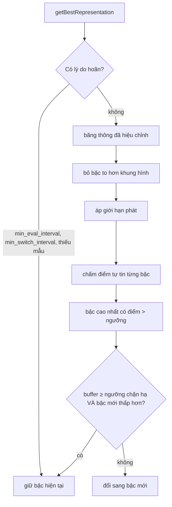

Bài trước ([#58](/blogs/facebook-bandwidth-ewma-estimator)) có con số băng thông. Bài này trả lời câu hỏi tiếp theo: có 2,6 Mbps thì phát bậc nào trong thang bitrate (bitrate ladder) 240p, 360p, 480p, 720p, 1080p?

Cách ai cũng nghĩ ra đầu tiên: chọn bậc có bitrate cao nhất mà vẫn nhỏ hơn băng thông. Với 2,6 Mbps là 720p ở 2,2 Mbps. Nghe hợp lý, nhưng cách này bỏ qua ba điều: ước lượng băng thông có sai số, buffer đang còn nhiều hay sắp cạn, và video đang hiện trong một khung 400 pixel trên điện thoại thì 1080p với 720p trông như nhau.

> [!TIP]
> **Tóm tắt**
> - `OzAbrManager` của Facebook chấm **điểm tự tin phát (playback confidence)** cho từng bậc rồi chọn bậc bitrate cao nhất có điểm vượt ngưỡng. Băng thông vừa khít bitrate thì điểm là 0,8; càng dư càng gần 1, thiếu thì rơi nhanh.
> - **Buffer càng cạn thì càng khó tính**: bitrate "cần có" được nhân thêm tới `1 + factor` lần. Buffer đầy thì có quyền liều hơn.
> - Trước khi chấm điểm, bỏ các bậc to hơn khung hình. Một hàm khác (`MosUtils`) dùng **MOS** (điểm chất lượng cảm nhận) để bỏ các bậc đắt mà điểm chỉ nhích lên chút ít.
> - Bản gốc lọc kích thước bằng `||`, nên video dọc trong khung ngang vẫn giữ bậc 720×1280. Bản viết lại đòi cả hai chiều vừa.

<iframe class="demo-frame" src="/demos/facebook-patterns/index.html?theme=dark#/abr-confidence" title="Demo abr-confidence" loading="lazy" style="height: 900px"></iframe>

<p class="demo-links">▶ <a href="/demos/facebook-patterns/index.html#/abr-confidence" target="_blank" rel="noopener">Mở demo toàn màn hình ↗</a> · <a href="https://stackblitz.com/github/hunghg255/blog-hunghg/tree/master/examples/facebook-patterns?file=src/lib/abrConfidence.ts" target="_blank" rel="noopener">Sửa code trên StackBlitz ↗</a> · <a href="https://github.com/hunghg255/blog-hunghg/blob/master/examples/facebook-patterns/src/lib/abrConfidence.ts" target="_blank" rel="noopener">Xem source trên GitHub ↗</a></p>

## Facebook làm thế nào?

Các module nằm trong bundle `26.VideoPlayer/all.js` (bản trùng ở `21.js`): `oz-player/strategies/OzAbrManager`, `OzPlaybackConfidenceUtils`, `oz-player/utils/OzAbrUtils`, `OzBandwidthBoundaryStreamSegmentsCountStrategy`. `MosUtils` nằm ở `152.js`.

### Điểm tự tin

Toàn bộ `OzPlaybackConfidenceUtils.getPlaybackConfidence`, đổi tên biến:

```js
const BASE = 0.8;
function getPlaybackConfidence(rep, bandwidth, bufferAhead, lowBufferThreshold, lowBufferFactor,
                               segmentsAhead, ttfbMs, downloadPenaltyFactor) {
  const fill = Math.min(1, bufferAhead / lowBufferThreshold);
  const needed = rep.getBandwidth() * (1 + (1 - fill) * lowBufferFactor);
  if (needed > bandwidth) return BASE * (bandwidth / needed);

  let penalty = 0;
  if (segmentsAhead != null && ttfbMs != null && downloadPenaltyFactor > 0) {
    const delta = getEstimatedDownloadTimeBufferDeltaMs(rep, bandwidth, segmentsAhead, ttfbMs);
    if (delta != null && delta > 0) penalty = delta / 1000 * downloadPenaltyFactor;
  }
  return 1 - (1 - BASE) * needed / bandwidth - penalty;
}
```

Đặt `x = needed / bandwidth` (tỉ lệ băng thông bị chiếm). Điểm là:

- `x > 1` (thiếu băng thông): `0,8 / x`. Thiếu gấp đôi thì còn 0,4.
- `x ≤ 1` (đủ): `1 − 0,2·x`. Dùng hết thì 0,8, dùng một nửa thì 0,9.

Hai nhánh gặp nhau ở 0,8 khi `x = 1`, nên đường cong liên tục. Ngưỡng `abr_confidence_threshold` do server cấu hình (giá trị không có trong bundle). Ngưỡng 0,85 tương đương "bitrate cần có không vượt 75% băng thông", tức chừa 25% làm biên an toàn. Viết thành điểm thay vì một hệ số an toàn cố định cho phép cộng thêm các khoản phạt khác vào cùng một thang.

**Buffer thấp thì khắt khe hơn.** Buffer 0 giây với `lowBufferFactor = 0,5` thì bậc 2 Mbps bị coi như cần 3 Mbps. Lúc buffer cạn, đoán sai một lần là khựng hình ngay, nên chọn bậc thấp hơn để nạp lại buffer nhanh. Buffer đầy thì một lần đoán sai chỉ làm buffer vơi bớt.

**Phạt theo thời gian tải.** `getEstimatedDownloadTimeBufferDeltaMs` tính thời gian tải `n` segment kế tiếp (cộng TTFB ước lượng ở bài #58) trừ đi thời lượng phát của chúng. Số dương nghĩa là tải chậm hơn phát, buffer sẽ hụt dần; mỗi giây hụt trừ `downloadPenaltyFactor` điểm.

### Vòng chọn

```js
getBestRepresentation(segmentsAhead) {
  const buffer = getBufferAhead(...);
  const reason = getReasonToPreventEvaluation(config, hasSwitched, buffer, sampleCount, lastEval, lastSwitch);
  if (reason) return this.current;               // min_eval_interval, min_switch_interval, min_bandwidth_samples, ...

  const bandwidth = OzBandwidthEstimator.getAdjustedBandwidth(config);
  const candidates = applyPlaybackRestrictions(excludeLargeRepresentations(config, this.reps, viewport, dpr));
  let best = null;
  for (const rep of candidates) {
    const c = getPlaybackConfidence(rep, bandwidth, buffer, ...);
    if (c > threshold && (!best || best.getBandwidth() < rep.getBandwidth())) best = rep;
  }
  best ||= config.getBool('fix_abr_default_representation') ? candidates[0] : this.reps[0];
  if (preventDownSwitch > 0 && buffer >= preventDownSwitch && this.current.getBandwidth() > best.getBandwidth())
    return this.current;                         // buffer còn nhiều: không hạ chất lượng
  ...
}
```

Vài chi tiết đáng để ý:

- **Chặn đánh giá lại quá thường xuyên.** `getReasonToPreventEvaluation` trả lý do nếu chưa qua `min_eval_interval` từ lần chấm trước, chưa qua `min_switch_interval` (hoặc `initial_switch_interval` nếu chưa đổi lần nào) từ lần đổi trước, chưa đủ `abr_min_bandwidth_samples`, hoặc buffer chưa đạt `abr_eval_buffer_threshold`. Đổi chất lượng liên tục khó chịu hơn xem chất lượng thấp.
- **Không hạ chất lượng khi buffer còn nhiều.** Có 25 giây buffer thì một lần băng thông tụt ngắn không đáng để hình mờ đi; nếu băng thông tụt thật, buffer sẽ xuống dưới ngưỡng và lần chấm sau sẽ hạ.
- **Cờ `fix_abr_default_representation`** cho thấy một lỗi đã được vá sau cờ thử nghiệm: khi không bậc nào đạt ngưỡng, bản cũ lấy phần tử đầu của danh sách **chưa lọc**, có thể là bậc vừa bị loại vì quá to.

### Bỏ bậc to hơn khung hình

```js
excludeLargeRepresentations(config, reps, viewport, dpr) {
  const f = config.getNumber('resolution_constraint_factor');
  if (f === 0) return reps;
  const kept = reps.filter((r) => r.getWidth() <= viewport.width * dpr * f || r.getHeight() <= viewport.height * dpr * f);
  return kept.length ? kept : [reps[0]];
}
```

Dấu `||` nghĩa là chỉ cần **một** chiều vừa. Với video ngang trong khung ngang, hai chiều tăng cùng nhau nên `||` và `&&` gần như cho cùng kết quả. Với video dọc 9:16 trong khung feed ngang, chiều rộng của bậc 720×1280 dễ dàng nhỏ hơn chiều rộng khung × dpr, nên bậc đó được giữ dù chiều cao gấp ba khung hình. Bật "Video dọc" và "Lọc kích thước bằng `||`" trong demo để thấy 720p dọc được chọn cho một khung 603 pixel chiều cao. Có lẽ ý định ban đầu là `&&`.

### Điểm MOS: bậc nào đáng tiền?

MOS (Mean Opinion Score, điểm ý kiến trung bình) vốn là điểm người xem chấm chất lượng. Các hệ thống video lớn ước lượng nó tự động cho từng bản encode. `MosUtils` đọc chuỗi kiểu `"360:70,480:76,720:84"`: "xem bản này ở độ phân giải hiển thị 360 thì được 70 điểm, ở 720 thì 84 điểm".

```js
function getQualityLabel(w, h) {           // "độ phân giải" của một khung
  if (w === 0 || h === 0) return 0;
  const long = Math.max(w, h), short = Math.min(w, h);
  return long / short > 16 / 9 ? Math.round(long / (16 / 9)) : short;   // 1920×800 → 1080
}
function getMosValue(points, label) {      // nội suy tuyến tính, KHÔNG sắp xếp points trước
  let lo = null, hi = null;
  for (const p of points) {
    if (p.qualityLabel <= label) lo = p; else { hi = p; break; }
  }
  ...
}
```

`filterTracksWithExpensiveMos` đi từ bậc cao xuống. Bậc nào đắt hơn bậc dưới mà MOS lại thấp hơn thì bỏ. Bậc nào MOS chỉ hơn bậc dưới một khoảng nằm trong "ngân sách" và băng thông không dư dả so với bitrate của nó thì cũng bỏ, đồng thời trừ khoảng đó vào ngân sách. Ngân sách được nạp lại mỗi khi giữ một bậc, nên không thể bỏ liền nhiều bậc mà tổng điểm mất đi vượt ngân sách. Trong các bundle có được, hàm này được định nghĩa nhưng không thấy nơi gọi; `getMosValue` thì được overlay debug của trình phát Shaka dùng.

Lỗi nhỏ: `getMosValue` dừng ở điểm đầu tiên lớn hơn `label`, nên nó đúng chỉ khi chuỗi MOS đã sắp tăng dần. `parsePlaybackMos` không sắp xếp. Server luôn gửi đúng thứ tự thì không sao, nhưng hàm không tự bảo vệ.

### Tải trước ít lại khi sát ranh giới

`OzBandwidthBoundaryStreamSegmentsCountStrategy` quyết định tải trước bao nhiêu segment:

```js
getSegmentsCount(...) {
  const bw = OzBandwidthEstimator.getBandwidth(config);
  const sd = OzBandwidthEstimator.getStandardDeviationOfBandwidth();
  const nearBoundary = this.reps.some((r) => Math.abs(r.getBandwidth() - bw) < sd * k);
  const count = nearBoundary ? segmentsNearBoundary : staticStrategy.getSegmentsCount(...);
  return Math.min(count, Math.ceil(perStreamDurationTarget * bw / (segmentBytes * 8)));
}
```

Băng thông nằm sát bitrate của một bậc (trong `k` lần độ lệch chuẩn) nghĩa là lần chấm điểm sau rất có thể đổi bậc. Tải trước 5 segment của bậc hiện tại lúc đó là phí, vì có thể phải bỏ chúng. Demo hiển thị "Sát ranh giới bậc: tải ít" khi điều này xảy ra.



## Bên trong trình duyệt

Trình phát kiểu này chạy trên **MSE (Media Source Extensions)**: JavaScript tự tải segment bằng `fetch` rồi `appendBuffer` vào `SourceBuffer`. Đổi bậc chỉ là tải segment kế tiếp từ URL của bậc khác; vì mỗi bậc có init segment riêng, trình phát phải append init segment của bậc mới trước. Buffer phía trước tính bằng `sourceBuffer.buffered.end(i) - video.currentTime` cho khoảng chứa playhead.

Kích thước khung hình đọc từ `getBoundingClientRect()` của thẻ `<video>` nhân `devicePixelRatio`. Màn hình điện thoại dpr 2,6 làm khung 412 pixel CSS thành hơn 1000 pixel thật, nên lọc theo pixel CSS sẽ chọn bậc quá thấp.

## Viết lại

Điểm tự tin và thời gian tải:

```ts title=src/lib/abrConfidence.ts
/** Mức tự tin khi băng thông vừa khít bitrate cần có. */
export const BASE_CONFIDENCE = 0.8;

/**
 * Tải `segmentsAhead` segment mất bao lâu so với thời lượng phát của chúng.
 * Dương: tải chậm hơn phát, buffer sẽ hụt dần.
 */
export function downloadTimeDeltaMs(bitrate: number, bandwidth: number, segmentSec: number, segmentsAhead: number, ttfbMs: number) {
  const playSec = segmentSec * segmentsAhead;
  return ((playSec * bitrate) / bandwidth) * 1000 + ttfbMs - playSec * 1000;
}

export function playbackConfidence(i: ConfidenceInput): number {
  const fill = Math.min(1, i.bufferMs / i.lowBufferMs);
  const needed = i.bitrate * (1 + (1 - fill) * i.lowBufferFactor);
  if (needed > i.bandwidth) return BASE_CONFIDENCE * (i.bandwidth / needed);
  let penalty = 0;
  if (i.segmentSec && i.segmentsAhead && i.ttfbMs != null && (i.downloadPenalty ?? 0) > 0) {
    const delta = downloadTimeDeltaMs(i.bitrate, i.bandwidth, i.segmentSec, i.segmentsAhead, i.ttfbMs);
    if (delta > 0) penalty = (delta / 1000) * i.downloadPenalty!;
  }
  return 1 - ((1 - BASE_CONFIDENCE) * needed) / i.bandwidth - penalty;
}
```

Lọc kích thước (mặc định `and`, giữ chế độ `or` để demo) và cắt bậc theo MOS:

```ts title=src/lib/abrConfidence.ts
/**
 * Bỏ bậc to hơn khung hình × dpr × factor. Bản gốc dùng `||` (rộng HOẶC cao vừa là giữ),
 * nên video dọc trong khung ngang giữ cả bậc 1080p. Ở đây cần cả hai chiều vừa.
 */
export function excludeLarge(list: Rendition[], vp: Viewport, factor: number, mode: 'and' | 'or' = 'and'): Rendition[] {
  if (factor === 0) return list;
  const fitsW = (r: Rendition) => r.width <= vp.width * vp.dpr * factor;
  const fitsH = (r: Rendition) => r.height <= vp.height * vp.dpr * factor;
  const kept = list.filter((r) => (mode === 'and' ? fitsW(r) && fitsH(r) : fitsW(r) || fitsH(r)));
  return kept.length ? kept : [lowest(list)];
}

const lowest = (list: Rendition[]) => list.reduce((a, b) => (b.bitrate < a.bitrate ? b : a));

/**
 * Đi từ bậc cao xuống: bậc nào MOS chỉ hơn bậc dưới ≤ ngân sách còn lại, và mạng không dư dả
 * (bandwidth / bitrate ≤ affordRatio) thì bỏ. Bậc đắt hơn mà MOS thấp hơn bậc dưới thì luôn bỏ.
 */
export function pruneExpensiveRungs(list: Rendition[], displayLabel: number, bandwidth: number, mosBudget: number, affordRatio: number) {
  const sorted = [...list].sort((a, b) => a.bitrate - b.bitrate);
  if (sorted.length < 2 || sorted.some((r) => !r.mos)) return { kept: sorted, pruned: [] as Rendition[] };
  const score = sorted.map((r) => mosAt(r.mos!, displayLabel));
  const kept: Rendition[] = [];
  const pruned: Rendition[] = [];
  let budget = mosBudget;
  for (let i = sorted.length - 1; i > 0; i--) {
    const gain = score[i] - score[i - 1];
    if (gain < 0 || (gain <= budget && bandwidth / sorted[i].bitrate <= affordRatio)) {
      if (gain >= 0) budget -= gain;
      pruned.push(sorted[i]);
      continue;
    }
    budget = mosBudget;
    kept.push(sorted[i]);
  }
  kept.push(sorted[0]);
  return { kept: kept.reverse(), pruned };
}
```

Vòng chọn và số segment tải trước:

```ts title=src/lib/abrConfidence.ts
export function chooseRendition(list: Rendition[], s: AbrState, o: AbrOptions): AbrDecision {
  const scores = list.map((r) => ({
    id: r.id,
    confidence: playbackConfidence({ bitrate: r.bitrate, bandwidth: s.bandwidth, bufferMs: s.bufferMs, lowBufferMs: o.lowBufferMs, lowBufferFactor: o.lowBufferFactor }),
  }));
  let best: Rendition | null = null;
  list.forEach((r, i) => {
    if (scores[i].confidence > o.threshold && (!best || best.bitrate < r.bitrate)) best = r;
  });
  const pick: Rendition = best ?? lowest(list);
  const current = s.current && list.find((r) => r.id === s.current!.id); // bậc hiện tại phải còn trong danh sách
  if (current && o.preventDownSwitchMs > 0 && s.bufferMs >= o.preventDownSwitchMs && current.bitrate > pick.bitrate)
    return { pick: current, reason: 'high_buffer', scores };
  return { pick, reason: best ? 'bandwidth' : 'fallback', scores };
}

/**
 * Băng thông nằm sát bitrate của một bậc nào đó (trong k × độ lệch chuẩn) thì sắp phải đổi bậc:
 * chỉ tải trước ít segment để khỏi tải thừa segment của bậc sắp bỏ.
 */
export function segmentsToPrefetch(list: Rendition[], bandwidth: number, stdDev: number, k: number, normal: number, nearBoundary: number) {
  const near = list.some((r) => Math.abs(r.bitrate - bandwidth) < stdDev * k);
  return { near, count: near ? Math.min(normal, nearBoundary) : normal };
}
```

::: spoiler Xem toàn bộ src/lib/abrConfidence.ts

```ts title=src/lib/abrConfidence.ts
/**
 * Chọn bitrate (ABR) theo "độ tự tin phát" kiểu oz-player của Facebook,
 * lọc bậc quá to so với khung hình và cắt bậc đắt mà điểm MOS tăng không đáng.
 * Viết lại từ đầu.
 */

export interface MosPoint {
  /** Độ phân giải hiển thị (cạnh ngắn, kiểu 360, 720). */
  label: number;
  /** Điểm chất lượng cảm nhận 0–100 khi xem bản này ở độ phân giải đó. */
  mos: number;
}

export interface Rendition {
  id: string;
  bitrate: number;
  width: number;
  height: number;
  mos?: MosPoint[];
}

export interface ConfidenceInput {
  bitrate: number;
  bandwidth: number;
  bufferMs: number;
  /** Buffer dưới ngưỡng này thì đòi dư băng thông. */
  lowBufferMs: number;
  /** Buffer cạn hẳn thì cần bandwidth ≥ bitrate × (1 + factor). */
  lowBufferFactor: number;
  /** Có đủ ba số dưới thì phạt thêm theo thời gian tải dự kiến. */
  segmentSec?: number;
  segmentsAhead?: number;
  ttfbMs?: number | null;
  downloadPenalty?: number;
}

/** Mức tự tin khi băng thông vừa khít bitrate cần có. */
export const BASE_CONFIDENCE = 0.8;

/**
 * Tải `segmentsAhead` segment mất bao lâu so với thời lượng phát của chúng.
 * Dương: tải chậm hơn phát, buffer sẽ hụt dần.
 */
export function downloadTimeDeltaMs(bitrate: number, bandwidth: number, segmentSec: number, segmentsAhead: number, ttfbMs: number) {
  const playSec = segmentSec * segmentsAhead;
  return ((playSec * bitrate) / bandwidth) * 1000 + ttfbMs - playSec * 1000;
}

export function playbackConfidence(i: ConfidenceInput): number {
  const fill = Math.min(1, i.bufferMs / i.lowBufferMs);
  const needed = i.bitrate * (1 + (1 - fill) * i.lowBufferFactor);
  if (needed > i.bandwidth) return BASE_CONFIDENCE * (i.bandwidth / needed);
  let penalty = 0;
  if (i.segmentSec && i.segmentsAhead && i.ttfbMs != null && (i.downloadPenalty ?? 0) > 0) {
    const delta = downloadTimeDeltaMs(i.bitrate, i.bandwidth, i.segmentSec, i.segmentsAhead, i.ttfbMs);
    if (delta > 0) penalty = (delta / 1000) * i.downloadPenalty!;
  }
  return 1 - ((1 - BASE_CONFIDENCE) * needed) / i.bandwidth - penalty;
}

/** Cạnh ngắn, nhưng video rộng hơn 16:9 thì quy về chiều cao tương đương 16:9 (1920×800 → 1080). */
export function qualityLabel(width: number, height: number): number {
  if (width === 0 || height === 0) return 0;
  const long = Math.max(width, height);
  const short = Math.min(width, height);
  return long / short > 16 / 9 ? Math.round(long / (16 / 9)) : short;
}

/** "360:62,720:80" → điểm đã SẮP XẾP theo label (bản gốc tin là chuỗi đã sắp sẵn). */
export function parseMos(text: string): MosPoint[] | null {
  const points: MosPoint[] = [];
  for (const part of text.split(',')) {
    const [a, b, extra] = part.split(':');
    const label = Number(a);
    const mos = Number(b);
    if (extra !== undefined || b === undefined || Number.isNaN(label) || Number.isNaN(mos)) return null;
    points.push({ label, mos });
  }
  return points.sort((x, y) => x.label - y.label);
}

/** Nội suy tuyến tính MOS tại một độ phân giải hiển thị, kẹp vào [0, 100]. */
export function mosAt(points: MosPoint[], label: number): number {
  if (points.length === 0) return 0;
  const sorted = [...points].sort((x, y) => x.label - y.label);
  const upper = sorted.findIndex((p) => p.label > label);
  if (upper === 0) return sorted[0].mos;
  if (upper === -1) return sorted[sorted.length - 1].mos;
  const lo = sorted[upper - 1];
  const hi = sorted[upper];
  const v = lo.mos + ((label - lo.label) * (hi.mos - lo.mos)) / (hi.label - lo.label);
  return Math.min(100, Math.max(0, v));
}

export interface Viewport {
  width: number;
  height: number;
  dpr: number;
}

/**
 * Bỏ bậc to hơn khung hình × dpr × factor. Bản gốc dùng `||` (rộng HOẶC cao vừa là giữ),
 * nên video dọc trong khung ngang giữ cả bậc 1080p. Ở đây cần cả hai chiều vừa.
 */
export function excludeLarge(list: Rendition[], vp: Viewport, factor: number, mode: 'and' | 'or' = 'and'): Rendition[] {
  if (factor === 0) return list;
  const fitsW = (r: Rendition) => r.width <= vp.width * vp.dpr * factor;
  const fitsH = (r: Rendition) => r.height <= vp.height * vp.dpr * factor;
  const kept = list.filter((r) => (mode === 'and' ? fitsW(r) && fitsH(r) : fitsW(r) || fitsH(r)));
  return kept.length ? kept : [lowest(list)];
}

const lowest = (list: Rendition[]) => list.reduce((a, b) => (b.bitrate < a.bitrate ? b : a));

/**
 * Đi từ bậc cao xuống: bậc nào MOS chỉ hơn bậc dưới ≤ ngân sách còn lại, và mạng không dư dả
 * (bandwidth / bitrate ≤ affordRatio) thì bỏ. Bậc đắt hơn mà MOS thấp hơn bậc dưới thì luôn bỏ.
 */
export function pruneExpensiveRungs(list: Rendition[], displayLabel: number, bandwidth: number, mosBudget: number, affordRatio: number) {
  const sorted = [...list].sort((a, b) => a.bitrate - b.bitrate);
  if (sorted.length < 2 || sorted.some((r) => !r.mos)) return { kept: sorted, pruned: [] as Rendition[] };
  const score = sorted.map((r) => mosAt(r.mos!, displayLabel));
  const kept: Rendition[] = [];
  const pruned: Rendition[] = [];
  let budget = mosBudget;
  for (let i = sorted.length - 1; i > 0; i--) {
    const gain = score[i] - score[i - 1];
    if (gain < 0 || (gain <= budget && bandwidth / sorted[i].bitrate <= affordRatio)) {
      if (gain >= 0) budget -= gain;
      pruned.push(sorted[i]);
      continue;
    }
    budget = mosBudget;
    kept.push(sorted[i]);
  }
  kept.push(sorted[0]);
  return { kept: kept.reverse(), pruned };
}

export interface AbrState {
  bandwidth: number;
  bufferMs: number;
  current: Rendition | null;
}

export interface AbrOptions {
  threshold: number;
  lowBufferMs: number;
  lowBufferFactor: number;
  /** Buffer từ mức này trở lên thì không hạ chất lượng (0 = tắt). */
  preventDownSwitchMs: number;
}

export interface AbrDecision {
  pick: Rendition;
  reason: 'bandwidth' | 'high_buffer' | 'fallback';
  scores: { id: string; confidence: number }[];
}

export function chooseRendition(list: Rendition[], s: AbrState, o: AbrOptions): AbrDecision {
  const scores = list.map((r) => ({
    id: r.id,
    confidence: playbackConfidence({ bitrate: r.bitrate, bandwidth: s.bandwidth, bufferMs: s.bufferMs, lowBufferMs: o.lowBufferMs, lowBufferFactor: o.lowBufferFactor }),
  }));
  let best: Rendition | null = null;
  list.forEach((r, i) => {
    if (scores[i].confidence > o.threshold && (!best || best.bitrate < r.bitrate)) best = r;
  });
  const pick: Rendition = best ?? lowest(list);
  const current = s.current && list.find((r) => r.id === s.current!.id); // bậc hiện tại phải còn trong danh sách
  if (current && o.preventDownSwitchMs > 0 && s.bufferMs >= o.preventDownSwitchMs && current.bitrate > pick.bitrate)
    return { pick: current, reason: 'high_buffer', scores };
  return { pick, reason: best ? 'bandwidth' : 'fallback', scores };
}

/**
 * Băng thông nằm sát bitrate của một bậc nào đó (trong k × độ lệch chuẩn) thì sắp phải đổi bậc:
 * chỉ tải trước ít segment để khỏi tải thừa segment của bậc sắp bỏ.
 */
export function segmentsToPrefetch(list: Rendition[], bandwidth: number, stdDev: number, k: number, normal: number, nearBoundary: number) {
  const near = list.some((r) => Math.abs(r.bitrate - bandwidth) < stdDev * k);
  return { near, count: near ? Math.min(normal, nearBoundary) : normal };
}
```

:::

**Khác bản gốc:**

- `excludeLarge` đòi cả rộng và cao đều vừa; khi không bậc nào vừa thì giữ bậc **bitrate thấp nhất**, không phụ thuộc thứ tự danh sách.
- `parseMos` sắp xếp điểm, và `mosAt` tự sắp lại trước khi nội suy.
- `pruneExpensiveRungs` sắp bậc theo bitrate trước khi duyệt, và trả cả danh sách bị cắt để UI giải thích.
- `chooseRendition` chỉ "giữ bậc hiện tại vì buffer cao" khi bậc đó còn trong danh sách ứng viên; bản gốc giữ `this.current` kể cả khi nó vừa bị lọc vì khung hình nhỏ lại.
- Các lý do hoãn đánh giá (khoảng cách thời gian, số mẫu) không đưa vào lib; chúng là vài phép so sánh thời gian, đặt ở lớp gọi.

## Đi qua code

- **`playbackConfidence()`** nhận một object thay cho 8 tham số vị trí. Phần phạt thời gian tải chỉ chạy khi có đủ thời lượng segment, số segment, TTFB và hệ số phạt.
- **`qualityLabel()`** quy khung hình về một con số "p". Khung rộng hơn 16:9 (video điện ảnh 2,4:1) được quy theo chiều dài, để 1920×800 vẫn là 1080p.
- **`mosAt()`** trả điểm của mốc thấp nhất nếu `label` nhỏ hơn mọi mốc, điểm của mốc cao nhất nếu lớn hơn, còn lại nội suy tuyến tính rồi kẹp vào 0–100.
- **`pruneExpensiveRungs()`** giữ nguyên quy tắc ngân sách của bản gốc: mỗi lần giữ một bậc, ngân sách nạp lại đầy.
- **`chooseRendition()`** trả `scores` cho mọi bậc. Bảng trong demo vẽ trực tiếp từ đó.
- **`segmentsToPrefetch()`** nhận độ lệch chuẩn từ bộ ước lượng ở bài #58. Demo dùng 15% băng thông cho đơn giản.

## Tại sao không làm cách khác?

**Hệ số an toàn cố định ("dùng 80% băng thông")?** Đó là trường hợp riêng của điểm tự tin khi không có phạt buffer và phạt thời gian tải. Dạng điểm cho phép cộng thêm các yếu tố mà không phải chỉnh lại hệ số.

**ABR theo buffer (kiểu BOLA)?** BOLA chọn bậc chủ yếu theo mức buffer, rất ổn định khi buffer đã đầy nhưng chậm chọn đúng ở lúc khởi động. oz-player trộn hai thứ: băng thông là đầu vào chính, buffer điều chỉnh mức khắt khe và chặn hạ chất lượng.

**Luôn phát bậc cao nhất mạng chịu được?** Trên khung feed nhỏ, 1080p tốn gấp đôi băng thông 720p mà người xem không phân biệt được. Băng thông đó nên dành cho video kế tiếp đang tải trước, hoặc tiết kiệm gói dữ liệu của người dùng.

## Edge case và cạm bẫy

- **Đổi kích thước khung** (xoay máy, mở toàn màn hình) phải chạy lại lọc kích thước. Bậc hiện tại có thể không còn trong danh sách ứng viên.
- **Thang bitrate không đều**: hai bậc cùng 720p khác bitrate (bản HQ). Đừng giả định mỗi độ phân giải chỉ có một bậc; sắp theo bitrate, không theo nhãn.
- **Ngưỡng tự tin quá cao** thì không bậc nào đạt, rơi về bậc mặc định. Phải chắc bậc mặc định là bậc thấp nhất **sau khi lọc**, chính là lỗi mà cờ `fix_abr_default_representation` vá.
- **MOS thiếu cho một bậc**: bản gốc trả nguyên danh sách nếu bất kỳ bậc nào thiếu MOS hoặc thiếu bitrate. Bản viết lại cũng vậy; cắt bậc chỉ an toàn khi có dữ liệu cho mọi bậc.
- **Video ngắn**: clip 6 giây thì phần lớn thời gian là lúc khởi động, chưa có mẫu băng thông nào của phiên này. Ước lượng ban đầu (số đã lưu từ phiên trước) quan trọng hơn thuật toán chọn.

## Dùng trong dự án

```ts
import { chooseRendition, excludeLarge, pruneExpensiveRungs, qualityLabel, type Rendition } from './abrConfidence';

function pickNext(video: HTMLVideoElement, ladder: Rendition[], current: Rendition | null, bandwidth: number) {
  const rect = video.getBoundingClientRect();
  const vp = { width: rect.width, height: rect.height, dpr: devicePixelRatio };
  const label = qualityLabel(Math.round(vp.width * vp.dpr), Math.round(vp.height * vp.dpr));
  const { kept } = pruneExpensiveRungs(excludeLarge(ladder, vp, 1.25), label, bandwidth, 3, 2);
  const b = video.buffered;
  let bufferMs = 0;
  for (let i = 0; i < b.length; i++)
    if (b.start(i) <= video.currentTime && video.currentTime <= b.end(i)) bufferMs = (b.end(i) - video.currentTime) * 1000;
  return chooseRendition(kept, { bandwidth, bufferMs, current }, {
    threshold: 0.85, lowBufferMs: 10_000, lowBufferFactor: 0.5, preventDownSwitchMs: 20_000,
  }).pick;
}
```

## Kiểm thử

::: spoiler Ví dụ test (bản phác, không có trong repo)

```ts
import { describe, expect, it } from 'vitest';
import { chooseRendition, excludeLarge, mosAt, parseMos, playbackConfidence, pruneExpensiveRungs, qualityLabel, type Rendition } from './abrConfidence';

const base = { bufferMs: 20_000, lowBufferMs: 10_000, lowBufferFactor: 0.5 };
const r = (id: string, bitrate: number, w: number, h: number, mos?: string): Rendition => ({ id, bitrate, width: w, height: h, mos: mos ? parseMos(mos)! : undefined });

describe('playbackConfidence', () => {
  it('0,8 khi vừa khít, liên tục ở hai phía', () => {
    expect(playbackConfidence({ ...base, bitrate: 1e6, bandwidth: 1e6 })).toBeCloseTo(0.8);
    expect(playbackConfidence({ ...base, bitrate: 1e6, bandwidth: 2e6 })).toBeCloseTo(0.9);
    expect(playbackConfidence({ ...base, bitrate: 2e6, bandwidth: 1e6 })).toBeCloseTo(0.4);
  });
  it('buffer cạn thì điểm thấp hơn', () => {
    const full = playbackConfidence({ ...base, bitrate: 1e6, bandwidth: 2e6 });
    const empty = playbackConfidence({ ...base, bufferMs: 0, bitrate: 1e6, bandwidth: 2e6 });
    expect(empty).toBeLessThan(full);
  });
});

describe('MOS', () => {
  it('nội suy và không phụ thuộc thứ tự chuỗi', () => {
    expect(mosAt(parseMos('720:80,360:60')!, 540)).toBeCloseTo(70);
    expect(qualityLabel(1920, 800)).toBe(1080);
  });
  it('cắt bậc đắt mà MOS tăng ít khi mạng không dư', () => {
    const ladder = [r('a', 1e6, 854, 480, '480:76'), r('b', 2e6, 1280, 720, '480:78'), r('c', 4e6, 1920, 1080, '480:79')];
    const { kept, pruned } = pruneExpensiveRungs(ladder, 480, 3e6, 3, 2);
    expect(kept.map((x) => x.id)).toEqual(['a']);
    expect(pruned.map((x) => x.id)).toEqual(['c', 'b']);
  });
});

describe('excludeLarge và chooseRendition', () => {
  const portrait = [r('240', 3e5, 240, 426), r('720', 2.2e6, 720, 1280)];
  const vp = { width: 412, height: 232, dpr: 2.6 };
  it('video dọc: and bỏ 720, or giữ', () => {
    expect(excludeLarge(portrait, vp, 1.25).map((x) => x.id)).toEqual(['240']);
    expect(excludeLarge(portrait, vp, 1.25, 'or').map((x) => x.id)).toEqual(['240', '720']);
  });
  it('buffer cao thì giữ bậc hiện tại thay vì hạ', () => {
    const ladder = [r('lo', 1e6, 854, 480), r('hi', 3e6, 1280, 720)];
    const opts = { threshold: 0.85, lowBufferMs: 10_000, lowBufferFactor: 0.5, preventDownSwitchMs: 20_000 };
    const d = chooseRendition(ladder, { bandwidth: 3.2e6, bufferMs: 25_000, current: ladder[1] }, opts);
    expect(d).toMatchObject({ pick: { id: 'hi' }, reason: 'high_buffer' });
    expect(chooseRendition(ladder, { bandwidth: 3.2e6, bufferMs: 5_000, current: ladder[1] }, opts).pick.id).toBe('lo');
  });
});
```

:::

## So với thư viện và chuẩn web

- **dash.js** có ba luật ABR: `ThroughputRule` (theo băng thông), `BolaRule` (theo buffer) và luật lai `DYNAMIC` chuyển giữa hai cái theo mức buffer; thêm `InsufficientBufferRule` để hạ khẩn cấp khi buffer sắp cạn.
- **Shaka Player** chọn bậc cao nhất có bitrate ≤ băng thông × hệ số (`bandwidthDowngradeTarget` 0,95, `bandwidthUpgradeTarget` 0,85), tức hai ngưỡng khác nhau cho lên và xuống; có `restrictToElementSize` để lọc theo kích thước khung hình.
- **hls.js** có `capLevelToPlayerSize` với cùng mục đích, và hệ số `abrBandWidthFactor`/`abrBandWidthUpFactor` cho hai chiều.
- **MOS tự động**: Netflix công bố VMAF làm thước đo chất lượng cảm nhận theo độ phân giải hiển thị; Meta có bài viết công khai về việc dùng điểm chất lượng như vậy để chọn bậc encode. Chuỗi `playback_resolution_mos` trong bundle là phía client của ý tưởng đó.
- **Media Capabilities API** (`navigator.mediaCapabilities.decodingInfo`) cho biết máy giải mã một cấu hình có mượt và tiết kiệm pin không, bổ sung cho lọc theo kích thước. Có trên các trình duyệt chính (tính tới 10/2026), xem [caniuse](https://caniuse.com/media-capabilities).

---

Bài này thuộc series **[Học từ mã nguồn Facebook](/series/facebook)** (83 bài, đọc theo thứ tự).

::: spoiler Xem nhanh danh sách bài trong series

*Phần 1*

- [Mở đầu: cách đọc code minify của Facebook](/blogs/learn-from-facebook-source-code)
- [#1 Dùng chung IntersectionObserver + infinite scroll](/blogs/facebook-shared-intersection-observer)
- [#2 useViewportDuration: đo thời gian thực sự được xem](/blogs/facebook-use-viewport-duration)
- [#3 Preload code + data khi hover](/blogs/facebook-preload-on-hover)
- [#4 Toast manager với external store](/blogs/facebook-toast-manager)
- [#5 Network status + heartbeat backoff](/blogs/facebook-network-status-heartbeat)
- [#6 ErrorGuard: bắt lỗi theo ngữ cảnh](/blogs/facebook-error-guard)
- [#7 Banzai: gom log theo lô + sendBeacon](/blogs/facebook-batch-logger)
- [#8 Focus trap + Esc theo layer](/blogs/facebook-focus-trap)

*Phần 2*

- [#9 Mẹo calc(… * 9999): container query, line-clamp, mũi tên carousel bằng CSS](/blogs/facebook-css-9999-trick)
- [#10 Thanh cuộn tuỳ biến bằng CSS 3D](/blogs/facebook-css-3d-scrollbar)
- [#11 Modal cuộn bằng window, giữ vị trí trang nền](/blogs/facebook-document-scroll-modal)
- [#12 Popover, tooltip group và hovercard](/blogs/facebook-popover-tooltip)
- [#13 Primitive Pressable + focus-visible](/blogs/facebook-pressable)
- [#14 Tab "Xem thêm" + sticky header bằng IntersectionObserver](/blogs/facebook-priority-tabs-sticky-header)
- [#15 Avatar khoét mask, gradient Messenger, skeleton steps()](/blogs/facebook-visual-tricks)
- [#16 Khung chat không giật](/blogs/facebook-chat-scroller)
- [#17 Thuật toán chọn bố cục collage ảnh](/blogs/facebook-photo-collage-layout)
- [#18 Keep-alive tab trong SPA](/blogs/facebook-keep-alive-tabs)
- [#19 Tự đo Visual Completion & interaction tracing](/blogs/facebook-visual-completion)
- [#20 Router SPA bền bỉ & tải chunk có retry](/blogs/facebook-spa-router-resilient-loading)

*Phần 3*

- [#21 Smart Compose: gợi ý chữ mờ khi gõ](/blogs/facebook-smart-compose-ghost-text)
- [#22 MQTT ngay trong trình duyệt, tự chuyển sang long-poll](/blogs/facebook-mqtt-in-browser)
- [#23 Đo thời gian dùng bằng bitmap 64 giây](/blogs/facebook-time-spent-bitmap)
- [#24 Bảng reaction nhấn giữ rồi trượt](/blogs/facebook-reaction-press-slide)
- [#25 Tìm kiếm gấp dấu, phiên âm và highlight đầu từ](/blogs/facebook-search-diacritics-tokenize)
- [#26 Ring buffer biết trace nào đã mất log](/blogs/facebook-trace-ring-buffer)
- [#27 Engine animation JS: một vòng rAF và solver cubic-bezier](/blogs/facebook-keyframes-loop-cubic-bezier)
- [#28 Bootloader: bitmap tài nguyên đã tải, chỉ reload khi cần](/blogs/facebook-bootloader-bitmap-consistency)
- [#29 Nhận biết click do screen reader tạo ra](/blogs/facebook-virtual-cursor-detection)
- [#30 Tải trước feed theo chất lượng mạng, đoán hạng thiết bị](/blogs/facebook-network-aware-prefetch)
- [#31 Hàng đợi gửi tin chat giữ đúng thứ tự](/blogs/facebook-ordered-send-queue)
- [#32 Gộp lời gọi API trong cùng một tick](/blogs/facebook-api-batcher)
- [#33 Resize ảnh trong pool Web Worker](/blogs/facebook-jpeg-resize-worker-pool)
- [#34 Crop ảnh theo nhiều khuôn mặt](/blogs/facebook-face-aware-crop)
- [#35 Kéo-thả sắp xếp và vùng thả file không nhấp nháy](/blogs/facebook-flicker-free-drag-drop)
- [#36 Tiện ích UI: fade-out, sticky event, hàm huỷ được](/blogs/facebook-ui-utility-hooks)
- [#37 Hạ tầng nhỏ: cookie, hash lỗi, prefetch khi chuột dừng](/blogs/facebook-small-infra-cookie-hash-idle)

*Phần 4–6*

- [#38 Đồng bộ tin nhắn: phát hiện lỗ seqID và fetch bù theo tầng](/blogs/facebook-messenger-sync-seqid-gaps)
- [#39 OTID: ID tin nhắn kiểu Snowflake sinh ở client](/blogs/facebook-otid-client-snowflake)
- [#40 QPL: lấy mẫu từ lúc bắt đầu, đo RTT gửi tin đầu-cuối](/blogs/facebook-qpl-send-rtt)
- [#41 Bộ điều phối request bảy chế độ gộp và chống trùng](/blogs/facebook-request-dispatcher-modes)
- [#42 Thread list theo mốc thời gian, cookie presence có version](/blogs/facebook-threadlist-ranged-presence)
- [#43 Composer dạng plugin: reducer, dirty checker, chuỗi kiểm tra](/blogs/facebook-plugin-composer)
- [#44 Thanh toán bất đồng bộ: subscribe trước, poll dự phòng](/blogs/facebook-async-checkout)
- [#45 Validate số thẻ: sửa lỗi gõ, dải BIN, Luhn](/blogs/facebook-card-validation)
- [#46 Lịch chọn khoảng ngày: bo góc dải chọn, phím đủ bộ, RTL](/blogs/facebook-range-calendar-a11y)
- [#47 Giờ mở cửa theo tuần: qua đêm, gộp khoảng, phần bù](/blogs/facebook-weekly-hours-intervals)
- [#48 Tiến độ đăng realtime: giữ event chờ snapshot, watchdog](/blogs/facebook-realtime-publish-snapshot)
- [#49 Tiền tệ theo đơn vị nhỏ nhất và ô nhập tiền](/blogs/facebook-currency-minor-units)
- [#50 Sửa hàng loạt Empty/Uniform/Mixed, seen/read bằng 2 bit](/blogs/facebook-bulk-edit-seen-bits)
- [#51 Phát hiện script lạ hook vào hàm native](/blogs/facebook-native-hook-detection)
- [#52 localStorage tự dọn khi đầy quota](/blogs/facebook-quota-aware-storage)
- [#53 Cache tuyến do server phân giải, chờ sẵn promise](/blogs/facebook-route-cache-prefetch)
- [#54 Lưới phím mũi tên 2D và focus không làm cuộn trang](/blogs/facebook-focus-table-grid)
- [#55 Tách emoji bằng máy trạng thái](/blogs/facebook-emoji-segmentation)
- [#56 Đọc trước ghi sau trong một frame, con tự biết vị trí](/blogs/facebook-read-then-write-dom)
- [#57 Hàng đợi lệnh cho video và stream sắp lại chunk](/blogs/facebook-video-command-queue)

*Phần 7–10*

- [#58 Ước lượng băng thông EWMA: loại outlier, nhớ qua phiên](/blogs/facebook-bandwidth-ewma-estimator)
- **#59 ABR theo độ tự tin phát và cắt bậc bitrate theo MOS** (bài này)
- [#60 Prefetch segment dự đoán từ manifest, parse hộp sidx](/blogs/facebook-dash-predicted-segments)
- [#61 Đọc metadata MP4/MOV ngay trên client](/blogs/facebook-mp4-metadata-client)
- [#62 Upload tiếp tục được: offset, hash dedupe, phát hiện treo](/blogs/facebook-resumable-upload)
- [#63 Fenwick tree: chọn ngẫu nhiên có trọng số và offset dòng](/blogs/facebook-fenwick-weighted-random)
- [#64 Vạch trục số và trục thời gian "đẹp"](/blogs/facebook-nice-axis-ticks)
- [#65 Damerau-Levenshtein theo dải chéo và tự sửa tên gõ sai](/blogs/facebook-damerau-levenshtein)
- [#66 PRNG có seed, shuffle tái lập và lấy mẫu trace](/blogs/facebook-seeded-prng-sampling)
- [#67 Cặp min/max-heap tái dùng vị trí trong danh sách ảo](/blogs/facebook-dual-heap-buffer-set)
- [#68 Memo nhiều đối số bằng Map/WeakMap và interning object](/blogs/facebook-multikey-memo-interning)
- [#69 Thống kê cửa sổ trượt và đại số khoảng thời gian](/blogs/facebook-moving-stat-intervals)
- [#70 Int64 từ hai số 32-bit, decode UTF, offset theo code point](/blogs/facebook-int64-utf-codepoints)
- [#71 Engine múi giờ IANA trên client, phát hiện lệch giờ](/blogs/facebook-client-iana-timezone)
- [#72 Tự cài semver range](/blogs/facebook-semver-range)
- [#73 Auto-link URL, cắt chữ an toàn, giới hạn LaTeX](/blogs/facebook-autolink-safe-truncate)
- [#74 Parser query kiểu PHP chống prototype pollution](/blogs/facebook-php-query-serializer)
- [#75 Popover tự lật theo phần tràn nhỏ nhất](/blogs/facebook-popover-auto-flip)
- [#76 Tiền tố for(;;) chống JSON hijacking, đọc stream](/blogs/facebook-csrf-prefix-streaming)
- [#77 Chống lộ Referer, linkshim, xoá token trên URL](/blogs/facebook-referrer-linkshim-url-scrub)
- [#78 setImmediate bằng postMessage, gom delta chuột theo frame](/blogs/facebook-setimmediate-mouse-batching)
- [#79 Phát hiện crash qua heartbeat, dò proxy cache hỏng](/blogs/facebook-crash-heartbeat-proxy-check)
- [#80 DPR vào cookie cho ảnh @2x, che khoá trong log](/blogs/facebook-dpr-cookie-secret-redaction)
- [#81 Flux waitFor tự viết và proxy có đệm](/blogs/facebook-flux-dispatch-buffered-proxy)
- [#82 Crop đúng tỉ lệ, xoay sticker bằng ma trận](/blogs/facebook-image-crop-rotation-geometry)

:::

Code + demo: [`examples/facebook-patterns`](https://github.com/hunghg255/blog-hunghg/tree/master/examples/facebook-patterns) · [Mở trên StackBlitz](https://stackblitz.com/github/hunghg255/blog-hunghg/tree/master/examples/facebook-patterns)
