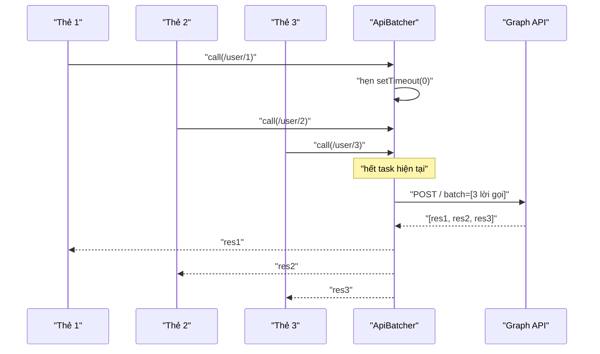

Một trang danh sách có 12 thẻ người dùng. Mỗi thẻ là một component tự lấy dữ liệu của nó khi mount: `fetch('/user/1')`, `fetch('/user/2')`… Code gọn, mỗi component độc lập. Nhưng trình duyệt phải gửi 12 request, mỗi request trả chi phí riêng (header, cookie, hàng đợi ở server), và với HTTP/1.1 thì chỉ chạy song song khoảng 6 cái mỗi host.

Cách quen thuộc là kéo việc lấy dữ liệu lên component cha và gọi một API "lấy nhiều". Đổi lại, component con không còn tự chủ, và API phía server phải có endpoint "lấy nhiều" cho mọi loại dữ liệu.

Facebook giữ được cả hai: component vẫn gọi API riêng lẻ, còn một lớp ở giữa gom các lời gọi phát ra **trong cùng một tick** thành một request.

> [!TIP]
> **Tóm tắt**
> - `ApiBatcher` (trong `ApiClient`, lớp gọi Graph API của Facebook) hẹn `setTimeout(0)` ở lời gọi đầu tiên; mọi lời gọi tới trước khi hẹn giờ chạy được gom vào một POST `batch`.
> - Đủ 50 lời gọi thì gửi ngay (Graph API nhận tối đa 50 request mỗi batch); chỉ có 1 lời gọi thì gửi thẳng, không bọc batch.
> - Kết quả là một mảng, khớp với lời gọi theo vị trí; cả batch lỗi thì mọi lời gọi cùng nhận lỗi.
> - Mang về: một hàm `call()` trả Promise như `fetch`, bên dưới tự gom. Nhớ xử lý lỗi **từng phần tử**, thứ bản gốc giao lại cho caller.

<iframe class="demo-frame" src="/demos/facebook-patterns/index.html?theme=dark#/api-batcher" title="Demo api-batcher" loading="lazy" style="height: 760px"></iframe>

<p class="demo-links">▶ <a href="/demos/facebook-patterns/index.html#/api-batcher" target="_blank" rel="noopener">Mở demo toàn màn hình ↗</a> · <a href="https://stackblitz.com/github/hunghg255/blog-hunghg/tree/master/examples/facebook-patterns?file=src/lib/apiBatcher.ts" target="_blank" rel="noopener">Sửa code trên StackBlitz ↗</a> · <a href="https://github.com/hunghg255/blog-hunghg/blob/master/examples/facebook-patterns/src/lib/apiBatcher.ts" target="_blank" rel="noopener">Xem source trên GitHub ↗</a></p>

## Facebook làm thế nào?

`ApiBatcher` nằm trong `107.js`, cạnh `ApiClient`. Đây là phần code gọi Graph API mà facebook.com dùng chung với Facebook JavaScript SDK (các module có tiền tố `sdk.` như `sdk.safelyParseResponse`).

### Gom và hẹn giờ

Đổi tên biến cho dễ đọc:

```js
const MAX_BATCH = 50;
const DEFAULT_BATCH_APP_ID = 105440539523;

scheduleBatchCall(...args) {
  const { body, callback, method, relative_url } = ApiBatcher.prepareBatchParams(args);
  const request = { method, relative_url };
  if (body) request.body = body;
  this.requests.push(request);
  this.callbacks.push(callback);
  if (this.requests.length == MAX_BATCH) {
    if (this.timer) clearTimeout(this.timer);
    this.dispatch();                                  // đủ 50: gửi ngay
  } else if (!this.timer) {
    this.timer = setTimeout(() => this.dispatch(), 0); // lời gọi đầu tiên: hẹn cuối tick
  }
}
```

`prepareBatchParams` chuẩn hoá từng lời gọi theo định dạng batch của Graph API: bỏ tham số `method` khỏi URL; với POST thì chuyển toàn bộ query sang `body` (đã mã hoá dạng `a=1&b=2`) và chỉ giữ lại trên URL những khoá nằm trong danh sách cho phép.

### Gửi và trả kết quả

```js
dispatch() {
  const requests = this.requests, callbacks = this.callbacks;
  this.requests = []; this.callbacks = []; this.timer = null;

  if (requests.length === 1) {                 // một lời gọi: gửi thẳng, khỏi bọc batch
    const r = requests[0];
    this.executeRequest(r.relative_url, r.method, r.body ? QueryString.decode(r.body) : null, callbacks[0]);
    return;
  }

  this.executeRequest('/', 'POST', {
    batch: requests,
    include_headers: false,                    // không cần header của từng response
    batch_app_id: this.appId || DEFAULT_BATCH_APP_ID,
  }, (response) => {
    if (Array.isArray(response)) {
      response.forEach((item, i) => callbacks[i](safelyParseResponse(item && item.body)));
    } else {
      callbacks.forEach((cb) => cb({ error: { message: 'Fatal: batch call failed.' } }));
    }
  });
}
```

Vài điều đáng chú ý:

- **Khớp theo vị trí.** Graph API trả về mảng cùng thứ tự với mảng request, nên `callbacks[i]` nhận `response[i]`. Không cần id.
- **`include_headers: false`** bỏ header của từng phần tử trong response, response gọn hơn.
- **Lỗi từng phần tử không được tách riêng.** Mỗi phần tử có `code` (mã HTTP) và `body`, nhưng callback chỉ nhận `body` đã parse. Phần tử lỗi 404 vẫn đi vào callback như dữ liệu bình thường, caller phải tự nhìn vào `body.error`. Phần tử `null` (Graph API trả `null` cho request không chạy được) thì thành `safelyParseResponse(undefined)`.
- **Cả batch lỗi** (response không phải mảng) thì mọi callback nhận chung một lỗi.

### Lớp bên ngoài: giới hạn số request đồng thời

`ApiClient` còn một hàng đợi riêng: biến đếm số request đang chạy và giới hạn `p`. Vượt giới hạn thì request được đẩy vào mảng chờ, xong một request thì lấy cái tiếp theo ra chạy. Giới hạn bằng 0 nghĩa là không giới hạn. Batch và hàng đợi này bổ sung cho nhau: batch giảm số request, hàng đợi chặn số request chạy cùng lúc.



## Bên trong trình duyệt: "cùng một tick" là bao lâu?

`setTimeout(fn, 0)` đưa `fn` vào hàng đợi task. Nó chạy **sau** khi task hiện tại kết thúc và sau khi mọi microtask (Promise) đã chạy xong. Tức là gom được:

- mọi code đồng bộ trong task hiện tại (một vòng lặp gọi 12 lần, hay React chạy 12 effect của 12 component con trong cùng một lần commit);
- mọi lời gọi phát ra trong các `then` nối tiếp nhau, vì microtask chạy hết trước khi tới lượt timer.

Nếu dùng `queueMicrotask` thay cho `setTimeout`, request đi sớm hơn một chút nhưng chỉ gom được code đồng bộ: lời gọi nằm trong một `then` phía sau có thể lỡ chuyến. Bản viết lại cho chọn cả hai, mặc định giống Facebook.

Còn một chi tiết về trình duyệt: `setTimeout(0)` không thật sự là 0ms. Sau vài lần lồng nhau, trình duyệt kẹp tối thiểu 4ms, và tab nền có thể bị giãn tới 1 giây. Với việc gom request thì không sao, nhưng nên biết khi đo.

Về lợi ích: mỗi request HTTP có chi phí cố định (header, cookie, TLS record, xếp hàng ở load balancer và server), không đổi theo kích thước body. Demo giả lập 180ms chi phí cố định cho mỗi request và 6ms cho mỗi lời gọi, cộng giới hạn 6 request song song. Kết quả Playwright trên bản build:

| Số thẻ | Mỗi lời gọi một request | Gộp |
|---|---|---|
| 1 | 1 request | 1 request (gửi thẳng, không bọc batch) |
| 12 | 12 request, 379ms | 1 request, 266ms |
| 60 | 60 request, 1873ms | 2 request (50 + 10), 483ms |

## Viết lại

Phần gom và hẹn giờ:

```ts title=src/lib/apiBatcher.ts
  function scheduleFlush() {
    if (scheduled) return;
    scheduled = true;
    const myGeneration = generation;
    const run = () => {
      // chuyến này đã bị gửi sớm vì đủ maxBatchSize thì bỏ qua lần hẹn cũ
      if (myGeneration === generation) flush();
    };
    if (schedule === 'microtask') queueMicrotask(run);
    else timer = setTimeout(run, 0);
  }

  function flush() {
    if (timer != null) clearTimeout(timer);
    timer = null;
    scheduled = false;
    generation++;
    const batch = pending;
    pending = [];
    if (batch.length === 0) return;
```

```ts title=src/lib/apiBatcher.ts
  return {
    call<T = unknown>(request: BatchRequest): Promise<T> {
      return new Promise<T>((resolve, reject) => {
        pending.push({ request, resolve: resolve as (v: unknown) => void, reject });
        if (pending.length >= maxBatchSize) flush();
        else scheduleFlush();
      });
    },
```

Phần gửi và trả kết quả về từng lời gọi, có tách lỗi từng phần tử:

```ts title=src/lib/apiBatcher.ts
    if (slots.length === 1) {
      listeners.forEach((l) => l({ size: 1, mode: 'single' }));
      executeSingle(slots[0]).then(
        (value) => waiters[0].forEach((w) => w.resolve(value)),
        (error) => waiters[0].forEach((w) => w.reject(error)),
      );
      return;
    }

    listeners.forEach((l) => l({ size: slots.length, mode: 'batch' }));
    executeBatch(slots).then(
      (responses) => {
        if (!Array.isArray(responses) || responses.length !== slots.length) {
          const error = new Error('Batch response malformed');
          waiters.flat().forEach((w) => w.reject(error));
          return;
        }
        responses.forEach((response, i) => {
          for (const w of waiters[i]) {
            if (response == null) w.reject(new BatchItemError(0, 'no response for this item'));
            else if (response.code >= 400) w.reject(new BatchItemError(response.code, response.body));
            else w.resolve(parseBody(response.body));
          }
        });
      },
      (error) => waiters.flat().forEach((w) => w.reject(error)),
    );
  }
```

::: spoiler Xem toàn bộ src/lib/apiBatcher.ts

```ts title=src/lib/apiBatcher.ts
/**
 * Gộp các lời gọi API phát ra trong cùng một tick thành một request "batch".
 *
 * Ý tưởng từ ApiBatcher (dùng trong ApiClient của Facebook để gọi Graph API):
 * - Lời gọi đầu tiên hẹn setTimeout(0); mọi lời gọi tới trước khi hẹn giờ chạy đi chung chuyến.
 * - Đủ 50 lời gọi thì gửi ngay, không chờ (Graph API nhận tối đa 50 request mỗi batch).
 * - Chuyến chỉ có 1 lời gọi thì gửi thẳng request đó, khỏi bọc batch.
 * - Kết quả trả về là mảng, khớp với lời gọi theo vị trí; cả batch lỗi thì mọi lời gọi cùng lỗi.
 */

export interface BatchRequest {
  method: 'GET' | 'POST' | 'DELETE';
  /** đường dẫn tương đối, vd "/me?fields=name" */
  relativeUrl: string;
  /** body đã mã hoá dạng query string cho POST (giống Graph API batch) */
  body?: string;
}

/** Một phần tử trong mảng kết quả batch. null khi server không chạy được request đó. */
export type BatchItemResponse = { code: number; body: string } | null;

export interface ApiBatcherOptions {
  executeSingle: (request: BatchRequest) => Promise<unknown>;
  executeBatch: (requests: BatchRequest[]) => Promise<BatchItemResponse[]>;
  /** mặc định 50 như bản gốc */
  maxBatchSize?: number;
  /**
   * 'task' (mặc định, như FB): gom tới hết task hiện tại, bắt được cả lời gọi phát ra từ
   * các callback/microtask nối nhau. 'microtask': gửi sớm hơn nhưng chỉ gom được code đồng bộ.
   */
  schedule?: 'task' | 'microtask';
  /** gộp các GET trùng URL trong cùng chuyến thành một (bản gốc không có) */
  dedupeGets?: boolean;
}

export class BatchItemError extends Error {
  constructor(
    public code: number,
    public body: string,
  ) {
    super(`Batch item failed with ${code}`);
  }
}

interface Pending {
  request: BatchRequest;
  resolve: (value: unknown) => void;
  reject: (reason: unknown) => void;
}

function parseBody(body: string): unknown {
  try {
    return JSON.parse(body);
  } catch {
    return body;
  }
}

export function createApiBatcher(options: ApiBatcherOptions) {
  const { executeSingle, executeBatch, maxBatchSize = 50, schedule = 'task', dedupeGets = false } = options;
  let pending: Pending[] = [];
  let scheduled = false;
  let timer: ReturnType<typeof setTimeout> | null = null;
  let generation = 0;
  const listeners = new Set<(info: { size: number; mode: 'single' | 'batch' }) => void>();

  function scheduleFlush() {
    if (scheduled) return;
    scheduled = true;
    const myGeneration = generation;
    const run = () => {
      // chuyến này đã bị gửi sớm vì đủ maxBatchSize thì bỏ qua lần hẹn cũ
      if (myGeneration === generation) flush();
    };
    if (schedule === 'microtask') queueMicrotask(run);
    else timer = setTimeout(run, 0);
  }

  function flush() {
    if (timer != null) clearTimeout(timer);
    timer = null;
    scheduled = false;
    generation++;
    const batch = pending;
    pending = [];
    if (batch.length === 0) return;

    // dedupe: các GET trùng URL dùng chung một chỗ trong batch
    const slots: BatchRequest[] = [];
    const waiters: Pending[][] = [];
    const indexByKey = new Map<string, number>();
    for (const item of batch) {
      const key = item.request.method === 'GET' && dedupeGets ? `GET ${item.request.relativeUrl}` : null;
      const existing = key != null ? indexByKey.get(key) : undefined;
      if (existing !== undefined) {
        waiters[existing].push(item);
        continue;
      }
      if (key != null) indexByKey.set(key, slots.length);
      slots.push(item.request);
      waiters.push([item]);
    }

    if (slots.length === 1) {
      listeners.forEach((l) => l({ size: 1, mode: 'single' }));
      executeSingle(slots[0]).then(
        (value) => waiters[0].forEach((w) => w.resolve(value)),
        (error) => waiters[0].forEach((w) => w.reject(error)),
      );
      return;
    }

    listeners.forEach((l) => l({ size: slots.length, mode: 'batch' }));
    executeBatch(slots).then(
      (responses) => {
        if (!Array.isArray(responses) || responses.length !== slots.length) {
          const error = new Error('Batch response malformed');
          waiters.flat().forEach((w) => w.reject(error));
          return;
        }
        responses.forEach((response, i) => {
          for (const w of waiters[i]) {
            if (response == null) w.reject(new BatchItemError(0, 'no response for this item'));
            else if (response.code >= 400) w.reject(new BatchItemError(response.code, response.body));
            else w.resolve(parseBody(response.body));
          }
        });
      },
      (error) => waiters.flat().forEach((w) => w.reject(error)),
    );
  }

  return {
    call<T = unknown>(request: BatchRequest): Promise<T> {
      return new Promise<T>((resolve, reject) => {
        pending.push({ request, resolve: resolve as (v: unknown) => void, reject });
        if (pending.length >= maxBatchSize) flush();
        else scheduleFlush();
      });
    },
    flush,
    onDispatch(listener: (info: { size: number; mode: 'single' | 'batch' }) => void) {
      listeners.add(listener);
      return () => listeners.delete(listener);
    },
  };
}
```

:::

**Khác bản gốc:**

- `call()` trả **Promise** thay vì nhận callback.
- **Phần tử lỗi** (`code >= 400`) và phần tử `null` reject riêng lời gọi đó bằng `BatchItemError`; các lời gọi khác trong cùng batch vẫn thành công. Bản gốc trả `body` cho mọi phần tử, kể cả phần tử lỗi.
- Response có số phần tử không khớp với số request thì reject tất cả, thay vì gọi lệch callback.
- Có tuỳ chọn `dedupeGets`: các GET trùng URL trong cùng chuyến chỉ chiếm một chỗ trong batch và dùng chung kết quả.
- Có tuỳ chọn `schedule: 'microtask'`.

## Đi qua code

1. **`call()`** đẩy lời gọi vào `pending`. Đủ `maxBatchSize` thì `flush()` ngay (đồng bộ); chưa đủ thì `scheduleFlush()`.
2. **`scheduleFlush()`** chỉ hẹn một lần cho mỗi chuyến. Biến `generation` để bỏ qua lần hẹn cũ nếu chuyến đó đã bị gửi sớm vì đủ 50 (với `queueMicrotask` thì không huỷ được lần hẹn, nên cần bộ đếm này).
3. **`flush()`** lấy toàn bộ `pending` ra, dựng mảng `slots` (request thực sự gửi) và `waiters` (các lời gọi chờ từng slot; nhiều lời gọi chung một slot khi bật dedupe).
4. Một slot: gọi `executeSingle`. Nhiều slot: gọi `executeBatch` rồi duyệt response theo vị trí, resolve hoặc reject từng lời gọi.

Demo dùng đúng mẫu "mỗi thẻ tự gọi API khi mount": mỗi `UserCard` gọi `fetchUser(id)` trong `useEffect` của chính nó. 12 component con chạy effect trong cùng một lần commit, nên 12 lời gọi rơi vào cùng một tick và đi chung một request. Bật "/user/7 trả 404": chỉ hai thẻ của người số 7 báo lỗi, 10 thẻ còn lại vẫn hiện tên. Bật thêm "Gộp GET trùng URL": batch giảm từ 12 xuống 9 lời gọi vì có 3 người xuất hiện hai lần.

## Tại sao không làm cách khác?

**Kéo dữ liệu lên cha và gọi API "lấy nhiều"?** Hiệu quả nhất, nhưng mọi màn hình phải biết trước con của nó cần gì. Batcher cho phép component con giữ quyền tự lấy dữ liệu mà vẫn không tốn thêm request.

**DataLoader (Node.js/GraphQL)?** Chính là cùng một ý tưởng, phổ biến ở phía server: gom lời gọi `load(key)` trong một tick rồi gọi một hàm `batchLoad(keys)`. Khác biệt: DataLoader gom theo **key** và mặc định có cache theo key; ApiBatcher gom **request bất kỳ** (method, URL, body) vì Graph API có endpoint batch tổng quát.

**HTTP/2 rồi thì cần gì batch?** HTTP/2 bỏ giới hạn 6 kết nối và dùng chung một kết nối, nên lợi ích giảm nhiều. Nhưng mỗi request vẫn mang header, cookie, vẫn đi qua middleware xác thực, vẫn tốn một lượt xử lý ở server. Với 50 lời gọi nhỏ, một batch vẫn rẻ hơn.

**GraphQL thì sao?** GraphQL giải bài toán này ở tầng query: một query lấy nhiều thứ. Relay còn gộp fragment của nhiều component thành một query. ApiBatcher là cách tương tự cho REST.

## Edge case và cạm bẫy

- **Lỗi từng phần tử:** đừng chỉ kiểm tra lỗi của cả batch. Server batch thường trả 200 cho cả batch dù vài phần tử bên trong lỗi.
- **Thứ tự phụ thuộc:** các phần tử trong một batch có thể chạy song song phía server. Nếu lời gọi B cần kết quả của A (tạo bài rồi đăng ảnh vào bài), đừng gom chúng chung một batch, hoặc dùng cơ chế phụ thuộc của server (Graph API có `depends_on` và `name` cho việc này).
- **Một phần tử chậm làm cả batch chậm:** cả batch chỉ trả về khi phần tử chậm nhất xong. Đừng gom request "nặng" (xuất báo cáo) chung với request nhẹ.
- **Kích thước response:** batch 50 phần tử có thể trả về vài MB. Không có phần tử nào hiển thị được cho tới khi cả response về.
- **Dedupe chỉ an toàn với GET.** POST/DELETE trùng nhau có thể là hai hành động thật (bấm thích hai bài giống URL?), không được gộp.
- **Huỷ (`AbortSignal`)** khó làm: một lời gọi trong batch không thể huỷ riêng. Bản viết lại không hỗ trợ; component unmount thì chỉ bỏ qua kết quả (biến `alive` trong demo).

## Dùng trong dự án

```ts
import { createApiBatcher, type BatchRequest } from './apiBatcher';

// server cần một endpoint nhận mảng request và trả mảng response cùng thứ tự
const batcher = createApiBatcher({
  executeSingle: async (r) => {
    const res = await fetch(`/api${r.relativeUrl}`, { method: r.method, body: r.body });
    if (!res.ok) throw new Error(String(res.status));
    return res.json();
  },
  executeBatch: async (requests) => {
    const res = await fetch('/api/batch', { method: 'POST', body: JSON.stringify({ batch: requests }) });
    if (!res.ok) throw new Error(String(res.status));
    return res.json();
  },
  dedupeGets: true,
});

export const getUser = (id: string) =>
  batcher.call<User>({ method: 'GET', relativeUrl: `/users/${id}?fields=name,avatar` });
```

Dùng chung với TanStack Query: đặt `getUser` làm `queryFn`. Query lo cache và dedupe theo key, batcher lo gom các query khác nhau vào một request.

## Kiểm thử

::: spoiler Ví dụ test (bản phác, không có trong repo)

```ts
import { describe, expect, it, vi } from 'vitest';
import { BatchItemError, createApiBatcher, type BatchRequest } from './apiBatcher';

const get = (id: number): BatchRequest => ({ method: 'GET', relativeUrl: `/user/${id}` });
const ok = (reqs: BatchRequest[]) => reqs.map((r) => ({ code: 200, body: JSON.stringify({ url: r.relativeUrl }) }));

describe('createApiBatcher', () => {
  it('các lời gọi trong cùng một tick đi chung một batch, kết quả khớp theo vị trí', async () => {
    const executeBatch = vi.fn(async (reqs: BatchRequest[]) => ok(reqs));
    const batcher = createApiBatcher({ executeSingle: vi.fn(), executeBatch });
    const results = await Promise.all([1, 2, 3].map((id) => batcher.call(get(id))));
    expect(executeBatch).toHaveBeenCalledTimes(1);
    expect(results).toEqual([{ url: '/user/1' }, { url: '/user/2' }, { url: '/user/3' }]);
  });

  it('chỉ một lời gọi thì gửi thẳng, không bọc batch', async () => {
    const executeSingle = vi.fn(async () => ({ id: 1 }));
    const executeBatch = vi.fn();
    const batcher = createApiBatcher({ executeSingle, executeBatch });
    await batcher.call(get(1));
    expect(executeSingle).toHaveBeenCalledTimes(1);
    expect(executeBatch).not.toHaveBeenCalled();
  });

  it('đủ 50 lời gọi thì gửi ngay, phần dư đi chuyến sau', async () => {
    const sizes: number[] = [];
    const batcher = createApiBatcher({
      executeSingle: vi.fn(),
      executeBatch: async (reqs) => {
        sizes.push(reqs.length);
        return ok(reqs);
      },
    });
    const calls = Array.from({ length: 120 }, (_, i) => batcher.call(get(i)));
    expect(sizes).toEqual([50, 50]); // hai chuyến đầu đi ngay, đồng bộ
    await Promise.all(calls);
    expect(sizes).toEqual([50, 50, 20]);
  });

  it('một phần tử lỗi chỉ làm hỏng lời gọi đó; cả batch lỗi thì mọi lời gọi cùng lỗi', async () => {
    const batcher = createApiBatcher({
      executeSingle: vi.fn(),
      executeBatch: async (reqs) => reqs.map((r, i) => (i === 1 ? { code: 404, body: '{}' } : { code: 200, body: `"${r.relativeUrl}"` })),
    });
    const [a, b] = await Promise.allSettled([batcher.call(get(1)), batcher.call(get(2))]);
    expect(a).toEqual({ status: 'fulfilled', value: '/user/1' });
    expect(b.status === 'rejected' && b.reason).toBeInstanceOf(BatchItemError);

    const broken = createApiBatcher({ executeSingle: vi.fn(), executeBatch: () => Promise.reject(new Error('500')) });
    const settled = await Promise.allSettled([broken.call(get(1)), broken.call(get(2))]);
    expect(settled.map((s) => s.status)).toEqual(['rejected', 'rejected']);
  });

  it('dedupeGets: GET trùng URL chỉ chiếm một chỗ trong batch', async () => {
    const executeBatch = vi.fn(async (reqs: BatchRequest[]) => ok(reqs));
    const batcher = createApiBatcher({ executeSingle: vi.fn(), executeBatch, dedupeGets: true });
    const [x, y] = await Promise.all([batcher.call(get(7)), batcher.call(get(7)), batcher.call(get(8))]);
    expect(executeBatch.mock.calls[0][0]).toHaveLength(2);
    expect(x).toEqual(y);
  });
});
```

:::

## So với thư viện và chuẩn web

- **Graph API batch** là tính năng công khai: POST tới `/` với tham số `batch` là mảng request, tối đa 50 request mỗi batch. Chính là định dạng `ApiBatcher` gửi đi.
- **DataLoader** (thư viện do Facebook mở mã nguồn, dùng nhiều trong server GraphQL) gom theo key: lô được gửi sau khi các Promise đang chờ đã chạy xong (trong Node dùng `process.nextTick`), nên gom được cả lời gọi phát ra từ các `then` nối tiếp.
- **Apollo Client** có `BatchHttpLink` gom nhiều GraphQL operation trong một khoảng thời gian (`batchInterval`, mặc định 10ms) vào một request; Relay thì gộp ở tầng query.
- Không có API trình duyệt nào gom request hộ bạn; HTTP/2 và HTTP/3 chỉ làm request rẻ hơn, không làm chúng biến mất.

---

Bài này thuộc series **[Học từ mã nguồn Facebook](/series/facebook)** (106 bài, đọc theo thứ tự).

::: spoiler Xem nhanh danh sách bài trong series

*Phần 1*

- [Mở đầu: cách đọc code minify của Facebook](/blogs/learn-from-facebook-source-code)
- [#1 Dùng chung IntersectionObserver + infinite scroll](/blogs/facebook-shared-intersection-observer)
- [#2 useViewportDuration: đo thời gian thực sự được xem](/blogs/facebook-use-viewport-duration)
- [#3 Preload code + data khi hover](/blogs/facebook-preload-on-hover)
- [#4 Toast manager với external store](/blogs/facebook-toast-manager)
- [#5 Network status + heartbeat backoff](/blogs/facebook-network-status-heartbeat)
- [#6 ErrorGuard: bắt lỗi theo ngữ cảnh](/blogs/facebook-error-guard)
- [#7 Banzai: gom log theo lô + sendBeacon](/blogs/facebook-batch-logger)
- [#8 Focus trap + Esc theo layer](/blogs/facebook-focus-trap)

*Phần 2*

- [#9 Mẹo calc(… * 9999): container query, line-clamp, mũi tên carousel bằng CSS](/blogs/facebook-css-9999-trick)
- [#10 Thanh cuộn tuỳ biến bằng CSS 3D](/blogs/facebook-css-3d-scrollbar)
- [#11 Modal cuộn bằng window, giữ vị trí trang nền](/blogs/facebook-document-scroll-modal)
- [#12 Popover, tooltip group và hovercard](/blogs/facebook-popover-tooltip)
- [#13 Primitive Pressable + focus-visible](/blogs/facebook-pressable)
- [#14 Tab "Xem thêm" + sticky header bằng IntersectionObserver](/blogs/facebook-priority-tabs-sticky-header)
- [#15 Avatar khoét mask, gradient Messenger, skeleton steps()](/blogs/facebook-visual-tricks)
- [#16 Khung chat không giật](/blogs/facebook-chat-scroller)
- [#17 Thuật toán chọn bố cục collage ảnh](/blogs/facebook-photo-collage-layout)
- [#18 Keep-alive tab trong SPA](/blogs/facebook-keep-alive-tabs)
- [#19 Tự đo Visual Completion & interaction tracing](/blogs/facebook-visual-completion)
- [#20 Router SPA bền bỉ & tải chunk có retry](/blogs/facebook-spa-router-resilient-loading)

*Phần 3*

- [#21 Smart Compose: gợi ý chữ mờ khi gõ](/blogs/facebook-smart-compose-ghost-text)
- [#22 MQTT ngay trong trình duyệt, tự chuyển sang long-poll](/blogs/facebook-mqtt-in-browser)
- [#23 Đo thời gian dùng bằng bitmap 64 giây](/blogs/facebook-time-spent-bitmap)
- [#24 Bảng reaction nhấn giữ rồi trượt](/blogs/facebook-reaction-press-slide)
- [#25 Tìm kiếm gấp dấu, phiên âm và highlight đầu từ](/blogs/facebook-search-diacritics-tokenize)
- [#26 Ring buffer biết trace nào đã mất log](/blogs/facebook-trace-ring-buffer)
- [#27 Engine animation JS: một vòng rAF và solver cubic-bezier](/blogs/facebook-keyframes-loop-cubic-bezier)
- [#28 Bootloader: bitmap tài nguyên đã tải, chỉ reload khi cần](/blogs/facebook-bootloader-bitmap-consistency)
- [#29 Nhận biết click do screen reader tạo ra](/blogs/facebook-virtual-cursor-detection)
- [#30 Tải trước feed theo chất lượng mạng, đoán hạng thiết bị](/blogs/facebook-network-aware-prefetch)
- [#31 Hàng đợi gửi tin chat giữ đúng thứ tự](/blogs/facebook-ordered-send-queue)
- **#32 Gộp lời gọi API trong cùng một tick** (bài này)
- [#33 Resize ảnh trong pool Web Worker](/blogs/facebook-jpeg-resize-worker-pool)
- [#34 Crop ảnh theo nhiều khuôn mặt](/blogs/facebook-face-aware-crop)
- [#35 Kéo-thả sắp xếp và vùng thả file không nhấp nháy](/blogs/facebook-flicker-free-drag-drop)
- [#36 Tiện ích UI: fade-out, sticky event, hàm huỷ được](/blogs/facebook-ui-utility-hooks)
- [#37 Hạ tầng nhỏ: cookie, hash lỗi, prefetch khi chuột dừng](/blogs/facebook-small-infra-cookie-hash-idle)

*Phần 4–6*

- [#38 Đồng bộ tin nhắn: phát hiện lỗ seqID và fetch bù theo tầng](/blogs/facebook-messenger-sync-seqid-gaps)
- [#39 OTID: ID tin nhắn kiểu Snowflake sinh ở client](/blogs/facebook-otid-client-snowflake)
- [#40 QPL: lấy mẫu từ lúc bắt đầu, đo RTT gửi tin đầu-cuối](/blogs/facebook-qpl-send-rtt)
- [#41 Bộ điều phối request bảy chế độ gộp và chống trùng](/blogs/facebook-request-dispatcher-modes)
- [#42 Thread list theo mốc thời gian, cookie presence có version](/blogs/facebook-threadlist-ranged-presence)
- [#43 Composer dạng plugin: reducer, dirty checker, chuỗi kiểm tra](/blogs/facebook-plugin-composer)
- [#44 Thanh toán bất đồng bộ: subscribe trước, poll dự phòng](/blogs/facebook-async-checkout)
- [#45 Validate số thẻ: sửa lỗi gõ, dải BIN, Luhn](/blogs/facebook-card-validation)
- [#46 Lịch chọn khoảng ngày: bo góc dải chọn, phím đủ bộ, RTL](/blogs/facebook-range-calendar-a11y)
- [#47 Giờ mở cửa theo tuần: qua đêm, gộp khoảng, phần bù](/blogs/facebook-weekly-hours-intervals)
- [#48 Tiến độ đăng realtime: giữ event chờ snapshot, watchdog](/blogs/facebook-realtime-publish-snapshot)
- [#49 Tiền tệ theo đơn vị nhỏ nhất và ô nhập tiền](/blogs/facebook-currency-minor-units)
- [#50 Sửa hàng loạt Empty/Uniform/Mixed, seen/read bằng 2 bit](/blogs/facebook-bulk-edit-seen-bits)
- [#51 Phát hiện script lạ hook vào hàm native](/blogs/facebook-native-hook-detection)
- [#52 localStorage tự dọn khi đầy quota](/blogs/facebook-quota-aware-storage)
- [#53 Cache tuyến do server phân giải, chờ sẵn promise](/blogs/facebook-route-cache-prefetch)
- [#54 Lưới phím mũi tên 2D và focus không làm cuộn trang](/blogs/facebook-focus-table-grid)
- [#55 Tách emoji bằng máy trạng thái](/blogs/facebook-emoji-segmentation)
- [#56 Đọc trước ghi sau trong một frame, con tự biết vị trí](/blogs/facebook-read-then-write-dom)
- [#57 Hàng đợi lệnh cho video và stream sắp lại chunk](/blogs/facebook-video-command-queue)

*Phần 7–10*

- [#58 Ước lượng băng thông EWMA: loại outlier, nhớ qua phiên](/blogs/facebook-bandwidth-ewma-estimator)
- [#59 ABR theo độ tự tin phát và cắt bậc bitrate theo MOS](/blogs/facebook-abr-playback-confidence)
- [#60 Prefetch segment dự đoán từ manifest, parse hộp sidx](/blogs/facebook-dash-predicted-segments)
- [#61 Đọc metadata MP4/MOV ngay trên client](/blogs/facebook-mp4-metadata-client)
- [#62 Upload tiếp tục được: offset, hash dedupe, phát hiện treo](/blogs/facebook-resumable-upload)
- [#63 Fenwick tree: chọn ngẫu nhiên có trọng số và offset dòng](/blogs/facebook-fenwick-weighted-random)
- [#64 Vạch trục số và trục thời gian "đẹp"](/blogs/facebook-nice-axis-ticks)
- [#65 Damerau-Levenshtein theo dải chéo và tự sửa tên gõ sai](/blogs/facebook-damerau-levenshtein)
- [#66 PRNG có seed, shuffle tái lập và lấy mẫu trace](/blogs/facebook-seeded-prng-sampling)
- [#67 Cặp min/max-heap tái dùng vị trí trong danh sách ảo](/blogs/facebook-dual-heap-buffer-set)
- [#68 Memo nhiều đối số bằng Map/WeakMap và interning object](/blogs/facebook-multikey-memo-interning)
- [#69 Thống kê cửa sổ trượt và đại số khoảng thời gian](/blogs/facebook-moving-stat-intervals)
- [#70 Int64 từ hai số 32-bit, decode UTF, offset theo code point](/blogs/facebook-int64-utf-codepoints)
- [#71 Engine múi giờ IANA trên client, phát hiện lệch giờ](/blogs/facebook-client-iana-timezone)
- [#72 Tự cài semver range](/blogs/facebook-semver-range)
- [#73 Auto-link URL, cắt chữ an toàn, giới hạn LaTeX](/blogs/facebook-autolink-safe-truncate)
- [#74 Parser query kiểu PHP chống prototype pollution](/blogs/facebook-php-query-serializer)
- [#75 Popover tự lật theo phần tràn nhỏ nhất](/blogs/facebook-popover-auto-flip)
- [#76 Tiền tố for(;;) chống JSON hijacking, đọc stream](/blogs/facebook-csrf-prefix-streaming)
- [#77 Chống lộ Referer, linkshim, xoá token trên URL](/blogs/facebook-referrer-linkshim-url-scrub)
- [#78 setImmediate bằng postMessage, gom delta chuột theo frame](/blogs/facebook-setimmediate-mouse-batching)
- [#79 Phát hiện crash qua heartbeat, dò proxy cache hỏng](/blogs/facebook-crash-heartbeat-proxy-check)
- [#80 DPR vào cookie cho ảnh @2x, che khoá trong log](/blogs/facebook-dpr-cookie-secret-redaction)
- [#81 Flux waitFor tự viết và proxy có đệm](/blogs/facebook-flux-dispatch-buffered-proxy)
- [#82 Crop đúng tỉ lệ, xoay sticker bằng ma trận](/blogs/facebook-image-crop-rotation-geometry)

*Phần 11–15*

- [#83 Chia subdomain giữa các tab bằng lease, long-poll theo bảng trạng thái](/blogs/facebook-tab-subdomain-lease-longpoll)
- [#84 MQTT QoS1: giữ publish chờ ack, gửi lại khi kết nối lại](/blogs/facebook-mqtt-qos1-republish)
- [#85 Cache Promise gộp request, cache lỗi ngắn, đua dữ liệu nhúng sẵn](/blogs/facebook-promise-cache-preload-race)
- [#86 Lịch retry: backoff có trần, Fibonacci, báo lỗi CDN mỗi N ngày](/blogs/facebook-retry-backoff-schedules)
- [#87 Giữ nguyên tham chiếu nhánh dữ liệu không đổi](/blogs/facebook-relay-recycle-nodes)
- [#88 Store optimistic: copy-on-write, rollback rồi áp lại](/blogs/facebook-relay-optimistic-store)
- [#89 Chỉ mục subscription theo record, hàng đợi task theo chiều sâu](/blogs/facebook-relay-subscription-index)
- [#90 Phân trang connection: cursor khớp đầu, edge không trùng](/blogs/facebook-relay-connection-pagination)
- [#91 Profiler kiểu middleware và memo selector có lấy mẫu kiểm tra](/blogs/facebook-profiler-middleware-memo-check)
- [#92 Đọc EBML/WebM Cues để tìm byte range của segment](/blogs/facebook-webm-ebml-cues)
- [#93 Stream HTTP Range tạm dừng được, tải tiếp đúng byte](/blogs/facebook-pausable-range-stream)
- [#94 Bảng khoảng thời gian gắn nhãn và nhảy qua lỗ buffer](/blogs/facebook-tagged-time-ranges-gaps)
- [#95 Gom chunk cho SourceBuffer, đồng bộ video bằng playbackRate](/blogs/facebook-sourcebuffer-video-sync)
- [#96 Gom tin nhắn thành cụm, vạch ngày và avatar đã xem](/blogs/facebook-message-grouping)
- [#97 Bao nhiêu tab chat vừa màn hình, chuỗi luật mở tab](/blogs/facebook-chat-tab-policy)
- [#98 Phím tắt Markdown trong editor, Backspace để hoàn tác](/blogs/facebook-markdown-shortcuts-editor)
- [#99 Offset theo code point hay UTF-16: bốn bug cùng một gốc](/blogs/facebook-codepoint-offset-bugs)
- [#100 Typeahead không nhảy: cache tiền tố, chặn reflow, khoá hover](/blogs/facebook-typeahead-stable-results)
- [#101 Hit-test trên canvas bằng phát lại path, nét đứt và cung Bézier](/blogs/facebook-canvas-hit-regions)
- [#102 Vòng tròn theo mét trên bản đồ Mercator](/blogs/facebook-mercator-meter-circles)
- [#103 Dò tính năng trình duyệt: ảnh EXIF 2×1, getter bẫy, scrollbar](/blogs/facebook-feature-probe-tricks)
- [#104 Bug định dạng số và kiểm tra dữ liệu theo locale](/blogs/facebook-locale-validation-bugs)
- [#105 Dispose cho đúng: idle callback, splice(-1), xoá nhầm key](/blogs/facebook-dispose-leak-bugs)

:::

Code + demo: [`examples/facebook-patterns`](https://github.com/hunghg255/blog-hunghg/tree/master/examples/facebook-patterns) · [Mở trên StackBlitz](https://stackblitz.com/github/hunghg255/blog-hunghg/tree/master/examples/facebook-patterns)
