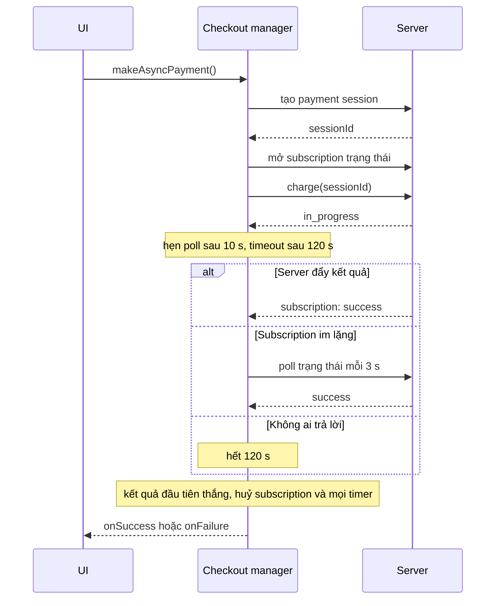

Bấm "Thanh toán" trên một trang thương mại điện tử: trình duyệt gửi request, server gọi sang cổng thanh toán, cổng thanh toán gọi sang ngân hàng, ngân hàng có thể bắt người dùng xác thực 3-D Secure. Toàn bộ việc này có thể mất vài giây, đôi khi vài phút. Giữ một HTTP request mở suốt thời gian đó thì dễ bị timeout ở proxy, và người dùng không biết chuyện gì đang xảy ra.

Vì vậy nhiều hệ thống trả lời ngay "đang xử lý" (`in_progress`) rồi báo kết quả sau. Câu hỏi là: báo bằng cách nào, và nếu cách đó trục trặc thì sao?

> [!TIP]
> **Tóm tắt**
> - `FBPaymentsAsyncCompleteCheckoutManager` của Facebook nhận kết quả từ bốn nguồn: response của charge, subscription trạng thái (đẩy từ server), polling dự phòng, và timeout tổng. **Nguồn nào đến trước thì thắng**, các nguồn còn lại bị huỷ.
> - **Mở subscription trước rồi mới gọi charge**, để không lỡ sự kiện "thành công" đến trước khi response của charge về.
> - Charge trả `in_progress` thì chờ 10 giây mới bắt đầu poll, poll mỗi 3 giây, timeout tổng 120 giây. Server được ghi đè cả ba số.
> - Bản gốc giữ timer trên instance và poll bằng `setInterval`. Gọi thanh toán lần hai khi lần một chưa xong thì timer cũ mất handle, còn query chậm thì các lần poll chồng lên nhau. Bản viết lại giữ mọi thứ trong closure của từng lần chạy và poll nối tiếp.

<iframe class="demo-frame" src="/demos/facebook-patterns/index.html?theme=dark#/async-checkout" title="Demo async-checkout" loading="lazy" style="height: 820px"></iframe>

<p class="demo-links">▶ <a href="/demos/facebook-patterns/index.html#/async-checkout" target="_blank" rel="noopener">Mở demo toàn màn hình ↗</a> · <a href="https://stackblitz.com/github/hunghg255/blog-hunghg/tree/master/examples/facebook-patterns?file=src/lib/asyncCheckout.ts" target="_blank" rel="noopener">Sửa code trên StackBlitz ↗</a> · <a href="https://github.com/hunghg255/blog-hunghg/blob/master/examples/facebook-patterns/src/lib/asyncCheckout.ts" target="_blank" rel="noopener">Xem source trên GitHub ↗</a></p>

## Facebook làm thế nào?

Module `FBPaymentsAsyncCompleteCheckoutManager` nằm trong bundle `292.js`. Ba hằng số ở đầu module:

```js
const DEFAULT_POLL_TIME_MS = 1e4;   // chờ 10 s mới bắt đầu poll
const DEFAULT_POLL_RETRY_MS = 3e3;  // poll mỗi 3 s
const DEFAULT_TIMEOUT_MS = 12e4;    // bỏ cuộc sau 120 s
```

Và một enum cho biết lần thanh toán kết thúc ở chặng nào, được gửi kèm log: `CHARGE`, `POLLING`, `PSI`, `SUBSCRIPTION`, `TIMEOUT`.

### Bước 1: payment session làm khoá idempotent

```js
makeAsyncPayment(params, info) {
  this.settled = false;
  if (!params.payment_session_id && !this.sessionId) {
    createPaymentSessionRelayGraphQL({ paymentType, receiverId, sessionId }, this.onSessionCreated, this.onSessionFailed);
  } else {
    this.sessionId ||= params.payment_session_id;
    params.payment_session_id ||= this.sessionId;
    this.charge(params);
  }
}
```

Payment session ID (PSI) được tạo **trước** khi trừ tiền. Mọi lần charge, poll và subscription sau đó đều gắn với ID này. Nếu mạng đứt giữa chừng và client gọi charge lại, server dựa vào PSI để biết đây là cùng một giao dịch, không trừ tiền lần hai. Ý tưởng giống header `Idempotency-Key` của Stripe.

### Bước 2: subscribe trước, charge sau

```js
charge(params) {
  this.subscribe(); // createPaymentSessionCompleteCheckoutStatusSubscription(sessionId, onSubscriptionUpdate)
  createAsyncCheckoutRelayGraphQL(params, this.onChargeResponse, this.onChargeError);
}
```

Thứ tự hai dòng này là mấu chốt. Giả sử charge mất 600 ms để trả response, nhưng giao dịch xong sau 400 ms và server đẩy sự kiện "success" ngay lúc đó. Nếu subscription chỉ được mở sau khi response của charge về, sự kiện ở mốc 400 ms đã trôi qua và không ai nghe. Client phải đợi tới lượt poll mới biết. Kịch bản "Sai: subscribe SAU charge" trong demo cho thấy đúng điều này: kết quả về ở 1702 ms qua polling, thay vì ngay khi server đẩy sự kiện.

### Bước 3: response của charge

```js
onChargeResponse(res) {
  const { paymentStatus, paymentsError, asyncMetadata } = res;
  if (!paymentsError && paymentStatus === 'success') return this.succeed(res, 'CHARGE');
  if (!paymentsError && paymentStatus === 'in_progress') {
    if (!this.settled) {
      this.readTimings(asyncMetadata);                           // server được ghi đè 3 hằng số
      this.pollStartTimer = setTimeout(this.startPolling, this.pollTimeMs);
      this.timeoutTimer = setTimeout(this.onTimeout, this.timeoutMs);
    }
    return;
  }
  if (paymentStatus === 'failure') return this.fail(paymentsError, 'CHARGE');
  this.fail(unknownError, 'CHARGE');
}

startPolling = () => {
  this.poll();
  this.pollInterval = setInterval(this.poll, this.pollRetryMs);
};
```

`readTimings` dùng `asyncMetadata?.pollTimeMs || DEFAULT`. Server biết rõ phương thức thanh toán nào thường mất bao lâu (thẻ nội địa vài giây, ví điện tử có thể lâu hơn), nên nó quyết định nhịp poll cho từng giao dịch.

### Bước 4: ai đến trước thắng

Cả bốn nguồn cuối cùng đều gọi một trong hai hàm:

```js
fail(error, stage) {
  if (this.settled) return;
  this.settled = true;
  this.unsubscribe();
  this.clearTimers(); // timeout, interval poll, timer bắt đầu poll
  this.onFailure(error, { async: 'true', async_checkout_end_stage: stage, payment_session_id: this.sessionId });
}
succeed(res, stage) { /* tương tự, gọi onSuccess */ }
```

Cờ `settled` đảm bảo chỉ một kết quả được báo lên UI. Subscription báo success ở giây 12 trong khi một lượt poll đang bay: lượt poll về sau sẽ bị bỏ qua.

Lỗi mạng khi poll chỉ được **ghi log**, không làm giao dịch thất bại. Còn lượt poll sau và còn timeout tổng, nên một lần mất mạng thoáng qua không biến thành "thanh toán thất bại" trên màn hình.

### Cùng mẫu đó ở upload video quảng cáo

`AdsVideoEncodingAsyncNotifier` (bundle `81.js`) chờ server encode video sau khi upload. Nó subscribe GraphQL `ads_video_status`; `AdsVideoUploadSession` hẹn `setTimeout(…, 12e4)` và nếu sau 120 giây chưa thành công thì gọi `start()` để bật polling dự phòng (log `EVENT_ENCODING_POLLING_FALLBACK`). Lịch poll được tính theo lần gọi trước để không bao giờ dồn request:

```js
schedule() {
  if (this.aborted) return;
  const delay = Math.max(0, this.lastFetchAt + 1000 - Date.now());
  this.timer = setTimeout(() => this.fetchStatus(), delay);
}
```

Nhưng module này **không có cờ `settled`**. Subscription và polling cùng gọi một hàm xử lý trạng thái: nhận `processing` thì hẹn lượt poll kế, nhận `ready` thì tải video rồi báo thành công. Hệ quả, suy ra từ code:

- Subscription đẩy `processing` là hàm này hẹn một lượt poll, kể cả khi mốc 120 giây chưa tới. Polling vì thế có thể bắt đầu sớm hơn nhiều so với tên gọi "dự phòng".
- Subscription đẩy `processing` trong lúc vòng poll đang chạy thì có thêm một timer, ghi đè `this.timer`. Hai vòng poll chạy song song và `abort()` chỉ huỷ được vòng sau.
- Cả hai nguồn cùng thấy `ready` thì callback thành công bị gọi hai lần. Subscription cũng không được dispose khi thành công. Đặt hai module cạnh nhau cho thấy rõ vì sao cờ "đã kết thúc" là phần không thể thiếu của mẫu này.

### Hai điểm yếu của bản checkout

- **Timer gắn với instance, không gắn với lần gọi.** `makeAsyncPayment` đặt lại `settled = false` nhưng không xoá timer của lần trước. Người dùng bấm "Thanh toán" lần hai khi lần một còn `in_progress` (sau khi đổi thẻ chẳng hạn): `this.timeoutTimer` và `this.pollInterval` bị gán handle mới, handle cũ mất. Timeout của lần một vẫn chạy, tới hạn thì gọi `fail()` và kết thúc **lần hai** sớm hơn dự kiến.
- **`setInterval` không chờ lượt trước.** Query trạng thái chậm hơn 3 giây thì các lượt poll chồng lên nhau. Kịch bản "Poll bằng setInterval, query chậm" trong demo đo được 3 request chạy cùng lúc.

Một chi tiết nhỏ: subscription nhận `in_progress` thì rơi vào nhánh "lỗi không xác định" và ghi log `FAIL`, dù giao dịch vẫn đang chạy bình thường. Không ảnh hưởng người dùng, nhưng làm số liệu log sai.



## Viết lại

Bản viết lại là một hàm `runAsyncCheckout(api, sessionId, options)`, trả về `{ promise, cancel }`. Mọi trạng thái (cờ `settled`, subscription, tập timer) nằm trong closure của **lần chạy đó**.

Kết thúc một lần, và xử lý cập nhật từ subscription hoặc polling:

```ts title=src/lib/asyncCheckout.ts
  // Mọi trạng thái nằm trong closure của LẦN CHẠY NÀY. Bản gốc giữ timer trên instance và
  // makeAsyncPayment() chỉ reset cờ settled: gọi lần 2 khi lần 1 chưa xong thì timer của lần 1
  // mất handle, vẫn có thể bắn timeout vào lần 2.
  let settled = false;
  let unsubscribe: (() => void) | null = null;
  const timers = new Set<ReturnType<typeof setTimeout>>();
  let resolveOutcome!: (o: CheckoutOutcome) => void;
  const promise = new Promise<CheckoutOutcome>((r) => (resolveOutcome = r));
  let sessionId: string | null = sessionIdIn;

  const later = (ms: number, fn: () => void) => {
    const t = setTimeout(() => {
      timers.delete(t);
      fn();
    }, ms);
    timers.add(t);
  };
  const cleanup = () => {
    unsubscribe?.();
    unsubscribe = null;
    timers.forEach((t) => {
      clearTimeout(t);
      clearInterval(t);
    });
    timers.clear();
  };
  const finish = (outcome: CheckoutOutcome) => {
    if (settled) return; // kết quả đầu tiên thắng
    settled = true;
    cleanup();
    emit(
      outcome.source,
      `KẾT THÚC: ${outcome.status}${outcome.error ? ` (${outcome.error})` : ''}`,
    );
    resolveOutcome({ ...outcome, sessionId: sessionId ?? undefined });
  };

  const onStatus = (source: 'subscription' | 'polling') => (update: StatusResponse) => {
    if (settled) return;
    emit(source, `trạng thái: ${update.status}`);
    // in_progress chỉ là "chưa xong", không phải lỗi
    if (update.status === 'success') finish({ status: 'success', source });
    else if (update.status === 'failure')
      finish({ status: 'failure', source, error: update.error });
  };
```

Polling nối tiếp (hoặc `setInterval` như bản gốc, để demo so sánh):

```ts title=src/lib/asyncCheckout.ts
  const startPolling = (retryMs: number) => {
    const poll = async () => {
      if (settled) return;
      emit('polling', 'hỏi trạng thái…');
      try {
        onStatus('polling')(await api.queryStatus(sessionId!));
      } catch (error) {
        // lỗi mạng lúc poll: bỏ qua, còn lượt sau và còn timeout tổng
        emit('polling', `lỗi khi hỏi: ${String(error)}`);
      }
      if (pollMode === 'chain' && !settled) later(retryMs, poll);
    };
    if (pollMode === 'interval') {
      void poll();
      const id = setInterval(() => void poll(), retryMs);
      timers.add(id);
    } else {
      void poll();
    }
  };
```

Luồng chính:

```ts title=src/lib/asyncCheckout.ts
  (async () => {
    try {
      if (!sessionId) {
        emit('session', 'tạo payment session…');
        sessionId = await api.createSession();
        emit('session', `session = ${sessionId}`);
      }
      if (settled) return;
      if (!subscribeAfterCharge) subscribe();
      emit('charge', 'gọi charge…');
      const charge = api.charge(sessionId);
      if (subscribeAfterCharge) {
        // chỉ để minh hoạ: subscription mở muộn, sự kiện đến trước đó bị lỡ
        await new Promise((r) => setTimeout(r, 0));
        await charge.catch(() => undefined);
        subscribe();
      }
      const res = await charge;
      if (settled) return;
      emit('charge', `charge trả: ${res.status}`);
      if (res.status === 'success') return finish({ status: 'success', source: 'charge' });
      if (res.status === 'failure')
        return finish({ status: 'failure', source: 'charge', error: res.error });
      const pollTimeMs =
        res.asyncMetadata?.pollTimeMs ?? overrides.pollTimeMs ?? DEFAULTS.pollTimeMs;
      const retryMs =
        res.asyncMetadata?.pollTimeRetryMs ?? overrides.pollTimeRetryMs ?? DEFAULTS.pollTimeRetryMs;
      const timeoutMs = res.asyncMetadata?.timeoutMs ?? overrides.timeoutMs ?? DEFAULTS.timeoutMs;
      later(pollTimeMs, () => startPolling(retryMs));
      later(timeoutMs, () =>
        finish({ status: 'failure', source: 'timeout', error: 'quá thời gian chờ' }),
      );
    } catch (error) {
      finish({ status: 'failure', source: sessionId ? 'charge' : 'session', error: String(error) });
    }
  })();
```

::: spoiler Xem toàn bộ src/lib/asyncCheckout.ts

```ts title=src/lib/asyncCheckout.ts
/**
 * Thanh toán bất đồng bộ: kết quả có thể đến từ 4 nguồn, nguồn nào đến trước thì thắng
 * (ý tưởng từ FBPaymentsAsyncCompleteCheckoutManager của Facebook).
 *
 * 1. Chưa có payment session thì tạo trước (dùng làm khoá idempotent cho lần charge).
 * 2. MỞ SUBSCRIPTION TRƯỚC rồi mới gọi charge, để không lỡ sự kiện "success" đến sớm.
 * 3. Charge trả success/failure: xong. Trả in_progress: sau `pollTimeMs` bắt đầu hỏi trạng thái
 *    mỗi `pollTimeRetryMs`, và hẹn timeout tổng `timeoutMs`. Server được ghi đè 3 số này.
 * 4. Kết quả đầu tiên thắng; sau đó huỷ subscription và mọi timer.
 */

export type PaymentStatus = 'success' | 'failure' | 'in_progress';

export interface AsyncMetadata {
  pollTimeMs?: number;
  pollTimeRetryMs?: number;
  timeoutMs?: number;
}

export interface ChargeResponse {
  status: PaymentStatus;
  error?: string;
  asyncMetadata?: AsyncMetadata;
}

export interface StatusResponse {
  status: PaymentStatus;
  error?: string;
}

export interface CheckoutApi {
  createSession(): Promise<string>;
  /** sessionId đóng vai khoá idempotent: gọi lại với cùng session không trừ tiền hai lần */
  charge(sessionId: string): Promise<ChargeResponse>;
  queryStatus(sessionId: string): Promise<StatusResponse>;
  /** trả hàm huỷ đăng ký */
  subscribe(sessionId: string, onUpdate: (update: StatusResponse) => void): () => void;
}

export type OutcomeSource = 'session' | 'charge' | 'subscription' | 'polling' | 'timeout';

export interface CheckoutOutcome {
  status: 'success' | 'failure';
  source: OutcomeSource;
  error?: string;
  sessionId?: string;
}

export interface CheckoutEvent {
  source: OutcomeSource;
  /** ms kể từ lúc bắt đầu */
  at: number;
  text: string;
}

export interface AsyncCheckoutOptions extends AsyncMetadata {
  /**
   * 'chain' (mặc định): hỏi trạng thái xong lần này mới hẹn lần sau, không chồng request.
   * 'interval': setInterval như bản gốc; query chậm hơn chu kỳ thì chồng lên nhau.
   */
  pollMode?: 'chain' | 'interval';
  /** chỉ để minh hoạ lỗi: gọi charge trước rồi mới subscribe */
  subscribeAfterCharge?: boolean;
  onEvent?: (event: CheckoutEvent) => void;
  now?: () => number;
}

export const DEFAULTS = { pollTimeMs: 10_000, pollTimeRetryMs: 3_000, timeoutMs: 120_000 };

export function runAsyncCheckout(
  api: CheckoutApi,
  sessionIdIn: string | null,
  {
    pollMode = 'chain',
    subscribeAfterCharge = false,
    onEvent,
    now = () => performance.now(),
    ...overrides
  }: AsyncCheckoutOptions = {},
): { promise: Promise<CheckoutOutcome>; cancel: () => void } {
  const startedAt = now();
  const emit = (source: OutcomeSource, text: string) =>
    onEvent?.({ source, at: Math.round(now() - startedAt), text });

  // Mọi trạng thái nằm trong closure của LẦN CHẠY NÀY. Bản gốc giữ timer trên instance và
  // makeAsyncPayment() chỉ reset cờ settled: gọi lần 2 khi lần 1 chưa xong thì timer của lần 1
  // mất handle, vẫn có thể bắn timeout vào lần 2.
  let settled = false;
  let unsubscribe: (() => void) | null = null;
  const timers = new Set<ReturnType<typeof setTimeout>>();
  let resolveOutcome!: (o: CheckoutOutcome) => void;
  const promise = new Promise<CheckoutOutcome>((r) => (resolveOutcome = r));
  let sessionId: string | null = sessionIdIn;

  const later = (ms: number, fn: () => void) => {
    const t = setTimeout(() => {
      timers.delete(t);
      fn();
    }, ms);
    timers.add(t);
  };
  const cleanup = () => {
    unsubscribe?.();
    unsubscribe = null;
    timers.forEach((t) => {
      clearTimeout(t);
      clearInterval(t);
    });
    timers.clear();
  };
  const finish = (outcome: CheckoutOutcome) => {
    if (settled) return; // kết quả đầu tiên thắng
    settled = true;
    cleanup();
    emit(
      outcome.source,
      `KẾT THÚC: ${outcome.status}${outcome.error ? ` (${outcome.error})` : ''}`,
    );
    resolveOutcome({ ...outcome, sessionId: sessionId ?? undefined });
  };

  const onStatus = (source: 'subscription' | 'polling') => (update: StatusResponse) => {
    if (settled) return;
    emit(source, `trạng thái: ${update.status}`);
    // in_progress chỉ là "chưa xong", không phải lỗi
    if (update.status === 'success') finish({ status: 'success', source });
    else if (update.status === 'failure')
      finish({ status: 'failure', source, error: update.error });
  };

  const startPolling = (retryMs: number) => {
    const poll = async () => {
      if (settled) return;
      emit('polling', 'hỏi trạng thái…');
      try {
        onStatus('polling')(await api.queryStatus(sessionId!));
      } catch (error) {
        // lỗi mạng lúc poll: bỏ qua, còn lượt sau và còn timeout tổng
        emit('polling', `lỗi khi hỏi: ${String(error)}`);
      }
      if (pollMode === 'chain' && !settled) later(retryMs, poll);
    };
    if (pollMode === 'interval') {
      void poll();
      const id = setInterval(() => void poll(), retryMs);
      timers.add(id);
    } else {
      void poll();
    }
  };

  const subscribe = () => {
    emit('subscription', 'mở subscription');
    unsubscribe = api.subscribe(sessionId!, onStatus('subscription'));
  };

  (async () => {
    try {
      if (!sessionId) {
        emit('session', 'tạo payment session…');
        sessionId = await api.createSession();
        emit('session', `session = ${sessionId}`);
      }
      if (settled) return;
      if (!subscribeAfterCharge) subscribe();
      emit('charge', 'gọi charge…');
      const charge = api.charge(sessionId);
      if (subscribeAfterCharge) {
        // chỉ để minh hoạ: subscription mở muộn, sự kiện đến trước đó bị lỡ
        await new Promise((r) => setTimeout(r, 0));
        await charge.catch(() => undefined);
        subscribe();
      }
      const res = await charge;
      if (settled) return;
      emit('charge', `charge trả: ${res.status}`);
      if (res.status === 'success') return finish({ status: 'success', source: 'charge' });
      if (res.status === 'failure')
        return finish({ status: 'failure', source: 'charge', error: res.error });
      const pollTimeMs =
        res.asyncMetadata?.pollTimeMs ?? overrides.pollTimeMs ?? DEFAULTS.pollTimeMs;
      const retryMs =
        res.asyncMetadata?.pollTimeRetryMs ?? overrides.pollTimeRetryMs ?? DEFAULTS.pollTimeRetryMs;
      const timeoutMs = res.asyncMetadata?.timeoutMs ?? overrides.timeoutMs ?? DEFAULTS.timeoutMs;
      later(pollTimeMs, () => startPolling(retryMs));
      later(timeoutMs, () =>
        finish({ status: 'failure', source: 'timeout', error: 'quá thời gian chờ' }),
      );
    } catch (error) {
      finish({ status: 'failure', source: sessionId ? 'charge' : 'session', error: String(error) });
    }
  })();

  return {
    promise,
    cancel: () => finish({ status: 'failure', source: 'charge', error: 'đã huỷ' }),
  };
}
```

:::

**Khác bản gốc:**

- Mỗi lần chạy có closure riêng. Gọi lần hai không đụng tới timer của lần một; muốn dừng lần một thì gọi `cancel()` của nó.
- Poll mặc định theo kiểu nối tiếp: lượt sau chỉ được hẹn khi lượt trước đã xong. Chế độ `'interval'` giữ lại để demo cho thấy chỗ chồng request.
- `in_progress` từ subscription được coi là "chưa xong", không ghi thành lỗi.
- API là một interface `CheckoutApi` truyền vào, thay vì gọi thẳng Relay. Test chỉ cần một object giả.
- Tuỳ chọn `subscribeAfterCharge` **chỉ để minh hoạ** cách làm sai, không nên bật trong code thật.

## Đi qua code

- **`later(ms, fn)`** bọc `setTimeout` và ghi handle vào `timers`. `cleanup()` duyệt tập này nên không timer nào bị bỏ sót, kể cả timer được hẹn trong vòng poll.
- **`finish()`** là cửa duy nhất để kết thúc: kiểm `settled`, dọn dẹp, ghi sự kiện, resolve promise. Bốn nguồn đều đi qua đây.
- **`onStatus(source)`** trả về handler cho từng nguồn, để sự kiện ghi đúng nguồn ("subscription" hay "polling") và kết quả cuối báo đúng ai đã thắng.
- **`startPolling()`** ở chế độ nối tiếp: `poll()` chờ `queryStatus` xong rồi mới `later(retryMs, poll)`. Lỗi mạng chỉ ghi sự kiện, vòng poll vẫn tiếp tục.
- **Luồng chính** chạy trong một async IIFE. Sau mỗi `await` đều kiểm `settled`, vì trong lúc chờ có thể người dùng đã bấm huỷ hoặc subscription đã báo kết quả.
- **Timeout tổng** được hẹn sau khi charge trả `in_progress`, giống bản gốc. Nếu muốn giới hạn cả thời gian tạo session và chờ charge, hẹn nó ngay từ đầu.

## Tại sao không làm cách khác?

**Chỉ dùng subscription (WebSocket, SSE)?** Kết nối realtime có thể đứt im lặng: proxy công ty cắt WebSocket, điện thoại chuyển mạng, server khởi động lại. Một sự kiện bị rơi nghĩa là người dùng nhìn spinner mãi. Polling dự phòng biến tình huống đó thành "chậm hơn vài giây" thay vì "treo".

**Chỉ dùng polling?** Poll mỗi giây thì tốn request; poll mỗi 10 giây thì người dùng đợi trung bình thêm 5 giây sau khi giao dịch đã xong. Subscription cho kết quả gần như tức thì trong trường hợp bình thường, polling chỉ là lưới an toàn.

**Giữ request charge mở tới khi có kết quả (long-polling)?** Proxy, load balancer và CDN thường cắt request sau 30 đến 60 giây. Thanh toán cần xác thực ngân hàng có thể lâu hơn thế.

**Bắt đầu poll ngay, không chờ 10 giây?** Phần lớn giao dịch xong trong vài giây và subscription đã báo về. Chờ 10 giây giảm hẳn số request poll vô ích trên toàn hệ thống.

## Edge case và cạm bẫy

- **Người dùng đóng tab khi đang `in_progress`.** Client không còn ai để báo, nhưng giao dịch vẫn chạy ở server. Trang xác nhận đơn hàng phải đọc trạng thái từ server theo PSI, không dựa vào việc client có nhận được kết quả hay không.
- **Timeout không có nghĩa là thất bại.** Sau 120 giây client báo lỗi, nhưng có thể ngân hàng vẫn đang xử lý và vài phút sau giao dịch thành công. Thông báo nên là "chưa xác nhận được, kiểm tra lại sau", và hệ thống cần một kênh khác (email, trang lịch sử đơn) để báo kết quả thật.
- **Bấm thanh toán hai lần.** Khoá nút trong lúc chạy, và nếu cho phép thử lại thì `cancel()` lần chạy cũ trước. PSI giúp server không trừ tiền hai lần, nhưng UI vẫn phải tránh hai luồng cùng báo kết quả.
- **Tab bị đưa xuống nền.** Trình duyệt giảm tần suất `setTimeout` ở tab nền (Chrome có thể gom timer về mức một lần mỗi phút trong một số trường hợp). Poll và timeout sẽ trễ hơn dự kiến; subscription thì vẫn nhận được sự kiện nếu kết nối còn sống.
- **Server ghi đè timing bằng 0.** Bản gốc dùng `||` nên 0 rơi về mặc định. Bản viết lại dùng `??`, nên 0 có nghĩa là "poll ngay" hoặc "timeout ngay". Nếu không tin server, kẹp giá trị trong một khoảng hợp lý.

## Dùng trong dự án

Mẫu này hợp với mọi tác vụ "bắt đầu ngay, xong sau": thanh toán, xuất báo cáo, encode video, tạo bản sao lưu.

```ts
const run = runAsyncCheckout(
  {
    createSession: () => api.post('/payments/session').then((r) => r.id),
    charge: (id) => api.post('/payments/charge', { session_id: id }),
    queryStatus: (id) => api.get(`/payments/${id}/status`),
    subscribe: (id, onUpdate) => {
      const es = new EventSource(`/payments/${id}/events`);
      es.onmessage = (e) => onUpdate(JSON.parse(e.data));
      return () => es.close();
    },
  },
  null,
);
setCancel(() => run.cancel);
const outcome = await run.promise;
if (outcome.status === 'success') router.push(`/orders/${outcome.sessionId}`);
else if (outcome.source === 'timeout') showPendingNotice(outcome.sessionId);
else showError(outcome.error);
```

## Kiểm thử

::: spoiler Ví dụ test (bản phác, không có trong repo)

```ts
import { afterEach, describe, expect, it, vi } from 'vitest';
import { runAsyncCheckout, type CheckoutApi, type StatusResponse } from './asyncCheckout';

afterEach(() => vi.useRealTimers());

function fakeApi(opts: { chargeStatus: 'success' | 'in_progress'; pushAfter?: number; pollSuccessAfter?: number }) {
  const listeners = new Set<(u: StatusResponse) => void>();
  let polls = 0;
  const api: CheckoutApi = {
    createSession: async () => 'ps_1',
    charge: async () => {
      if (opts.pushAfter != null)
        setTimeout(() => listeners.forEach((l) => l({ status: 'success' })), opts.pushAfter);
      return { status: opts.chargeStatus };
    },
    queryStatus: async () => {
      polls++;
      return { status: opts.pollSuccessAfter != null && polls >= opts.pollSuccessAfter ? 'success' : 'in_progress' };
    },
    subscribe: (_id, cb) => {
      listeners.add(cb);
      return () => void listeners.delete(cb);
    },
  };
  return { api, listeners, polls: () => polls };
}

const timing = { pollTimeMs: 1000, pollTimeRetryMs: 300, timeoutMs: 5000 };

describe('runAsyncCheckout', () => {
  it('subscription thắng thì dừng poll và gỡ subscription', async () => {
    vi.useFakeTimers();
    const f = fakeApi({ chargeStatus: 'in_progress', pushAfter: 500 });
    const { promise } = runAsyncCheckout(f.api, null, timing);
    await vi.advanceTimersByTimeAsync(600);
    await expect(promise).resolves.toMatchObject({ status: 'success', source: 'subscription', sessionId: 'ps_1' });
    await vi.advanceTimersByTimeAsync(10_000);
    expect(f.polls()).toBe(0);
    expect(f.listeners.size).toBe(0);
  });

  it('subscription im lặng thì polling cứu', async () => {
    vi.useFakeTimers();
    const f = fakeApi({ chargeStatus: 'in_progress', pollSuccessAfter: 3 });
    const { promise } = runAsyncCheckout(f.api, null, timing);
    await vi.advanceTimersByTimeAsync(1000 + 300 * 2 + 50);
    await expect(promise).resolves.toMatchObject({ status: 'success', source: 'polling' });
    expect(f.polls()).toBe(3);
  });

  it('không ai trả lời thì timeout, và chỉ kết thúc một lần', async () => {
    vi.useFakeTimers();
    const f = fakeApi({ chargeStatus: 'in_progress' });
    const onEvent = vi.fn();
    const { promise } = runAsyncCheckout(f.api, null, { ...timing, onEvent });
    await vi.advanceTimersByTimeAsync(5100);
    await expect(promise).resolves.toMatchObject({ status: 'failure', source: 'timeout' });
    const ends = onEvent.mock.calls.filter(([e]) => e.text.startsWith('KẾT THÚC'));
    expect(ends).toHaveLength(1);
  });
});
```

:::

## So với thư viện và chuẩn web

- **Stripe** dùng cùng ý tưởng ở phía server: `PaymentIntent` có trạng thái `processing`, client đọc kết quả qua webhook hoặc poll `retrieve`, và mọi request ghi đều nhận header `Idempotency-Key`.
- **`Promise.race`** là phiên bản ngắn của "ai đến trước thắng", nhưng nó không huỷ các promise thua. Phần dọn dẹp (gỡ subscription, xoá timer) vẫn phải tự viết, và đó chính là phần dễ sai nhất.
- **`AbortSignal.any()`** gộp nhiều tín hiệu huỷ thành một; dùng được để huỷ cùng lúc các `fetch` đang poll khi đã có kết quả. Hỗ trợ trên các trình duyệt chính (tính tới 10/2026), xem [caniuse](https://caniuse.com/mdn-api_abortsignal_any_static).
- **Server-Sent Events** (`EventSource`) là lựa chọn nhẹ cho kênh subscription một chiều từ server, có sẵn tự kết nối lại; Facebook dùng GraphQL subscription chạy trên kênh realtime riêng của họ.

---

Bài này thuộc series **[Học từ mã nguồn Facebook](/series/facebook)** (83 bài, đọc theo thứ tự).

::: spoiler Xem nhanh danh sách bài trong series

*Phần 1*

- [Mở đầu: cách đọc code minify của Facebook](/blogs/learn-from-facebook-source-code)
- [#1 Dùng chung IntersectionObserver + infinite scroll](/blogs/facebook-shared-intersection-observer)
- [#2 useViewportDuration: đo thời gian thực sự được xem](/blogs/facebook-use-viewport-duration)
- [#3 Preload code + data khi hover](/blogs/facebook-preload-on-hover)
- [#4 Toast manager với external store](/blogs/facebook-toast-manager)
- [#5 Network status + heartbeat backoff](/blogs/facebook-network-status-heartbeat)
- [#6 ErrorGuard: bắt lỗi theo ngữ cảnh](/blogs/facebook-error-guard)
- [#7 Banzai: gom log theo lô + sendBeacon](/blogs/facebook-batch-logger)
- [#8 Focus trap + Esc theo layer](/blogs/facebook-focus-trap)

*Phần 2*

- [#9 Mẹo calc(… * 9999): container query, line-clamp, mũi tên carousel bằng CSS](/blogs/facebook-css-9999-trick)
- [#10 Thanh cuộn tuỳ biến bằng CSS 3D](/blogs/facebook-css-3d-scrollbar)
- [#11 Modal cuộn bằng window, giữ vị trí trang nền](/blogs/facebook-document-scroll-modal)
- [#12 Popover, tooltip group và hovercard](/blogs/facebook-popover-tooltip)
- [#13 Primitive Pressable + focus-visible](/blogs/facebook-pressable)
- [#14 Tab "Xem thêm" + sticky header bằng IntersectionObserver](/blogs/facebook-priority-tabs-sticky-header)
- [#15 Avatar khoét mask, gradient Messenger, skeleton steps()](/blogs/facebook-visual-tricks)
- [#16 Khung chat không giật](/blogs/facebook-chat-scroller)
- [#17 Thuật toán chọn bố cục collage ảnh](/blogs/facebook-photo-collage-layout)
- [#18 Keep-alive tab trong SPA](/blogs/facebook-keep-alive-tabs)
- [#19 Tự đo Visual Completion & interaction tracing](/blogs/facebook-visual-completion)
- [#20 Router SPA bền bỉ & tải chunk có retry](/blogs/facebook-spa-router-resilient-loading)

*Phần 3*

- [#21 Smart Compose: gợi ý chữ mờ khi gõ](/blogs/facebook-smart-compose-ghost-text)
- [#22 MQTT ngay trong trình duyệt, tự chuyển sang long-poll](/blogs/facebook-mqtt-in-browser)
- [#23 Đo thời gian dùng bằng bitmap 64 giây](/blogs/facebook-time-spent-bitmap)
- [#24 Bảng reaction nhấn giữ rồi trượt](/blogs/facebook-reaction-press-slide)
- [#25 Tìm kiếm gấp dấu, phiên âm và highlight đầu từ](/blogs/facebook-search-diacritics-tokenize)
- [#26 Ring buffer biết trace nào đã mất log](/blogs/facebook-trace-ring-buffer)
- [#27 Engine animation JS: một vòng rAF và solver cubic-bezier](/blogs/facebook-keyframes-loop-cubic-bezier)
- [#28 Bootloader: bitmap tài nguyên đã tải, chỉ reload khi cần](/blogs/facebook-bootloader-bitmap-consistency)
- [#29 Nhận biết click do screen reader tạo ra](/blogs/facebook-virtual-cursor-detection)
- [#30 Tải trước feed theo chất lượng mạng, đoán hạng thiết bị](/blogs/facebook-network-aware-prefetch)
- [#31 Hàng đợi gửi tin chat giữ đúng thứ tự](/blogs/facebook-ordered-send-queue)
- [#32 Gộp lời gọi API trong cùng một tick](/blogs/facebook-api-batcher)
- [#33 Resize ảnh trong pool Web Worker](/blogs/facebook-jpeg-resize-worker-pool)
- [#34 Crop ảnh theo nhiều khuôn mặt](/blogs/facebook-face-aware-crop)
- [#35 Kéo-thả sắp xếp và vùng thả file không nhấp nháy](/blogs/facebook-flicker-free-drag-drop)
- [#36 Tiện ích UI: fade-out, sticky event, hàm huỷ được](/blogs/facebook-ui-utility-hooks)
- [#37 Hạ tầng nhỏ: cookie, hash lỗi, prefetch khi chuột dừng](/blogs/facebook-small-infra-cookie-hash-idle)

*Phần 4–6*

- [#38 Đồng bộ tin nhắn: phát hiện lỗ seqID và fetch bù theo tầng](/blogs/facebook-messenger-sync-seqid-gaps)
- [#39 OTID: ID tin nhắn kiểu Snowflake sinh ở client](/blogs/facebook-otid-client-snowflake)
- [#40 QPL: lấy mẫu từ lúc bắt đầu, đo RTT gửi tin đầu-cuối](/blogs/facebook-qpl-send-rtt)
- [#41 Bộ điều phối request bảy chế độ gộp và chống trùng](/blogs/facebook-request-dispatcher-modes)
- [#42 Thread list theo mốc thời gian, cookie presence có version](/blogs/facebook-threadlist-ranged-presence)
- [#43 Composer dạng plugin: reducer, dirty checker, chuỗi kiểm tra](/blogs/facebook-plugin-composer)
- **#44 Thanh toán bất đồng bộ: subscribe trước, poll dự phòng** (bài này)
- [#45 Validate số thẻ: sửa lỗi gõ, dải BIN, Luhn](/blogs/facebook-card-validation)
- [#46 Lịch chọn khoảng ngày: bo góc dải chọn, phím đủ bộ, RTL](/blogs/facebook-range-calendar-a11y)
- [#47 Giờ mở cửa theo tuần: qua đêm, gộp khoảng, phần bù](/blogs/facebook-weekly-hours-intervals)
- [#48 Tiến độ đăng realtime: giữ event chờ snapshot, watchdog](/blogs/facebook-realtime-publish-snapshot)
- [#49 Tiền tệ theo đơn vị nhỏ nhất và ô nhập tiền](/blogs/facebook-currency-minor-units)
- [#50 Sửa hàng loạt Empty/Uniform/Mixed, seen/read bằng 2 bit](/blogs/facebook-bulk-edit-seen-bits)
- [#51 Phát hiện script lạ hook vào hàm native](/blogs/facebook-native-hook-detection)
- [#52 localStorage tự dọn khi đầy quota](/blogs/facebook-quota-aware-storage)
- [#53 Cache tuyến do server phân giải, chờ sẵn promise](/blogs/facebook-route-cache-prefetch)
- [#54 Lưới phím mũi tên 2D và focus không làm cuộn trang](/blogs/facebook-focus-table-grid)
- [#55 Tách emoji bằng máy trạng thái](/blogs/facebook-emoji-segmentation)
- [#56 Đọc trước ghi sau trong một frame, con tự biết vị trí](/blogs/facebook-read-then-write-dom)
- [#57 Hàng đợi lệnh cho video và stream sắp lại chunk](/blogs/facebook-video-command-queue)

*Phần 7–10*

- [#58 Ước lượng băng thông EWMA: loại outlier, nhớ qua phiên](/blogs/facebook-bandwidth-ewma-estimator)
- [#59 ABR theo độ tự tin phát và cắt bậc bitrate theo MOS](/blogs/facebook-abr-playback-confidence)
- [#60 Prefetch segment dự đoán từ manifest, parse hộp sidx](/blogs/facebook-dash-predicted-segments)
- [#61 Đọc metadata MP4/MOV ngay trên client](/blogs/facebook-mp4-metadata-client)
- [#62 Upload tiếp tục được: offset, hash dedupe, phát hiện treo](/blogs/facebook-resumable-upload)
- [#63 Fenwick tree: chọn ngẫu nhiên có trọng số và offset dòng](/blogs/facebook-fenwick-weighted-random)
- [#64 Vạch trục số và trục thời gian "đẹp"](/blogs/facebook-nice-axis-ticks)
- [#65 Damerau-Levenshtein theo dải chéo và tự sửa tên gõ sai](/blogs/facebook-damerau-levenshtein)
- [#66 PRNG có seed, shuffle tái lập và lấy mẫu trace](/blogs/facebook-seeded-prng-sampling)
- [#67 Cặp min/max-heap tái dùng vị trí trong danh sách ảo](/blogs/facebook-dual-heap-buffer-set)
- [#68 Memo nhiều đối số bằng Map/WeakMap và interning object](/blogs/facebook-multikey-memo-interning)
- [#69 Thống kê cửa sổ trượt và đại số khoảng thời gian](/blogs/facebook-moving-stat-intervals)
- [#70 Int64 từ hai số 32-bit, decode UTF, offset theo code point](/blogs/facebook-int64-utf-codepoints)
- [#71 Engine múi giờ IANA trên client, phát hiện lệch giờ](/blogs/facebook-client-iana-timezone)
- [#72 Tự cài semver range](/blogs/facebook-semver-range)
- [#73 Auto-link URL, cắt chữ an toàn, giới hạn LaTeX](/blogs/facebook-autolink-safe-truncate)
- [#74 Parser query kiểu PHP chống prototype pollution](/blogs/facebook-php-query-serializer)
- [#75 Popover tự lật theo phần tràn nhỏ nhất](/blogs/facebook-popover-auto-flip)
- [#76 Tiền tố for(;;) chống JSON hijacking, đọc stream](/blogs/facebook-csrf-prefix-streaming)
- [#77 Chống lộ Referer, linkshim, xoá token trên URL](/blogs/facebook-referrer-linkshim-url-scrub)
- [#78 setImmediate bằng postMessage, gom delta chuột theo frame](/blogs/facebook-setimmediate-mouse-batching)
- [#79 Phát hiện crash qua heartbeat, dò proxy cache hỏng](/blogs/facebook-crash-heartbeat-proxy-check)
- [#80 DPR vào cookie cho ảnh @2x, che khoá trong log](/blogs/facebook-dpr-cookie-secret-redaction)
- [#81 Flux waitFor tự viết và proxy có đệm](/blogs/facebook-flux-dispatch-buffered-proxy)
- [#82 Crop đúng tỉ lệ, xoay sticker bằng ma trận](/blogs/facebook-image-crop-rotation-geometry)

:::

Code + demo: [`examples/facebook-patterns`](https://github.com/hunghg255/blog-hunghg/tree/master/examples/facebook-patterns) · [Mở trên StackBlitz](https://stackblitz.com/github/hunghg255/blog-hunghg/tree/master/examples/facebook-patterns)
