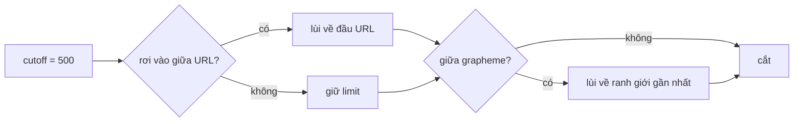

Chữ người dùng gõ là thứ khó đoán nhất trong một trang mạng xã hội. Ba việc tưởng nhỏ nhưng làm sai là thấy ngay:

- **Biến URL thành link.** Câu "(xem https://vi.wikipedia.org/wiki/Sao_Thủy_(hành_tinh))." có hai dấu `)` và một dấu `.` sau URL. Lấy tới khoảng trắng thì link hỏng; dừng ở `(` đầu tiên thì cũng hỏng.
- **Cắt chữ cho nút "Xem thêm".** Cắt ở ký tự thứ 500 có thể rơi giữa một URL (link nửa vời trỏ sang trang 404) hoặc giữa một emoji gia đình 👨‍👩‍👧 (hiện ra ô vuông).
- **Render công thức toán** trong Messenger. `{{{{…}}}}` lồng vài nghìn bậc là đủ để trình render đệ quy tới tràn stack, ngay trên máy người nhận.

Mã nguồn facebook.com có lời giải cho cả ba, và một lỗi nhỏ đáng học ở phần gợi ý hashtag.

> [!TIP]
> **Tóm tắt**
> - `URLMatcher` tìm điểm bắt đầu bằng regex, rồi **quét tay** phần đuôi: `(` tăng độ sâu, `)` giảm và chỉ "chốt" khi về 0; dấu câu cuối không tính trừ khi phía sau còn chữ.
> - `ExpandableText.react` cắt ở ký tự 500 (mỗi lần "Thêm" mở thêm 500); `ExpandableTextUtils` lùi chỗ cắt về đầu URL nếu chỗ cắt rơi vào giữa URL. Bản viết lại lùi tiếp về ranh giới grapheme bằng `Intl.Segmenter`.
> - `MessengerMathUtils` đo độ lồng của `{}` và `\begin…\end` trước khi render; quá 20 bậc hoặc dài quá 1000 ký tự thì báo "Equation is too complex".
> - Lỗi đáng nhớ: `endsWith("\\uFF03")` so với chuỗi 6 ký tự, nên dấu `＃` toàn khổ không bao giờ mở gợi ý hashtag.

<iframe class="demo-frame" src="/demos/facebook-patterns/index.html?theme=dark#/autolink" title="Demo autolink" loading="lazy" style="height: 1180px"></iframe>

<p class="demo-links">▶ <a href="/demos/facebook-patterns/index.html#/autolink" target="_blank" rel="noopener">Mở demo toàn màn hình ↗</a> · <a href="https://stackblitz.com/github/hunghg255/blog-hunghg/tree/master/examples/facebook-patterns?file=src/lib/autolink.ts" target="_blank" rel="noopener">Sửa code trên StackBlitz ↗</a> · <a href="https://github.com/hunghg255/blog-hunghg/blob/master/examples/facebook-patterns/src/lib/autolink.ts" target="_blank" rel="noopener">Xem source trên GitHub ↗</a></p>

## Facebook làm thế nào?

### URLMatcher: regex để tìm chỗ bắt đầu, vòng lặp để tìm chỗ kết thúc

Module `URLMatcher` (bundle `15.js`) không cố viết một regex "bắt URL hoàn hảo". Nó tách bài toán làm hai:

1. Một regex cho phần **đầu** URL: scheme (`https://`) hoặc `www.`, rồi host. Phần host có danh sách ký tự cho phép và TLD.
2. Một vòng lặp tay cho phần **đuôi** (path, query, fragment). Vòng lặp này giữ một bộ đếm ngoặc:
   - gặp `(` thì tăng;
   - gặp `)` thì giảm, và **chỉ khi về 0** mới coi phần trong ngoặc là thuộc URL;
   - gặp dấu câu như `.`, `,`, `!`, `?` thì chưa chốt ngay, chỉ chốt nếu phía sau còn ký tự thường.

Nhờ vậy `https://en.wikipedia.org/wiki/Bash_(Unix_shell)` giữ được `(Unix_shell)`, còn `(link: https://example.com/a).` thì bỏ `)` và `.` của câu văn. Cuối cùng module lọc bỏ những thứ trông như email (`an@www.example.com` không thành link `www.example.com`).

Lý do không dùng một regex duy nhất: "ngoặc cân bằng" không biểu diễn được bằng regex thường (cần đếm), và một regex cố làm việc đó dễ thành regex chạy lâu theo hàm mũ (ReDoS) với input xấu. Vòng lặp tay chạy tuyến tính.

### ExpandableTextUtils: đừng cắt giữa URL

`ExpandableTextUtils.adjustCutoffToAvoidTruncatingURLs` (bundle `189.js`) nhận đoạn text và chỗ cắt dự kiến. Nó chạy `URLMatcher` trên text; nếu một URL phủ vị trí `limit − 1` thì chỗ cắt lùi về **đầu URL đó**. Phần "Xem thêm" sẽ bắt đầu bằng nguyên URL, không có link cụt.

Người gọi là component `ExpandableText.react` (cùng bundle). Chỗ cắt và bước nhảy nằm ở component chứ không ở hàm tiện ích: `defaultProps` có `cutoff: 500` và `grow: 500`, mỗi lần bấm "Thêm" thì `cutoff += grow`, bấm "Ít hơn" thì trừ lại. Đầu module còn có một hằng `50`, nhưng biến đó bị gán đè ngay phía dưới nên có lẽ là phần sót lại, không được dùng làm chỗ cắt. Việc lùi về đầu URL chỉ chạy khi component nhận prop `avoidTruncatingURLs`; sau khi cắt bằng `substr`, text được `trim()`.

Component còn một chế độ `penalizeNewLine`: mỗi dấu xuống dòng tính thành `newLinePenalizationWeight` ký tự, để đoạn có nhiều dòng ngắn không chiếm cả màn hình. Nhánh này tự đếm từng ký tự và **không gọi** `adjustCutoffToAvoidTruncatingURLs`, nên bật nó lên là mất luôn phần bảo vệ URL.

Cả hai nhánh đều không quan tâm tới emoji hay dấu tổ hợp: chỗ cắt vẫn có thể rơi giữa cặp surrogate của 👋 hay giữa chuỗi ZWJ của 👨‍👩‍👧 (nhánh `penalizeNewLine` còn dùng `split("")`, tách theo code unit).

### MessengerMathUtils: đếm độ lồng trước khi render

Messenger cho gõ công thức LaTeX và render bằng KaTeX. `MessengerMath.react` kiểm tra hai thứ trước khi render:

- độ dài thân công thức `> maxLength` (1000);
- `MessengerMathUtils.getMaxBraceDepth(body) > maxBraceDepth` (20).

Vượt một trong hai thì hiện lỗi "Equation is too complex" thay vì gọi KaTeX. Ngoài ra KaTeX được gọi với `maxSize: 5` (giới hạn kích thước ký hiệu co giãn) và chỉ khi công thức nằm trong khoảng 500px quanh viewport.

`getMaxBraceDepth` (bundle `117.js`) đếm như sau: `\begin` cộng 2, `\end` trừ 2, `\` theo sau bởi ký tự khác thì bỏ qua ký tự đó (để `\{` không bị đếm), `{` cộng 1, `}` trừ 1. Hàm lấy giá trị lớn nhất của bộ đếm.

Chỗ đáng sửa: bộ đếm được phép xuống **âm**. Chuỗi `}}}}}}` ở đầu kéo bộ đếm về −6, và 24 dấu `{` phía sau chỉ đo được 18. Công thức lồng 24 bậc lọt qua giới hạn 20. KaTeX vẫn có thể báo lỗi cú pháp vì `}` thừa, nhưng bước bảo vệ đã bị vượt qua; nút "} thừa ở đầu" trong demo cho thấy hai con số.

### HashtagSuggestionsStrategy: một dấu gạch chéo thừa

Composer mở gợi ý hashtag khi chữ vừa gõ kết thúc bằng `#`. Bàn phím tiếng Nhật, Trung ở chế độ toàn khổ gõ ra `＃` (U+FF03), nên code có kiểm tra thêm:

```js
a.endsWith("#") || a.endsWith("\\uFF03")
```

Trong mã nguồn đã build, chuỗi là `"\\uFF03"`: dấu `\` được escape, nên đây là chuỗi **6 ký tự** `＃`, không phải ký tự `＃`. Không ai gõ sáu ký tự đó, nên nhánh này không bao giờ đúng. Có lẽ lỗi sinh ra khi một công cụ build escape lại chuỗi đã escape.

## Bên trong trình duyệt: "một ký tự" là gì?

JavaScript đếm chuỗi theo **UTF-16 code unit**. `'👋'.length === 2`, `'👨‍👩‍👧'.length === 8` (ba emoji, mỗi cái 2 unit, nối bằng hai ZWJ). `slice(0, n)` cắt theo code unit, nên có thể để lại nửa cặp surrogate: trình duyệt hiện `�`.

Thứ người dùng thấy là **grapheme cluster**: chữ cái + dấu tổ hợp, emoji + modifier màu da, chuỗi ZWJ. `Intl.Segmenter` với `granularity: 'grapheme'` (có trong mọi trình duyệt lớn tính tới 10/2026) trả các ranh giới đó.



## Viết lại

Phần tìm URL giữ đúng ý tưởng của `URLMatcher`: regex chỉ tìm điểm bắt đầu và lấy "ứng viên" tới khoảng trắng hoặc ký tự cấm, rồi `trimUrl` quét tay:

```ts title=src/lib/autolink.ts
export function trimUrl(candidate: string): string {
  let end = 0;
  let depth = 0;
  for (let i = 0; i < candidate.length; i++) {
    const ch = candidate[i];
    if (ch === '(') {
      depth++;
      continue;
    }
    if (ch === ')') {
      if (depth === 0) break;
      depth--;
      if (depth === 0) end = i + 1;
      continue;
    }
    if (depth > 0) continue; // trong ngoặc: chờ tới khi đóng mới chốt
    if (TRAILING.test(ch)) continue; // dấu câu: chỉ được giữ nếu phía sau còn chữ
    end = i + 1;
  }
  return candidate.slice(0, end);
}
```

Cắt chữ: lùi về đầu URL như bản gốc, rồi lùi tiếp về ranh giới grapheme:

```ts title=src/lib/autolink.ts
export function safeCutoff(text: string, limit: number): number {
  if (limit >= text.length) return text.length;
  let cut = limit;
  for (const m of findUrls(text)) {
    if (m.start >= cut) break;
    if (m.end > cut) {
      cut = m.start;
      break;
    }
  }
  return toGraphemeBoundary(text, cut);
}
```

Đếm độ lồng LaTeX, không cho bộ đếm xuống dưới 0:

```ts title=src/lib/autolink.ts
export function maxBraceDepth(tex: string): number {
  let depth = 0;
  let max = 0;
  for (let i = 0; i < tex.length; i++) {
    const ch = tex[i];
    if (ch === '\\') {
      if (tex.startsWith('\\begin', i)) {
        depth += 2;
        max = Math.max(max, depth);
      } else if (tex.startsWith('\\end', i)) {
        depth = Math.max(0, depth - 2);
      } else {
        i++; // bỏ qua ký tự được escape
      }
    } else if (ch === '{') {
      depth++;
      max = Math.max(max, depth);
    } else if (ch === '}') {
      depth = Math.max(0, depth - 1);
    }
  }
  return max;
}
```

::: spoiler Xem toàn bộ src/lib/autolink.ts

```ts title=src/lib/autolink.ts
/**
 * Ba tiện ích quanh "chữ người dùng gõ" (ý tưởng từ URLMatcher, ExpandableTextUtils,
 * MessengerMathUtils và HashtagSuggestionsStrategy của Facebook):
 *  - tìm URL trong đoạn văn, nuốt đúng cặp ngoặc nhưng bỏ dấu câu cuối câu
 *  - cắt chữ cho "Xem thêm" mà không chặt đôi một URL (hay một emoji)
 *  - chặn công thức LaTeX lồng quá sâu trước khi đưa cho trình render
 */

// ---- 1. Tìm URL ----

/** Điểm bắt đầu: có scheme, hoặc www. (www2., www3. cũng được). */
const START = /(?:\bhttps?:\/\/|\bwww\d{0,3}\.)[^\s<>"'`]+/giu;
/** Dấu câu thường đứng sau URL trong câu văn, không thuộc về URL. */
const TRAILING = /[.,;:!?'"»… -]/u;

/**
 * Cắt phần đuôi của một ứng viên URL:
 *  - `(` mở một nhóm; chỉ "chốt" phần trong ngoặc khi gặp `)` đóng đúng cặp
 *  - `)` không có cặp (vd URL nằm trong ngoặc của câu văn) là điểm dừng
 *  - dấu câu ở cuối không được tính, trừ khi phía sau còn ký tự thường
 */
export function trimUrl(candidate: string): string {
  let end = 0;
  let depth = 0;
  for (let i = 0; i < candidate.length; i++) {
    const ch = candidate[i];
    if (ch === '(') {
      depth++;
      continue;
    }
    if (ch === ')') {
      if (depth === 0) break;
      depth--;
      if (depth === 0) end = i + 1;
      continue;
    }
    if (depth > 0) continue; // trong ngoặc: chờ tới khi đóng mới chốt
    if (TRAILING.test(ch)) continue; // dấu câu: chỉ được giữ nếu phía sau còn chữ
    end = i + 1;
  }
  return candidate.slice(0, end);
}

export interface UrlMatch {
  url: string;
  start: number;
  end: number;
}

export function findUrls(text: string): UrlMatch[] {
  const out: UrlMatch[] = [];
  for (const m of text.matchAll(START)) {
    const url = trimUrl(m[0]);
    if (url.length < 5) continue;
    out.push({ url, start: m.index!, end: m.index! + url.length });
  }
  return out;
}

/** Cách "ngây thơ" hay gặp: lấy hết tới khoảng trắng. */
export function findUrlsNaive(text: string): UrlMatch[] {
  return [...text.matchAll(/https?:\/\/\S+|www\.\S+/gi)].map((m) => ({
    url: m[0],
    start: m.index!,
    end: m.index! + m[0].length,
  }));
}

export type Segment = { kind: 'text'; text: string } | { kind: 'link'; text: string; href: string };

export function linkify(text: string, matches = findUrls(text)): Segment[] {
  const segments: Segment[] = [];
  let pos = 0;
  for (const m of matches) {
    if (m.start > pos) segments.push({ kind: 'text', text: text.slice(pos, m.start) });
    const href = /^https?:\/\//i.test(m.url) ? m.url : `https://${m.url}`;
    segments.push({ kind: 'link', text: m.url, href });
    pos = m.end;
  }
  if (pos < text.length) segments.push({ kind: 'text', text: text.slice(pos) });
  return segments;
}

// ---- 2. Cắt chữ không chặt URL ----

const graphemes =
  typeof Intl !== 'undefined' && 'Segmenter' in Intl
    ? new Intl.Segmenter(undefined, { granularity: 'grapheme' })
    : null;

/** Lùi `index` về ranh giới grapheme gần nhất (không cắt giữa emoji hay chữ có dấu tổ hợp). */
function toGraphemeBoundary(text: string, index: number): number {
  if (!graphemes) {
    // không có Segmenter: ít nhất đừng cắt giữa cặp surrogate
    const code = text.charCodeAt(index - 1);
    return code >= 0xd800 && code <= 0xdbff ? index - 1 : index;
  }
  let last = 0;
  for (const { index: i } of graphemes.segment(text)) {
    if (i > index) break;
    last = i;
  }
  return last;
}

/**
 * Chỗ cắt an toàn cho đoạn "Xem thêm": nếu `limit` rơi vào giữa một URL thì lùi về
 * đầu URL đó (cả URL xuống dòng ẩn), rồi lùi tiếp về ranh giới grapheme.
 */
export function safeCutoff(text: string, limit: number): number {
  if (limit >= text.length) return text.length;
  let cut = limit;
  for (const m of findUrls(text)) {
    if (m.start >= cut) break;
    if (m.end > cut) {
      cut = m.start;
      break;
    }
  }
  return toGraphemeBoundary(text, cut);
}

// ---- 3. Giới hạn độ sâu LaTeX ----

/**
 * Độ lồng sâu nhất của `{…}` và `\begin…\end` (mỗi môi trường tính 2 bậc, như bản gốc).
 * Ký tự sau `\` được bỏ qua, nên `\{` không bị đếm.
 * Khác bản gốc: không để độ sâu âm. Bản gốc cho `}` thừa kéo bộ đếm xuống dưới 0,
 * khiến các `{` phía sau bị đếm thiếu.
 */
export function maxBraceDepth(tex: string): number {
  let depth = 0;
  let max = 0;
  for (let i = 0; i < tex.length; i++) {
    const ch = tex[i];
    if (ch === '\\') {
      if (tex.startsWith('\\begin', i)) {
        depth += 2;
        max = Math.max(max, depth);
      } else if (tex.startsWith('\\end', i)) {
        depth = Math.max(0, depth - 2);
      } else {
        i++; // bỏ qua ký tự được escape
      }
    } else if (ch === '{') {
      depth++;
      max = Math.max(max, depth);
    } else if (ch === '}') {
      depth = Math.max(0, depth - 1);
    }
  }
  return max;
}

export interface LatexLimits {
  maxLength: number;
  maxDepth: number;
}

/** Giới hạn mặc định giống Messenger: dài tối đa 1000 ký tự, lồng tối đa 20. */
export const MESSENGER_LIMITS: LatexLimits = { maxLength: 1000, maxDepth: 20 };

export function checkLatex(tex: string, limits = MESSENGER_LIMITS): { ok: boolean; reason?: string; depth: number } {
  const depth = maxBraceDepth(tex);
  if (tex.length > limits.maxLength) return { ok: false, reason: 'quá dài', depth };
  if (depth > limits.maxDepth) return { ok: false, reason: 'lồng quá sâu', depth };
  return { ok: true, depth };
}

// ---- 4. Dấu # để mở gợi ý hashtag ----

/** `#` thường hoặc `＃` (U+FF03, bàn phím tiếng Nhật/Trung gõ ra). */
export function endsWithHashTrigger(text: string): boolean {
  return text.endsWith('#') || text.endsWith('＃');
}

/** Cách viết của bản gốc: chuỗi 6 ký tự "＃" chứ không phải ký tự U+FF03. */
export function endsWithHashTriggerFbStyle(text: string): boolean {
  return text.endsWith('#') || text.endsWith('\\uFF03');
}
```

:::

## Đi qua code

- **`START`** chỉ bắt `https?://` hoặc `www`, `www2.`…, rồi lấy tham lam tới khoảng trắng, `<`, `>`, dấu nháy. Cờ `u` để `\b` và lớp ký tự làm việc đúng với chữ có dấu.
- **`trimUrl`** đi qua từng ký tự của ứng viên. `end` là vị trí cuối đã "chốt". Ký tự thường được chốt ngay. Dấu câu không được chốt, nhưng nếu sau nó còn ký tự thường thì ký tự đó chốt luôn cả dấu câu (`file.tar.gz.` giữ được `file.tar.gz`). Trong ngoặc thì chờ tới `)` đóng đúng cặp mới chốt cả cụm; `)` không có cặp là điểm dừng.
- **`linkify`** đổi danh sách match thành các đoạn `text`/`link`; URL bắt đầu bằng `www.` được thêm `https://` cho `href`. Render bằng React, không dùng `innerHTML`, nên không cần escape tay.
- **`safeCutoff`** dừng ở URL đầu tiên phủ qua `limit`; `toGraphemeBoundary` duyệt các grapheme tới khi vượt `limit`. Không có `Intl.Segmenter` thì ít nhất không cắt giữa cặp surrogate.
- **`checkLatex`** trả cả lý do và độ sâu, để giao diện báo đúng "quá dài" hay "lồng quá sâu".

**Khác bản gốc:**

- Không có bảng TLD và luật host chi tiết; `findUrls` chấp nhận mọi host sau `https://`.
- Không lọc email. `an@www.example.com` vẫn ra link `www.example.com`; cần thì thêm bước kiểm tra ký tự trước `start`.
- `safeCutoff` có thêm bước ranh giới grapheme.
- `maxBraceDepth` kẹp bộ đếm ở 0.
- `endsWithHashTrigger` dùng đúng ký tự `'＃'`.

## Tại sao không làm cách khác?

- **Một regex lớn cho cả URL** (kiểu regex của Gruber): đọc khó, sửa khó, và nhiều bản có nhóm lặp lồng nhau dễ thành ReDoS. Tách "điểm bắt đầu" (regex đơn giản) với "điểm kết thúc" (vòng lặp) dễ kiểm thử hơn.
- **`new URL()` để kiểm tra**: chỉ cho biết một chuỗi có phải URL hợp lệ không, không cho biết URL kết thúc ở đâu trong câu văn. `https://example.com/a).` vẫn là URL hợp lệ.
- **Cắt chữ bằng CSS `line-clamp`**: tốt cho hiển thị, nhưng "Xem thêm" của Facebook là cắt theo số ký tự ở phía dữ liệu (để đo, để log, để render phía server). Khi chỉ cần hiển thị, `line-clamp` đơn giản hơn và không bao giờ cắt giữa grapheme.
- **Đặt timeout cho trình render LaTeX**: JavaScript chạy một luồng, không ngắt được một hàm đệ quy đang chạy. Kiểm tra trước khi render là cách duy nhất (hoặc render trong Worker).

## Edge case và cạm bẫy

- **URL có ngoặc lệch thật**: `https://example.com/a(b` (thiếu `)`). Bộ đếm không bao giờ về 0, nên phần từ `(` trở đi bị bỏ. Đây là đánh đổi chấp nhận được: hiếm, và link vẫn trỏ về đúng trang cha.
- **Dấu câu toàn khổ** `。`, `、` của tiếng Nhật, Trung: thêm vào `TRAILING` nếu người dùng của bạn hay viết các thứ tiếng này.
- **URL tiếng Việt chưa mã hoá** (`/wiki/Sao_Thủy`): `START` nhận mọi ký tự không phải khoảng trắng nên vẫn khớp. `href` để nguyên, trình duyệt tự percent-encode khi điều hướng.
- **Link `javascript:`**: `START` chỉ nhận `http(s)` và `www.`, nên không bao giờ sinh `href="javascript:…"`. Đừng nới regex này.
- **Độ sâu không phải là thước đo duy nhất**: `\underbrace` hay `\sqrt` lồng nhau vẫn tốn nhiều thời gian render dù độ sâu thấp. Messenger còn giới hạn độ dài và `maxSize`.

## Dùng trong dự án

```tsx
import { linkify, safeCutoff } from './autolink';

function PostBody({ text, expanded }: { text: string; expanded: boolean }) {
  const shown = expanded ? text : text.slice(0, safeCutoff(text, 500));
  return (
    <p>
      {linkify(shown).map((s, i) =>
        s.kind === 'link' ? <a key={i} href={s.href} rel='noopener noreferrer'>{s.text}</a> : s.text,
      )}
    </p>
  );
}
```

Trước khi đưa công thức cho KaTeX hay MathJax, gọi `checkLatex(tex)`; `ok` là `false` thì hiện thông báo "công thức quá phức tạp" kèm `reason` thay vì render.

## Kiểm thử

::: spoiler Ví dụ test (bản phác, không có trong repo)

```ts
import { describe, expect, it } from 'vitest';
import { checkLatex, endsWithHashTrigger, endsWithHashTriggerFbStyle, findUrls, maxBraceDepth, safeCutoff } from './autolink';

describe('findUrls', () => {
  it('giữ ngoặc đúng cặp của Wikipedia', () => {
    expect(findUrls('xem https://en.wikipedia.org/wiki/Bash_(Unix_shell) nhé')[0].url).toBe(
      'https://en.wikipedia.org/wiki/Bash_(Unix_shell)',
    );
  });
  it('bỏ ) của câu văn và dấu câu cuối', () => {
    expect(findUrls('(link: https://example.com/a).')[0].url).toBe('https://example.com/a');
    expect(findUrls('Vào www.example.com, rồi https://x.dev/p?q=1!').map((m) => m.url)).toEqual([
      'www.example.com',
      'https://x.dev/p?q=1',
    ]);
  });
  it('dấu chấm giữa path vẫn giữ', () => {
    expect(findUrls('https://a.com/file.tar.gz.')[0].url).toBe('https://a.com/file.tar.gz');
  });
});

describe('safeCutoff', () => {
  it('không chặt đôi URL', () => {
    const text = 'Đọc thêm ở https://example.com/rat-dai/bai-viet';
    expect(safeCutoff(text, 20)).toBe(text.indexOf('https'));
  });
  it('không cắt giữa emoji gia đình', () => {
    expect(safeCutoff('abc👨‍👩‍👧xyz', 5)).toBe(3);
  });
});

describe('LaTeX', () => {
  it('đếm ngoặc và \\begin như bản gốc', () => {
    expect(maxBraceDepth('\\frac{a}{b}')).toBe(1);
    expect(maxBraceDepth('\\begin{x}{y}\\end{x}')).toBe(3);
    expect(maxBraceDepth('\\{\\}')).toBe(0);
  });
  it('} thừa không làm giảm độ sâu đo được', () => {
    expect(maxBraceDepth('}}}}' + '{'.repeat(25))).toBe(25);
    expect(checkLatex('{'.repeat(21) + '}'.repeat(21)).ok).toBe(false);
  });
});

it('nhận # toàn khổ, bản gốc thì không', () => {
  expect(endsWithHashTrigger('tag ＃')).toBe(true);
  expect(endsWithHashTriggerFbStyle('tag ＃')).toBe(false);
});
```

:::

## So với thư viện và chuẩn web

- **linkify-it** (dùng trong markdown-it) và **linkifyjs** làm cùng việc với `URLMatcher`, kèm danh sách TLD đầy đủ, email, và nhiều luật hơn. Với sản phẩm thật nên dùng chúng; bản 20 dòng ở đây để hiểu cơ chế ngoặc cân bằng. linkify-it cũng xử lý ngoặc theo kiểu đếm cặp.
- **`Intl.Segmenter`** là cách chuẩn để cắt theo grapheme. Thư viện `grapheme-splitter` từng lấp chỗ trống này trước khi Firefox hỗ trợ `Intl.Segmenter` (Firefox 125, 2024).
- **CSS `line-clamp`** (`-webkit-line-clamp`, đã chuẩn hoá thành `line-clamp` không tiền tố ở một số trình duyệt tính tới 10/2026) cắt theo dòng hiển thị, không bao giờ cắt giữa grapheme, nhưng không cho biết đã cắt ở ký tự nào.
- **KaTeX** có option `maxExpand` (giới hạn số lần mở macro) và `maxSize`, nhưng không có giới hạn độ lồng. Kiểm tra độ sâu trước như Messenger là lớp bảo vệ bổ sung đáng có.

---

Bài này thuộc series **[Học từ mã nguồn Facebook](/series/facebook)** (106 bài, đọc theo thứ tự).

::: spoiler Xem nhanh danh sách bài trong series

*Phần 1*

- [Mở đầu: cách đọc code minify của Facebook](/blogs/learn-from-facebook-source-code)
- [#1 Dùng chung IntersectionObserver + infinite scroll](/blogs/facebook-shared-intersection-observer)
- [#2 useViewportDuration: đo thời gian thực sự được xem](/blogs/facebook-use-viewport-duration)
- [#3 Preload code + data khi hover](/blogs/facebook-preload-on-hover)
- [#4 Toast manager với external store](/blogs/facebook-toast-manager)
- [#5 Network status + heartbeat backoff](/blogs/facebook-network-status-heartbeat)
- [#6 ErrorGuard: bắt lỗi theo ngữ cảnh](/blogs/facebook-error-guard)
- [#7 Banzai: gom log theo lô + sendBeacon](/blogs/facebook-batch-logger)
- [#8 Focus trap + Esc theo layer](/blogs/facebook-focus-trap)

*Phần 2*

- [#9 Mẹo calc(… * 9999): container query, line-clamp, mũi tên carousel bằng CSS](/blogs/facebook-css-9999-trick)
- [#10 Thanh cuộn tuỳ biến bằng CSS 3D](/blogs/facebook-css-3d-scrollbar)
- [#11 Modal cuộn bằng window, giữ vị trí trang nền](/blogs/facebook-document-scroll-modal)
- [#12 Popover, tooltip group và hovercard](/blogs/facebook-popover-tooltip)
- [#13 Primitive Pressable + focus-visible](/blogs/facebook-pressable)
- [#14 Tab "Xem thêm" + sticky header bằng IntersectionObserver](/blogs/facebook-priority-tabs-sticky-header)
- [#15 Avatar khoét mask, gradient Messenger, skeleton steps()](/blogs/facebook-visual-tricks)
- [#16 Khung chat không giật](/blogs/facebook-chat-scroller)
- [#17 Thuật toán chọn bố cục collage ảnh](/blogs/facebook-photo-collage-layout)
- [#18 Keep-alive tab trong SPA](/blogs/facebook-keep-alive-tabs)
- [#19 Tự đo Visual Completion & interaction tracing](/blogs/facebook-visual-completion)
- [#20 Router SPA bền bỉ & tải chunk có retry](/blogs/facebook-spa-router-resilient-loading)

*Phần 3*

- [#21 Smart Compose: gợi ý chữ mờ khi gõ](/blogs/facebook-smart-compose-ghost-text)
- [#22 MQTT ngay trong trình duyệt, tự chuyển sang long-poll](/blogs/facebook-mqtt-in-browser)
- [#23 Đo thời gian dùng bằng bitmap 64 giây](/blogs/facebook-time-spent-bitmap)
- [#24 Bảng reaction nhấn giữ rồi trượt](/blogs/facebook-reaction-press-slide)
- [#25 Tìm kiếm gấp dấu, phiên âm và highlight đầu từ](/blogs/facebook-search-diacritics-tokenize)
- [#26 Ring buffer biết trace nào đã mất log](/blogs/facebook-trace-ring-buffer)
- [#27 Engine animation JS: một vòng rAF và solver cubic-bezier](/blogs/facebook-keyframes-loop-cubic-bezier)
- [#28 Bootloader: bitmap tài nguyên đã tải, chỉ reload khi cần](/blogs/facebook-bootloader-bitmap-consistency)
- [#29 Nhận biết click do screen reader tạo ra](/blogs/facebook-virtual-cursor-detection)
- [#30 Tải trước feed theo chất lượng mạng, đoán hạng thiết bị](/blogs/facebook-network-aware-prefetch)
- [#31 Hàng đợi gửi tin chat giữ đúng thứ tự](/blogs/facebook-ordered-send-queue)
- [#32 Gộp lời gọi API trong cùng một tick](/blogs/facebook-api-batcher)
- [#33 Resize ảnh trong pool Web Worker](/blogs/facebook-jpeg-resize-worker-pool)
- [#34 Crop ảnh theo nhiều khuôn mặt](/blogs/facebook-face-aware-crop)
- [#35 Kéo-thả sắp xếp và vùng thả file không nhấp nháy](/blogs/facebook-flicker-free-drag-drop)
- [#36 Tiện ích UI: fade-out, sticky event, hàm huỷ được](/blogs/facebook-ui-utility-hooks)
- [#37 Hạ tầng nhỏ: cookie, hash lỗi, prefetch khi chuột dừng](/blogs/facebook-small-infra-cookie-hash-idle)

*Phần 4–6*

- [#38 Đồng bộ tin nhắn: phát hiện lỗ seqID và fetch bù theo tầng](/blogs/facebook-messenger-sync-seqid-gaps)
- [#39 OTID: ID tin nhắn kiểu Snowflake sinh ở client](/blogs/facebook-otid-client-snowflake)
- [#40 QPL: lấy mẫu từ lúc bắt đầu, đo RTT gửi tin đầu-cuối](/blogs/facebook-qpl-send-rtt)
- [#41 Bộ điều phối request bảy chế độ gộp và chống trùng](/blogs/facebook-request-dispatcher-modes)
- [#42 Thread list theo mốc thời gian, cookie presence có version](/blogs/facebook-threadlist-ranged-presence)
- [#43 Composer dạng plugin: reducer, dirty checker, chuỗi kiểm tra](/blogs/facebook-plugin-composer)
- [#44 Thanh toán bất đồng bộ: subscribe trước, poll dự phòng](/blogs/facebook-async-checkout)
- [#45 Validate số thẻ: sửa lỗi gõ, dải BIN, Luhn](/blogs/facebook-card-validation)
- [#46 Lịch chọn khoảng ngày: bo góc dải chọn, phím đủ bộ, RTL](/blogs/facebook-range-calendar-a11y)
- [#47 Giờ mở cửa theo tuần: qua đêm, gộp khoảng, phần bù](/blogs/facebook-weekly-hours-intervals)
- [#48 Tiến độ đăng realtime: giữ event chờ snapshot, watchdog](/blogs/facebook-realtime-publish-snapshot)
- [#49 Tiền tệ theo đơn vị nhỏ nhất và ô nhập tiền](/blogs/facebook-currency-minor-units)
- [#50 Sửa hàng loạt Empty/Uniform/Mixed, seen/read bằng 2 bit](/blogs/facebook-bulk-edit-seen-bits)
- [#51 Phát hiện script lạ hook vào hàm native](/blogs/facebook-native-hook-detection)
- [#52 localStorage tự dọn khi đầy quota](/blogs/facebook-quota-aware-storage)
- [#53 Cache tuyến do server phân giải, chờ sẵn promise](/blogs/facebook-route-cache-prefetch)
- [#54 Lưới phím mũi tên 2D và focus không làm cuộn trang](/blogs/facebook-focus-table-grid)
- [#55 Tách emoji bằng máy trạng thái](/blogs/facebook-emoji-segmentation)
- [#56 Đọc trước ghi sau trong một frame, con tự biết vị trí](/blogs/facebook-read-then-write-dom)
- [#57 Hàng đợi lệnh cho video và stream sắp lại chunk](/blogs/facebook-video-command-queue)

*Phần 7–10*

- [#58 Ước lượng băng thông EWMA: loại outlier, nhớ qua phiên](/blogs/facebook-bandwidth-ewma-estimator)
- [#59 ABR theo độ tự tin phát và cắt bậc bitrate theo MOS](/blogs/facebook-abr-playback-confidence)
- [#60 Prefetch segment dự đoán từ manifest, parse hộp sidx](/blogs/facebook-dash-predicted-segments)
- [#61 Đọc metadata MP4/MOV ngay trên client](/blogs/facebook-mp4-metadata-client)
- [#62 Upload tiếp tục được: offset, hash dedupe, phát hiện treo](/blogs/facebook-resumable-upload)
- [#63 Fenwick tree: chọn ngẫu nhiên có trọng số và offset dòng](/blogs/facebook-fenwick-weighted-random)
- [#64 Vạch trục số và trục thời gian "đẹp"](/blogs/facebook-nice-axis-ticks)
- [#65 Damerau-Levenshtein theo dải chéo và tự sửa tên gõ sai](/blogs/facebook-damerau-levenshtein)
- [#66 PRNG có seed, shuffle tái lập và lấy mẫu trace](/blogs/facebook-seeded-prng-sampling)
- [#67 Cặp min/max-heap tái dùng vị trí trong danh sách ảo](/blogs/facebook-dual-heap-buffer-set)
- [#68 Memo nhiều đối số bằng Map/WeakMap và interning object](/blogs/facebook-multikey-memo-interning)
- [#69 Thống kê cửa sổ trượt và đại số khoảng thời gian](/blogs/facebook-moving-stat-intervals)
- [#70 Int64 từ hai số 32-bit, decode UTF, offset theo code point](/blogs/facebook-int64-utf-codepoints)
- [#71 Engine múi giờ IANA trên client, phát hiện lệch giờ](/blogs/facebook-client-iana-timezone)
- [#72 Tự cài semver range](/blogs/facebook-semver-range)
- **#73 Auto-link URL, cắt chữ an toàn, giới hạn LaTeX** (bài này)
- [#74 Parser query kiểu PHP chống prototype pollution](/blogs/facebook-php-query-serializer)
- [#75 Popover tự lật theo phần tràn nhỏ nhất](/blogs/facebook-popover-auto-flip)
- [#76 Tiền tố for(;;) chống JSON hijacking, đọc stream](/blogs/facebook-csrf-prefix-streaming)
- [#77 Chống lộ Referer, linkshim, xoá token trên URL](/blogs/facebook-referrer-linkshim-url-scrub)
- [#78 setImmediate bằng postMessage, gom delta chuột theo frame](/blogs/facebook-setimmediate-mouse-batching)
- [#79 Phát hiện crash qua heartbeat, dò proxy cache hỏng](/blogs/facebook-crash-heartbeat-proxy-check)
- [#80 DPR vào cookie cho ảnh @2x, che khoá trong log](/blogs/facebook-dpr-cookie-secret-redaction)
- [#81 Flux waitFor tự viết và proxy có đệm](/blogs/facebook-flux-dispatch-buffered-proxy)
- [#82 Crop đúng tỉ lệ, xoay sticker bằng ma trận](/blogs/facebook-image-crop-rotation-geometry)

*Phần 11–15*

- [#83 Chia subdomain giữa các tab bằng lease, long-poll theo bảng trạng thái](/blogs/facebook-tab-subdomain-lease-longpoll)
- [#84 MQTT QoS1: giữ publish chờ ack, gửi lại khi kết nối lại](/blogs/facebook-mqtt-qos1-republish)
- [#85 Cache Promise gộp request, cache lỗi ngắn, đua dữ liệu nhúng sẵn](/blogs/facebook-promise-cache-preload-race)
- [#86 Lịch retry: backoff có trần, Fibonacci, báo lỗi CDN mỗi N ngày](/blogs/facebook-retry-backoff-schedules)
- [#87 Giữ nguyên tham chiếu nhánh dữ liệu không đổi](/blogs/facebook-relay-recycle-nodes)
- [#88 Store optimistic: copy-on-write, rollback rồi áp lại](/blogs/facebook-relay-optimistic-store)
- [#89 Chỉ mục subscription theo record, hàng đợi task theo chiều sâu](/blogs/facebook-relay-subscription-index)
- [#90 Phân trang connection: cursor khớp đầu, edge không trùng](/blogs/facebook-relay-connection-pagination)
- [#91 Profiler kiểu middleware và memo selector có lấy mẫu kiểm tra](/blogs/facebook-profiler-middleware-memo-check)
- [#92 Đọc EBML/WebM Cues để tìm byte range của segment](/blogs/facebook-webm-ebml-cues)
- [#93 Stream HTTP Range tạm dừng được, tải tiếp đúng byte](/blogs/facebook-pausable-range-stream)
- [#94 Bảng khoảng thời gian gắn nhãn và nhảy qua lỗ buffer](/blogs/facebook-tagged-time-ranges-gaps)
- [#95 Gom chunk cho SourceBuffer, đồng bộ video bằng playbackRate](/blogs/facebook-sourcebuffer-video-sync)
- [#96 Gom tin nhắn thành cụm, vạch ngày và avatar đã xem](/blogs/facebook-message-grouping)
- [#97 Bao nhiêu tab chat vừa màn hình, chuỗi luật mở tab](/blogs/facebook-chat-tab-policy)
- [#98 Phím tắt Markdown trong editor, Backspace để hoàn tác](/blogs/facebook-markdown-shortcuts-editor)
- [#99 Offset theo code point hay UTF-16: bốn bug cùng một gốc](/blogs/facebook-codepoint-offset-bugs)
- [#100 Typeahead không nhảy: cache tiền tố, chặn reflow, khoá hover](/blogs/facebook-typeahead-stable-results)
- [#101 Hit-test trên canvas bằng phát lại path, nét đứt và cung Bézier](/blogs/facebook-canvas-hit-regions)
- [#102 Vòng tròn theo mét trên bản đồ Mercator](/blogs/facebook-mercator-meter-circles)
- [#103 Dò tính năng trình duyệt: ảnh EXIF 2×1, getter bẫy, scrollbar](/blogs/facebook-feature-probe-tricks)
- [#104 Bug định dạng số và kiểm tra dữ liệu theo locale](/blogs/facebook-locale-validation-bugs)
- [#105 Dispose cho đúng: idle callback, splice(-1), xoá nhầm key](/blogs/facebook-dispose-leak-bugs)

:::

Code + demo: [`examples/facebook-patterns`](https://github.com/hunghg255/blog-hunghg/tree/master/examples/facebook-patterns) · [Mở trên StackBlitz](https://stackblitz.com/github/hunghg255/blog-hunghg/tree/master/examples/facebook-patterns)
