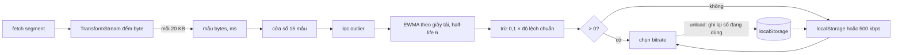

Trình phát video cần trả lời một câu hỏi liên tục: mạng của người dùng đang nhanh cỡ nào? Câu trả lời quyết định chọn bản 360p hay 1080p, có nên tự phát video kế tiếp trong News Feed hay không, và có nên tải trước vài segment hay không. Đoán cao quá thì video khựng, đoán thấp quá thì hình mờ trên đường truyền cáp quang.

Đo thì dễ: lấy số byte chia thời gian. Khó là **gộp** các lần đo: mạng di động lên xuống từng giây, một segment lấy từ cache về trong 50 ms cho ra "800 Mbps", và lúc mở trang chưa có lần đo nào cả.

> [!TIP]
> **Tóm tắt**
> - oz-player (trình phát video nội bộ của Facebook) tính **EWMA (trung bình trượt hàm mũ) theo giây tải**: half-life 6 giây, mẫu tải lâu nặng hơn mẫu tải nhanh. Trước đó loại mẫu lệch quá 2 lần độ lệch chuẩn, sau đó trừ đi 0,1 lần độ lệch chuẩn để thận trọng.
> - Chưa có số đo thì dùng giá trị đã lưu trong `localStorage` từ phiên trước, không có nữa thì 500 kbps.
> - Công thức gốc có hai chỗ hỏng: mẫu đầu tiên luôn ra `NaN` (độ lệch chuẩn bằng 0 nên bộ lọc bỏ hết mẫu), và một mẫu "cache hit" làm kết quả âm. Cả hai lặng lẽ rơi về số dự phòng 500 kbps, và số đó lại bị ghi vào cache cho phiên sau.
> - Bản viết lại lọc outlier bằng median và MAD, kẹp kết quả không âm, chỉ lưu số đo thật và lưu lúc `pagehide` thay vì `unload`.

<iframe class="demo-frame" src="/demos/facebook-patterns/index.html?theme=dark#/bandwidth-ewma" title="Demo bandwidth-ewma" loading="lazy" style="height: 900px"></iframe>

<p class="demo-links">▶ <a href="/demos/facebook-patterns/index.html#/bandwidth-ewma" target="_blank" rel="noopener">Mở demo toàn màn hình ↗</a> · <a href="https://stackblitz.com/github/hunghg255/blog-hunghg/tree/master/examples/facebook-patterns?file=src/lib/bandwidthEwma.ts" target="_blank" rel="noopener">Sửa code trên StackBlitz ↗</a> · <a href="https://github.com/hunghg255/blog-hunghg/blob/master/examples/facebook-patterns/src/lib/bandwidthEwma.ts" target="_blank" rel="noopener">Xem source trên GitHub ↗</a></p>

## Facebook làm thế nào?

Phần đo băng thông nằm trong nhóm module `oz-player/networks/*` ở bundle `15.js`. Có ba lớp: một bộ đếm byte gắn vào stream của từng request, một bộ ước lượng giữ 15 mẫu gần nhất, và một lớp cache đọc ghi `localStorage`.

### Lớp 1: đếm byte trên stream

`OzNetworkRequestStreamBandwidthReporter` tạo một transform stream và nghe hai sự kiện: mỗi lần có chunk được ghi, và lúc stream đóng. Cứ đủ `byte_count_per_sample` byte (mặc định 20 000) thì nó báo một mẫu `{ bytes, timeInMs }`:

```js
// đổi tên biến cho dễ đọc
onWrite(chunk) {
  this.totalBytes += chunk.length;
  const now = Date.now(), elapsed = now - this.sampleStart;
  if (this.bytesPerSample > 0 && this.totalBytes >= this.lastReported + this.bytesPerSample && !this.isBogus(elapsed, 0)) {
    this.report(this.totalBytes - this.lastReported, elapsed, 0);
    this.sampleStart = now;
    this.lastReported = this.totalBytes;
  }
}
isBogus(ms, responseTimeMs) {
  if (ms - responseTimeMs <= 0) return true;
  const bitsPerSec = this.totalBytes * 8 / (ms / 1000);   // byte CỘNG DỒN, không phải byte của mẫu
  return ms < this.minimumSampleDuration && bitsPerSec > this.maximumSampleBandwidth;
}
```

Hàm `isBogus` lẽ ra kiểm tra mẫu hiện tại có "nhanh vô lý" không, nhưng nó chia **tổng số byte từ đầu request** cho thời gian của **riêng mẫu này**. Càng về cuối stream, tốc độ tính ra càng phồng. Với cấu hình mặc định (`minimumSampleDuration = 0`) vế đầu luôn sai nên kiểm tra này không bao giờ loại mẫu nào; nếu server bật ngưỡng, các mẫu cuối của request dài sẽ bị loại oan.

Lúc stream đóng, nếu chưa báo mẫu nào, nó có thể lấy thời gian từ Resource Timing (`responseEnd - startTime`) để có ít nhất một mẫu, và báo thêm thời gian tới byte đầu (`responseStart - requestStart`).

### Lớp 2: công thức ước lượng

`OzBandwidthUtils` có ba hàm. Bỏ minify:

```js
function ewma(points, halfLife) {
  const alpha = Math.exp(Math.log(0.5) / halfLife);   // 0.5^(1/halfLife)
  let est = 0, totalWeight = 0;
  for (const p of points) {
    const keep = Math.pow(alpha, p.weight);
    est = p.value * (1 - keep) + est * keep;
    totalWeight += p.weight;
  }
  return Math.round(est / (1 - Math.pow(alpha, totalWeight)));
}
const ewmaOfBandwidth = (samples, hl) =>
  ewma(samples.map((s) => ({ value: s.bytes * 8000 / s.timeInMs, weight: s.timeInMs / 1000 })), hl);

function getBandwidthEstimate(samples, halfLife, outlierFactor, penaltyFactor) {
  const sd = stdDevOfBandwidth(samples);                       // độ lệch chuẩn, đã làm tròn
  const kept = samples.filter((s) => Math.abs(mean - bw(s)) < sd * outlierFactor);
  return ewmaOfBandwidth(kept, halfLife) - sd * penaltyFactor;
}
```

Ba ý hay trong đoạn này:

- **Trọng số là số giây tải.** Một mẫu đo trong 2 giây đáng tin hơn mẫu đo trong 50 ms, nên nó "kéo" trung bình mạnh hơn. Half-life 6 nghĩa là sau 6 giây tải dữ liệu mới, ảnh hưởng của dữ liệu cũ giảm một nửa, bất kể đó là 3 mẫu hay 30 mẫu.
- **Chia cho `1 - alpha^tổng trọng số`** để bù thiên lệch: EWMA bắt đầu từ 0, nên với ít mẫu nó luôn thấp hơn thực tế. Phép chia này đưa nó về đúng tỉ lệ (cùng mẹo "bias correction" của Adam optimizer).
- **Trừ phạt độ lệch chuẩn.** Mạng dao động mạnh thì chọn chất lượng thấp hơn một chút để có dư địa.

`OzBandwidthEstimator` gọi hàm trên với `half_life = 6`, `outlier_exclusion_factor = 2`, `std_dev_penalty_factor = 0.1`, rồi:

```js
getBandwidth(config) {
  const b = getBandwidthEstimate(this.samples, 6, 2, 0.1);
  return b > 0 ? b : this.fallback(config);   // cache trong localStorage, rồi mới tới 500 000
}
```

Ngoài ra nó còn phạt khi nhiều video tải song song: mỗi video thêm trong hàng đợi trừ `bandwidth_penalty_per_additional_video` (tối đa 90%), vì băng thông bị chia cho các video đang tải trước trong feed.

### Chỗ hỏng: `b > 0` đang che hai lỗi

Chạy công thức gốc với vài bộ mẫu:

| Mẫu | Kết quả gốc | Vì sao |
|---|---|---|
| 1 mẫu 1 Mbps | `NaN` | sd = 0, điều kiện `< 0` bỏ hết mẫu, EWMA của tập rỗng là 0/0 |
| 3 mẫu bằng nhau | `NaN` | như trên |
| 3 mẫu ~1 Mbps + 1 mẫu 5 MB/50 ms | khoảng −11,8 Mbps | sd phồng lên 346 Mbps, phạt 0,1 × sd lớn hơn cả EWMA |

`NaN > 0` và số âm `> 0` đều sai, nên cả hai trường hợp lặng lẽ rơi về số dự phòng. Người dùng không thấy lỗi, chỉ thấy video mở đầu ở chất lượng ứng với 500 kbps, và chất lượng đó kéo dài cho tới khi có đủ mẫu "đẹp".

Trường hợp thứ ba còn tệ hơn vì **bộ lọc 2σ không bao giờ loại được gì khi có từ 4 mẫu trở xuống**. Với độ lệch chuẩn tổng thể (chia cho n), một điểm chỉ có thể lệch khỏi trung bình tối đa √(n−1) lần σ. Bốn mẫu thì tối đa √3 ≈ 1,73σ, chưa tới 2σ. Chính mẫu outlier làm σ phồng lên đủ để che nó. Mẫu cache hit 800 Mbps được giữ lại, và phải chờ nó trôi khỏi cửa sổ 15 mẫu thì ước lượng mới sống lại.

### Lớp 3: nhớ qua phiên

```js
class OzBandwidthCache {
  constructor(key, getValue) {
    OzWindowEvents.onUnload(() => this.updateCachedBandwidth());
  }
  updateCachedBandwidth() { OzCacheStorage.set(this.key, String(this.getValue())); }
}
```

`getValue` là `getAdjustedBandwidth()`, tức con số **đang được dùng**, có thể chính là số dự phòng và đã bị trừ phạt theo số video song song. Phiên này rơi về 500 kbps vì `NaN` thì lúc đóng tab nó ghi 500 kbps vào cache, và phiên sau bắt đầu từ 500 kbps. Thêm nữa, `unload` không chạy đáng tin trên mobile (trình duyệt giết tab ở nền mà không phát sự kiện) và làm trang không vào được bfcache.

### Một bộ ước lượng thứ hai: VideoPlayerShakaBandwidthEstimator

Trình phát cũ dựa trên Shaka Player (bundle `139.js`) có bộ ước lượng riêng, dùng `CacheStorage("localstorage", "_video_")` với cùng khoá `bandwidthEstimate`. Phần đáng học là cổng chặn autoplay:

```js
static isAutoplayBandwidthRestrained(isLive) {
  const est = getEstimator();
  const value = useFastAverage && restrained ? est.getFastMovingBandwidth() : est.getBandwidth();
  const threshold = isLive ? 250000 : 123034;
  restrained = !(value === null || value >= threshold);
  return restrained;
}
```

Không có ngưỡng thứ hai hay thời gian chờ nào giữ trạng thái chặn; hàm chỉ nhớ kết quả lần trước để **chọn nguồn số đo**. Lần trước không bị chặn thì xét theo trung bình chậm, nên một lần tụt ngắn khó làm chặn autoplay. Lần trước đã bị chặn thì đọc trung bình nhanh (`getFastMovingBandwidth`) để mở lại autoplay ngay khi mạng hồi phục. Nếu cả hai chiều cùng dùng trung bình chậm, người dùng vừa ra khỏi thang máy phải chờ hàng chục giây mới được autoplay lại.



## Bên trong trình duyệt: đo ở đâu cho đúng?

- **Đếm byte trên `ReadableStream`** của `fetch` đo được tốc độ dữ liệu thật sự tới JavaScript, gồm cả thời gian giải nén. Đây là cách oz-player làm: response được `pipeThrough` một transform stream trước khi tới bộ đệm video.
- **Resource Timing** (`performance.getEntriesByName(url)`) cho các mốc `requestStart`, `responseStart`, `responseEnd` chính xác hơn `Date.now()`, nhưng chỉ có sau khi request xong, và với request khác origin thì cần header `Timing-Allow-Origin`.
- **`navigator.connection.downlink`** (Network Information API) cho một con số ước lượng sẵn, làm tròn tới 25 kbps và có trần, chỉ có trên trình duyệt nhân Chromium (tính tới 10/2026). Dùng làm giá trị khởi đầu được, không thay được đo thật.
- **Cache hit** từ HTTP cache hoặc Service Worker trả về gần như tức thì. Đó là lý do oz-player có cờ `exclude_prefetch_bandwidth_samples` để bỏ mẫu của response lấy từ cache.

## Viết lại

File `src/lib/bandwidthEwma.ts` giữ ý tưởng của oz-player, sửa các điểm trên. EWMA trọng số liên tục, trả `null` thay vì `NaN` khi không có dữ liệu:

```ts title=src/lib/bandwidthEwma.ts
/**
 * EWMA với trọng số liên tục: alpha = 0.5^(1/halfLife), mỗi điểm "kéo" giá trị
 * theo trọng số riêng. Chia cho (1 - alpha^tổng trọng số) để bỏ thiên lệch về 0 ở đầu chuỗi.
 */
export function ewma(points: { value: number; weight: number }[], halfLife: number): number | null {
  const alpha = Math.exp(Math.log(0.5) / halfLife);
  let estimate = 0;
  let totalWeight = 0;
  for (const p of points) {
    const keep = Math.pow(alpha, p.weight);
    estimate = p.value * (1 - keep) + estimate * keep;
    totalWeight += p.weight;
  }
  if (totalWeight <= 0) return null;
  return estimate / (1 - Math.pow(alpha, totalWeight));
}
```

Lọc outlier bằng **median và MAD** (median absolute deviation, độ lệch tuyệt đối trung vị). Median không bị một mẫu cực lớn kéo đi, nên ngưỡng không phồng theo outlier như σ:

```ts title=src/lib/bandwidthEwma.ts
/** Lọc outlier bằng median + MAD: vẫn chạy được khi ít mẫu, không bị chính outlier làm phình ngưỡng. */
export function filterOutliers(samples: BandwidthSample[], factor: number): BandwidthSample[] {
  if (samples.length < 3) return samples;
  const rates = samples.map(bps);
  const med = median(rates);
  const deviations = rates.map((r) => Math.abs(r - med));
  // MAD × 1.4826 ≈ σ với phân phối chuẩn; quá nửa số mẫu trùng nhau thì MAD = 0, lùi về trung bình độ lệch
  const scale = median(deviations) * 1.4826 || mean(deviations) * 1.2533;
  if (scale === 0) return samples;
  return samples.filter((_, i) => deviations[i] <= factor * scale);
}

function median(values: number[]): number {
  const sorted = [...values].sort((a, b) => a - b);
  const mid = sorted.length >> 1;
  return sorted.length % 2 ? sorted[mid] : (sorted[mid - 1] + sorted[mid]) / 2;
}

export function estimateBandwidth(samples: BandwidthSample[], o: EstimateOptions = {}): number | null {
  const { halfLifeSec = 6, outlierFactor = 2, stdDevPenalty = 0.1, floorRatio = 0.5 } = o;
  const kept = filterOutliers(samples, outlierFactor);
  const raw = ewma(kept.map((s) => ({ value: bps(s), weight: s.ms / 1000 })), halfLifeSec);
  if (raw == null || !Number.isFinite(raw)) return null;
  const penalty = stdDev(kept.map(bps)) * stdDevPenalty; // độ lệch của tập ĐÃ lọc
  return Math.round(Math.max(raw - penalty, raw * floorRatio));
}
```

Bộ ước lượng: trả kèm **nguồn** của con số, chỉ lưu khi có số đo thật, cache có hạn dùng, lưu khi trang bị ẩn:

```ts title=src/lib/bandwidthEwma.ts
  addSample(sample: BandwidthSample): void {
    if (sample.ms <= 0 || sample.bytes <= 0) return;
    this.samples.push(sample);
    if (this.samples.length > this.o.maxSamples) this.samples.shift();
  }

  getSamples(): readonly BandwidthSample[] {
    return this.samples;
  }

  /** Ước lượng hiện tại và nguồn của nó, để UI/log biết số đang dùng là đo thật hay đoán. */
  estimate(): { bps: number; source: 'samples' | 'cache' | 'default' } {
    const live = estimateBandwidth(this.samples, this.o);
    if (live != null && live > 0) return { bps: live, source: 'samples' };
    const cached = this.readCache();
    if (cached != null) return { bps: cached, source: 'cache' };
    return { bps: this.o.defaultBps, source: 'default' };
  }

  readCache(): number | null {
    const raw = this.o.store?.get(this.o.storageKey);
    if (!raw) return null;
    try {
      const { bps: value, at } = JSON.parse(raw) as { bps: number; at: number };
      if (!(value > 0) || this.o.now() - at > this.o.maxCacheAgeMs) return null;
      return value;
    } catch {
      return null;
    }
  }

  /** Chỉ lưu khi có số đo thật: không ghi lại giá trị cache/mặc định, tránh vòng lặp tự củng cố. */
  persist(): boolean {
    const live = estimateBandwidth(this.samples, this.o);
    if (live == null || live <= 0) return false;
    this.o.store?.set(this.o.storageKey, JSON.stringify({ bps: live, at: this.o.now() }));
    return true;
  }

  /** pagehide + visibilitychange thay cho unload (unload không chạy trên mobile, chặn bfcache). */
  persistOnHide(target: Window = window): () => void {
    const onHide = () => void this.persist();
    const onVisibility = () => document.visibilityState === 'hidden' && this.persist();
    target.addEventListener('pagehide', onHide);
    target.document.addEventListener('visibilitychange', onVisibility);
    return () => {
      target.removeEventListener('pagehide', onHide);
      target.document.removeEventListener('visibilitychange', onVisibility);
    };
  }
}
```

Bộ đếm byte và cổng autoplay:

```ts title=src/lib/bandwidthEwma.ts
/**
 * TransformStream đếm byte đi qua và báo một mẫu mỗi khi đủ bytesPerSample.
 * Mẫu dùng số byte CỦA MẪU (không phải byte cộng dồn) khi kiểm tra mẫu vô lý.
 */
export function createBandwidthMeter(
  onSample: (s: BandwidthSample) => void,
  { bytesPerSample = 20_000, maxBps = 1e9, now = () => performance.now() } = {},
): TransformStream<Uint8Array, Uint8Array> {
  let start = now();
  let pending = 0;
  const emit = () => {
    const t = now();
    const ms = t - start;
    if (ms > 0 && (pending * 8000) / ms <= maxBps) onSample({ bytes: pending, ms });
    start = t;
    pending = 0;
  };
  return new TransformStream({
    transform(chunk, controller) {
      pending += chunk.byteLength;
      if (pending >= bytesPerSample) emit();
      controller.enqueue(chunk);
    },
    flush() {
      if (pending > 0) emit();
    },
  });
}

/**
 * Cổng chặn autoplay bất đối xứng: bị chặn hay không xét theo EWMA chậm,
 * lần trước đã bị chặn thì đọc EWMA nhanh để mở lại sớm khi mạng hồi phục (cùng một ngưỡng).
 */
export class AutoplayGate {
  restrained = false;
  constructor(private readonly thresholdBps = 123_034) {}

  update(slowBps: number | null, fastBps: number | null): boolean {
    const value = this.restrained ? fastBps ?? slowBps : slowBps;
    this.restrained = value != null && value < this.thresholdBps;
    return this.restrained;
  }
}
```

::: spoiler Xem toàn bộ src/lib/bandwidthEwma.ts

```ts title=src/lib/bandwidthEwma.ts
/**
 * Ước lượng băng thông kiểu oz-player (Facebook): EWMA theo half-life tính bằng giây,
 * loại outlier theo độ lệch chuẩn, trừ phạt theo độ dao động, nhớ kết quả qua phiên.
 * Viết lại từ đầu; có kèm bản "meta" mô phỏng đúng công thức gốc để demo so sánh.
 */

export interface BandwidthSample {
  bytes: number;
  ms: number;
}

export interface EstimateOptions {
  /** Half-life tính theo giây tải (mẫu tải 2 s nặng gấp đôi mẫu 1 s). Gốc: 6. */
  halfLifeSec?: number;
  /** Bỏ mẫu lệch khỏi trung bình quá factor × độ lệch chuẩn. Gốc: 2. */
  outlierFactor?: number;
  /** Trừ penalty × độ lệch chuẩn khỏi kết quả. Gốc: 0.1. */
  stdDevPenalty?: number;
  /** Kết quả không bao giờ thấp hơn floorRatio × EWMA (bản gốc có thể ra số âm). */
  floorRatio?: number;
}

export const bps = (s: BandwidthSample) => (s.bytes * 8000) / s.ms;

export function mean(values: number[]): number {
  return values.reduce((a, b) => a + b, 0) / values.length;
}

export function stdDev(values: number[]): number {
  if (values.length === 0) return 0;
  const m = mean(values);
  return Math.sqrt(values.reduce((acc, v) => acc + (v - m) ** 2, 0) / values.length);
}

/**
 * EWMA với trọng số liên tục: alpha = 0.5^(1/halfLife), mỗi điểm "kéo" giá trị
 * theo trọng số riêng. Chia cho (1 - alpha^tổng trọng số) để bỏ thiên lệch về 0 ở đầu chuỗi.
 */
export function ewma(points: { value: number; weight: number }[], halfLife: number): number | null {
  const alpha = Math.exp(Math.log(0.5) / halfLife);
  let estimate = 0;
  let totalWeight = 0;
  for (const p of points) {
    const keep = Math.pow(alpha, p.weight);
    estimate = p.value * (1 - keep) + estimate * keep;
    totalWeight += p.weight;
  }
  if (totalWeight <= 0) return null;
  return estimate / (1 - Math.pow(alpha, totalWeight));
}

/** Công thức gốc, giữ nguyên cả chỗ yếu: dùng để demo cho thấy NaN và số âm. */
export function metaEstimate(samples: BandwidthSample[], o: EstimateOptions = {}): number {
  const { halfLifeSec = 6, outlierFactor = 2, stdDevPenalty = 0.1 } = o;
  const rates = samples.map(bps);
  const sd = Math.round(stdDev(rates));
  const m = mean(rates);
  const kept = samples.filter((s) => Math.abs(m - bps(s)) < sd * outlierFactor); // `<`: sd = 0 thì bỏ hết
  const alpha = Math.exp(Math.log(0.5) / halfLifeSec);
  let est = 0;
  let w = 0;
  for (const s of kept) {
    const keep = Math.pow(alpha, s.ms / 1000);
    est = bps(s) * (1 - keep) + est * keep;
    w += s.ms / 1000;
  }
  return Math.round(est / (1 - Math.pow(alpha, w))) - sd * stdDevPenalty; // 0/0 = NaN khi kept rỗng
}

/** Lọc outlier bằng median + MAD: vẫn chạy được khi ít mẫu, không bị chính outlier làm phình ngưỡng. */
export function filterOutliers(samples: BandwidthSample[], factor: number): BandwidthSample[] {
  if (samples.length < 3) return samples;
  const rates = samples.map(bps);
  const med = median(rates);
  const deviations = rates.map((r) => Math.abs(r - med));
  // MAD × 1.4826 ≈ σ với phân phối chuẩn; quá nửa số mẫu trùng nhau thì MAD = 0, lùi về trung bình độ lệch
  const scale = median(deviations) * 1.4826 || mean(deviations) * 1.2533;
  if (scale === 0) return samples;
  return samples.filter((_, i) => deviations[i] <= factor * scale);
}

function median(values: number[]): number {
  const sorted = [...values].sort((a, b) => a - b);
  const mid = sorted.length >> 1;
  return sorted.length % 2 ? sorted[mid] : (sorted[mid - 1] + sorted[mid]) / 2;
}

export function estimateBandwidth(samples: BandwidthSample[], o: EstimateOptions = {}): number | null {
  const { halfLifeSec = 6, outlierFactor = 2, stdDevPenalty = 0.1, floorRatio = 0.5 } = o;
  const kept = filterOutliers(samples, outlierFactor);
  const raw = ewma(kept.map((s) => ({ value: bps(s), weight: s.ms / 1000 })), halfLifeSec);
  if (raw == null || !Number.isFinite(raw)) return null;
  const penalty = stdDev(kept.map(bps)) * stdDevPenalty; // độ lệch của tập ĐÃ lọc
  return Math.round(Math.max(raw - penalty, raw * floorRatio));
}

export interface BandwidthStore {
  get(key: string): string | null;
  set(key: string, value: string): void;
}

export interface EstimatorOptions extends EstimateOptions {
  maxSamples?: number;
  defaultBps?: number;
  storageKey?: string;
  /** Giá trị đã lưu quá tuổi này thì bỏ (mạng hôm qua không phải mạng hôm nay). */
  maxCacheAgeMs?: number;
  store?: BandwidthStore | null;
  now?: () => number;
}

export class BandwidthEstimator {
  private samples: BandwidthSample[] = [];
  private readonly o: Required<Omit<EstimatorOptions, 'store'>> & { store: BandwidthStore | null };

  constructor(options: EstimatorOptions = {}) {
    this.o = {
      halfLifeSec: 6,
      outlierFactor: 2,
      stdDevPenalty: 0.1,
      floorRatio: 0.5,
      maxSamples: 15,
      defaultBps: 500_000,
      storageKey: 'bandwidthEstimate',
      maxCacheAgeMs: 24 * 3600_000,
      store: safeLocalStorage(),
      now: Date.now,
      ...options,
    };
  }

  addSample(sample: BandwidthSample): void {
    if (sample.ms <= 0 || sample.bytes <= 0) return;
    this.samples.push(sample);
    if (this.samples.length > this.o.maxSamples) this.samples.shift();
  }

  getSamples(): readonly BandwidthSample[] {
    return this.samples;
  }

  /** Ước lượng hiện tại và nguồn của nó, để UI/log biết số đang dùng là đo thật hay đoán. */
  estimate(): { bps: number; source: 'samples' | 'cache' | 'default' } {
    const live = estimateBandwidth(this.samples, this.o);
    if (live != null && live > 0) return { bps: live, source: 'samples' };
    const cached = this.readCache();
    if (cached != null) return { bps: cached, source: 'cache' };
    return { bps: this.o.defaultBps, source: 'default' };
  }

  readCache(): number | null {
    const raw = this.o.store?.get(this.o.storageKey);
    if (!raw) return null;
    try {
      const { bps: value, at } = JSON.parse(raw) as { bps: number; at: number };
      if (!(value > 0) || this.o.now() - at > this.o.maxCacheAgeMs) return null;
      return value;
    } catch {
      return null;
    }
  }

  /** Chỉ lưu khi có số đo thật: không ghi lại giá trị cache/mặc định, tránh vòng lặp tự củng cố. */
  persist(): boolean {
    const live = estimateBandwidth(this.samples, this.o);
    if (live == null || live <= 0) return false;
    this.o.store?.set(this.o.storageKey, JSON.stringify({ bps: live, at: this.o.now() }));
    return true;
  }

  /** pagehide + visibilitychange thay cho unload (unload không chạy trên mobile, chặn bfcache). */
  persistOnHide(target: Window = window): () => void {
    const onHide = () => void this.persist();
    const onVisibility = () => document.visibilityState === 'hidden' && this.persist();
    target.addEventListener('pagehide', onHide);
    target.document.addEventListener('visibilitychange', onVisibility);
    return () => {
      target.removeEventListener('pagehide', onHide);
      target.document.removeEventListener('visibilitychange', onVisibility);
    };
  }
}

function safeLocalStorage(): BandwidthStore | null {
  try {
    if (typeof localStorage === 'undefined') return null;
    return { get: (k) => localStorage.getItem(k), set: (k, v) => localStorage.setItem(k, v) };
  } catch {
    return null;
  }
}

/**
 * TransformStream đếm byte đi qua và báo một mẫu mỗi khi đủ bytesPerSample.
 * Mẫu dùng số byte CỦA MẪU (không phải byte cộng dồn) khi kiểm tra mẫu vô lý.
 */
export function createBandwidthMeter(
  onSample: (s: BandwidthSample) => void,
  { bytesPerSample = 20_000, maxBps = 1e9, now = () => performance.now() } = {},
): TransformStream<Uint8Array, Uint8Array> {
  let start = now();
  let pending = 0;
  const emit = () => {
    const t = now();
    const ms = t - start;
    if (ms > 0 && (pending * 8000) / ms <= maxBps) onSample({ bytes: pending, ms });
    start = t;
    pending = 0;
  };
  return new TransformStream({
    transform(chunk, controller) {
      pending += chunk.byteLength;
      if (pending >= bytesPerSample) emit();
      controller.enqueue(chunk);
    },
    flush() {
      if (pending > 0) emit();
    },
  });
}

/**
 * Cổng chặn autoplay bất đối xứng: bị chặn hay không xét theo EWMA chậm,
 * lần trước đã bị chặn thì đọc EWMA nhanh để mở lại sớm khi mạng hồi phục (cùng một ngưỡng).
 */
export class AutoplayGate {
  restrained = false;
  constructor(private readonly thresholdBps = 123_034) {}

  update(slowBps: number | null, fastBps: number | null): boolean {
    const value = this.restrained ? fastBps ?? slowBps : slowBps;
    this.restrained = value != null && value < this.thresholdBps;
    return this.restrained;
  }
}
```

:::

**Khác bản gốc:**

- Lọc outlier bằng median/MAD, nhận mẫu khi lệch `<=` ngưỡng. Hơn nửa số mẫu trùng nhau (MAD = 0) thì lùi về trung bình độ lệch tuyệt đối, nên ba mẫu 1 Mbps cộng một mẫu 800 Mbps vẫn loại được mẫu cuối.
- Phạt theo độ lệch chuẩn của tập **đã lọc**, và kết quả không thấp hơn một nửa EWMA. Không còn số âm.
- `estimate()` trả `{ bps, source }`. Log và UI biết đang dùng số đo hay số đoán.
- `persist()` chỉ ghi số đo thật, kèm thời điểm; số cũ hơn một ngày bị bỏ qua. Gắn vào `pagehide` và `visibilitychange` thay vì `unload`.
- Bộ đếm byte báo mẫu theo số byte của chính mẫu đó và kiểm tra mẫu vô lý theo số đó.
- Phần phạt nhiều video song song không đưa vào lib; nhân thêm hệ số ở chỗ chọn bitrate nếu cần.

## Đi qua code

- **`bps(s)`** đổi một mẫu ra bit/giây: `bytes × 8 × 1000 / ms`.
- **`ewma()`** là bản sạch của công thức gốc. `alpha^weight` là phần "giữ lại" của giá trị cũ sau `weight` giây; half-life 6 thì sau 6 giây tải phần giữ lại là 0,5.
- **`metaEstimate()`** mô phỏng đúng công thức gốc, cả dấu `<` và việc làm tròn σ. Demo dùng nó để so sánh, không dùng trong code thật.
- **`filterOutliers()`** cần ít nhất 3 mẫu. Hệ số 1,4826 đưa MAD về cùng thang với σ khi dữ liệu phân phối chuẩn, nên `factor = 2` mang nghĩa gần giống "2 sigma".
- **`BandwidthEstimator.addSample()`** bỏ mẫu có thời gian hoặc số byte không dương, giữ tối đa 15 mẫu như bản gốc.
- **`createBandwidthMeter()`** trả về `TransformStream<Uint8Array>`; gắn bằng `response.body.pipeThrough(meter)`. `flush()` báo nốt phần byte còn lại khi stream đóng.
- **`AutoplayGate.update(slow, fast)`** làm như bản gốc: cùng một ngưỡng, chỉ đổi nguồn số đo theo kết quả lần trước. Nó nhận hai ước lượng, một với half-life 6 và một với half-life ngắn. Demo dùng 1,5 giây cho bản nhanh.

## Tại sao không làm cách khác?

**Trung bình cộng các mẫu?** Mẫu cũ nặng ngang mẫu mới, nên khi người dùng bước từ Wi-Fi ra 4G, ước lượng phải chờ cả cửa sổ trôi qua mới thay đổi. EWMA ưu tiên dữ liệu gần đây.

**EWMA theo số mẫu thay vì theo giây?** Nếu mỗi mẫu cùng trọng số, một loạt request nhỏ (manifest, ảnh thumbnail) với tốc độ đo được thấp sẽ áp đảo một request video lớn. Theo giây tải thì mẫu nào chiếm nhiều thời gian đường truyền hơn mới nặng hơn.

**Chỉ lấy mẫu mới nhất?** Một lần TCP slow start hoặc một gói mất là đủ để chất lượng nhảy lên xuống liên tục. Người xem ghét đổi chất lượng hơn là xem chất lượng thấp hơn một bậc.

**Dùng `navigator.connection.downlink`?** Không có trên Safari và Firefox, bị làm tròn, và là ước lượng của cả máy chứ không phải của đường tới CDN video.

## Edge case và cạm bẫy

- **Mẫu từ cache.** Response lấy từ HTTP cache hay Service Worker không nói gì về mạng. Đánh dấu và bỏ qua, hoặc đặt thời gian mẫu tối thiểu (oz-player có `minimum_bandwidth_sample_duration`, mặc định 0).
- **Tải song song.** Ba segment tải cùng lúc, mỗi cái đo được 1/3 băng thông. Cộng tốc độ các request đang chạy, hoặc chỉ đo khi tải tuần tự.
- **HTTP/2 và HTTP/3 multiplexing** làm thời gian của một request bao gồm cả lúc chờ các stream khác trên cùng kết nối.
- **Tab ở nền.** Trình duyệt hạn chế timer và có thể dừng tải; mẫu đo lúc đó thấp giả. Bỏ mẫu khi `document.hidden`.
- **Giá trị lưu từ phiên trước** có thể đến từ mạng khác (Wi-Fi văn phòng hôm qua, 4G hôm nay). Gắn thời điểm và hạn dùng; bản viết lại bỏ số cũ hơn 24 giờ.
- **Chế độ riêng tư** có thể chặn `localStorage` hoặc ném lỗi khi ghi. Bọc `try/catch`, và vẫn chạy được khi không có bộ nhớ.

## Dùng trong dự án

```ts
import { BandwidthEstimator, createBandwidthMeter } from './bandwidthEwma';

const estimator = new BandwidthEstimator({ storageKey: 'my-player-bw' });
estimator.persistOnHide();

async function fetchSegment(url: string): Promise<Uint8Array> {
  const res = await fetch(url);
  const fromCache = res.headers.get('x-cache') === 'HIT';
  const meter = createBandwidthMeter((s) => !fromCache && estimator.addSample(s));
  const buf = await new Response(res.body!.pipeThrough(meter)).arrayBuffer();
  return new Uint8Array(buf);
}

function pickRendition(renditions: { bandwidth: number }[]) {
  const { bps, source } = estimator.estimate();
  const budget = bps * (source === 'samples' ? 0.8 : 0.6); // số đoán thì thận trọng hơn
  return [...renditions].sort((a, b) => b.bandwidth - a.bandwidth).find((r) => r.bandwidth <= budget) ?? renditions.at(-1);
}
```

## Kiểm thử

::: spoiler Ví dụ test (bản phác, không có trong repo)

```ts
import { describe, expect, it } from 'vitest';
import { AutoplayGate, BandwidthEstimator, estimateBandwidth, metaEstimate } from './bandwidthEwma';

const s = (mbps: number, ms = 1000) => ({ bytes: (mbps * 1e6 * ms) / 8000, ms });

describe('estimateBandwidth', () => {
  it('một mẫu cho ra đúng tốc độ, bản gốc ra NaN', () => {
    expect(estimateBandwidth([s(1)])).toBe(1_000_000);
    expect(metaEstimate([s(1)])).toBeNaN();
  });

  it('loại mẫu cache hit khi chỉ có 4 mẫu', () => {
    const samples = [s(1), s(2), s(1, 900), { bytes: 5_000_000, ms: 50 }];
    expect(metaEstimate(samples)).toBeLessThan(0);
    const v = estimateBandwidth(samples)!;
    expect(v).toBeGreaterThan(1_000_000);
    expect(v).toBeLessThan(2_000_000);
  });

  it('không bao giờ âm', () => {
    expect(estimateBandwidth([s(0.1), s(50), s(0.2), s(30)])!).toBeGreaterThan(0);
  });
});

describe('BandwidthEstimator', () => {
  it('chỉ lưu số đo thật và bỏ cache quá hạn', () => {
    const map = new Map<string, string>();
    const store = { get: (k: string) => map.get(k) ?? null, set: (k: string, v: string) => void map.set(k, v) };
    let now = 0;
    const a = new BandwidthEstimator({ store, now: () => now });
    expect(a.persist()).toBe(false);
    a.addSample(s(3));
    expect(a.persist()).toBe(true);
    const b = new BandwidthEstimator({ store, now: () => now });
    expect(b.estimate()).toEqual({ bps: 3_000_000, source: 'cache' });
    now = 25 * 3600_000;
    expect(b.estimate().source).toBe('default');
  });
});

describe('AutoplayGate', () => {
  it('vào bằng trung bình chậm, ra bằng trung bình nhanh', () => {
    const gate = new AutoplayGate(100_000);
    expect(gate.update(90_000, 300_000)).toBe(true);
    expect(gate.update(90_000, 300_000)).toBe(false);
  });
});
```

:::

## So với thư viện và chuẩn web

- **Shaka Player** có `EwmaBandwidthEstimator` với hai EWMA (half-life 2 giây và 5 giây) và lấy giá trị **nhỏ hơn**; nó cũng bỏ qua mẫu dưới 16 KB. Facebook từng dùng một bản mở rộng có cache (`EWMACacheBandwidthEstimator`).
- **hls.js** có `EwmaBandWidthEstimator` cũng dùng hai EWMA nhanh/chậm và lấy min, cộng thêm ước lượng TTFB riêng, giống `getEstimatedTimeToFirstByteMs` của oz-player.
- **dash.js** cho chọn giữa trung bình trượt hàm mũ và trung bình trượt cửa sổ (sliding window) qua cấu hình `throughput`.
- **`navigator.connection`** (`downlink`, `effectiveType`, `rtt`) chỉ có trên trình duyệt nhân Chromium, xem [caniuse](https://caniuse.com/netinfo).
- **`pagehide`/`visibilitychange`** là cách lưu trạng thái được khuyến nghị thay cho `unload`; Chrome đang dần bỏ hẳn sự kiện `unload`.

---

Bài này thuộc series **[Học từ mã nguồn Facebook](/series/facebook)** (106 bài, đọc theo thứ tự).

::: spoiler Xem nhanh danh sách bài trong series

*Phần 1*

- [Mở đầu: cách đọc code minify của Facebook](/blogs/learn-from-facebook-source-code)
- [#1 Dùng chung IntersectionObserver + infinite scroll](/blogs/facebook-shared-intersection-observer)
- [#2 useViewportDuration: đo thời gian thực sự được xem](/blogs/facebook-use-viewport-duration)
- [#3 Preload code + data khi hover](/blogs/facebook-preload-on-hover)
- [#4 Toast manager với external store](/blogs/facebook-toast-manager)
- [#5 Network status + heartbeat backoff](/blogs/facebook-network-status-heartbeat)
- [#6 ErrorGuard: bắt lỗi theo ngữ cảnh](/blogs/facebook-error-guard)
- [#7 Banzai: gom log theo lô + sendBeacon](/blogs/facebook-batch-logger)
- [#8 Focus trap + Esc theo layer](/blogs/facebook-focus-trap)

*Phần 2*

- [#9 Mẹo calc(… * 9999): container query, line-clamp, mũi tên carousel bằng CSS](/blogs/facebook-css-9999-trick)
- [#10 Thanh cuộn tuỳ biến bằng CSS 3D](/blogs/facebook-css-3d-scrollbar)
- [#11 Modal cuộn bằng window, giữ vị trí trang nền](/blogs/facebook-document-scroll-modal)
- [#12 Popover, tooltip group và hovercard](/blogs/facebook-popover-tooltip)
- [#13 Primitive Pressable + focus-visible](/blogs/facebook-pressable)
- [#14 Tab "Xem thêm" + sticky header bằng IntersectionObserver](/blogs/facebook-priority-tabs-sticky-header)
- [#15 Avatar khoét mask, gradient Messenger, skeleton steps()](/blogs/facebook-visual-tricks)
- [#16 Khung chat không giật](/blogs/facebook-chat-scroller)
- [#17 Thuật toán chọn bố cục collage ảnh](/blogs/facebook-photo-collage-layout)
- [#18 Keep-alive tab trong SPA](/blogs/facebook-keep-alive-tabs)
- [#19 Tự đo Visual Completion & interaction tracing](/blogs/facebook-visual-completion)
- [#20 Router SPA bền bỉ & tải chunk có retry](/blogs/facebook-spa-router-resilient-loading)

*Phần 3*

- [#21 Smart Compose: gợi ý chữ mờ khi gõ](/blogs/facebook-smart-compose-ghost-text)
- [#22 MQTT ngay trong trình duyệt, tự chuyển sang long-poll](/blogs/facebook-mqtt-in-browser)
- [#23 Đo thời gian dùng bằng bitmap 64 giây](/blogs/facebook-time-spent-bitmap)
- [#24 Bảng reaction nhấn giữ rồi trượt](/blogs/facebook-reaction-press-slide)
- [#25 Tìm kiếm gấp dấu, phiên âm và highlight đầu từ](/blogs/facebook-search-diacritics-tokenize)
- [#26 Ring buffer biết trace nào đã mất log](/blogs/facebook-trace-ring-buffer)
- [#27 Engine animation JS: một vòng rAF và solver cubic-bezier](/blogs/facebook-keyframes-loop-cubic-bezier)
- [#28 Bootloader: bitmap tài nguyên đã tải, chỉ reload khi cần](/blogs/facebook-bootloader-bitmap-consistency)
- [#29 Nhận biết click do screen reader tạo ra](/blogs/facebook-virtual-cursor-detection)
- [#30 Tải trước feed theo chất lượng mạng, đoán hạng thiết bị](/blogs/facebook-network-aware-prefetch)
- [#31 Hàng đợi gửi tin chat giữ đúng thứ tự](/blogs/facebook-ordered-send-queue)
- [#32 Gộp lời gọi API trong cùng một tick](/blogs/facebook-api-batcher)
- [#33 Resize ảnh trong pool Web Worker](/blogs/facebook-jpeg-resize-worker-pool)
- [#34 Crop ảnh theo nhiều khuôn mặt](/blogs/facebook-face-aware-crop)
- [#35 Kéo-thả sắp xếp và vùng thả file không nhấp nháy](/blogs/facebook-flicker-free-drag-drop)
- [#36 Tiện ích UI: fade-out, sticky event, hàm huỷ được](/blogs/facebook-ui-utility-hooks)
- [#37 Hạ tầng nhỏ: cookie, hash lỗi, prefetch khi chuột dừng](/blogs/facebook-small-infra-cookie-hash-idle)

*Phần 4–6*

- [#38 Đồng bộ tin nhắn: phát hiện lỗ seqID và fetch bù theo tầng](/blogs/facebook-messenger-sync-seqid-gaps)
- [#39 OTID: ID tin nhắn kiểu Snowflake sinh ở client](/blogs/facebook-otid-client-snowflake)
- [#40 QPL: lấy mẫu từ lúc bắt đầu, đo RTT gửi tin đầu-cuối](/blogs/facebook-qpl-send-rtt)
- [#41 Bộ điều phối request bảy chế độ gộp và chống trùng](/blogs/facebook-request-dispatcher-modes)
- [#42 Thread list theo mốc thời gian, cookie presence có version](/blogs/facebook-threadlist-ranged-presence)
- [#43 Composer dạng plugin: reducer, dirty checker, chuỗi kiểm tra](/blogs/facebook-plugin-composer)
- [#44 Thanh toán bất đồng bộ: subscribe trước, poll dự phòng](/blogs/facebook-async-checkout)
- [#45 Validate số thẻ: sửa lỗi gõ, dải BIN, Luhn](/blogs/facebook-card-validation)
- [#46 Lịch chọn khoảng ngày: bo góc dải chọn, phím đủ bộ, RTL](/blogs/facebook-range-calendar-a11y)
- [#47 Giờ mở cửa theo tuần: qua đêm, gộp khoảng, phần bù](/blogs/facebook-weekly-hours-intervals)
- [#48 Tiến độ đăng realtime: giữ event chờ snapshot, watchdog](/blogs/facebook-realtime-publish-snapshot)
- [#49 Tiền tệ theo đơn vị nhỏ nhất và ô nhập tiền](/blogs/facebook-currency-minor-units)
- [#50 Sửa hàng loạt Empty/Uniform/Mixed, seen/read bằng 2 bit](/blogs/facebook-bulk-edit-seen-bits)
- [#51 Phát hiện script lạ hook vào hàm native](/blogs/facebook-native-hook-detection)
- [#52 localStorage tự dọn khi đầy quota](/blogs/facebook-quota-aware-storage)
- [#53 Cache tuyến do server phân giải, chờ sẵn promise](/blogs/facebook-route-cache-prefetch)
- [#54 Lưới phím mũi tên 2D và focus không làm cuộn trang](/blogs/facebook-focus-table-grid)
- [#55 Tách emoji bằng máy trạng thái](/blogs/facebook-emoji-segmentation)
- [#56 Đọc trước ghi sau trong một frame, con tự biết vị trí](/blogs/facebook-read-then-write-dom)
- [#57 Hàng đợi lệnh cho video và stream sắp lại chunk](/blogs/facebook-video-command-queue)

*Phần 7–10*

- **#58 Ước lượng băng thông EWMA: loại outlier, nhớ qua phiên** (bài này)
- [#59 ABR theo độ tự tin phát và cắt bậc bitrate theo MOS](/blogs/facebook-abr-playback-confidence)
- [#60 Prefetch segment dự đoán từ manifest, parse hộp sidx](/blogs/facebook-dash-predicted-segments)
- [#61 Đọc metadata MP4/MOV ngay trên client](/blogs/facebook-mp4-metadata-client)
- [#62 Upload tiếp tục được: offset, hash dedupe, phát hiện treo](/blogs/facebook-resumable-upload)
- [#63 Fenwick tree: chọn ngẫu nhiên có trọng số và offset dòng](/blogs/facebook-fenwick-weighted-random)
- [#64 Vạch trục số và trục thời gian "đẹp"](/blogs/facebook-nice-axis-ticks)
- [#65 Damerau-Levenshtein theo dải chéo và tự sửa tên gõ sai](/blogs/facebook-damerau-levenshtein)
- [#66 PRNG có seed, shuffle tái lập và lấy mẫu trace](/blogs/facebook-seeded-prng-sampling)
- [#67 Cặp min/max-heap tái dùng vị trí trong danh sách ảo](/blogs/facebook-dual-heap-buffer-set)
- [#68 Memo nhiều đối số bằng Map/WeakMap và interning object](/blogs/facebook-multikey-memo-interning)
- [#69 Thống kê cửa sổ trượt và đại số khoảng thời gian](/blogs/facebook-moving-stat-intervals)
- [#70 Int64 từ hai số 32-bit, decode UTF, offset theo code point](/blogs/facebook-int64-utf-codepoints)
- [#71 Engine múi giờ IANA trên client, phát hiện lệch giờ](/blogs/facebook-client-iana-timezone)
- [#72 Tự cài semver range](/blogs/facebook-semver-range)
- [#73 Auto-link URL, cắt chữ an toàn, giới hạn LaTeX](/blogs/facebook-autolink-safe-truncate)
- [#74 Parser query kiểu PHP chống prototype pollution](/blogs/facebook-php-query-serializer)
- [#75 Popover tự lật theo phần tràn nhỏ nhất](/blogs/facebook-popover-auto-flip)
- [#76 Tiền tố for(;;) chống JSON hijacking, đọc stream](/blogs/facebook-csrf-prefix-streaming)
- [#77 Chống lộ Referer, linkshim, xoá token trên URL](/blogs/facebook-referrer-linkshim-url-scrub)
- [#78 setImmediate bằng postMessage, gom delta chuột theo frame](/blogs/facebook-setimmediate-mouse-batching)
- [#79 Phát hiện crash qua heartbeat, dò proxy cache hỏng](/blogs/facebook-crash-heartbeat-proxy-check)
- [#80 DPR vào cookie cho ảnh @2x, che khoá trong log](/blogs/facebook-dpr-cookie-secret-redaction)
- [#81 Flux waitFor tự viết và proxy có đệm](/blogs/facebook-flux-dispatch-buffered-proxy)
- [#82 Crop đúng tỉ lệ, xoay sticker bằng ma trận](/blogs/facebook-image-crop-rotation-geometry)

*Phần 11–15*

- [#83 Chia subdomain giữa các tab bằng lease, long-poll theo bảng trạng thái](/blogs/facebook-tab-subdomain-lease-longpoll)
- [#84 MQTT QoS1: giữ publish chờ ack, gửi lại khi kết nối lại](/blogs/facebook-mqtt-qos1-republish)
- [#85 Cache Promise gộp request, cache lỗi ngắn, đua dữ liệu nhúng sẵn](/blogs/facebook-promise-cache-preload-race)
- [#86 Lịch retry: backoff có trần, Fibonacci, báo lỗi CDN mỗi N ngày](/blogs/facebook-retry-backoff-schedules)
- [#87 Giữ nguyên tham chiếu nhánh dữ liệu không đổi](/blogs/facebook-relay-recycle-nodes)
- [#88 Store optimistic: copy-on-write, rollback rồi áp lại](/blogs/facebook-relay-optimistic-store)
- [#89 Chỉ mục subscription theo record, hàng đợi task theo chiều sâu](/blogs/facebook-relay-subscription-index)
- [#90 Phân trang connection: cursor khớp đầu, edge không trùng](/blogs/facebook-relay-connection-pagination)
- [#91 Profiler kiểu middleware và memo selector có lấy mẫu kiểm tra](/blogs/facebook-profiler-middleware-memo-check)
- [#92 Đọc EBML/WebM Cues để tìm byte range của segment](/blogs/facebook-webm-ebml-cues)
- [#93 Stream HTTP Range tạm dừng được, tải tiếp đúng byte](/blogs/facebook-pausable-range-stream)
- [#94 Bảng khoảng thời gian gắn nhãn và nhảy qua lỗ buffer](/blogs/facebook-tagged-time-ranges-gaps)
- [#95 Gom chunk cho SourceBuffer, đồng bộ video bằng playbackRate](/blogs/facebook-sourcebuffer-video-sync)
- [#96 Gom tin nhắn thành cụm, vạch ngày và avatar đã xem](/blogs/facebook-message-grouping)
- [#97 Bao nhiêu tab chat vừa màn hình, chuỗi luật mở tab](/blogs/facebook-chat-tab-policy)
- [#98 Phím tắt Markdown trong editor, Backspace để hoàn tác](/blogs/facebook-markdown-shortcuts-editor)
- [#99 Offset theo code point hay UTF-16: bốn bug cùng một gốc](/blogs/facebook-codepoint-offset-bugs)
- [#100 Typeahead không nhảy: cache tiền tố, chặn reflow, khoá hover](/blogs/facebook-typeahead-stable-results)
- [#101 Hit-test trên canvas bằng phát lại path, nét đứt và cung Bézier](/blogs/facebook-canvas-hit-regions)
- [#102 Vòng tròn theo mét trên bản đồ Mercator](/blogs/facebook-mercator-meter-circles)
- [#103 Dò tính năng trình duyệt: ảnh EXIF 2×1, getter bẫy, scrollbar](/blogs/facebook-feature-probe-tricks)
- [#104 Bug định dạng số và kiểm tra dữ liệu theo locale](/blogs/facebook-locale-validation-bugs)
- [#105 Dispose cho đúng: idle callback, splice(-1), xoá nhầm key](/blogs/facebook-dispose-leak-bugs)

:::

Code + demo: [`examples/facebook-patterns`](https://github.com/hunghg255/blog-hunghg/tree/master/examples/facebook-patterns) · [Mở trên StackBlitz](https://stackblitz.com/github/hunghg255/blog-hunghg/tree/master/examples/facebook-patterns)
