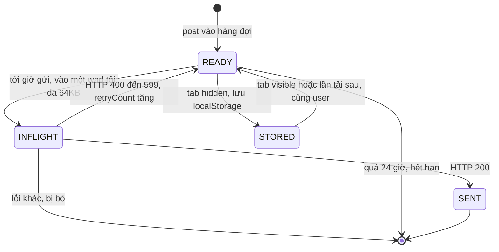
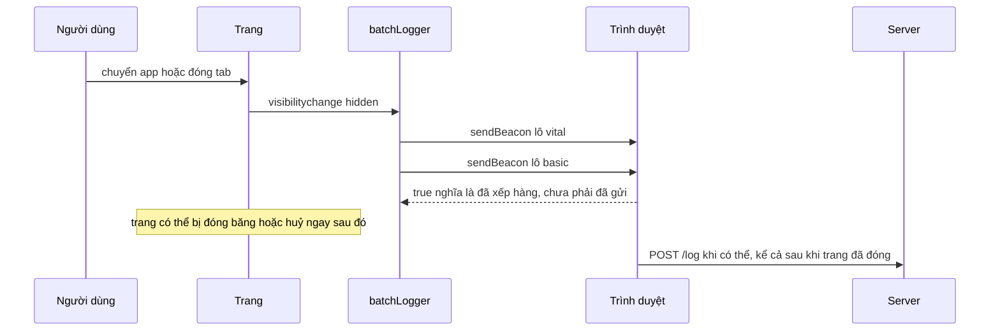

Mỗi lần người dùng cuộn feed, Facebook ghi lại hàng chục event: bài nào hiện, hiện bao lâu ([bài #2](/blogs/facebook-use-viewport-duration)), video chạy mấy giây, có lỗi gì ([bài #6](/blogs/facebook-error-guard)), thời gian render… Mỗi event một request thì mạng và pin điện thoại không chịu nổi.

Hệ thống lo việc này tên là **Banzai**.

> [!TIP]
> **Tóm tắt**
> - Đừng gửi mỗi event một request: gom vào hàng đợi, gửi theo lô; hai mức ưu tiên `vital` (gửi sau ~1 giây) và `basic` (chờ lâu hơn).
> - Server lỗi thì đưa event về đầu hàng đợi, giãn lịch gửi bằng backoff + jitter; lỗi 4xx thì bỏ.
> - Tab chuyển sang `hidden` là sự kiện cuối cùng chắc chắn xảy ra trên mobile: lúc đó gửi phần còn lại bằng `sendBeacon`.
> - Banzai còn lưu hàng đợi vào localStorage và chỉ khôi phục cho đúng user; bản viết lại để phần đó ở mục mở rộng.

## Vì sao không gửi mỗi event một request?

Nghe hiển nhiên, nhưng con số cụ thể giúp hiểu vì sao Banzai được thiết kế như vậy:

- **Overhead cố định.** Mỗi request mang theo header, cookie, có khi là cả TLS handshake nếu kết nối bị đóng. Với cookie của một trang lớn, phần overhead này dễ dàng **vượt 1KB**, trong khi một event click chỉ vài chục byte.
- **Radio trên điện thoại.** Mỗi lần gửi, modem 4G/5G phải chuyển sang trạng thái năng lượng cao và **giữ ở đó vài giây** sau khi gửi xong. Gửi 30 request rải rác trong một phút tốn pin hơn nhiều so với gửi 3 request mỗi request 10 event.
- **Phía server.** Gom lô giảm số request đi hàng chục lần, với cùng một lượng dữ liệu.
- **Tranh tài nguyên với UI.** Mỗi request là việc trên main thread (serialize, mở kết nối) và chiếm một slot kết nối. Log không được phép làm chậm việc tải ảnh hay API của feed.

## Bên trong trình duyệt: sendBeacon, keepalive và Page Lifecycle

### `navigator.sendBeacon(url, data)`

- **Chỉ POST**, không đặt được header tuỳ ý, **không đọc được response**. Giá trị trả về `true` chỉ có nghĩa là trình duyệt **đã nhận vào hàng đợi**, không có nghĩa là server đã nhận.
- Request được gửi **kèm cookie** và **vẫn tiếp tục sau khi trang đóng**. Trình duyệt chịu trách nhiệm gửi nó đi.
- Có **giới hạn tổng dung lượng** cho các request keepalive đang chờ gửi, khoảng **64KB** trong các trình duyệt phổ biến. Vượt quá thì `sendBeacon` trả về `false`. Vì vậy phải chia lô và kiểm tra giá trị trả về. Có lẽ không phải ngẫu nhiên mà `BATCH_SIZE_LIMIT` của Banzai là 64.000 (suy đoán). Lưu ý con số đó là **số ký tự JSON**, không phải byte: chữ tiếng Việt có dấu chiếm 2–3 byte khi mã hoá UTF-8.
- **Content-Type** lấy từ kiểu dữ liệu: string → `text/plain;charset=UTF-8`, `FormData` → `multipart/form-data`, `URLSearchParams` → `application/x-www-form-urlencoded`, `Blob` → `blob.type`.
- Ba loại đầu là kiểu "CORS-safelisted", **không cần preflight** khi gửi sang origin khác. `Blob` kiểu `application/json` thì cần preflight, mà `sendBeacon` không làm preflight được, nên request sang origin khác bị chặn. Banzai gửi `FormData` nên không gặp chuyện này.

### `fetch(url, { keepalive: true })`

Là "sendBeacon có thêm tuỳ chọn": chọn được method, header, `credentials`. Nhưng mọi request keepalive (kể cả `sendBeacon`) dùng **chung hạn mức ~64KB đang bay**. Một lô lớn gửi bằng `keepalive` mà chưa xong đúng lúc tab bị ẩn có thể làm `sendBeacon` ngay sau đó trả về `false`.

### Page Lifecycle: tại sao là `visibilitychange`?

Một trang đi qua các trạng thái **active → passive → hidden → frozen → (discarded | terminated)**. Trên mobile, khi người dùng chuyển sang app khác, trang đi tới **hidden** và sau đó hệ điều hành có thể **giết luôn tiến trình** mà không có `beforeunload`, `unload` hay `pagehide` nào được bắn. `visibilitychange` sang `hidden` là **sự kiện cuối cùng được đảm bảo** có thể xảy ra.

Còn `unload` thì vừa không đáng tin, vừa **có hại**: trang có listener `unload` thường không được đưa vào **bfcache** (back/forward cache), nên bấm Back sẽ phải tải lại toàn bộ thay vì hiện ngay lập tức. Chrome đang dần ngừng hỗ trợ `unload`. `pagehide` thì an toàn với bfcache (`event.persisted === true` nghĩa là trang đang vào bfcache chứ không bị huỷ).


## Facebook làm thế nào?

### 1. Một "post" là một tuple

`BanzaiUtils.wrapData` biến mỗi lần `Banzai.post(route, data, options)` thành một mảng gọn:

```text
[route, data, timestamp, retryCount, size]  +  __meta: { appID, userID, webSessionId, status, retry, priority }
```

Dùng tuple thay cho object giúp JSON gửi đi ngắn hơn, vì không lặp lại tên key ở mỗi event. `size` (độ dài JSON của data) được tính **ngay lúc post**, để sau đó chia lô không phải stringify lại.

### 2. Ưu tiên được suy ra từ độ trễ

Không có tham số `priority` riêng. `post()` nhận `options.delay`, và nếu `delay > VITAL_WAIT` thì event là `basic`, ngược lại là `vital`. Các hằng số trong `BanzaiConsts`:

| Hằng số | Giá trị | Ý nghĩa |
| --- | --- | --- |
| `VITAL_WAIT` | 1 giây | thời gian chờ mặc định của event vital |
| `BASIC_WAIT_COMET` | 2 giây | thời gian chờ mặc định của event basic trên Comet |
| `BASIC_WAIT` | 60 giây | thời gian chờ basic ở bản cũ |
| `BATCH_SIZE_LIMIT` | 64.000 | kích thước tối đa một lần gửi (tính bằng độ dài JSON) |
| `EXPIRY` | 24 giờ | event cũ hơn thì bỏ, không gửi nữa |
| `STORAGE_FLUSH_INTERVAL` | 12 giờ | chu kỳ dọn event tồn trong localStorage |

Mỗi mức ưu tiên có một lịch gửi riêng. `_schedule` chỉ hẹn lại giờ nếu deadline mới **sớm hơn** deadline đang có. Trong cùng một mức, một post có `delay` ngắn đến sau sẽ kéo lịch gửi sớm lên, còn post có `delay` dài hơn không bao giờ đẩy lịch lùi lại. Nhờ vậy, một luồng event liên tục không thể làm lô bị hoãn mãi.

Lịch gửi cũng không dùng `setTimeout` trần. Vital dùng `setTimeoutCometLoggingPriWithFallback`, basic dùng `setTimeoutCometSpeculativeWithFallback`: cả hai chạy qua scheduler ưu tiên của Comet, nên việc log nhường chỗ cho render và xử lý input.

Ngoài ra còn vài chế độ đặc biệt:

- `signal: true`: gửi **ngay** trong một request riêng, không chờ lô.
- `batch`: gộp nhiều post cùng một khoá trong `BATCH_TIMEOUT` (10 giây) thành một.
- `BanzaiLazyQueue`: các lệnh post gọi **trước khi** Banzai tải xong được xếp hàng, rồi phát lại khi Banzai sẵn sàng. Code khác không phải chờ module logging.

### 3. Chia "wad" theo người dùng và 64KB

Khi tới giờ gửi, `BanzaiUtils.filterPost` duyệt hàng đợi và gom post thành các **wad** (gói dữ liệu), mỗi wad ứng với một bộ `webSessionId + userID + appID + có nén hay không`. Mỗi lần gửi dừng lại khi tổng `size` chạm `BATCH_SIZE_LIMIT` (64KB). Phần còn lại chờ chuyến sau. Post đang bay được đánh dấu `POST_INFLIGHT` để không bị gửi trùng. Post cũ hơn 24 giờ bị bỏ.

Payload là `FormData` gồm `ts` (giờ client **lúc gửi**) và `q` (JSON của các wad). Trước khi gửi bằng XHR, wad được **nén deflate bất đồng bộ** (`compressWadAsync`) để không chặn main thread.

### 4. Gửi, retry và nối với NetworkStatus

`BanzaiAdapterComet.send` POST tới `/ajax/bz`:

- Status **200** là thành công: gọi `NetworkStatus.reportSuccess()`. Status khác: `reportError()`. Đây chính là module network status ở [bài #5](/blogs/facebook-network-status-heartbeat). Logging tự trở thành một nguồn tín hiệu về chất lượng mạng.
- Nếu `NetworkStatus` đang báo offline, request **không được gửi** mà chờ tới khi có sự kiện online.
- Gửi lỗi thì `BanzaiUtils.retryPost` đặt post về `POST_READY`, tăng `retryCount`, và **chỉ đưa lại vào hàng đợi nếu status trong khoảng 400–599** (kể cả 4xx). Sau đó toàn bộ hàng đợi được lưu xuống localStorage.

### 5. Tab bị ẩn và rời trang

Đây là phần tinh tế nhất:

- **Tab chuyển sang hidden**: thử gửi mọi thứ bằng `sendBeacon`, sau đó `_store()` lưu phần còn lại vào localStorage.
- **Tab visible trở lại**: thử beacon phần còn lại, rồi `_restore()` từ localStorage.
- **`beforeunload`**: beacon cả vital lẫn basic.
- **`_unload`**: huỷ các XHR đang bay, đưa post của chúng về hàng đợi với một mã giả **444** (nằm trong khoảng 400–599 nên được retry), beacon lại lần cuối rồi lưu storage.
- **Beacon bị từ chối**: post được trả lại hàng đợi và một bộ đếm `send_via_beacon_failure` được log.

### 6. `BanzaiStorage`: không mất log khi tab chết

- Lưu vào localStorage với key `bz:<webSessionId>.<timestamp>`. Không lưu những bộ đếm nội bộ đã gửi rồi.
- Khi restore, lấy khoá **`WebStorageMutex("banzai")`** trước. Nếu người dùng mở 5 tab, chỉ một tab lấy log tồn đọng ra gửi, tránh **gửi trùng 5 lần**.
- **Chỉ restore post của đúng user hiện tại** (hoặc khi chưa đăng nhập). Đăng xuất rồi đăng nhập tài khoản khác thì log của tài khoản cũ không bị gửi kèm danh tính của tài khoản mới. Đây là yêu cầu về **quyền riêng tư**, không chỉ là tính đúng đắn.
- Không chạy trong iframe. Khi ở trong iframe cùng domain, `post()` được chuyển thẳng lên Banzai của `window.top`, để cả trang chỉ có một hàng đợi.
- Mọi lời gọi vào storage đều bọc trong `ErrorGuard` ([bài #6](/blogs/facebook-error-guard)): localStorage đầy hoặc bị chặn trong chế độ ẩn danh cũng không làm hỏng việc logging.

### 7. Tự đo chính mình

Banzai đếm `messages_sent`, `messages_received`, `total_messages_*` và gửi lên ODS (hệ thống metric nội bộ, route `categorized_ods`). So sánh số đã post với số server nhận được, họ biết **bao nhiêu phần trăm log bị thất lạc**. Hệ thống đo lường cũng cần được đo.

Vòng đời một post:



Nguồn trong [facebook-codebase](https://github.com/hunghg255/facebook-codebase): thư mục `24.Banzai/`, `00 BanzaiComet/`; các module phụ `BanzaiConsts`, `BanzaiUtils`, `BanzaiStorage` nằm trong các file bundle lớn như `31.js`.

## Viết lại

Bản viết lại giữ những ý cốt lõi: hai mức ưu tiên, gửi ngay khi lô đầy, retry có giới hạn, beacon khi tab ẩn. Bỏ bớt phần nén, mutex nhiều tab và localStorage (bàn ở mục mở rộng). Thêm một thứ Banzai không làm ở tầng này: **backoff** khi server lỗi liên tục.

### Transport: tách "gửi" khỏi "logic gom lô"

```ts title=src/lib/batchLogger.ts
export interface Transport {
  /** gửi bình thường, reject nếu lỗi */
  send(url: string, body: string): Promise<void>;
  /** gửi lúc trang sắp đóng, trả về false nếu trình duyệt từ chối */
  beacon(url: string, body: string): boolean;
}

export class HttpError extends Error {
  constructor(public status: number) {
    super(`HTTP ${status}`);
  }
}

/** 4xx (trừ 408 timeout, 429 rate limit) là lỗi do chính request: gửi lại cũng vô ích. */
function isRetryable(error: unknown) {
  if (!(error instanceof HttpError)) return true; // lỗi mạng, 5xx…
  return error.status >= 500 || error.status === 408 || error.status === 429;
}

// Các request keepalive (kể cả sendBeacon) dùng CHUNG một hạn mức ~64KB đang bay.
// Chỉ bật keepalive cho lô nhỏ, để một lô lớn đang gửi dở không làm beacon lúc ẩn tab bị từ chối.
const KEEPALIVE_BUDGET = 16_000;

export const browserTransport: Transport = {
  async send(url, body) {
    const response = await fetch(url, {
      method: 'POST',
      body,
      // Cùng origin thì application/json không sao. Khác origin thì JSON cần preflight CORS;
      // khi đó nên gửi text/plain (server vẫn JSON.parse được) giống nhánh beacon bên dưới.
      headers: { 'Content-Type': 'application/json' },
      // keepalive: request vẫn hoàn thành nếu người dùng chuyển trang giữa chừng
      keepalive: body.length < KEEPALIVE_BUDGET,
    });
    if (!response.ok) throw new HttpError(response.status);
  },
  beacon(url, body) {
    // text/plain là content-type "CORS-safelisted": gửi sang origin khác không cần preflight.
    // application/json thì cần preflight, mà sendBeacon không làm preflight được -> bị chặn.
    return navigator.sendBeacon?.(url, new Blob([body], { type: 'text/plain' })) ?? false;
  },
};
```

Logic gom lô không biết `fetch` hay `sendBeacon` là gì, chỉ biết `transport.send()` và `transport.beacon()`. Nhờ vậy demo thay transport giả để in log ra màn hình, và test thay bằng `vi.fn()`.

Về Content-Type: beacon gửi `Blob` kiểu `text/plain` để không cần preflight. `send` thường gửi `application/json`, ổn khi endpoint cùng origin. Nếu endpoint khác origin, request JSON sẽ có preflight (và với `keepalive`, preflight từng không được hỗ trợ ở một số trình duyệt), nên tốt nhất dùng `text/plain` cho cả hai rồi `JSON.parse` ở server.

`keepalive` chỉ bật cho lô dưới ~16KB, để một lô lớn đang bay không chiếm hết hạn mức chung với `sendBeacon`.

### Ghi log, lịch gửi và backoff

```ts title=src/lib/batchLogger.ts
    log(event: string, data?: Record<string, unknown>, priority: Priority = 'basic') {
      queues[priority].push({ id: createId(), event, data, time: Date.now(), retries: 0 });
      notify();
      // Lô đầy thì gửi ngay, NHƯNG chỉ khi server đang khoẻ. Đang có lỗi (backoff) mà vẫn
      // gửi ngay mỗi khi đủ lô thì backoff vô nghĩa đúng lúc lưu lượng cao nhất.
      if (queues[priority].length >= maxBatchSize && failures[priority] === 0) {
        void flushQueue(priority);
      } else {
        schedule(priority);
      }
    },
```

```ts title=src/lib/batchLogger.ts
  function schedule(priority: Priority) {
    if (timers[priority] != null) return; // đã hẹn rồi, event mới đi chung chuyến
    const failed = failures[priority];
    // 1 lần lỗi -> chờ gấp đôi, 2 lần -> gấp 4… tối đa gấp 32.
    // Có lỗi thì thêm jitter ±25% để hàng triệu tab không cùng gửi lại vào một thời điểm.
    const backoff = 2 ** Math.min(failed, 5);
    const jitter = failed > 0 ? 0.75 + Math.random() * 0.5 : 1;
    const delay = delays[priority] * backoff * jitter;
    timers[priority] = setTimeout(() => {
      timers[priority] = undefined;
      void flushQueue(priority);
    }, delay);
  }

  async function flushQueue(priority: Priority) {
    clearTimeout(timers[priority]);
    timers[priority] = undefined;
    const batch = queues[priority].splice(0, maxBatchSize);
    if (batch.length === 0) return;
    notify();

    try {
      // sentAt: server so với giờ của nó để bù lệch đồng hồ cho `time` của từng event
      await transport.send(endpoint, JSON.stringify({ priority, sentAt: Date.now(), events: batch }));
      failures[priority] = 0;
    } catch (error) {
      if (!isRetryable(error)) {
        notify();
        return; // bỏ lô này
      }
      failures[priority]++;
      const retry = batch
        .map((e) => ({ ...e, retries: e.retries + 1 }))
        .filter((e) => e.retries <= maxRetries);
      // đưa lại lên đầu hàng đợi để giữ đúng thứ tự thời gian
      queues[priority].unshift(...retry);
      notify();
    }
    if (queues[priority].length > 0) schedule(priority);
  }
```

Theo một event đi qua code:

1. `log()` đẩy event vào đúng hàng đợi. Nếu hàng đợi đã đạt `maxBatchSize` **và server đang khoẻ** (`failures === 0`) thì gọi thẳng `flushQueue()`; ngược lại gọi `schedule()`. Điều kiện "server đang khoẻ" quan trọng: không có nó, đúng lúc lưu lượng cao nhất và server đang lỗi, mỗi khi đủ lô lại gửi ngay, bỏ qua backoff.
2. `schedule()` thấy đã có timer thì **không làm gì**: event mới "đi chung chuyến" với timer đang có. Đây là bản đơn giản hoá của luật "chỉ hẹn sớm hơn" trong Banzai.
3. Tới giờ, `flushQueue()` **cắt** tối đa `maxBatchSize` event ra khỏi hàng đợi (`splice`) rồi gửi. Event đang bay không còn nằm trong hàng đợi, nên một lần flush khác chạy song song không gửi trùng chúng. Đây cũng là vai trò của trạng thái `POST_INFLIGHT` ở Banzai.
4. Gửi thành công: `failures` về 0.
5. Gửi lỗi không retry được (4xx trừ 408/429): bỏ lô.
6. Gửi lỗi còn lại: `failures` tăng, mỗi event tăng `retries`, event vượt `maxRetries` bị bỏ, phần còn lại được `unshift` về **đầu** hàng đợi để giữ thứ tự thời gian.
7. Còn event thì hẹn lần sau với độ trễ `delays[priority] × 2^min(failures, 5)`, nhân thêm jitter ±25% khi đang lỗi.

Với cấu hình mặc định, khi server sập (chưa tính jitter):

| Lần lỗi liên tiếp | Chờ (basic) | Chờ (vital) |
| --- | --- | --- |
| 0 | 5 giây | 1 giây |
| 1 | 10 giây | 2 giây |
| 2 | 20 giây | 4 giây |
| 3 | 40 giây | 8 giây |
| 4 | 80 giây | 16 giây |
| 5 trở lên | 160 giây | 32 giây |

Một event được thử tối đa `maxRetries + 1 = 4` lần rồi bị bỏ: log không đáng để giữ mãi trong bộ nhớ.

Tại sao backoff quan trọng? Khi server log sập, **mọi tab của mọi người dùng** cùng retry. Không có backoff, ngay khi server vừa sống lại nó bị dội một cơn sóng request dồn ứ và lại sập ("thundering herd"). Backoff giãn tải ra, còn jitter giúp các client không retry cùng một mili-giây.

**Khác bản gốc:** Banzai retry mọi status 400–599 (kể cả 4xx) và không có backoff ở tầng này; bản viết lại bỏ 4xx (trừ 408/429) và có backoff + jitter. Không nén, không lưu localStorage, chia lô theo số event chứ không theo kích thước.

### Rời trang

```ts title=src/lib/batchLogger.ts
  /** Gửi tất cả ngay bằng sendBeacon, dùng khi trang sắp bị đóng. */
  function flushWithBeacon() {
    (['vital', 'basic'] as const).forEach((priority) => {
      clearTimeout(timers[priority]);
      timers[priority] = undefined;
      while (queues[priority].length > 0) {
        const batch = queues[priority].splice(0, maxBatchSize);
        const ok = transport.beacon(
          endpoint,
          JSON.stringify({ priority, sentAt: Date.now(), events: batch }),
        );
        if (!ok) {
          // Beacon bị từ chối (thường do payload > 64KB): trả lại hàng đợi.
          // Bản production có thể lưu tạm vào localStorage để lần sau gửi tiếp.
          queues[priority].unshift(...batch);
          break;
        }
      }
    });
    notify();
  }

  // `visibilitychange -> hidden` là tín hiệu đáng tin nhất trên mobile
  // (beforeunload/unload thường không chạy khi người dùng vuốt tắt app).
  const onVisibilityChange = () => {
    if (document.visibilityState === 'hidden') flushWithBeacon();
  };
  document.addEventListener('visibilitychange', onVisibilityChange);
  window.addEventListener('pagehide', flushWithBeacon);
```



Bản viết lại nghe cả `visibilitychange` và `pagehide`. Hai sự kiện có thể cùng bắn, nhưng lần thứ hai thấy hàng đợi trống nên không gửi gì.

::: spoiler Xem toàn bộ src/lib/batchLogger.ts

```ts title=src/lib/batchLogger.ts
/**
 * Client logging gom theo lô (ý tưởng từ Banzai - hệ thống logging phía client của Facebook).
 *
 * - Không gửi 1 request cho mỗi event: gom lại, gửi theo lô.
 * - 2 mức ưu tiên: `vital` (lỗi, thanh toán…) gửi nhanh, `basic` (click, view…) chờ lâu hơn.
 * - Lô đầy thì gửi ngay, không chờ hẹn giờ.
 * - Gửi lỗi thì đưa lại vào hàng đợi, quá số lần thử thì bỏ.
 * - Tab bị ẩn / rời trang thì gửi hết bằng navigator.sendBeacon (request không bị huỷ khi trang đóng).
 */

export type Priority = 'vital' | 'basic';

export interface LogEvent {
  /** id duy nhất để server bỏ event trùng (beacon + retry có thể gửi một event 2 lần) */
  id: string;
  event: string;
  data?: Record<string, unknown>;
  time: number;
  retries: number;
}

export interface Transport {
  /** gửi bình thường, reject nếu lỗi */
  send(url: string, body: string): Promise<void>;
  /** gửi lúc trang sắp đóng, trả về false nếu trình duyệt từ chối */
  beacon(url: string, body: string): boolean;
}

export class HttpError extends Error {
  constructor(public status: number) {
    super(`HTTP ${status}`);
  }
}

/** 4xx (trừ 408 timeout, 429 rate limit) là lỗi do chính request: gửi lại cũng vô ích. */
function isRetryable(error: unknown) {
  if (!(error instanceof HttpError)) return true; // lỗi mạng, 5xx…
  return error.status >= 500 || error.status === 408 || error.status === 429;
}

// Các request keepalive (kể cả sendBeacon) dùng CHUNG một hạn mức ~64KB đang bay.
// Chỉ bật keepalive cho lô nhỏ, để một lô lớn đang gửi dở không làm beacon lúc ẩn tab bị từ chối.
const KEEPALIVE_BUDGET = 16_000;

export const browserTransport: Transport = {
  async send(url, body) {
    const response = await fetch(url, {
      method: 'POST',
      body,
      // Cùng origin thì application/json không sao. Khác origin thì JSON cần preflight CORS;
      // khi đó nên gửi text/plain (server vẫn JSON.parse được) giống nhánh beacon bên dưới.
      headers: { 'Content-Type': 'application/json' },
      // keepalive: request vẫn hoàn thành nếu người dùng chuyển trang giữa chừng
      keepalive: body.length < KEEPALIVE_BUDGET,
    });
    if (!response.ok) throw new HttpError(response.status);
  },
  beacon(url, body) {
    // text/plain là content-type "CORS-safelisted": gửi sang origin khác không cần preflight.
    // application/json thì cần preflight, mà sendBeacon không làm preflight được -> bị chặn.
    return navigator.sendBeacon?.(url, new Blob([body], { type: 'text/plain' })) ?? false;
  },
};

const createId = () =>
  typeof crypto !== 'undefined' && 'randomUUID' in crypto
    ? crypto.randomUUID()
    : `${Date.now().toString(36)}-${Math.random().toString(36).slice(2)}`;

export interface BatchLoggerOptions {
  endpoint: string;
  transport?: Transport;
  /** thời gian chờ trước khi gửi, theo mức ưu tiên */
  delays?: Record<Priority, number>;
  maxBatchSize?: number;
  maxRetries?: number;
}

export function createBatchLogger({
  endpoint,
  transport = browserTransport,
  delays = { vital: 1000, basic: 5000 },
  maxBatchSize = 50,
  maxRetries = 3,
}: BatchLoggerOptions) {
  const queues: Record<Priority, LogEvent[]> = { vital: [], basic: [] };
  const timers: Partial<Record<Priority, ReturnType<typeof setTimeout>>> = {};
  // số lần gửi lỗi liên tiếp, để giãn dần lịch gửi khi server đang có vấn đề
  const failures: Record<Priority, number> = { vital: 0, basic: 0 };
  const listeners = new Set<() => void>();
  const notify = () => listeners.forEach((listener) => listener());

  function schedule(priority: Priority) {
    if (timers[priority] != null) return; // đã hẹn rồi, event mới đi chung chuyến
    const failed = failures[priority];
    // 1 lần lỗi -> chờ gấp đôi, 2 lần -> gấp 4… tối đa gấp 32.
    // Có lỗi thì thêm jitter ±25% để hàng triệu tab không cùng gửi lại vào một thời điểm.
    const backoff = 2 ** Math.min(failed, 5);
    const jitter = failed > 0 ? 0.75 + Math.random() * 0.5 : 1;
    const delay = delays[priority] * backoff * jitter;
    timers[priority] = setTimeout(() => {
      timers[priority] = undefined;
      void flushQueue(priority);
    }, delay);
  }

  async function flushQueue(priority: Priority) {
    clearTimeout(timers[priority]);
    timers[priority] = undefined;
    const batch = queues[priority].splice(0, maxBatchSize);
    if (batch.length === 0) return;
    notify();

    try {
      // sentAt: server so với giờ của nó để bù lệch đồng hồ cho `time` của từng event
      await transport.send(endpoint, JSON.stringify({ priority, sentAt: Date.now(), events: batch }));
      failures[priority] = 0;
    } catch (error) {
      if (!isRetryable(error)) {
        notify();
        return; // bỏ lô này
      }
      failures[priority]++;
      const retry = batch
        .map((e) => ({ ...e, retries: e.retries + 1 }))
        .filter((e) => e.retries <= maxRetries);
      // đưa lại lên đầu hàng đợi để giữ đúng thứ tự thời gian
      queues[priority].unshift(...retry);
      notify();
    }
    if (queues[priority].length > 0) schedule(priority);
  }

  /** Gửi tất cả ngay bằng sendBeacon, dùng khi trang sắp bị đóng. */
  function flushWithBeacon() {
    (['vital', 'basic'] as const).forEach((priority) => {
      clearTimeout(timers[priority]);
      timers[priority] = undefined;
      while (queues[priority].length > 0) {
        const batch = queues[priority].splice(0, maxBatchSize);
        const ok = transport.beacon(
          endpoint,
          JSON.stringify({ priority, sentAt: Date.now(), events: batch }),
        );
        if (!ok) {
          // Beacon bị từ chối (thường do payload > 64KB): trả lại hàng đợi.
          // Bản production có thể lưu tạm vào localStorage để lần sau gửi tiếp.
          queues[priority].unshift(...batch);
          break;
        }
      }
    });
    notify();
  }

  // `visibilitychange -> hidden` là tín hiệu đáng tin nhất trên mobile
  // (beforeunload/unload thường không chạy khi người dùng vuốt tắt app).
  const onVisibilityChange = () => {
    if (document.visibilityState === 'hidden') flushWithBeacon();
  };
  document.addEventListener('visibilitychange', onVisibilityChange);
  window.addEventListener('pagehide', flushWithBeacon);

  return {
    log(event: string, data?: Record<string, unknown>, priority: Priority = 'basic') {
      queues[priority].push({ id: createId(), event, data, time: Date.now(), retries: 0 });
      notify();
      // Lô đầy thì gửi ngay, NHƯNG chỉ khi server đang khoẻ. Đang có lỗi (backoff) mà vẫn
      // gửi ngay mỗi khi đủ lô thì backoff vô nghĩa đúng lúc lưu lượng cao nhất.
      if (queues[priority].length >= maxBatchSize && failures[priority] === 0) {
        void flushQueue(priority);
      } else {
        schedule(priority);
      }
    },
    flush: () => Promise.all([flushQueue('vital'), flushQueue('basic')]),
    flushWithBeacon,
    getQueueSizes: () => ({ vital: queues.vital.length, basic: queues.basic.length }),
    subscribe(listener: () => void) {
      listeners.add(listener);
      return () => {
        listeners.delete(listener);
      };
    },
    destroy() {
      clearTimeout(timers.vital);
      clearTimeout(timers.basic);
      document.removeEventListener('visibilitychange', onVisibilityChange);
      window.removeEventListener('pagehide', flushWithBeacon);
    },
  };
}

export type BatchLogger = ReturnType<typeof createBatchLogger>;
```

:::

## Demo

Transport trong demo chỉ in ra log thay vì gửi thật. Thử:

- Bấm **Log click** vài lần: 5 giây sau mới có **một** request.
- **Log lỗi thanh toán (vital)**: chỉ chờ 1 giây.
- **Spam 45 event**: đủ 20 event là gửi ngay một lô, không chờ.
- Bật **Server lỗi** rồi log: event được xếp lại hàng đợi, các lần thử sau cách nhau xa dần (backoff).
- **Giả lập rời trang** hoặc chuyển sang tab khác: phần còn lại đi bằng `sendBeacon`.

<iframe class="demo-frame" src="/demos/facebook-patterns/index.html?theme=dark#/batch-logger" title="Demo batch-logger" loading="lazy" style="height: 540px"></iframe>

<p class="demo-links">▶ <a href="/demos/facebook-patterns/index.html#/batch-logger" target="_blank" rel="noopener">Mở demo toàn màn hình ↗</a> · <a href="https://stackblitz.com/github/hunghg255/blog-hunghg/tree/master/examples/facebook-patterns?file=src/lib/batchLogger.ts" target="_blank" rel="noopener">Sửa code trên StackBlitz ↗</a> · <a href="https://github.com/hunghg255/blog-hunghg/blob/master/examples/facebook-patterns/src/lib/batchLogger.ts" target="_blank" rel="noopener">Xem source trên GitHub ↗</a></p>

## Tại sao không làm cách khác?

**"Gửi ngay khi có event, cho realtime?"** Analytics hiếm khi cần realtime tới từng giây. Thứ thực sự cần nhanh (lỗi thanh toán, crash) thì đã có mức `vital` với độ trễ 1 giây. Nếu cần gửi ngay tức thì, làm như `signal: true` của Banzai: một request riêng cho đúng event đó.

**"Dùng `requestIdleCallback` để gửi lúc rảnh?"** Trên trang luôn bận (feed đang cuộn, video đang chạy), idle callback có thể **không bao giờ** chạy. Nếu dùng thì phải có `timeout`. Banzai dùng scheduler có mức ưu tiên kèm fallback `setTimeout`, cùng một ý.

**"Chỉ gửi lúc `beforeunload`, gom cả phiên vào một request?"** Mất sạch log khi tab bị hệ điều hành giết, phiên dài thì vượt 64KB, và chặn bfcache như đã nói.

**"Gửi lỗi thì retry ngay?"** Server đang quá tải mà retry ngay chỉ làm nó chết lâu hơn. Phải có backoff.

**"Retry mọi lỗi?"** Đây là chỗ bản viết lại khác Banzai: Banzai retry cả 4xx. Bản viết lại thì không. **400 Bad Request** (payload sai) hay **413** (quá lớn) thì retry bao nhiêu lần kết quả cũng vậy. Bản viết lại có `HttpError` mang theo status và hàm `isRetryable`: lỗi mạng, 5xx, **408** và **429** thì retry với backoff, còn 4xx khác thì bỏ lô đó luôn. Muốn kỹ hơn nữa thì đọc header `Retry-After` của 429/503 để biết khi nào gửi lại.

## Edge case và cạm bẫy

**Gửi trùng.** Request có thể đã tới server nhưng client không nhận được response (mất mạng đúng lúc trả về). Client retry, server nhận hai lần. Vì vậy mỗi event trong bản viết lại có `id` duy nhất (`crypto.randomUUID()`, fallback sang chuỗi ngẫu nhiên ở trình duyệt cũ) để server dedupe. Với nhiều tab, mượn ý **mutex** của BanzaiStorage (Web Locks API: `navigator.locks.request('logger', …)`), để chỉ một tab gửi log tồn đọng.

**Lệch giờ client (clock skew).** `Date.now()` trên máy người dùng có thể sai vài phút, thậm chí vài năm. Banzai gửi kèm `ts` = giờ client **lúc gửi**. Server lấy `giờ server lúc nhận − ts` làm độ lệch rồi cộng vào thời gian của mọi event trong lô. Bản viết lại làm tương tự: body của mỗi lô (cả fetch lẫn beacon) có `sentAt: Date.now()`, server tự tính độ lệch.

**Thứ tự event.** Retry, nhiều tab, beacon và fetch chạy song song đều có thể làm event **đến server không theo thứ tự**. Đừng giả định thứ tự đến là thứ tự xảy ra. Hãy gửi kèm thời gian và một **số thứ tự tăng dần theo phiên** để server tự sắp xếp.

**PII.** Log là nơi dữ liệu cá nhân rò rỉ nhiều nhất: nội dung ô input, email trong URL, token trong query string. Lọc ở client (danh sách key cho phép thay vì danh sách cấm) **và** ở server. Banzai còn gắn `userID` vào từng post và từ chối restore log của user khác. Nếu bạn thêm lưu localStorage, hãy làm tương tự.

**Log phình to.** Ai đó log nguyên object `story` 30KB vào mỗi impression. Banzai cảnh báo khi route quá dài hoặc data vượt `DATA_LIMIT`. Hãy thêm một kiểm tra tương tự ở môi trường dev.

## Mở rộng: lưu localStorage như Banzai

Phần còn thiếu lớn nhất so với Banzai là lưu hàng đợi khi tab ẩn. Phác thảo:

```ts
const STORAGE_KEY = 'logger:pending';

function store() {
  const pending = [...queues.vital, ...queues.basic];
  if (pending.length === 0) return;
  try {
    localStorage.setItem(STORAGE_KEY, JSON.stringify({ userId: currentUserId(), pending }));
  } catch {
    // hết quota hoặc localStorage bị chặn: chấp nhận mất log, không được throw
  }
}

function restore() {
  navigator.locks.request('logger:restore', { ifAvailable: true }, async (lock) => {
    if (!lock) return; // tab khác đang restore
    const raw = localStorage.getItem(STORAGE_KEY);
    localStorage.removeItem(STORAGE_KEY);
    if (!raw) return;
    const { userId, pending } = JSON.parse(raw);
    if (userId !== currentUserId()) return; // không gửi log của user khác
    const dayAgo = Date.now() - 24 * 60 * 60 * 1000;
    for (const e of pending) if (e.time > dayAgo) queues.basic.push(e);
  });
}
```

Gọi `store()` sau `flushWithBeacon()` khi tab hidden (cho phần beacon bị từ chối), và `restore()` khi khởi động hoặc khi tab visible trở lại.

## Dùng trong dự án

```ts title=logger.ts
export const logger = createBatchLogger({ endpoint: '/api/log' });

logger.log('page_view', { path: location.pathname });
logger.log('checkout_error', { code }, 'vital');
```

Phía server, endpoint `/api/log` nên trả về ngay (`202 Accepted`) rồi đẩy vào queue (Kafka, SQS…), không xử lý đồng bộ. Đây cũng là cách các SDK analytics lớn (Segment, Amplitude, PostHog…) vận hành. Nếu bạn đang tự viết tracking, đừng gửi mỗi event một request.

## Kiểm thử

Logic phụ thuộc thời gian nên dùng **fake timers**, và vì code đụng tới `document`/`window` nên chạy trong môi trường jsdom.

::: spoiler Ví dụ test (bản phác, không có trong repo)

```ts title=batchLogger.test.ts
// @vitest-environment jsdom
import { afterEach, expect, it, vi } from 'vitest';
import { createBatchLogger } from './batchLogger';

afterEach(() => {
  vi.useRealTimers();
  vi.restoreAllMocks();
});

it('gom event và chỉ gửi khi tới hạn', async () => {
  vi.useFakeTimers();
  const send = vi.fn().mockResolvedValue(undefined);
  const logger = createBatchLogger({ endpoint: '/log', transport: { send, beacon: vi.fn(() => true) } });

  logger.log('a');
  logger.log('b');
  await vi.advanceTimersByTimeAsync(4999);
  expect(send).not.toHaveBeenCalled();

  await vi.advanceTimersByTimeAsync(1);
  expect(send).toHaveBeenCalledTimes(1);
  expect(JSON.parse(send.mock.calls[0][1]).events).toHaveLength(2);
  logger.destroy();
});

it('server lỗi thì giãn lịch gửi gấp đôi', async () => {
  vi.useFakeTimers();
  vi.spyOn(Math, 'random').mockReturnValue(0.5); // jitter = 1, để thời gian chờ cố định
  const send = vi.fn().mockRejectedValue(new Error('503'));
  const logger = createBatchLogger({ endpoint: '/log', transport: { send, beacon: vi.fn(() => true) } });

  logger.log('a', {}, 'vital');
  await vi.advanceTimersByTimeAsync(1000); // lần 1: lỗi
  expect(send).toHaveBeenCalledTimes(1);
  await vi.advanceTimersByTimeAsync(1999); // chưa tới 2 giây
  expect(send).toHaveBeenCalledTimes(1);
  await vi.advanceTimersByTimeAsync(1); // lần 2 sau đúng 2 giây
  expect(send).toHaveBeenCalledTimes(2);
  logger.destroy();
});
```

:::

Kiểm thử phần beacon: gọi `document.dispatchEvent(new Event('visibilitychange'))` sau khi mock `document.visibilityState` thành `'hidden'`, rồi kiểm tra `beacon` được gọi với đúng các event còn trong hàng đợi.

---

Bài này thuộc series **[Học từ mã nguồn Facebook](/series/facebook)** (58 bài, đọc theo thứ tự).

::: spoiler Xem nhanh danh sách bài trong series

*Phần 1*

- [Mở đầu: cách đọc code minify của Facebook](/blogs/learn-from-facebook-source-code)
- [#1 Dùng chung IntersectionObserver + infinite scroll](/blogs/facebook-shared-intersection-observer)
- [#2 useViewportDuration: đo thời gian thực sự được xem](/blogs/facebook-use-viewport-duration)
- [#3 Preload code + data khi hover](/blogs/facebook-preload-on-hover)
- [#4 Toast manager với external store](/blogs/facebook-toast-manager)
- [#5 Network status + heartbeat backoff](/blogs/facebook-network-status-heartbeat)
- [#6 ErrorGuard: bắt lỗi theo ngữ cảnh](/blogs/facebook-error-guard)
- **#7 Banzai: gom log theo lô + sendBeacon** (bài này)
- [#8 Focus trap + Esc theo layer](/blogs/facebook-focus-trap)

*Phần 2*

- [#9 Mẹo calc(… * 9999): container query, line-clamp, mũi tên carousel bằng CSS](/blogs/facebook-css-9999-trick)
- [#10 Thanh cuộn tuỳ biến bằng CSS 3D](/blogs/facebook-css-3d-scrollbar)
- [#11 Modal cuộn bằng window, giữ vị trí trang nền](/blogs/facebook-document-scroll-modal)
- [#12 Popover, tooltip group và hovercard](/blogs/facebook-popover-tooltip)
- [#13 Primitive Pressable + focus-visible](/blogs/facebook-pressable)
- [#14 Tab "Xem thêm" + sticky header bằng IntersectionObserver](/blogs/facebook-priority-tabs-sticky-header)
- [#15 Avatar khoét mask, gradient Messenger, skeleton steps()](/blogs/facebook-visual-tricks)
- [#16 Khung chat không giật](/blogs/facebook-chat-scroller)
- [#17 Thuật toán chọn bố cục collage ảnh](/blogs/facebook-photo-collage-layout)
- [#18 Keep-alive tab trong SPA](/blogs/facebook-keep-alive-tabs)
- [#19 Tự đo Visual Completion & interaction tracing](/blogs/facebook-visual-completion)
- [#20 Router SPA bền bỉ & tải chunk có retry](/blogs/facebook-spa-router-resilient-loading)

*Phần 3*

- [#21 Smart Compose: gợi ý chữ mờ khi gõ](/blogs/facebook-smart-compose-ghost-text)
- [#22 MQTT ngay trong trình duyệt, tự chuyển sang long-poll](/blogs/facebook-mqtt-in-browser)
- [#23 Đo thời gian dùng bằng bitmap 64 giây](/blogs/facebook-time-spent-bitmap)
- [#24 Bảng reaction nhấn giữ rồi trượt](/blogs/facebook-reaction-press-slide)
- [#25 Tìm kiếm gấp dấu, phiên âm và highlight đầu từ](/blogs/facebook-search-diacritics-tokenize)
- [#26 Ring buffer biết trace nào đã mất log](/blogs/facebook-trace-ring-buffer)
- [#27 Engine animation JS: một vòng rAF và solver cubic-bezier](/blogs/facebook-keyframes-loop-cubic-bezier)
- [#28 Bootloader: bitmap tài nguyên đã tải, chỉ reload khi cần](/blogs/facebook-bootloader-bitmap-consistency)
- [#29 Nhận biết click do screen reader tạo ra](/blogs/facebook-virtual-cursor-detection)
- [#30 Tải trước feed theo chất lượng mạng, đoán hạng thiết bị](/blogs/facebook-network-aware-prefetch)
- [#31 Hàng đợi gửi tin chat giữ đúng thứ tự](/blogs/facebook-ordered-send-queue)
- [#32 Gộp lời gọi API trong cùng một tick](/blogs/facebook-api-batcher)
- [#33 Resize ảnh trong pool Web Worker](/blogs/facebook-jpeg-resize-worker-pool)
- [#34 Crop ảnh theo nhiều khuôn mặt](/blogs/facebook-face-aware-crop)
- [#35 Kéo-thả sắp xếp và vùng thả file không nhấp nháy](/blogs/facebook-flicker-free-drag-drop)
- [#36 Tiện ích UI: fade-out, sticky event, hàm huỷ được](/blogs/facebook-ui-utility-hooks)
- [#37 Hạ tầng nhỏ: cookie, hash lỗi, prefetch khi chuột dừng](/blogs/facebook-small-infra-cookie-hash-idle)

*Phần 4–6*

- [#38 Đồng bộ tin nhắn: phát hiện lỗ seqID và fetch bù theo tầng](/blogs/facebook-messenger-sync-seqid-gaps)
- [#39 OTID: ID tin nhắn kiểu Snowflake sinh ở client](/blogs/facebook-otid-client-snowflake)
- [#40 QPL: lấy mẫu từ lúc bắt đầu, đo RTT gửi tin đầu-cuối](/blogs/facebook-qpl-send-rtt)
- [#41 Bộ điều phối request bảy chế độ gộp và chống trùng](/blogs/facebook-request-dispatcher-modes)
- [#42 Thread list theo mốc thời gian, cookie presence có version](/blogs/facebook-threadlist-ranged-presence)
- [#43 Composer dạng plugin: reducer, dirty checker, chuỗi kiểm tra](/blogs/facebook-plugin-composer)
- [#44 Thanh toán bất đồng bộ: subscribe trước, poll dự phòng](/blogs/facebook-async-checkout)
- [#45 Validate số thẻ: sửa lỗi gõ, dải BIN, Luhn](/blogs/facebook-card-validation)
- [#46 Lịch chọn khoảng ngày: bo góc dải chọn, phím đủ bộ, RTL](/blogs/facebook-range-calendar-a11y)
- [#47 Giờ mở cửa theo tuần: qua đêm, gộp khoảng, phần bù](/blogs/facebook-weekly-hours-intervals)
- [#48 Tiến độ đăng realtime: giữ event chờ snapshot, watchdog](/blogs/facebook-realtime-publish-snapshot)
- [#49 Tiền tệ theo đơn vị nhỏ nhất và ô nhập tiền](/blogs/facebook-currency-minor-units)
- [#50 Sửa hàng loạt Empty/Uniform/Mixed, seen/read bằng 2 bit](/blogs/facebook-bulk-edit-seen-bits)
- [#51 Phát hiện script lạ hook vào hàm native](/blogs/facebook-native-hook-detection)
- [#52 localStorage tự dọn khi đầy quota](/blogs/facebook-quota-aware-storage)
- [#53 Cache tuyến do server phân giải, chờ sẵn promise](/blogs/facebook-route-cache-prefetch)
- [#54 Lưới phím mũi tên 2D và focus không làm cuộn trang](/blogs/facebook-focus-table-grid)
- [#55 Tách emoji bằng máy trạng thái](/blogs/facebook-emoji-segmentation)
- [#56 Đọc trước ghi sau trong một frame, con tự biết vị trí](/blogs/facebook-read-then-write-dom)
- [#57 Hàng đợi lệnh cho video và stream sắp lại chunk](/blogs/facebook-video-command-queue)

:::

Code + demo: [`examples/facebook-patterns`](https://github.com/hunghg255/blog-hunghg/tree/master/examples/facebook-patterns) · [Mở trên StackBlitz](https://stackblitz.com/github/hunghg255/blog-hunghg/tree/master/examples/facebook-patterns)
