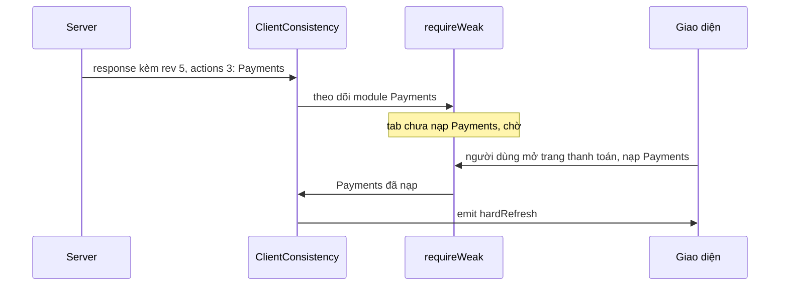

Một SPA lớn như facebook.com tải JS/CSS theo từng mảnh (chunk) khi người dùng mở tính năng mới. Hai câu hỏi phát sinh:

1. **Server biết gửi gì?** Khi trả về một màn hình mới, server muốn kèm luôn các chunk cần thiết (để client khỏi phải hỏi thêm một vòng). Nhưng không nên gửi lại chunk tab đã có.
2. **Deploy bản mới thì sao?** Tab mở từ sáng đang chạy code cũ. Ép mọi người reload mỗi lần deploy thì phiền; không ép thì tab cũ có thể nạp một chunk mới không tương thích với phần code cũ đang chạy.

Bootloader của Facebook giải câu 1 bằng một **bitmap nén** gửi kèm mọi request, và câu 2 bằng **ClientConsistency**: chỉ yêu cầu reload khi module bị đổi là module tab đang dùng (hoặc sắp dùng).

> [!TIP]
> **Tóm tắt**
> - Mỗi tài nguyên có một số thứ tự; tab giữ một mảng bit "đã có / chưa có", nén bằng run-length + mã Elias-gamma + bảng 64 ký tự URL-safe, rồi gửi kèm mọi request async.
> - Tài nguyên được đánh số theo gói nên các bit "đã có" đứng thành cụm: 140 tài nguyên thành 7 ký tự, thay vì 70 ký tự bitmap thô.
> - Response mang theo `{ rev, actions }`: mức 2 là soft refresh, mức 3 là hard refresh, kèm danh sách module bị đổi. Client chỉ phát sự kiện khi module đó **đã hoặc sẽ** được nạp.
> - Bản gốc chỉ theo dõi mỗi module một lần trong suốt vòng đời tab, nên có lẽ bỏ lỡ trường hợp deploy sau nâng module từ soft lên hard.

<iframe class="demo-frame" src="/demos/facebook-patterns/index.html?theme=dark#/bootloader-bitmap" title="Demo bootloader-bitmap" loading="lazy" style="height: 900px"></iframe>

<p class="demo-links">▶ <a href="/demos/facebook-patterns/index.html#/bootloader-bitmap" target="_blank" rel="noopener">Mở demo toàn màn hình ↗</a> · <a href="https://stackblitz.com/github/hunghg255/blog-hunghg/tree/master/examples/facebook-patterns?file=src/lib/resourceBitmap.ts" target="_blank" rel="noopener">Sửa code trên StackBlitz ↗</a> · <a href="https://github.com/hunghg255/blog-hunghg/blob/master/examples/facebook-patterns/src/lib/resourceBitmap.ts" target="_blank" rel="noopener">Xem source trên GitHub ↗</a></p>

## Facebook làm thế nào?

Các module nằm trong thư mục `Bootloader/` của [facebook-codebase](https://github.com/hunghg255/codebase/tree/main/facebook-codebase): `BitMap`, `CSRBitMap`, `ClientConsistency`, `Bootloader`; phần gửi kèm request nằm ở `getAsyncParams` (bundle `1.js`).

### Bitmap gửi kèm mọi request

`getAsyncParams` dựng các tham số chung cho mọi request async. Trong đó có hai bitmap:

```js
c[StaticSiteData.jsmod_key] = ServerJSDefine.getLoadedModuleHash(), // module JS đã định nghĩa
c[StaticSiteData.csr_key]   = CSRBitMap.toCompressedString(),       // tài nguyên CSR đã tải
c.__rev = SiteData.client_revision,                                 // bản build tab đang chạy
```

`CSRBitMap` là một `BitMap` dùng chung. Mỗi lần Bootloader nhận thông tin một tài nguyên, nó đọc danh sách số thứ tự (chuỗi dạng `":12,13,57"`, tách bởi `CSRIndexUtil`) rồi bật bit tương ứng:

```js
(!w.has(g) || d) && (w.set(g, a), CSRBitMap.add(g))
```

Server nhìn bitmap là biết tab đã có những gì.

### Nén: run-length + Elias-gamma

```js
var ALPHABET = "0123456789abcdefghijklmnopqrstuvwxyzABCDEFGHIJKLMNOPQRSTUVWXYZ-_";

toCompressedString() {
  if (this.$2 != null) return this.$2;                // cache
  var runs = [], len = 1, cur = this.$1[0] || 0, first = cur.toString(2);
  for (var i = 1; i < this.$1.length; i++) {
    var bit = this.$1[i] || 0;
    bit === cur ? len++ : (runs.push(gamma(len)), cur = bit, len = 1);
  }
  len && runs.push(gamma(len));
  return this.$2 = pack(first + runs.join(""));
}
function gamma(n) {                                    // Elias-gamma
  var bits = n.toString(2);
  return "0".repeat(bits.length - 1) + bits;
}
function pack(bits) {                                  // 6 bit -> 1 ký tự
  return (bits + "00000").match(/[01]{6}/g).map(b => ALPHABET[parseInt(b, 2)]).join("");
}
```

Ba lớp:

1. **Run-length.** Thay vì gửi từng bit, gửi bit đầu tiên rồi độ dài từng dãy bit giống nhau liên tiếp. `1111111000011` thành "bắt đầu bằng 1, rồi các dãy dài 7, 4, 2".
2. **Elias-gamma** cho từng độ dài: viết số ở hệ nhị phân, thêm phía trước (số bit − 1) số 0. 7 = `111` thành `00111`; 1 thành `1`. Mã này **tự mô tả độ dài**: đọc thấy k số 0 thì biết k+1 bit tiếp theo là một số. Không cần dấu phân cách, số nhỏ dùng ít bit.
3. **6 bit thành 1 ký tự** theo bảng 64 ký tự an toàn trong URL (`-` và `_` thay cho `+` và `/` của base64 chuẩn), đệm số 0 cho đủ.

Kết quả được cache (`this.$2`) và chỉ bị xoá khi có bit **mới** được bật; gửi kèm hàng trăm request không tốn gì thêm.

Phần đệm số 0 ở cuối không gây nhầm khi giải mã: một chuỗi toàn số 0 không bao giờ là mã Elias-gamma hoàn chỉnh (thiếu phần số phía sau), nên bộ giải mã dừng lại. Phía giải mã nằm ở server, không có trong bản dump; bản viết lại có hàm `decodeCompressed` để chứng minh nén không mất thông tin.

### ClientConsistency: reload khi code đang dùng bị đổi

Response của Bootloader (`HasteResponse`) mang theo trường `consistency`, được phát qua `ClientConsistencyEventEmitter.emit("newEntry", …)`. `ClientConsistency` xử lý (đổi tên biến):

```js
function onEntry({ actions, rev }) {
  if (rev === SiteData.client_revision) return;     // cùng bản build, không làm gì
  handle(actions);
}
function handle(actions) {
  required = {};
  var levels = Object.keys(actions).sort().reverse(); // "3" trước "2"
  for (var level of levels) {
    var modules = actions[level] ?? [];
    if (modules.length === 0) { fire(Number(level)); break; } // mọi tab đều phải làm
    modules.forEach(m => {
      required[m] = Math.max(required[m] ?? 0, Number(level));
      if (watched.has(m)) return;                   // đã theo dõi rồi thì thôi
      watched.add(m);
      requireWeak(m, () => required[m] && fire(required[m]));
    });
  }
}
function fire(level) {
  level === 2 && emitter.emit("softRefresh");
  level === 3 && emitter.emit("hardRefresh");
}
```

Mấu chốt là `requireWeak(m, cb)`: gọi `cb` **khi module `m` được định nghĩa**. Nếu tab đã nạp `m` thì gọi ngay; nếu chưa thì chờ, và nếu tab không bao giờ mở tính năng dùng `m` thì không bao giờ gọi. Vậy:

- Deploy đổi `VideoPlayer` mà tab chưa từng xem video: không ai bị làm phiền.
- Người dùng mở video **sau đó**: lúc chunk `VideoPlayer` (bản mới, không khớp với code cũ) được nạp thì mới phát yêu cầu refresh.
- Danh sách rỗng ở một mức: áp dụng cho mọi tab, không cần xét module.

Mình không tìm thấy nơi lắng nghe `softRefresh` / `hardRefresh` trong bản dump, nên không biết giao diện hiển thị thế nào (có lẽ là thanh thông báo kiểu "có bản mới").



### Chỗ yếu: mỗi module chỉ được theo dõi một lần

Biến `watched` (trong bản gốc là `l`) không bao giờ được xoá. Giả sử:

1. Deploy rev 3: `{ "2": ["Composer"] }`. Tab đang dùng Composer, `requireWeak` gọi ngay, phát **soft** refresh. Người dùng bỏ qua.
2. Deploy rev 4: `{ "3": ["Composer"] }`. `required.Composer` thành 3, nhưng vì Composer đã nằm trong `watched` nên không có `requireWeak` mới, và callback cũ đã chạy xong từ bước 1. **Không có hard refresh nào được phát.**

Đây là mình suy ra từ code; có thể phía server không bao giờ gửi hai deploy như vậy, hoặc soft refresh tự nó đã đủ. Demo phần 2 tái hiện: bấm lần lượt "Composer đổi (soft)" rồi "Composer cần hard", log của bản gốc chỉ có một dòng soft.

## Bên trong trình duyệt: vì sao không dùng service worker hay cache?

Cache HTTP và service worker trả lời câu hỏi "file này đã tải chưa" **trong** trình duyệt, nhưng server không nhìn thấy. Khi server muốn **chủ động** đẩy kèm tài nguyên cho một response (để tiết kiệm một vòng request), nó cần biết client thiếu gì. Bitmap là cách gửi thông tin đó gọn nhất: vài chục ký tự trên query string, không cần trạng thái phía server.

## Viết lại

Phần nén giữ đúng thuật toán của bản gốc (xem file đầy đủ ở cuối mục). Phần mới là giải nén, để kiểm chứng không mất thông tin:

```ts title=src/lib/resourceBitmap.ts
/**
 * Giải nén (phía server làm việc này; ở đây để chứng minh mã hoá không mất thông tin).
 * Phần đệm số 0 ở cuối không bao giờ thành một mã Elias-gamma hợp lệ nên tự bị bỏ qua.
 */
export function decodeCompressed(text: string): number[] {
  if (!text) return [];
  const bits = unpackBits(text);
  let value = bits[0] === '1' ? 1 : 0;
  const out: number[] = [];
  let i = 1;
  while (i < bits.length) {
    let zeros = 0;
    while (i + zeros < bits.length && bits[i + zeros] === '0') zeros++;
    if (i + zeros + zeros + 1 > bits.length) break; // chỉ còn phần đệm
    const run = parseInt(bits.slice(i + zeros, i + zeros + zeros + 1), 2);
    for (let k = 0; k < run; k++) out.push(value);
    value = 1 - value;
    i += zeros + zeros + 1;
  }
  return out;
```

Client consistency, có nhớ mức đã phát cho từng module:

```ts title=src/lib/resourceBitmap.ts
export function createConsistencyChecker(
  clientRevision: number,
  registry: ModuleRegistry,
  emit: (level: RefreshLevel, reason: string) => void,
) {
  const required = new Map<string, RefreshLevel>(); // mức cao nhất server yêu cầu cho module
  const emitted = new Map<string, RefreshLevel>(); // mức đã phát cho module
  const watching = new Set<string>();
  const loaded = new Set<string>(); // module đã nạp (biết qua callback của registry)

  const fire = (module: string) => {
    const level = required.get(module);
    if (!level) return;
    const already = emitted.get(module);
    if (already && RANK[already] >= RANK[level]) return;
    emitted.set(module, level);
    emit(level, module);
  };

  return function handle(payload: ConsistencyPayload) {
    if (payload.rev === clientRevision) return;
    // mức cao xét trước: "3" rồi mới "2"
    const keys = Object.keys(payload.actions).sort((a, b) => Number(b) - Number(a));
    for (const key of keys) {
      const level = LEVELS[key];
      if (!level) continue;
      const modules = payload.actions[key] ?? [];
      if (modules.length === 0) {
        // không kèm module: mọi tab đều phải làm, và không cần xét mức thấp hơn
        emit(level, '*');
        return;
      }
      for (const module of modules) {
        const previous = required.get(module);
        if (!previous || RANK[level] > RANK[previous]) required.set(module, level);
        if (watching.has(module)) {
          // đã theo dõi từ deploy trước: nếu module đang chạy thì kiểm lại với mức mới
          if (loaded.has(module)) fire(module);
        } else {
          watching.add(module);
          registry.onLoaded(module, () => {
            loaded.add(module);
            fire(module);
          });
        }
      }
    }
  };
}
```

**Khác bản gốc:**

- Thêm `decodeCompressed` (bản gốc giải mã ở server).
- `createConsistencyChecker` nhận `registry` thay cho `requireWeak` toàn cục, để dùng được với bất kỳ module loader nào.
- Nhớ mức đã phát cho từng module (`emitted`) và kiểm lại khi một deploy sau nâng mức, thay vì bỏ qua module đã theo dõi.
- Bản gốc xoá bảng mức (`required = {}`) mỗi khi có response mới, tức module đang chờ nạp chỉ được xét theo response mới nhất. Có lẽ vì server gửi toàn bộ thay đổi kể từ `__rev` của client trong mỗi response. Bản viết lại giữ mức cao nhất từng được yêu cầu, an toàn hơn nếu server chỉ gửi phần thay đổi mới.
- Sắp xếp mức theo số (`Number(b) - Number(a)`) thay vì sắp xếp chuỗi; với hai mức 2 và 3 thì kết quả như nhau, nhưng sẽ đúng nếu sau này có mức 10.

::: spoiler Xem toàn bộ src/lib/resourceBitmap.ts

```ts title=src/lib/resourceBitmap.ts
/**
 * Bitmap "tài nguyên đã có ở client", nén bằng run-length + mã Elias-gamma + base64 URL-safe
 * (ý tưởng từ BitMap / CSRBitMap trong Bootloader của Facebook).
 *
 * Facebook gửi chuỗi này kèm MỌI request async (tham số trong getAsyncParams), để server
 * khỏi gửi lại JS/CSS mà tab đã tải. Mỗi tài nguyên có một số thứ tự cố định do server cấp.
 */

const ALPHABET = '0123456789abcdefghijklmnopqrstuvwxyzABCDEFGHIJKLMNOPQRSTUVWXYZ-_';

/** Elias-gamma: n (≥ 1) viết nhị phân, thêm (số bit - 1) số 0 ở trước để tự mô tả độ dài. */
export function eliasGamma(n: number) {
  const bits = n.toString(2);
  return '0'.repeat(bits.length - 1) + bits;
}

/** Chuỗi bit -> base64 URL-safe theo bảng riêng (đệm số 0 cho đủ bội số của 6). */
function packBits(bits: string) {
  let out = '';
  for (let i = 0; i < bits.length; i += 6) {
    out += ALPHABET[parseInt(bits.slice(i, i + 6).padEnd(6, '0'), 2)];
  }
  return out;
}

function unpackBits(text: string) {
  let bits = '';
  for (const ch of text) {
    const value = ALPHABET.indexOf(ch);
    if (value === -1) throw new Error(`Ký tự không hợp lệ: ${ch}`);
    bits += value.toString(2).padStart(6, '0');
  }
  return bits;
}

export class ResourceBitmap {
  private bits: number[] = [];
  /** cache chuỗi nén; chỉ huỷ khi có bit MỚI được bật */
  private cached: string | null = null;

  set(index: number) {
    if (!this.bits[index]) this.cached = null;
    this.bits[index] = 1;
    return this;
  }

  has(index: number) {
    return this.bits[index] === 1;
  }

  get length() {
    return this.bits.length;
  }

  /** Không nén: mỗi tài nguyên một bit. */
  toRawString() {
    let bits = '';
    for (let i = 0; i < this.bits.length; i++) bits += this.bits[i] ? '1' : '0';
    return bits ? packBits(bits) : '';
  }

  /**
   * Nén: bit đầu tiên cho biết run đầu là 0 hay 1, sau đó độ dài từng run (dãy bit giống
   * nhau liên tiếp) mã Elias-gamma. Tài nguyên thường được tải theo cụm nên run rất dài.
   */
  toCompressedString() {
    if (this.bits.length === 0) return '';
    if (this.cached != null) return this.cached;
    let current = this.bits[0] ? 1 : 0;
    let out = String(current);
    let run = 1;
    for (let i = 1; i < this.bits.length; i++) {
      const bit = this.bits[i] ? 1 : 0;
      if (bit === current) run++;
      else {
        out += eliasGamma(run);
        current = bit;
        run = 1;
      }
    }
    out += eliasGamma(run);
    return (this.cached = packBits(out));
  }
}

/**
 * Giải nén (phía server làm việc này; ở đây để chứng minh mã hoá không mất thông tin).
 * Phần đệm số 0 ở cuối không bao giờ thành một mã Elias-gamma hợp lệ nên tự bị bỏ qua.
 */
export function decodeCompressed(text: string): number[] {
  if (!text) return [];
  const bits = unpackBits(text);
  let value = bits[0] === '1' ? 1 : 0;
  const out: number[] = [];
  let i = 1;
  while (i < bits.length) {
    let zeros = 0;
    while (i + zeros < bits.length && bits[i + zeros] === '0') zeros++;
    if (i + zeros + zeros + 1 > bits.length) break; // chỉ còn phần đệm
    const run = parseInt(bits.slice(i + zeros, i + zeros + zeros + 1), 2);
    for (let k = 0; k < run; k++) out.push(value);
    value = 1 - value;
    i += zeros + zeros + 1;
  }
  return out;
}

// ---- Client consistency: deploy mới thì chỉ reload khi CODE ĐANG DÙNG bị đổi ----

export type RefreshLevel = 'soft' | 'hard';
const LEVELS: Record<string, RefreshLevel | undefined> = { '2': 'soft', '3': 'hard' };
const RANK: Record<RefreshLevel, number> = { soft: 1, hard: 2 };

/** Phiên bản tối giản của requireWeak: gọi callback khi module được nạp (ngay nếu đã nạp). */
export interface ModuleRegistry {
  onLoaded(name: string, callback: () => void): void;
}

export interface ConsistencyPayload {
  /** revision của bản deploy server đang chạy */
  rev: number;
  /** mức hành động -> các module bị đổi; mảng rỗng = áp dụng cho mọi client */
  actions: Record<string, string[]>;
}

/**
 * Server đính kèm `{ rev, actions }` vào response. Ví dụ `{ "3": ["Payments"], "2": ["Composer"] }`:
 * client nào ĐÃ hoặc SẼ nạp Payments phải hard refresh, nạp Composer thì soft refresh.
 *
 * Khác bản gốc (ClientConsistency): bản gốc chỉ đăng ký theo dõi mỗi module MỘT lần trong
 * suốt vòng đời tab, nên nếu một deploy sau nâng module từ soft lên hard thì có lẽ không bao
 * giờ phát hard refresh. Ở đây nhớ mức đã phát cho từng module và phát lại khi mức tăng.
 */
export function createConsistencyChecker(
  clientRevision: number,
  registry: ModuleRegistry,
  emit: (level: RefreshLevel, reason: string) => void,
) {
  const required = new Map<string, RefreshLevel>(); // mức cao nhất server yêu cầu cho module
  const emitted = new Map<string, RefreshLevel>(); // mức đã phát cho module
  const watching = new Set<string>();
  const loaded = new Set<string>(); // module đã nạp (biết qua callback của registry)

  const fire = (module: string) => {
    const level = required.get(module);
    if (!level) return;
    const already = emitted.get(module);
    if (already && RANK[already] >= RANK[level]) return;
    emitted.set(module, level);
    emit(level, module);
  };

  return function handle(payload: ConsistencyPayload) {
    if (payload.rev === clientRevision) return;
    // mức cao xét trước: "3" rồi mới "2"
    const keys = Object.keys(payload.actions).sort((a, b) => Number(b) - Number(a));
    for (const key of keys) {
      const level = LEVELS[key];
      if (!level) continue;
      const modules = payload.actions[key] ?? [];
      if (modules.length === 0) {
        // không kèm module: mọi tab đều phải làm, và không cần xét mức thấp hơn
        emit(level, '*');
        return;
      }
      for (const module of modules) {
        const previous = required.get(module);
        if (!previous || RANK[level] > RANK[previous]) required.set(module, level);
        if (watching.has(module)) {
          // đã theo dõi từ deploy trước: nếu module đang chạy thì kiểm lại với mức mới
          if (loaded.has(module)) fire(module);
        } else {
          watching.add(module);
          registry.onLoaded(module, () => {
            loaded.add(module);
            fire(module);
          });
        }
      }
    }
  };
}
```

:::

## Tại sao không làm cách khác?

**Gửi danh sách số thứ tự (`"12,13,14,…"`)?** Với vài trăm tài nguyên, danh sách dài vài nghìn ký tự, vượt giới hạn hợp lý cho query string. Bitmap thô cũng đã gọn hơn (1 bit mỗi tài nguyên), và run-length còn gọn hơn nữa vì tài nguyên được tải theo cụm.

**Dùng gzip?** Query string không nén được, và chuỗi chỉ vài chục ký tự thì header gzip đã lớn hơn cả dữ liệu.

**Mỗi deploy đều bắt reload?** Facebook deploy nhiều lần mỗi ngày. Bắt reload mỗi lần thì người dùng mất trạng thái liên tục. ClientConsistency chỉ làm phiền người thật sự chạy code bị đổi.

**Hỏi server định kỳ "có bản mới không" như Trello?** Đó là cách ở [bài #16 series web](/blogs/web-spa-self-update-strategies). Facebook gắn thông tin vào response có sẵn nên không tốn thêm request, và có thông tin chi tiết tới từng module. So sánh thêm với cách router của Facebook xử lý chunk lỗi ở [Học từ Facebook #20](/blogs/facebook-spa-router-resilient-loading).

## Edge case và cạm bẫy

- **Số thứ tự phải ổn định.** Bitmap chỉ có nghĩa khi server và client cùng hiểu "tài nguyên số 57" là gì. Facebook đánh số phía server và gửi kèm khi khai báo tài nguyên (chuỗi `":12,13,57"`).
- **Bit chỉ bật, không tắt.** Tài nguyên đã tải thì coi như có mãi trong tab (bộ nhớ, không phải cache đĩa), nên không cần thao tác xoá bit. Cache chuỗi nén cũng nhờ vậy mà đơn giản.
- **Bitmap thưa.** Nếu tài nguyên tải rải rác (không thành cụm), run-length kém hiệu quả. Demo: thêm 40 tài nguyên ngẫu nhiên thì chuỗi nén từ 7 lên 28 ký tự, vẫn ngắn hơn bitmap thô.
- **`softRefresh` và `hardRefresh` chỉ là sự kiện.** Ứng dụng phải tự quyết làm gì: soft có thể là hiện thanh "có bản mới", hard có thể là reload ở lần điều hướng kế tiếp (đừng reload ngay khi người dùng đang gõ).

## Dùng trong dự án

```ts
const loaded = new ResourceBitmap();
chunkManifest.onChunkLoaded((index) => loaded.set(index));

async function api(path: string) {
  const url = new URL(path, location.origin);
  url.searchParams.set('__res', loaded.toCompressedString());
  url.searchParams.set('__rev', BUILD_REV);
  const res = await fetch(url).then((r) => r.json());
  if (res.consistency) checkConsistency(res.consistency);
  return res.data;
}

const checkConsistency = createConsistencyChecker(BUILD_REV, moduleRegistry, (level) =>
  level === 'hard' ? scheduleReloadOnNextNavigation() : showUpdateBanner(),
);
```

## Kiểm thử

::: spoiler Ví dụ test (bản phác, không có trong repo)

```ts
import { describe, expect, it } from 'vitest';
import { ResourceBitmap, createConsistencyChecker, decodeCompressed, eliasGamma } from './resourceBitmap';

describe('ResourceBitmap', () => {
  it('Elias-gamma', () => {
    expect(eliasGamma(1)).toBe('1');
    expect(eliasGamma(7)).toBe('00111');
  });

  it('nén rồi giải nén ra đúng bitmap (ngẫu nhiên)', () => {
    for (let t = 0; t < 200; t++) {
      const b = new ResourceBitmap();
      const n = 1 + Math.floor(Math.random() * 300);
      for (let i = 0; i < n; i++) if (Math.random() < 0.3) b.set(i);
      b.set(n - 1);
      const decoded = decodeCompressed(b.toCompressedString());
      expect(decoded).toHaveLength(b.length);
      decoded.forEach((bit, i) => expect(bit).toBe(b.has(i) ? 1 : 0));
    }
  });

  it('cụm liền nhau nén rất gọn', () => {
    const b = new ResourceBitmap();
    for (let i = 0; i < 120; i++) b.set(i);
    for (let i = 400; i < 420; i++) b.set(i);
    expect(b.toCompressedString().length).toBeLessThan(b.toRawString().length / 5);
  });
});

describe('createConsistencyChecker', () => {
  it('chỉ phát khi module đã nạp, và phát lại khi mức tăng', () => {
    const loaded = new Set(['Composer']);
    const waiting: Record<string, () => void> = {};
    const registry = { onLoaded: (m: string, cb: () => void) => (loaded.has(m) ? cb() : (waiting[m] = cb)) };
    const events: string[] = [];
    const check = createConsistencyChecker(1, registry, (level, m) => events.push(`${level}:${m}`));
    check({ rev: 2, actions: { '2': ['Composer'] } });
    check({ rev: 3, actions: { '3': ['Composer'] } });
    check({ rev: 4, actions: { '3': ['Payments'] } });
    expect(events).toEqual(['soft:Composer', 'hard:Composer']);
    waiting.Payments();
    expect(events).toContain('hard:Payments');
  });
});
```

:::

## So với chuẩn web và thư viện

- Module Federation (webpack/rspack) và các bundler hiện đại cũng theo dõi chunk đã tải, nhưng thông tin này nằm ở client; không có cơ chế chuẩn để gửi cho server.
- HTTP/2 Server Push từng được kỳ vọng giải bài toán "đẩy kèm tài nguyên", nhưng Chrome đã bỏ hỗ trợ (từ bản 106) vì server không biết client đã có gì trong cache, đúng điều bitmap của Facebook giải quyết. Hướng thay thế được khuyên dùng là `103 Early Hints` kèm `<link rel=preload>`.

---

Bài này thuộc series **[Học từ mã nguồn Facebook](/series/facebook)** (83 bài, đọc theo thứ tự).

::: spoiler Xem nhanh danh sách bài trong series

*Phần 1*

- [Mở đầu: cách đọc code minify của Facebook](/blogs/learn-from-facebook-source-code)
- [#1 Dùng chung IntersectionObserver + infinite scroll](/blogs/facebook-shared-intersection-observer)
- [#2 useViewportDuration: đo thời gian thực sự được xem](/blogs/facebook-use-viewport-duration)
- [#3 Preload code + data khi hover](/blogs/facebook-preload-on-hover)
- [#4 Toast manager với external store](/blogs/facebook-toast-manager)
- [#5 Network status + heartbeat backoff](/blogs/facebook-network-status-heartbeat)
- [#6 ErrorGuard: bắt lỗi theo ngữ cảnh](/blogs/facebook-error-guard)
- [#7 Banzai: gom log theo lô + sendBeacon](/blogs/facebook-batch-logger)
- [#8 Focus trap + Esc theo layer](/blogs/facebook-focus-trap)

*Phần 2*

- [#9 Mẹo calc(… * 9999): container query, line-clamp, mũi tên carousel bằng CSS](/blogs/facebook-css-9999-trick)
- [#10 Thanh cuộn tuỳ biến bằng CSS 3D](/blogs/facebook-css-3d-scrollbar)
- [#11 Modal cuộn bằng window, giữ vị trí trang nền](/blogs/facebook-document-scroll-modal)
- [#12 Popover, tooltip group và hovercard](/blogs/facebook-popover-tooltip)
- [#13 Primitive Pressable + focus-visible](/blogs/facebook-pressable)
- [#14 Tab "Xem thêm" + sticky header bằng IntersectionObserver](/blogs/facebook-priority-tabs-sticky-header)
- [#15 Avatar khoét mask, gradient Messenger, skeleton steps()](/blogs/facebook-visual-tricks)
- [#16 Khung chat không giật](/blogs/facebook-chat-scroller)
- [#17 Thuật toán chọn bố cục collage ảnh](/blogs/facebook-photo-collage-layout)
- [#18 Keep-alive tab trong SPA](/blogs/facebook-keep-alive-tabs)
- [#19 Tự đo Visual Completion & interaction tracing](/blogs/facebook-visual-completion)
- [#20 Router SPA bền bỉ & tải chunk có retry](/blogs/facebook-spa-router-resilient-loading)

*Phần 3*

- [#21 Smart Compose: gợi ý chữ mờ khi gõ](/blogs/facebook-smart-compose-ghost-text)
- [#22 MQTT ngay trong trình duyệt, tự chuyển sang long-poll](/blogs/facebook-mqtt-in-browser)
- [#23 Đo thời gian dùng bằng bitmap 64 giây](/blogs/facebook-time-spent-bitmap)
- [#24 Bảng reaction nhấn giữ rồi trượt](/blogs/facebook-reaction-press-slide)
- [#25 Tìm kiếm gấp dấu, phiên âm và highlight đầu từ](/blogs/facebook-search-diacritics-tokenize)
- [#26 Ring buffer biết trace nào đã mất log](/blogs/facebook-trace-ring-buffer)
- [#27 Engine animation JS: một vòng rAF và solver cubic-bezier](/blogs/facebook-keyframes-loop-cubic-bezier)
- **#28 Bootloader: bitmap tài nguyên đã tải, chỉ reload khi cần** (bài này)
- [#29 Nhận biết click do screen reader tạo ra](/blogs/facebook-virtual-cursor-detection)
- [#30 Tải trước feed theo chất lượng mạng, đoán hạng thiết bị](/blogs/facebook-network-aware-prefetch)
- [#31 Hàng đợi gửi tin chat giữ đúng thứ tự](/blogs/facebook-ordered-send-queue)
- [#32 Gộp lời gọi API trong cùng một tick](/blogs/facebook-api-batcher)
- [#33 Resize ảnh trong pool Web Worker](/blogs/facebook-jpeg-resize-worker-pool)
- [#34 Crop ảnh theo nhiều khuôn mặt](/blogs/facebook-face-aware-crop)
- [#35 Kéo-thả sắp xếp và vùng thả file không nhấp nháy](/blogs/facebook-flicker-free-drag-drop)
- [#36 Tiện ích UI: fade-out, sticky event, hàm huỷ được](/blogs/facebook-ui-utility-hooks)
- [#37 Hạ tầng nhỏ: cookie, hash lỗi, prefetch khi chuột dừng](/blogs/facebook-small-infra-cookie-hash-idle)

*Phần 4–6*

- [#38 Đồng bộ tin nhắn: phát hiện lỗ seqID và fetch bù theo tầng](/blogs/facebook-messenger-sync-seqid-gaps)
- [#39 OTID: ID tin nhắn kiểu Snowflake sinh ở client](/blogs/facebook-otid-client-snowflake)
- [#40 QPL: lấy mẫu từ lúc bắt đầu, đo RTT gửi tin đầu-cuối](/blogs/facebook-qpl-send-rtt)
- [#41 Bộ điều phối request bảy chế độ gộp và chống trùng](/blogs/facebook-request-dispatcher-modes)
- [#42 Thread list theo mốc thời gian, cookie presence có version](/blogs/facebook-threadlist-ranged-presence)
- [#43 Composer dạng plugin: reducer, dirty checker, chuỗi kiểm tra](/blogs/facebook-plugin-composer)
- [#44 Thanh toán bất đồng bộ: subscribe trước, poll dự phòng](/blogs/facebook-async-checkout)
- [#45 Validate số thẻ: sửa lỗi gõ, dải BIN, Luhn](/blogs/facebook-card-validation)
- [#46 Lịch chọn khoảng ngày: bo góc dải chọn, phím đủ bộ, RTL](/blogs/facebook-range-calendar-a11y)
- [#47 Giờ mở cửa theo tuần: qua đêm, gộp khoảng, phần bù](/blogs/facebook-weekly-hours-intervals)
- [#48 Tiến độ đăng realtime: giữ event chờ snapshot, watchdog](/blogs/facebook-realtime-publish-snapshot)
- [#49 Tiền tệ theo đơn vị nhỏ nhất và ô nhập tiền](/blogs/facebook-currency-minor-units)
- [#50 Sửa hàng loạt Empty/Uniform/Mixed, seen/read bằng 2 bit](/blogs/facebook-bulk-edit-seen-bits)
- [#51 Phát hiện script lạ hook vào hàm native](/blogs/facebook-native-hook-detection)
- [#52 localStorage tự dọn khi đầy quota](/blogs/facebook-quota-aware-storage)
- [#53 Cache tuyến do server phân giải, chờ sẵn promise](/blogs/facebook-route-cache-prefetch)
- [#54 Lưới phím mũi tên 2D và focus không làm cuộn trang](/blogs/facebook-focus-table-grid)
- [#55 Tách emoji bằng máy trạng thái](/blogs/facebook-emoji-segmentation)
- [#56 Đọc trước ghi sau trong một frame, con tự biết vị trí](/blogs/facebook-read-then-write-dom)
- [#57 Hàng đợi lệnh cho video và stream sắp lại chunk](/blogs/facebook-video-command-queue)

*Phần 7–10*

- [#58 Ước lượng băng thông EWMA: loại outlier, nhớ qua phiên](/blogs/facebook-bandwidth-ewma-estimator)
- [#59 ABR theo độ tự tin phát và cắt bậc bitrate theo MOS](/blogs/facebook-abr-playback-confidence)
- [#60 Prefetch segment dự đoán từ manifest, parse hộp sidx](/blogs/facebook-dash-predicted-segments)
- [#61 Đọc metadata MP4/MOV ngay trên client](/blogs/facebook-mp4-metadata-client)
- [#62 Upload tiếp tục được: offset, hash dedupe, phát hiện treo](/blogs/facebook-resumable-upload)
- [#63 Fenwick tree: chọn ngẫu nhiên có trọng số và offset dòng](/blogs/facebook-fenwick-weighted-random)
- [#64 Vạch trục số và trục thời gian "đẹp"](/blogs/facebook-nice-axis-ticks)
- [#65 Damerau-Levenshtein theo dải chéo và tự sửa tên gõ sai](/blogs/facebook-damerau-levenshtein)
- [#66 PRNG có seed, shuffle tái lập và lấy mẫu trace](/blogs/facebook-seeded-prng-sampling)
- [#67 Cặp min/max-heap tái dùng vị trí trong danh sách ảo](/blogs/facebook-dual-heap-buffer-set)
- [#68 Memo nhiều đối số bằng Map/WeakMap và interning object](/blogs/facebook-multikey-memo-interning)
- [#69 Thống kê cửa sổ trượt và đại số khoảng thời gian](/blogs/facebook-moving-stat-intervals)
- [#70 Int64 từ hai số 32-bit, decode UTF, offset theo code point](/blogs/facebook-int64-utf-codepoints)
- [#71 Engine múi giờ IANA trên client, phát hiện lệch giờ](/blogs/facebook-client-iana-timezone)
- [#72 Tự cài semver range](/blogs/facebook-semver-range)
- [#73 Auto-link URL, cắt chữ an toàn, giới hạn LaTeX](/blogs/facebook-autolink-safe-truncate)
- [#74 Parser query kiểu PHP chống prototype pollution](/blogs/facebook-php-query-serializer)
- [#75 Popover tự lật theo phần tràn nhỏ nhất](/blogs/facebook-popover-auto-flip)
- [#76 Tiền tố for(;;) chống JSON hijacking, đọc stream](/blogs/facebook-csrf-prefix-streaming)
- [#77 Chống lộ Referer, linkshim, xoá token trên URL](/blogs/facebook-referrer-linkshim-url-scrub)
- [#78 setImmediate bằng postMessage, gom delta chuột theo frame](/blogs/facebook-setimmediate-mouse-batching)
- [#79 Phát hiện crash qua heartbeat, dò proxy cache hỏng](/blogs/facebook-crash-heartbeat-proxy-check)
- [#80 DPR vào cookie cho ảnh @2x, che khoá trong log](/blogs/facebook-dpr-cookie-secret-redaction)
- [#81 Flux waitFor tự viết và proxy có đệm](/blogs/facebook-flux-dispatch-buffered-proxy)
- [#82 Crop đúng tỉ lệ, xoay sticker bằng ma trận](/blogs/facebook-image-crop-rotation-geometry)

:::

Code + demo: [`examples/facebook-patterns`](https://github.com/hunghg255/blog-hunghg/tree/master/examples/facebook-patterns) · [Mở trên StackBlitz](https://stackblitz.com/github/hunghg255/blog-hunghg/tree/master/examples/facebook-patterns)
