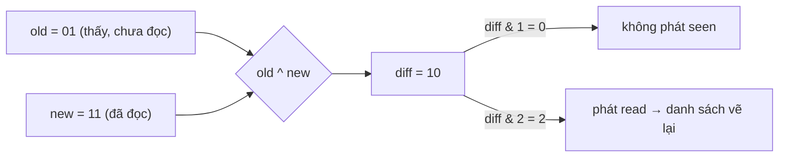

Bạn chọn 3 chiến dịch quảng cáo trong một bảng rồi bấm "Sửa". Một form hiện ra. Ô "Ngân sách" nên hiển thị gì, khi 3 chiến dịch có 3 ngân sách khác nhau? Và nếu người dùng chỉ đổi "Tuổi tối thiểu" rồi bấm Lưu, thì ngân sách của 3 chiến dịch có được giữ nguyên không?

Cách làm nhanh nhất là lấy dòng đầu tiên làm giá trị cho cả form. Ô ngân sách hiện 500, người dùng không để ý, bấm Lưu, và cả 3 chiến dịch giờ đều có ngân sách 500. Với form quảng cáo, đó là lỗi tốn tiền thật.

Bài này xem hai mẩu code nhỏ của Facebook. Cả hai cùng giải một kiểu bài toán: **một giá trị đại diện cho nhiều thứ cùng lúc**, sao cho khi cập nhật, phần không đổi không bị đụng tới.

1. `AdsBulkValueUtils`: mỗi field của form sửa hàng loạt là `Empty`, `Uniform` hoặc `Mixed`.
2. `NotificationSeenState`: trạng thái "đã thấy" và "đã đọc" của thông báo gói trong 2 bit, dùng XOR để biết bit nào vừa đổi.

> [!TIP]
> **Tóm tắt**
> - Form sửa N dòng không giữ một giá trị mà giữ một **BulkValue**: `empty` (mọi dòng rỗng), `uniform` (mọi dòng giống nhau) hoặc `mixed` (mảng N giá trị riêng). Ô `mixed` hiện placeholder "Nhiều giá trị".
> - Sửa một ô thì chỉ ô đó thành `uniform`; khi tách ngược ra N object, ô `mixed` trả lại đúng giá trị riêng của từng dòng.
> - Chuông thông báo lưu `SEEN=1`, `READ=2`. `old ^ new` cho biết bit nào đổi, nên badge chỉ vẽ lại khi bit SEEN đổi, danh sách chỉ vẽ lại khi bit READ đổi.
> - Payload lúc tải trang **không được ghi đè** trạng thái đã biết, vì nó có thể cũ hơn dữ liệu vừa nhận qua push.

<iframe class="demo-frame" src="/demos/facebook-patterns/index.html?theme=dark#/bulk-edit" title="Demo bulk-edit" loading="lazy" style="height: 1250px"></iframe>

<p class="demo-links">▶ <a href="/demos/facebook-patterns/index.html#/bulk-edit" target="_blank" rel="noopener">Mở demo toàn màn hình ↗</a> · <a href="https://stackblitz.com/github/hunghg255/blog-hunghg/tree/master/examples/facebook-patterns?file=src/lib/bulkEdit.ts" target="_blank" rel="noopener">Sửa code trên StackBlitz ↗</a> · <a href="https://github.com/hunghg255/blog-hunghg/blob/master/examples/facebook-patterns/src/lib/bulkEdit.ts" target="_blank" rel="noopener">Xem source trên GitHub ↗</a></p>

## Facebook làm thế nào?

### Ba kiểu giá trị cho form sửa hàng loạt

Trong `99.js` có bốn module đi cùng nhau: `AdsEmptyValue`, `AdsUniformValue`, `AdsMixedValue` và `AdsBulkValueUtils`. Mỗi kiểu có một hàm `create(values)` nhận mảng N giá trị, trả về instance nếu khớp, ngược lại trả `null`:

```js
// AdsEmptyValue.create: mọi giá trị đều "rỗng"
values.every((a) =>
  a === undefined || a === null || a === '' ||
  (Array.isArray(a) && !a.length) ||
  (a[Symbol.iterator] && a.size === 0) ||                 // Set/Map rỗng
  (Object.prototype.toString.call(a) === '[object Object]' && !Object.keys(a).length)
) ? AdsEmptyValue.instance() : null;                       // Empty là singleton

// AdsUniformValue.create: mọi giá trị areEqual với phần tử đầu
values.every((a) => areEqual(a, values[0])) ? new AdsUniformValue(values[0]) : null;

// AdsMixedValue.create: luôn khớp
new AdsMixedValue(values);
```

`AdsBulkValueUtils.aggregate` thử các kiểu theo thứ tự trong `AdsEmptyUniformMixedBulkValueTypes`: Empty trước, rồi Uniform, cuối cùng Mixed. Kiểu nào `create` ra khác `null` thì dừng. Mỗi kiểu có `match({ Empty, Uniform, Mixed })`, giống pattern matching của kiểu tổng (sum type) trong các ngôn ngữ hàm.

### Gộp và tách sâu theo path

Form quảng cáo không phẳng: `targeting.age_min`, `targeting.geo_locations.countries`… Hàm `aggregateDeep(spec, objects)` đi đệ quy theo một object mẫu, và ở mỗi lá thì `getByPath` từ N object để tạo bulk value:

Với mỗi lá, hàm (tên rút gọn `y()`) lấy giá trị ở path đó từ N object, rồi thử lần lượt các kiểu như trên. Nếu cả N giá trị đều `undefined` thì chỉ Empty được chấp nhận.

`deaggregateDeep(tree, n)` đi ngược lại, tạo N object và `setByPath` cho từng lá:

```js
function writeLeaf(target, index, bulk, path) {
  const v = bulk.getValueForIndex(index);   // Uniform: luôn value; Mixed: values[index]
  if (v !== undefined) setByPath(target, path, v); // Empty trả undefined: không ghi gì
}
```

Mấu chốt nằm ở đây: lá `Mixed` mà người dùng không đụng tới sẽ trả lại **đúng giá trị riêng của từng dòng**. Lá được sửa đã thành `Uniform`, nên mọi dòng nhận cùng giá trị mới. Độ sâu quá 5 cấp thì module ghi log cảnh báo hiệu năng.

Bộ util còn có `getObjectDeepChanges` trả về `{ new, old }` cho từng lá đã đổi, dùng để chỉ gửi phần thay đổi lên server.

Hai chi tiết nhỏ khi đọc code:

- `AdsMixedValue.hashCode()` chỉ trả về **độ dài mảng**, nên mọi Mixed cùng N phần tử cùng hash. Không sai, vì `equals` vẫn so từng phần tử, nhưng dùng làm khoá trong Map của Immutable.js thì mọi Mixed cùng độ dài rơi vào một bucket.
- `areBulkValuesEqual` so bằng `StrSet` (tập chuỗi), nên `Mixed[a, b]` bằng `Mixed[b, a]` và bỏ qua phần tử trùng. Nếu thứ tự dòng có ý nghĩa thì hàm này trả `true` sai.

### Trạng thái thông báo gói trong 2 bit

Module `NotificationSeenState` (`277.js`) giữ một object `{ alert_id → số }`:

```js
const SEEN = 1, READ = 2;
const states = {
  UNSEEN_AND_UNREAD: 0,
  SEEN_BUT_UNREAD: SEEN,       // 1
  SEEN_AND_READ: 3,            // SEEN | READ
};
```

Không có trạng thái `2` (đã đọc nhưng chưa thấy), vì đọc thì phải thấy. Khi có cập nhật, hàm `o()` so trạng thái cũ và mới bằng XOR:

```js
// trong vòng lặp qua từng alert_id; id chưa biết thì phát cả hai sự kiện
const diff = old ^ value;
if (diff & SEEN) seenChanged.push(id);
if (diff & READ) readChanged.push(id);
// cuối hàm: didUpdateSeenState(seenChanged), didUpdateReadState(readChanged) nếu khác rỗng
```

Mở chuông là `old | 1`. Bỏ đọc là `old & ~2`. Hai sự kiện tách biệt: badge đỏ trên chuông chỉ cần biết "seen", chấm xanh trên từng thông báo chỉ cần biết "read". Bấm mở chuông làm đổi seen của 20 thông báo, nhưng danh sách không phải vẽ lại vì không bit READ nào đổi.

Module còn có một luật về nguồn dữ liệu:

```js
NotificationUpdates.subscribe('update-notifications', (_, data) => {
  const fromEndpoint = data.payloadsource == PayloadSourceType.ENDPOINT;
  const nodes = data.nodes.filter((n) => !fromEndpoint || known[n.alert_id] === undefined);
  apply(toStates(nodes));
});
```

Payload từ endpoint (lúc tải trang, lúc mở danh sách) **không ghi đè** id đã biết. Lý do (suy đoán, code không ghi chú): response của endpoint được tạo ở server tại một thời điểm; trong lúc nó bay về, người dùng có thể đã đọc thông báo ở tab khác và trạng thái mới đã tới qua push. Ghi đè thì thông báo đã đọc lại hiện chấm xanh.

### Danh sách "thin client"

`CometNotificationsThinClientConnectionHandler` (`26.js`) là một connection handler tự viết cho Relay. Khi refetch đầu danh sách (không có `after`/`before`), server có thể trả về edge kiểu `NotifPageCachedNotificationRow`, chỉ có id và vài field. Handler dựng bảng `notif.id → record đầy đủ` từ các edge đang có, rồi thay node rút gọn bằng record cũ:

```js
if (node.getType() === 'NotifPageCachedNotificationRow') {
  const full = oldById[node.getLinkedRecord('notif').getValue('id')];
  if (full) { full.copyFieldsFrom(node); edge.setLinkedRecord(full, 'node'); out.push(edge); }
  // không có trong cache: bỏ qua, không báo gì
}
```

Server không phải gửi lại tiêu đề, ảnh, link của thông báo client đã có. Điểm yếu: hàng rút gọn mà client không có bản đầy đủ thì **bị bỏ lặng lẽ**. Có lẽ server dựa vào thông tin client gửi lên để chỉ dùng hàng rút gọn cho id client chắc chắn có, nhưng handler không tự bảo vệ trường hợp đó.

## Bên trong: vì sao XOR?



XOR của hai số cho ra bit 1 ở đúng những vị trí khác nhau. Với 2 bit, `diff & 1` và `diff & 2` trả lời ngay "bit nào đổi" mà không cần `if` cho từng tổ hợp trạng thái. Thêm bit thứ ba (ví dụ "đã ẩn") thì chỉ cần thêm một dòng `if (diff & HIDDEN)`.

## Viết lại

### BulkValue

```ts title=src/lib/bulkEdit.ts
export function aggregate<T>(values: T[], equal = deepEqual): BulkValue<T> {
  if (values.every(isEmptyLike)) return EMPTY;
  const first = values[0];
  if (values.every((v) => equal(v, first))) return { kind: 'uniform', value: first };
  return { kind: 'mixed', values };
}
```

```ts title=src/lib/bulkEdit.ts
export function deaggregateDeep(tree: BulkTree, count: number): Record<string, unknown>[] {
  const out = Array.from({ length: count }, () => ({}) as Record<string, unknown>);
  const walk = (node: BulkTree, path: string[]) => {
    for (const [key, child] of Object.entries(node)) {
      const childPath = [...path, key];
      if (isBulkValue(child)) {
        out.forEach((object, i) => {
          const value = valueAt(child, i);
          if (value !== undefined) setByPath(object, childPath, value);
        });
      } else {
        walk(child, childPath);
      }
    }
  };
  walk(tree, []);
  return out;
}
```

::: spoiler Xem toàn bộ src/lib/bulkEdit.ts

```ts title=src/lib/bulkEdit.ts
/**
 * Sửa hàng loạt kiểu Ads Manager (ý tưởng từ AdsBulkValueUtils / AdsEmptyValue /
 * AdsUniformValue / AdsMixedValue của Facebook).
 *
 * Chọn N chiến dịch rồi mở một form: mỗi field trong form không giữ "một giá trị" mà giữ
 * một BulkValue cho cả N dòng:
 *   - empty:   cả N dòng đều rỗng (null, '', [], Set rỗng, {} rỗng)
 *   - uniform: cả N dòng cùng một giá trị
 *   - mixed:   mỗi dòng một giá trị, giữ nguyên mảng N giá trị
 * Sửa một field thì chỉ field đó thành uniform; field không đụng tới giữ đúng giá trị
 * riêng của từng dòng khi tách ngược ra N object.
 */

export type BulkValue<T = unknown> =
  | { kind: 'empty' }
  | { kind: 'uniform'; value: T }
  | { kind: 'mixed'; values: T[] };

const EMPTY: BulkValue<never> = Object.freeze({ kind: 'empty' });

export function isEmptyLike(value: unknown): boolean {
  if (value === undefined || value === null || value === '') return true;
  if (Array.isArray(value)) return value.length === 0;
  if (value instanceof Set || value instanceof Map) return value.size === 0;
  if (Object.prototype.toString.call(value) === '[object Object]') {
    return Object.keys(value as object).length === 0;
  }
  return false;
}

/** So sánh sâu đơn giản cho dữ liệu JSON (đủ cho form). */
export function deepEqual(a: unknown, b: unknown): boolean {
  if (Object.is(a, b)) return true;
  if (typeof a !== 'object' || typeof b !== 'object' || a === null || b === null) return false;
  if (Array.isArray(a) !== Array.isArray(b)) return false;
  const ka = Object.keys(a as object);
  const kb = Object.keys(b as object);
  if (ka.length !== kb.length) return false;
  return ka.every((k) =>
    deepEqual((a as Record<string, unknown>)[k], (b as Record<string, unknown>)[k]),
  );
}

/** Thử lần lượt empty → uniform → mixed, giống thứ tự AdsEmptyUniformMixedBulkValueTypes. */
export function aggregate<T>(values: T[], equal = deepEqual): BulkValue<T> {
  if (values.every(isEmptyLike)) return EMPTY;
  const first = values[0];
  if (values.every((v) => equal(v, first))) return { kind: 'uniform', value: first };
  return { kind: 'mixed', values };
}

export function match<T, R>(
  bulk: BulkValue<T>,
  cases: { empty: () => R; uniform: (value: T) => R; mixed: (values: T[]) => R },
): R {
  if (bulk.kind === 'empty') return cases.empty();
  if (bulk.kind === 'uniform') return cases.uniform(bulk.value);
  return cases.mixed(bulk.values);
}

/** Giá trị cho dòng thứ i; undefined nghĩa là "không ghi gì". */
export function valueAt<T>(bulk: BulkValue<T>, index: number): T | undefined {
  if (bulk.kind === 'empty') return undefined;
  if (bulk.kind === 'uniform') return bulk.value;
  return bulk.values[index];
}

// ---- gộp/tách sâu theo path ----

/** Cây field: lá là `true`, nhánh là object con. */
export type Shape = { [key: string]: true | Shape };
export type BulkTree = { [key: string]: BulkValue | BulkTree };

export function isBulkValue(value: unknown): value is BulkValue {
  return (
    typeof value === 'object' &&
    value !== null &&
    'kind' in value &&
    ['empty', 'uniform', 'mixed'].includes((value as { kind: string }).kind)
  );
}

export function getByPath(object: unknown, path: string[]): unknown {
  let current = object;
  for (const key of path) {
    if (current == null || typeof current !== 'object') return undefined;
    current = (current as Record<string, unknown>)[key];
  }
  return current;
}

export function setByPath(object: Record<string, unknown>, path: string[], value: unknown) {
  let current = object;
  path.slice(0, -1).forEach((key) => {
    if (typeof current[key] !== 'object' || current[key] === null) current[key] = {};
    current = current[key] as Record<string, unknown>;
  });
  current[path[path.length - 1]] = value;
}

/** N object → một cây BulkValue theo shape. */
export function aggregateDeep(objects: object[], shape: Shape, path: string[] = []): BulkTree {
  const tree: BulkTree = {};
  for (const [key, child] of Object.entries(shape)) {
    const childPath = [...path, key];
    tree[key] =
      child === true
        ? aggregate(objects.map((o) => getByPath(o, childPath)))
        : aggregateDeep(objects, child, childPath);
  }
  return tree;
}

/** Cây BulkValue → N object. Lá empty thì không ghi (giống hàm `z` của bản gốc). */
export function deaggregateDeep(tree: BulkTree, count: number): Record<string, unknown>[] {
  const out = Array.from({ length: count }, () => ({}) as Record<string, unknown>);
  const walk = (node: BulkTree, path: string[]) => {
    for (const [key, child] of Object.entries(node)) {
      const childPath = [...path, key];
      if (isBulkValue(child)) {
        out.forEach((object, i) => {
          const value = valueAt(child, i);
          if (value !== undefined) setByPath(object, childPath, value);
        });
      } else {
        walk(child, childPath);
      }
    }
  };
  walk(tree, []);
  return out;
}

/** Sửa một field trên form: lá đó thành uniform (hoặc empty nếu giá trị rỗng). */
export function editLeaf(tree: BulkTree, path: string[], value: unknown): BulkTree {
  const [head, ...rest] = path;
  const node = tree[head];
  if (rest.length === 0) return { ...tree, [head]: isEmptyLike(value) ? EMPTY : { kind: 'uniform', value } };
  if (!node || isBulkValue(node)) throw new Error(`Path không tồn tại: ${path.join('.')}`);
  return { ...tree, [head]: editLeaf(node, rest, value) };
}

/** Liệt kê các lá đã đổi so với cây gốc (dùng để chỉ gửi field bị sửa lên server). */
export function changedPaths(before: BulkTree, after: BulkTree, path: string[] = []): string[] {
  const keys = new Set([...Object.keys(before), ...Object.keys(after)]);
  const out: string[] = [];
  keys.forEach((key) => {
    const a = before[key];
    const b = after[key];
    const childPath = [...path, key];
    if (isBulkValue(a) || isBulkValue(b)) {
      if (!deepEqual(a, b)) out.push(childPath.join('.'));
    } else if (a && b) {
      out.push(...changedPaths(a, b, childPath));
    }
  });
  return out;
}
```

:::

### Seen/read và refetch rút gọn

```ts title=src/lib/seenState.ts
  function apply(next: Record<string, SeenBits>) {
    const seenChanged: string[] = [];
    const readChanged: string[] = [];
    for (const [id, value] of Object.entries(next)) {
      const old = states.get(id);
      states.set(id, value);
      if (old === undefined) {
        // id mới: cả badge lẫn danh sách đều cần biết
        seenChanged.push(id);
        readChanged.push(id);
        continue;
      }
      const diff = old ^ value;
      if (diff & SEEN) seenChanged.push(id);
      if (diff & READ) readChanged.push(id);
    }
    if (seenChanged.length) listeners.seen.forEach((l) => l(seenChanged));
    if (readChanged.length) listeners.read.forEach((l) => l(readChanged));
  }
```

```ts title=src/lib/seenState.ts
/**
 * Refetch đầu danh sách: ghép hàng rút gọn với bản đầy đủ đang có.
 * Bản gốc lặng lẽ bỏ hàng rút gọn không tìm thấy trong cache; ở đây trả `missing`
 * để gọi lại server lấy bản đầy đủ thay vì làm mất thông báo.
 */
export function mergeRefetch(current: FullRow[], incoming: ServerRow[]) {
  const byId = new Map(current.map((row) => [row.id, row]));
  const rows: FullRow[] = [];
  const missing: string[] = [];
  const seen = new Set<string>();
  for (const row of incoming) {
    if (seen.has(row.id)) continue;
    seen.add(row.id);
    if (!isCached(row)) {
      rows.push(row);
      continue;
    }
    const old = byId.get(row.id);
    if (old) rows.push({ ...old, state: row.state });
    else missing.push(row.id);
  }
  return { rows, missing };
}
```

::: spoiler Xem toàn bộ src/lib/seenState.ts

```ts title=src/lib/seenState.ts
/**
 * Trạng thái "đã thấy / đã đọc" của thông báo bằng 2 bit, và danh sách "thin client"
 * (ý tưởng từ NotificationSeenState và CometNotificationsThinClientConnectionHandler).
 *
 * SEEN = bit 1 (badge đỏ trên chuông), READ = bit 2 (chấm xanh trên từng thông báo).
 * Đọc kéo theo thấy, nên chỉ có 3 trạng thái hợp lệ: 0, 1, 3.
 * Khi cập nhật, `old ^ new` cho biết bit nào đổi, rồi phát hai sự kiện riêng:
 * badge chỉ nghe "seen", danh sách chỉ nghe "read".
 */

export const SEEN = 1;
export const READ = 2;
export const UNSEEN_AND_UNREAD = 0;
export const SEEN_BUT_UNREAD = SEEN;
export const SEEN_AND_READ = SEEN | READ;

export type SeenBits = 0 | 1 | 3;
export type PayloadSource = 'endpoint' | 'push' | 'sync';
type Listener = (ids: string[]) => void;

export function createSeenStore() {
  const states = new Map<string, SeenBits>();
  const listeners = { seen: new Set<Listener>(), read: new Set<Listener>() };

  /** Áp một loạt trạng thái mới, phát sự kiện theo bit thực sự đổi. */
  function apply(next: Record<string, SeenBits>) {
    const seenChanged: string[] = [];
    const readChanged: string[] = [];
    for (const [id, value] of Object.entries(next)) {
      const old = states.get(id);
      states.set(id, value);
      if (old === undefined) {
        // id mới: cả badge lẫn danh sách đều cần biết
        seenChanged.push(id);
        readChanged.push(id);
        continue;
      }
      const diff = old ^ value;
      if (diff & SEEN) seenChanged.push(id);
      if (diff & READ) readChanged.push(id);
    }
    if (seenChanged.length) listeners.seen.forEach((l) => l(seenChanged));
    if (readChanged.length) listeners.read.forEach((l) => l(readChanged));
  }

  return {
    /**
     * Payload tải trang ('endpoint') không được ghi đè id đã biết: dữ liệu đó có thể cũ hơn
     * trạng thái vừa nhận qua push/sync. Push và sync thì luôn ghi đè.
     */
    receive(items: Array<{ id: string; state: SeenBits }>, source: PayloadSource) {
      const next: Record<string, SeenBits> = {};
      items.forEach(({ id, state }) => {
        if (source === 'endpoint' && states.has(id)) return;
        next[id] = state;
      });
      apply(next);
    },
    /** Mở chuông: mọi id được đánh dấu đã thấy (giữ nguyên bit đọc). */
    markSeen(ids: string[]) {
      const next: Record<string, SeenBits> = {};
      ids.forEach((id) => {
        const old = states.get(id);
        if (old !== undefined) next[id] = (old | SEEN) as SeenBits;
      });
      apply(next);
    },
    /** Đọc thì kéo theo đã thấy; bỏ đọc chỉ xoá bit READ. */
    markRead(ids: string[], read = true) {
      const next: Record<string, SeenBits> = {};
      ids.forEach((id) => {
        const old = states.get(id);
        if (read) next[id] = SEEN_AND_READ as SeenBits;
        else if (old !== undefined) next[id] = (old & ~READ) as SeenBits;
      });
      apply(next);
    },
    get: (id: string) => states.get(id),
    unseenCount: () => [...states.values()].filter((s) => s === UNSEEN_AND_UNREAD).length,
    unreadCount: () => [...states.values()].filter((s) => s !== SEEN_AND_READ).length,
    on(type: 'seen' | 'read', listener: Listener) {
      listeners[type].add(listener);
      return () => listeners[type].delete(listener);
    },
  };
}

export type SeenStore = ReturnType<typeof createSeenStore>;

// ---- "thin client": server chỉ gửi id cho thông báo client đã có ----

export interface FullRow {
  id: string;
  text: string;
  time: number;
  state: SeenBits;
}
/** Hàng rút gọn: server biết client đã có nội dung, chỉ gửi id và trạng thái mới. */
export interface CachedRow {
  id: string;
  cached: true;
  state: SeenBits;
}
export type ServerRow = FullRow | CachedRow;

export const isCached = (row: ServerRow): row is CachedRow => 'cached' in row;

/**
 * Refetch đầu danh sách: ghép hàng rút gọn với bản đầy đủ đang có.
 * Bản gốc lặng lẽ bỏ hàng rút gọn không tìm thấy trong cache; ở đây trả `missing`
 * để gọi lại server lấy bản đầy đủ thay vì làm mất thông báo.
 */
export function mergeRefetch(current: FullRow[], incoming: ServerRow[]) {
  const byId = new Map(current.map((row) => [row.id, row]));
  const rows: FullRow[] = [];
  const missing: string[] = [];
  const seen = new Set<string>();
  for (const row of incoming) {
    if (seen.has(row.id)) continue;
    seen.add(row.id);
    if (!isCached(row)) {
      rows.push(row);
      continue;
    }
    const old = byId.get(row.id);
    if (old) rows.push({ ...old, state: row.state });
    else missing.push(row.id);
  }
  return { rows, missing };
}

/** Phân trang tiếp (after = endCursor): nối vào cuối, khử trùng theo id. */
export function appendPage(current: FullRow[], page: FullRow[]) {
  const ids = new Set(current.map((r) => r.id));
  return [...current, ...page.filter((r) => !ids.has(r.id))];
}

/** Ước lượng số byte JSON, để demo so sánh hàng đầy đủ với hàng rút gọn. */
export const jsonBytes = (value: unknown) => new TextEncoder().encode(JSON.stringify(value)).length;
```

:::

## Đi qua code

- `aggregate` dùng `deepEqual` thay cho `===`, vì giá trị trong form có thể là mảng hoặc object (danh sách quốc gia, khoảng tuổi).
- `valueAt` gom logic "dòng thứ i nhận gì" vào một chỗ. Trả `undefined` nghĩa là không ghi, giống `getValueForIndex` của bản gốc.
- `editLeaf` không sửa cây gốc mà trả về cây mới, để `changedPaths(original, edited)` so được trước và sau.
- Trong demo, khi Lưu, chỉ các path có trong `changedPaths` được ghi vào từng dòng. Như vậy dù cây có lá `mixed`, request gửi lên server chỉ chứa field người dùng thật sự đổi.
- `createSeenStore.apply` giữ đúng ý của `o()` trong bản gốc: id mới thì phát cả hai sự kiện, id cũ thì XOR.
- `receive(items, 'endpoint')` bỏ qua id đã biết. `push` và `sync` thì luôn ghi đè.
- `mergeRefetch` trả thêm `missing`: những id server gửi dạng rút gọn mà client không có. Gọi lại server lấy bản đầy đủ thay vì làm mất thông báo.

**Khác bản gốc:** bản viết lại dùng kiểu union của TypeScript thay cho ba class; `match` là hàm thay vì method. `mergeRefetch` báo id thiếu thay vì bỏ qua. Bộ seen/read dùng `Map` và listener riêng cho từng sự kiện thay cho hệ thống pub/sub `NotificationUpdates`.

## Tại sao không làm cách khác?

**Dùng `null` cho ô có nhiều giá trị?** Khi đó không phân biệt được "mọi dòng đều trống" với "mỗi dòng một giá trị". Một bên nên hiện ô trống, một bên nên hiện "Nhiều giá trị". Khi Lưu, ô trống do người dùng xoá phải ghi `null` cho mọi dòng, còn ô mixed không đụng tới thì không được ghi gì.

**Gửi lên server cả N object đầy đủ?** Được, nếu không có ai khác sửa cùng lúc. Nhưng Ads Manager là công cụ nhiều người dùng chung một tài khoản quảng cáo. Gửi đủ mọi field có nghĩa là ghi đè thay đổi của người khác lên những field mình không đụng tới.

**Hai boolean `isSeen`, `isRead` thay cho 2 bit?** Logic tương đương, nhưng phải tự so từng boolean để biết sự kiện nào cần phát. Bitmask gọn hơn, và lưu được trong một số nguyên khi gửi qua mạng.

**Mỗi thông báo tự nghe store và tự vẽ lại?** Với vài chục thông báo thì không sao. Tách sự kiện seen/read giúp tránh cả danh sách vẽ lại khi chỉ có badge cần đổi, một việc xảy ra mỗi lần người dùng bấm chuông.

## Edge case và cạm bẫy

- **Rỗng thế nào mới là rỗng?** `0` và `false` không rỗng. Nếu coi `0` là rỗng, ngân sách 0 của mọi dòng sẽ hiện ô trống thay vì `0`.
- **Đặt về rỗng có chủ đích.** Người dùng xoá trắng ô ngân sách: `editLeaf` biến lá thành `empty`, và `deaggregateDeep` sẽ không ghi gì. Demo xử lý bằng cách ghi `null` cho path có trong `changedPaths`, để "xoá" vẫn được gửi đi. Nếu dùng nguyên `deaggregateDeep` mà không có danh sách thay đổi, thao tác xoá sẽ mất.
- **So sánh object có thứ tự key khác nhau.** `deepEqual` trong bài so theo key nên `{a, b}` và `{b, a}` bằng nhau. Mảng thì so theo thứ tự.
- **Thông báo bị "bỏ đọc" khi chưa thấy?** Bản gốc không có trạng thái 2, và `markRead(false)` chỉ xoá bit READ nên không bao giờ tạo ra trạng thái này.
- **Id lạ trong `markSeen`.** Bản gốc chỉ cập nhật id đã biết; id chưa từng nhận thì bị bỏ qua. Bản viết lại giữ hành vi đó.

## Dùng trong dự án

```tsx
const shape = { status: true, budget: true, targeting: { minAge: true } } as const;

function BulkEditForm({ rows, onSave }: { rows: Campaign[]; onSave: (patches: Patch[]) => void }) {
  const original = useMemo(() => aggregateDeep(rows, shape), [rows]);
  const [tree, setTree] = useState(original);
  const changes = changedPaths(original, tree);

  const save = () => {
    const values = deaggregateDeep(tree, rows.length);
    onSave(rows.map((row, i) => ({
      id: row.id,
      // chỉ gửi field đã đổi; field xoá trắng gửi null
      changes: Object.fromEntries(changes.map((p) => [p, getByPath(values[i], p.split('.')) ?? null])),
    })));
  };
  // input: value = leaf.kind === 'uniform' ? leaf.value : '', placeholder = leaf.kind === 'mixed' ? 'Nhiều giá trị' : ''
}
```

Với thông báo:

```ts
const store = createSeenStore();
store.on('seen', () => setBadge(store.unseenCount()));   // component chuông
store.on('read', (ids) => rerenderRows(ids));            // danh sách
socket.on('notification_state', (items) => store.receive(items, 'push'));
fetchNotifications().then((items) => store.receive(items, 'endpoint'));
```

## Kiểm thử

::: spoiler Ví dụ test (bản phác, không có trong repo)

```ts
import { describe, expect, it, vi } from 'vitest';
import { aggregate, aggregateDeep, changedPaths, deaggregateDeep, editLeaf } from './bulkEdit';
import { createSeenStore, mergeRefetch } from './seenState';

describe('bulk edit', () => {
  it('empty → uniform → mixed theo thứ tự', () => {
    expect(aggregate([null, '', [], {}])).toEqual({ kind: 'empty' });
    expect(aggregate([5, 5, 5])).toEqual({ kind: 'uniform', value: 5 });
    expect(aggregate([5, 3])).toEqual({ kind: 'mixed', values: [5, 3] });
  });

  it('sửa một lá chỉ đổi lá đó, lá mixed giữ giá trị từng dòng', () => {
    const rows = [
      { budget: 500, targeting: { minAge: 18 } },
      { budget: 300, targeting: { minAge: 18 } },
    ];
    const tree = aggregateDeep(rows, { budget: true, targeting: { minAge: true } });
    const edited = editLeaf(tree, ['targeting', 'minAge'], 21);
    expect(changedPaths(tree, edited)).toEqual(['targeting.minAge']);
    expect(deaggregateDeep(edited, 2)).toEqual([
      { budget: 500, targeting: { minAge: 21 } },
      { budget: 300, targeting: { minAge: 21 } },
    ]);
  });
});

describe('seen/read', () => {
  it('XOR tách sự kiện seen và read', () => {
    const store = createSeenStore();
    store.receive([{ id: 'a', state: 0 }, { id: 'b', state: 0 }], 'endpoint');
    const seen = vi.fn();
    const read = vi.fn();
    store.on('seen', seen);
    store.on('read', read);
    store.markSeen(['a', 'b']);
    expect(seen).toHaveBeenCalledWith(['a', 'b']);
    expect(read).not.toHaveBeenCalled();
    store.markRead(['a']);
    expect(read).toHaveBeenCalledWith(['a']);
    expect(seen).toHaveBeenCalledTimes(1);
  });

  it('payload endpoint không ghi đè id đã biết', () => {
    const store = createSeenStore();
    store.receive([{ id: 'a', state: 0 }], 'endpoint');
    store.markRead(['a']);
    store.receive([{ id: 'a', state: 0 }], 'endpoint');
    expect(store.get('a')).toBe(3);
  });

  it('refetch rút gọn báo id thiếu', () => {
    const { rows, missing } = mergeRefetch(
      [{ id: 'a', text: 'A', time: 1, state: 0 }],
      [{ id: 'a', cached: true, state: 3 }, { id: 'z', cached: true, state: 0 }],
    );
    expect(rows[0]).toMatchObject({ id: 'a', text: 'A', state: 3 });
    expect(missing).toEqual(['z']);
  });
});
```

:::

## So với thư viện

- Form library như React Hook Form hay Formik không có khái niệm "giá trị cho N bản ghi". Cách phổ biến là tự giữ `dirtyFields` và chỉ gửi field đã đổi; BulkValue là bước tiếp theo, thêm trạng thái `mixed` để hiển thị đúng.
- JSON Patch (RFC 6902) và JSON Merge Patch (RFC 7396) là chuẩn để mô tả "chỉ những field đã đổi" khi gửi lên server. `changedPaths` trong bài tương đương với việc tạo các thao tác `replace` của JSON Patch.
- Bitmask cho trạng thái là kỹ thuật cũ, quen thuộc ở quyền file Unix (`rwx`). Các API như `Notification` của trình duyệt không quản lý seen/read; đó luôn là logic của ứng dụng.

---

Bài này thuộc series **[Học từ mã nguồn Facebook](/series/facebook)** (106 bài, đọc theo thứ tự).

::: spoiler Xem nhanh danh sách bài trong series

*Phần 1*

- [Mở đầu: cách đọc code minify của Facebook](/blogs/learn-from-facebook-source-code)
- [#1 Dùng chung IntersectionObserver + infinite scroll](/blogs/facebook-shared-intersection-observer)
- [#2 useViewportDuration: đo thời gian thực sự được xem](/blogs/facebook-use-viewport-duration)
- [#3 Preload code + data khi hover](/blogs/facebook-preload-on-hover)
- [#4 Toast manager với external store](/blogs/facebook-toast-manager)
- [#5 Network status + heartbeat backoff](/blogs/facebook-network-status-heartbeat)
- [#6 ErrorGuard: bắt lỗi theo ngữ cảnh](/blogs/facebook-error-guard)
- [#7 Banzai: gom log theo lô + sendBeacon](/blogs/facebook-batch-logger)
- [#8 Focus trap + Esc theo layer](/blogs/facebook-focus-trap)

*Phần 2*

- [#9 Mẹo calc(… * 9999): container query, line-clamp, mũi tên carousel bằng CSS](/blogs/facebook-css-9999-trick)
- [#10 Thanh cuộn tuỳ biến bằng CSS 3D](/blogs/facebook-css-3d-scrollbar)
- [#11 Modal cuộn bằng window, giữ vị trí trang nền](/blogs/facebook-document-scroll-modal)
- [#12 Popover, tooltip group và hovercard](/blogs/facebook-popover-tooltip)
- [#13 Primitive Pressable + focus-visible](/blogs/facebook-pressable)
- [#14 Tab "Xem thêm" + sticky header bằng IntersectionObserver](/blogs/facebook-priority-tabs-sticky-header)
- [#15 Avatar khoét mask, gradient Messenger, skeleton steps()](/blogs/facebook-visual-tricks)
- [#16 Khung chat không giật](/blogs/facebook-chat-scroller)
- [#17 Thuật toán chọn bố cục collage ảnh](/blogs/facebook-photo-collage-layout)
- [#18 Keep-alive tab trong SPA](/blogs/facebook-keep-alive-tabs)
- [#19 Tự đo Visual Completion & interaction tracing](/blogs/facebook-visual-completion)
- [#20 Router SPA bền bỉ & tải chunk có retry](/blogs/facebook-spa-router-resilient-loading)

*Phần 3*

- [#21 Smart Compose: gợi ý chữ mờ khi gõ](/blogs/facebook-smart-compose-ghost-text)
- [#22 MQTT ngay trong trình duyệt, tự chuyển sang long-poll](/blogs/facebook-mqtt-in-browser)
- [#23 Đo thời gian dùng bằng bitmap 64 giây](/blogs/facebook-time-spent-bitmap)
- [#24 Bảng reaction nhấn giữ rồi trượt](/blogs/facebook-reaction-press-slide)
- [#25 Tìm kiếm gấp dấu, phiên âm và highlight đầu từ](/blogs/facebook-search-diacritics-tokenize)
- [#26 Ring buffer biết trace nào đã mất log](/blogs/facebook-trace-ring-buffer)
- [#27 Engine animation JS: một vòng rAF và solver cubic-bezier](/blogs/facebook-keyframes-loop-cubic-bezier)
- [#28 Bootloader: bitmap tài nguyên đã tải, chỉ reload khi cần](/blogs/facebook-bootloader-bitmap-consistency)
- [#29 Nhận biết click do screen reader tạo ra](/blogs/facebook-virtual-cursor-detection)
- [#30 Tải trước feed theo chất lượng mạng, đoán hạng thiết bị](/blogs/facebook-network-aware-prefetch)
- [#31 Hàng đợi gửi tin chat giữ đúng thứ tự](/blogs/facebook-ordered-send-queue)
- [#32 Gộp lời gọi API trong cùng một tick](/blogs/facebook-api-batcher)
- [#33 Resize ảnh trong pool Web Worker](/blogs/facebook-jpeg-resize-worker-pool)
- [#34 Crop ảnh theo nhiều khuôn mặt](/blogs/facebook-face-aware-crop)
- [#35 Kéo-thả sắp xếp và vùng thả file không nhấp nháy](/blogs/facebook-flicker-free-drag-drop)
- [#36 Tiện ích UI: fade-out, sticky event, hàm huỷ được](/blogs/facebook-ui-utility-hooks)
- [#37 Hạ tầng nhỏ: cookie, hash lỗi, prefetch khi chuột dừng](/blogs/facebook-small-infra-cookie-hash-idle)

*Phần 4–6*

- [#38 Đồng bộ tin nhắn: phát hiện lỗ seqID và fetch bù theo tầng](/blogs/facebook-messenger-sync-seqid-gaps)
- [#39 OTID: ID tin nhắn kiểu Snowflake sinh ở client](/blogs/facebook-otid-client-snowflake)
- [#40 QPL: lấy mẫu từ lúc bắt đầu, đo RTT gửi tin đầu-cuối](/blogs/facebook-qpl-send-rtt)
- [#41 Bộ điều phối request bảy chế độ gộp và chống trùng](/blogs/facebook-request-dispatcher-modes)
- [#42 Thread list theo mốc thời gian, cookie presence có version](/blogs/facebook-threadlist-ranged-presence)
- [#43 Composer dạng plugin: reducer, dirty checker, chuỗi kiểm tra](/blogs/facebook-plugin-composer)
- [#44 Thanh toán bất đồng bộ: subscribe trước, poll dự phòng](/blogs/facebook-async-checkout)
- [#45 Validate số thẻ: sửa lỗi gõ, dải BIN, Luhn](/blogs/facebook-card-validation)
- [#46 Lịch chọn khoảng ngày: bo góc dải chọn, phím đủ bộ, RTL](/blogs/facebook-range-calendar-a11y)
- [#47 Giờ mở cửa theo tuần: qua đêm, gộp khoảng, phần bù](/blogs/facebook-weekly-hours-intervals)
- [#48 Tiến độ đăng realtime: giữ event chờ snapshot, watchdog](/blogs/facebook-realtime-publish-snapshot)
- [#49 Tiền tệ theo đơn vị nhỏ nhất và ô nhập tiền](/blogs/facebook-currency-minor-units)
- **#50 Sửa hàng loạt Empty/Uniform/Mixed, seen/read bằng 2 bit** (bài này)
- [#51 Phát hiện script lạ hook vào hàm native](/blogs/facebook-native-hook-detection)
- [#52 localStorage tự dọn khi đầy quota](/blogs/facebook-quota-aware-storage)
- [#53 Cache tuyến do server phân giải, chờ sẵn promise](/blogs/facebook-route-cache-prefetch)
- [#54 Lưới phím mũi tên 2D và focus không làm cuộn trang](/blogs/facebook-focus-table-grid)
- [#55 Tách emoji bằng máy trạng thái](/blogs/facebook-emoji-segmentation)
- [#56 Đọc trước ghi sau trong một frame, con tự biết vị trí](/blogs/facebook-read-then-write-dom)
- [#57 Hàng đợi lệnh cho video và stream sắp lại chunk](/blogs/facebook-video-command-queue)

*Phần 7–10*

- [#58 Ước lượng băng thông EWMA: loại outlier, nhớ qua phiên](/blogs/facebook-bandwidth-ewma-estimator)
- [#59 ABR theo độ tự tin phát và cắt bậc bitrate theo MOS](/blogs/facebook-abr-playback-confidence)
- [#60 Prefetch segment dự đoán từ manifest, parse hộp sidx](/blogs/facebook-dash-predicted-segments)
- [#61 Đọc metadata MP4/MOV ngay trên client](/blogs/facebook-mp4-metadata-client)
- [#62 Upload tiếp tục được: offset, hash dedupe, phát hiện treo](/blogs/facebook-resumable-upload)
- [#63 Fenwick tree: chọn ngẫu nhiên có trọng số và offset dòng](/blogs/facebook-fenwick-weighted-random)
- [#64 Vạch trục số và trục thời gian "đẹp"](/blogs/facebook-nice-axis-ticks)
- [#65 Damerau-Levenshtein theo dải chéo và tự sửa tên gõ sai](/blogs/facebook-damerau-levenshtein)
- [#66 PRNG có seed, shuffle tái lập và lấy mẫu trace](/blogs/facebook-seeded-prng-sampling)
- [#67 Cặp min/max-heap tái dùng vị trí trong danh sách ảo](/blogs/facebook-dual-heap-buffer-set)
- [#68 Memo nhiều đối số bằng Map/WeakMap và interning object](/blogs/facebook-multikey-memo-interning)
- [#69 Thống kê cửa sổ trượt và đại số khoảng thời gian](/blogs/facebook-moving-stat-intervals)
- [#70 Int64 từ hai số 32-bit, decode UTF, offset theo code point](/blogs/facebook-int64-utf-codepoints)
- [#71 Engine múi giờ IANA trên client, phát hiện lệch giờ](/blogs/facebook-client-iana-timezone)
- [#72 Tự cài semver range](/blogs/facebook-semver-range)
- [#73 Auto-link URL, cắt chữ an toàn, giới hạn LaTeX](/blogs/facebook-autolink-safe-truncate)
- [#74 Parser query kiểu PHP chống prototype pollution](/blogs/facebook-php-query-serializer)
- [#75 Popover tự lật theo phần tràn nhỏ nhất](/blogs/facebook-popover-auto-flip)
- [#76 Tiền tố for(;;) chống JSON hijacking, đọc stream](/blogs/facebook-csrf-prefix-streaming)
- [#77 Chống lộ Referer, linkshim, xoá token trên URL](/blogs/facebook-referrer-linkshim-url-scrub)
- [#78 setImmediate bằng postMessage, gom delta chuột theo frame](/blogs/facebook-setimmediate-mouse-batching)
- [#79 Phát hiện crash qua heartbeat, dò proxy cache hỏng](/blogs/facebook-crash-heartbeat-proxy-check)
- [#80 DPR vào cookie cho ảnh @2x, che khoá trong log](/blogs/facebook-dpr-cookie-secret-redaction)
- [#81 Flux waitFor tự viết và proxy có đệm](/blogs/facebook-flux-dispatch-buffered-proxy)
- [#82 Crop đúng tỉ lệ, xoay sticker bằng ma trận](/blogs/facebook-image-crop-rotation-geometry)

*Phần 11–15*

- [#83 Chia subdomain giữa các tab bằng lease, long-poll theo bảng trạng thái](/blogs/facebook-tab-subdomain-lease-longpoll)
- [#84 MQTT QoS1: giữ publish chờ ack, gửi lại khi kết nối lại](/blogs/facebook-mqtt-qos1-republish)
- [#85 Cache Promise gộp request, cache lỗi ngắn, đua dữ liệu nhúng sẵn](/blogs/facebook-promise-cache-preload-race)
- [#86 Lịch retry: backoff có trần, Fibonacci, báo lỗi CDN mỗi N ngày](/blogs/facebook-retry-backoff-schedules)
- [#87 Giữ nguyên tham chiếu nhánh dữ liệu không đổi](/blogs/facebook-relay-recycle-nodes)
- [#88 Store optimistic: copy-on-write, rollback rồi áp lại](/blogs/facebook-relay-optimistic-store)
- [#89 Chỉ mục subscription theo record, hàng đợi task theo chiều sâu](/blogs/facebook-relay-subscription-index)
- [#90 Phân trang connection: cursor khớp đầu, edge không trùng](/blogs/facebook-relay-connection-pagination)
- [#91 Profiler kiểu middleware và memo selector có lấy mẫu kiểm tra](/blogs/facebook-profiler-middleware-memo-check)
- [#92 Đọc EBML/WebM Cues để tìm byte range của segment](/blogs/facebook-webm-ebml-cues)
- [#93 Stream HTTP Range tạm dừng được, tải tiếp đúng byte](/blogs/facebook-pausable-range-stream)
- [#94 Bảng khoảng thời gian gắn nhãn và nhảy qua lỗ buffer](/blogs/facebook-tagged-time-ranges-gaps)
- [#95 Gom chunk cho SourceBuffer, đồng bộ video bằng playbackRate](/blogs/facebook-sourcebuffer-video-sync)
- [#96 Gom tin nhắn thành cụm, vạch ngày và avatar đã xem](/blogs/facebook-message-grouping)
- [#97 Bao nhiêu tab chat vừa màn hình, chuỗi luật mở tab](/blogs/facebook-chat-tab-policy)
- [#98 Phím tắt Markdown trong editor, Backspace để hoàn tác](/blogs/facebook-markdown-shortcuts-editor)
- [#99 Offset theo code point hay UTF-16: bốn bug cùng một gốc](/blogs/facebook-codepoint-offset-bugs)
- [#100 Typeahead không nhảy: cache tiền tố, chặn reflow, khoá hover](/blogs/facebook-typeahead-stable-results)
- [#101 Hit-test trên canvas bằng phát lại path, nét đứt và cung Bézier](/blogs/facebook-canvas-hit-regions)
- [#102 Vòng tròn theo mét trên bản đồ Mercator](/blogs/facebook-mercator-meter-circles)
- [#103 Dò tính năng trình duyệt: ảnh EXIF 2×1, getter bẫy, scrollbar](/blogs/facebook-feature-probe-tricks)
- [#104 Bug định dạng số và kiểm tra dữ liệu theo locale](/blogs/facebook-locale-validation-bugs)
- [#105 Dispose cho đúng: idle callback, splice(-1), xoá nhầm key](/blogs/facebook-dispose-leak-bugs)

:::

Code + demo: [`examples/facebook-patterns`](https://github.com/hunghg255/blog-hunghg/tree/master/examples/facebook-patterns) · [Mở trên StackBlitz](https://stackblitz.com/github/hunghg255/blog-hunghg/tree/master/examples/facebook-patterns)
