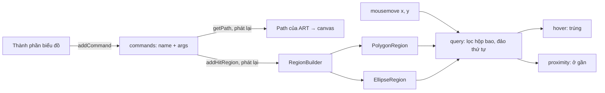

Biểu đồ vẽ bằng SVG thì mỗi cột, mỗi đường là một phần tử DOM: muốn biết chuột đang trỏ vào đâu chỉ cần `mouseenter`. Vẽ bằng `<canvas>` thì khác: canvas là một tấm ảnh. Bạn vẽ xong ba cột, một đường và mười điểm, trình duyệt chỉ còn biết "có một khối pixel 640×340". Chuột ở toạ độ (215, 186) là đang trên đường dữ liệu hay trên cột thứ hai, bạn phải tự trả lời.

Thư viện biểu đồ nội bộ của Facebook, **Candela** (đã gặp ở [bài #64 về vạch trục](/blogs/facebook-nice-axis-ticks)), vẽ qua ART, một thư viện đồ hoạ có thể xuất ra canvas. Nó giải bài toán hit-test bằng một ý đơn giản: mỗi hình được mô tả bằng **danh sách lệnh vẽ**. Danh sách đó được phát lại hai lần, một lần để vẽ, một lần vào một bộ dựng có cùng API để tạo **vùng hit-test** (hit region).

Bài này đi qua cách làm đó, cách ART đổi cung thành Bézier rồi làm phẳng, và mấy lỗi đọc được trong bản gốc: `rect()` không tạo vùng nào, ellipse có lỗ ở giữa, nét đứt đi theo trục chứ không theo đường thẳng.

> [!TIP]
> **Tóm tắt**
> - Mỗi hình ghi lại lệnh `moveTo/lineTo/ellipse…` thành `[{ name, args }]`. Vẽ thì phát lại lên path, hit-test thì phát lại vào một builder dựng đa giác/ellipse. Hai bên không bao giờ lệch nhau.
> - Vùng có hai ngưỡng: **hover** (trúng, vài px quanh nét) và **proximity** (ở gần, để hiện tooltip, snap). Query lọc nhanh bằng hộp bao, đảo thứ tự để hình vẽ sau (nằm trên) đứng đầu.
> - Bản gốc: `rect()` không bao giờ thành vùng, `arc`/`bezierCurveTo` ném "not implemented", ellipse tô kín có một lỗ bán kính bằng ngưỡng, hộp bao ellipse chỉ nới nửa ngưỡng nên vùng gần không bao giờ báo. `drawDashedPath` cộng dash vào x và y riêng rẽ nên đường chéo bị gãy.
> - Bản viết lại: bộ ghi có đủ API CanvasPath, đổi cung sang cubic với `k = 4/3·tan(θ/4)`, làm phẳng bằng de Casteljau thích nghi, nét đứt cắt theo độ dài thật. Trình duyệt có sẵn `isPointInPath`/`isPointInStroke` khi chỉ cần trúng/trượt.

<iframe class="demo-frame" src="/demos/facebook-patterns/index.html?theme=dark#/canvas-hit-regions" title="Demo canvas-hit-regions" loading="lazy" style="height: 1200px"></iframe>

<p class="demo-links">▶ <a href="/demos/facebook-patterns/index.html#/canvas-hit-regions" target="_blank" rel="noopener">Mở demo toàn màn hình ↗</a> · <a href="https://stackblitz.com/github/hunghg255/blog-hunghg/tree/master/examples/facebook-patterns?file=src/lib/hitRegions.ts" target="_blank" rel="noopener">Sửa code trên StackBlitz ↗</a> · <a href="https://github.com/hunghg255/blog-hunghg/blob/master/examples/facebook-patterns/src/lib/hitRegions.ts" target="_blank" rel="noopener">Xem source trên GitHub ↗</a></p>

## Facebook làm thế nào?

### Ghi lệnh, phát lại hai lần: `CandelaInteractiveMixin` (thư mục `0 000A/000 CHART/0 Candela/`)

Mỗi thành phần biểu đồ tương tác (đường, vùng, điểm) không vẽ thẳng lên canvas. Nó ghi lệnh vào `this.commands`:

```js
addCommand(name, ...args) {
  this.commands.push({ name, args });
  return this;
}
getPath() {              // để vẽ: phát lại lên một Path của ART
  this.buildPath();
  return this.commands.reduce((path, { name, args }) => path[name](...args), new Path());
}
```

Khi biểu đồ ở chế độ tương tác và không đang chạy animation, `_addHitRegion()` gửi cùng danh sách đó cho `regionManager.addHitRegion({ commands, fill, stroke, hoverThreshold, proximityThreshold, id, uid })`. Mặc định `hoverThreshold: 5`, `proximityThreshold: 10`. Vì cùng một danh sách lệnh, hình vẽ ra và vùng hit-test luôn khớp nhau, kể cả khi dữ liệu đổi.

### Dựng vùng: `CandelaRegionManager` và `CandelaPathRegionBuilder`

`addHitRegion` tạo một builder rồi gọi lần lượt từng lệnh lên nó (`builder[name].apply(builder, args)`). Builder có API giống `Path2D`: `moveTo`, `lineTo`, `line` (tương đối), `move`, `close`, `ellipse`, `rect`. Khi `build()`, mỗi hình con thành một `CandelaPolygonRegion` hoặc `CandelaEllipseRegion`.

`query(x, y)` của manager (đổi tên biến):

```js
query(x, y) {
  const candidates = this.inBounds(x, y);          // lọc nhanh bằng hộp bao
  return {
    hover: candidates.filter((r) => r.hoverTest(x, y)),
    proximity: candidates.filter((r) => r.proximityTest(x, y)),
  };
}
inBounds(x, y) {
  const out = [];
  for (const regions of this.regions.values())
    regions.forEach((r) => { const b = r.getBoundingRect(); if (inside(x, y, b)) out.push(r); });
  return out.reverse();                            // hình vẽ sau nằm trên, đứng đầu
}
```

Polygon kiểm "trúng" bằng hai cách: nếu tô kín thì đếm số lần tia ngang cắt cạnh (chẵn lẻ), nếu không thì đo khoảng cách tới từng đoạn bằng `findDistanceToSegment` (chiếu vuông góc, kẹp tham số vào [0, 1]) và so với ngưỡng. Hộp bao của từng đoạn được nới bằng ngưỡng lớn nhất, nên chỉ những đoạn gần chuột mới phải tính khoảng cách.

Ellipse kiểm bằng phương trình `(dx·cos + dy·sin)²/rx² + (dx·sin − dy·cos)²/ry² ≤ 1`, có hỗ trợ cung (góc đầu, góc cuối) và lỗ ở giữa (`innerRadiusRatio`, dùng cho biểu đồ donut). "Trúng" là nằm trong ellipse ngoài (bán kính + ngưỡng) và ngoài ellipse trong (bán kính × tỉ lệ − ngưỡng).

### Những gì builder không làm được

Đọc kỹ `CandelaPathRegionBuilder`, và chạy chính các module đó trong Node (thêm vài hàm giả cho `EventEmitter`, `CandelaUtils`), thấy bốn chỗ:

1. **`rect()` không tạo vùng nào.** Lớp `Rect` gọi constructor cha, rồi dựng một polygon **cục bộ** và bỏ đi; bản thân đối tượng rect có 0 điểm. Polygon cục bộ đó còn thiếu một góc (chỉ có 3 điểm) và đổi chỗ rộng với cao. Cuối cùng `build()` chỉ nhận `instanceof Polygon`, mà `Rect` không phải. Chạy thử: `rect(10, 10, 50, 100)` cho **0** vùng. Trong bundle không thành phần nào gọi `rect`, nên lỗi này có lẽ chưa từng lộ.
2. **Cung và Bézier ném lỗi**: `arc`, `arcTo`, `bezierCurveTo`, `quadraticCurveTo` đều `throw new Error("Path2D.… not implemented!")`. Vùng chỉ có thể là đa giác hoặc ellipse.
3. **Ellipse tô kín có một lỗ.** Với ellipse tô kín, tỉ lệ lỗ mặc định là 0, nên bán kính trong là `0 − ngưỡng`, một số âm. Công thức bình phương nó lên thành dương: một chấm tròn với `hoverThreshold = 3` có một lỗ bán kính 3 px ở tâm, trỏ vào giữa chấm thì không trúng.
4. **Hộp bao ellipse chỉ nới nửa ngưỡng** (`x − 0.5·t`, `width + t`), trong khi `proximityTest` nới đủ `t`. Cộng với lỗ ở trên, chấm tròn bán kính 8 px, ngưỡng gần 20 px chỉ "gần" khi chuột cách tâm từ 20 tới 28 px, mà hộp bao dừng ở 18 px. Chạy thử: vùng gần **không bao giờ** được báo.

Demo bật "Mô phỏng builder gốc" để thấy cả bốn: ba cột không phản hồi, vùng cong và donut báo lỗi, điểm cuối có lỗ và không có vùng gần.

### Cung thành Bézier: `art/core/path` (bundle `All_Candela.js`)

Thư viện ART (mã nguồn mở, được nhúng vào bundle) có phần mà builder thiếu. Nó đọc chuỗi `d=` kiểu SVG bằng một regex tách lệnh và số, và **lặp lệnh ngầm**: gặp số khi đang chờ lệnh thì dùng lại lệnh trước, riêng `m` thành `l`, `M` thành `L`, đúng như đặc tả SVG.

Cung (`A`) được đổi từ dạng "điểm đầu, điểm cuối" sang dạng "tâm, góc", phóng to bán kính nếu quá nhỏ, rồi cắt thành các đoạn không quá 90°. Mỗi đoạn là một cubic Bézier:

```js
const parts = Math.ceil(Math.abs(sweep / (Math.PI / 2)));
const step = sweep / parts;
const k = 4 / 3 * Math.tan(step / 4);      // độ dài tay nắm cho cung `step` radian
for (let i = 0; i < parts; i++) {
  // c1 = điểm đầu + k·tiếp tuyến, c2 = điểm cuối − k·tiếp tuyến
  this.onBezierCurve(x, y, c1x, c1y, c2x, c2y, x = endX, y = endY);
}
```

Còn `onBezierCurve` mặc định chia đôi đệ quy (de Casteljau) cho tới khi hai điểm điều khiển cách dây cung chưa tới 0,1 px (bình phương < 0,01), rồi coi đoạn đó là thẳng. `Q` và `T` được nâng bậc thành cubic bằng `(P0 + 2·C)/3`.

### Nét đứt: `CandelaUtils.art.drawDashedPath`

Viền "dashed" và "dotted" của biểu đồ dùng hàm này:

```js
const toward = (v, target, d) => v < target ? Math.min(v + d, target) : Math.max(v - d, target);
while (x !== x2 || y !== y2) {
  let d = nextDash();
  x = toward(x, x2, d); y = toward(y, y2, d);   // cộng d vào CẢ x và y
  path.lineTo(x, y);
  d = nextDash();
  x = toward(x, x2, d); y = toward(y, y2, d);
  path.moveTo(x, y);
}
```

Mỗi trục tiến `d` rồi tự kẹp ở đích. Với đường ngang hay dọc thì đúng. Với đường chéo thì sai hai kiểu: ở 45°, mỗi gạch dài `d·√2` (14,14 px thay vì 10); ở góc khác, trục ngắn tới đích trước rồi đứng yên, đường thành gấp khúc. Từ (0, 0) tới (40, 10) với dash 5, nét đi chéo tới (10, 10) rồi đi ngang. Demo phần 2: ở 14°, nét lệch khỏi đường thẳng tới 51 px. Thêm một bẫy: dash bằng 0 (viền "dotted" với độ dày 0) thì `x`, `y` không bao giờ đổi, `while` chạy mãi.



## Bên trong trình duyệt: canvas không nhớ hình

Canvas 2D là **chế độ tức thời** (immediate mode): mỗi lệnh `fill()`, `stroke()` đổi pixel rồi quên. Không có cây đối tượng, không có sự kiện trên từng hình. SVG và DOM là **chế độ giữ lại** (retained mode): trình duyệt giữ cây hình học, nên tự hit-test được.

Trình duyệt cũng có hai hàm hit-test cho canvas: `ctx.isPointInPath(path, x, y, fillRule)` và `ctx.isPointInStroke(path, x, y)`. Chúng nhận một `Path2D` và trả lời đúng/sai theo đúng hình học trình duyệt dùng để vẽ (kể cả cung, Bézier). Muốn có ngưỡng 5 px quanh nét thì đặt `lineWidth = 10` rồi hỏi `isPointInStroke`. Demo có cột "isPointInPath / Stroke" để so.

Nhưng có ba thứ chúng không cho:

- **Khoảng cách.** Chỉ có trúng/trượt. Vùng "gần" (để hiện tooltip khi chuột cách điểm 15 px) cần khoảng cách thật, hoặc hỏi thêm lần nữa với nét dày hơn.
- **Dữ liệu ngoài trình duyệt.** Hit-test trong worker, trên server khi render ảnh, hay trong test không có canvas.
- **Thời ART.** ART xuất ra canvas, SVG và VML (IE cũ). Một bộ hit-test bằng toán thuần dùng chung cho mọi đầu ra. `Path2D` cũng mới có ở mọi trình duyệt chính từ khoảng 2015 trở đi.

Đổi cung sang cubic là chuyện xấp xỉ. Một cung tròn 90° vẽ bằng cubic với tay nắm `k = 4/3·tan(θ/4)` (≈ 0,5523 khi θ = 90°) lệch bán kính thật tối đa khoảng 0,027%: bán kính 100 px thì lệch 0,03 px. Vì vậy cắt cung thành các đoạn ≤ 90° là đủ chính xác cho màn hình.

Làm phẳng cubic là bài toán khác: cần bao nhiêu đoạn thẳng để sai số dưới ε? Chia đôi đệ quy và dừng khi hai điểm điều khiển đủ gần dây cung là cách đơn giản và thích nghi: chỗ cong gắt chia nhiều, chỗ gần thẳng chia ít. Thanh trượt "sai số làm phẳng" trong demo cho thấy số đỉnh giảm từ hơn trăm xuống vài chục khi nới sai số.

## Viết lại

`src/lib/hitRegions.ts` gồm: một bộ ghi `PathRecorder` có đủ API CanvasPath (kể cả `arc`, `ellipse`, `bezierCurveTo`, `quadraticCurveTo`), làm phẳng mọi thứ thành đường gấp khúc; `buildRegion` dựng vùng; `RegionIndex` để query; và `dashPolyline` cắt nét đứt theo độ dài.

Cung và ellipse: chuẩn hoá góc quét như canvas, cắt thành đoạn ≤ 90°, mỗi đoạn một cubic.

```ts title=src/lib/hitRegions.ts
  ellipse(cx: number, cy: number, rx: number, ry: number, rotation: number, start: number, end: number, ccw = false) {
    let sweep = end - start;
    // chuẩn hoá như canvas: quét tối đa một vòng, đúng chiều
    if (!ccw && sweep < 0) sweep = (sweep % TAU) + TAU;
    if (ccw && sweep > 0) sweep = (sweep % TAU) - TAU;
    if (Math.abs(sweep) > TAU) sweep = Math.sign(sweep) * TAU;
    const cos = Math.cos(rotation), sin = Math.sin(rotation);
    const at = (t: number, dx = 0, dy = 0): Pt => {
      const ex = rx * Math.cos(t) + dx, ey = ry * Math.sin(t) + dy;
      return { x: cx + ex * cos - ey * sin, y: cy + ex * sin + ey * cos };
    };
    const first = at(start);
    // canvas nối đường thẳng từ bút hiện tại tới điểm đầu cung
    if (this.current) this.lineTo(first.x, first.y);
    else this.moveTo(first.x, first.y);
    // chia cung thành các đoạn ≤ 90°, mỗi đoạn là một cubic với k = 4/3·tan(θ/4)
    const parts = Math.max(1, Math.ceil(Math.abs(sweep) / (Math.PI / 2) - 1e-9));
    const step = sweep / parts;
    const k = (4 / 3) * Math.tan(step / 4);
    let t = start;
    for (let i = 0; i < parts; i++) {
      const t2 = t + step;
      const c1 = at(t, -k * rx * Math.sin(t), k * ry * Math.cos(t));
      const c2 = at(t2, k * rx * Math.sin(t2), -k * ry * Math.cos(t2));
      const p = at(t2);
      this.bezierCurveTo(c1.x, c1.y, c2.x, c2.y, p.x, p.y);
      t = t2;
    }
  }
```

Làm phẳng cubic:

```ts title=src/lib/hitRegions.ts
function flattenCubic(p0: Pt, p1: Pt, p2: Pt, p3: Pt, tol: number, out: Pt[], depth: number) {
  const flat = distToLine(p1, p0, p3) <= tol && distToLine(p2, p0, p3) <= tol;
  if (flat || depth > 16) {
    out.push(p3);
    return;
  }
  const mid = (a: Pt, b: Pt): Pt => ({ x: (a.x + b.x) / 2, y: (a.y + b.y) / 2 });
  const a = mid(p0, p1), b = mid(p1, p2), c = mid(p2, p3);
  const d = mid(a, b), e = mid(b, c), m = mid(d, e);
  flattenCubic(p0, a, d, m, tol, out, depth + 1);
  flattenCubic(m, e, c, p3, tol, out, depth + 1);
}

function distToLine(p: Pt, a: Pt, b: Pt) {
  const dx = b.x - a.x, dy = b.y - a.y;
  const len = Math.hypot(dx, dy);
  if (len === 0) return Math.hypot(p.x - a.x, p.y - a.y);
  return Math.abs((p.x - a.x) * dy - (p.y - a.y) * dx) / len;
}
```

Điểm trong vùng tô: dùng số vòng quấn (winding number) để hỗ trợ cả `nonzero` lẫn `evenodd`, giống `fill()` của canvas.

```ts title=src/lib/hitRegions.ts
export function pointInSubpaths(p: Pt, subpaths: Subpath[], rule: FillRule = 'nonzero') {
  let winding = 0;
  for (const { points } of subpaths) {
    const n = points.length;
    for (let i = 0; i < n; i++) {
      const a = points[i], b = points[(i + 1) % n];
      if (a.y <= p.y) {
        if (b.y > p.y && cross(a, b, p) > 0) winding++; // cạnh đi lên, p bên trái
      } else if (b.y <= p.y && cross(a, b, p) < 0) winding--; // cạnh đi xuống, p bên phải
    }
  }
  return rule === 'nonzero' ? winding !== 0 : (winding & 1) === 1;
}

const cross = (a: Pt, b: Pt, p: Pt) => (b.x - a.x) * (p.y - a.y) - (p.x - a.x) * (b.y - a.y);
```

Dựng vùng: phát lại hàm vẽ vào bộ ghi, nới hộp bao bằng **đủ** ngưỡng lớn nhất.

```ts title=src/lib/hitRegions.ts
export function buildRegion(id: string, draw: (sink: PathSink) => void, opts: RegionOptions = {}, tolerance = 0.25): HitRegion {
  const rec = new PathRecorder(tolerance);
  draw(rec);
  const hoverThreshold = opts.hoverThreshold ?? 0;
  const proximityThreshold = opts.proximityThreshold ?? 0;
  const pad = Math.max(hoverThreshold, proximityThreshold);
  let x0 = Infinity, y0 = Infinity, x1 = -Infinity, y1 = -Infinity;
  for (const s of rec.subpaths)
    for (const p of s.points) {
      x0 = Math.min(x0, p.x); y0 = Math.min(y0, p.y);
      x1 = Math.max(x1, p.x); y1 = Math.max(y1, p.y);
    }
  return {
    id,
    subpaths: rec.subpaths,
    fill: opts.fill ?? false,
    stroke: opts.stroke ?? !opts.fill,
    hoverThreshold,
    proximityThreshold,
    fillRule: opts.fillRule ?? 'nonzero',
    data: opts.data,
    // nới đủ cả ngưỡng: điểm cách nét đúng `pad` px vẫn lọt qua bước lọc nhanh
    bounds: { x: x0 - pad, y: y0 - pad, width: x1 - x0 + 2 * pad, height: y1 - y0 + 2 * pad },
  };
}
```

Nét đứt theo độ dài thật, giữ pha qua các đỉnh:

```ts title=src/lib/hitRegions.ts
export function dashPolyline(points: Pt[], pattern: number[], offset = 0): Pt[][] {
  const pat = pattern.length % 2 ? [...pattern, ...pattern] : pattern; // như setLineDash
  const total = pat.reduce((a, b) => a + b, 0);
  if (points.length < 2 || total <= 0 || pat.some((v) => v < 0 || !Number.isFinite(v))) return [points];
  const dashes: Pt[][] = [];
  let idx = 0;
  let left = pat[0];
  let phase = ((offset % total) + total) % total;
  while (phase > 0) { // bỏ qua phần offset
    const take = Math.min(phase, left);
    phase -= take; left -= take;
    if (left === 0) { idx = (idx + 1) % pat.length; left = pat[idx]; }
  }
  let current: Pt[] | null = idx % 2 === 0 ? [points[0]] : null;
  for (let i = 1; i < points.length; i++) {
    const a = points[i - 1], b = points[i];
    const len = Math.hypot(b.x - a.x, b.y - a.y);
    let pos = 0;
    while (pos < len) {
      const take = Math.min(left, len - pos);
      pos += take; left -= take;
      const t = pos / len; // tham số hoá theo độ dài, không theo từng trục
      const q = { x: a.x + (b.x - a.x) * t, y: a.y + (b.y - a.y) * t };
      if (current) current.push(q);
      if (left <= 1e-9) {
        if (current) { dashes.push(current); current = null; } else current = [q];
        idx = (idx + 1) % pat.length;
        left = pat[idx];
      }
    }
  }
  if (current && current.length > 1) dashes.push(current);
  return dashes;
}
```

::: spoiler Xem toàn bộ src/lib/hitRegions.ts

```ts title=src/lib/hitRegions.ts
/**
 * Hit-test cho hình vẽ trên canvas bằng cách "phát lại" lệnh path vào một bộ ghi
 * có cùng API với CanvasPath, làm phẳng đường cong thành đa giác, rồi hỏi
 * "chuột đang ở trên hình nào" mà không cần DOM cho từng hình.
 * Ý tưởng từ CandelaPathRegionBuilder / CandelaRegionManager và art/core/path (Facebook),
 * viết lại từ đầu, có thêm cung và Bézier.
 */

export interface Pt {
  x: number;
  y: number;
}

export interface Subpath {
  points: Pt[];
  closed: boolean;
}

/** Tập con của CanvasPath mà cả ctx thật lẫn bộ ghi đều có. */
export interface PathSink {
  moveTo(x: number, y: number): void;
  lineTo(x: number, y: number): void;
  bezierCurveTo(c1x: number, c1y: number, c2x: number, c2y: number, x: number, y: number): void;
  quadraticCurveTo(cx: number, cy: number, x: number, y: number): void;
  arc(x: number, y: number, r: number, start: number, end: number, ccw?: boolean): void;
  ellipse(x: number, y: number, rx: number, ry: number, rotation: number, start: number, end: number, ccw?: boolean): void;
  rect(x: number, y: number, w: number, h: number): void;
  closePath(): void;
}

const TAU = Math.PI * 2;

/** Ghi lệnh path và làm phẳng thành các đường gấp khúc. */
export class PathRecorder implements PathSink {
  readonly subpaths: Subpath[] = [];
  private current: Subpath | null = null;
  private pen: Pt = { x: 0, y: 0 };

  /** tolerance: sai số tối đa (px) giữa đường cong thật và đoạn thẳng thay thế. */
  constructor(private readonly tolerance = 0.25) {}

  get segmentCount() {
    return this.subpaths.reduce((n, s) => n + Math.max(0, s.points.length - 1) + (s.closed ? 1 : 0), 0);
  }

  moveTo(x: number, y: number) {
    this.current = { points: [{ x, y }], closed: false };
    this.subpaths.push(this.current);
    this.pen = { x, y };
  }

  lineTo(x: number, y: number) {
    if (!this.current) {
      this.moveTo(x, y); // giống canvas: lineTo đầu tiên đóng vai moveTo
      return;
    }
    this.current.points.push({ x, y });
    this.pen = { x, y };
  }

  bezierCurveTo(c1x: number, c1y: number, c2x: number, c2y: number, x: number, y: number) {
    if (!this.current) this.moveTo(c1x, c1y);
    const p0 = this.pen;
    flattenCubic(p0, { x: c1x, y: c1y }, { x: c2x, y: c2y }, { x, y }, this.tolerance, this.current!.points, 0);
    this.pen = { x, y };
  }

  quadraticCurveTo(cx: number, cy: number, x: number, y: number) {
    const p0 = this.pen;
    // nâng bậc: Q(P0, C, P1) = C(P0, (P0 + 2C)/3, (P1 + 2C)/3, P1)
    this.bezierCurveTo(
      (p0.x + 2 * cx) / 3, (p0.y + 2 * cy) / 3,
      (x + 2 * cx) / 3, (y + 2 * cy) / 3,
      x, y,
    );
  }

  arc(x: number, y: number, r: number, start: number, end: number, ccw = false) {
    this.ellipse(x, y, r, r, 0, start, end, ccw);
  }

  ellipse(cx: number, cy: number, rx: number, ry: number, rotation: number, start: number, end: number, ccw = false) {
    let sweep = end - start;
    // chuẩn hoá như canvas: quét tối đa một vòng, đúng chiều
    if (!ccw && sweep < 0) sweep = (sweep % TAU) + TAU;
    if (ccw && sweep > 0) sweep = (sweep % TAU) - TAU;
    if (Math.abs(sweep) > TAU) sweep = Math.sign(sweep) * TAU;
    const cos = Math.cos(rotation), sin = Math.sin(rotation);
    const at = (t: number, dx = 0, dy = 0): Pt => {
      const ex = rx * Math.cos(t) + dx, ey = ry * Math.sin(t) + dy;
      return { x: cx + ex * cos - ey * sin, y: cy + ex * sin + ey * cos };
    };
    const first = at(start);
    // canvas nối đường thẳng từ bút hiện tại tới điểm đầu cung
    if (this.current) this.lineTo(first.x, first.y);
    else this.moveTo(first.x, first.y);
    // chia cung thành các đoạn ≤ 90°, mỗi đoạn là một cubic với k = 4/3·tan(θ/4)
    const parts = Math.max(1, Math.ceil(Math.abs(sweep) / (Math.PI / 2) - 1e-9));
    const step = sweep / parts;
    const k = (4 / 3) * Math.tan(step / 4);
    let t = start;
    for (let i = 0; i < parts; i++) {
      const t2 = t + step;
      const c1 = at(t, -k * rx * Math.sin(t), k * ry * Math.cos(t));
      const c2 = at(t2, k * rx * Math.sin(t2), -k * ry * Math.cos(t2));
      const p = at(t2);
      this.bezierCurveTo(c1.x, c1.y, c2.x, c2.y, p.x, p.y);
      t = t2;
    }
  }

  rect(x: number, y: number, w: number, h: number) {
    this.moveTo(x, y);
    this.lineTo(x + w, y);
    this.lineTo(x + w, y + h);
    this.lineTo(x, y + h);
    this.closePath();
  }

  closePath() {
    if (!this.current) return;
    this.current.closed = true;
    const start = this.current.points[0];
    // canvas: sau closePath bút về điểm đầu, lệnh tiếp theo mở subpath mới
    this.current = null;
    this.pen = { ...start };
  }
}

/** de Casteljau thích nghi: chia đôi tới khi hai control point đủ gần dây cung. */
function flattenCubic(p0: Pt, p1: Pt, p2: Pt, p3: Pt, tol: number, out: Pt[], depth: number) {
  const flat = distToLine(p1, p0, p3) <= tol && distToLine(p2, p0, p3) <= tol;
  if (flat || depth > 16) {
    out.push(p3);
    return;
  }
  const mid = (a: Pt, b: Pt): Pt => ({ x: (a.x + b.x) / 2, y: (a.y + b.y) / 2 });
  const a = mid(p0, p1), b = mid(p1, p2), c = mid(p2, p3);
  const d = mid(a, b), e = mid(b, c), m = mid(d, e);
  flattenCubic(p0, a, d, m, tol, out, depth + 1);
  flattenCubic(m, e, c, p3, tol, out, depth + 1);
}

function distToLine(p: Pt, a: Pt, b: Pt) {
  const dx = b.x - a.x, dy = b.y - a.y;
  const len = Math.hypot(dx, dy);
  if (len === 0) return Math.hypot(p.x - a.x, p.y - a.y);
  return Math.abs((p.x - a.x) * dy - (p.y - a.y) * dx) / len;
}

/** Khoảng cách từ p tới đoạn ab: chiếu vuông góc, kẹp t vào [0, 1]. */
export function distanceToSegment(p: Pt, a: Pt, b: Pt) {
  const dx = b.x - a.x, dy = b.y - a.y;
  const len2 = dx * dx + dy * dy;
  let t = len2 === 0 ? 0 : ((p.x - a.x) * dx + (p.y - a.y) * dy) / len2;
  t = Math.max(0, Math.min(1, t));
  return Math.hypot(p.x - (a.x + t * dx), p.y - (a.y + t * dy));
}

export type FillRule = 'nonzero' | 'evenodd';

/** Điểm có nằm trong vùng tô không. Subpath chưa đóng vẫn được tô như canvas (tự nối về đầu). */
export function pointInSubpaths(p: Pt, subpaths: Subpath[], rule: FillRule = 'nonzero') {
  let winding = 0;
  for (const { points } of subpaths) {
    const n = points.length;
    for (let i = 0; i < n; i++) {
      const a = points[i], b = points[(i + 1) % n];
      if (a.y <= p.y) {
        if (b.y > p.y && cross(a, b, p) > 0) winding++; // cạnh đi lên, p bên trái
      } else if (b.y <= p.y && cross(a, b, p) < 0) winding--; // cạnh đi xuống, p bên phải
    }
  }
  return rule === 'nonzero' ? winding !== 0 : (winding & 1) === 1;
}

const cross = (a: Pt, b: Pt, p: Pt) => (b.x - a.x) * (p.y - a.y) - (p.x - a.x) * (b.y - a.y);

export interface Rect {
  x: number;
  y: number;
  width: number;
  height: number;
}

export interface RegionOptions {
  fill?: boolean;
  stroke?: boolean;
  /** khoảng cách (px) tới nét vẫn tính là "trúng" */
  hoverThreshold?: number;
  /** khoảng cách (px) tính là "ở gần", dùng cho tooltip, snap */
  proximityThreshold?: number;
  fillRule?: FillRule;
  data?: unknown;
}

export interface HitRegion extends Required<Omit<RegionOptions, 'data'>> {
  id: string;
  subpaths: Subpath[];
  /** hộp bao đã nới ra bằng ngưỡng lớn nhất, dùng để lọc nhanh */
  bounds: Rect;
  data?: unknown;
}

export function buildRegion(id: string, draw: (sink: PathSink) => void, opts: RegionOptions = {}, tolerance = 0.25): HitRegion {
  const rec = new PathRecorder(tolerance);
  draw(rec);
  const hoverThreshold = opts.hoverThreshold ?? 0;
  const proximityThreshold = opts.proximityThreshold ?? 0;
  const pad = Math.max(hoverThreshold, proximityThreshold);
  let x0 = Infinity, y0 = Infinity, x1 = -Infinity, y1 = -Infinity;
  for (const s of rec.subpaths)
    for (const p of s.points) {
      x0 = Math.min(x0, p.x); y0 = Math.min(y0, p.y);
      x1 = Math.max(x1, p.x); y1 = Math.max(y1, p.y);
    }
  return {
    id,
    subpaths: rec.subpaths,
    fill: opts.fill ?? false,
    stroke: opts.stroke ?? !opts.fill,
    hoverThreshold,
    proximityThreshold,
    fillRule: opts.fillRule ?? 'nonzero',
    data: opts.data,
    // nới đủ cả ngưỡng: điểm cách nét đúng `pad` px vẫn lọt qua bước lọc nhanh
    bounds: { x: x0 - pad, y: y0 - pad, width: x1 - x0 + 2 * pad, height: y1 - y0 + 2 * pad },
  };
}

/** Khoảng cách nhỏ nhất từ p tới nét của vùng (cạnh đóng của subpath kín cũng tính). */
export function distanceToOutline(p: Pt, region: HitRegion) {
  let best = Infinity;
  for (const { points, closed } of region.subpaths) {
    if (points.length === 1) best = Math.min(best, Math.hypot(p.x - points[0].x, p.y - points[0].y));
    for (let i = 1; i < points.length; i++) best = Math.min(best, distanceToSegment(p, points[i - 1], points[i]));
    if (closed && points.length > 2) best = Math.min(best, distanceToSegment(p, points[points.length - 1], points[0]));
  }
  return best;
}

export function hoverTest(region: HitRegion, p: Pt) {
  if (region.fill && pointInSubpaths(p, region.subpaths, region.fillRule)) return true;
  return distanceToOutline(p, region) <= region.hoverThreshold;
}

export function proximityTest(region: HitRegion, p: Pt) {
  if (region.fill && pointInSubpaths(p, region.subpaths, region.fillRule)) return true;
  return distanceToOutline(p, region) <= region.proximityThreshold;
}

const inRect = (p: Pt, r: Rect) => p.x >= r.x && p.x <= r.x + r.width && p.y >= r.y && p.y <= r.y + r.height;

/** Danh sách vùng theo thứ tự vẽ; query trả về vùng nằm trên cùng trước. */
export class RegionIndex {
  private regions = new Map<string, HitRegion>();

  set(region: HitRegion) {
    this.regions.delete(region.id); // thêm lại = đưa lên trên cùng
    this.regions.set(region.id, region);
  }

  delete(id: string) {
    return this.regions.delete(id);
  }

  clear() {
    this.regions.clear();
  }

  get size() {
    return this.regions.size;
  }

  query(p: Pt): { hover: HitRegion[]; proximity: HitRegion[]; candidates: number } {
    const candidates = [...this.regions.values()].filter((r) => inRect(p, r.bounds)).reverse();
    return {
      hover: candidates.filter((r) => hoverTest(r, p)),
      proximity: candidates.filter((r) => proximityTest(r, p)),
      candidates: candidates.length,
    };
  }
}

/**
 * Cắt một đường gấp khúc thành các gạch theo độ dài thật.
 * pattern = [gạch, khoảng, gạch, khoảng…]; pha được giữ qua các đỉnh.
 */
export function dashPolyline(points: Pt[], pattern: number[], offset = 0): Pt[][] {
  const pat = pattern.length % 2 ? [...pattern, ...pattern] : pattern; // như setLineDash
  const total = pat.reduce((a, b) => a + b, 0);
  if (points.length < 2 || total <= 0 || pat.some((v) => v < 0 || !Number.isFinite(v))) return [points];
  const dashes: Pt[][] = [];
  let idx = 0;
  let left = pat[0];
  let phase = ((offset % total) + total) % total;
  while (phase > 0) { // bỏ qua phần offset
    const take = Math.min(phase, left);
    phase -= take; left -= take;
    if (left === 0) { idx = (idx + 1) % pat.length; left = pat[idx]; }
  }
  let current: Pt[] | null = idx % 2 === 0 ? [points[0]] : null;
  for (let i = 1; i < points.length; i++) {
    const a = points[i - 1], b = points[i];
    const len = Math.hypot(b.x - a.x, b.y - a.y);
    let pos = 0;
    while (pos < len) {
      const take = Math.min(left, len - pos);
      pos += take; left -= take;
      const t = pos / len; // tham số hoá theo độ dài, không theo từng trục
      const q = { x: a.x + (b.x - a.x) * t, y: a.y + (b.y - a.y) * t };
      if (current) current.push(q);
      if (left <= 1e-9) {
        if (current) { dashes.push(current); current = null; } else current = [q];
        idx = (idx + 1) % pat.length;
        left = pat[idx];
      }
    }
  }
  if (current && current.length > 1) dashes.push(current);
  return dashes;
}

/**
 * Cách của CandelaUtils.art.drawDashedPath (viết lại để so sánh): cộng `dash` vào x và y
 * độc lập, mỗi trục tự kẹp về đích. Có trần số vòng vì dash = 0 sẽ lặp vô hạn.
 */
export function axisDashedPath(from: Pt, to: Pt, pattern: number[], maxSteps = 10_000): { dashes: Pt[][]; steps: number; stuck: boolean } {
  const toward = (v: number, target: number, d: number) => (v < target ? Math.min(v + d, target) : Math.max(v - d, target));
  let x = from.x, y = from.y, i = 0, steps = 0;
  const next = () => pattern[i++ % pattern.length];
  const dashes: Pt[][] = [];
  while ((x !== to.x || y !== to.y) && steps < maxSteps) {
    steps++;
    const start = { x, y };
    let d = next();
    x = toward(x, to.x, d); y = toward(y, to.y, d);
    dashes.push([start, { x, y }]);
    d = next();
    x = toward(x, to.x, d); y = toward(y, to.y, d);
  }
  return { dashes, steps, stuck: steps >= maxSteps };
}

export function polylineLength(points: Pt[]) {
  let n = 0;
  for (let i = 1; i < points.length; i++) n += Math.hypot(points[i].x - points[i - 1].x, points[i].y - points[i - 1].y);
  return n;
}
```

:::

## Đi qua code

- **Một hàm vẽ, hai "bút".** Hình trong demo là `draw(p: PathSink)`. Gọi `draw(ctx)` để vẽ, `draw(new PathRecorder())` để dựng vùng, `draw(new Path2D())` để hỏi trình duyệt. `PathSink` là tập con chung của cả ba, nên TypeScript bắt lỗi nếu hình dùng lệnh mà bộ ghi chưa có.
- **`ellipse`**: canvas nối một đường thẳng từ bút hiện tại tới điểm đầu cung, nên bộ ghi cũng `lineTo` điểm đó nếu đang có subpath. Lát donut trong demo dựa vào hành vi này: cung ngoài, rồi cung trong ngược chiều, `closePath`.
- **Tay nắm của cubic**: tiếp tuyến của ellipse tại góc `t` là `(−rx·sin t, ry·cos t)`. `c1 = điểm đầu + k·tiếp tuyến`, `c2 = điểm cuối − k·tiếp tuyến`, rồi cả hai mới được xoay theo `rotation`. Bản gốc của builder bỏ qua `rotation`; bản này giữ.
- **`flattenCubic`**: điều kiện dừng là khoảng cách hai điểm điều khiển tới dây cung `≤ tol`. Có trần độ sâu 16 cho đầu vào lạ (NaN, toạ độ khổng lồ).
- **`pointInSubpaths`**: cạnh đi lên mà điểm nằm bên trái thì +1, cạnh đi xuống mà điểm nằm bên phải thì −1. Subpath chưa đóng vẫn được coi là kín, giống cách canvas tô.
- **`proximityTest` cũng tính "ở trong"**: chuột ở giữa một cột thì cột đó vừa trúng vừa gần. Bản gốc chỉ đo khoảng cách tới cạnh.
- **`RegionIndex.set`** xoá rồi thêm lại, nên cập nhật một vùng cũng đưa nó lên trên cùng, đúng với thứ tự vẽ lại.
- **`dashPolyline`**: biến `left` là phần còn lại của gạch hoặc khoảng hiện tại, đi qua đỉnh thì mang sang đoạn sau. Mảng lẻ được nhân đôi như `setLineDash([5])` thành `[5, 5]`. Dash 0 hay số âm thì trả nguyên đường liền, không lặp vô hạn.

**Khác bản gốc:**

- Có `arc`, `ellipse` có `rotation`, `bezierCurveTo`, `quadraticCurveTo` (làm phẳng thành đa giác); `rect` là một subpath kín 4 góc.
- Không có ellipse riêng: mọi thứ là đa giác. Đổi lại, lỗ donut là một subpath ngược chiều, như khi vẽ bằng canvas.
- Hộp bao nới đủ ngưỡng; không có bán kính âm.
- Nét đứt tham số hoá theo độ dài; dash 0 không treo.

## Tại sao không làm cách khác?

- **Chỉ dùng `isPointInPath`/`isPointInStroke`**: đúng và nhanh, nên dùng nếu chỉ cần trúng/trượt trên canvas thật. Muốn vùng "gần" thì phải hỏi thêm với nét dày hơn, và không có khoảng cách để chọn điểm gần nhất.
- **Canvas ẩn tô màu theo id** (mỗi hình một màu, đọc pixel dưới chuột): O(1) mỗi lần query, hợp khi có hàng nghìn hình. Nhưng phải vẽ hai lần, khử răng cưa (anti-aliasing) làm sai màu ở mép, và `getImageData` buộc GPU đọc ngược về CPU.
- **Dựng DOM trong suốt đè lên canvas**: dễ cho trợ năng (focus, aria) nhưng nặng khi nhiều điểm.
- **Thư viện có sẵn** (Konva, PixiJS, ECharts): đều tự hit-test; đáng dùng nếu bạn chưa có tầng vẽ riêng.

## Edge case và cạm bẫy

- **Nhiều hình chồng nhau**: luôn trả về theo thứ tự vẽ ngược. Hình nằm dưới vẫn có trong `proximity`; giao diện thường chỉ lấy phần tử đầu của `hover`.
- **Transform**: nếu vẽ sau `ctx.scale(dpr, dpr)` hay xoay, toạ độ chuột phải đổi ngược trước khi query. `isPointInPath` dùng toạ độ chưa transform của canvas, còn path thì bị transform theo ma trận hiện tại; dễ nhầm.
- **Nét dày**: vùng stroke nên có `hoverThreshold ≥ lineWidth / 2`, không thì trỏ vào mép nét đang hiện mà không trúng.
- **Lỗ trong hình**: `nonzero` và `evenodd` cho kết quả khác nhau khi subpath trong cùng chiều với subpath ngoài. Dùng cùng quy tắc với lúc `fill()`.
- **Hiệu năng**: query duyệt mọi vùng (lọc hộp bao là O(n)). Vài trăm vùng không sao; hàng vạn điểm thì nên có lưới chia ô hoặc cây R (R-tree), và chỉ query trong `requestAnimationFrame`.
- **Animation**: bản gốc không dựng vùng khi đang animation; bạn cũng nên xoá vùng cũ hoặc tạm tắt hit-test, nếu không vùng nằm ở vị trí cũ.

## Dùng trong dự án

```ts
import { buildRegion, RegionIndex, type PathSink } from './hitRegions';

const index = new RegionIndex();
const shapes = points.map((p, i) => ({
  id: `pt-${i}`,
  draw: (s: PathSink) => s.arc(p.x, p.y, 4, 0, Math.PI * 2),
}));

function render(ctx: CanvasRenderingContext2D) {
  index.clear();
  for (const sh of shapes) {
    ctx.beginPath(); sh.draw(ctx); ctx.fill();
    index.set(buildRegion(sh.id, sh.draw, { fill: true, hoverThreshold: 2, proximityThreshold: 16 }));
  }
}

canvas.addEventListener('pointermove', (e) => {
  const { hover, proximity } = index.query({ x: e.offsetX, y: e.offsetY });
  canvas.style.cursor = hover.length ? 'pointer' : '';
  showTooltip(proximity[0]?.id);
});
```

## Kiểm thử

::: spoiler Ví dụ test (bản phác, không có trong repo)

```ts
import { describe, expect, it } from 'vitest';
import { buildRegion, dashPolyline, PathRecorder, pointInSubpaths, polylineLength, RegionIndex } from './hitRegions';

describe('PathRecorder', () => {
  it('rect thành subpath kín 4 góc', () => {
    const r = new PathRecorder();
    r.rect(10, 10, 50, 100);
    expect(r.subpaths[0].points).toHaveLength(4);
    expect(r.subpaths[0].closed).toBe(true);
  });

  it('cung tròn sau khi làm phẳng nằm sát bán kính', () => {
    const r = new PathRecorder(0.1);
    r.arc(0, 0, 100, 0, Math.PI * 2);
    for (const p of r.subpaths[0].points) expect(Math.abs(Math.hypot(p.x, p.y) - 100)).toBeLessThan(0.2);
  });
});

describe('hit-test', () => {
  it('chấm tròn trúng ở tâm, gần ở 15 px', () => {
    const dot = buildRegion('dot', (s) => s.ellipse(100, 100, 8, 8, 0, 0, Math.PI * 2), { fill: true, hoverThreshold: 3, proximityThreshold: 20 });
    const index = new RegionIndex();
    index.set(dot);
    expect(index.query({ x: 100, y: 100 }).hover.map((r) => r.id)).toEqual(['dot']);
    expect(index.query({ x: 123, y: 100 }).proximity.map((r) => r.id)).toEqual(['dot']);
  });

  it('hình vẽ sau đứng đầu', () => {
    const index = new RegionIndex();
    index.set(buildRegion('under', (s) => s.rect(0, 0, 100, 100), { fill: true }));
    index.set(buildRegion('over', (s) => s.rect(50, 50, 100, 100), { fill: true }));
    expect(index.query({ x: 75, y: 75 }).hover.map((r) => r.id)).toEqual(['over', 'under']);
  });

  it('evenodd tạo lỗ, nonzero thì không khi cùng chiều', () => {
    const r = new PathRecorder();
    r.rect(0, 0, 100, 100);
    r.rect(25, 25, 50, 50);
    expect(pointInSubpaths({ x: 50, y: 50 }, r.subpaths, 'evenodd')).toBe(false);
    expect(pointInSubpaths({ x: 50, y: 50 }, r.subpaths, 'nonzero')).toBe(true);
  });
});

describe('dashPolyline', () => {
  it('gạch dài đúng dash trên đường chéo', () => {
    const d = dashPolyline([{ x: 0, y: 0 }, { x: 300, y: 75 }], [10]);
    expect(polylineLength(d[0])).toBeCloseTo(10);
  });
  it('dash 0 không treo', () => {
    expect(dashPolyline([{ x: 0, y: 0 }, { x: 10, y: 0 }], [0])).toHaveLength(1);
  });
});
```

:::

## So với thư viện và chuẩn web

- **`CanvasRenderingContext2D.isPointInPath` / `isPointInStroke`** với `Path2D`: có ở mọi trình duyệt chính (tính tới 10/2026). Nhanh, chính xác, nhưng chỉ trả lời trúng/trượt và cần canvas thật (`OffscreenCanvas` trong worker cũng có).
- **Hit region API** (`ctx.addHitRegion`) từng nằm trong đặc tả canvas, cho phép gắn id và phần tử trợ năng vào từng vùng. Nó đã bị gỡ khỏi đặc tả và khỏi các trình duyệt thử nghiệm; tên `addHitRegion` của Candela có lẽ lấy cảm hứng từ đó.
- **Konva, Fabric.js**: hit-test bằng canvas ẩn tô màu theo id. **PixiJS**: hit-test bằng hình học (hitArea). **ECharts** (bản canvas): hình học + `isPointInPath`.
- **SVG**: nếu số hình ít (vài trăm), SVG cho sẵn sự kiện, trợ năng và CSS hover; canvas chỉ đáng khi số điểm lớn.
- Bài liên quan: [#64 vạch trục "đẹp" của Candela](/blogs/facebook-nice-axis-ticks), [#82 ma trận xoay sticker](/blogs/facebook-image-crop-rotation-geometry).

---

Bài này thuộc series **[Học từ mã nguồn Facebook](/series/facebook)** (106 bài, đọc theo thứ tự).

::: spoiler Xem nhanh danh sách bài trong series

*Phần 1*

- [Mở đầu: cách đọc code minify của Facebook](/blogs/learn-from-facebook-source-code)
- [#1 Dùng chung IntersectionObserver + infinite scroll](/blogs/facebook-shared-intersection-observer)
- [#2 useViewportDuration: đo thời gian thực sự được xem](/blogs/facebook-use-viewport-duration)
- [#3 Preload code + data khi hover](/blogs/facebook-preload-on-hover)
- [#4 Toast manager với external store](/blogs/facebook-toast-manager)
- [#5 Network status + heartbeat backoff](/blogs/facebook-network-status-heartbeat)
- [#6 ErrorGuard: bắt lỗi theo ngữ cảnh](/blogs/facebook-error-guard)
- [#7 Banzai: gom log theo lô + sendBeacon](/blogs/facebook-batch-logger)
- [#8 Focus trap + Esc theo layer](/blogs/facebook-focus-trap)

*Phần 2*

- [#9 Mẹo calc(… * 9999): container query, line-clamp, mũi tên carousel bằng CSS](/blogs/facebook-css-9999-trick)
- [#10 Thanh cuộn tuỳ biến bằng CSS 3D](/blogs/facebook-css-3d-scrollbar)
- [#11 Modal cuộn bằng window, giữ vị trí trang nền](/blogs/facebook-document-scroll-modal)
- [#12 Popover, tooltip group và hovercard](/blogs/facebook-popover-tooltip)
- [#13 Primitive Pressable + focus-visible](/blogs/facebook-pressable)
- [#14 Tab "Xem thêm" + sticky header bằng IntersectionObserver](/blogs/facebook-priority-tabs-sticky-header)
- [#15 Avatar khoét mask, gradient Messenger, skeleton steps()](/blogs/facebook-visual-tricks)
- [#16 Khung chat không giật](/blogs/facebook-chat-scroller)
- [#17 Thuật toán chọn bố cục collage ảnh](/blogs/facebook-photo-collage-layout)
- [#18 Keep-alive tab trong SPA](/blogs/facebook-keep-alive-tabs)
- [#19 Tự đo Visual Completion & interaction tracing](/blogs/facebook-visual-completion)
- [#20 Router SPA bền bỉ & tải chunk có retry](/blogs/facebook-spa-router-resilient-loading)

*Phần 3*

- [#21 Smart Compose: gợi ý chữ mờ khi gõ](/blogs/facebook-smart-compose-ghost-text)
- [#22 MQTT ngay trong trình duyệt, tự chuyển sang long-poll](/blogs/facebook-mqtt-in-browser)
- [#23 Đo thời gian dùng bằng bitmap 64 giây](/blogs/facebook-time-spent-bitmap)
- [#24 Bảng reaction nhấn giữ rồi trượt](/blogs/facebook-reaction-press-slide)
- [#25 Tìm kiếm gấp dấu, phiên âm và highlight đầu từ](/blogs/facebook-search-diacritics-tokenize)
- [#26 Ring buffer biết trace nào đã mất log](/blogs/facebook-trace-ring-buffer)
- [#27 Engine animation JS: một vòng rAF và solver cubic-bezier](/blogs/facebook-keyframes-loop-cubic-bezier)
- [#28 Bootloader: bitmap tài nguyên đã tải, chỉ reload khi cần](/blogs/facebook-bootloader-bitmap-consistency)
- [#29 Nhận biết click do screen reader tạo ra](/blogs/facebook-virtual-cursor-detection)
- [#30 Tải trước feed theo chất lượng mạng, đoán hạng thiết bị](/blogs/facebook-network-aware-prefetch)
- [#31 Hàng đợi gửi tin chat giữ đúng thứ tự](/blogs/facebook-ordered-send-queue)
- [#32 Gộp lời gọi API trong cùng một tick](/blogs/facebook-api-batcher)
- [#33 Resize ảnh trong pool Web Worker](/blogs/facebook-jpeg-resize-worker-pool)
- [#34 Crop ảnh theo nhiều khuôn mặt](/blogs/facebook-face-aware-crop)
- [#35 Kéo-thả sắp xếp và vùng thả file không nhấp nháy](/blogs/facebook-flicker-free-drag-drop)
- [#36 Tiện ích UI: fade-out, sticky event, hàm huỷ được](/blogs/facebook-ui-utility-hooks)
- [#37 Hạ tầng nhỏ: cookie, hash lỗi, prefetch khi chuột dừng](/blogs/facebook-small-infra-cookie-hash-idle)

*Phần 4–6*

- [#38 Đồng bộ tin nhắn: phát hiện lỗ seqID và fetch bù theo tầng](/blogs/facebook-messenger-sync-seqid-gaps)
- [#39 OTID: ID tin nhắn kiểu Snowflake sinh ở client](/blogs/facebook-otid-client-snowflake)
- [#40 QPL: lấy mẫu từ lúc bắt đầu, đo RTT gửi tin đầu-cuối](/blogs/facebook-qpl-send-rtt)
- [#41 Bộ điều phối request bảy chế độ gộp và chống trùng](/blogs/facebook-request-dispatcher-modes)
- [#42 Thread list theo mốc thời gian, cookie presence có version](/blogs/facebook-threadlist-ranged-presence)
- [#43 Composer dạng plugin: reducer, dirty checker, chuỗi kiểm tra](/blogs/facebook-plugin-composer)
- [#44 Thanh toán bất đồng bộ: subscribe trước, poll dự phòng](/blogs/facebook-async-checkout)
- [#45 Validate số thẻ: sửa lỗi gõ, dải BIN, Luhn](/blogs/facebook-card-validation)
- [#46 Lịch chọn khoảng ngày: bo góc dải chọn, phím đủ bộ, RTL](/blogs/facebook-range-calendar-a11y)
- [#47 Giờ mở cửa theo tuần: qua đêm, gộp khoảng, phần bù](/blogs/facebook-weekly-hours-intervals)
- [#48 Tiến độ đăng realtime: giữ event chờ snapshot, watchdog](/blogs/facebook-realtime-publish-snapshot)
- [#49 Tiền tệ theo đơn vị nhỏ nhất và ô nhập tiền](/blogs/facebook-currency-minor-units)
- [#50 Sửa hàng loạt Empty/Uniform/Mixed, seen/read bằng 2 bit](/blogs/facebook-bulk-edit-seen-bits)
- [#51 Phát hiện script lạ hook vào hàm native](/blogs/facebook-native-hook-detection)
- [#52 localStorage tự dọn khi đầy quota](/blogs/facebook-quota-aware-storage)
- [#53 Cache tuyến do server phân giải, chờ sẵn promise](/blogs/facebook-route-cache-prefetch)
- [#54 Lưới phím mũi tên 2D và focus không làm cuộn trang](/blogs/facebook-focus-table-grid)
- [#55 Tách emoji bằng máy trạng thái](/blogs/facebook-emoji-segmentation)
- [#56 Đọc trước ghi sau trong một frame, con tự biết vị trí](/blogs/facebook-read-then-write-dom)
- [#57 Hàng đợi lệnh cho video và stream sắp lại chunk](/blogs/facebook-video-command-queue)

*Phần 7–10*

- [#58 Ước lượng băng thông EWMA: loại outlier, nhớ qua phiên](/blogs/facebook-bandwidth-ewma-estimator)
- [#59 ABR theo độ tự tin phát và cắt bậc bitrate theo MOS](/blogs/facebook-abr-playback-confidence)
- [#60 Prefetch segment dự đoán từ manifest, parse hộp sidx](/blogs/facebook-dash-predicted-segments)
- [#61 Đọc metadata MP4/MOV ngay trên client](/blogs/facebook-mp4-metadata-client)
- [#62 Upload tiếp tục được: offset, hash dedupe, phát hiện treo](/blogs/facebook-resumable-upload)
- [#63 Fenwick tree: chọn ngẫu nhiên có trọng số và offset dòng](/blogs/facebook-fenwick-weighted-random)
- [#64 Vạch trục số và trục thời gian "đẹp"](/blogs/facebook-nice-axis-ticks)
- [#65 Damerau-Levenshtein theo dải chéo và tự sửa tên gõ sai](/blogs/facebook-damerau-levenshtein)
- [#66 PRNG có seed, shuffle tái lập và lấy mẫu trace](/blogs/facebook-seeded-prng-sampling)
- [#67 Cặp min/max-heap tái dùng vị trí trong danh sách ảo](/blogs/facebook-dual-heap-buffer-set)
- [#68 Memo nhiều đối số bằng Map/WeakMap và interning object](/blogs/facebook-multikey-memo-interning)
- [#69 Thống kê cửa sổ trượt và đại số khoảng thời gian](/blogs/facebook-moving-stat-intervals)
- [#70 Int64 từ hai số 32-bit, decode UTF, offset theo code point](/blogs/facebook-int64-utf-codepoints)
- [#71 Engine múi giờ IANA trên client, phát hiện lệch giờ](/blogs/facebook-client-iana-timezone)
- [#72 Tự cài semver range](/blogs/facebook-semver-range)
- [#73 Auto-link URL, cắt chữ an toàn, giới hạn LaTeX](/blogs/facebook-autolink-safe-truncate)
- [#74 Parser query kiểu PHP chống prototype pollution](/blogs/facebook-php-query-serializer)
- [#75 Popover tự lật theo phần tràn nhỏ nhất](/blogs/facebook-popover-auto-flip)
- [#76 Tiền tố for(;;) chống JSON hijacking, đọc stream](/blogs/facebook-csrf-prefix-streaming)
- [#77 Chống lộ Referer, linkshim, xoá token trên URL](/blogs/facebook-referrer-linkshim-url-scrub)
- [#78 setImmediate bằng postMessage, gom delta chuột theo frame](/blogs/facebook-setimmediate-mouse-batching)
- [#79 Phát hiện crash qua heartbeat, dò proxy cache hỏng](/blogs/facebook-crash-heartbeat-proxy-check)
- [#80 DPR vào cookie cho ảnh @2x, che khoá trong log](/blogs/facebook-dpr-cookie-secret-redaction)
- [#81 Flux waitFor tự viết và proxy có đệm](/blogs/facebook-flux-dispatch-buffered-proxy)
- [#82 Crop đúng tỉ lệ, xoay sticker bằng ma trận](/blogs/facebook-image-crop-rotation-geometry)

*Phần 11–15*

- [#83 Chia subdomain giữa các tab bằng lease, long-poll theo bảng trạng thái](/blogs/facebook-tab-subdomain-lease-longpoll)
- [#84 MQTT QoS1: giữ publish chờ ack, gửi lại khi kết nối lại](/blogs/facebook-mqtt-qos1-republish)
- [#85 Cache Promise gộp request, cache lỗi ngắn, đua dữ liệu nhúng sẵn](/blogs/facebook-promise-cache-preload-race)
- [#86 Lịch retry: backoff có trần, Fibonacci, báo lỗi CDN mỗi N ngày](/blogs/facebook-retry-backoff-schedules)
- [#87 Giữ nguyên tham chiếu nhánh dữ liệu không đổi](/blogs/facebook-relay-recycle-nodes)
- [#88 Store optimistic: copy-on-write, rollback rồi áp lại](/blogs/facebook-relay-optimistic-store)
- [#89 Chỉ mục subscription theo record, hàng đợi task theo chiều sâu](/blogs/facebook-relay-subscription-index)
- [#90 Phân trang connection: cursor khớp đầu, edge không trùng](/blogs/facebook-relay-connection-pagination)
- [#91 Profiler kiểu middleware và memo selector có lấy mẫu kiểm tra](/blogs/facebook-profiler-middleware-memo-check)
- [#92 Đọc EBML/WebM Cues để tìm byte range của segment](/blogs/facebook-webm-ebml-cues)
- [#93 Stream HTTP Range tạm dừng được, tải tiếp đúng byte](/blogs/facebook-pausable-range-stream)
- [#94 Bảng khoảng thời gian gắn nhãn và nhảy qua lỗ buffer](/blogs/facebook-tagged-time-ranges-gaps)
- [#95 Gom chunk cho SourceBuffer, đồng bộ video bằng playbackRate](/blogs/facebook-sourcebuffer-video-sync)
- [#96 Gom tin nhắn thành cụm, vạch ngày và avatar đã xem](/blogs/facebook-message-grouping)
- [#97 Bao nhiêu tab chat vừa màn hình, chuỗi luật mở tab](/blogs/facebook-chat-tab-policy)
- [#98 Phím tắt Markdown trong editor, Backspace để hoàn tác](/blogs/facebook-markdown-shortcuts-editor)
- [#99 Offset theo code point hay UTF-16: bốn bug cùng một gốc](/blogs/facebook-codepoint-offset-bugs)
- [#100 Typeahead không nhảy: cache tiền tố, chặn reflow, khoá hover](/blogs/facebook-typeahead-stable-results)
- **#101 Hit-test trên canvas bằng phát lại path, nét đứt và cung Bézier** (bài này)
- [#102 Vòng tròn theo mét trên bản đồ Mercator](/blogs/facebook-mercator-meter-circles)
- [#103 Dò tính năng trình duyệt: ảnh EXIF 2×1, getter bẫy, scrollbar](/blogs/facebook-feature-probe-tricks)
- [#104 Bug định dạng số và kiểm tra dữ liệu theo locale](/blogs/facebook-locale-validation-bugs)
- [#105 Dispose cho đúng: idle callback, splice(-1), xoá nhầm key](/blogs/facebook-dispose-leak-bugs)

:::

Code + demo: [`examples/facebook-patterns`](https://github.com/hunghg255/blog-hunghg/tree/master/examples/facebook-patterns) · [Mở trên StackBlitz](https://stackblitz.com/github/hunghg255/blog-hunghg/tree/master/examples/facebook-patterns)
