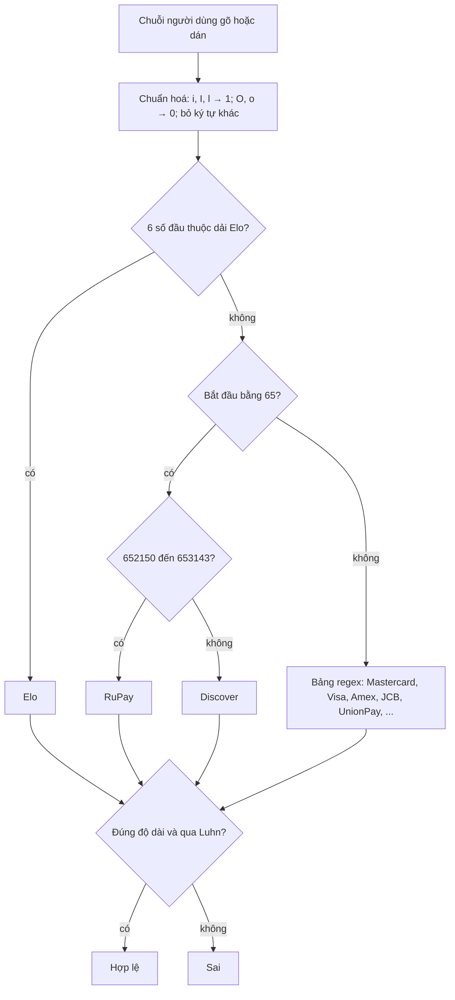

Ô nhập số thẻ là một trong những ô khó làm cho đúng nhất trên web. Người dùng gõ có dấu cách hoặc không, dán từ ghi chú, dán từ ứng dụng ngân hàng, hoặc dùng tính năng quét thẻ bằng camera và nhận về `4lll 1111…` vì phần mềm đọc nhầm số `1` thành chữ `l`. Trong lúc gõ, họ muốn thấy logo hãng thẻ hiện đúng, các nhóm số tự tách, và biết ngay khi gõ sai một chữ số.

> [!TIP]
> **Tóm tắt**
> - `PaymentMethodUtils` của Facebook chuẩn hoá trước khi làm gì khác: `i`, `I`, `l` thành `1`, `O`, `o` thành `0`, bỏ mọi ký tự không phải số.
> - Dò hãng **theo thứ tự**: dải BIN 6 số của Elo trước (vì nhiều thẻ Elo bắt đầu bằng 4, trùng Visa), rồi tiền tố `65` để tách RuPay khỏi Discover, rồi mới tới bảng regex. Mastercard được nhận đúng cả dải `2221–2720`.
> - Luhn dùng mẹo **nối chuỗi**: nhân đôi chữ số ở vị trí lẻ, nối mọi kết quả thành một chuỗi rồi cộng từng ký tự, nên `14` tự thành `1 + 4`.
> - Hai lỗi nhỏ: bảng regex chạy trên chuỗi **chưa chuẩn hoá** (dán `" 4111…"` ra hãng "unknown"), và mọi thẻ phải đúng 16 số (thẻ 19 số hợp lệ bị loại). Bản viết lại sửa cả hai.

<iframe class="demo-frame" src="/demos/facebook-patterns/index.html?theme=dark#/card-validation" title="Demo card-validation" loading="lazy" style="height: 860px"></iframe>

<p class="demo-links">▶ <a href="/demos/facebook-patterns/index.html#/card-validation" target="_blank" rel="noopener">Mở demo toàn màn hình ↗</a> · <a href="https://stackblitz.com/github/hunghg255/blog-hunghg/tree/master/examples/facebook-patterns?file=src/lib/cardValidation.ts" target="_blank" rel="noopener">Sửa code trên StackBlitz ↗</a> · <a href="https://github.com/hunghg255/blog-hunghg/blob/master/examples/facebook-patterns/src/lib/cardValidation.ts" target="_blank" rel="noopener">Xem source trên GitHub ↗</a></p>

Mọi số thẻ trong bài và demo là **số test công khai** (từ tài liệu của Stripe và các hãng thẻ), không phải thẻ thật.

## Facebook làm thế nào?

Module `PaymentMethodUtils` nằm trong bundle `259.js`. Đây là phần code dùng chung cho các form thanh toán (quảng cáo, mua hàng, quyên góp).

### Bước 1: chuẩn hoá kiểu OCR

```js
const normalize = (s) => s.replace(/[iIl]/g, '1').replace(/[Oo]/g, '0').replace(/[^\d]/gi, '');
```

Ba chữ cái hay bị nhầm với số được đổi trước, rồi mọi ký tự còn lại không phải số bị bỏ. `"4lll-1111 O000"` thành `"411111110000"`. Thứ tự quan trọng: nếu bỏ ký tự không phải số trước, chữ `l` đã biến mất trước khi kịp đổi thành `1`.

### Bước 2: bảng hãng thẻ

Mỗi hãng là một object, có regex, số chữ số, số chữ số mã bảo mật (CSC) và cờ có được hỗ trợ hay không:

```js
const CARD_TYPES = [
  { name: 'elo',    pattern: /^40117[8-9]/, digits: 16, cscDigits: 3, supported: true },
  { name: 'mc',     pattern: /^5[1-5]|^2(2(2[1-9]|[3-9])|[3-6]|7([01]|20))/, digits: 16, cscDigits: 3, supported: true },
  { name: 'visa',   pattern: /^4/,          digits: 16, cscDigits: 3, supported: true },
  { name: 'amex',   pattern: /^3[47]/,      digits: 15, cscDigits: 4, supported: true },
  { name: 'jcb',    pattern: /^35(2[8-9]|[3-8])/, digits: 16, … },
  { name: 'cup',    pattern: /^62/,         digits: 16, … },               // UnionPay
  { name: 'disc',   pattern: /^(6011|65|64[4-9])/, digits: 16, … },
  { name: 'rupay',  pattern: /^(508[5-9]|60[6-8])/, digits: 16, … },
  { name: 'diners', pattern: /^30[0-5]/,    digits: 14, supported: false },
  { name: 'unknown', pattern: null,         digits: 16, supported: false },
];
```

Regex Mastercard đáng đọc kỹ. Từ 2017, Mastercard dùng thêm dải BIN `2221xx` tới `2720xx`. Regex `^2(2(2[1-9]|[3-9])|[3-6]|7([01]|20))` liệt kê đúng dải đó: `222[1-9]`, `22[3-9]`, `2[3-6]`, `27[01]`, `2720`. Nhiều thư viện cũ chỉ kiểm `^5[1-5]` và từ chối thẻ Mastercard mới.

### Bước 3: dò hãng theo thứ tự

```js
getCardType(input) {
  const bin = normalize(input).substr(0, 6);
  if (isElo(bin)) return ELO;                       // ~40 dải BIN 6 số
  if (bin.substr(0, 2) === '65') {
    return Number(bin) >= 652150 && Number(bin) <= 653143 ? RUPAY : DISCOVER;
  }
  for (const type of CARD_TYPES) {
    if (type.pattern && input.match(type.pattern)) return type;   // ← chạy trên input, không phải bin
  }
  return UNKNOWN;
}
```

Hai trường hợp phải dò bằng dải số trước regex:

- **Elo** (thẻ nội địa Brazil) có khoảng 40 dải BIN, như `401178–401179`, `438935`, `457631–457632`, `509107–509807`. Nhiều dải bắt đầu bằng `4`, nên nếu chạy regex trước, chúng bị nhận nhầm là Visa. `isElo` chuyển 6 số đầu thành số nguyên rồi so với từng dải.
- **RuPay** (thẻ nội địa Ấn Độ) dùng dải `652150–653143`, nằm gọn trong không gian `65xxxx` của Discover. Regex Discover `^65` sẽ nuốt nó.

Kiểm tra theo dải số dễ đọc và dễ sửa hơn nhiều so với viết một regex cho 40 dải.

### Bước 4: Luhn bằng mẹo nối chuỗi

```js
isValidLuhn(input) {
  const digits = normalize(input).split('').reverse();
  let joined = '';
  for (let i = 0; i < digits.length; i++) {
    let d = parseInt(digits[i], 10);
    if (i % 2 !== 0) d *= 2;
    joined += d;                       // 7*2 = 14 → nối "14"
  }
  let sum = 0;
  for (let i = 0; i < joined.length; i++) sum += parseInt(joined.charAt(i), 10); // "14" → 1 + 4
  return sum !== 0 && sum % 10 === 0;
}
```

Thuật toán Luhn yêu cầu: chữ số được nhân đôi mà lớn hơn 9 thì cộng hai chữ số của nó (14 thành 1 + 4 = 5, cũng bằng 14 − 9). Thay vì viết `if (d > 9) d -= 9`, code nối mọi kết quả thành một chuỗi rồi cộng từng ký tự. Chữ số đơn và kết quả hai chữ số được xử lý cùng một cách. Điều kiện `sum !== 0` loại số toàn chữ số 0, vốn qua được Luhn (0 chia hết cho 10).

### Bước 5: nhóm số khi hiển thị

```js
getCreditCardGrouping(input) {
  switch (getCardType(input).name) {
    case 'amex':   return [0, 4, 10, 15]; // 3782 822463 10005
    case 'diners': return [0, 4, 10, 14];
    default:       return [0, 4, 8, 12, 16];
  }
}
```

Mảng là vị trí cắt. Amex in trên thẻ theo nhóm 4-6-5, nên ô nhập cũng tách đúng như vậy; người dùng so với thẻ thật dễ hơn.

Một chi tiết thú vị: nhãn mặc định khi không nhận ra hãng là `g._("Thẻ tín dụng")`. Facebook dịch chuỗi `fbt` ngay lúc build bundle cho từng ngôn ngữ; bundle trong repo có lẽ được tải khi giao diện đặt tiếng Việt, nên bản dịch nằm sẵn trong file JS.

### Hai lỗi nhỏ

Mình chạy lại logic của bản gốc bằng Node với các số test:

| Đầu vào | Hãng (gốc) | Hợp lệ (gốc) | Ghi chú |
|---|---|---|---|
| `"4242 4242 4242 4242"` | visa | ✓ | |
| `" 4111 1111 1111 1111"` | **unknown** | ✓ | dấu cách ở đầu |
| `"4111 1111 1111 1111 110"` | visa | **✗** | Visa 19 số, Luhn đúng |
| `"6205 5000 0000 0000 004"` | unionpay | **✗** | UnionPay 19 số |

- **Regex chạy trên chuỗi gốc.** Trong vòng lặp cuối của `getCardType`, `input.match(pattern)` dùng chuỗi người dùng gõ, không phải chuỗi đã chuẩn hoá. Dán số có dấu cách ở đầu (rất hay gặp khi copy từ email) thì `^4` không khớp, logo hiện "thẻ không xác định". `isValidCCNumber` chuẩn hoá trước khi gọi `getCardType`, nên kết quả "hợp lệ" vẫn đúng; chỉ có icon và cách nhóm số trong lúc gõ bị sai.
- **Mọi hãng đều 16 số.** Visa, UnionPay, Discover và JCB đều có thẻ 19 số. `isValidCCNumber` so `digits !== length` với `digits` cố định 16, nên những thẻ này bị từ chối dù hợp lệ. `getMaxCardLength` cũng luôn trả 16, kể cả với Amex (15). Nếu ô nhập dùng giá trị này làm `maxlength`, người dùng thẻ 19 số không gõ hết được.



## Viết lại

Chuẩn hoá và dò hãng, lần này cả bảng regex cũng chạy trên chuỗi đã chuẩn hoá:

```ts title=src/lib/cardValidation.ts
/** i/I/l → 1, O/o → 0 (lỗi OCR hay gặp), rồi chỉ giữ chữ số. */
export function normalizeCardNumber(input: string) {
  return input.replace(/[iIl]/g, '1').replace(/[Oo]/g, '0').replace(/\D/g, '');
}

function inRanges(bin6: number, ranges: Array<[number, number]>) {
  return ranges.some(([lo, hi]) => bin6 >= lo && bin6 <= hi);
}

export function detectCardType(input: string): CardType {
  const digits = normalizeCardNumber(input);
  if (digits.length >= 6) {
    const bin6 = Number(digits.slice(0, 6));
    if (inRanges(bin6, ELO_RANGES)) return TYPES.elo;
    if (digits.startsWith('65'))
      return bin6 >= 652150 && bin6 <= 653143 ? TYPES.rupay : TYPES.discover;
  }
  for (const [brand, pattern] of PATTERNS) {
    if (pattern.test(digits)) return TYPES[brand];
  }
  return TYPES.unknown;
}
```

Luhn viết theo kiểu `d > 9 ? d - 9 : d`, cùng kết quả với mẹo nối chuỗi nhưng không tạo chuỗi trung gian:

```ts title=src/lib/cardValidation.ts
/** Kiểm Luhn. Chuỗi rỗng / toàn số 0 bị coi là sai. */
export function luhnValid(input: string) {
  const digits = normalizeCardNumber(input);
  if (digits.length === 0) return false;
  let sum = 0;
  for (let i = 0; i < digits.length; i++) {
    let d = digits.charCodeAt(digits.length - 1 - i) - 48;
    if (i % 2 === 1) {
      d *= 2;
      if (d > 9) d -= 9; // = cộng hai chữ số của d
    }
    sum += d;
  }
  return sum !== 0 && sum % 10 === 0;
}

export type CardCheck =
  | { ok: true; type: CardType }
  | { ok: false; type: CardType; reason: 'unsupported' | 'length' | 'checksum' | 'incomplete' };

export function validateCardNumber(input: string): CardCheck {
  const digits = normalizeCardNumber(input);
  const type = detectCardType(digits);
  const max = Math.max(...type.lengths);
  if (digits.length < Math.min(...type.lengths)) return { ok: false, type, reason: 'incomplete' };
  if (!type.supported) return { ok: false, type, reason: 'unsupported' };
  if (!type.lengths.includes(digits.length)) {
    return { ok: false, type, reason: digits.length > max ? 'length' : 'incomplete' };
  }
  if (!luhnValid(digits)) return { ok: false, type, reason: 'checksum' };
  return { ok: true, type };
}
```

Format theo nhóm và giữ con trỏ đúng chỗ sau khi format:

```ts title=src/lib/cardValidation.ts
/** Chèn khoảng trắng theo nhóm của hãng: Amex 4-6-5, còn lại 4-4-4-4(-3). */
export function formatCardNumber(input: string) {
  const digits = normalizeCardNumber(input);
  const type = detectCardType(digits);
  const max = Math.max(...type.lengths);
  const clipped = digits.slice(0, max);
  const parts: string[] = [];
  let from = 0;
  for (const to of type.groups) {
    if (from >= clipped.length) break;
    parts.push(clipped.slice(from, to));
    from = to;
  }
  if (from < clipped.length) parts.push(clipped.slice(from));
  return parts.join(' ');
}

/**
 * Giữ con trỏ đúng chỗ sau khi format lại: đếm số chữ số đứng trước con trỏ trong chuỗi cũ,
 * rồi tìm vị trí có đúng chừng ấy chữ số trong chuỗi mới.
 */
export function caretAfterFormat(raw: string, caret: number, formatted: string) {
  const digitsBefore = normalizeCardNumber(raw.slice(0, caret)).length;
  let seen = 0;
  for (let i = 0; i < formatted.length; i++) {
    if (seen === digitsBefore) return i;
    if (/\d/.test(formatted[i])) seen++;
  }
  return formatted.length;
}
```

::: spoiler Xem toàn bộ src/lib/cardValidation.ts

```ts title=src/lib/cardValidation.ts
/**
 * Nhận diện hãng thẻ + kiểm số thẻ (ý tưởng từ PaymentMethodUtils của Facebook).
 *
 * - Chuẩn hoá "kiểu OCR": i/I/l thành 1, O/o thành 0, rồi bỏ mọi ký tự không phải số.
 * - Dò hãng theo THỨ TỰ: dải BIN 6 số của Elo (trùng tiền tố Visa 4…, phải dò trước),
 *   tiền tố 65 tách RuPay (652150–653143) khỏi Discover, rồi tới bảng regex.
 * - Luhn: nhân đôi chữ số ở vị trí lẻ (đếm từ phải), cộng mọi chữ số của kết quả.
 *
 * Khác bản gốc: dò hãng trên chuỗi ĐÃ chuẩn hoá (bản gốc chạy regex trên chuỗi người dùng gõ,
 * " 4111…" ra unknown), và mỗi hãng có danh sách độ dài hợp lệ (Visa 13/16/19, UnionPay 16–19…)
 * thay vì cố định 16.
 */

export type CardBrand =
  | 'elo'
  | 'mastercard'
  | 'visa'
  | 'amex'
  | 'jcb'
  | 'unionpay'
  | 'discover'
  | 'rupay'
  | 'diners'
  | 'unknown';

export interface CardType {
  brand: CardBrand;
  label: string;
  /** độ dài hợp lệ */
  lengths: number[];
  cscDigits: number;
  /** vị trí cắt nhóm khi hiển thị */
  groups: number[];
  supported: boolean;
}

const G4 = [4, 8, 12, 16, 19];

const TYPES: Record<CardBrand, CardType> = {
  elo: { brand: 'elo', label: 'Elo', lengths: [16], cscDigits: 3, groups: G4, supported: true },
  mastercard: {
    brand: 'mastercard',
    label: 'Mastercard',
    lengths: [16],
    cscDigits: 3,
    groups: G4,
    supported: true,
  },
  visa: {
    brand: 'visa',
    label: 'Visa',
    lengths: [13, 16, 19],
    cscDigits: 3,
    groups: G4,
    supported: true,
  },
  amex: {
    brand: 'amex',
    label: 'American Express',
    lengths: [15],
    cscDigits: 4,
    groups: [4, 10, 15],
    supported: true,
  },
  jcb: {
    brand: 'jcb',
    label: 'JCB',
    lengths: [16, 17, 18, 19],
    cscDigits: 3,
    groups: G4,
    supported: true,
  },
  unionpay: {
    brand: 'unionpay',
    label: 'UnionPay',
    lengths: [16, 17, 18, 19],
    cscDigits: 3,
    groups: G4,
    supported: true,
  },
  discover: {
    brand: 'discover',
    label: 'Discover',
    lengths: [16, 19],
    cscDigits: 3,
    groups: G4,
    supported: true,
  },
  rupay: {
    brand: 'rupay',
    label: 'RuPay',
    lengths: [16],
    cscDigits: 3,
    groups: G4,
    supported: true,
  },
  diners: {
    brand: 'diners',
    label: 'Diners Club',
    lengths: [14],
    cscDigits: 3,
    groups: [4, 10, 14],
    supported: false,
  },
  unknown: {
    brand: 'unknown',
    label: 'Thẻ',
    lengths: [16],
    cscDigits: 3,
    groups: G4,
    supported: false,
  },
};

/** Dải BIN 6 số của Elo (lấy từ bảng của Facebook, rút gọn còn các dải đầu). */
const ELO_RANGES: Array<[number, number]> = [
  [401178, 401179],
  [431274, 431274],
  [438935, 438935],
  [457393, 457393],
  [457631, 457632],
  [504175, 504175],
  [506717, 506718],
  [506720, 506721],
  [506723, 506733],
  [509000, 509002],
  [509107, 509807],
  [636297, 636297],
  [636368, 636368],
  [650485, 650513],
  [651652, 651704],
  [655000, 655019],
  [655021, 655058],
];

const PATTERNS: Array<[CardBrand, RegExp]> = [
  // 51–55 và dải mới 2221–2720
  ['mastercard', /^(5[1-5]|2(2(2[1-9]|[3-9])|[3-6]|7([01]|20)))/],
  ['visa', /^4/],
  ['amex', /^3[47]/],
  ['jcb', /^35(2[89]|[3-8])/],
  ['unionpay', /^62/],
  ['discover', /^(6011|65|64[4-9])/],
  ['rupay', /^(508[5-9]|60[6-8])/],
  ['diners', /^30[0-5]|^3[689]/],
];

/** i/I/l → 1, O/o → 0 (lỗi OCR hay gặp), rồi chỉ giữ chữ số. */
export function normalizeCardNumber(input: string) {
  return input.replace(/[iIl]/g, '1').replace(/[Oo]/g, '0').replace(/\D/g, '');
}

function inRanges(bin6: number, ranges: Array<[number, number]>) {
  return ranges.some(([lo, hi]) => bin6 >= lo && bin6 <= hi);
}

export function detectCardType(input: string): CardType {
  const digits = normalizeCardNumber(input);
  if (digits.length >= 6) {
    const bin6 = Number(digits.slice(0, 6));
    if (inRanges(bin6, ELO_RANGES)) return TYPES.elo;
    if (digits.startsWith('65'))
      return bin6 >= 652150 && bin6 <= 653143 ? TYPES.rupay : TYPES.discover;
  }
  for (const [brand, pattern] of PATTERNS) {
    if (pattern.test(digits)) return TYPES[brand];
  }
  return TYPES.unknown;
}

/** Kiểm Luhn. Chuỗi rỗng / toàn số 0 bị coi là sai. */
export function luhnValid(input: string) {
  const digits = normalizeCardNumber(input);
  if (digits.length === 0) return false;
  let sum = 0;
  for (let i = 0; i < digits.length; i++) {
    let d = digits.charCodeAt(digits.length - 1 - i) - 48;
    if (i % 2 === 1) {
      d *= 2;
      if (d > 9) d -= 9; // = cộng hai chữ số của d
    }
    sum += d;
  }
  return sum !== 0 && sum % 10 === 0;
}

export type CardCheck =
  | { ok: true; type: CardType }
  | { ok: false; type: CardType; reason: 'unsupported' | 'length' | 'checksum' | 'incomplete' };

export function validateCardNumber(input: string): CardCheck {
  const digits = normalizeCardNumber(input);
  const type = detectCardType(digits);
  const max = Math.max(...type.lengths);
  if (digits.length < Math.min(...type.lengths)) return { ok: false, type, reason: 'incomplete' };
  if (!type.supported) return { ok: false, type, reason: 'unsupported' };
  if (!type.lengths.includes(digits.length)) {
    return { ok: false, type, reason: digits.length > max ? 'length' : 'incomplete' };
  }
  if (!luhnValid(digits)) return { ok: false, type, reason: 'checksum' };
  return { ok: true, type };
}

/** Chèn khoảng trắng theo nhóm của hãng: Amex 4-6-5, còn lại 4-4-4-4(-3). */
export function formatCardNumber(input: string) {
  const digits = normalizeCardNumber(input);
  const type = detectCardType(digits);
  const max = Math.max(...type.lengths);
  const clipped = digits.slice(0, max);
  const parts: string[] = [];
  let from = 0;
  for (const to of type.groups) {
    if (from >= clipped.length) break;
    parts.push(clipped.slice(from, to));
    from = to;
  }
  if (from < clipped.length) parts.push(clipped.slice(from));
  return parts.join(' ');
}

/**
 * Giữ con trỏ đúng chỗ sau khi format lại: đếm số chữ số đứng trước con trỏ trong chuỗi cũ,
 * rồi tìm vị trí có đúng chừng ấy chữ số trong chuỗi mới.
 */
export function caretAfterFormat(raw: string, caret: number, formatted: string) {
  const digitsBefore = normalizeCardNumber(raw.slice(0, caret)).length;
  let seen = 0;
  for (let i = 0; i < formatted.length; i++) {
    if (seen === digitsBefore) return i;
    if (/\d/.test(formatted[i])) seen++;
  }
  return formatted.length;
}

// ---------------------------------------------------------------------------
// Mô phỏng hành vi bản gốc (để so sánh trong demo và bài viết, không phải code của Facebook)
// ---------------------------------------------------------------------------

const ORIGINAL_PATTERNS: Array<[CardBrand, RegExp]> = [['elo', /^40117[89]/], ...PATTERNS];

/** Bản gốc: Elo/RuPay dò trên chuỗi đã chuẩn hoá, nhưng bảng regex lại chạy trên CHUỖI GỐC. */
export function detectCardTypeLikeOriginal(input: string): CardType {
  const digits = normalizeCardNumber(input);
  const bin6 = digits.slice(0, 6);
  if (inRanges(Number(bin6), ELO_RANGES)) return TYPES.elo;
  if (bin6.startsWith('65'))
    return Number(bin6) >= 652150 && Number(bin6) <= 653143 ? TYPES.rupay : TYPES.discover;
  for (const [brand, pattern] of ORIGINAL_PATTERNS) if (input.match(pattern)) return TYPES[brand];
  return TYPES.unknown;
}

/** Bản gốc: mọi hãng (trừ Amex/Diners) chỉ nhận đúng 16 số. */
export function validateLikeOriginal(input: string) {
  const digits = normalizeCardNumber(input);
  const type = detectCardTypeLikeOriginal(digits);
  const expected = type.brand === 'amex' ? 15 : type.brand === 'diners' ? 14 : 16;
  return type.supported && digits.length === expected && luhnValid(digits);
}
```

:::

**Khác bản gốc:**

- Bảng regex chạy trên chuỗi đã chuẩn hoá.
- Mỗi hãng có **danh sách** độ dài hợp lệ: Visa 13/16/19, UnionPay và JCB 16 đến 19, Discover 16/19. Kết quả kiểm tra cho biết lý do (`incomplete`, `length`, `checksum`, `unsupported`) để UI hiện thông báo phù hợp.
- Bảng dải Elo chỉ giữ một phần để minh hoạ. Code thật nên lấy bảng BIN đầy đủ và cập nhật định kỳ, vì các hãng vẫn cấp thêm dải mới.
- Có thêm `caretAfterFormat` để giữ vị trí con trỏ khi chèn khoảng trắng; bản gốc để việc này cho component.
- Phần cuối file có hai hàm `…LikeOriginal` mô phỏng hành vi bản gốc, chỉ để demo và bài viết so sánh.

## Đi qua code

- **`normalizeCardNumber`** giữ nguyên thứ tự của bản gốc: đổi chữ cái trước, bỏ ký tự không phải số sau.
- **`detectCardType`** chỉ dò dải Elo và RuPay khi đã có đủ 6 số. Với ít hơn 6 số, regex vẫn cho ra hãng tạm thời (gõ `4` là thấy logo Visa), đúng trải nghiệm người dùng mong đợi.
- **`validateCardNumber`** kiểm theo thứ tự: chưa đủ độ dài tối thiểu, hãng không hỗ trợ, độ dài không nằm trong danh sách, sai Luhn. Thứ tự này quyết định thông báo nào hiện ra: đang gõ dở thì báo "chưa đủ số" chứ không báo "sai checksum".
- **`formatCardNumber`** cắt chuỗi số ở các vị trí trong `groups` rồi nối bằng khoảng trắng, và bỏ phần vượt quá độ dài tối đa của hãng.
- **`caretAfterFormat`** đếm số chữ số đứng trước con trỏ trong chuỗi cũ, rồi tìm vị trí trong chuỗi mới có đúng chừng ấy chữ số phía trước. Trong demo: gõ `9` vào giữa `4242 4|242`, chuỗi thành `4242 49242`, format lại thành `4242 4924 2` và con trỏ nằm ngay sau `9` (vị trí 7), không nhảy về cuối.

## Tại sao không làm cách khác?

**Dùng `<input type="number">`?** Số thẻ không phải là số để tính toán: `type="number"` bỏ số 0 ở đầu, hiện nút tăng giảm, và có thể đổi sang dạng `1e+18` với chuỗi dài. Dùng `type="text"` với `inputmode="numeric"` để điện thoại hiện bàn phím số, cùng `autocomplete="cc-number"` để trình duyệt điền tự động.

**Chặn ngay ký tự không phải số khi gõ?** Người dùng dán `4111-1111-1111-1111` từ email sẽ thấy ô nhập "nuốt" mất nội dung. Chấp nhận mọi thứ rồi chuẩn hoá thân thiện hơn.

**Chỉ dùng regex cho mọi hãng?** 40 dải BIN của Elo viết thành regex sẽ rất dài và khó đối chiếu với tài liệu của hãng. So dải số nguyên dễ đọc và dễ cập nhật.

**Kiểm Luhn là đủ?** Luhn chỉ bắt lỗi gõ (sai một chữ số, đảo hai chữ số liền nhau). Nó không cho biết thẻ có tồn tại hay còn tiền. Kiểm tra thật luôn ở phía server và cổng thanh toán; kiểm ở client chỉ để báo lỗi sớm.

## Edge case và cạm bẫy

- **Đừng tự xử lý số thẻ nếu không bắt buộc.** Trang đọc trực tiếp số thẻ phải tuân thủ PCI DSS ở mức cao hơn. Cổng thanh toán (Stripe Elements, Adyen, Braintree…) cung cấp ô nhập trong iframe để số thẻ không bao giờ đi qua code của bạn; code trong bài này hữu ích khi bạn làm chính ô nhập đó, hoặc cần nhận diện hãng để hiển thị.
- **Bảng BIN thay đổi.** Hãng thẻ cấp thêm dải mới (Mastercard 2-series là ví dụ). Nhận sai hãng thì đừng chặn người dùng; để server quyết định.
- **Thẻ 19 số.** Đừng đặt `maxlength="16"` hay `maxlength="19"` cứng trên ô nhập có khoảng trắng; độ dài tối đa phụ thuộc hãng và số khoảng trắng chèn vào.
- **Log và analytics.** Không ghi số thẻ, kể cả một phần, vào log hay công cụ phân tích. Nếu cần, chỉ ghi hãng và 4 số cuối.
- **Đổi `O` thành `0` trong trường khác.** Hàm chuẩn hoá này chỉ dành cho số thẻ. Dùng nó cho tên chủ thẻ hay mã bưu chính sẽ làm hỏng dữ liệu.

## Dùng trong dự án

```tsx
function CardNumberInput({ onValid }: { onValid: (digits: string, brand: string) => void }) {
  const [value, setValue] = useState('');
  const ref = useRef<HTMLInputElement>(null);
  const caret = useRef<number | null>(null);
  useLayoutEffect(() => {
    if (caret.current != null) ref.current?.setSelectionRange(caret.current, caret.current);
    caret.current = null;
  });
  const check = validateCardNumber(value);
  useEffect(() => {
    if (check.ok) onValid(normalizeCardNumber(value), check.type.brand);
  }, [value]);
  return (
    <input
      ref={ref}
      inputMode='numeric'
      autoComplete='cc-number'
      value={value}
      onChange={(e) => {
        const formatted = formatCardNumber(e.target.value);
        caret.current = caretAfterFormat(e.target.value, e.target.selectionStart ?? 0, formatted);
        setValue(formatted);
      }}
    />
  );
}
```

## Kiểm thử

::: spoiler Ví dụ test (bản phác, không có trong repo)

```ts
import { describe, expect, it } from 'vitest';
import {
  detectCardType,
  detectCardTypeLikeOriginal,
  formatCardNumber,
  luhnValid,
  normalizeCardNumber,
  validateCardNumber,
  validateLikeOriginal,
} from './cardValidation';

describe('cardValidation', () => {
  it('chuẩn hoá lỗi OCR', () => {
    expect(normalizeCardNumber('4lll 1l1l OOO1')).toBe('411111110001');
  });

  it('dò hãng theo thứ tự: Elo trước Visa, RuPay tách khỏi Discover', () => {
    expect(detectCardType('4011 7800 0000 0000').brand).toBe('elo');
    expect(detectCardType('4111 1111 1111 1111').brand).toBe('visa');
    expect(detectCardType('6521 5000 0000 0000').brand).toBe('rupay');
    expect(detectCardType('6500 0000 0000 0000').brand).toBe('discover');
    expect(detectCardType('2720 9900 0000 0000').brand).toBe('mastercard');
    expect(detectCardType('2721 0000 0000 0000').brand).toBe('unknown');
  });

  it('Luhn với số thẻ test công khai', () => {
    expect(luhnValid('4242424242424242')).toBe(true);
    expect(luhnValid('4242424242424241')).toBe(false);
    expect(luhnValid('0000000000000000')).toBe(false);
  });

  it('sửa hai lỗi của bản gốc: khoảng trắng đầu và thẻ 19 số', () => {
    expect(detectCardTypeLikeOriginal(' 4111 1111 1111 1111').brand).toBe('unknown');
    expect(detectCardType(' 4111 1111 1111 1111').brand).toBe('visa');
    expect(validateLikeOriginal('6205500000000000004')).toBe(false);
    expect(validateCardNumber('6205500000000000004').ok).toBe(true);
  });

  it('nhóm số theo hãng', () => {
    expect(formatCardNumber('378282246310005')).toBe('3782 822463 10005');
    expect(formatCardNumber('4111111111111111110')).toBe('4111 1111 1111 1111 110');
  });
});
```

:::

## So với thư viện và chuẩn web

- **`card-validator`** (thư viện của Braintree, kèm `credit-card-type`) làm cùng việc: dò hãng theo dải BIN, danh sách độ dài cho từng hãng, Luhn, và cho biết số đang gõ dở có "có thể hợp lệ" hay không.
- **Ô nhập do cổng thanh toán cung cấp** (Stripe Elements, Adyen Web Components…) tự lo nhận diện hãng, format và kiểm tra, đồng thời giữ số thẻ ngoài phạm vi PCI của bạn. Đây thường là lựa chọn nên dùng.
- **HTML:** `autocomplete="cc-number"`, `cc-exp`, `cc-csc` giúp trình duyệt và trình quản lý mật khẩu điền đúng ô; `inputmode="numeric"` hiện bàn phím số trên điện thoại.
- **Payment Request API** cho phép trình duyệt hiện giao diện thanh toán gốc với thẻ đã lưu, nhưng mức hỗ trợ khác nhau giữa các trình duyệt (tính tới 10/2026, xem [caniuse](https://caniuse.com/payment-request)).

---

Bài này thuộc series **[Học từ mã nguồn Facebook](/series/facebook)** (83 bài, đọc theo thứ tự).

::: spoiler Xem nhanh danh sách bài trong series

*Phần 1*

- [Mở đầu: cách đọc code minify của Facebook](/blogs/learn-from-facebook-source-code)
- [#1 Dùng chung IntersectionObserver + infinite scroll](/blogs/facebook-shared-intersection-observer)
- [#2 useViewportDuration: đo thời gian thực sự được xem](/blogs/facebook-use-viewport-duration)
- [#3 Preload code + data khi hover](/blogs/facebook-preload-on-hover)
- [#4 Toast manager với external store](/blogs/facebook-toast-manager)
- [#5 Network status + heartbeat backoff](/blogs/facebook-network-status-heartbeat)
- [#6 ErrorGuard: bắt lỗi theo ngữ cảnh](/blogs/facebook-error-guard)
- [#7 Banzai: gom log theo lô + sendBeacon](/blogs/facebook-batch-logger)
- [#8 Focus trap + Esc theo layer](/blogs/facebook-focus-trap)

*Phần 2*

- [#9 Mẹo calc(… * 9999): container query, line-clamp, mũi tên carousel bằng CSS](/blogs/facebook-css-9999-trick)
- [#10 Thanh cuộn tuỳ biến bằng CSS 3D](/blogs/facebook-css-3d-scrollbar)
- [#11 Modal cuộn bằng window, giữ vị trí trang nền](/blogs/facebook-document-scroll-modal)
- [#12 Popover, tooltip group và hovercard](/blogs/facebook-popover-tooltip)
- [#13 Primitive Pressable + focus-visible](/blogs/facebook-pressable)
- [#14 Tab "Xem thêm" + sticky header bằng IntersectionObserver](/blogs/facebook-priority-tabs-sticky-header)
- [#15 Avatar khoét mask, gradient Messenger, skeleton steps()](/blogs/facebook-visual-tricks)
- [#16 Khung chat không giật](/blogs/facebook-chat-scroller)
- [#17 Thuật toán chọn bố cục collage ảnh](/blogs/facebook-photo-collage-layout)
- [#18 Keep-alive tab trong SPA](/blogs/facebook-keep-alive-tabs)
- [#19 Tự đo Visual Completion & interaction tracing](/blogs/facebook-visual-completion)
- [#20 Router SPA bền bỉ & tải chunk có retry](/blogs/facebook-spa-router-resilient-loading)

*Phần 3*

- [#21 Smart Compose: gợi ý chữ mờ khi gõ](/blogs/facebook-smart-compose-ghost-text)
- [#22 MQTT ngay trong trình duyệt, tự chuyển sang long-poll](/blogs/facebook-mqtt-in-browser)
- [#23 Đo thời gian dùng bằng bitmap 64 giây](/blogs/facebook-time-spent-bitmap)
- [#24 Bảng reaction nhấn giữ rồi trượt](/blogs/facebook-reaction-press-slide)
- [#25 Tìm kiếm gấp dấu, phiên âm và highlight đầu từ](/blogs/facebook-search-diacritics-tokenize)
- [#26 Ring buffer biết trace nào đã mất log](/blogs/facebook-trace-ring-buffer)
- [#27 Engine animation JS: một vòng rAF và solver cubic-bezier](/blogs/facebook-keyframes-loop-cubic-bezier)
- [#28 Bootloader: bitmap tài nguyên đã tải, chỉ reload khi cần](/blogs/facebook-bootloader-bitmap-consistency)
- [#29 Nhận biết click do screen reader tạo ra](/blogs/facebook-virtual-cursor-detection)
- [#30 Tải trước feed theo chất lượng mạng, đoán hạng thiết bị](/blogs/facebook-network-aware-prefetch)
- [#31 Hàng đợi gửi tin chat giữ đúng thứ tự](/blogs/facebook-ordered-send-queue)
- [#32 Gộp lời gọi API trong cùng một tick](/blogs/facebook-api-batcher)
- [#33 Resize ảnh trong pool Web Worker](/blogs/facebook-jpeg-resize-worker-pool)
- [#34 Crop ảnh theo nhiều khuôn mặt](/blogs/facebook-face-aware-crop)
- [#35 Kéo-thả sắp xếp và vùng thả file không nhấp nháy](/blogs/facebook-flicker-free-drag-drop)
- [#36 Tiện ích UI: fade-out, sticky event, hàm huỷ được](/blogs/facebook-ui-utility-hooks)
- [#37 Hạ tầng nhỏ: cookie, hash lỗi, prefetch khi chuột dừng](/blogs/facebook-small-infra-cookie-hash-idle)

*Phần 4–6*

- [#38 Đồng bộ tin nhắn: phát hiện lỗ seqID và fetch bù theo tầng](/blogs/facebook-messenger-sync-seqid-gaps)
- [#39 OTID: ID tin nhắn kiểu Snowflake sinh ở client](/blogs/facebook-otid-client-snowflake)
- [#40 QPL: lấy mẫu từ lúc bắt đầu, đo RTT gửi tin đầu-cuối](/blogs/facebook-qpl-send-rtt)
- [#41 Bộ điều phối request bảy chế độ gộp và chống trùng](/blogs/facebook-request-dispatcher-modes)
- [#42 Thread list theo mốc thời gian, cookie presence có version](/blogs/facebook-threadlist-ranged-presence)
- [#43 Composer dạng plugin: reducer, dirty checker, chuỗi kiểm tra](/blogs/facebook-plugin-composer)
- [#44 Thanh toán bất đồng bộ: subscribe trước, poll dự phòng](/blogs/facebook-async-checkout)
- **#45 Validate số thẻ: sửa lỗi gõ, dải BIN, Luhn** (bài này)
- [#46 Lịch chọn khoảng ngày: bo góc dải chọn, phím đủ bộ, RTL](/blogs/facebook-range-calendar-a11y)
- [#47 Giờ mở cửa theo tuần: qua đêm, gộp khoảng, phần bù](/blogs/facebook-weekly-hours-intervals)
- [#48 Tiến độ đăng realtime: giữ event chờ snapshot, watchdog](/blogs/facebook-realtime-publish-snapshot)
- [#49 Tiền tệ theo đơn vị nhỏ nhất và ô nhập tiền](/blogs/facebook-currency-minor-units)
- [#50 Sửa hàng loạt Empty/Uniform/Mixed, seen/read bằng 2 bit](/blogs/facebook-bulk-edit-seen-bits)
- [#51 Phát hiện script lạ hook vào hàm native](/blogs/facebook-native-hook-detection)
- [#52 localStorage tự dọn khi đầy quota](/blogs/facebook-quota-aware-storage)
- [#53 Cache tuyến do server phân giải, chờ sẵn promise](/blogs/facebook-route-cache-prefetch)
- [#54 Lưới phím mũi tên 2D và focus không làm cuộn trang](/blogs/facebook-focus-table-grid)
- [#55 Tách emoji bằng máy trạng thái](/blogs/facebook-emoji-segmentation)
- [#56 Đọc trước ghi sau trong một frame, con tự biết vị trí](/blogs/facebook-read-then-write-dom)
- [#57 Hàng đợi lệnh cho video và stream sắp lại chunk](/blogs/facebook-video-command-queue)

*Phần 7–10*

- [#58 Ước lượng băng thông EWMA: loại outlier, nhớ qua phiên](/blogs/facebook-bandwidth-ewma-estimator)
- [#59 ABR theo độ tự tin phát và cắt bậc bitrate theo MOS](/blogs/facebook-abr-playback-confidence)
- [#60 Prefetch segment dự đoán từ manifest, parse hộp sidx](/blogs/facebook-dash-predicted-segments)
- [#61 Đọc metadata MP4/MOV ngay trên client](/blogs/facebook-mp4-metadata-client)
- [#62 Upload tiếp tục được: offset, hash dedupe, phát hiện treo](/blogs/facebook-resumable-upload)
- [#63 Fenwick tree: chọn ngẫu nhiên có trọng số và offset dòng](/blogs/facebook-fenwick-weighted-random)
- [#64 Vạch trục số và trục thời gian "đẹp"](/blogs/facebook-nice-axis-ticks)
- [#65 Damerau-Levenshtein theo dải chéo và tự sửa tên gõ sai](/blogs/facebook-damerau-levenshtein)
- [#66 PRNG có seed, shuffle tái lập và lấy mẫu trace](/blogs/facebook-seeded-prng-sampling)
- [#67 Cặp min/max-heap tái dùng vị trí trong danh sách ảo](/blogs/facebook-dual-heap-buffer-set)
- [#68 Memo nhiều đối số bằng Map/WeakMap và interning object](/blogs/facebook-multikey-memo-interning)
- [#69 Thống kê cửa sổ trượt và đại số khoảng thời gian](/blogs/facebook-moving-stat-intervals)
- [#70 Int64 từ hai số 32-bit, decode UTF, offset theo code point](/blogs/facebook-int64-utf-codepoints)
- [#71 Engine múi giờ IANA trên client, phát hiện lệch giờ](/blogs/facebook-client-iana-timezone)
- [#72 Tự cài semver range](/blogs/facebook-semver-range)
- [#73 Auto-link URL, cắt chữ an toàn, giới hạn LaTeX](/blogs/facebook-autolink-safe-truncate)
- [#74 Parser query kiểu PHP chống prototype pollution](/blogs/facebook-php-query-serializer)
- [#75 Popover tự lật theo phần tràn nhỏ nhất](/blogs/facebook-popover-auto-flip)
- [#76 Tiền tố for(;;) chống JSON hijacking, đọc stream](/blogs/facebook-csrf-prefix-streaming)
- [#77 Chống lộ Referer, linkshim, xoá token trên URL](/blogs/facebook-referrer-linkshim-url-scrub)
- [#78 setImmediate bằng postMessage, gom delta chuột theo frame](/blogs/facebook-setimmediate-mouse-batching)
- [#79 Phát hiện crash qua heartbeat, dò proxy cache hỏng](/blogs/facebook-crash-heartbeat-proxy-check)
- [#80 DPR vào cookie cho ảnh @2x, che khoá trong log](/blogs/facebook-dpr-cookie-secret-redaction)
- [#81 Flux waitFor tự viết và proxy có đệm](/blogs/facebook-flux-dispatch-buffered-proxy)
- [#82 Crop đúng tỉ lệ, xoay sticker bằng ma trận](/blogs/facebook-image-crop-rotation-geometry)

:::

Code + demo: [`examples/facebook-patterns`](https://github.com/hunghg255/blog-hunghg/tree/master/examples/facebook-patterns) · [Mở trên StackBlitz](https://stackblitz.com/github/hunghg255/blog-hunghg/tree/master/examples/facebook-patterns)
