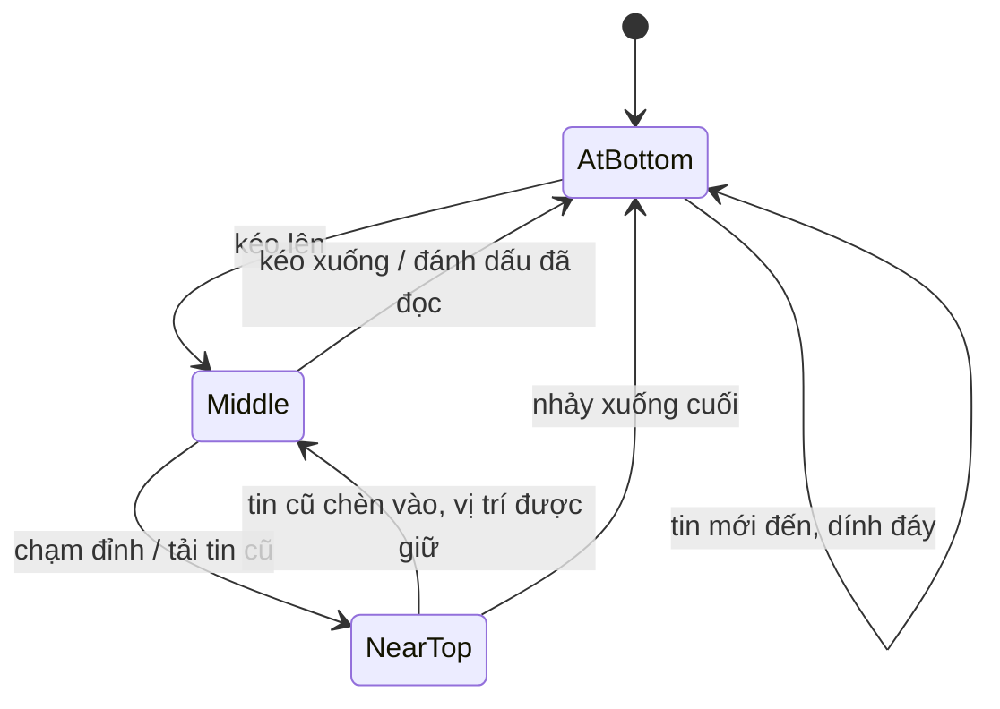

Khung chat là một trong những thứ khó làm "cho đúng" nhất trên web, dù trông chỉ là một `div` có `overflow-y: auto`. Người dùng mong đợi:

1. Mở cuộc trò chuyện là thấy **tin mới nhất ở đáy**.
2. Đang ở đáy mà có tin mới thì **tự cuộn theo**. Đang kéo lên đọc tin cũ thì **đứng yên**, chỉ hiện nút "↓ 3 tin mới".
3. Kéo lên đỉnh thì **tải tin cũ hơn**, và chỗ đang đọc **không nhảy** đi đâu cả.
4. Ảnh trong tin nhắn tải xong làm tin cao thêm 200px: vẫn không nhảy.
5. Cuộn tới mép khung chat thì **dừng**, không kéo luôn cả trang bên ngoài.

Làm ngây thơ thì gặp đủ cả năm lỗi. Thử ngay trong demo: bật "Cách ngây thơ", kéo lên đỉnh. Khi tin cũ được chèn vào, tin bạn đang đọc bị đẩy văng xuống hơn 500px.

<iframe class="demo-frame" src="/demos/facebook-patterns/index.html?theme=dark#/chat-scroller" title="Demo chat-scroller" loading="lazy" style="height: 640px"></iframe>

<p class="demo-links">▶ <a href="/demos/facebook-patterns/index.html#/chat-scroller" target="_blank" rel="noopener">Mở demo toàn màn hình ↗</a> · <a href="https://stackblitz.com/github/hunghg255/blog-hunghg/tree/master/examples/facebook-patterns?file=src/lib/useChatScroller.ts" target="_blank" rel="noopener">Sửa code trên StackBlitz ↗</a> · <a href="https://github.com/hunghg255/blog-hunghg/blob/master/examples/facebook-patterns/src/lib/useChatScroller.ts" target="_blank" rel="noopener">Xem source trên GitHub ↗</a></p>

## Facebook làm thế nào

Messenger trên facebook.com dùng module `MWChatConversationScroller_DEPRECATED.bs` (nằm trong bundle `99 ChatComposer/all.js` của [facebook-codebase](https://github.com/hunghg255/facebook-codebase)). Đuôi `.bs` cho biết module được viết bằng **ReasonML** và biên dịch qua BuckleScript. Vì vậy trong code có những thứ như `{TAG: 0, _0: b}`: đó là cách ReasonML biểu diễn một biến thể (variant) có kèm dữ liệu.

### Bốn trạng thái vị trí

Giải mã hàm cập nhật vị trí (đã đổi tên biến):

```js
function isAtBottom(tolerance = 20, el) { return el.scrollTop + el.clientHeight >= el.scrollHeight - tolerance }
function isAtTop(tolerance = 20, el) { return el.scrollTop <= tolerance }

const distFromBottom = el.scrollHeight - (el.scrollTop + el.clientHeight);
state.current = isAtBottom(el) ? (hasMoreAfter ? 1 : 0)
              : isAtTop(el) ? { TAG: 0, _0: distFromBottom }   // NearTop(dist)
                            : { TAG: 1, _0: distFromBottom };  // Middle(dist)
```

Dịch ra kiểu TypeScript:

```ts
type Position =
  | 'AtBottom'                 // 0: ở đáy, không còn tin mới hơn chưa tải
  | 'AtBottomWithMoreAfter'    // 1: ở đáy nhưng phía sau còn tin (đang xem lịch sử, nhảy tới tin cũ)
  | { NearTop: number }        // ở đỉnh, lưu khoảng cách tới ĐÁY
  | { Middle: number };        // ở giữa, lưu khoảng cách tới ĐÁY
```

Dung sai 20px được export thành hằng `scrollTolerance = 20`.

Điểm mấu chốt: vị trí được lưu dưới dạng **khoảng cách tới đáy**, không phải `scrollTop`. Khi tin cũ chèn lên trên, `scrollHeight` tăng, nhưng khoảng cách từ chỗ đang xem tới đáy **không đổi**. Khôi phục khoảng cách đó là giữ nguyên chỗ đang đọc.

### Sự kiện theo cạnh (edge-triggered)

Hàm cập nhật không gọi "tải tin cũ" mỗi khi thấy đang ở đỉnh. Nó so **trạng thái cũ với trạng thái mới**:

- Đi từ AtBottom hoặc Middle **vào** NearTop: `dispatch(2)` (tải tin cũ).
- Đi từ NearTop hoặc Middle **về** đáy: `dispatch(1)` (về đáy: đánh dấu đã đọc, tải tin mới hơn nếu có).
- Đứng yên ở đỉnh, cuộn qua lại vài pixel: không gọi gì thêm.

Đây là khác biệt giữa "level-triggered" (cứ ở trạng thái X là gọi) và "edge-triggered" (chỉ gọi khi **chuyển** vào X). Kiểu thứ hai tự nhiên chống gọi trùng mà không cần cờ `isLoading`.



### Khôi phục sau mỗi lần render

```js
useLayoutEffect(() => {                         // không có deps: chạy sau MỌI lần render
  const s = state.current;
  if (typeof s === "number") { if (s === 0) scrollToBottom() }    // AtBottom: dính đáy
  else if (s.TAG /* Middle */ && gkx("1600131")) { /* bỏ qua */ }
  else scrollTop = scrollHeight - (s._0 + clientHeight);          // giữ khoảng cách tới đáy
});
```

- `useLayoutEffect` chạy **sau khi DOM đã đổi nhưng trước khi trình duyệt vẽ**. Người dùng không bao giờ thấy khung hình "đang nhảy".
- `AtBottomWithMoreAfter` thì **không** dính đáy: đang xem lịch sử (ví dụ vừa nhảy tới một tin cũ được trả lời), tin mới đến không nên kéo người dùng đi.
- `Middle`: mặc định cũng giữ khoảng cách tới đáy, **trừ khi** gatekeeper `1600131` bật. Lý do có cờ này: đang đọc ở giữa mà có tin mới thêm vào **cuối**, giữ khoảng cách tới đáy sẽ làm nội dung đang đọc **trôi lên** đúng bằng chiều cao tin mới. Việc đặt nó sau một gatekeeper cho thấy Facebook đang thử bỏ hành vi đó. Bản viết lại bên dưới giải quyết triệt để chuyện này.

Một layout effect khác lo trường hợp **nội dung chưa lấp đầy khung**:

```js
useLayoutEffect(() => {
  if (el.clientHeight > 0 && Math.abs(el.clientHeight - el.scrollHeight) < 20) dispatch(0);
});
```

Cuộc trò chuyện mới chỉ có 3 tin thì không có thanh cuộn, người dùng không thể "kéo lên đỉnh" để kích hoạt tải tin cũ, nên phải tự tải tiếp.

### Lắng nghe gì, và tại sao lạ vậy

```js
const disableElasticScroll = document.body.style.overscrollBehavior === undefined
                          && document.body.style.scrollBoundaryBehavior === undefined;
// …
mouseenter -> addEventListener("wheel", onWheel, { passive: !disableElasticScroll })
mouseleave -> removeEventListener("wheel", …)
scroll     -> throttle(update, 50, { trailing: true })   // chỉ khi gkx("1283332") bật
mouseup / mousedown -> update
```

- CSS của khung có `overscroll-behavior: contain`. Cuộn tới mép thì dừng, không "chain" sang trang cha. Trình duyệt **không** hỗ trợ thuộc tính này (cả tên cũ `scroll-boundary-behavior`) thì `onWheel` gọi `preventDefault()` khi cuộn xuống lúc đã ở đáy hoặc cuộn lên lúc đã ở đỉnh.
- Listener `wheel` phải **non-passive** mới gọi được `preventDefault`. Mà listener non-passive làm trình duyệt phải chờ JS trước khi cuộn (chậm). Vì vậy họ chỉ gắn nó khi chuột **đang ở trên** khung chat (`mouseenter`), và gỡ khi rời đi. Trình duyệt hỗ trợ `overscroll-behavior` thì listener là passive.
- Sự kiện `scroll` được throttle 50ms (trailing) và nằm sau một gatekeeper. Khi cờ tắt, vị trí chỉ được cập nhật ở `wheel`, `mouseup`, `mousedown`. Có vẻ họ đo xem nghe `scroll` có đáng không.

Ngoài ra, scroller còn cung cấp `BaseScrollableAreaContext`. Nhờ đó popover, tooltip mở bên trong khung chat biết container cuộn của mình để tự định vị lại khi cuộn (xem [bài #12 về popover](/blogs/facebook-popover-tooltip)). Imperative handle có `scrollToBottom()` và `scrollToElement(el, offset)`: `scrollIntoView` rồi `scrollBy(0, -offset)` để chừa chỗ cho header.

## Bên trong trình duyệt: scroll anchoring và column-reverse

Hai "đường tắt" hay được nhắc tới, kèm lý do Facebook không dựa vào chúng:

**Scroll anchoring (`overflow-anchor`).** Chrome và Firefox có cơ chế tự giữ vị trí khi nội dung phía trên thay đổi. Trình duyệt chọn một "anchor node" đang hiện trong khung, và sau mỗi lần layout dịch `scrollTop` để anchor đứng yên. Đó chính xác là thứ ta cần khi chèn tin cũ. Nhưng:

- Safari trong thời gian dài không hỗ trợ. Khung chat phải chạy đúng trên iPhone.
- Trình duyệt tự chọn anchor theo heuristic, và nó không biết khái niệm "dính đáy".
- Code tự khôi phục vị trí **cộng** với anchoring của trình duyệt có thể bù hai lần.

Vì vậy bản viết lại đặt `overflow-anchor: none` cho khung chat và tự làm mọi thứ, để hành vi giống nhau ở mọi nơi. Khung "ngây thơ" trong demo cũng đặt `overflow-anchor: none` để mô phỏng trình duyệt không có anchoring.

**`flex-direction: column-reverse`.** Đảo chiều flex làm vị trí cuộn bắt đầu từ đáy: tin mới tự dính đáy và chèn tin cũ (vào cuối DOM) không làm nhảy. Rất gọn, nhưng:

- Thứ tự DOM ngược với thứ tự hiển thị. Trình đọc màn hình đọc từ tin mới nhất ngược lên, bôi đen chữ hay `Tab` cũng đi ngược. Muốn đúng phải đảo cả dữ liệu.
- `scrollTop` mang giá trị âm (0 là đáy). Các trình duyệt từng không thống nhất chuyện này, và code nào giả định `scrollTop >= 0` đều sai.
- Vẫn phải tự xử lý "ở giữa thì đừng nhảy khi có tin mới".

## Viết lại: thay "khoảng cách tới đáy" bằng anchor

Khi viết demo, mình làm theo đúng Facebook (lưu khoảng cách tới đáy cho NearTop) và gặp ngay một lỗi. Ngay khi chạm đỉnh, demo hiện dòng "Đang tải tin cũ…" ở đầu danh sách. Dòng này cao khoảng 30px, chèn lên trên, nên vị trí được khôi phục về `scrollTop ≈ 30`, tức là trạng thái chuyển từ NearTop sang **Middle**. 800ms sau, tin cũ về, nhưng lúc này đang là Middle nên không còn được giữ chỗ. Đo bằng Playwright: tin `#1000` nhảy từ **11px xuống 529px**.

Nói cách khác, chiến lược "giữ khoảng cách tới đáy" chỉ đúng khi mọi thay đổi xảy ra **phía trên** chỗ đang đọc. Còn chiến lược "không làm gì" chỉ đúng khi mọi thay đổi xảy ra **phía dưới**. Spinner, ảnh tải chậm, tin mới đều có thể xảy ra ở cả hai phía.

Lời giải là **neo theo phần tử** (giống tinh thần của scroll anchoring):

- Mỗi lần cuộn, ghi lại **tin nhắn đầu tiên đang hiện** ở mép trên khung và khoảng cách của nó tới mép trên.
- Sau khi DOM đổi, đo lại xem tin đó bị đẩy đi bao nhiêu và cộng đúng bấy nhiêu vào `scrollTop`.
- Đang ở đáy thì vẫn dính đáy như Facebook.

Sau khi sửa, cùng kịch bản đó tin `#1000` đứng ở 11px → 10px (lệch 1px do làm tròn).

```ts title=src/lib/useChatScroller.ts
import { useCallback, useEffect, useLayoutEffect, useRef, useState } from 'react';

/**
 * Khung cuộn cho chat (ý tưởng từ MWChatConversationScroller của Facebook Messenger):
 * - đang ở đáy thì tin mới đến vẫn dính đáy
 * - nội dung phía trên thay đổi (tải tin cũ, spinner, ảnh tải xong) thì chỗ đang đọc đứng yên
 * - chạm đỉnh -> gọi tải tin cũ; nội dung chưa lấp đầy khung -> gọi tải thêm ngay
 * - cuộn tới mép không "lan" ra trang bên ngoài (overscroll containment)
 *
 * Bí quyết: ghi lại vị trí TRƯỚC khi nội dung đổi (trong sự kiện scroll), rồi khôi phục SAU khi
 * DOM đổi nhưng TRƯỚC khi trình duyệt vẽ (useLayoutEffect / ResizeObserver).
 */

export type ChatScrollPosition =
  | { kind: 'bottom' }
  | { kind: 'top'; fromBottom: number }
  | { kind: 'middle'; fromBottom: number };

export interface UseChatScrollerOptions {
  /** vừa cuộn chạm đỉnh: tải tin cũ hơn */
  onReachTop?: () => void;
  /** vừa cuộn về đáy: đánh dấu đã đọc, tải tin mới hơn… */
  onReachBottom?: () => void;
  /** nội dung chưa đủ cao để cuộn: nên tải thêm luôn (người dùng không thể cuộn để kích hoạt) */
  onNotFilled?: () => void;
  onPositionChange?: (position: ChatScrollPosition) => void;
  /** dung sai coi là "ở đáy" / "ở đỉnh", Facebook dùng 20px */
  threshold?: number;
  /** theo dõi thay đổi kích thước không qua React (ảnh tải xong, bàn phím mobile bật lên…) */
  observeResize?: boolean;
}

export function measureChatPosition(el: HTMLElement, threshold = 20): ChatScrollPosition {
  const fromBottom = el.scrollHeight - (el.scrollTop + el.clientHeight);
  if (fromBottom <= threshold) return { kind: 'bottom' };
  if (el.scrollTop <= threshold) return { kind: 'top', fromBottom };
  return { kind: 'middle', fromBottom };
}

/** Phần tử "neo": con đầu tiên còn nhìn thấy ở mép trên khung, kèm khoảng cách tới mép trên. */
interface Anchor {
  element: Element;
  offset: number;
}

function findAnchor(scroller: HTMLElement, content: Element): Anchor | null {
  const viewportTop = scroller.getBoundingClientRect().top;
  const children = content.children;
  // Tìm nhị phân con đầu tiên có đáy nằm dưới mép trên khung: O(log n) lần đo.
  let lo = 0;
  let hi = children.length - 1;
  let found = -1;
  while (lo <= hi) {
    const mid = (lo + hi) >> 1;
    if (children[mid].getBoundingClientRect().bottom > viewportTop) {
      found = mid;
      hi = mid - 1;
    } else {
      lo = mid + 1;
    }
  }
  if (found === -1) return null;
  const element = children[found];
  return { element, offset: element.getBoundingClientRect().top - viewportTop };
}

const supportsOverscrollBehavior =
  typeof CSS !== 'undefined' && CSS.supports?.('overscroll-behavior', 'contain');

export function useChatScroller<S extends HTMLElement = HTMLDivElement, C extends HTMLElement = HTMLDivElement>(
  options: UseChatScrollerOptions = {},
) {
  const { threshold = 20, observeResize = true } = options;
  const [scroller, setScroller] = useState<S | null>(null);
  const [content, setContent] = useState<C | null>(null);
  // Chat mở ra là đang ở tin mới nhất.
  const positionRef = useRef<ChatScrollPosition>({ kind: 'bottom' });
  const anchorRef = useRef<Anchor | null>(null);

  // "latest ref" cho các callback: listener gắn 1 lần nhưng luôn gọi bản mới nhất
  const optionsRef = useRef(options);
  useLayoutEffect(() => {
    optionsRef.current = options;
  });

  const getContent = useCallback(
    () => content ?? scroller?.firstElementChild ?? null,
    [content, scroller],
  );

  /** Đặt lại scrollTop theo vị trí đã ghi nhận. Idempotent: gọi nhiều lần không sao. */
  const restore = useCallback(() => {
    if (!scroller) return;
    const pos = positionRef.current;
    if (pos.kind === 'bottom') {
      scroller.scrollTop = scroller.scrollHeight;
      return;
    }
    const anchor = anchorRef.current;
    if (anchor && anchor.element.isConnected) {
      // Neo bị đẩy xuống/kéo lên bao nhiêu thì bù scrollTop đúng bấy nhiêu.
      const viewportTop = scroller.getBoundingClientRect().top;
      const delta = anchor.element.getBoundingClientRect().top - viewportTop - anchor.offset;
      if (Math.abs(delta) >= 1) scroller.scrollTop += delta;
    } else {
      // Không còn neo (bị xoá): quay về cách của Facebook, giữ khoảng cách tới đáy.
      scroller.scrollTop = scroller.scrollHeight - (pos.fromBottom + scroller.clientHeight);
    }
  }, [scroller]);

  // Ghi nhận vị trí + neo, và bắn sự kiện khi CHUYỂN trạng thái (edge-triggered, giống Facebook):
  // nằm yên ở đỉnh không gọi tải tin cũ liên tục.
  const update = useCallback(() => {
    if (!scroller) return;
    const prev = positionRef.current;
    const next = measureChatPosition(scroller, threshold);
    positionRef.current = next;
    const contentEl = getContent();
    anchorRef.current = next.kind === 'bottom' || !contentEl ? null : findAnchor(scroller, contentEl);
    if (next.kind !== prev.kind) optionsRef.current.onPositionChange?.(next);
    if (next.kind === 'top' && prev.kind !== 'top') optionsRef.current.onReachTop?.();
    if (next.kind === 'bottom' && prev.kind !== 'bottom') optionsRef.current.onReachBottom?.();
  }, [scroller, threshold, getContent]);

  // Sau MỖI lần render (không deps): DOM đã đổi nhưng chưa vẽ -> khôi phục vị trí.
  useLayoutEffect(() => {
    if (!scroller) return;
    restore();
    if (scroller.clientHeight > 0 && Math.abs(scroller.scrollHeight - scroller.clientHeight) < threshold) {
      optionsRef.current.onNotFilled?.();
    }
  });

  useEffect(() => {
    if (!scroller) return;
    // Tắt scroll anchoring của trình duyệt: ta tự neo, để hành vi giống nhau trên mọi trình
    // duyệt (Safari không có scroll anchoring) và không bị bù hai lần.
    scroller.style.overflowAnchor = 'none';
    scroller.style.overscrollBehavior = 'contain';

    // Chỉ đọc layout (không ghi), nên chạy ở mỗi sự kiện scroll vẫn rẻ.
    scroller.addEventListener('scroll', update, { passive: true });

    // Trình duyệt cũ không có overscroll-behavior: chặn wheel ở mép bằng preventDefault.
    // Listener non-passive làm chậm cuộn, nên chỉ gắn khi chuột đang ở trên khung chat.
    const onWheel = (event: WheelEvent) => {
      const atBottom = scroller.scrollHeight - scroller.scrollTop - scroller.clientHeight <= 0;
      if ((event.deltaY > 0 && atBottom) || (event.deltaY < 0 && scroller.scrollTop <= 0)) {
        event.preventDefault();
      }
    };
    const onEnter = () => scroller.addEventListener('wheel', onWheel, { passive: false });
    const onLeave = () => scroller.removeEventListener('wheel', onWheel);
    if (!supportsOverscrollBehavior) {
      scroller.addEventListener('mouseenter', onEnter);
      scroller.addEventListener('mouseleave', onLeave);
    }

    return () => {
      scroller.removeEventListener('scroll', update);
      scroller.removeEventListener('mouseenter', onEnter);
      scroller.removeEventListener('mouseleave', onLeave);
      onLeave();
    };
  }, [scroller, update]);

  // Kích thước đổi KHÔNG qua React render: ảnh/video tải xong, font tải xong, bàn phím ảo bật
  // làm khung chat thấp đi… useLayoutEffect không chạy trong các trường hợp này.
  useEffect(() => {
    if (!scroller || !observeResize || typeof ResizeObserver === 'undefined') return;
    // Callback của ResizeObserver chạy sau layout, trước paint -> sửa vị trí không bị giật.
    const observer = new ResizeObserver(() => restore());
    observer.observe(scroller);
    const contentEl = getContent();
    if (contentEl) observer.observe(contentEl);
    return () => observer.disconnect();
  }, [scroller, observeResize, restore, getContent]);

  const scrollToBottom = useCallback(() => {
    if (!scroller) return;
    positionRef.current = { kind: 'bottom' };
    anchorRef.current = null;
    scroller.scrollTop = scroller.scrollHeight;
  }, [scroller]);

  return {
    /** gắn vào phần tử có overflow-y: auto */
    scrollerRef: setScroller,
    /** gắn vào phần tử bọc trực tiếp danh sách tin nhắn (mỗi con = một tin) */
    contentRef: setContent,
    scrollToBottom,
    getPosition: () => positionRef.current,
  };
}
```

### Đi qua từng phần

**1. `measureChatPosition`.** Giữ đúng ba trạng thái và dung sai 20px của Facebook. Biến thể `AtBottomWithMoreAfter` được bỏ cho gọn: nếu bạn có tính năng "nhảy tới tin cũ" thì nên thêm lại, vì lúc đó đáy khung chưa phải tin mới nhất.

**2. `update`, chạy ở mỗi sự kiện `scroll`.**

- Đo trạng thái mới và ghi anchor.
- Nếu trạng thái **đổi** thì gọi `onPositionChange`. Nếu đổi **vào** đỉnh thì gọi `onReachTop`, nếu đổi **về** đáy thì gọi `onReachBottom`.
- Không throttle như Facebook. Hàm chỉ **đọc** layout (`scrollTop`, `scrollHeight`, `getBoundingClientRect`), không ghi gì, nên không gây "layout thrashing". Sự kiện `scroll` vốn chỉ bắn tối đa một lần mỗi khung hình. Throttle còn có cái giá: trong 50ms trễ, một lần render có thể khôi phục theo vị trí **cũ**.

**3. `findAnchor`.** Tìm nhị phân trên `content.children` cho con đầu tiên có `bottom > mép trên khung`. Với 5.000 tin nhắn chỉ cần khoảng 13 lần đo thay vì 5.000. Đây là lý do hook cần `contentRef` gắn vào phần tử bọc **trực tiếp** các tin nhắn.

**4. `restore`.**

- `bottom` → `scrollTop = scrollHeight`.
- Còn lại: nếu anchor còn trong DOM, bù đúng độ lệch. Nếu anchor đã bị xoá (ví dụ tin bị thu hồi), quay về cách của Facebook: giữ khoảng cách tới đáy.
- Hàm **idempotent**: gọi lại khi không có gì đổi thì độ lệch bằng 0, không làm gì. Nhờ vậy gọi nó ở mỗi lần render và mỗi callback ResizeObserver đều an toàn.

**5. `useLayoutEffect` không deps.** Giống Facebook: sau mỗi lần render, trước khi vẽ. Kèm kiểm tra "chưa lấp đầy" để gọi `onNotFilled`.

**6. ResizeObserver: phần Facebook không có.** Ảnh trong tin nhắn tải xong, font web tải xong, bàn phím ảo bật lên làm khung chat thấp đi… tất cả đều đổi chiều cao **mà không qua React render**, nên `useLayoutEffect` không chạy. ResizeObserver theo dõi cả khung (`clientHeight` đổi) lẫn phần nội dung (chiều cao đổi). Callback của nó chạy **sau layout, trước paint**, trong cùng bước "update the rendering" của event loop, nên sửa vị trí ở đó cũng không bị giật. Demo: bật "Tin mới có ảnh tải chậm", đứng ở đáy. Có ResizeObserver thì vẫn dính đáy. Tắt đi thì sau khi ảnh tải xong, khung lệch khỏi đáy **140px** (đúng chiều cao ảnh).

**7. `overflow-anchor: none` và `overscroll-behavior: contain`** được đặt từ JS để hook tự đủ, không phụ thuộc CSS bên ngoài. Fallback `wheel` giữ đúng mẹo của Facebook: chỉ gắn listener non-passive khi chuột ở trên khung.

## Tại sao không làm cách khác?

**"Dùng `useEffect` thay `useLayoutEffect`?"** `useEffect` chạy **sau** khi trình duyệt đã vẽ. Người dùng sẽ thấy một khung hình nội dung bị đẩy đi, rồi khung sau mới nhảy về: đúng cái "giật" ta đang muốn tránh.

**"Lưu `scrollTop` thay vì khoảng cách tới đáy hay anchor?"** `scrollTop` đo từ **đỉnh**. Chèn tin cũ lên đỉnh làm mọi thứ dịch xuống, nên `scrollTop` cũ chỉ vào nội dung khác. Đó chính là lỗi của cách ngây thơ.

**"Sao không gọi tải tin cũ ở `IntersectionObserver` trên tin đầu tiên?"** Hoàn toàn được, và nhẹ hơn (xem [bài #1](/blogs/facebook-shared-intersection-observer)). Nhưng bạn vẫn cần nghe `scroll` để biết vị trí (đáy/giữa) và để ghi anchor, nên gộp lại một chỗ cho đơn giản.

**"Virtual list?"** Cuộc trò chuyện hàng chục nghìn tin thì nên ảo hoá. Nguyên lý giữ chỗ vẫn y hệt: đo chiều cao các mục mới, bù `scrollTop`. Các thư viện như react-virtuoso có sẵn tuỳ chọn `followOutput` (dính đáy) và `firstItemIndex` (chèn mục phía trên mà không nhảy) cho đúng bài toán này.

## Cạm bẫy

- **`scroll-behavior: smooth` trên khung chat.** Mọi lần gán `scrollTop` để khôi phục sẽ biến thành một animation cuộn, và nội dung "trượt" về chỗ cũ thay vì đứng yên. Giữ `scroll-behavior: auto` cho container này. Muốn cuộn mượt khi bấm "↓ Xuống cuối" thì gọi `scrollTo({ behavior: 'smooth' })` riêng lúc đó.
- **Trang tin cũ quá ngắn.** Tải 15 tin cũ mà tổng cao chưa tới 20px (hiếm, nhưng có thể với tin hệ thống) thì sau khi chèn vẫn đang ở đỉnh. Trạng thái không **đổi** nên `onReachTop` không bắn lại. Hãy tải đủ nhiều tin mỗi trang, hoặc sau khi tải xong tự kiểm tra `getPosition()` và gọi tiếp.
- **`onNotFilled` gọi ở mọi lần render** khi nội dung chưa đầy. Phía gọi phải tự chặn bằng cờ "đang tải" (demo dùng `loadingRef`). Facebook cũng vậy: reducer phía sau tự bỏ qua khi đang tải.
- **Ảnh không có kích thước.** ResizeObserver cứu được vị trí, nhưng tốt nhất vẫn là gửi kèm `width`/`height` từ server và đặt `aspect-ratio` cho khung ảnh. Chiều cao đúng ngay từ đầu thì không có gì phải bù.
- **iOS và cuộn quán tính.** Gán `scrollTop` trong lúc người dùng đang cuộn quán tính (momentum) trên iOS có thể làm cú cuộn khựng lại. Nếu có thể, hãy dời việc chèn tin cũ cho tới khi cuộn dừng hẳn.
- **Header ngày (sticky) trong danh sách.** Chúng cũng là con trực tiếp của content, và có thể được chọn làm anchor. Không sai, nhưng header sticky luôn dính ở mép trên nên đo vị trí của nó vô nghĩa. Nếu có sticky header, hãy bỏ qua chúng khi tìm anchor.

## Kiểm thử

Kiểm bằng trình duyệt thật là đáng tin nhất. Ví dụ với Playwright (không có trong repo; demo của bài được kiểm đúng kiểu này):

```ts
import { expect, test } from '@playwright/test';

test('tải tin cũ không làm nhảy tin đang đọc', async ({ page }) => {
  await page.goto('/#/chat-scroller');
  const chat = page.getByTestId('chat');
  const topOf = (id: number) =>
    chat.evaluate((el, id) => {
      const msg = [...el.querySelectorAll('.cs-msg')].find((m) => m.textContent!.startsWith(`#${id} `))!;
      return msg.getBoundingClientRect().top - el.getBoundingClientRect().top;
    }, id);

  await page.getByLabel('Tin mới mỗi 2 giây').uncheck(); // tắt tin mới cho dễ đếm
  await chat.evaluate((el) => (el.scrollTop = 0)); // chạm đỉnh -> tải tin cũ
  const before = await topOf(1000);
  await expect(chat.locator('.cs-msg')).toHaveCount(35); // 20 tin ban đầu + 15 tin cũ vừa tải
  expect(Math.abs((await topOf(1000)) - before)).toBeLessThanOrEqual(1);
});

test('đang ở đáy thì tin mới dính đáy', async ({ page }) => {
  await page.goto('/#/chat-scroller');
  await page.waitForTimeout(4500); // 2 tin mới đến
  const fromBottom = await page
    .getByTestId('chat')
    .evaluate((el) => el.scrollHeight - el.scrollTop - el.clientHeight);
  expect(fromBottom).toBeLessThanOrEqual(1);
});
```

## Dùng trong dự án

Kết hợp với `useInfiniteQuery` của TanStack Query, theo chiều ngược (trang mới nhất trước):

```tsx
function Conversation({ threadId }: { threadId: string }) {
  const { data, fetchNextPage, hasNextPage, isFetchingNextPage } = useInfiniteQuery({
    queryKey: ['messages', threadId],
    queryFn: ({ pageParam }) => fetchMessages(threadId, pageParam), // trang cũ hơn
    initialPageParam: null as string | null,
    getNextPageParam: (last) => last.olderCursor,
  });
  const loadOlder = () => hasNextPage && !isFetchingNextPage && fetchNextPage();
  const { scrollerRef, contentRef } = useChatScroller({ onReachTop: loadOlder, onNotFilled: loadOlder });

  // pages[0] là trang mới nhất -> đảo lại để tin cũ nằm trên
  const messages = data?.pages.slice().reverse().flatMap((p) => p.items) ?? [];
  return (
    <div ref={scrollerRef} style={{ overflowY: 'auto', height: '100%' }}>
      <div ref={contentRef}>
        {messages.map((m) => <MessageRow key={m.id} message={m} />)}
      </div>
    </div>
  );
}
```

Spinner "Đang tải tin cũ…" cứ đặt thoải mái ở đầu danh sách: anchor lo phần còn lại.

---

**Series "Học từ mã nguồn Facebook"**

*Phần 1*

- [Mở đầu: cách đọc code minify của Facebook](/blogs/learn-from-facebook-source-code)
- [#1 Dùng chung IntersectionObserver + infinite scroll](/blogs/facebook-shared-intersection-observer)
- [#2 useViewportDuration: đo thời gian thực sự được xem](/blogs/facebook-use-viewport-duration)
- [#3 Preload code + data khi hover](/blogs/facebook-preload-on-hover)
- [#4 Toast manager với external store](/blogs/facebook-toast-manager)
- [#5 Network status + heartbeat backoff](/blogs/facebook-network-status-heartbeat)
- [#6 ErrorGuard: bắt lỗi theo ngữ cảnh](/blogs/facebook-error-guard)
- [#7 Banzai: gom log theo lô + sendBeacon](/blogs/facebook-batch-logger)
- [#8 Focus trap + Esc theo layer](/blogs/facebook-focus-trap)

*Phần 2*

- [#9 Mẹo calc(… * 9999): container query, line-clamp, mũi tên carousel bằng CSS](/blogs/facebook-css-9999-trick)
- [#10 Thanh cuộn tuỳ biến bằng CSS 3D](/blogs/facebook-css-3d-scrollbar)
- [#11 Modal cuộn bằng window, giữ vị trí trang nền](/blogs/facebook-document-scroll-modal)
- [#12 Popover, tooltip group và hovercard](/blogs/facebook-popover-tooltip)
- [#13 Primitive Pressable + focus-visible](/blogs/facebook-pressable)
- [#14 Tab "Xem thêm" + sticky header bằng IntersectionObserver](/blogs/facebook-priority-tabs-sticky-header)
- [#15 Avatar khoét mask, gradient Messenger, skeleton steps()](/blogs/facebook-visual-tricks)
- **#16 Khung chat không giật** (bài này)
- [#17 Thuật toán chọn bố cục collage ảnh](/blogs/facebook-photo-collage-layout)
- [#18 Keep-alive tab trong SPA](/blogs/facebook-keep-alive-tabs)
- [#19 Tự đo Visual Completion & interaction tracing](/blogs/facebook-visual-completion)
- [#20 Router SPA bền bỉ & tải chunk có retry](/blogs/facebook-spa-router-resilient-loading)

Code + demo: [`examples/facebook-patterns`](https://github.com/hunghg255/blog-hunghg/tree/master/examples/facebook-patterns) · [Mở trên StackBlitz](https://stackblitz.com/github/hunghg255/blog-hunghg/tree/master/examples/facebook-patterns)
