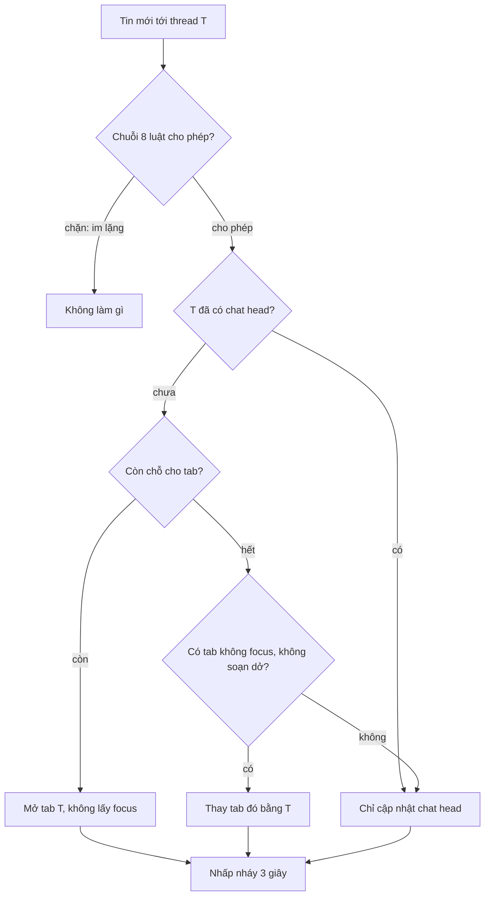

Bạn đang gõ dở một tin dài cho Bình trong tab chat góc phải facebook.com. Đúng lúc đó Chi nhắn tới. Hai chuyện có thể xảy ra: tab của Chi bật lên **thay chỗ** tab Bình và chữ bạn đang gõ biến mất khỏi màn hình, hoặc Chi chỉ hiện thành một bong bóng tròn (chat head) ở cột bên phải, chờ bạn bấm.

Khi đã hết chỗ cho tab mới, Messenger web không bao giờ thay tab **đang focus**, và cố giữ lại tab **có chữ soạn dở** (cố thôi: bản gốc có một kẽ hở, xem bên dưới); không còn tab nào để thay thì Chi chỉ thành chat head. Xung quanh quyết định đó là cả một bộ luật nhỏ: bao nhiêu tab là đủ cho độ rộng cửa sổ này, tin nào được phép bật tab, bong bóng nào lên đầu, thông báo nhấp nháy bao lâu. Bài này đọc năm module ReasonML của Messenger, chỉ ra hai lỗi hẹn giờ và một lỗi thay nhầm tab, rồi viết lại thành hàm thuần.

> [!TIP]
> **Tóm tắt**
> - Số tab tối đa: cửa sổ hẹp hơn 1100px thì 1 tab, rộng hơn thì `(nửa màn hình − 90) / 338`. Bản gốc **làm tròn lên**, nên ở 1920px ba tab chiếm 1014px, lấn quá nửa màn hình.
> - Tin đến: còn chỗ thì mở tab **không lấy focus**. Hết chỗ thì chỉ thay tab không focus và không có chữ soạn dở. Bản gốc có một nhánh dự phòng vẫn thay được tab có chữ soạn dở.
> - Tám luật "có bật tab không" nối thành chuỗi continuation, luật đồng bộ và bất đồng bộ (đọc setting, danh sách chặn) chung một chuỗi. Bị chặn thì callback im lặng.
> - Hai lỗi hẹn giờ: timer thông báo cũ không bị huỷ, `setTimeout` quá 24,8 ngày chạy ngay lập tức. Bản viết lại dùng `clearTimeout` và hẹn giờ chia chặng.

<iframe class="demo-frame" src="/demos/facebook-patterns/index.html?theme=dark#/chat-tab-policy" title="Demo chat-tab-policy" loading="lazy" style="height: 980px"></iframe>

<p class="demo-links">▶ <a href="/demos/facebook-patterns/index.html#/chat-tab-policy" target="_blank" rel="noopener">Mở demo toàn màn hình ↗</a> · <a href="https://stackblitz.com/github/hunghg255/blog-hunghg/tree/master/examples/facebook-patterns?file=src/lib/chatTabs.ts" target="_blank" rel="noopener">Sửa code trên StackBlitz ↗</a> · <a href="https://github.com/hunghg255/blog-hunghg/blob/master/examples/facebook-patterns/src/lib/chatTabs.ts" target="_blank" rel="noopener">Xem source trên GitHub ↗</a></p>

## Facebook làm thế nào?

Các module có đuôi `.bs` (ReasonML dịch qua BuckleScript): `MWChatMultitabCalc.bs`, `MWChatMultitabReducer.bs`, `MWChatVisibleChatHeads.bs` trong bundle `2.js`; `MWChatTabPolicy.bs` trong `18.js`; `MWChatCalculateIsMutedFromExpireTime.bs` trong `99 ChatComposer/all.js`.

### Bao nhiêu tab

Toàn bộ `MWChatMultitabCalc.bs`:

```js
function calculateMaxOpenTabs() {
  if (window.innerWidth < 1100) return 1;
  const tabWidth = qex._('1586109') ? 306 : 338;          // thí nghiệm: tab hẹp hơn
  const n = (((window.innerWidth / 2) | 0) - 90 | 0) / tabWidth;
  return n < 1 ? 1 : Math.ceil(n);
}
```

Ý đồ đọc được từ công thức: dành nửa phải màn hình cho tab chat, trừ 90px cho cột chat head. Nhưng `Math.ceil` cho thêm một tab mỗi khi phần lẻ khác 0:

| Cửa sổ | Chỗ dành cho tab | `ceil` | Tab chiếm | `floor` |
| --- | --- | --- | --- | --- |
| 1280px | 550px | 2 | 676px | 1 |
| 1920px | 870px | 3 | 1014px | 2 |
| 2560px | 1190px | 4 | 1352px | 3 |

Có thể đội Messenger cố ý chấp nhận lấn sang trái để màn hình to có nhiều tab hơn; code không có chú thích nào. Bản viết lại để `floor` làm mặc định và cho chọn lại.

Biến `maxOpenTabs` là một ô nhớ cấp module (`{contents: …}`), tính lúc load và tính lại khi resize. Nghĩa là hai component đọc nó ở hai thời điểm có thể thấy hai giá trị khác nhau; với một app chỉ có một dock chat thì không sao.

### Tin đến thì mở tab nào

`openTabFromNewMessage(state, threadId)` trong `MWChatMultitabReducer.bs`. State gồm `openTabsState` (mảng tab, phần tử 0 là mới nhất), `chatHeads` (mọi thread có bong bóng, kể cả thread đang mở tab), `notificationTimers`. Nhánh chính, khi được phép nhiều hơn một tab:

```js
const notInHeads = chatHeads.indexOf(threadId) === -1;
const canOpen    = notInHeads && tabs.length < maxOpenTabs.contents;
const canReplace = notInHeads && !tabs.every((t) => t.hasContent.contents);
let victim = tabs.findIndex((t) => !t.isTabFocused && !t.hasContent.contents);
if (victim === -1) victim = tabs.findIndex((t) => !t.isTabFocused);   // nhánh dự phòng

if (canOpen)         tabs = addOrUpdateTab(tabs, { threadId, isTabFocused: false, … });
else if (canReplace) tabs = addTabAndRemoveSpecificTab(tabs, { threadId, isTabFocused: false, … }, victim);
// còn lại: chỉ cập nhật chat head
```

`hasContent` là một ô nhớ dùng chung (`{contents: bool}`), composer ghi `true` khi có chữ soạn dở. Ý tưởng rất đúng: **không bao giờ cướp chỗ của tab người dùng đang làm việc**. Tab mới cũng mở ở trạng thái không focus, để con trỏ không bị giật khỏi ô đang gõ.

Nhưng hai điều kiện không khớp nhau. `canReplace` chỉ hỏi "có tab nào không có chữ soạn dở không", còn `victim` lại có nhánh dự phòng "tab không focus bất kỳ". Tình huống: tab A đang focus và trống, tab B và C không focus nhưng **đều có chữ soạn dở**. `canReplace` đúng (nhờ A), `victim` rơi vào nhánh dự phòng và chọn B. Tab B, đang có chữ soạn dở, bị thay bằng thread mới. Tôi mô phỏng lại hàm này bằng node với đúng điều kiện trên và nhận `replace B`. Chữ soạn dở có lẽ vẫn còn trong `MWChatComposerViewStateStore`, nhưng tab đã biến khỏi màn hình. Demo có công tắc "Mô phỏng bản gốc" để xem.

### Thu nhỏ cửa sổ

`recalculateOpenTabs` chạy khi resize. Nó duyệt mảng tab bằng `reduceRight` và giữ một chỗ cho tab đang focus:

```js
const focused = tabs.findIndex((t) => t.isTabFocused);
tabs = tabs.reduceRight((kept, tab, i) => {
  const budget = focused === -1 ? max - kept.length : max - kept.length - 1;
  return i === focused || budget > 0 ? [tab, ...kept] : kept;
}, []);
```

Duyệt từ cuối mảng nghĩa là giữ các tab **cũ nhất** và bỏ tab mới nhất. Trong khi đó, khi thêm tab vượt giới hạn, `addOrUpdateTab` làm `[tab, ...tabs].slice(0, max)`, tức bỏ tab **cũ nhất**. Hai chỗ ưu tiên ngược nhau. Bản viết lại thống nhất: luôn bỏ tab cũ nhất, luôn giữ tab đang focus.

### Chat head không nhảy

`MWChatVisibleChatHeads.get(heads, tabs)` bỏ các thread đang mở tab, còn lại quá 6 thì hiện 5 bong bóng và gom phần còn lại vào bong bóng "+N". `reorderChatHeads` đưa thread vừa có tin lên đầu, **trừ khi** thread đó đang mở tab hoặc đang nằm trong số bong bóng nhìn thấy. Một bong bóng người dùng đang nhìn mà nhảy lên đầu thì rất dễ bấm nhầm; nó chỉ nhảy khi đang ẩn trong "+N".

### Thông báo 3 giây, và timer không bị huỷ

Mỗi thread có tin mới thì nhấp nháy 3 giây. `updateNotificationTimers`:

```js
function updateNotificationTimers(timers, threadId) {
  const i = timers.findIndex((t) => t[0] === threadId);
  const fresh = [threadId, setTimeout(() => dispatch(CloseNotification(threadId)), 3000)];
  return i !== -1
    ? timers.slice(i + 1).concat(timers.slice(0, i), [fresh]) // bỏ entry cũ… nhưng không clearTimeout
    : [fresh].concat(timers);
}
```

Cả module không có `clearTimeout` nào. Tin thứ hai của An đến sau 2,5 giây: entry cũ bị bỏ khỏi mảng nhưng timer của nó **vẫn chạy**, và 0,5 giây sau nó dispatch `CloseNotification(An)`. Reducer lọc theo `threadId` nên xoá luôn entry mới. Thông báo cho tin thứ hai chỉ sáng 0,5 giây thay vì 3. Mô phỏng bằng đồng hồ giả trong node: thông báo đóng ở t = 3000ms, chưa tới 3000ms sau tin cuối. Thêm một chi tiết nhỏ: `slice(i + 1).concat(slice(0, i))` **xoay** mảng chứ không chỉ chuyển entry xuống cuối (`[A,B,C,D]` cập nhật B thành `[C,D,A,B]`).

### Tám luật trong chuỗi continuation

`MWChatTabPolicy.shouldMessageBeAllowed(thread, message, callback)` quyết định tin có được bật tab không. Tám luật, mỗi luật nhận hàm `next` và gọi `next(0)` để đi tiếp, `next(1)` để chặn:

```js
const proceedIfAllow = (rule, next, code) => (code === 0 ? rule(next) : 0);
const rules = [killswitch, [outgoing, [chatTabsOff, [muted, [nonUserGenerated, [notInbox, [blockedInGroup, [canonicalNoId, 0]]]]]]]];
// gấp danh sách liên kết thành chuỗi: luật cuối cùng gọi callback(0) = cho phép
const chain = (list) => list ? (code) => proceedIfAllow(list[0], chain(list[1]), code)
                             : (code) => proceedIfAllow(() => callback(0), () => 0, code);
return rules[0](chain(rules[1]));
```

Lợi ích của kiểu viết này: luật `chatTabsOff` đọc setting qua `MWChatSettingsQuery.areChatTabsTurnedOff(cb)`, luật `blockedInGroup` chờ `requireDeferred('MessengerState.bs')` tải xong rồi mới so danh sách chặn. Cả hai bất đồng bộ nhưng nằm chung chuỗi với sáu luật đồng bộ, và luật sau chỉ chạy khi luật trước cho qua, nên tin của chính mình hay tin hệ thống không bao giờ phải chờ tải module.

Luật mute có ngoại lệ: thread đang mute nhưng tin có `profile_ranges` chứa id của mình (được @nhắc) thì vẫn bật tab, trừ khi người dùng mute cả lượt nhắc. Mỗi lần chặn, code log lý do (`message_thread_muted`, `message_no_inbox`…) và tăng bộ đếm `NewMessage.reject`.

Giới hạn: bị chặn thì `callback` **không bao giờ được gọi**. Bên gọi không phân biệt được "bị chặn" với "luật bất đồng bộ còn đang chạy" hay "luật bất đồng bộ lỗi và không gọi `next`".

### setTimeout và hạn mute 30 ngày

`MWChatCalculateIsMutedFromExpireTime.useHook(muteUntil)` là một hook React:

```js
useEffect(() => {
  const muted = muteUntil <= -1 || muteUntil > Date.now();      // -1: mute vĩnh viễn
  setMuted(muted);
  if (!(muted && muteUntil > -1)) return;
  const id = setTimeout(() => setMuted(false), muteUntil - Date.now());
  return () => clearTimeout(id);
}, [muteUntil]);
```

Delay của `setTimeout` được chuyển thành số nguyên 32 bit có dấu. Quá `2^31 − 1` ms (khoảng 24,8 ngày) thì trình duyệt coi như 0 và chạy ngay. Node báo `TimeoutOverflowWarning` và chạy sau 1ms. Các lựa chọn mute hiện tại (15 phút, 1 giờ, 8 giờ, 24 giờ, vĩnh viễn) đều dưới ngưỡng, nhưng ngày nào thêm "1 tháng" thì thread vừa mute sẽ hiện "đã bật thông báo" ngay lập tức. Demo chạy thật `setTimeout(fn, 30 ngày)` trên trình duyệt của bạn.



## Bên trong trình duyệt: timer là số nguyên 32 bit

Đặc tả HTML nói rõ bước "timer initialisation": delay được chuyển qua `ToInt32`-tương đương của WebIDL (`long`), âm thì thành 0. Vì vậy `setTimeout(fn, 2 ** 31)` thành `-2147483648` rồi thành 0. Firefox, Chrome, Safari đều làm vậy. Tab ẩn còn bị kẹp tối thiểu 1 giây và có thể bị gom timer, nhưng đó là giới hạn dưới; với giới hạn trên, chỉ có cách chia nhỏ: hẹn một chặng tối đa 24,8 ngày, khi chặng đó chạy thì tính lại thời gian còn lại và hẹn tiếp.

Một hướng khác là không hẹn giờ dài trong trang: tab chat hiếm khi mở liên tục 25 ngày. Kiểm tra lại `isMuted` mỗi khi tab hiện lên (`visibilitychange`) hoặc mỗi khi render cũng đủ. Bản viết lại vẫn có `setLongTimeout` vì nó rẻ và đúng trong mọi trường hợp.

## Viết lại

Tin đến và thu nhỏ cửa sổ. Hàm thuần, nhận dock cũ trả dock mới cùng kết quả để log:

```ts title=src/lib/chatTabs.ts
export function onIncomingMessage(
  dock: Dock,
  threadId: string,
  max: number,
  o: IncomingOptions = {},
): { dock: Dock; outcome: Outcome } {
  const known = dock.heads.includes(threadId);
  const fresh: ChatTab = { threadId, focused: false, draft: false };

  if (!known && dock.tabs.length < max) {
    const tabs = [fresh, ...dock.tabs];
    return { dock: { tabs, heads: promoteHead(dock.heads, tabs, threadId) }, outcome: { kind: 'opened' } };
  }

  if (!known) {
    let victim = dock.tabs.findIndex((t) => !t.focused && !t.draft);
    if (victim === -1 && o.legacyFallback && dock.tabs.some((t) => !t.draft)) {
      victim = dock.tabs.findIndex((t) => !t.focused); // tab này có thể đang có draft
    }
    if (victim !== -1) {
      const closed = dock.tabs[victim].threadId;
      const tabs = [fresh, ...dock.tabs.filter((_, i) => i !== victim)];
      return {
        dock: { tabs, heads: promoteHead(dock.heads, tabs, threadId) },
        outcome: { kind: 'replaced', closed },
      };
    }
  }

  return { dock: { tabs: dock.tabs, heads: promoteHead(dock.heads, dock.tabs, threadId) }, outcome: { kind: 'head-only' } };
}

/** Thu nhỏ cửa sổ: giữ tab đang focus, bỏ tab cũ nhất trước. */
export function fitTabs(tabs: ChatTab[], max: number): ChatTab[] {
  if (tabs.length <= max) return tabs;
  const focused = tabs.find((t) => t.focused);
  const keep = new Set(tabs.filter((t) => t !== focused).slice(0, focused ? max - 1 : max));
  if (focused) keep.add(focused);
  return tabs.filter((t) => keep.has(t));
}
```

Chuỗi luật bằng `async`/`await`: vẫn tuần tự, vẫn dừng ở luật đầu tiên chặn, nhưng luôn trả kết quả kèm tên luật:

```ts title=src/lib/chatTabs.ts
// ---------- 4. Chuỗi luật "có bật tab không" ----------

export interface PolicyRule<C> {
  name: string;
  /** true = chặn. Được phép bất đồng bộ (đọc setting, danh sách chặn...) */
  blocks: (ctx: C) => boolean | Promise<boolean>;
}

export type PolicyResult = { allowed: true } | { allowed: false; rule: string; error?: unknown };

/**
 * Chạy lần lượt, dừng ở luật đầu tiên chặn. Luôn trả kết quả (bản gốc im lặng khi bị chặn).
 * Luật ném lỗi thì coi như chặn: thà không bật tab còn hơn bật nhầm.
 */
export async function runPolicy<C>(rules: readonly PolicyRule<C>[], ctx: C): Promise<PolicyResult> {
  for (const rule of rules) {
    try {
      if (await rule.blocks(ctx)) return { allowed: false, rule: rule.name };
    } catch (error) {
      return { allowed: false, rule: rule.name, error };
    }
  }
  return { allowed: true };
}
```

Hẹn giờ dài:

```ts title=src/lib/chatTabs.ts
/** setTimeout nhận delay kiểu int32: quá 2^31 - 1 ms (~24,8 ngày) là chạy ngay. */
export const MAX_TIMEOUT = 2 ** 31 - 1;

/** Hẹn giờ dài bao lâu cũng được: chia thành nhiều chặng không quá MAX_TIMEOUT. */
export function setLongTimeout(fn: () => void, delayMs: number, now: () => number = Date.now): () => void {
  const target = now() + delayMs;
  let id: ReturnType<typeof setTimeout>;
  const arm = () => {
    const left = Math.max(0, target - now());
    id = setTimeout(left > MAX_TIMEOUT ? arm : fn, Math.min(left, MAX_TIMEOUT));
  };
  arm();
  return () => clearTimeout(id);
}
```

::: spoiler Xem toàn bộ src/lib/chatTabs.ts

```ts title=src/lib/chatTabs.ts
/**
 * Dock chat kiểu Messenger web: bao nhiêu tab vừa màn hình, tin đến thì mở/thay tab nào,
 * chuỗi luật "có nên bật tab", hẹn giờ thông báo và hẹn giờ bỏ mute dài ngày.
 * Ý tưởng học từ MWChatMultitabCalc / MWChatMultitabReducer / MWChatVisibleChatHeads /
 * MWChatTabPolicy / MWChatCalculateIsMutedFromExpireTime, viết lại từ đầu.
 */

// ---------- 1. Bao nhiêu tab ----------

export interface TabLayout {
  /** độ rộng một tab, Messenger: 338 (306 khi bật bản thanh mảnh) */
  tabWidth?: number;
  /** dưới độ rộng này chỉ cho 1 tab */
  minViewport?: number;
  /** phần dành cho cột chat head */
  reserved?: number;
  /** bản gốc làm tròn lên; mặc định ở đây làm tròn xuống để không lấn quá nửa màn hình */
  round?: 'ceil' | 'floor';
}

export function maxOpenTabs(viewport: number, o: TabLayout = {}): number {
  const { tabWidth = 338, minViewport = 1100, reserved = 90, round = 'floor' } = o;
  if (viewport < minViewport) return 1;
  const n = (Math.floor(viewport / 2) - reserved) / tabWidth;
  return Math.max(1, round === 'ceil' ? Math.ceil(n) : Math.floor(n));
}

// ---------- 2. Tin đến thì làm gì với tab ----------

export interface ChatTab {
  threadId: string;
  focused: boolean;
  /** đang có chữ soạn dở */
  draft: boolean;
}

/** tabs[0] là tab mới nhất. heads: mọi thread đang có bong bóng, mới nhất trước. */
export interface Dock {
  tabs: ChatTab[];
  heads: string[];
}

export type Outcome = { kind: 'opened' } | { kind: 'replaced'; closed: string } | { kind: 'head-only' };

export interface IncomingOptions {
  /**
   * Mô phỏng bản gốc: không tìm được tab "không focus, không draft" thì lấy tab không focus
   * đầu tiên, kể cả tab đang có draft.
   */
  legacyFallback?: boolean;
}

export function onIncomingMessage(
  dock: Dock,
  threadId: string,
  max: number,
  o: IncomingOptions = {},
): { dock: Dock; outcome: Outcome } {
  const known = dock.heads.includes(threadId);
  const fresh: ChatTab = { threadId, focused: false, draft: false };

  if (!known && dock.tabs.length < max) {
    const tabs = [fresh, ...dock.tabs];
    return { dock: { tabs, heads: promoteHead(dock.heads, tabs, threadId) }, outcome: { kind: 'opened' } };
  }

  if (!known) {
    let victim = dock.tabs.findIndex((t) => !t.focused && !t.draft);
    if (victim === -1 && o.legacyFallback && dock.tabs.some((t) => !t.draft)) {
      victim = dock.tabs.findIndex((t) => !t.focused); // tab này có thể đang có draft
    }
    if (victim !== -1) {
      const closed = dock.tabs[victim].threadId;
      const tabs = [fresh, ...dock.tabs.filter((_, i) => i !== victim)];
      return {
        dock: { tabs, heads: promoteHead(dock.heads, tabs, threadId) },
        outcome: { kind: 'replaced', closed },
      };
    }
  }

  return { dock: { tabs: dock.tabs, heads: promoteHead(dock.heads, dock.tabs, threadId) }, outcome: { kind: 'head-only' } };
}

/** Thu nhỏ cửa sổ: giữ tab đang focus, bỏ tab cũ nhất trước. */
export function fitTabs(tabs: ChatTab[], max: number): ChatTab[] {
  if (tabs.length <= max) return tabs;
  const focused = tabs.find((t) => t.focused);
  const keep = new Set(tabs.filter((t) => t !== focused).slice(0, focused ? max - 1 : max));
  if (focused) keep.add(focused);
  return tabs.filter((t) => keep.has(t));
}

// ---------- 3. Chat head không nhảy ----------

export const MAX_BUBBLES = 6;

/** Bong bóng hiển thị: bỏ thread đang mở tab; quá 6 thì 5 bong bóng + một bong bóng "+N". */
export function visibleHeads(heads: string[], tabs: ChatTab[], maxBubbles = MAX_BUBBLES) {
  const free = heads.filter((h) => !tabs.some((t) => t.threadId === h));
  return free.length > maxBubbles
    ? { shown: free.slice(0, maxBubbles - 1), overflow: free.slice(maxBubbles - 1) }
    : { shown: free, overflow: [] as string[] };
}

/** Đưa thread lên đầu, trừ khi người dùng đang nhìn thấy nó (tab mở hoặc bong bóng đang hiện). */
export function promoteHead(heads: string[], tabs: ChatTab[], threadId: string, maxBubbles = MAX_BUBBLES) {
  if (!heads.includes(threadId)) return [threadId, ...heads];
  const onScreen =
    tabs.some((t) => t.threadId === threadId) || visibleHeads(heads, tabs, maxBubbles).shown.includes(threadId);
  return onScreen ? heads : [threadId, ...heads.filter((h) => h !== threadId)];
}

// ---------- 4. Chuỗi luật "có bật tab không" ----------

export interface PolicyRule<C> {
  name: string;
  /** true = chặn. Được phép bất đồng bộ (đọc setting, danh sách chặn...) */
  blocks: (ctx: C) => boolean | Promise<boolean>;
}

export type PolicyResult = { allowed: true } | { allowed: false; rule: string; error?: unknown };

/**
 * Chạy lần lượt, dừng ở luật đầu tiên chặn. Luôn trả kết quả (bản gốc im lặng khi bị chặn).
 * Luật ném lỗi thì coi như chặn: thà không bật tab còn hơn bật nhầm.
 */
export async function runPolicy<C>(rules: readonly PolicyRule<C>[], ctx: C): Promise<PolicyResult> {
  for (const rule of rules) {
    try {
      if (await rule.blocks(ctx)) return { allowed: false, rule: rule.name };
    } catch (error) {
      return { allowed: false, rule: rule.name, error };
    }
  }
  return { allowed: true };
}

// ---------- 5. Hẹn giờ ----------

/** Mỗi thread một timer thông báo; tin mới đến thì huỷ timer cũ rồi đặt lại. */
export class NotificationTimers {
  private timers = new Map<string, ReturnType<typeof setTimeout>>();
  constructor(
    private onExpire: (threadId: string) => void,
    private ms = 3000,
  ) {}
  notify(threadId: string) {
    clearTimeout(this.timers.get(threadId)); // bản gốc thiếu dòng này
    this.timers.delete(threadId); // xoá rồi set lại để thread lên cuối thứ tự Map
    this.timers.set(
      threadId,
      setTimeout(() => {
        this.timers.delete(threadId);
        this.onExpire(threadId);
      }, this.ms),
    );
  }
  dismiss(threadId: string) {
    clearTimeout(this.timers.get(threadId));
    this.timers.delete(threadId);
  }
  active() {
    return [...this.timers.keys()];
  }
  dispose() {
    this.timers.forEach((id) => clearTimeout(id));
    this.timers.clear();
  }
}

/** setTimeout nhận delay kiểu int32: quá 2^31 - 1 ms (~24,8 ngày) là chạy ngay. */
export const MAX_TIMEOUT = 2 ** 31 - 1;

/** Hẹn giờ dài bao lâu cũng được: chia thành nhiều chặng không quá MAX_TIMEOUT. */
export function setLongTimeout(fn: () => void, delayMs: number, now: () => number = Date.now): () => void {
  const target = now() + delayMs;
  let id: ReturnType<typeof setTimeout>;
  const arm = () => {
    const left = Math.max(0, target - now());
    id = setTimeout(left > MAX_TIMEOUT ? arm : fn, Math.min(left, MAX_TIMEOUT));
  };
  arm();
  return () => clearTimeout(id);
}

/** muteUntil <= -1: mute vĩnh viễn. Ngược lại mute tới thời điểm đó (epoch ms). */
export function isMuted(muteUntil: number, now = Date.now()): boolean {
  return muteUntil <= -1 || muteUntil > now;
}
```

:::

## Đi qua code

- `maxOpenTabs` nhận độ rộng làm tham số thay vì đọc `window.innerWidth`: test được, và dùng được cho một container không phải cả cửa sổ.
- `onIncomingMessage` có ba lối ra, khớp với ba nhánh của bản gốc. `known` nghĩa là thread đã có bong bóng (kể cả khi đang mở tab): khi đó không mở thêm gì.
- Nạn nhân chỉ được chọn trong các tab **không focus và không có chữ soạn dở**. `legacyFallback` tồn tại chỉ để demo tái hiện lỗi.
- `fitTabs` giữ tab focus rồi lấp chỗ còn lại bằng các tab mới nhất (đầu mảng).
- `promoteHead` đưa thread lên đầu trừ khi nó đang hiện trên màn hình, dùng chung `visibleHeads` với lớp hiển thị nên hai bên không lệch nhau.
- `runPolicy` coi luật ném lỗi là chặn: thà không bật tab còn hơn bật nhầm cho thread đã mute.
- `NotificationTimers` dùng `Map`: `delete` rồi `set` để thread lên cuối thứ tự, `clearTimeout` trước khi đặt timer mới.
- `setLongTimeout` hẹn từng chặng `min(còn lại, 2^31 − 1)`, tính lại từ `now()` mỗi chặng nên không cộng dồn sai số. `now` tiêm vào được để test.

**Khác bản gốc:**

- Làm tròn xuống, có tham số `round` để quay về `ceil`.
- Không thay tab có chữ soạn dở trong bất kỳ trường hợp nào.
- Thu nhỏ cửa sổ bỏ tab cũ nhất, thống nhất với khi thêm tab.
- Chuỗi luật trả `Promise<PolicyResult>` thay vì gọi callback khi được phép và im lặng khi bị chặn.
- Timer thông báo được huỷ khi có tin mới; không xoay thứ tự các thread khác.
- Hẹn giờ bỏ mute chia chặng, đúng cả với hạn trên 24,8 ngày.

## Tại sao không làm cách khác?

- **Mở tab và focus luôn**: người dùng đang gõ cho Bình bị giật con trỏ sang ô của Chi, phím tiếp theo gửi nhầm người. Tab mới không bao giờ được lấy focus.
- **Đo chỗ trống thật bằng `ResizeObserver`** thay vì công thức nửa màn hình: chính xác hơn, nhưng số tab sẽ đổi theo mọi thứ trên trang (sidebar mở, quảng cáo cao lên). Một công thức theo độ rộng cửa sổ ổn định và dễ đoán.
- **Chuỗi luật bằng `Promise.all`** (chạy song song): nhanh hơn khi mọi luật đều cho qua, nhưng tin của chính mình vẫn phải chờ tải module danh sách chặn. Tuần tự và dừng sớm rẻ hơn trong trường hợp phổ biến.
- **Một `setInterval` kiểm tra mute mỗi phút**: đơn giản, không tràn số, nhưng trễ tới một phút và chạy mãi kể cả khi không có thread nào mute.

## Edge case và cạm bẫy

- **Ô nhớ module**: bản gốc giữ `maxOpenTabs` trong biến module. Server-side rendering hoặc hai dock trên một trang sẽ dùng chung giá trị. Truyền độ rộng vào hàm như bản viết lại.
- **Draft được đánh dấu qua ref dùng chung** (`hasContent: {contents}`): reducer đọc giá trị hiện tại của ref chứ không phải giá trị trong state, nên React DevTools hay time-travel debug sẽ không thấy nó đổi. Bản viết lại để `draft` là dữ liệu thường trong state.
- **Luật bất đồng bộ trả lời muộn**: người dùng có thể đã tự mở thread đó trong lúc chờ. Kiểm tra lại state trước khi áp kết quả.
- **Tab ẩn và timer**: trình duyệt giới hạn timer của tab ẩn; thông báo 3 giây có thể kéo dài hơn. Không sao với nhấp nháy, nhưng đừng dùng timer này để đo thời gian.
- **Mute "vĩnh viễn" là −1**: mọi số âm nhỏ hơn hoặc bằng −1 đều là vĩnh viễn; đừng dùng 0 làm giá trị "không mute" nếu có thể nhầm với epoch.

## Dùng trong dự án

```ts
import { maxOpenTabs, onIncomingMessage, runPolicy, setLongTimeout, type Dock } from './chatTabs';

const rules = [
  { name: 'outgoing', blocks: (m: Msg) => m.senderId === me },
  { name: 'muted', blocks: (m: Msg) => isMutedThread(m.threadId) && !m.mentions.includes(me) },
  { name: 'tabs-off', blocks: async () => (await settings()).chatTabsOff },
];

async function onMessage(dock: Dock, m: Msg): Promise<Dock> {
  const verdict = await runPolicy(rules, m);
  if (!verdict.allowed) {
    metrics.count('tab_suppressed', { reason: verdict.rule });
    return dock;
  }
  return onIncomingMessage(dock, m.threadId, maxOpenTabs(window.innerWidth)).dock;
}

// bỏ mute tự động, kể cả khi hạn là 30 ngày
const cancel = setLongTimeout(() => store.unmute(threadId), muteUntil - Date.now());
```

## Kiểm thử

::: spoiler Ví dụ test (bản phác, không có trong repo)

```ts
import { describe, expect, it, vi } from 'vitest';
import { fitTabs, maxOpenTabs, NotificationTimers, onIncomingMessage, runPolicy, setLongTimeout, MAX_TIMEOUT } from './chatTabs';

const tab = (threadId: string, focused = false, draft = false) => ({ threadId, focused, draft });

describe('maxOpenTabs', () => {
  it('làm tròn xuống, ceil như bản gốc', () => {
    expect(maxOpenTabs(1000)).toBe(1);
    expect(maxOpenTabs(1920)).toBe(2);
    expect(maxOpenTabs(1920, { round: 'ceil' })).toBe(3);
  });
});

describe('onIncomingMessage', () => {
  const dock = { tabs: [tab('A', true), tab('B', false, true), tab('C', false, true)], heads: ['A', 'B', 'C'] };
  it('không thay tab có draft', () => {
    const r = onIncomingMessage(dock, 'D', 3);
    expect(r.outcome.kind).toBe('head-only');
    expect(r.dock.heads[0]).toBe('D');
  });
  it('legacyFallback tái hiện lỗi gốc', () => {
    expect(onIncomingMessage(dock, 'D', 3, { legacyFallback: true }).outcome).toEqual({ kind: 'replaced', closed: 'B' });
  });
  it('còn chỗ thì mở, không focus', () => {
    const r = onIncomingMessage({ tabs: [], heads: [] }, 'A', 2);
    expect(r.dock.tabs).toEqual([tab('A')]);
  });
});

it('fitTabs giữ tab focus', () => {
  expect(fitTabs([tab('A'), tab('B'), tab('C', true)], 2).map((t) => t.threadId)).toEqual(['A', 'C']);
});

it('runPolicy dừng ở luật đầu tiên chặn và báo tên', async () => {
  const later = vi.fn(() => true);
  const r = await runPolicy([{ name: 'a', blocks: async () => false }, { name: 'b', blocks: () => true }, { name: 'c', blocks: later }], {});
  expect(r).toEqual({ allowed: false, rule: 'b' });
  expect(later).not.toHaveBeenCalled();
});

describe('hẹn giờ', () => {
  it('thông báo đóng 3 giây sau tin CUỐI', () => {
    vi.useFakeTimers();
    const closed: number[] = [];
    const t = new NotificationTimers(() => closed.push(Date.now()), 3000);
    const t0 = Date.now();
    t.notify('A');
    vi.advanceTimersByTime(2500);
    t.notify('A');
    vi.advanceTimersByTime(3000);
    expect(closed).toEqual([t0 + 5500]);
  });

  it('setLongTimeout không chạy sớm với 30 ngày', () => {
    vi.useFakeTimers();
    const fn = vi.fn();
    setLongTimeout(fn, 30 * 86_400_000);
    vi.advanceTimersByTime(MAX_TIMEOUT);
    expect(fn).not.toHaveBeenCalled();
    vi.advanceTimersByTime(30 * 86_400_000 - MAX_TIMEOUT);
    expect(fn).toHaveBeenCalledOnce();
  });
});
```

:::

## So với thư viện và chuẩn web

- **`setTimeout`**: giới hạn `2^31 − 1` ms là hành vi chuẩn, ghi trong đặc tả HTML (WebIDL `long`) và ở tài liệu MDN mục "Maximum delay value". Thư viện `long-timeout` trên npm làm đúng việc chia chặng như `setLongTimeout`.
- **Scheduler API** (`scheduler.postTask` có `delay`): cũng không dành cho hẹn giờ nhiều ngày; dữ liệu cần tồn tại qua nhiều ngày nên nằm ở server hoặc kiểm tra lại khi trang hiện lên.
- **AbortController**: thay cho callback im lặng, chuỗi luật có thể nhận `signal` để huỷ khi người dùng tự mở thread trong lúc luật bất đồng bộ đang chạy.
- Bài liên quan: [#43 Composer dạng plugin](/blogs/facebook-plugin-composer) (chuỗi kiểm tra trước khi gửi), [#31 Hàng đợi gửi tin](/blogs/facebook-ordered-send-queue), [#18 Keep-alive tab](/blogs/facebook-keep-alive-tabs).

---

Bài này thuộc series **[Học từ mã nguồn Facebook](/series/facebook)** (106 bài, đọc theo thứ tự).

::: spoiler Xem nhanh danh sách bài trong series

*Phần 1*

- [Mở đầu: cách đọc code minify của Facebook](/blogs/learn-from-facebook-source-code)
- [#1 Dùng chung IntersectionObserver + infinite scroll](/blogs/facebook-shared-intersection-observer)
- [#2 useViewportDuration: đo thời gian thực sự được xem](/blogs/facebook-use-viewport-duration)
- [#3 Preload code + data khi hover](/blogs/facebook-preload-on-hover)
- [#4 Toast manager với external store](/blogs/facebook-toast-manager)
- [#5 Network status + heartbeat backoff](/blogs/facebook-network-status-heartbeat)
- [#6 ErrorGuard: bắt lỗi theo ngữ cảnh](/blogs/facebook-error-guard)
- [#7 Banzai: gom log theo lô + sendBeacon](/blogs/facebook-batch-logger)
- [#8 Focus trap + Esc theo layer](/blogs/facebook-focus-trap)

*Phần 2*

- [#9 Mẹo calc(… * 9999): container query, line-clamp, mũi tên carousel bằng CSS](/blogs/facebook-css-9999-trick)
- [#10 Thanh cuộn tuỳ biến bằng CSS 3D](/blogs/facebook-css-3d-scrollbar)
- [#11 Modal cuộn bằng window, giữ vị trí trang nền](/blogs/facebook-document-scroll-modal)
- [#12 Popover, tooltip group và hovercard](/blogs/facebook-popover-tooltip)
- [#13 Primitive Pressable + focus-visible](/blogs/facebook-pressable)
- [#14 Tab "Xem thêm" + sticky header bằng IntersectionObserver](/blogs/facebook-priority-tabs-sticky-header)
- [#15 Avatar khoét mask, gradient Messenger, skeleton steps()](/blogs/facebook-visual-tricks)
- [#16 Khung chat không giật](/blogs/facebook-chat-scroller)
- [#17 Thuật toán chọn bố cục collage ảnh](/blogs/facebook-photo-collage-layout)
- [#18 Keep-alive tab trong SPA](/blogs/facebook-keep-alive-tabs)
- [#19 Tự đo Visual Completion & interaction tracing](/blogs/facebook-visual-completion)
- [#20 Router SPA bền bỉ & tải chunk có retry](/blogs/facebook-spa-router-resilient-loading)

*Phần 3*

- [#21 Smart Compose: gợi ý chữ mờ khi gõ](/blogs/facebook-smart-compose-ghost-text)
- [#22 MQTT ngay trong trình duyệt, tự chuyển sang long-poll](/blogs/facebook-mqtt-in-browser)
- [#23 Đo thời gian dùng bằng bitmap 64 giây](/blogs/facebook-time-spent-bitmap)
- [#24 Bảng reaction nhấn giữ rồi trượt](/blogs/facebook-reaction-press-slide)
- [#25 Tìm kiếm gấp dấu, phiên âm và highlight đầu từ](/blogs/facebook-search-diacritics-tokenize)
- [#26 Ring buffer biết trace nào đã mất log](/blogs/facebook-trace-ring-buffer)
- [#27 Engine animation JS: một vòng rAF và solver cubic-bezier](/blogs/facebook-keyframes-loop-cubic-bezier)
- [#28 Bootloader: bitmap tài nguyên đã tải, chỉ reload khi cần](/blogs/facebook-bootloader-bitmap-consistency)
- [#29 Nhận biết click do screen reader tạo ra](/blogs/facebook-virtual-cursor-detection)
- [#30 Tải trước feed theo chất lượng mạng, đoán hạng thiết bị](/blogs/facebook-network-aware-prefetch)
- [#31 Hàng đợi gửi tin chat giữ đúng thứ tự](/blogs/facebook-ordered-send-queue)
- [#32 Gộp lời gọi API trong cùng một tick](/blogs/facebook-api-batcher)
- [#33 Resize ảnh trong pool Web Worker](/blogs/facebook-jpeg-resize-worker-pool)
- [#34 Crop ảnh theo nhiều khuôn mặt](/blogs/facebook-face-aware-crop)
- [#35 Kéo-thả sắp xếp và vùng thả file không nhấp nháy](/blogs/facebook-flicker-free-drag-drop)
- [#36 Tiện ích UI: fade-out, sticky event, hàm huỷ được](/blogs/facebook-ui-utility-hooks)
- [#37 Hạ tầng nhỏ: cookie, hash lỗi, prefetch khi chuột dừng](/blogs/facebook-small-infra-cookie-hash-idle)

*Phần 4–6*

- [#38 Đồng bộ tin nhắn: phát hiện lỗ seqID và fetch bù theo tầng](/blogs/facebook-messenger-sync-seqid-gaps)
- [#39 OTID: ID tin nhắn kiểu Snowflake sinh ở client](/blogs/facebook-otid-client-snowflake)
- [#40 QPL: lấy mẫu từ lúc bắt đầu, đo RTT gửi tin đầu-cuối](/blogs/facebook-qpl-send-rtt)
- [#41 Bộ điều phối request bảy chế độ gộp và chống trùng](/blogs/facebook-request-dispatcher-modes)
- [#42 Thread list theo mốc thời gian, cookie presence có version](/blogs/facebook-threadlist-ranged-presence)
- [#43 Composer dạng plugin: reducer, dirty checker, chuỗi kiểm tra](/blogs/facebook-plugin-composer)
- [#44 Thanh toán bất đồng bộ: subscribe trước, poll dự phòng](/blogs/facebook-async-checkout)
- [#45 Validate số thẻ: sửa lỗi gõ, dải BIN, Luhn](/blogs/facebook-card-validation)
- [#46 Lịch chọn khoảng ngày: bo góc dải chọn, phím đủ bộ, RTL](/blogs/facebook-range-calendar-a11y)
- [#47 Giờ mở cửa theo tuần: qua đêm, gộp khoảng, phần bù](/blogs/facebook-weekly-hours-intervals)
- [#48 Tiến độ đăng realtime: giữ event chờ snapshot, watchdog](/blogs/facebook-realtime-publish-snapshot)
- [#49 Tiền tệ theo đơn vị nhỏ nhất và ô nhập tiền](/blogs/facebook-currency-minor-units)
- [#50 Sửa hàng loạt Empty/Uniform/Mixed, seen/read bằng 2 bit](/blogs/facebook-bulk-edit-seen-bits)
- [#51 Phát hiện script lạ hook vào hàm native](/blogs/facebook-native-hook-detection)
- [#52 localStorage tự dọn khi đầy quota](/blogs/facebook-quota-aware-storage)
- [#53 Cache tuyến do server phân giải, chờ sẵn promise](/blogs/facebook-route-cache-prefetch)
- [#54 Lưới phím mũi tên 2D và focus không làm cuộn trang](/blogs/facebook-focus-table-grid)
- [#55 Tách emoji bằng máy trạng thái](/blogs/facebook-emoji-segmentation)
- [#56 Đọc trước ghi sau trong một frame, con tự biết vị trí](/blogs/facebook-read-then-write-dom)
- [#57 Hàng đợi lệnh cho video và stream sắp lại chunk](/blogs/facebook-video-command-queue)

*Phần 7–10*

- [#58 Ước lượng băng thông EWMA: loại outlier, nhớ qua phiên](/blogs/facebook-bandwidth-ewma-estimator)
- [#59 ABR theo độ tự tin phát và cắt bậc bitrate theo MOS](/blogs/facebook-abr-playback-confidence)
- [#60 Prefetch segment dự đoán từ manifest, parse hộp sidx](/blogs/facebook-dash-predicted-segments)
- [#61 Đọc metadata MP4/MOV ngay trên client](/blogs/facebook-mp4-metadata-client)
- [#62 Upload tiếp tục được: offset, hash dedupe, phát hiện treo](/blogs/facebook-resumable-upload)
- [#63 Fenwick tree: chọn ngẫu nhiên có trọng số và offset dòng](/blogs/facebook-fenwick-weighted-random)
- [#64 Vạch trục số và trục thời gian "đẹp"](/blogs/facebook-nice-axis-ticks)
- [#65 Damerau-Levenshtein theo dải chéo và tự sửa tên gõ sai](/blogs/facebook-damerau-levenshtein)
- [#66 PRNG có seed, shuffle tái lập và lấy mẫu trace](/blogs/facebook-seeded-prng-sampling)
- [#67 Cặp min/max-heap tái dùng vị trí trong danh sách ảo](/blogs/facebook-dual-heap-buffer-set)
- [#68 Memo nhiều đối số bằng Map/WeakMap và interning object](/blogs/facebook-multikey-memo-interning)
- [#69 Thống kê cửa sổ trượt và đại số khoảng thời gian](/blogs/facebook-moving-stat-intervals)
- [#70 Int64 từ hai số 32-bit, decode UTF, offset theo code point](/blogs/facebook-int64-utf-codepoints)
- [#71 Engine múi giờ IANA trên client, phát hiện lệch giờ](/blogs/facebook-client-iana-timezone)
- [#72 Tự cài semver range](/blogs/facebook-semver-range)
- [#73 Auto-link URL, cắt chữ an toàn, giới hạn LaTeX](/blogs/facebook-autolink-safe-truncate)
- [#74 Parser query kiểu PHP chống prototype pollution](/blogs/facebook-php-query-serializer)
- [#75 Popover tự lật theo phần tràn nhỏ nhất](/blogs/facebook-popover-auto-flip)
- [#76 Tiền tố for(;;) chống JSON hijacking, đọc stream](/blogs/facebook-csrf-prefix-streaming)
- [#77 Chống lộ Referer, linkshim, xoá token trên URL](/blogs/facebook-referrer-linkshim-url-scrub)
- [#78 setImmediate bằng postMessage, gom delta chuột theo frame](/blogs/facebook-setimmediate-mouse-batching)
- [#79 Phát hiện crash qua heartbeat, dò proxy cache hỏng](/blogs/facebook-crash-heartbeat-proxy-check)
- [#80 DPR vào cookie cho ảnh @2x, che khoá trong log](/blogs/facebook-dpr-cookie-secret-redaction)
- [#81 Flux waitFor tự viết và proxy có đệm](/blogs/facebook-flux-dispatch-buffered-proxy)
- [#82 Crop đúng tỉ lệ, xoay sticker bằng ma trận](/blogs/facebook-image-crop-rotation-geometry)

*Phần 11–15*

- [#83 Chia subdomain giữa các tab bằng lease, long-poll theo bảng trạng thái](/blogs/facebook-tab-subdomain-lease-longpoll)
- [#84 MQTT QoS1: giữ publish chờ ack, gửi lại khi kết nối lại](/blogs/facebook-mqtt-qos1-republish)
- [#85 Cache Promise gộp request, cache lỗi ngắn, đua dữ liệu nhúng sẵn](/blogs/facebook-promise-cache-preload-race)
- [#86 Lịch retry: backoff có trần, Fibonacci, báo lỗi CDN mỗi N ngày](/blogs/facebook-retry-backoff-schedules)
- [#87 Giữ nguyên tham chiếu nhánh dữ liệu không đổi](/blogs/facebook-relay-recycle-nodes)
- [#88 Store optimistic: copy-on-write, rollback rồi áp lại](/blogs/facebook-relay-optimistic-store)
- [#89 Chỉ mục subscription theo record, hàng đợi task theo chiều sâu](/blogs/facebook-relay-subscription-index)
- [#90 Phân trang connection: cursor khớp đầu, edge không trùng](/blogs/facebook-relay-connection-pagination)
- [#91 Profiler kiểu middleware và memo selector có lấy mẫu kiểm tra](/blogs/facebook-profiler-middleware-memo-check)
- [#92 Đọc EBML/WebM Cues để tìm byte range của segment](/blogs/facebook-webm-ebml-cues)
- [#93 Stream HTTP Range tạm dừng được, tải tiếp đúng byte](/blogs/facebook-pausable-range-stream)
- [#94 Bảng khoảng thời gian gắn nhãn và nhảy qua lỗ buffer](/blogs/facebook-tagged-time-ranges-gaps)
- [#95 Gom chunk cho SourceBuffer, đồng bộ video bằng playbackRate](/blogs/facebook-sourcebuffer-video-sync)
- [#96 Gom tin nhắn thành cụm, vạch ngày và avatar đã xem](/blogs/facebook-message-grouping)
- **#97 Bao nhiêu tab chat vừa màn hình, chuỗi luật mở tab** (bài này)
- [#98 Phím tắt Markdown trong editor, Backspace để hoàn tác](/blogs/facebook-markdown-shortcuts-editor)
- [#99 Offset theo code point hay UTF-16: bốn bug cùng một gốc](/blogs/facebook-codepoint-offset-bugs)
- [#100 Typeahead không nhảy: cache tiền tố, chặn reflow, khoá hover](/blogs/facebook-typeahead-stable-results)
- [#101 Hit-test trên canvas bằng phát lại path, nét đứt và cung Bézier](/blogs/facebook-canvas-hit-regions)
- [#102 Vòng tròn theo mét trên bản đồ Mercator](/blogs/facebook-mercator-meter-circles)
- [#103 Dò tính năng trình duyệt: ảnh EXIF 2×1, getter bẫy, scrollbar](/blogs/facebook-feature-probe-tricks)
- [#104 Bug định dạng số và kiểm tra dữ liệu theo locale](/blogs/facebook-locale-validation-bugs)
- [#105 Dispose cho đúng: idle callback, splice(-1), xoá nhầm key](/blogs/facebook-dispose-leak-bugs)

:::

Code + demo: [`examples/facebook-patterns`](https://github.com/hunghg255/blog-hunghg/tree/master/examples/facebook-patterns) · [Mở trên StackBlitz](https://stackblitz.com/github/hunghg255/blog-hunghg/tree/master/examples/facebook-patterns)
