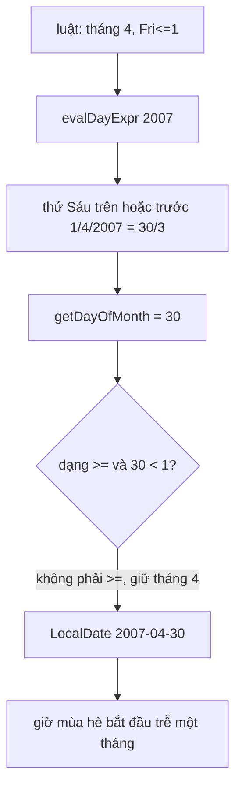

Hiển thị "đăng lúc 14:05" nghe đơn giản: lấy timestamp, cộng offset của người xem. Khó ở chỗ offset thay đổi theo ngày (giờ mùa hè), theo năm (chính phủ đổi luật), và người xem có thể đang ở múi giờ khác với múi giờ máy tính đang để.

Ngày nay `Intl.DateTimeFormat` lo gần hết việc này. Nhưng bundle của Facebook vẫn mang theo **một engine múi giờ hoàn chỉnh**: luật tzdata nén từ năm 2003, code tự tính từng lần đổi giờ, một cây quyết định để đoán tên múi giờ chỉ từ `Date`, và một đoạn tự sửa offset khi đồng hồ máy bị chỉnh tay.

Bài này đọc engine đó, tìm ra một lỗi tính ngày làm sai giờ mùa hè của Israel trong 6 năm, rồi viết lại một bản nhỏ và đối chiếu với `Intl`.

> [!TIP]
> **Tóm tắt**
> - Dữ liệu `TimezoneRulesFrom2003-tz2020a` lưu luật theo cú pháp tzdata nén: `"2005 8 4 Fri<=1 2 1"` nghĩa là từ 2005, trong 8 năm, tháng 4, thứ Sáu cuối cùng trên hoặc trước ngày 1, lúc 2:00, cộng 1 giờ. `TimezoneDatabaseUtil` biến luật thành danh sách lần đổi giờ.
> - `evalDayExpr` chỉ trả **ngày trong tháng**. Dạng `>=` tràn sang tháng sau được sửa tháng, dạng `<=` lùi về tháng trước thì không. Luật `<=` duy nhất trong dữ liệu là của Israel 2005–2012: 6/8 năm, ngày bắt đầu giờ mùa hè bị tính trễ đúng một tháng (2007: 30/4 thay vì 30/3).
> - Không có `Intl`, Facebook đoán múi giờ bằng **cây quyết định**: mỗi nút hỏi `getTimezoneOffset()` tại một thời điểm, rẽ nhánh theo câu trả lời. Lần đổi giờ của môi trường được dò bằng bước 30 ngày rồi tìm nhị phân.
> - `getBrowserGMTOffsetAdjustedForSkew` so đồng hồ máy với giờ server, làm tròn độ lệch tới 15 phút rồi cộng vào offset: máy để múi UTC nhưng chỉnh kim cho đúng giờ Hà Nội vẫn được nhận ra là UTC+7.

<iframe class="demo-frame" src="/demos/facebook-patterns/index.html?theme=dark#/tz-engine" title="Demo tz-engine" loading="lazy" style="height: 1600px"></iframe>

<p class="demo-links">▶ <a href="/demos/facebook-patterns/index.html#/tz-engine" target="_blank" rel="noopener">Mở demo toàn màn hình ↗</a> · <a href="https://stackblitz.com/github/hunghg255/blog-hunghg/tree/master/examples/facebook-patterns?file=src/lib/tzEngine.ts" target="_blank" rel="noopener">Sửa code trên StackBlitz ↗</a> · <a href="https://github.com/hunghg255/blog-hunghg/blob/master/examples/facebook-patterns/src/lib/tzEngine.ts" target="_blank" rel="noopener">Xem source trên GitHub ↗</a></p>

## Facebook làm thế nào?

### Dữ liệu: luật tzdata nén

Module `TimezoneRulesFrom2003-tz2020a` (thư mục `12.Timezone`) có `version: "2020a"`, `fromYear: 2003` và một mảng `ruleSets`, mỗi phần tử là một chuỗi các luật sáu trường. Luật của Israel:

```text
… 2004 1 4 7 1 1  2004 1 9 22 1 0
2005 8 4 Fri<=1 2 1
2005 1 10 9 2 0  2006 1 10 1 2 0  2007 1 9 16 2 0  …  2012 1 9 23 2 0
2013 - 3 Fri>=23 2 1  2013 - 10 lastSun 2 0
```

Sáu trường là: năm bắt đầu, số năm (`-` là mãi mãi), tháng, biểu thức ngày, giờ, phần cộng thêm (giờ). Biểu thức ngày có bốn dạng giống hệt tzdata: số (`15`), `lastSun`, `Sun>=8`, `Fri<=1`. `LazyTimezoneDatabase` nạp module dữ liệu theo `fromYear` và `version`, nên trang chỉ cần luật từ 2003 không phải tải cả lịch sử từ 1970.

### TimezoneDatabaseUtil: từ luật ra lần đổi giờ

Module này (trong `32.js`) có các hàm `parseOffset`, `parseDayExpr`, `evalDayExpr`, `getActiveRules`, `generateTransitionForRule`, `restrictTransitions`, `compactifyTransitions`. Hai hàm quan trọng nhất:

```js
function evalDayExpr(expr, year, month) {
  if (expr.dayOfMonth != null) return expr.dayOfMonth;
  if (expr.lastDayOfWeek != null) { /* … */ }
  if (expr.beforeOrOn != null) {
    const d = LocalDate.create(year, month, expr.beforeOrOn).addDays(1);
    const k = mod(expr.dayOfWeek - d.getDayOfWeek(), 7);
    return d.addDays(k - 7).getDayOfMonth();     // ← chỉ trả ngày trong tháng
  }
  if (expr.afterOrOn != null) { /* … */ return d.addDays(k).getDayOfMonth(); }
}

// getActiveRules
let day = evalDayExpr(rule.day, y, rule.month), month = rule.month;
rule.day.afterOrOn != null && day < rule.day.afterOrOn && month++;  // sửa tháng cho ">="
const utcMidnight = LocalDate.create(y, month, day).toInstant(Timezone.UTC);
```

Sau đó `generateTransitionForRule` đổi "2:00 giờ địa phương" ra UTC tuỳ kiểu giờ của luật. Với giờ địa phương (`wall`), nó lấy thời điểm **một giây trước** lần đổi, đổi ra UTC theo các lần đổi đã có, rồi cộng lại một giây: `getParallelUsingTransitions(e + time - 1) + 1`. Mẹo này tránh được giờ mơ hồ ngay tại lúc đổi. Cuối cùng `compactifyTransitions` bỏ các lần "đổi" mà offset không đổi.

### Bên trong: lỗi "Fri&lt;=1"



`evalDayExpr` tính đúng ngày (30/3/2007) nhưng chỉ trả về số `30`. `getActiveRules` chỉ sửa tháng khi luật là dạng `>=` và ngày tràn sang tháng sau. Dạng `<=` lùi sang tháng trước thì tháng vẫn là 4, nên lần đổi giờ thành 30/4.

Tìm trong cả file dữ liệu, `<=` chỉ xuất hiện đúng một lần: luật Israel 2005–2012. Năm nào 1/4 là thứ Sáu (2005, 2011) thì không sao. Sáu năm còn lại bị lệch:

| Năm | Đúng (tzdata) | Theo cách tính trên |
| --- | --- | --- |
| 2006 | 31/3 | 31/4, có lẽ thành 1/5 khi đổi ra instant |
| 2007 | 30/3 | 30/4 |
| 2008 | 28/3 | 28/4 |
| 2009 | 27/3 | 27/4 |
| 2010 | 26/3 | 26/4 |
| 2012 | 30/3 | 30/4 |

Bảng này có được bằng cách port `evalDayExpr` và `getActiveRules` sang TypeScript (phần 1 của demo), giả định `LocalDate` đổi ngày không hợp lệ bằng cách tràn như `Date.UTC`. Ảnh hưởng thực tế có lẽ nhỏ: chỉ các timestamp cũ ở Israel trong khoảng một tháng mỗi năm đó, và chỉ khi trang dùng engine này thay vì `Intl`. Nhưng đây là kiểu lỗi chỉ lộ ra khi đối chiếu với một nguồn độc lập.

### Đoán múi giờ không cần Intl

Module `Timezone` (cùng thư mục) lấy tên múi giờ theo thứ tự: tên từ `Intl.DateTimeFormat().resolvedOptions().timeZone` (sau một gatekeeper), nếu không có thì đi cây quyết định:

```js
var j = function (a) { return new Date(1e3 * a).getTimezoneOffset() * -60; };
function t() { return TimezoneUtil.determineTimezoneID(EnvironmentTimezoneDecisionTree, j) || i; }
```

Cây `EnvironmentTimezoneDecisionTree-tz2020a` là object lồng nhau:

```js
{ instant: 1132117200,                 // 16/11/2005
  0:     { instant: 1531536300, 0: { timezone: 0 }, 3600: { … }, 7200: { timezone: 300 } },
  10800: { instant: 1087737300, … },
  … }
```

`determineTimezoneID` hỏi offset tại `instant`, đi vào nhánh có khoá bằng câu trả lời, lặp tới khi gặp lá `{timezone: id}`. Vài câu hỏi là đủ phân biệt hàng trăm múi giờ.

Khi không có luật cho múi giờ của môi trường, `extractTimezoneTransitions` dò từ 2004 tới 2107 với bước 30 ngày. Thấy offset hai đầu bước khác nhau thì tìm nhị phân tới đúng giây đổi giờ. Đó là cách lấy được lịch đổi giờ của máy chỉ bằng `Date`.

### Bù đồng hồ bị chỉnh tay

`CometTimezoneUpdater` chạy khi trang tải. Server nhúng sẵn `server_time`, `server_gmt_offset` và `timezone` đã lưu của người dùng:

```js
e = -getBrowserGMTOffsetAdjustedForSkew(server_time);
var f = killswitch("TIMEZONE_SET_IANA_ZONE_NAME") ? null : getBrowserTimezone();
(force_update === true || e !== server_gmt_offset || (f != null && f !== timezone)) &&
  cometAsyncFetch("/ajax/timezone/update.php", { data: { gmt_off: e, is_forced: force_update, tz: f }, method: "POST" });
```

Còn `getBrowserGMTOffsetAdjustedForSkew` (trong `278.js`) làm phép tính:

```js
var skew = serverTime - Date.now() / 1000;
var rounded = Math.round(skew / (15 * 60)) * 15;        // phút, bội số của 15
var c = Math.round(new Date().getTimezoneOffset() + rounded) % (24 * 60);
c > 12 * 60 ? c -= 24 * 60 : c < -14 * 60 && (c += 24 * 60);
```

Lý do: nhiều người để máy ở múi giờ sai (UTC, hoặc múi giờ của nơi mua máy) rồi **chỉnh kim đồng hồ** cho khớp giờ địa phương. Offset máy báo là sai, nhưng độ lệch giữa đồng hồ máy và server cho biết offset thật. Làm tròn 15 phút vì mọi offset trên thế giới đều là bội số của 15 phút (Nepal +5:45, Chatham +12:45), và vì đồng hồ máy vốn đã lệch vài giây tới vài phút.

## Viết lại

Tất cả trong `src/lib/tzEngine.ts`. Hàm tính ngày trả **ngày đầy đủ**, để `Date.UTC` lo phần tràn tháng theo cả hai chiều:

```ts title=src/lib/tzEngine.ts
/** Ngày thật của biểu thức trong (năm, tháng). Kết quả có thể nằm ở tháng trước/sau. */
export function resolveDay(expr: DayExpr, year: number, month: number): YMD {
  let day: number;
  switch (expr.kind) {
    case 'dom':
      day = expr.day;
      break;
    case 'last': {
      const lastDay = new Date(Date.UTC(year, month, 0)).getUTCDate();
      day = lastDay - mod(dowOf(year, month, lastDay) - expr.dow, 7);
      break;
    }
    case '>=':
      day = expr.day + mod(expr.dow - dowOf(year, month, expr.day), 7);
      break;
    case '<=':
      day = expr.day - mod(dowOf(year, month, expr.day) - expr.dow, 7);
      break;
  }
  // Date.UTC tự tràn: ngày 0 = cuối tháng trước, ngày 32 = đầu tháng sau
  const d = new Date(Date.UTC(year, month - 1, day));
  return { year: d.getUTCFullYear(), month: d.getUTCMonth() + 1, day: d.getUTCDate() };
}
```

Tính lần đổi giờ theo thứ tự thời gian, mang theo phần DST đang bật để đổi giờ địa phương ra UTC:

```ts title=src/lib/tzEngine.ts
/** Mọi lần chuyển giờ trong [fromYear, toYear], tính tuần tự để biết DST đang bật trước mỗi lần. */
export function transitions(zone: Zone, fromYear: number, toYear: number, resolve: DayResolver = resolveDay) {
  const items: { local: YMD; localMs: number; r: Rule }[] = [];
  for (let y = fromYear - 1; y <= toYear; y++) {
    for (const r of zone.rules) {
      if (y < r.from || y > r.to) continue;
      const local = resolve(r.day, y, r.month);
      items.push({ local, localMs: Date.UTC(local.year, local.month - 1, local.day) + r.at * 1000, r });
    }
  }
  items.sort((a, b) => a.localMs - b.localMs);
  const out: Transition[] = [];
  let save = 0;
  for (const { local, localMs, r } of items) {
    const shift = r.atType === 'u' ? 0 : r.atType === 's' ? zone.std : zone.std + save;
    const at = localMs - shift * 1000;
    save = r.save;
    if (local.year >= fromYear) out.push({ at, offset: zone.std + save, save, local });
  }
  return out;
}
```

Phần dò lần đổi giờ (`extractTransitions`) và cây quyết định (`buildTzTree`, `guessZone`) nằm cuối file:

::: spoiler Xem toàn bộ src/lib/tzEngine.ts

```ts title=src/lib/tzEngine.ts
/**
 * Engine múi giờ nhỏ chạy trên client (ý tưởng từ TimezoneDatabaseUtil, TimezoneUtil và CometTimezoneUpdater của Facebook).
 *
 * Luật DST viết theo cú pháp tzdata: "2005 2012 Apr Fri<=1 2:00 1:00" nghĩa là từ 2005 tới 2012,
 * tháng 4, thứ Sáu cuối cùng trên hoặc trước ngày 1, lúc 2:00 giờ địa phương, cộng thêm 1 giờ.
 *
 * Khác bản gốc: hàm tính ngày trả về NGÀY ĐẦY ĐỦ (năm, tháng, ngày) thay vì chỉ "ngày trong tháng",
 * nên "Fri<=1" rơi sang tháng trước vẫn đúng. Bản gốc chỉ sửa tháng cho dạng ">=".
 * Mỗi múi giờ chỉ có một "era" (một offset chuẩn) để ví dụ gọn.
 */

const DAYS = ['Sun', 'Mon', 'Tue', 'Wed', 'Thu', 'Fri', 'Sat'];
const MONTHS = ['Jan', 'Feb', 'Mar', 'Apr', 'May', 'Jun', 'Jul', 'Aug', 'Sep', 'Oct', 'Nov', 'Dec'];
const mod = (a: number, n: number) => ((a % n) + n) % n;

/** "+5:30" → 19800 giây; "-3" → -10800; "2:00" → 7200 */
export function parseOffset(text: string): number {
  const m = /^([+-]?)(\d+)(?::(\d+))?(?::(\d+))?$/.exec(text.trim());
  if (!m) throw new SyntaxError(`Offset không hợp lệ: ${text}`);
  const sign = m[1] === '-' ? -1 : 1;
  return sign * (+m[2] * 3600 + +(m[3] ?? 0) * 60 + +(m[4] ?? 0));
}

export type DayExpr =
  | { kind: 'dom'; day: number }
  | { kind: 'last'; dow: number }
  | { kind: '>=' | '<='; dow: number; day: number };

export function parseDayExpr(text: string): DayExpr {
  let m: RegExpExecArray | null;
  if ((m = /^(\w{3})(>=|<=)(\d+)$/.exec(text)) && DAYS.includes(m[1])) {
    return { kind: m[2] as '>=' | '<=', dow: DAYS.indexOf(m[1]), day: +m[3] };
  }
  if ((m = /^last(\w{3})$/.exec(text)) && DAYS.includes(m[1])) return { kind: 'last', dow: DAYS.indexOf(m[1]) };
  if (/^\d+$/.test(text)) return { kind: 'dom', day: +text };
  throw new SyntaxError(`Biểu thức ngày không hợp lệ: ${text}`);
}

export interface YMD {
  year: number;
  month: number; // 1–12
  day: number;
}

const dowOf = (y: number, m: number, d: number) => new Date(Date.UTC(y, m - 1, d)).getUTCDay();

/** Ngày thật của biểu thức trong (năm, tháng). Kết quả có thể nằm ở tháng trước/sau. */
export function resolveDay(expr: DayExpr, year: number, month: number): YMD {
  let day: number;
  switch (expr.kind) {
    case 'dom':
      day = expr.day;
      break;
    case 'last': {
      const lastDay = new Date(Date.UTC(year, month, 0)).getUTCDate();
      day = lastDay - mod(dowOf(year, month, lastDay) - expr.dow, 7);
      break;
    }
    case '>=':
      day = expr.day + mod(expr.dow - dowOf(year, month, expr.day), 7);
      break;
    case '<=':
      day = expr.day - mod(dowOf(year, month, expr.day) - expr.dow, 7);
      break;
  }
  // Date.UTC tự tràn: ngày 0 = cuối tháng trước, ngày 32 = đầu tháng sau
  const d = new Date(Date.UTC(year, month - 1, day));
  return { year: d.getUTCFullYear(), month: d.getUTCMonth() + 1, day: d.getUTCDate() };
}

export type DayResolver = (expr: DayExpr, year: number, month: number) => YMD;

export interface Rule {
  from: number;
  to: number;
  month: number;
  day: DayExpr;
  /** giây kể từ nửa đêm */
  at: number;
  /** 'w' giờ địa phương đang chạy, 's' giờ chuẩn (bỏ DST), 'u' UTC */
  atType: 'w' | 's' | 'u';
  save: number;
}

/** Đọc một dòng luật kiểu tzdata: "FROM TO MON DAY AT SAVE" (TO có thể là only/max). */
export function rule(line: string): Rule {
  const [from, to, mon, day, at, save] = line.trim().split(/\s+/);
  const atType = /[us]$/.test(at) ? (at.slice(-1) as 'u' | 's') : 'w';
  return {
    from: +from,
    to: to === 'only' ? +from : to === 'max' ? 9999 : +to,
    month: MONTHS.indexOf(mon) + 1,
    day: parseDayExpr(day),
    at: parseOffset(at.replace(/[usw]$/, '')),
    atType,
    save: parseOffset(save),
  };
}

export interface Zone {
  name: string;
  std: number; // offset chuẩn, giây
  rules: Rule[];
}

export interface Transition {
  at: number; // ms UTC
  offset: number; // giây, sau chuyển
  save: number;
  local: YMD;
}

/** Mọi lần chuyển giờ trong [fromYear, toYear], tính tuần tự để biết DST đang bật trước mỗi lần. */
export function transitions(zone: Zone, fromYear: number, toYear: number, resolve: DayResolver = resolveDay) {
  const items: { local: YMD; localMs: number; r: Rule }[] = [];
  for (let y = fromYear - 1; y <= toYear; y++) {
    for (const r of zone.rules) {
      if (y < r.from || y > r.to) continue;
      const local = resolve(r.day, y, r.month);
      items.push({ local, localMs: Date.UTC(local.year, local.month - 1, local.day) + r.at * 1000, r });
    }
  }
  items.sort((a, b) => a.localMs - b.localMs);
  const out: Transition[] = [];
  let save = 0;
  for (const { local, localMs, r } of items) {
    const shift = r.atType === 'u' ? 0 : r.atType === 's' ? zone.std : zone.std + save;
    const at = localMs - shift * 1000;
    save = r.save;
    if (local.year >= fromYear) out.push({ at, offset: zone.std + save, save, local });
  }
  return out;
}

/** Offset (giây) đang áp dụng tại thời điểm UTC `ms`. */
export function offsetAt(zone: Zone, ms: number, resolve: DayResolver = resolveDay): number {
  const y = new Date(ms).getUTCFullYear();
  const list = transitions(zone, y - 1, y, resolve);
  let offset = zone.std;
  for (const t of list) if (t.at <= ms) offset = t.offset;
  return offset;
}

// ---------------- dữ liệu mẫu (rút gọn từ tzdata) ----------------

const ISRAEL_END: [number, string, string][] = [
  [2005, 'Oct', '9'],
  [2006, 'Oct', '1'],
  [2007, 'Sep', '16'],
  [2008, 'Oct', '5'],
  [2009, 'Sep', '27'],
  [2010, 'Sep', '12'],
  [2011, 'Oct', '2'],
  [2012, 'Sep', '23'],
];

export const ZONES: Record<string, Zone> = {
  'Asia/Jerusalem': {
    name: 'Asia/Jerusalem',
    std: 7200,
    rules: [
      rule('2005 2012 Apr Fri<=1 2:00 1:00'),
      ...ISRAEL_END.map(([y, m, d]) => rule(`${y} only ${m} ${d} 2:00 0`)),
      rule('2013 max Mar Fri>=23 2:00 1:00'),
      rule('2013 max Oct lastSun 2:00 0'),
    ],
  },
  'America/New_York': {
    name: 'America/New_York',
    std: -18000,
    rules: [rule('2007 max Mar Sun>=8 2:00 1:00'), rule('2007 max Nov Sun>=1 2:00 0')],
  },
  'Europe/Berlin': {
    name: 'Europe/Berlin',
    std: 3600,
    rules: [rule('1996 max Mar lastSun 1:00u 1:00'), rule('1996 max Oct lastSun 1:00u 0')],
  },
  'Australia/Sydney': {
    name: 'Australia/Sydney',
    std: 36000,
    rules: [rule('2008 max Apr Sun>=1 2:00s 0'), rule('2008 max Oct Sun>=1 2:00s 1:00')],
  },
  'Asia/Ho_Chi_Minh': { name: 'Asia/Ho_Chi_Minh', std: 25200, rules: [] },
};

// ---------------- so với trình duyệt ----------------

/** Offset (giây) theo dữ liệu tz có sẵn trong trình duyệt, để đối chiếu. */
const formatters = new Map<string, Intl.DateTimeFormat>();
export function intlOffset(timeZone: string, ms: number): number {
  let f = formatters.get(timeZone);
  if (!f) formatters.set(timeZone, (f = new Intl.DateTimeFormat('en-US', { timeZone, timeZoneName: 'longOffset' })));
  const name = f
    .formatToParts(ms)
    .find((p) => p.type === 'timeZoneName')?.value;
  const m = /GMT([+-])(\d{2}):(\d{2})/.exec(name ?? '');
  return m ? (m[1] === '-' ? -1 : 1) * (+m[2] * 3600 + +m[3] * 60) : 0;
}

export const formatOffset = (sec: number) => {
  const sign = sec < 0 ? '-' : '+';
  const a = Math.abs(sec);
  return `UTC${sign}${Math.floor(a / 3600)}${a % 3600 ? ':' + String((a % 3600) / 60).padStart(2, '0') : ''}`;
};

/** Tên IANA của trình duyệt, null nếu không có Intl (bản gốc cũng bọc try/catch). */
export function browserTimeZone(): string | null {
  try {
    return Intl.DateTimeFormat().resolvedOptions().timeZone || null;
  } catch {
    return null;
  }
}

/**
 * Offset thật của người dùng (phút, dương = phía đông UTC) khi đồng hồ máy có thể bị chỉnh tay.
 * Máy để múi UTC nhưng chỉnh kim cho khớp giờ Hà Nội thì đồng hồ "nhanh" 7 giờ so với server:
 * lấy độ lệch đó, làm tròn 15 phút, cộng vào offset trình duyệt báo.
 */
export function effectiveOffsetMinutes(serverMs: number, clientMs: number, browserOffsetMin: number): number {
  const skew = Math.round((clientMs - serverMs) / 60_000 / 15) * 15;
  let off = (browserOffsetMin + skew) % (24 * 60);
  // hợp lệ từ UTC-12 tới UTC+14 (Kiribati), ngoài khoảng đó thì quay vòng 24 giờ
  if (off < -12 * 60) off += 24 * 60;
  else if (off > 14 * 60) off -= 24 * 60;
  return off;
}

// ---------------- dò và đoán múi giờ từ môi trường ----------------

export type OffsetProbe = (ms: number) => number;

/**
 * Dò các lần đổi giờ chỉ bằng một hàm "offset tại thời điểm t" (Date.getTimezoneOffset hay Intl):
 * bước nhảy thô `step`, thấy offset khác thì tìm nhị phân tới đúng mili giây (như extractTimezoneTransitions).
 */
export function extractTransitions(probe: OffsetProbe, startMs: number, endMs: number, step = 7 * 86_400_000) {
  const out: { at: number; offset: number }[] = [];
  let prev = probe(startMs);
  for (let t = startMs; t < endMs; t += step) {
    const next = probe(t + step);
    if (next === prev) continue;
    let lo = t; // probe(lo) === prev
    let hi = t + step; // probe(hi) === next
    while (hi - lo > 1) {
      const mid = Math.floor((lo + hi) / 2);
      if (probe(mid) === prev) lo = mid;
      else hi = mid;
    }
    if (hi < endMs) out.push({ at: hi, offset: next });
    prev = next;
  }
  return out;
}

/** Cây quyết định: hỏi offset tại `at`, rẽ nhánh theo kết quả; lá là nhóm múi giờ không phân biệt được. */
export type TzTree = { at: number; branches: Record<string, TzTree> } | { zones: string[] };

export function buildTzTree(zones: string[], probes: number[], offset: (zone: string, ms: number) => number): TzTree {
  const table = new Map(zones.map((z) => [z, probes.map((t) => offset(z, t))]));
  const grow = (ids: string[]): TzTree => {
    let best = -1;
    let bestWorst = ids.length;
    probes.forEach((_, i) => {
      const sizes = new Map<number, number>();
      for (const z of ids) sizes.set(table.get(z)![i], (sizes.get(table.get(z)![i]) ?? 0) + 1);
      const worst = Math.max(...sizes.values()); // nhóm lớn nhất sau khi hỏi câu này
      if (worst < bestWorst) [best, bestWorst] = [i, worst];
    });
    if (best < 0) return { zones: ids }; // không câu hỏi nào tách được nữa
    const groups: Record<string, string[]> = {};
    for (const z of ids) (groups[table.get(z)![best]] ??= []).push(z);
    const branches: Record<string, TzTree> = {};
    for (const [k, g] of Object.entries(groups)) branches[k] = grow(g);
    return { at: probes[best], branches };
  };
  return grow(zones);
}

export function guessZone(tree: TzTree, probe: OffsetProbe): { zones: string[]; questions: number } {
  let questions = 0;
  while ('at' in tree) {
    const next = tree.branches[String(probe(tree.at))];
    questions++;
    if (!next) return { zones: [], questions };
    tree = next;
  }
  return { zones: tree.zones, questions };
}
```

:::

**Khác bản gốc:**

- `resolveDay` trả `{year, month, day}` nên `<=`, `>=` và `last` đều đúng khi rơi sang tháng khác. Không cần sửa tháng ở nơi gọi.
- Luật được viết bằng cú pháp tzdata gốc (`rule('2005 2012 Apr Fri<=1 2:00 1:00')`), dễ đối chiếu với file `asia` của tzdata.
- Mỗi múi giờ chỉ có một offset chuẩn, không có "era" như bản gốc. Đủ cho các múi giờ không đổi offset chuẩn trong khoảng thời gian quan tâm.
- `buildTzTree` dựng cây từ chính dữ liệu `Intl` của trình duyệt (chọn câu hỏi làm nhóm lớn nhất còn lại nhỏ nhất), thay vì nhúng cây dựng sẵn. Lá là **nhóm** múi giờ không phân biệt được, không phải một ID.
- `effectiveOffsetMinutes` nhận đồng hồ server/client làm tham số và trả offset dương về phía đông, cùng chiều với cách người ta viết "UTC+7".

## Đi qua code

- `resolveDay` cho `<=`: lấy thứ của ngày mốc, lùi `mod(thứ mốc − thứ cần, 7)` ngày. Kết quả có thể là ngày 0 hoặc âm, `Date.UTC(2007, 3, 0)` tự hiểu là 31/3.
- `transitions` lấy luật của cả năm trước `fromYear` để biết DST đang bật hay tắt ở đầu khoảng (cần cho Nam bán cầu: Sydney đầu năm đang ở giờ mùa hè). Sắp xếp theo giờ địa phương rồi đi một lượt, mỗi lần đổi dùng `save` của lần trước để đổi giờ `w` ra UTC.
- Hậu tố `u` (UTC) và `s` (giờ chuẩn) đi theo tzdata: châu Âu đổi lúc `1:00u` cho mọi nước cùng lúc, Sydney đổi lúc `2:00s`.
- `offsetAt` tính lần đổi giờ của năm đó và năm trước, lấy lần cuối cùng không sau `ms`.
- `extractTransitions` bước 7 ngày (không lần đổi giờ nào gần nhau hơn thế), mỗi lần thấy offset khác thì tìm nhị phân giữa hai đầu bước: khoảng 30 lần gọi `probe` cho mỗi lần đổi.
- `buildTzTree` dựng sẵn bảng offset của mọi múi giờ tại mọi mốc, rồi đệ quy: mỗi tầng chọn mốc chia nhóm tốt nhất. Với 418 múi giờ của Chromium/Node và 192 mốc (ngày 1 và 15 mỗi tháng 2020–2027), cây sâu tối đa 4 tầng, dựng mất khoảng 300 ms.

Đối chiếu: với năm múi giờ mẫu (Jerusalem, New York, Berlin, Sydney, Hồ Chí Minh), `offsetAt` khớp `Intl` ở 157.780 thời điểm cách nhau 5 giờ từ 2009 tới 2026, và mọi lần đổi giờ 2024–2026 khớp tới từng giây.

## Tại sao không làm cách khác?

- **Chỉ dùng `Intl`**: đây là lựa chọn đúng cho dự án mới. Có lẽ Facebook giữ engine riêng vì nó có từ trước khi `Intl` có `timeZone` trên mọi trình duyệt, và vì họ cần **cùng một phiên bản tzdata** ở client và server (server định dạng sẵn một phần giờ trong HTML, client phải ra cùng kết quả). Trình duyệt cập nhật tzdata theo lịch riêng.
- **`getTimezoneOffset()` một lần**: chỉ cho offset hiện tại. Lưu offset đó lên server rồi dùng cho mọi timestamp là sai với mọi thời điểm bên kia lần đổi giờ.
- **Thư viện như moment-timezone**: dữ liệu đầy đủ nặng hàng trăm KB. Facebook cắt dữ liệu theo năm (`fromYear`) và nạp lười.
- **Tin offset máy báo**: sai với người chỉnh kim đồng hồ. Tin giờ server và bỏ qua offset máy cũng sai, vì không biết người dùng ở đâu. Kết hợp hai nguồn như `getBrowserGMTOffsetAdjustedForSkew` là cách rẻ mà hiệu quả.

## Edge case và cạm bẫy

- **Giờ không tồn tại và giờ lặp.** 2:30 sáng 29/3/2026 không có ở Berlin, 2:30 sáng 25/10/2026 có hai lần. Đổi "giờ địa phương" ra UTC phải chọn một quy ước (Temporal gọi là `disambiguation: 'compatible' | 'earlier' | 'later' | 'reject'`).
- **Offset không tròn giờ**: +5:30 (Ấn Độ), +5:45 (Nepal), −3:30 (Newfoundland). Đừng lưu offset bằng số giờ nguyên.
- **Chính phủ đổi luật.** Dữ liệu `tz2020a` không biết các thay đổi sau đó. Dữ liệu nhúng sẵn cần cập nhật như một dependency.
- **Làm tròn 15 phút** nghĩa là đồng hồ lệch 8 phút sẽ bị coi là lệch 15 phút. Ngưỡng đó vẫn hợp lý: đồng hồ lệch 8 phút thì cũng nên báo người dùng.
- **Cây quyết định nhận diện "hành vi", không phải tên.** Hai múi giờ có cùng offset ở mọi mốc hỏi sẽ nằm chung lá. Berlin nằm chung nhóm với 32 múi giờ châu Âu khác, và từ 2020 tới nay chúng đúng là giống nhau. Muốn phân biệt Jerusalem với Athens thì cần mốc rơi đúng vào mấy ngày lệch nhau quanh cuối tháng 3.

## Dùng trong dự án

Đồng bộ múi giờ người dùng lên server khi trang tải, giống `CometTimezoneUpdater`:

```ts
const { serverTime, savedOffsetMin, savedZone } = window.__BOOT__;
const offset = effectiveOffsetMinutes(serverTime, Date.now(), -new Date().getTimezoneOffset());
const zone = browserTimeZone();
if (offset !== savedOffsetMin || (zone && zone !== savedZone)) {
  navigator.sendBeacon('/api/timezone', JSON.stringify({ offset, zone }));
}
```

Định dạng giờ thì dùng `Intl`, chỉ dùng engine tự viết khi cần chạy ở nơi không có `Intl` đầy đủ hoặc cần khớp tzdata với server:

```ts
new Intl.DateTimeFormat('vi-VN', { timeZone: user.zone, dateStyle: 'medium', timeStyle: 'short' }).format(post.createdAt);
```

## Kiểm thử

::: spoiler Ví dụ test (bản phác, không có trong repo)

```ts
import { describe, expect, it } from 'vitest';
import {
  ZONES,
  buildTzTree,
  effectiveOffsetMinutes,
  extractTransitions,
  guessZone,
  intlOffset,
  offsetAt,
  parseDayExpr,
  parseOffset,
  resolveDay,
  transitions,
} from '../src/lib/tzEngine';

describe('tzEngine', () => {
  it('parse offset và biểu thức ngày', () => {
    expect(parseOffset('+5:30')).toBe(19800);
    expect(parseOffset('-3')).toBe(-10800);
    expect(parseDayExpr('Fri<=1')).toEqual({ kind: '<=', dow: 5, day: 1 });
    expect(parseDayExpr('lastSun')).toEqual({ kind: 'last', dow: 0 });
  });

  it('Fri<=1 tháng 4/2007 là 30/3', () => {
    expect(resolveDay(parseDayExpr('Fri<=1'), 2007, 4)).toEqual({ year: 2007, month: 3, day: 30 });
    expect(resolveDay(parseDayExpr('Sun>=29'), 2026, 2)).toEqual({ year: 2026, month: 3, day: 1 });
  });

  it('khớp Intl ở mọi lần đổi giờ 2024–2026', () => {
    for (const [name, zone] of Object.entries(ZONES)) {
      for (const t of transitions(zone, 2024, 2026)) {
        expect(intlOffset(name, t.at)).toBe(t.offset);
        expect(intlOffset(name, t.at - 1000)).not.toBe(t.offset);
      }
    }
  });

  it('Israel 2007: 15/4 đã là UTC+3', () => {
    expect(offsetAt(ZONES['Asia/Jerusalem'], Date.UTC(2007, 3, 15, 12))).toBe(3 * 3600);
  });

  it('dò lần đổi giờ bằng tìm nhị phân', () => {
    const r = extractTransitions((ms) => intlOffset('Europe/Berlin', ms), Date.UTC(2026, 0, 1), Date.UTC(2027, 0, 1));
    expect(r.map((x) => new Date(x.at).toISOString())).toEqual(['2026-03-29T01:00:00.000Z', '2026-10-25T01:00:00.000Z']);
  });

  it('cây quyết định đưa New York về nhóm có New York', () => {
    const probes = Array.from({ length: 48 }, (_, i) => Date.UTC(2024 + Math.floor(i / 24), (i % 24) >> 1, i % 2 ? 15 : 1));
    const zones = ['America/New_York', 'America/Chicago', 'Europe/Berlin', 'Asia/Ho_Chi_Minh', 'Australia/Sydney'];
    const tree = buildTzTree(zones, probes, intlOffset);
    expect(guessZone(tree, (ms) => intlOffset('America/New_York', ms)).zones).toEqual(['America/New_York']);
  });

  it('bù đồng hồ chỉnh tay, làm tròn 15 phút', () => {
    expect(effectiveOffsetMinutes(0, 7 * 3600_000, 0)).toBe(420);
    expect(effectiveOffsetMinutes(0, 7 * 3600_000 + 90_000, 0)).toBe(420);
    expect(effectiveOffsetMinutes(0, 3 * 3600_000, 13 * 60)).toBe(-8 * 60); // UTC+16 quay vòng
  });
});
```

:::

## So với thư viện và chuẩn web

- **`Intl.DateTimeFormat`** với `timeZone` và `timeZoneName: 'longOffset'` cho offset của bất kỳ múi giờ IANA nào tại bất kỳ thời điểm nào. `Intl.supportedValuesOf('timeZone')` liệt kê các múi giờ trình duyệt biết.
- **Temporal**: `Temporal.ZonedDateTime` gói một thời điểm cùng múi giờ, tự xử lý giờ không tồn tại và giờ lặp; `zdt.getTimeZoneTransition('next')` trả lần đổi giờ kế tiếp, đúng việc `extractTransitions` làm. Temporal đã có trên Firefox và Chromium, Safari đang triển khai (tính tới 10/2026).
- **tzdata** (IANA) là nguồn gốc của mọi thứ ở trên. File `asia` có đúng dòng `Rule Zion 2005 2012 - Apr Fri<=1 2:00 1:00 D`.
- **jstz** và các thư viện đoán múi giờ cũ dùng ý tưởng giống cây quyết định: hỏi offset ở vài ngày mốc. Ngày nay `resolvedOptions().timeZone` thay được gần hết, trừ khi người dùng chỉnh kim đồng hồ.

---

Bài này thuộc series **[Học từ mã nguồn Facebook](/series/facebook)** (106 bài, đọc theo thứ tự).

::: spoiler Xem nhanh danh sách bài trong series

*Phần 1*

- [Mở đầu: cách đọc code minify của Facebook](/blogs/learn-from-facebook-source-code)
- [#1 Dùng chung IntersectionObserver + infinite scroll](/blogs/facebook-shared-intersection-observer)
- [#2 useViewportDuration: đo thời gian thực sự được xem](/blogs/facebook-use-viewport-duration)
- [#3 Preload code + data khi hover](/blogs/facebook-preload-on-hover)
- [#4 Toast manager với external store](/blogs/facebook-toast-manager)
- [#5 Network status + heartbeat backoff](/blogs/facebook-network-status-heartbeat)
- [#6 ErrorGuard: bắt lỗi theo ngữ cảnh](/blogs/facebook-error-guard)
- [#7 Banzai: gom log theo lô + sendBeacon](/blogs/facebook-batch-logger)
- [#8 Focus trap + Esc theo layer](/blogs/facebook-focus-trap)

*Phần 2*

- [#9 Mẹo calc(… * 9999): container query, line-clamp, mũi tên carousel bằng CSS](/blogs/facebook-css-9999-trick)
- [#10 Thanh cuộn tuỳ biến bằng CSS 3D](/blogs/facebook-css-3d-scrollbar)
- [#11 Modal cuộn bằng window, giữ vị trí trang nền](/blogs/facebook-document-scroll-modal)
- [#12 Popover, tooltip group và hovercard](/blogs/facebook-popover-tooltip)
- [#13 Primitive Pressable + focus-visible](/blogs/facebook-pressable)
- [#14 Tab "Xem thêm" + sticky header bằng IntersectionObserver](/blogs/facebook-priority-tabs-sticky-header)
- [#15 Avatar khoét mask, gradient Messenger, skeleton steps()](/blogs/facebook-visual-tricks)
- [#16 Khung chat không giật](/blogs/facebook-chat-scroller)
- [#17 Thuật toán chọn bố cục collage ảnh](/blogs/facebook-photo-collage-layout)
- [#18 Keep-alive tab trong SPA](/blogs/facebook-keep-alive-tabs)
- [#19 Tự đo Visual Completion & interaction tracing](/blogs/facebook-visual-completion)
- [#20 Router SPA bền bỉ & tải chunk có retry](/blogs/facebook-spa-router-resilient-loading)

*Phần 3*

- [#21 Smart Compose: gợi ý chữ mờ khi gõ](/blogs/facebook-smart-compose-ghost-text)
- [#22 MQTT ngay trong trình duyệt, tự chuyển sang long-poll](/blogs/facebook-mqtt-in-browser)
- [#23 Đo thời gian dùng bằng bitmap 64 giây](/blogs/facebook-time-spent-bitmap)
- [#24 Bảng reaction nhấn giữ rồi trượt](/blogs/facebook-reaction-press-slide)
- [#25 Tìm kiếm gấp dấu, phiên âm và highlight đầu từ](/blogs/facebook-search-diacritics-tokenize)
- [#26 Ring buffer biết trace nào đã mất log](/blogs/facebook-trace-ring-buffer)
- [#27 Engine animation JS: một vòng rAF và solver cubic-bezier](/blogs/facebook-keyframes-loop-cubic-bezier)
- [#28 Bootloader: bitmap tài nguyên đã tải, chỉ reload khi cần](/blogs/facebook-bootloader-bitmap-consistency)
- [#29 Nhận biết click do screen reader tạo ra](/blogs/facebook-virtual-cursor-detection)
- [#30 Tải trước feed theo chất lượng mạng, đoán hạng thiết bị](/blogs/facebook-network-aware-prefetch)
- [#31 Hàng đợi gửi tin chat giữ đúng thứ tự](/blogs/facebook-ordered-send-queue)
- [#32 Gộp lời gọi API trong cùng một tick](/blogs/facebook-api-batcher)
- [#33 Resize ảnh trong pool Web Worker](/blogs/facebook-jpeg-resize-worker-pool)
- [#34 Crop ảnh theo nhiều khuôn mặt](/blogs/facebook-face-aware-crop)
- [#35 Kéo-thả sắp xếp và vùng thả file không nhấp nháy](/blogs/facebook-flicker-free-drag-drop)
- [#36 Tiện ích UI: fade-out, sticky event, hàm huỷ được](/blogs/facebook-ui-utility-hooks)
- [#37 Hạ tầng nhỏ: cookie, hash lỗi, prefetch khi chuột dừng](/blogs/facebook-small-infra-cookie-hash-idle)

*Phần 4–6*

- [#38 Đồng bộ tin nhắn: phát hiện lỗ seqID và fetch bù theo tầng](/blogs/facebook-messenger-sync-seqid-gaps)
- [#39 OTID: ID tin nhắn kiểu Snowflake sinh ở client](/blogs/facebook-otid-client-snowflake)
- [#40 QPL: lấy mẫu từ lúc bắt đầu, đo RTT gửi tin đầu-cuối](/blogs/facebook-qpl-send-rtt)
- [#41 Bộ điều phối request bảy chế độ gộp và chống trùng](/blogs/facebook-request-dispatcher-modes)
- [#42 Thread list theo mốc thời gian, cookie presence có version](/blogs/facebook-threadlist-ranged-presence)
- [#43 Composer dạng plugin: reducer, dirty checker, chuỗi kiểm tra](/blogs/facebook-plugin-composer)
- [#44 Thanh toán bất đồng bộ: subscribe trước, poll dự phòng](/blogs/facebook-async-checkout)
- [#45 Validate số thẻ: sửa lỗi gõ, dải BIN, Luhn](/blogs/facebook-card-validation)
- [#46 Lịch chọn khoảng ngày: bo góc dải chọn, phím đủ bộ, RTL](/blogs/facebook-range-calendar-a11y)
- [#47 Giờ mở cửa theo tuần: qua đêm, gộp khoảng, phần bù](/blogs/facebook-weekly-hours-intervals)
- [#48 Tiến độ đăng realtime: giữ event chờ snapshot, watchdog](/blogs/facebook-realtime-publish-snapshot)
- [#49 Tiền tệ theo đơn vị nhỏ nhất và ô nhập tiền](/blogs/facebook-currency-minor-units)
- [#50 Sửa hàng loạt Empty/Uniform/Mixed, seen/read bằng 2 bit](/blogs/facebook-bulk-edit-seen-bits)
- [#51 Phát hiện script lạ hook vào hàm native](/blogs/facebook-native-hook-detection)
- [#52 localStorage tự dọn khi đầy quota](/blogs/facebook-quota-aware-storage)
- [#53 Cache tuyến do server phân giải, chờ sẵn promise](/blogs/facebook-route-cache-prefetch)
- [#54 Lưới phím mũi tên 2D và focus không làm cuộn trang](/blogs/facebook-focus-table-grid)
- [#55 Tách emoji bằng máy trạng thái](/blogs/facebook-emoji-segmentation)
- [#56 Đọc trước ghi sau trong một frame, con tự biết vị trí](/blogs/facebook-read-then-write-dom)
- [#57 Hàng đợi lệnh cho video và stream sắp lại chunk](/blogs/facebook-video-command-queue)

*Phần 7–10*

- [#58 Ước lượng băng thông EWMA: loại outlier, nhớ qua phiên](/blogs/facebook-bandwidth-ewma-estimator)
- [#59 ABR theo độ tự tin phát và cắt bậc bitrate theo MOS](/blogs/facebook-abr-playback-confidence)
- [#60 Prefetch segment dự đoán từ manifest, parse hộp sidx](/blogs/facebook-dash-predicted-segments)
- [#61 Đọc metadata MP4/MOV ngay trên client](/blogs/facebook-mp4-metadata-client)
- [#62 Upload tiếp tục được: offset, hash dedupe, phát hiện treo](/blogs/facebook-resumable-upload)
- [#63 Fenwick tree: chọn ngẫu nhiên có trọng số và offset dòng](/blogs/facebook-fenwick-weighted-random)
- [#64 Vạch trục số và trục thời gian "đẹp"](/blogs/facebook-nice-axis-ticks)
- [#65 Damerau-Levenshtein theo dải chéo và tự sửa tên gõ sai](/blogs/facebook-damerau-levenshtein)
- [#66 PRNG có seed, shuffle tái lập và lấy mẫu trace](/blogs/facebook-seeded-prng-sampling)
- [#67 Cặp min/max-heap tái dùng vị trí trong danh sách ảo](/blogs/facebook-dual-heap-buffer-set)
- [#68 Memo nhiều đối số bằng Map/WeakMap và interning object](/blogs/facebook-multikey-memo-interning)
- [#69 Thống kê cửa sổ trượt và đại số khoảng thời gian](/blogs/facebook-moving-stat-intervals)
- [#70 Int64 từ hai số 32-bit, decode UTF, offset theo code point](/blogs/facebook-int64-utf-codepoints)
- **#71 Engine múi giờ IANA trên client, phát hiện lệch giờ** (bài này)
- [#72 Tự cài semver range](/blogs/facebook-semver-range)
- [#73 Auto-link URL, cắt chữ an toàn, giới hạn LaTeX](/blogs/facebook-autolink-safe-truncate)
- [#74 Parser query kiểu PHP chống prototype pollution](/blogs/facebook-php-query-serializer)
- [#75 Popover tự lật theo phần tràn nhỏ nhất](/blogs/facebook-popover-auto-flip)
- [#76 Tiền tố for(;;) chống JSON hijacking, đọc stream](/blogs/facebook-csrf-prefix-streaming)
- [#77 Chống lộ Referer, linkshim, xoá token trên URL](/blogs/facebook-referrer-linkshim-url-scrub)
- [#78 setImmediate bằng postMessage, gom delta chuột theo frame](/blogs/facebook-setimmediate-mouse-batching)
- [#79 Phát hiện crash qua heartbeat, dò proxy cache hỏng](/blogs/facebook-crash-heartbeat-proxy-check)
- [#80 DPR vào cookie cho ảnh @2x, che khoá trong log](/blogs/facebook-dpr-cookie-secret-redaction)
- [#81 Flux waitFor tự viết và proxy có đệm](/blogs/facebook-flux-dispatch-buffered-proxy)
- [#82 Crop đúng tỉ lệ, xoay sticker bằng ma trận](/blogs/facebook-image-crop-rotation-geometry)

*Phần 11–15*

- [#83 Chia subdomain giữa các tab bằng lease, long-poll theo bảng trạng thái](/blogs/facebook-tab-subdomain-lease-longpoll)
- [#84 MQTT QoS1: giữ publish chờ ack, gửi lại khi kết nối lại](/blogs/facebook-mqtt-qos1-republish)
- [#85 Cache Promise gộp request, cache lỗi ngắn, đua dữ liệu nhúng sẵn](/blogs/facebook-promise-cache-preload-race)
- [#86 Lịch retry: backoff có trần, Fibonacci, báo lỗi CDN mỗi N ngày](/blogs/facebook-retry-backoff-schedules)
- [#87 Giữ nguyên tham chiếu nhánh dữ liệu không đổi](/blogs/facebook-relay-recycle-nodes)
- [#88 Store optimistic: copy-on-write, rollback rồi áp lại](/blogs/facebook-relay-optimistic-store)
- [#89 Chỉ mục subscription theo record, hàng đợi task theo chiều sâu](/blogs/facebook-relay-subscription-index)
- [#90 Phân trang connection: cursor khớp đầu, edge không trùng](/blogs/facebook-relay-connection-pagination)
- [#91 Profiler kiểu middleware và memo selector có lấy mẫu kiểm tra](/blogs/facebook-profiler-middleware-memo-check)
- [#92 Đọc EBML/WebM Cues để tìm byte range của segment](/blogs/facebook-webm-ebml-cues)
- [#93 Stream HTTP Range tạm dừng được, tải tiếp đúng byte](/blogs/facebook-pausable-range-stream)
- [#94 Bảng khoảng thời gian gắn nhãn và nhảy qua lỗ buffer](/blogs/facebook-tagged-time-ranges-gaps)
- [#95 Gom chunk cho SourceBuffer, đồng bộ video bằng playbackRate](/blogs/facebook-sourcebuffer-video-sync)
- [#96 Gom tin nhắn thành cụm, vạch ngày và avatar đã xem](/blogs/facebook-message-grouping)
- [#97 Bao nhiêu tab chat vừa màn hình, chuỗi luật mở tab](/blogs/facebook-chat-tab-policy)
- [#98 Phím tắt Markdown trong editor, Backspace để hoàn tác](/blogs/facebook-markdown-shortcuts-editor)
- [#99 Offset theo code point hay UTF-16: bốn bug cùng một gốc](/blogs/facebook-codepoint-offset-bugs)
- [#100 Typeahead không nhảy: cache tiền tố, chặn reflow, khoá hover](/blogs/facebook-typeahead-stable-results)
- [#101 Hit-test trên canvas bằng phát lại path, nét đứt và cung Bézier](/blogs/facebook-canvas-hit-regions)
- [#102 Vòng tròn theo mét trên bản đồ Mercator](/blogs/facebook-mercator-meter-circles)
- [#103 Dò tính năng trình duyệt: ảnh EXIF 2×1, getter bẫy, scrollbar](/blogs/facebook-feature-probe-tricks)
- [#104 Bug định dạng số và kiểm tra dữ liệu theo locale](/blogs/facebook-locale-validation-bugs)
- [#105 Dispose cho đúng: idle callback, splice(-1), xoá nhầm key](/blogs/facebook-dispose-leak-bugs)

:::

Code + demo: [`examples/facebook-patterns`](https://github.com/hunghg255/blog-hunghg/tree/master/examples/facebook-patterns) · [Mở trên StackBlitz](https://stackblitz.com/github/hunghg255/blog-hunghg/tree/master/examples/facebook-patterns)
