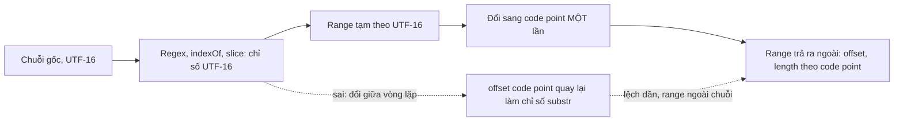

`"😀".length` bằng 2. Ai viết JavaScript lâu đều biết điều này, và Facebook biết rõ hơn ai hết: họ có cả module `UnicodeUtils` với `strlen`, `substr` đếm theo code point, và mọi entity range trong Draft.js hay GraphQL của Messenger đều tính theo code point (xem [#70](/blogs/facebook-int64-utf-codepoints)).

Vậy mà trong cùng codebase, tôi tìm được bốn chỗ dùng lẫn hai đơn vị. Không chỗ nào sai vì người viết không biết về UTF-16. Chúng sai vì **đổi đơn vị ở giữa vòng lặp**: một biến tính theo code point được đưa vào một hàm tính theo UTF-16, hoặc ngược lại. Bài này mổ từng lỗi, rồi rút ra một quy tắc đơn giản để không bao giờ gặp lại.

> [!TIP]
> **Tóm tắt**
> - Chuỗi JavaScript đánh chỉ số theo **đơn vị mã UTF-16** (code unit). Emoji và ký tự ngoài BMP chiếm 2 đơn vị nhưng là 1 **code point**. Người dùng thấy **grapheme** (cụm ký tự): 👨‍👩‍👧 là 1 grapheme, 5 code point, 8 đơn vị UTF-16.
> - `MentionsUtils` che emoji bằng `_` để regex đếm theo code point, rồi lấy tên mention từ chuỗi đã che: emoji trong tên biến thành `_`. `RedditLinkRanges` và `getURLRanges` cộng dồn offset theo code point rồi dùng nó làm chỉ số `substr`: lệch một đơn vị mỗi emoji, có lúc tìm lại link cũ và sinh range nằm ngoài chuỗi.
> - Bộ kiểm tra độ dài bài đăng báo "có N ký tự" nhưng N là `.length` UTF-16.
> - Quy tắc: **tìm và cắt trên UTF-16, đổi sang code point đúng một lần ở cuối**. Đếm "ký tự" cho người dùng thì dùng `Intl.Segmenter`.

<iframe class="demo-frame" src="/demos/facebook-patterns/index.html?theme=dark#/codepoint-offset-bugs" title="Demo codepoint-offset-bugs" loading="lazy" style="height: 1250px"></iframe>

<p class="demo-links">▶ <a href="/demos/facebook-patterns/index.html#/codepoint-offset-bugs" target="_blank" rel="noopener">Mở demo toàn màn hình ↗</a> · <a href="https://stackblitz.com/github/hunghg255/blog-hunghg/tree/master/examples/facebook-patterns?file=src/lib/textOffsets.ts" target="_blank" rel="noopener">Sửa code trên StackBlitz ↗</a> · <a href="https://github.com/hunghg255/blog-hunghg/blob/master/examples/facebook-patterns/src/lib/textOffsets.ts" target="_blank" rel="noopener">Xem source trên GitHub ↗</a></p>

## Ba đơn vị đo một chuỗi

| Chuỗi | `.length` (UTF-16) | code point | grapheme |
| --- | --- | --- | --- |
| `a` | 1 | 1 | 1 |
| `ệ` (dựng sẵn) | 1 | 1 | 1 |
| `ệ` (e + hai dấu kết hợp) | 3 | 3 | 1 |
| `😀` | 2 | 1 | 1 |
| `🇻🇳` | 4 | 2 | 1 |
| `👨‍👩‍👧` | 8 | 5 | 1 |

`String.prototype.slice`, `substr`, `indexOf`, `RegExp.lastIndex`, `match.index` đều dùng UTF-16. `Array.from(s)` và `for…of` đi theo code point. Chỉ `Intl.Segmenter` đi theo grapheme. Một API đếm theo đơn vị nào thì mọi phép cộng trừ trên offset của nó phải ở cùng đơn vị đó.

## Facebook làm thế nào? Bốn lỗi

### 1. `MentionsUtils`: che emoji, rồi lấy tên từ chuỗi đã che

Bundle `177.js`. Tin nhắn lưu mention dạng markup `@[uid:Tên]`. Hàm `parseMessageMentions` đổi markup thành chữ thường kèm range:

```js
const MENTION = /@\[([0-9;]+):((?:[^\\\]]|\\.)*)\]/g;
function parseMessageMentions(text) {
  let cps = Array.from(text);
  let masked = cps.map((c) => (c.length > 1 ? '_' : c)).join(''); // mỗi code point thành 1 đơn vị
  const ranges = [];
  let m;
  while ((m = MENTION.exec(masked))) {
    const r = { uid: m[1], text: m[2], offset: m.index, length: m[2].length };
    ranges.push(r);
    masked = masked.substr(0, r.offset) + r.text + masked.substr(r.offset + m[0].length);
    text = cps.slice(0, r.offset).join('') + r.text + cps.slice(r.offset + m[0].length).join('');
    cps = Array.from(text);
    MENTION.lastIndex = r.offset + r.length;
  }
  return { ranges, text };
}
```

Mẹo che rất thông minh: thay mỗi ký tự astral bằng `_` thì chuỗi `masked` có đúng một đơn vị cho mỗi code point, nên `m.index` của regex chính là offset code point. Nhưng `r.text = m[2]` lấy từ chuỗi **đã che**, và chính `r.text` được ghép vào văn bản thật. Kết quả:

- `"@[123:Anna 🌸 Lee]"` thành `"Anna _ Lee"`. Tên có emoji, hay tên bằng chữ ngoài BMP (một số chữ Hán hiếm), bị hỏng.
- Regex cho phép ký tự thoát `\]` trong tên, nhưng không có bước bỏ dấu `\`: `"@[7:Bob \] Jr]"` hiện ra `"Bob \] Jr"`.

Một module khác cùng việc, `MentionsInputUtility` (bundle `294.js`), làm đúng: chạy regex trên chuỗi gốc, bỏ ký tự thoát (`\:` và `\]`), rồi đổi offset UTF-16 sang code point bằng cách cộng dồn `đoạn.length − strlen(đoạn)`.

### 2. `RedditLinkRanges`: offset code point làm chỉ số `substr`

Bundle `117.js`. Biến `r/vietnam` và `u/spez` thành link:

```js
function get(text, from = 0) {
  const rest = text.substr(from);                       // from dùng như chỉ số UTF-16
  const m = RedditLinkMatcher.match(rest);              // /(^|\s)(\/?[ru]\/\w{1,21})\b/i
  if (!m) return [];
  from += UnicodeUtils.strlen(rest.substr(0, m.idx));   // ... nhưng cộng dồn theo code point
  const range = { offset: from, length: m.lnk.length, entity: { url: 'https://reddit.com' + … } };
  return [range].concat(this.get(text, from + m.lnk.length));
}
```

Link đầu tiên luôn đúng. Từ link thứ hai, `from` (code point) nhỏ hơn vị trí UTF-16 thật đúng bằng số emoji đứng trước, nên `substr(from)` bắt đầu **sớm hơn**, rồi offset mới lại cộng `strlen` của một đoạn dài hơn thực tế. Mỗi emoji đứng trước làm lệch thêm 1. Với `"😀😀 r/aww then r/cats"`, `r/cats` nhận offset 16 thay vì 14.

Tệ hơn: khi số emoji lớn hơn độ dài link, `substr` bắt đầu **trước** link vừa tìm, regex tìm lại chính link đó (`^` khớp đầu chuỗi con), và hàm sinh thêm một range trùng có offset nằm **ngoài** độ dài chuỗi. Chạy trên node: `"😀😀😀😀 r/ab"` cho hai range, `{offset: 5}` đúng và `{offset: 9}` chỉ vào khoảng trống sau chuỗi dài 9 code point.

### 3. `getURLRanges`: cùng lỗi, thêm một lỗi `break`

Bundle `99 ChatComposer/all.js`:

```js
let d = 0;
while (true) {
  const rest = text.substr(d);                          // UTF-16
  const url = URLScraper.match(rest);
  if (!url || !URI.isValidURI(url)) break;              // URL không hợp lệ: bỏ luôn mọi URL phía sau
  d += UnicodeUtils.strlen(rest.substr(0, rest.indexOf(url))); // code point
  ranges.push({ offset: d, length: url.length, entity: { url } });
  d += url.length;
}
```

Cùng một kiểu trộn đơn vị. Tôi chạy lại vòng lặp trên node với một regex URL giản lược thay cho `URLScraper` (bản thật dài và phụ thuộc nhiều module): `"😀😀😀 xem a.com và b.com"` cho `b.com` offset 20, đúng là 17. Với sáu emoji phía trước `docs.example.com`, vòng lặp tìm lại phần đuôi `le.com` và sinh range ngoài chuỗi. Demo tái hiện cả hai trường hợp.

Lỗi thứ hai không liên quan Unicode: gặp một chuỗi giống URL nhưng `isValidURI` từ chối, `break` thoát vòng lặp, mọi URL **phía sau** nó mất link. Đáng lẽ là bỏ qua chuỗi đó và tìm tiếp.

### 4. `cometComposerValidateStatusTextLength`: "ký tự" là đơn vị UTF-16

Bundle `15.js`. Kiểm tra độ dài bài đăng trước khi gửi:

```js
const LIMIT = 63206;
const length = getPlainTextFromDeferredDraftEditorState(editorState).length;
return length > LIMIT
  ? fbt('Nội dung này có {number} ký tự, dài hơn mức tối đa được phép là {maxselect} ký tự…')
  : null;
```

Con số 63206 là giới hạn lâu đời của bài đăng Facebook. Có lẽ server cũng đếm theo UTF-16 nên giới hạn này khớp, đó không phải lỗi. Lỗi nằm ở **thông báo**: một bài toàn emoji 40.000 cái bị báo "có 80.000 ký tự". Người dùng đếm được 40.000, xoá đi một nửa mà vẫn bị chặn. Cách sửa: giữ phép so sánh theo đơn vị server dùng, nhưng hiển thị số grapheme, hoặc nói "quá dài N%" thay vì đếm ký tự.



## Liên quan: tin chỉ có emoji

Cũng trong chuyện đếm emoji, `MessengerSupportedEmojiUtils.getEmojiOnlyContents` (bundle `117.js`) quyết định tin có "chỉ toàn emoji" không, để hiện cỡ lớn. Nó ăn khoảng trắng, rồi các emoticon (`:)`, `<3`) **ở đầu tin**, rồi lần lượt từng emoji; gặp thứ gì khác thì trả `null`. Hai vòng lặp tách rời nên `":) 😀"` là tin emoji, còn `"😀 :)"` thì không. Emoji có giới tính mà chưa gắn giới tính (người chạy, người nhún vai…) được tự thêm `U+200D U+2640` (dạng nữ) trước khi tra bảng ảnh.

## Bên trong JavaScript

Chuỗi JavaScript là dãy số 16 bit từ đầu (ECMAScript 1, 1997), khi Unicode còn vừa trong 65.536 ký tự. Unicode 2.0 mở rộng, và ký tự mới được mã hoá bằng **cặp thay thế** (surrogate pair): đơn vị đầu trong khoảng `D800–DBFF`, đơn vị sau trong `DC00–DFFF`. Đổi chỉ số đã ăn sâu vào ngôn ngữ, nên ES2015 chỉ thêm các API mới đi theo code point (`codePointAt`, `String.fromCodePoint`, `for…of`, cờ `u` của regex) chứ không đổi `length` hay `slice`.

Đổi chỉ số UTF-16 sang code point là O(n): phải quét từ đầu để đếm cặp thay thế. Vì vậy các hàm "đổi một lần ở cuối" của bản viết lại vẫn tốn O(n) cho mỗi range; với tin nhắn vài trăm ký tự thì không đáng kể. Nếu xử lý văn bản lớn, tính một bảng tiền tố (vị trí UTF-16 của mỗi code point) một lần rồi tra.

## Viết lại

Đổi đơn vị, và một hàm quét regex duy nhất cho mọi loại range. Không đệ quy, không `substr`: regex `/g` tự đi tiếp bằng `lastIndex` (UTF-16), offset chỉ đổi sang code point khi đẩy ra:

```ts title=src/lib/textOffsets.ts
/** Chỉ số UTF-16 -> offset code point. */
export const toCodePoint = (s: string, utf16Index: number) => cpLength(s.slice(0, utf16Index));

/** Offset code point -> chỉ số UTF-16. */
export function toUtf16(s: string, cpOffset: number): number {
  let i = 0;
  for (let n = 0; n < cpOffset && i < s.length; n++) {
    const c = s.charCodeAt(i);
    i += c >= 0xd800 && c <= 0xdbff && i + 1 < s.length ? 2 : 1;
  }
  return i;
}

/** Cắt chuỗi theo offset code point (để kiểm tra range). */
export const cpSlice = (s: string, offset: number, length: number) =>
  s.slice(toUtf16(s, offset), toUtf16(s, offset + length));

/**
 * Quét mọi kết quả của một regex trên UTF-16, rồi đổi offset sang code point.
 * Không đệ quy, không substr: lastIndex của regex /g tự đi tiếp.
 */
export function scanRanges<E>(
  text: string,
  re: RegExp,
  pick: (m: RegExpExecArray) => { start: number; value: string; entity: E } | null,
): TextRange<E>[] {
  const g = new RegExp(re.source, re.flags.includes('g') ? re.flags : re.flags + 'g');
  const out: TextRange<E>[] = [];
  for (let m = g.exec(text); m; m = g.exec(text)) {
    if (m[0] === '') g.lastIndex++; // regex khớp rỗng: tránh lặp vô hạn
    const hit = pick(m);
    if (!hit) continue;
    out.push({ offset: toCodePoint(text, hit.start), length: cpLength(hit.value), entity: hit.entity });
  }
  return out;
}
```

Mention và link dùng chung quy tắc. Mention ghép văn bản từ chuỗi gốc và đếm code point của **văn bản đã ghép**, nên không cần che:

```ts title=src/lib/textOffsets.ts
// ---------------------------------------------------------------- mention

/** Markup "@[uid:Tên]"; trong tên, "\]" và "\\" là ký tự thoát. */
const MENTION = /@\[([0-9;]+):((?:[^\\\]]|\\.)*)\]/g;

export function parseMentions(markup: string): { text: string; ranges: TextRange<{ uid: string }>[] } {
  let text = '';
  let last = 0;
  const ranges: TextRange<{ uid: string }>[] = [];
  for (const m of markup.matchAll(MENTION)) {
    const name = m[2].replace(/\\(.)/g, '$1'); // bỏ ký tự thoát
    text += markup.slice(last, m.index);
    ranges.push({ offset: cpLength(text), length: cpLength(name), entity: { uid: m[1] } });
    text += name;
    last = m.index! + m[0].length;
  }
  return { text: text + markup.slice(last), ranges };
}

// ---------------------------------------------------------------- link

/** r/sub hoặc u/user; tên subreddit tối đa 21 ký tự. */
export const REDDIT = /(^|\s)(\/?[ru]\/\w{1,21})\b/gi;

export function redditRanges(text: string): TextRange<{ url: string }>[] {
  return scanRanges(text, REDDIT, (m) => {
    const link = m[2];
    const start = m.index + m[1].length;
    return { start, value: link, entity: { url: 'https://reddit.com' + (link[0] === '/' ? '' : '/') + link } };
  });
}

/** URL giản lược cho demo: có hoặc không có scheme, tên miền có dấu chấm. */
export const URL_RE = /\b(?:https?:\/\/)?(?:[a-z0-9-]+\.)+[a-z]{2,}(?:\/[^\s]*)?/gi;

export function urlRanges(text: string, isValid: (url: string) => boolean = () => true): TextRange<{ url: string }>[] {
  return scanRanges(text, URL_RE, (m) => {
    // URL không hợp lệ: bỏ qua nó, KHÔNG dừng cả vòng lặp như bản gốc
    if (!isValid(m[0])) return null;
    const url = /^[a-z][a-z0-9+.-]+:\/\//i.test(m[0]) ? m[0] : 'http://' + m[0];
    return { start: m.index, value: m[0], entity: { url } };
  });
}
```

Tin chỉ có emoji: tách theo grapheme, nhận emoticon ở mọi vị trí:

```ts title=src/lib/textOffsets.ts
/**
 * Tin chỉ gồm emoji, emoticon và khoảng trắng thì trả danh sách emoji (để hiện cỡ lớn),
 * ngược lại null. Emoticon được nhận ở BẤT KỲ vị trí nào (bản gốc chỉ nhận ở đầu tin).
 */
export function emojiOnly(text: string, maxEmoji = Infinity): string[] | null {
  const out: string[] = [];
  const tokens = text.split(/(\s+)/).filter(Boolean);
  for (const tok of tokens) {
    if (/^\s+$/.test(tok)) continue;
    let rest = tok;
    while (rest) {
      const emo = Object.keys(EMOTICONS).find((e) => rest.startsWith(e));
      if (emo) {
        out.push(EMOTICONS[emo]);
        rest = rest.slice(emo.length);
        continue;
      }
      const g = graphemes(rest)[0];
      if (!isEmojiGrapheme(g)) return null;
      out.push(g);
      rest = rest.slice(g.length);
    }
  }
  return out.length > 0 && out.length <= maxEmoji ? out : null;
}
```

::: spoiler Xem toàn bộ src/lib/textOffsets.ts

```ts title=src/lib/textOffsets.ts
/**
 * Offset văn bản: chuỗi JavaScript đánh chỉ số theo đơn vị UTF-16, còn nhiều API
 * (entity range của Draft.js, GraphQL của Messenger) đếm theo code point.
 * Quy tắc của file này: mọi phép tìm/cắt làm trên UTF-16, chỉ đổi sang code point
 * MỘT lần ở cuối. Ý tưởng học từ lỗi trong MentionsUtils, RedditLinkRanges, getURLRanges
 * và MessengerSupportedEmojiUtils của Facebook; code viết lại từ đầu.
 */

export interface TextRange<E = unknown> {
  /** tính theo code point */
  offset: number;
  /** tính theo code point */
  length: number;
  entity: E;
}

// ---------------------------------------------------------------- đổi đơn vị

/** Số code point: "😀".length === 2 nhưng cpLength("😀") === 1. */
export function cpLength(s: string): number {
  let n = 0;
  for (let i = 0; i < s.length; i++) {
    const c = s.charCodeAt(i);
    if (c >= 0xd800 && c <= 0xdbff && i + 1 < s.length) {
      const d = s.charCodeAt(i + 1);
      if (d >= 0xdc00 && d <= 0xdfff) i++;
    }
    n++;
  }
  return n;
}

/** Chỉ số UTF-16 -> offset code point. */
export const toCodePoint = (s: string, utf16Index: number) => cpLength(s.slice(0, utf16Index));

/** Offset code point -> chỉ số UTF-16. */
export function toUtf16(s: string, cpOffset: number): number {
  let i = 0;
  for (let n = 0; n < cpOffset && i < s.length; n++) {
    const c = s.charCodeAt(i);
    i += c >= 0xd800 && c <= 0xdbff && i + 1 < s.length ? 2 : 1;
  }
  return i;
}

/** Cắt chuỗi theo offset code point (để kiểm tra range). */
export const cpSlice = (s: string, offset: number, length: number) =>
  s.slice(toUtf16(s, offset), toUtf16(s, offset + length));

/**
 * Quét mọi kết quả của một regex trên UTF-16, rồi đổi offset sang code point.
 * Không đệ quy, không substr: lastIndex của regex /g tự đi tiếp.
 */
export function scanRanges<E>(
  text: string,
  re: RegExp,
  pick: (m: RegExpExecArray) => { start: number; value: string; entity: E } | null,
): TextRange<E>[] {
  const g = new RegExp(re.source, re.flags.includes('g') ? re.flags : re.flags + 'g');
  const out: TextRange<E>[] = [];
  for (let m = g.exec(text); m; m = g.exec(text)) {
    if (m[0] === '') g.lastIndex++; // regex khớp rỗng: tránh lặp vô hạn
    const hit = pick(m);
    if (!hit) continue;
    out.push({ offset: toCodePoint(text, hit.start), length: cpLength(hit.value), entity: hit.entity });
  }
  return out;
}

// ---------------------------------------------------------------- mention

/** Markup "@[uid:Tên]"; trong tên, "\]" và "\\" là ký tự thoát. */
const MENTION = /@\[([0-9;]+):((?:[^\\\]]|\\.)*)\]/g;

export function parseMentions(markup: string): { text: string; ranges: TextRange<{ uid: string }>[] } {
  let text = '';
  let last = 0;
  const ranges: TextRange<{ uid: string }>[] = [];
  for (const m of markup.matchAll(MENTION)) {
    const name = m[2].replace(/\\(.)/g, '$1'); // bỏ ký tự thoát
    text += markup.slice(last, m.index);
    ranges.push({ offset: cpLength(text), length: cpLength(name), entity: { uid: m[1] } });
    text += name;
    last = m.index! + m[0].length;
  }
  return { text: text + markup.slice(last), ranges };
}

// ---------------------------------------------------------------- link

/** r/sub hoặc u/user; tên subreddit tối đa 21 ký tự. */
export const REDDIT = /(^|\s)(\/?[ru]\/\w{1,21})\b/gi;

export function redditRanges(text: string): TextRange<{ url: string }>[] {
  return scanRanges(text, REDDIT, (m) => {
    const link = m[2];
    const start = m.index + m[1].length;
    return { start, value: link, entity: { url: 'https://reddit.com' + (link[0] === '/' ? '' : '/') + link } };
  });
}

/** URL giản lược cho demo: có hoặc không có scheme, tên miền có dấu chấm. */
export const URL_RE = /\b(?:https?:\/\/)?(?:[a-z0-9-]+\.)+[a-z]{2,}(?:\/[^\s]*)?/gi;

export function urlRanges(text: string, isValid: (url: string) => boolean = () => true): TextRange<{ url: string }>[] {
  return scanRanges(text, URL_RE, (m) => {
    // URL không hợp lệ: bỏ qua nó, KHÔNG dừng cả vòng lặp như bản gốc
    if (!isValid(m[0])) return null;
    const url = /^[a-z][a-z0-9+.-]+:\/\//i.test(m[0]) ? m[0] : 'http://' + m[0];
    return { start: m.index, value: m[0], entity: { url } };
  });
}

// ---------------------------------------------------------------- đếm

export interface TextCount {
  utf16: number;
  codePoints: number;
  /** "ký tự" theo mắt người: 👨‍👩‍👧 là 1 */
  graphemes: number;
}

const segmenter =
  typeof Intl !== 'undefined' && 'Segmenter' in Intl ? new Intl.Segmenter(undefined, { granularity: 'grapheme' }) : null;

export function graphemes(text: string): string[] {
  return segmenter ? Array.from(segmenter.segment(text), (s) => s.segment) : Array.from(text);
}

export function countText(text: string): TextCount {
  return { utf16: text.length, codePoints: cpLength(text), graphemes: graphemes(text).length };
}

// ---------------------------------------------------------------- tin chỉ có emoji

const EMOTICONS: Record<string, string> = { ':)': '🙂', ':(': '🙁', ':D': '😀', ';)': '😉', '<3': '❤️', ':P': '😛' };
const PICTO = /\p{Extended_Pictographic}|\p{Regional_Indicator}|\u20e3/u;
/** Một grapheme có phải emoji không (gồm cờ, keycap 1️⃣). */
export const isEmojiGrapheme = (g: string) => PICTO.test(g);

/**
 * Tin chỉ gồm emoji, emoticon và khoảng trắng thì trả danh sách emoji (để hiện cỡ lớn),
 * ngược lại null. Emoticon được nhận ở BẤT KỲ vị trí nào (bản gốc chỉ nhận ở đầu tin).
 */
export function emojiOnly(text: string, maxEmoji = Infinity): string[] | null {
  const out: string[] = [];
  const tokens = text.split(/(\s+)/).filter(Boolean);
  for (const tok of tokens) {
    if (/^\s+$/.test(tok)) continue;
    let rest = tok;
    while (rest) {
      const emo = Object.keys(EMOTICONS).find((e) => rest.startsWith(e));
      if (emo) {
        out.push(EMOTICONS[emo]);
        rest = rest.slice(emo.length);
        continue;
      }
      const g = graphemes(rest)[0];
      if (!isEmojiGrapheme(g)) return null;
      out.push(g);
      rest = rest.slice(g.length);
    }
  }
  return out.length > 0 && out.length <= maxEmoji ? out : null;
}
```

:::

::: spoiler Xem src/lib/textOffsetsLegacy.ts (mô phỏng bản gốc để demo so sánh)

```ts title=src/lib/textOffsetsLegacy.ts
/**
 * Mô phỏng cách tính của bản gốc (đã đổi tên biến) để demo đặt cạnh bản sửa.
 * KHÔNG dùng trong dự án: mỗi hàm ở đây có một lỗi trộn đơn vị UTF-16 / code point.
 */
import { cpLength, graphemes, isEmojiGrapheme, REDDIT, URL_RE, type TextRange } from './textOffsets';

/** MentionsUtils: che ký tự astral bằng "_" để regex đếm theo code point, rồi lấy tên từ chuỗi đã che. */
export function legacyParseMentions(markup: string) {
  const re = /@\[([0-9;]+):((?:[^\\\]]|\\.)*)\]/g;
  let text = markup;
  let cps = Array.from(text);
  let masked = cps.map((c) => (c.length > 1 ? '_' : c)).join('');
  const ranges: TextRange<{ uid: string }>[] = [];
  for (let m = re.exec(masked); m; m = re.exec(masked)) {
    const name = m[2]; // lấy từ chuỗi ĐÃ CHE: emoji trong tên thành "_", "\]" giữ nguyên
    ranges.push({ offset: m.index, length: name.length, entity: { uid: m[1] } });
    masked = masked.slice(0, m.index) + name + masked.slice(m.index + m[0].length);
    text = cps.slice(0, m.index).join('') + name + cps.slice(m.index + m[0].length).join('');
    cps = Array.from(text);
    re.lastIndex = m.index + name.length;
  }
  return { text, ranges };
}

/** RedditLinkRanges: offset cộng dồn theo code point nhưng lại dùng làm chỉ số substr (UTF-16). */
export function legacyRedditRanges(text: string, from = 0): TextRange<{ url: string }>[] {
  const rest = text.substr(from);
  const m = new RegExp(REDDIT.source, 'i').exec(rest);
  if (!m) return [];
  const link = m[2];
  const start = from + cpLength(rest.substr(0, m.index + m[1].length));
  const url = 'https://reddit.com' + (link[0] === '/' ? '' : '/') + link;
  return [{ offset: start, length: link.length, entity: { url } }, ...legacyRedditRanges(text, start + link.length)];
}

/** getURLRanges: cùng lỗi, và gặp URL không hợp lệ thì dừng hẳn (break). */
export function legacyUrlRanges(text: string, isValid: (url: string) => boolean = () => true) {
  const out: TextRange<{ url: string }>[] = [];
  let pos = 0;
  for (;;) {
    const rest = text.substr(pos);
    const m = new RegExp(URL_RE.source, 'i').exec(rest);
    if (!m || !isValid(m[0])) break;
    pos += cpLength(rest.substr(0, rest.indexOf(m[0])));
    out.push({ offset: pos, length: m[0].length, entity: { url: m[0] } });
    pos += m[0].length;
  }
  return out;
}

/** MessengerSupportedEmojiUtils.getEmojiOnlyContents: emoticon chỉ được nhận khi đứng trước mọi emoji. */
export function legacyEmojiOnly(text: string): boolean {
  let rest = text;
  const eatSpace = () => (rest = rest.replace(/^\s+/, ''));
  for (;;) {
    eatSpace();
    const emo = /^(:\)|:\(|:D|;\)|<3|:P)/.exec(rest);
    if (!emo) break;
    rest = rest.slice(emo[0].length);
  }
  while (rest.trim().length > 0) {
    eatSpace();
    const g = graphemes(rest)[0];
    if (!isEmojiGrapheme(g)) return false;
    rest = rest.slice(g.length);
  }
  return true;
}
```

:::

## Đi qua code

- `cpLength` đếm code point bằng cách nhảy qua cặp thay thế hợp lệ; cặp hỏng (một nửa đứng lẻ) vẫn tính là 1, giống `Array.from`.
- `toCodePoint` và `toUtf16` là hai chiều đổi; `cpSlice` dùng `toUtf16` để kiểm tra range: đây là cách demo phát hiện range "ma".
- `scanRanges` nhận regex và hàm `pick` trả vị trí bắt đầu (UTF-16) cùng chuỗi khớp. `pick` trả `null` là bỏ qua kết quả đó, vòng lặp đi tiếp; đó là cách `urlRanges` xử lý URL không hợp lệ thay cho `break`.
- `parseMentions` dùng `matchAll` trên chuỗi gốc. Văn bản đầu ra được ghép dần, offset của mention là `cpLength(văn bản đã ghép)` tại thời điểm thêm tên: luôn đúng đơn vị, không cần che.
- `countText` trả cả ba con số; giao diện chọn con số phù hợp (giới hạn của server, hay số "ký tự" để báo người dùng).
- `emojiOnly` tách theo khoảng trắng, trong mỗi đoạn ăn emoticon hoặc một grapheme emoji; có `maxEmoji` vì một tin 50 emoji cỡ lớn chiếm cả màn hình.

**Khác bản gốc:**

- Mention giữ nguyên emoji trong tên và bỏ ký tự thoát `\`.
- Link r/… và URL không lệch, không sinh range trùng; URL không hợp lệ chỉ bị bỏ qua.
- Regex URL trong bài là bản giản lược cho demo, không thay được `URLScraper` của Facebook; dùng thư viện như `linkifyjs` cho sản phẩm thật.
- Tin chỉ có emoji: nhận emoticon ở mọi vị trí, không tự đổi giới tính emoji.

## Tại sao không làm cách khác?

- **Đổi cả chuỗi sang mảng code point** (`Array.from`) rồi làm mọi thứ trên mảng: đúng, nhưng regex không chạy trên mảng; phải `join` lại, và lúc đó lại quay về chỉ số UTF-16. Đó chính là cái bẫy của `MentionsUtils`.
- **Dùng cờ `u` của regex**: cờ `u` làm `.` và lớp ký tự hiểu cặp thay thế, nhưng `match.index` và `lastIndex` **vẫn** là chỉ số UTF-16. Nó không giải quyết chuyện offset.
- **Đếm theo grapheme cho range**: đúng với mắt người, nhưng server và Draft.js đếm code point. Range phải theo đơn vị của bên nhận; grapheme chỉ dùng để hiển thị số đếm.
- **Che emoji bằng một ký tự giữ chỗ**: chỉ an toàn khi không bao giờ lấy chữ ra từ chuỗi đã che. Một lần quên là hỏng dữ liệu người dùng.

## Edge case và cạm bẫy

- **Chuẩn hoá Unicode**: "ệ" dựng sẵn (1 code point) và tổ hợp (3 code point) cho offset khác nhau. Nếu server chuẩn hoá NFC còn client không, range lệch dù cả hai đếm code point. Chuẩn hoá trước khi tính range.
- **Cặp thay thế hỏng**: chuỗi cắt nhầm giữa cặp (ví dụ `slice(0, 1)` của `"😀"`) sinh một nửa lẻ. `cpLength` đếm nó là 1; `encodeURIComponent` sẽ ném lỗi. Kiểm tra bằng `String.prototype.isWellFormed()` (tính tới 10/2026 có ở các trình duyệt chính) hoặc sửa bằng `toWellFormed()`.
- **Regex khớp rỗng**: một regex có thể khớp chuỗi rỗng sẽ làm vòng lặp `exec` đứng yên. `scanRanges` tự tăng `lastIndex` trong trường hợp này.
- **`\b` và chữ có dấu**: `\b` của JavaScript chỉ hiểu `[A-Za-z0-9_]` là chữ, kể cả khi có cờ `u`. `r/việt` dừng link ở `r/vi`. Reddit chỉ cho tên ASCII nên không sao, nhưng đừng dùng `\b` cho tên tiếng Việt.
- **Emoji mới**: `\p{Extended_Pictographic}` theo phiên bản Unicode của trình duyệt. Emoji mới hơn bộ dữ liệu của trình duyệt có thể không được nhận là emoji.

## Dùng trong dự án

```ts
import { countText, parseMentions, urlRanges } from './textOffsets';

// gửi lên API nhận range theo code point
const { text, ranges } = parseMentions(markup);
await api.send({ text, mentions: ranges, links: urlRanges(text, (u) => URL.canParse('http://' + u)) });

// hiển thị số ký tự cho người dùng, so giới hạn theo đơn vị server
const c = countText(draft);
hint.textContent = c.utf16 > 63206 ? 'Bài viết quá dài, hãy rút ngắn' : `${c.graphemes} ký tự`;
```

## Kiểm thử

::: spoiler Ví dụ test (bản phác, không có trong repo)

```ts
import { describe, expect, it } from 'vitest';
import { countText, cpSlice, emojiOnly, parseMentions, redditRanges, toCodePoint, toUtf16, urlRanges } from './textOffsets';

const texts = (t: string, rs: { offset: number; length: number }[]) => rs.map((r) => cpSlice(t, r.offset, r.length));

describe('đổi đơn vị', () => {
  it('hai chiều', () => {
    const s = 'a😀b🇻🇳c';
    expect(toCodePoint(s, 3)).toBe(2);
    expect(toUtf16(s, 2)).toBe(3);
    for (let i = 0; i <= 5; i++) expect(toCodePoint(s, toUtf16(s, i))).toBe(i);
  });
});

describe('mention', () => {
  it('giữ emoji, bỏ ký tự thoát', () => {
    const r = parseMentions('😀 @[1:Anna 🌸] và @[2:Bob \\] Jr]');
    expect(r.text).toBe('😀 Anna 🌸 và Bob ] Jr');
    expect(texts(r.text, r.ranges)).toEqual(['Anna 🌸', 'Bob ] Jr']);
  });
});

describe('link', () => {
  it('không lệch dù có nhiều emoji', () => {
    const t = '😀'.repeat(10) + ' r/a then u/b, xem a.com và docs.example.com';
    expect(texts(t, redditRanges(t))).toEqual(['r/a', 'u/b']);
    expect(texts(t, urlRanges(t))).toEqual(['a.com', 'docs.example.com']);
  });
  it('URL không hợp lệ bị bỏ qua, không dừng', () => {
    const t = 'bad.zz ok.com';
    expect(texts(t, urlRanges(t, (u) => !u.startsWith('bad')))).toEqual(['ok.com']);
  });
});

it('đếm ba đơn vị', () => {
  expect(countText('👨‍👩‍👧')).toEqual({ utf16: 8, codePoints: 5, graphemes: 1 });
});

it('tin chỉ có emoji, emoticon ở đâu cũng được', () => {
  expect(emojiOnly(':) 😀')).toEqual(['🙂', '😀']);
  expect(emojiOnly('😀 :)')).toEqual(['😀', '🙂']);
  expect(emojiOnly('ok 👍')).toBeNull();
});
```

:::

## So với thư viện và chuẩn web

- **`Intl.Segmenter`** (granularity `grapheme`): có ở mọi trình duyệt chính (Firefox từ bản 125, tính tới 10/2026); thư viện `grapheme-splitter` là phương án cho môi trường cũ.
- **`String.prototype.isWellFormed` / `toWellFormed`**: phát hiện và sửa cặp thay thế hỏng (ES2024).
- **Draft.js và Lexical**: Draft.js đếm entity range theo code point khi chuyển ra raw (`convertToRaw` dùng `UnicodeUtils`); Lexical lưu text node theo chuỗi JavaScript (UTF-16). Khi chuyển dữ liệu giữa hai hệ, phải đổi đơn vị.
- **linkifyjs, linkify-it**: tìm URL có hỗ trợ tên miền quốc tế; trả vị trí theo UTF-16, cần đổi nếu API của bạn đếm code point.
- **Twitter text** (`twitter-text`): đếm độ dài tweet theo trọng số code point, coi mọi emoji là 2; một ví dụ khác về chuyện "ký tự" là quy ước của từng sản phẩm.
- Bài liên quan: [#70 Int64, decode UTF, offset theo code point](/blogs/facebook-int64-utf-codepoints), [#55 Tách emoji bằng máy trạng thái](/blogs/facebook-emoji-segmentation), [#73 Auto-link URL](/blogs/facebook-autolink-safe-truncate).

---

Bài này thuộc series **[Học từ mã nguồn Facebook](/series/facebook)** (106 bài, đọc theo thứ tự).

::: spoiler Xem nhanh danh sách bài trong series

*Phần 1*

- [Mở đầu: cách đọc code minify của Facebook](/blogs/learn-from-facebook-source-code)
- [#1 Dùng chung IntersectionObserver + infinite scroll](/blogs/facebook-shared-intersection-observer)
- [#2 useViewportDuration: đo thời gian thực sự được xem](/blogs/facebook-use-viewport-duration)
- [#3 Preload code + data khi hover](/blogs/facebook-preload-on-hover)
- [#4 Toast manager với external store](/blogs/facebook-toast-manager)
- [#5 Network status + heartbeat backoff](/blogs/facebook-network-status-heartbeat)
- [#6 ErrorGuard: bắt lỗi theo ngữ cảnh](/blogs/facebook-error-guard)
- [#7 Banzai: gom log theo lô + sendBeacon](/blogs/facebook-batch-logger)
- [#8 Focus trap + Esc theo layer](/blogs/facebook-focus-trap)

*Phần 2*

- [#9 Mẹo calc(… * 9999): container query, line-clamp, mũi tên carousel bằng CSS](/blogs/facebook-css-9999-trick)
- [#10 Thanh cuộn tuỳ biến bằng CSS 3D](/blogs/facebook-css-3d-scrollbar)
- [#11 Modal cuộn bằng window, giữ vị trí trang nền](/blogs/facebook-document-scroll-modal)
- [#12 Popover, tooltip group và hovercard](/blogs/facebook-popover-tooltip)
- [#13 Primitive Pressable + focus-visible](/blogs/facebook-pressable)
- [#14 Tab "Xem thêm" + sticky header bằng IntersectionObserver](/blogs/facebook-priority-tabs-sticky-header)
- [#15 Avatar khoét mask, gradient Messenger, skeleton steps()](/blogs/facebook-visual-tricks)
- [#16 Khung chat không giật](/blogs/facebook-chat-scroller)
- [#17 Thuật toán chọn bố cục collage ảnh](/blogs/facebook-photo-collage-layout)
- [#18 Keep-alive tab trong SPA](/blogs/facebook-keep-alive-tabs)
- [#19 Tự đo Visual Completion & interaction tracing](/blogs/facebook-visual-completion)
- [#20 Router SPA bền bỉ & tải chunk có retry](/blogs/facebook-spa-router-resilient-loading)

*Phần 3*

- [#21 Smart Compose: gợi ý chữ mờ khi gõ](/blogs/facebook-smart-compose-ghost-text)
- [#22 MQTT ngay trong trình duyệt, tự chuyển sang long-poll](/blogs/facebook-mqtt-in-browser)
- [#23 Đo thời gian dùng bằng bitmap 64 giây](/blogs/facebook-time-spent-bitmap)
- [#24 Bảng reaction nhấn giữ rồi trượt](/blogs/facebook-reaction-press-slide)
- [#25 Tìm kiếm gấp dấu, phiên âm và highlight đầu từ](/blogs/facebook-search-diacritics-tokenize)
- [#26 Ring buffer biết trace nào đã mất log](/blogs/facebook-trace-ring-buffer)
- [#27 Engine animation JS: một vòng rAF và solver cubic-bezier](/blogs/facebook-keyframes-loop-cubic-bezier)
- [#28 Bootloader: bitmap tài nguyên đã tải, chỉ reload khi cần](/blogs/facebook-bootloader-bitmap-consistency)
- [#29 Nhận biết click do screen reader tạo ra](/blogs/facebook-virtual-cursor-detection)
- [#30 Tải trước feed theo chất lượng mạng, đoán hạng thiết bị](/blogs/facebook-network-aware-prefetch)
- [#31 Hàng đợi gửi tin chat giữ đúng thứ tự](/blogs/facebook-ordered-send-queue)
- [#32 Gộp lời gọi API trong cùng một tick](/blogs/facebook-api-batcher)
- [#33 Resize ảnh trong pool Web Worker](/blogs/facebook-jpeg-resize-worker-pool)
- [#34 Crop ảnh theo nhiều khuôn mặt](/blogs/facebook-face-aware-crop)
- [#35 Kéo-thả sắp xếp và vùng thả file không nhấp nháy](/blogs/facebook-flicker-free-drag-drop)
- [#36 Tiện ích UI: fade-out, sticky event, hàm huỷ được](/blogs/facebook-ui-utility-hooks)
- [#37 Hạ tầng nhỏ: cookie, hash lỗi, prefetch khi chuột dừng](/blogs/facebook-small-infra-cookie-hash-idle)

*Phần 4–6*

- [#38 Đồng bộ tin nhắn: phát hiện lỗ seqID và fetch bù theo tầng](/blogs/facebook-messenger-sync-seqid-gaps)
- [#39 OTID: ID tin nhắn kiểu Snowflake sinh ở client](/blogs/facebook-otid-client-snowflake)
- [#40 QPL: lấy mẫu từ lúc bắt đầu, đo RTT gửi tin đầu-cuối](/blogs/facebook-qpl-send-rtt)
- [#41 Bộ điều phối request bảy chế độ gộp và chống trùng](/blogs/facebook-request-dispatcher-modes)
- [#42 Thread list theo mốc thời gian, cookie presence có version](/blogs/facebook-threadlist-ranged-presence)
- [#43 Composer dạng plugin: reducer, dirty checker, chuỗi kiểm tra](/blogs/facebook-plugin-composer)
- [#44 Thanh toán bất đồng bộ: subscribe trước, poll dự phòng](/blogs/facebook-async-checkout)
- [#45 Validate số thẻ: sửa lỗi gõ, dải BIN, Luhn](/blogs/facebook-card-validation)
- [#46 Lịch chọn khoảng ngày: bo góc dải chọn, phím đủ bộ, RTL](/blogs/facebook-range-calendar-a11y)
- [#47 Giờ mở cửa theo tuần: qua đêm, gộp khoảng, phần bù](/blogs/facebook-weekly-hours-intervals)
- [#48 Tiến độ đăng realtime: giữ event chờ snapshot, watchdog](/blogs/facebook-realtime-publish-snapshot)
- [#49 Tiền tệ theo đơn vị nhỏ nhất và ô nhập tiền](/blogs/facebook-currency-minor-units)
- [#50 Sửa hàng loạt Empty/Uniform/Mixed, seen/read bằng 2 bit](/blogs/facebook-bulk-edit-seen-bits)
- [#51 Phát hiện script lạ hook vào hàm native](/blogs/facebook-native-hook-detection)
- [#52 localStorage tự dọn khi đầy quota](/blogs/facebook-quota-aware-storage)
- [#53 Cache tuyến do server phân giải, chờ sẵn promise](/blogs/facebook-route-cache-prefetch)
- [#54 Lưới phím mũi tên 2D và focus không làm cuộn trang](/blogs/facebook-focus-table-grid)
- [#55 Tách emoji bằng máy trạng thái](/blogs/facebook-emoji-segmentation)
- [#56 Đọc trước ghi sau trong một frame, con tự biết vị trí](/blogs/facebook-read-then-write-dom)
- [#57 Hàng đợi lệnh cho video và stream sắp lại chunk](/blogs/facebook-video-command-queue)

*Phần 7–10*

- [#58 Ước lượng băng thông EWMA: loại outlier, nhớ qua phiên](/blogs/facebook-bandwidth-ewma-estimator)
- [#59 ABR theo độ tự tin phát và cắt bậc bitrate theo MOS](/blogs/facebook-abr-playback-confidence)
- [#60 Prefetch segment dự đoán từ manifest, parse hộp sidx](/blogs/facebook-dash-predicted-segments)
- [#61 Đọc metadata MP4/MOV ngay trên client](/blogs/facebook-mp4-metadata-client)
- [#62 Upload tiếp tục được: offset, hash dedupe, phát hiện treo](/blogs/facebook-resumable-upload)
- [#63 Fenwick tree: chọn ngẫu nhiên có trọng số và offset dòng](/blogs/facebook-fenwick-weighted-random)
- [#64 Vạch trục số và trục thời gian "đẹp"](/blogs/facebook-nice-axis-ticks)
- [#65 Damerau-Levenshtein theo dải chéo và tự sửa tên gõ sai](/blogs/facebook-damerau-levenshtein)
- [#66 PRNG có seed, shuffle tái lập và lấy mẫu trace](/blogs/facebook-seeded-prng-sampling)
- [#67 Cặp min/max-heap tái dùng vị trí trong danh sách ảo](/blogs/facebook-dual-heap-buffer-set)
- [#68 Memo nhiều đối số bằng Map/WeakMap và interning object](/blogs/facebook-multikey-memo-interning)
- [#69 Thống kê cửa sổ trượt và đại số khoảng thời gian](/blogs/facebook-moving-stat-intervals)
- [#70 Int64 từ hai số 32-bit, decode UTF, offset theo code point](/blogs/facebook-int64-utf-codepoints)
- [#71 Engine múi giờ IANA trên client, phát hiện lệch giờ](/blogs/facebook-client-iana-timezone)
- [#72 Tự cài semver range](/blogs/facebook-semver-range)
- [#73 Auto-link URL, cắt chữ an toàn, giới hạn LaTeX](/blogs/facebook-autolink-safe-truncate)
- [#74 Parser query kiểu PHP chống prototype pollution](/blogs/facebook-php-query-serializer)
- [#75 Popover tự lật theo phần tràn nhỏ nhất](/blogs/facebook-popover-auto-flip)
- [#76 Tiền tố for(;;) chống JSON hijacking, đọc stream](/blogs/facebook-csrf-prefix-streaming)
- [#77 Chống lộ Referer, linkshim, xoá token trên URL](/blogs/facebook-referrer-linkshim-url-scrub)
- [#78 setImmediate bằng postMessage, gom delta chuột theo frame](/blogs/facebook-setimmediate-mouse-batching)
- [#79 Phát hiện crash qua heartbeat, dò proxy cache hỏng](/blogs/facebook-crash-heartbeat-proxy-check)
- [#80 DPR vào cookie cho ảnh @2x, che khoá trong log](/blogs/facebook-dpr-cookie-secret-redaction)
- [#81 Flux waitFor tự viết và proxy có đệm](/blogs/facebook-flux-dispatch-buffered-proxy)
- [#82 Crop đúng tỉ lệ, xoay sticker bằng ma trận](/blogs/facebook-image-crop-rotation-geometry)

*Phần 11–15*

- [#83 Chia subdomain giữa các tab bằng lease, long-poll theo bảng trạng thái](/blogs/facebook-tab-subdomain-lease-longpoll)
- [#84 MQTT QoS1: giữ publish chờ ack, gửi lại khi kết nối lại](/blogs/facebook-mqtt-qos1-republish)
- [#85 Cache Promise gộp request, cache lỗi ngắn, đua dữ liệu nhúng sẵn](/blogs/facebook-promise-cache-preload-race)
- [#86 Lịch retry: backoff có trần, Fibonacci, báo lỗi CDN mỗi N ngày](/blogs/facebook-retry-backoff-schedules)
- [#87 Giữ nguyên tham chiếu nhánh dữ liệu không đổi](/blogs/facebook-relay-recycle-nodes)
- [#88 Store optimistic: copy-on-write, rollback rồi áp lại](/blogs/facebook-relay-optimistic-store)
- [#89 Chỉ mục subscription theo record, hàng đợi task theo chiều sâu](/blogs/facebook-relay-subscription-index)
- [#90 Phân trang connection: cursor khớp đầu, edge không trùng](/blogs/facebook-relay-connection-pagination)
- [#91 Profiler kiểu middleware và memo selector có lấy mẫu kiểm tra](/blogs/facebook-profiler-middleware-memo-check)
- [#92 Đọc EBML/WebM Cues để tìm byte range của segment](/blogs/facebook-webm-ebml-cues)
- [#93 Stream HTTP Range tạm dừng được, tải tiếp đúng byte](/blogs/facebook-pausable-range-stream)
- [#94 Bảng khoảng thời gian gắn nhãn và nhảy qua lỗ buffer](/blogs/facebook-tagged-time-ranges-gaps)
- [#95 Gom chunk cho SourceBuffer, đồng bộ video bằng playbackRate](/blogs/facebook-sourcebuffer-video-sync)
- [#96 Gom tin nhắn thành cụm, vạch ngày và avatar đã xem](/blogs/facebook-message-grouping)
- [#97 Bao nhiêu tab chat vừa màn hình, chuỗi luật mở tab](/blogs/facebook-chat-tab-policy)
- [#98 Phím tắt Markdown trong editor, Backspace để hoàn tác](/blogs/facebook-markdown-shortcuts-editor)
- **#99 Offset theo code point hay UTF-16: bốn bug cùng một gốc** (bài này)
- [#100 Typeahead không nhảy: cache tiền tố, chặn reflow, khoá hover](/blogs/facebook-typeahead-stable-results)
- [#101 Hit-test trên canvas bằng phát lại path, nét đứt và cung Bézier](/blogs/facebook-canvas-hit-regions)
- [#102 Vòng tròn theo mét trên bản đồ Mercator](/blogs/facebook-mercator-meter-circles)
- [#103 Dò tính năng trình duyệt: ảnh EXIF 2×1, getter bẫy, scrollbar](/blogs/facebook-feature-probe-tricks)
- [#104 Bug định dạng số và kiểm tra dữ liệu theo locale](/blogs/facebook-locale-validation-bugs)
- [#105 Dispose cho đúng: idle callback, splice(-1), xoá nhầm key](/blogs/facebook-dispose-leak-bugs)

:::

Code + demo: [`examples/facebook-patterns`](https://github.com/hunghg255/blog-hunghg/tree/master/examples/facebook-patterns) · [Mở trên StackBlitz](https://stackblitz.com/github/hunghg255/blog-hunghg/tree/master/examples/facebook-patterns)
