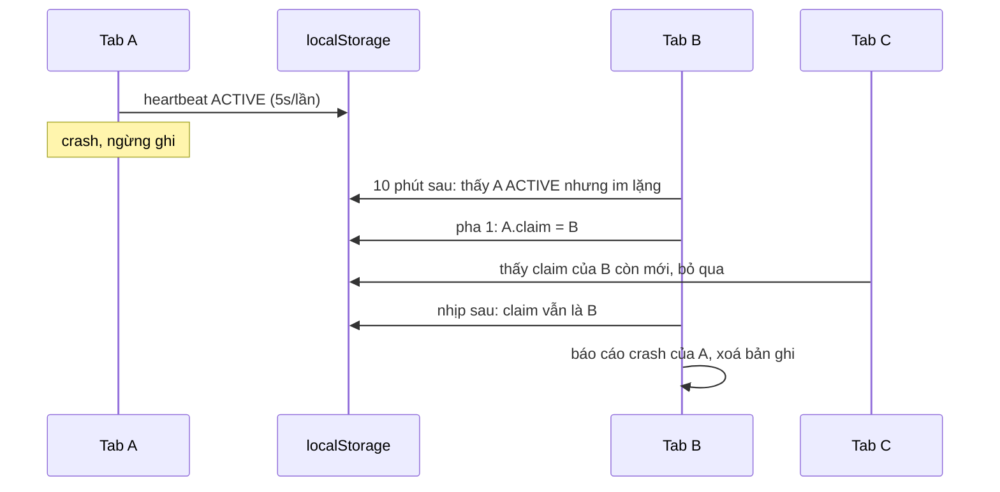

Trình duyệt giết tab vì hết bộ nhớ ("Aw, Snap!"), hoặc tab treo cứng tới mức người dùng phải đóng. Lúc đó không có `error`, không có `pagehide`, không có `sendBeacon`. JavaScript của trang đã chết trước khi kịp kêu.

Vậy làm sao đội Facebook biết trang upload video crash bao nhiêu lần, và lúc crash trang đang dùng bao nhiêu bộ nhớ?

Câu trả lời: người chết không báo được thì **người sống báo thay**. Mỗi tab ghi "tôi còn sống" vào `localStorage` vài giây một lần. Tab nào mở sau (hoặc tab khác đang mở) thấy một bản ghi "đang chạy" mà lâu không cập nhật thì biết tab đó đã chết.

Bài này cũng nói về một kiểu "chết" khác, lặng lẽ hơn: proxy ở giữa cache nhầm trang của người này rồi trả cho người khác.

> [!TIP]
> **Tóm tắt**
> - `Bandicoot` ghi bản ghi của mọi tab vào **một** khoá `localStorage` chung, 5 giây một lần: trạng thái, thời điểm, dung lượng heap, số phần tử DOM, URL.
> - Bản ghi `ACTIVE` mà im lặng hơn 10 phút là crash. Tab ẩn chuyển `INACTIVE` nên không bị tính nhầm.
> - Nhiều tab cùng thấy một crash: tab đầu tiên ghi tên mình vào bản ghi (pha 1), nhịp sau nếu tên vẫn là mình mới báo (pha 2). Mỗi crash chỉ một báo cáo.
> - `DetectBrokenProxyCache` so cookie `c_user` với user id server nhúng trong HTML. Khác nhau nghĩa là HTML này được render cho người khác rồi bị cache lại.
> - Bản viết lại tự đóng phiên khi `pagehide`, tiêm được lưu trữ và đồng hồ để test, và không xoá dữ liệu của tab khác khi ghi lỗi.

<iframe class="demo-frame" src="/demos/facebook-patterns/index.html?theme=dark#/crash-heartbeat" title="Demo crash-heartbeat" loading="lazy" style="height: 1000px"></iframe>

<p class="demo-links">▶ <a href="/demos/facebook-patterns/index.html#/crash-heartbeat" target="_blank" rel="noopener">Mở demo toàn màn hình ↗</a> · <a href="https://stackblitz.com/github/hunghg255/blog-hunghg/tree/master/examples/facebook-patterns?file=src/lib/crashHeartbeat.ts" target="_blank" rel="noopener">Sửa code trên StackBlitz ↗</a> · <a href="https://github.com/hunghg255/blog-hunghg/blob/master/examples/facebook-patterns/src/lib/crashHeartbeat.ts" target="_blank" rel="noopener">Xem source trên GitHub ↗</a></p>

## Facebook làm thế nào?

### `BandicootSession` (bundle `177.js`)

Bốn hàm thuần, quyết định số phận một bản ghi:

```js
const Status = { ACTIVE: 'ACTIVE', INACTIVE: 'INACTIVE', CLOSED: 'CLOSED' };
const STALE = 10 * 60 * 1000;            // 10 phút
const ORPHAN = 14 * 24 * 60 * 60 * 1000; // 14 ngày
const age = (s) => Date.now() - s.lastUpdated;

isTrackedSession = (s) => s.status !== CLOSED && !(s.status === INACTIVE && age(s) > STALE);
isCrashedSession = (s) => s.status === ACTIVE && age(s) > STALE;
isOrphanSession  = (s) => age(s) > ORPHAN;
```

### `Bandicoot` (bundle `177.js`, bản khác trong `26.VideoPlayer/all.js`)

Mỗi loại theo dõi có một khoá, ví dụ `Bandicoot:<tên>`, chứa JSON `{ sessionId: record }` của mọi tab. Mỗi 5 giây (`setInterval`), tab chạy một nhịp: đọc cả map, cập nhật bản ghi của mình (kèm `getCrashTimeData()`: thời lượng, số tab, `performance.memory`, số phần tử DOM, URL), xét bản ghi của các tab khác, ghi cả map lại.

Phần đáng học nhất là nhận việc hai pha trong mỗi nhịp:

```js
if (isCrashedSession(s)) {
  if (Date.now() - (s.loggerReportTime || 0) > 10_000) { s.loggerReportTime = Date.now(); s.loggerReportSession = myId; } // pha 1
  else if (s.loggerReportSession == myId) { logCrash(id, s); return null; }                                                 // pha 2
}
```

::: spoiler Code gốc đã đổi tên biến: heartbeat và nhận việc hai pha

```js
heartbeat() {
  const sessions = this.read();
  sessions[this.id] = { ...sessions[this.id], ...this.getCrashTimeData(),
                        lastUpdated: Date.now(), status: this.status() };
  this.write(this.checkCrashes(sessions));
}

getCrashTimeData() {
  const mem = performance.memory || {};            // chỉ Chromium có
  return { duration: Date.now() - this.startTime, tabs: Object.keys(this.read()).length,
           jsHeapSizeLimit: mem.jsHeapSizeLimit, usedJSHeapSize: mem.usedJSHeapSize, …,
           elementsInDOM: document.getElementsByTagName('*').length, uri: location.href };
}

checkCrashes(sessions) {
  return filterTracked(sessions, (s, id) => {        // bỏ CLOSED, INACTIVE cũ, quá 14 ngày
    if (isCrashedSession(s)) {
      if (Date.now() - (s.loggerReportTime || 0) > 10_000) {
        s.loggerReportTime = Date.now();             // pha 1: nhận việc
        s.loggerReportSession = this.id;
      } else if (s.loggerReportSession == this.id) {
        this.logCrash(id, s, this.getLogTimeData()); // pha 2: vẫn là mình → báo
        return null;                                 // xoá khỏi map
      }
    }
    return s;
  });
}
```

:::

Dữ liệu `getCrashTimeData` được ghi **lúc tab còn sống**, nên khi báo cáo, người báo gửi được trạng thái cuối cùng của tab đã chết: heap đang dùng bao nhiêu, DOM có bao nhiêu phần tử, ở URL nào. Đó là manh mối tốt nhất cho crash vì hết bộ nhớ.

Các chi tiết khác:

- Lúc khởi động, thử `setItem('__test…')`; lỗi thì coi như trình duyệt không hỗ trợ.
- `visibilitychange` chuyển trạng thái giữa `ACTIVE` và `INACTIVE`.
- `endSession()` ghi `CLOSED`. Module không tự gọi nó khi đóng tab; lớp con (`VideoUploadCrashMonitor`, `AdsUnifiedLoggingCrashLogger`) gọi khi việc của chúng xong, ví dụ upload hoàn tất. Thông điệp báo của bên upload: "Detected video upload did not complete due to a crash".
- Khi ghi lỗi (đầy bộ nhớ): báo lỗi tối đa 5 giây một lần, rồi **xoá cả khoá chung**. Xoá cũng lỗi thì dừng hẳn.



### Hai chỗ đáng bàn

**Ghi lỗi thì xoá cả khoá.** Khoá chứa bản ghi của mọi tab, kể cả bản ghi của tab vừa crash mà chưa ai báo. Một tab gặp `QuotaExceededError` xoá luôn bằng chứng của tab khác. Có lẽ đội viết coi đầy bộ nhớ là hiếm, nhưng tình huống đầy bộ nhớ lại hay đi cùng trang đang nặng, đúng lúc dễ crash.

**Đọc, sửa, ghi không có khoá.** Hai tab chạy nhịp sát nhau: A đọc, B ghi, A ghi đè bản của B. B mất một nhịp heartbeat (5 giây so với ngưỡng 10 phút, không đáng kể), và nếu B vừa nhận việc thì A ghi đè mất. Nhận việc hai pha chịu được điều này: ai ghi sau thì thắng, người thua thấy tên khác ở nhịp sau và bỏ qua. Trường hợp xấu nhất là crash được báo trễ một nhịp, không phải báo hai lần.

### `DetectBrokenProxyCache` (bundle `283.js`, gọi từ `CometRootDeferred.js`)

Toàn bộ module:

```js
function run(renderedUserId, cookieName) {
  const fromCookie = Cookie.get(cookieName);
  if (fromCookie != renderedUserId && fromCookie != null && renderedUserId != '0') {
    new AsyncSignal('/common/scribe_endpoint.php', {
      c: 'si_detect_broken_proxy_cache',
      m: cookieName + ' ' + renderedUserId + ' ' + fromCookie,
    }).send();
  }
}

// lúc rảnh, sau khi trang đã lên
JSScheduler.scheduleSpeculativeCallback(() => DetectBrokenProxyCache.run(USER_ID, 'c_user'));
```

Server render HTML cho user `renderedUserId`. Cookie `c_user` cho biết trình duyệt này đang đăng nhập là ai. Nếu proxy công ty, CDN cấu hình sai hay cache của nhà mạng giữ lại một trang HTML cá nhân hoá rồi trả cho người khác, hai giá trị sẽ khác nhau. Trang không sửa được gì (đã lỡ hiện), nhưng ít nhất server biết có proxy đang làm hỏng việc. `renderedUserId == '0'` là trang chưa đăng nhập, ai xem cũng như nhau nên bỏ qua.

## Viết lại

Một nhịp: ghi bản ghi của mình, dọn bản ghi hết hạn, nhận việc rồi báo.

```ts title=src/lib/crashHeartbeat.ts
  function beat() {
    if (broken || !running) return;
    const t = now();
    const sessions = read();
    sessions[sessionId] = {
      ...sessions[sessionId],
      status,
      startedAt,
      lastUpdated: t,
      data: options.collect?.(),
    };
    for (const [id, record] of Object.entries(sessions)) {
      if (id === sessionId) continue;
      const silent = t - record?.lastUpdated;
      // đóng đàng hoàng, tab ẩn rồi im lặng (không biết có crash không), hoặc quá cũ: bỏ
      const forget =
        !record?.status ||
        record.status === 'closed' ||
        (record.status === 'inactive' && silent > crashAfterMs) ||
        silent > forgetAfterMs;
      if (forget) {
        delete sessions[id];
      } else if (isCrashed(record, t, crashAfterMs)) {
        if (record.claimBy === sessionId) {
          // Pha 2: nhận việc từ nhịp trước và không ai giành lại → mình báo.
          delete sessions[id];
          options.onCrash(id, record);
        } else if (!record.claimAt || t - record.claimAt > claimMs) {
          // Pha 1: chưa ai nhận (hoặc người nhận cũng đã chết) → ghi tên mình vào.
          record.claimBy = sessionId;
          record.claimAt = t;
        }
      }
    }
    write(sessions);
  }
```

## Đi qua code

- Một nhịp luôn ghi bản ghi của mình **trước** khi xét tab khác. Nhờ vậy tab vừa thức dậy sau khi máy ngủ không tự thấy mình "im lặng".
- `forget` gom ba trường hợp không cần theo dõi nữa: đóng đàng hoàng, tab ẩn rồi im lặng (không biết nó crash hay bị trình duyệt dọn), và bản ghi quá cũ. Giống `isTrackedSession` và `isOrphanSession` của bản gốc.
- Pha 1 chỉ nhận việc khi chưa ai nhận, hoặc người nhận cũng đã im lặng quá `claimMs` (hai nhịp). Pha 2 chạy ở nhịp sau, nếu tên trong bản ghi vẫn là mình.
- `write` lỗi thì đặt `broken`, dừng timer và gọi `onError`. Không xoá khoá chung, nên bằng chứng crash của tab khác vẫn còn cho tab tiếp theo.
- `manual: true` tắt timer và listener; demo dùng nó để chạy bốn "tab" với một đồng hồ giả trong cùng một trang.

**Khác bản gốc:**

- Tự đóng phiên (`closed`) khi `pagehide`, nên đóng tab bình thường không cần lớp con nhớ gọi `endSession()`.
- Ngưỡng crash, nhịp, thời gian quên đều là tham số; lưu trữ và đồng hồ tiêm vào được (`manual: true` để test hoặc mô phỏng không cần timer thật).
- Phần dữ liệu đính kèm là hàm `collect()` do người dùng truyền, thay vì cố định heap/DOM/URL.
- Ghi lỗi thì dừng theo dõi và gọi `onError`, không xoá dữ liệu của tab khác.
- `checkProxyCache` là hàm thuần trả kết quả; gửi tín hiệu đi đâu là việc của người gọi.

::: spoiler Xem toàn bộ src/lib/crashHeartbeat.ts

```ts title=src/lib/crashHeartbeat.ts
/**
 * Phát hiện tab bị crash bằng heartbeat trong localStorage (ý tưởng từ Bandicoot của Facebook):
 * - Mỗi tab ghi bản ghi của mình vào MỘT khoá chung (map sessionId → record) mỗi `heartbeatMs`.
 * - Bản ghi còn "active" mà lâu không được cập nhật nghĩa là tab đã chết mà không kịp đóng.
 * - Nhiều tab cùng thấy một crash: dùng "nhận việc hai pha" để chỉ một tab báo cáo.
 * Khác bản gốc: tự đóng phiên khi pagehide, lưu trữ và đồng hồ tiêm vào được,
 * ghi lỗi thì dừng thay vì xoá luôn dữ liệu của các tab khác.
 */

export type SessionStatus = 'active' | 'inactive' | 'closed';

export interface SessionRecord {
  status: SessionStatus;
  startedAt: number;
  lastUpdated: number;
  /** tab đang nhận việc báo cáo crash của bản ghi này, và lúc nhận */
  claimBy?: string;
  claimAt?: number;
  data?: Record<string, unknown>;
}

export interface StorageLike {
  getItem(key: string): string | null;
  setItem(key: string, value: string): void;
  removeItem(key: string): void;
}

export interface CrashMonitorOptions {
  storage: StorageLike;
  /** khoá chung cho mọi tab cùng loại, vd 'crash:video-upload' */
  key: string;
  sessionId?: string;
  now?: () => number;
  heartbeatMs?: number;
  /** active mà im lặng lâu hơn mức này thì coi là crash (bản gốc: 10 phút) */
  crashAfterMs?: number;
  /** bản ghi cũ hơn mức này bị dọn, kể cả chưa ai báo (bản gốc: 14 ngày) */
  forgetAfterMs?: number;
  /** dữ liệu gắn vào heartbeat để biết lúc crash trang đang thế nào */
  collect?: () => Record<string, unknown>;
  onCrash: (sessionId: string, record: SessionRecord) => void;
  onError?: (error: unknown) => void;
  /** true: không tự hẹn giờ, không nghe sự kiện trang; người gọi tự gọi beat() (test, mô phỏng) */
  manual?: boolean;
}

export interface CrashMonitor {
  readonly sessionId: string;
  start(): void;
  /** một nhịp: ghi bản ghi của mình, rồi xét các bản ghi khác */
  beat(): void;
  setVisible(visible: boolean): void;
  stop(): void;
}

export function isCrashed(record: SessionRecord, now: number, crashAfterMs: number) {
  return record.status === 'active' && now - record.lastUpdated > crashAfterMs;
}

export function createCrashMonitor(options: CrashMonitorOptions): CrashMonitor {
  const {
    storage,
    key,
    now = Date.now,
    heartbeatMs = 5_000,
    crashAfterMs = 10 * 60_000,
    forgetAfterMs = 14 * 24 * 3_600_000,
  } = options;
  // Cửa sổ nhận việc phải dài hơn một nhịp: tab khác có ít nhất một nhịp để "giành" lại.
  const claimMs = heartbeatMs * 2;
  const sessionId = options.sessionId ?? Math.random().toString(36).slice(2, 9);
  let status: SessionStatus = 'active';
  let startedAt = 0;
  let running = false;
  let timer: ReturnType<typeof setInterval> | null = null;
  let broken = false;

  const read = (): Record<string, SessionRecord> => {
    try {
      const parsed = JSON.parse(storage.getItem(key) ?? '{}');
      return parsed && typeof parsed === 'object' ? parsed : {};
    } catch {
      return {}; // JSON hỏng: coi như rỗng, lần ghi sau sẽ thay
    }
  };

  const write = (sessions: Record<string, SessionRecord>) => {
    try {
      storage.setItem(key, JSON.stringify(sessions));
    } catch (error) {
      // Đầy bộ nhớ: dừng theo dõi, KHÔNG xoá khoá chung (còn bằng chứng crash của tab khác).
      broken = true;
      stop();
      options.onError?.(error);
    }
  };

  function beat() {
    if (broken || !running) return;
    const t = now();
    const sessions = read();
    sessions[sessionId] = {
      ...sessions[sessionId],
      status,
      startedAt,
      lastUpdated: t,
      data: options.collect?.(),
    };
    for (const [id, record] of Object.entries(sessions)) {
      if (id === sessionId) continue;
      const silent = t - record?.lastUpdated;
      // đóng đàng hoàng, tab ẩn rồi im lặng (không biết có crash không), hoặc quá cũ: bỏ
      const forget =
        !record?.status ||
        record.status === 'closed' ||
        (record.status === 'inactive' && silent > crashAfterMs) ||
        silent > forgetAfterMs;
      if (forget) {
        delete sessions[id];
      } else if (isCrashed(record, t, crashAfterMs)) {
        if (record.claimBy === sessionId) {
          // Pha 2: nhận việc từ nhịp trước và không ai giành lại → mình báo.
          delete sessions[id];
          options.onCrash(id, record);
        } else if (!record.claimAt || t - record.claimAt > claimMs) {
          // Pha 1: chưa ai nhận (hoặc người nhận cũng đã chết) → ghi tên mình vào.
          record.claimBy = sessionId;
          record.claimAt = t;
        }
      }
    }
    write(sessions);
  }

  function update(next: SessionStatus) {
    status = next;
    beat();
  }

  const onVisibility = () => update(document.visibilityState === 'hidden' ? 'inactive' : 'active');
  const onPageHide = () => stop();

  function stop() {
    if (timer) clearInterval(timer);
    timer = null;
    if (!running) return;
    if (!broken) update('closed');
    running = false;
    if (!options.manual) {
      document.removeEventListener('visibilitychange', onVisibility);
      window.removeEventListener('pagehide', onPageHide);
    }
  }

  return {
    sessionId,
    beat,
    stop,
    setVisible: (visible) => update(visible ? 'active' : 'inactive'),
    start() {
      if (running || broken) return;
      running = true;
      startedAt = now();
      status = 'active';
      beat();
      if (!options.manual) {
        timer = setInterval(beat, heartbeatMs);
        document.addEventListener('visibilitychange', onVisibility);
        window.addEventListener('pagehide', onPageHide);
      }
    },
  };
}

/**
 * Dò proxy/CDN cache nhầm trang cá nhân hoá (ý tưởng từ DetectBrokenProxyCache):
 * server nhúng user id vào HTML; cookie đăng nhập là của người đang dùng trình duyệt.
 * Hai giá trị khác nhau nghĩa là HTML này được render cho NGƯỜI KHÁC rồi bị cache lại.
 */
export function checkProxyCache(renderedUserId: string, cookieUserId: string | null) {
  const broken = renderedUserId !== '0' && cookieUserId != null && cookieUserId !== renderedUserId;
  return { broken, renderedUserId, cookieUserId };
}

export function readCookie(
  name: string,
  cookie = typeof document === 'undefined' ? '' : document.cookie,
) {
  for (const part of cookie.split(';')) {
    const eq = part.indexOf('=');
    if (eq > 0 && part.slice(0, eq).trim() === name)
      return decodeURIComponent(part.slice(eq + 1).trim());
  }
  return null;
}
```

:::

## Tại sao không làm cách khác?

- **Gửi log trong `beforeunload`/`pagehide`**: crash thật không bắn sự kiện nào. Ngược lại, có `pagehide` là biết tab đóng đàng hoàng, đó là lý do bản viết lại dùng nó để đánh dấu `closed`.
- **Mỗi tab một khoá riêng**: tránh được ghi đè, nhưng mỗi nhịp phải quét toàn bộ `localStorage` để tìm tab khác. Bản gốc chỉ quét một lần lúc khởi động (dọn khoá mồ côi), còn lại đọc một khoá.
- **Tab nào thấy crash cũng báo**: demo đếm song song, 3 tab sống cho 3 báo cáo cho mỗi crash. Đếm trùng làm số liệu crash phồng gấp vài lần, tuỳ người dùng mở bao nhiêu tab.
- **Web Locks API** (`navigator.locks.request`): lock thật giữa các tab, sạch hơn nhận việc hai pha. Nhưng lock được giải phóng khi tab chết, nên dùng để "tab khác biết ngay khi tab này chết" cũng được: tab B chờ lock của tab A, lấy được lock nghĩa là A đã đi. Có lẽ Bandicoot ra đời trước khi Web Locks phổ biến.
- **Reporting API / Crash Reports** (`ReportingObserver` không bắt được, phải cấu hình `Reporting-Endpoints` ở header): Chromium gửi báo cáo crash "oom" lên server của bạn mà không cần JavaScript. Chỉ có ở Chromium (tính tới 10/2026) và không kèm dữ liệu ứng dụng.

## Edge case và cạm bẫy

- **Máy ngủ**: laptop gập lại 30 phút với tab đang hiện. Khi mở lại, tab nào chạy nhịp trước có thể thấy tab kia `ACTIVE` mà im lặng 30 phút. Nhịp đầu tiên chỉ nhận việc (pha 1). Nếu trong 5 giây đó tab kia kịp ghi heartbeat, bản ghi hết "im lặng" và nhịp sau không báo. Hai pha vô tình cũng chống được báo nhầm loại này, nhưng không chắc chắn nếu timer của tab kia chạy trễ hơn một nhịp.
- **Tab ẩn bị bóp timer**: Chrome gom timer của tab ẩn lâu (hơn 5 phút) về khoảng 1 lần/phút. Vì vậy phải đánh dấu `inactive` khi ẩn; nếu không, tab ẩn lâu bị coi là crash.
- **bfcache**: `pagehide` có `persisted = true` khi trang vào back/forward cache. Bản viết lại đánh dấu `closed`; nếu người dùng bấm Back, cần `start()` lại trong `pageshow`.
- **Bộ nhớ dùng chung giữa các tab không có giao dịch**: không dựa vào hai pha cho việc cần đúng tuyệt đối (trừ tiền, gửi tin). Cho đếm crash thì đủ.
- **Proxy cache**: chuyện này lẽ ra không xảy ra nếu server gửi `Cache-Control: private, no-store` cho trang cá nhân hoá. Kiểm tra phía client là lưới an toàn cho những proxy không tôn trọng header, không thay thế header.
- **So sánh `!=` lỏng của bản gốc**: cookie là chuỗi, user id có thể là số; `!=` cho phép `'42' != 42` là `false`. Bản viết lại nhận cả hai là chuỗi và so `!==`.

## Dùng trong dự án

```ts
import { checkProxyCache, createCrashMonitor, readCookie } from './crashHeartbeat';

// theo dõi riêng trang soạn bài: crash lúc đang soạn là mất bài
const monitor = createCrashMonitor({
  storage: localStorage,
  key: 'crash:editor',
  collect: () => ({ url: location.pathname, nodes: document.getElementsByTagName('*').length }),
  onCrash: (id, record) =>
    navigator.sendBeacon('/log/crash', JSON.stringify({ id, ...record.data, silentFor: Date.now() - record.lastUpdated })),
  onError: () => console.warn('không theo dõi crash được: localStorage đầy'),
});
monitor.start();

const proxy = checkProxyCache(window.__RENDERED_USER_ID__, readCookie('uid'));
if (proxy.broken) navigator.sendBeacon('/log/proxy-cache', JSON.stringify(proxy));
```

## Kiểm thử

::: spoiler Ví dụ test (bản phác, không có trong repo)

```ts
import { describe, expect, it } from 'vitest';
import { checkProxyCache, createCrashMonitor } from './crashHeartbeat';

function setup() {
  const map = new Map<string, string>();
  const storage = { getItem: (k: string) => map.get(k) ?? null, setItem: (k: string, v: string) => void map.set(k, v), removeItem: (k: string) => void map.delete(k) };
  const clock = { t: 0 };
  const reports: string[] = [];
  const tab = (id: string) =>
    createCrashMonitor({ storage, key: 'k', sessionId: id, now: () => clock.t, manual: true, crashAfterMs: 60_000,
      onCrash: (dead) => reports.push(`${id}>${dead}`) });
  return { clock, reports, tab, map };
}

describe('createCrashMonitor', () => {
  it('mỗi crash chỉ một tab báo, dù thứ tự nhịp ngẫu nhiên', () => {
    for (let trial = 0; trial < 100; trial++) {
      const { clock, reports, tab } = setup();
      const tabs = ['A', 'B', 'C', 'D'].map(tab);
      tabs.forEach((t) => t.start());
      const alive = tabs.slice(1); // A crash
      for (let i = 0; i < 40; i++) {
        clock.t += 5_000;
        [...alive].sort(() => Math.random() - 0.5).forEach((t) => t.beat());
      }
      expect(reports).toHaveLength(1);
      expect(reports[0]).toMatch(/>A$/);
    }
  });

  it('tab ẩn không bị coi là crash', () => {
    const { clock, reports, tab } = setup();
    const [a, b] = [tab('A'), tab('B')];
    a.start(); b.start(); a.setVisible(false);
    for (let i = 0; i < 40; i++) { clock.t += 5_000; b.beat(); }
    expect(reports).toEqual([]);
  });

  it('ghi lỗi thì dừng, không xoá dữ liệu của tab khác', () => {
    const { map, clock } = setup();
    map.set('k', '{"X":{"status":"active","startedAt":0,"lastUpdated":0}}');
    let errors = 0;
    const storage = { getItem: (k: string) => map.get(k) ?? null, setItem: () => { throw new Error('quota'); }, removeItem: () => {} };
    createCrashMonitor({ storage, key: 'k', now: () => clock.t, manual: true, onCrash() {}, onError: () => errors++ }).start();
    expect(errors).toBe(1);
    expect(map.has('k')).toBe(true);
  });
});

it('checkProxyCache', () => {
  expect(checkProxyCache('1', '2').broken).toBe(true);
  expect(checkProxyCache('1', '1').broken).toBe(false);
  expect(checkProxyCache('0', '2').broken).toBe(false); // trang chưa đăng nhập
  expect(checkProxyCache('1', null).broken).toBe(false);
});
```

:::

## So với thư viện và chuẩn web

- **Sentry, Datadog RUM**: bắt lỗi JavaScript và long task, nhưng tab bị giết thì SDK cũng chết theo. Muốn đếm loại crash này vẫn cần heartbeat kiểu Bandicoot hoặc Reporting API.
- **Reporting API** (`Reporting-Endpoints` + loại báo cáo `crash`): trình duyệt tự gửi báo cáo khi tab crash, có lý do (`oom`, `unresponsive`). Chỉ Chromium (tính tới 10/2026).
- **Web Locks API**: có ở mọi trình duyệt chính; dùng để bầu một tab "leader" hoặc để biết tab khác đã chết, thay cho nhận việc qua `localStorage`.
- **`BroadcastChannel`**: nhắn giữa các tab cùng origin, nhưng tin nhắn không lưu lại; tab mở sau không biết tab trước đã chết. Heartbeat cần thứ gì đó tồn tại sau khi tab chết, nên phải là storage.
- **`performance.memory`**: chỉ Chromium, đã lỗi thời; thay bằng `performance.measureUserAgentSpecificMemory()` (cần cross-origin isolation, cũng chỉ Chromium, tính tới 10/2026).

---

Bài này thuộc series **[Học từ mã nguồn Facebook](/series/facebook)** (106 bài, đọc theo thứ tự).

::: spoiler Xem nhanh danh sách bài trong series

*Phần 1*

- [Mở đầu: cách đọc code minify của Facebook](/blogs/learn-from-facebook-source-code)
- [#1 Dùng chung IntersectionObserver + infinite scroll](/blogs/facebook-shared-intersection-observer)
- [#2 useViewportDuration: đo thời gian thực sự được xem](/blogs/facebook-use-viewport-duration)
- [#3 Preload code + data khi hover](/blogs/facebook-preload-on-hover)
- [#4 Toast manager với external store](/blogs/facebook-toast-manager)
- [#5 Network status + heartbeat backoff](/blogs/facebook-network-status-heartbeat)
- [#6 ErrorGuard: bắt lỗi theo ngữ cảnh](/blogs/facebook-error-guard)
- [#7 Banzai: gom log theo lô + sendBeacon](/blogs/facebook-batch-logger)
- [#8 Focus trap + Esc theo layer](/blogs/facebook-focus-trap)

*Phần 2*

- [#9 Mẹo calc(… * 9999): container query, line-clamp, mũi tên carousel bằng CSS](/blogs/facebook-css-9999-trick)
- [#10 Thanh cuộn tuỳ biến bằng CSS 3D](/blogs/facebook-css-3d-scrollbar)
- [#11 Modal cuộn bằng window, giữ vị trí trang nền](/blogs/facebook-document-scroll-modal)
- [#12 Popover, tooltip group và hovercard](/blogs/facebook-popover-tooltip)
- [#13 Primitive Pressable + focus-visible](/blogs/facebook-pressable)
- [#14 Tab "Xem thêm" + sticky header bằng IntersectionObserver](/blogs/facebook-priority-tabs-sticky-header)
- [#15 Avatar khoét mask, gradient Messenger, skeleton steps()](/blogs/facebook-visual-tricks)
- [#16 Khung chat không giật](/blogs/facebook-chat-scroller)
- [#17 Thuật toán chọn bố cục collage ảnh](/blogs/facebook-photo-collage-layout)
- [#18 Keep-alive tab trong SPA](/blogs/facebook-keep-alive-tabs)
- [#19 Tự đo Visual Completion & interaction tracing](/blogs/facebook-visual-completion)
- [#20 Router SPA bền bỉ & tải chunk có retry](/blogs/facebook-spa-router-resilient-loading)

*Phần 3*

- [#21 Smart Compose: gợi ý chữ mờ khi gõ](/blogs/facebook-smart-compose-ghost-text)
- [#22 MQTT ngay trong trình duyệt, tự chuyển sang long-poll](/blogs/facebook-mqtt-in-browser)
- [#23 Đo thời gian dùng bằng bitmap 64 giây](/blogs/facebook-time-spent-bitmap)
- [#24 Bảng reaction nhấn giữ rồi trượt](/blogs/facebook-reaction-press-slide)
- [#25 Tìm kiếm gấp dấu, phiên âm và highlight đầu từ](/blogs/facebook-search-diacritics-tokenize)
- [#26 Ring buffer biết trace nào đã mất log](/blogs/facebook-trace-ring-buffer)
- [#27 Engine animation JS: một vòng rAF và solver cubic-bezier](/blogs/facebook-keyframes-loop-cubic-bezier)
- [#28 Bootloader: bitmap tài nguyên đã tải, chỉ reload khi cần](/blogs/facebook-bootloader-bitmap-consistency)
- [#29 Nhận biết click do screen reader tạo ra](/blogs/facebook-virtual-cursor-detection)
- [#30 Tải trước feed theo chất lượng mạng, đoán hạng thiết bị](/blogs/facebook-network-aware-prefetch)
- [#31 Hàng đợi gửi tin chat giữ đúng thứ tự](/blogs/facebook-ordered-send-queue)
- [#32 Gộp lời gọi API trong cùng một tick](/blogs/facebook-api-batcher)
- [#33 Resize ảnh trong pool Web Worker](/blogs/facebook-jpeg-resize-worker-pool)
- [#34 Crop ảnh theo nhiều khuôn mặt](/blogs/facebook-face-aware-crop)
- [#35 Kéo-thả sắp xếp và vùng thả file không nhấp nháy](/blogs/facebook-flicker-free-drag-drop)
- [#36 Tiện ích UI: fade-out, sticky event, hàm huỷ được](/blogs/facebook-ui-utility-hooks)
- [#37 Hạ tầng nhỏ: cookie, hash lỗi, prefetch khi chuột dừng](/blogs/facebook-small-infra-cookie-hash-idle)

*Phần 4–6*

- [#38 Đồng bộ tin nhắn: phát hiện lỗ seqID và fetch bù theo tầng](/blogs/facebook-messenger-sync-seqid-gaps)
- [#39 OTID: ID tin nhắn kiểu Snowflake sinh ở client](/blogs/facebook-otid-client-snowflake)
- [#40 QPL: lấy mẫu từ lúc bắt đầu, đo RTT gửi tin đầu-cuối](/blogs/facebook-qpl-send-rtt)
- [#41 Bộ điều phối request bảy chế độ gộp và chống trùng](/blogs/facebook-request-dispatcher-modes)
- [#42 Thread list theo mốc thời gian, cookie presence có version](/blogs/facebook-threadlist-ranged-presence)
- [#43 Composer dạng plugin: reducer, dirty checker, chuỗi kiểm tra](/blogs/facebook-plugin-composer)
- [#44 Thanh toán bất đồng bộ: subscribe trước, poll dự phòng](/blogs/facebook-async-checkout)
- [#45 Validate số thẻ: sửa lỗi gõ, dải BIN, Luhn](/blogs/facebook-card-validation)
- [#46 Lịch chọn khoảng ngày: bo góc dải chọn, phím đủ bộ, RTL](/blogs/facebook-range-calendar-a11y)
- [#47 Giờ mở cửa theo tuần: qua đêm, gộp khoảng, phần bù](/blogs/facebook-weekly-hours-intervals)
- [#48 Tiến độ đăng realtime: giữ event chờ snapshot, watchdog](/blogs/facebook-realtime-publish-snapshot)
- [#49 Tiền tệ theo đơn vị nhỏ nhất và ô nhập tiền](/blogs/facebook-currency-minor-units)
- [#50 Sửa hàng loạt Empty/Uniform/Mixed, seen/read bằng 2 bit](/blogs/facebook-bulk-edit-seen-bits)
- [#51 Phát hiện script lạ hook vào hàm native](/blogs/facebook-native-hook-detection)
- [#52 localStorage tự dọn khi đầy quota](/blogs/facebook-quota-aware-storage)
- [#53 Cache tuyến do server phân giải, chờ sẵn promise](/blogs/facebook-route-cache-prefetch)
- [#54 Lưới phím mũi tên 2D và focus không làm cuộn trang](/blogs/facebook-focus-table-grid)
- [#55 Tách emoji bằng máy trạng thái](/blogs/facebook-emoji-segmentation)
- [#56 Đọc trước ghi sau trong một frame, con tự biết vị trí](/blogs/facebook-read-then-write-dom)
- [#57 Hàng đợi lệnh cho video và stream sắp lại chunk](/blogs/facebook-video-command-queue)

*Phần 7–10*

- [#58 Ước lượng băng thông EWMA: loại outlier, nhớ qua phiên](/blogs/facebook-bandwidth-ewma-estimator)
- [#59 ABR theo độ tự tin phát và cắt bậc bitrate theo MOS](/blogs/facebook-abr-playback-confidence)
- [#60 Prefetch segment dự đoán từ manifest, parse hộp sidx](/blogs/facebook-dash-predicted-segments)
- [#61 Đọc metadata MP4/MOV ngay trên client](/blogs/facebook-mp4-metadata-client)
- [#62 Upload tiếp tục được: offset, hash dedupe, phát hiện treo](/blogs/facebook-resumable-upload)
- [#63 Fenwick tree: chọn ngẫu nhiên có trọng số và offset dòng](/blogs/facebook-fenwick-weighted-random)
- [#64 Vạch trục số và trục thời gian "đẹp"](/blogs/facebook-nice-axis-ticks)
- [#65 Damerau-Levenshtein theo dải chéo và tự sửa tên gõ sai](/blogs/facebook-damerau-levenshtein)
- [#66 PRNG có seed, shuffle tái lập và lấy mẫu trace](/blogs/facebook-seeded-prng-sampling)
- [#67 Cặp min/max-heap tái dùng vị trí trong danh sách ảo](/blogs/facebook-dual-heap-buffer-set)
- [#68 Memo nhiều đối số bằng Map/WeakMap và interning object](/blogs/facebook-multikey-memo-interning)
- [#69 Thống kê cửa sổ trượt và đại số khoảng thời gian](/blogs/facebook-moving-stat-intervals)
- [#70 Int64 từ hai số 32-bit, decode UTF, offset theo code point](/blogs/facebook-int64-utf-codepoints)
- [#71 Engine múi giờ IANA trên client, phát hiện lệch giờ](/blogs/facebook-client-iana-timezone)
- [#72 Tự cài semver range](/blogs/facebook-semver-range)
- [#73 Auto-link URL, cắt chữ an toàn, giới hạn LaTeX](/blogs/facebook-autolink-safe-truncate)
- [#74 Parser query kiểu PHP chống prototype pollution](/blogs/facebook-php-query-serializer)
- [#75 Popover tự lật theo phần tràn nhỏ nhất](/blogs/facebook-popover-auto-flip)
- [#76 Tiền tố for(;;) chống JSON hijacking, đọc stream](/blogs/facebook-csrf-prefix-streaming)
- [#77 Chống lộ Referer, linkshim, xoá token trên URL](/blogs/facebook-referrer-linkshim-url-scrub)
- [#78 setImmediate bằng postMessage, gom delta chuột theo frame](/blogs/facebook-setimmediate-mouse-batching)
- **#79 Phát hiện crash qua heartbeat, dò proxy cache hỏng** (bài này)
- [#80 DPR vào cookie cho ảnh @2x, che khoá trong log](/blogs/facebook-dpr-cookie-secret-redaction)
- [#81 Flux waitFor tự viết và proxy có đệm](/blogs/facebook-flux-dispatch-buffered-proxy)
- [#82 Crop đúng tỉ lệ, xoay sticker bằng ma trận](/blogs/facebook-image-crop-rotation-geometry)

*Phần 11–15*

- [#83 Chia subdomain giữa các tab bằng lease, long-poll theo bảng trạng thái](/blogs/facebook-tab-subdomain-lease-longpoll)
- [#84 MQTT QoS1: giữ publish chờ ack, gửi lại khi kết nối lại](/blogs/facebook-mqtt-qos1-republish)
- [#85 Cache Promise gộp request, cache lỗi ngắn, đua dữ liệu nhúng sẵn](/blogs/facebook-promise-cache-preload-race)
- [#86 Lịch retry: backoff có trần, Fibonacci, báo lỗi CDN mỗi N ngày](/blogs/facebook-retry-backoff-schedules)
- [#87 Giữ nguyên tham chiếu nhánh dữ liệu không đổi](/blogs/facebook-relay-recycle-nodes)
- [#88 Store optimistic: copy-on-write, rollback rồi áp lại](/blogs/facebook-relay-optimistic-store)
- [#89 Chỉ mục subscription theo record, hàng đợi task theo chiều sâu](/blogs/facebook-relay-subscription-index)
- [#90 Phân trang connection: cursor khớp đầu, edge không trùng](/blogs/facebook-relay-connection-pagination)
- [#91 Profiler kiểu middleware và memo selector có lấy mẫu kiểm tra](/blogs/facebook-profiler-middleware-memo-check)
- [#92 Đọc EBML/WebM Cues để tìm byte range của segment](/blogs/facebook-webm-ebml-cues)
- [#93 Stream HTTP Range tạm dừng được, tải tiếp đúng byte](/blogs/facebook-pausable-range-stream)
- [#94 Bảng khoảng thời gian gắn nhãn và nhảy qua lỗ buffer](/blogs/facebook-tagged-time-ranges-gaps)
- [#95 Gom chunk cho SourceBuffer, đồng bộ video bằng playbackRate](/blogs/facebook-sourcebuffer-video-sync)
- [#96 Gom tin nhắn thành cụm, vạch ngày và avatar đã xem](/blogs/facebook-message-grouping)
- [#97 Bao nhiêu tab chat vừa màn hình, chuỗi luật mở tab](/blogs/facebook-chat-tab-policy)
- [#98 Phím tắt Markdown trong editor, Backspace để hoàn tác](/blogs/facebook-markdown-shortcuts-editor)
- [#99 Offset theo code point hay UTF-16: bốn bug cùng một gốc](/blogs/facebook-codepoint-offset-bugs)
- [#100 Typeahead không nhảy: cache tiền tố, chặn reflow, khoá hover](/blogs/facebook-typeahead-stable-results)
- [#101 Hit-test trên canvas bằng phát lại path, nét đứt và cung Bézier](/blogs/facebook-canvas-hit-regions)
- [#102 Vòng tròn theo mét trên bản đồ Mercator](/blogs/facebook-mercator-meter-circles)
- [#103 Dò tính năng trình duyệt: ảnh EXIF 2×1, getter bẫy, scrollbar](/blogs/facebook-feature-probe-tricks)
- [#104 Bug định dạng số và kiểm tra dữ liệu theo locale](/blogs/facebook-locale-validation-bugs)
- [#105 Dispose cho đúng: idle callback, splice(-1), xoá nhầm key](/blogs/facebook-dispose-leak-bugs)

:::

Code + demo: [`examples/facebook-patterns`](https://github.com/hunghg255/blog-hunghg/tree/master/examples/facebook-patterns) · [Mở trên StackBlitz](https://stackblitz.com/github/hunghg255/blog-hunghg/tree/master/examples/facebook-patterns)
