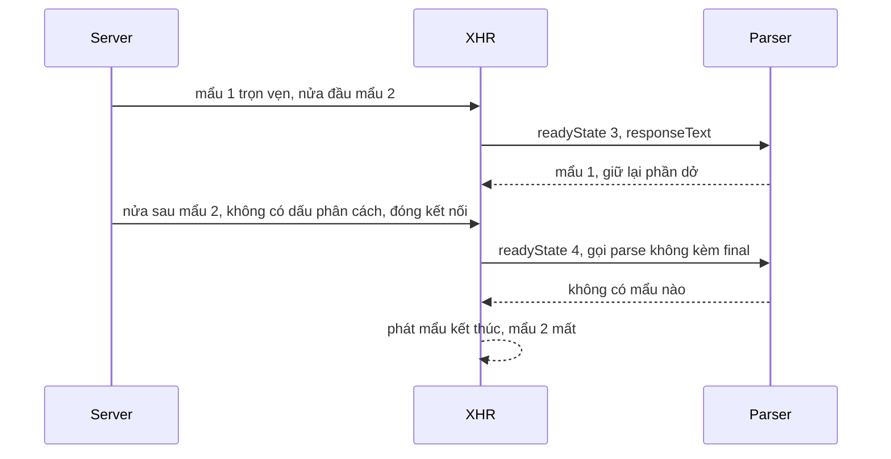

Mở DevTools trên facebook.com, xem response của một request `/ajax/...`. Dòng đầu tiên luôn là:

```text
for (;;);{"__ar":1,"payload":{...}}
```

Một vòng lặp vô hạn, ngay trước dữ liệu. Không phải lỗi: đây là lớp chống **JSON hijacking** có từ thời trình duyệt còn cho phép trang khác đọc dữ liệu JSON qua thẻ `<script>`. Cùng chỗ đó, Facebook còn có `ChunkedRequest`: một request trả về **nhiều mẩu JSON**, client xử lý từng mẩu ngay khi nó về thay vì chờ cả response.

> [!TIP]
> **Tóm tắt**
> - `<script src="https://victim/api">` gửi kèm cookie của nạn nhân và **chạy** response như JavaScript. Tiền tố `for (;;);` làm script kẹt vòng lặp vô hạn trước khi chạm tới dữ liệu.
> - Code của chính trang đọc response bằng XHR/fetch (dạng text), bỏ tiền tố rồi `JSON.parse`. `CSRFGuard.clean` trả `null` nếu thiếu tiền tố, không âm thầm chấp nhận.
> - `ChunkedRequest` đọc XHR ở `readyState 3`, cắt theo `\r\n`, nhớ offset. Lỗi: ở `readyState 4` nó gọi parser **không** kèm cờ kết thúc, nên mẩu cuối không có `\r\n` theo sau bị mất, chỉ còn mẩu đánh dấu `"{}"`.
> - Viết lại bằng `fetch` + `ReadableStream` + `TextDecoderStream`: kiểm tra tiền tố một lần, ghép mẩu bị cắt đôi, phát nốt mẩu cuối.

<iframe class="demo-frame" src="/demos/facebook-patterns/index.html?theme=dark#/chunked-stream" title="Demo chunked-stream" loading="lazy" style="height: 820px"></iframe>

<p class="demo-links">▶ <a href="/demos/facebook-patterns/index.html#/chunked-stream" target="_blank" rel="noopener">Mở demo toàn màn hình ↗</a> · <a href="https://stackblitz.com/github/hunghg255/blog-hunghg/tree/master/examples/facebook-patterns?file=src/lib/chunkedResponse.ts" target="_blank" rel="noopener">Sửa code trên StackBlitz ↗</a> · <a href="https://github.com/hunghg255/blog-hunghg/blob/master/examples/facebook-patterns/src/lib/chunkedResponse.ts" target="_blank" rel="noopener">Xem source trên GitHub ↗</a></p>

## JSON hijacking là gì?

Thẻ `<script src>` được phép tải từ bất kỳ domain nào, và trình duyệt **gửi kèm cookie** của domain đó (trước khi có `SameSite`). Trang `evil.example` có thể viết:

```html
<script src="https://social.example/api/friends"></script>
```

Response là JSON của người đang đăng nhập. Trình duyệt chạy nó như JavaScript. Một object `{"a":1}` đứng đầu là lỗi cú pháp (bị hiểu là block có label), nên không có gì xảy ra. Nhưng một **mảng** `[{"email":"…"}]` là biểu thức hợp lệ. Trình duyệt cũ (Firefox 2, Safari đời đầu) gọi constructor `Array` khi tạo mảng literal, nên trang độc chỉ cần ghi đè `Array` hoặc định nghĩa setter trên `Object.prototype` là đọc được từng phần tử. Gmail từng bị lộ danh bạ theo cách này năm 2006.

Thêm `for (;;);` vào đầu: script chạy vào vòng lặp vô hạn, không bao giờ tới dòng tạo mảng. Code hợp lệ của chính trang đọc response bằng XHR (không bị chặn bởi same-origin policy vì cùng origin), nhận về **text**, cắt tiền tố rồi mới parse.

Nút "Không tiền tố" / "Có for (;;);" trong demo chạy payload như một script trong Worker: không tiền tố thì chạy tới hết; có tiền tố thì kẹt, và demo dừng Worker sau 300ms.

Trình duyệt hiện đại đã chặn hướng tấn công này bằng nhiều lớp (mảng literal không gọi constructor do người dùng ghi đè, cookie `SameSite=Lax` mặc định, CORB/ORB chặn response JSON nạp qua `<script>`). Tiền tố vẫn là lớp phòng thủ rẻ, không phụ thuộc vào trình duyệt của người dùng.

## Facebook làm thế nào?

### CSRFGuard

Module rất ngắn:

```js
const marker = 'for (;;);';
const regex = /^for ?\(;;\);/;
export const length = marker.length;
export function exists(s) { return !!s.match(regex); }
export function clean(s) {
  const m = s.match(regex);
  return m ? s.substr(m[0].length) : m; // không khớp: m là null
}
```

Regex chấp nhận cả `for(;;);` không dấu cách. `clean` trả `null` khi thiếu tiền tố. Lớp transport gắn nó bằng `setResponseFilter(CSRFGuard.clean)`, nên response nào không có tiền tố sẽ thành `null` và bị xử lý như lỗi. Đây là lựa chọn có chủ đích: nếu một endpoint quên gắn tiền tố, client báo lỗi ngay trong lúc phát triển thay vì chạy được và để lọt lỗ hổng ra production.

### ChunkedRequest

Một số endpoint (tải dần bảng tin, kết quả tìm kiếm) trả nhiều mẩu JSON cách nhau bởi `\r\n`, mỗi mẩu được server `flush` ngay khi có. `ChunkedRequest` (bundle `107.js`) đọc chúng bằng XHR:

- Gắn `suppress_http_code=1` để server luôn trả 200 (lỗi nằm trong payload), và yêu cầu trình duyệt hỗ trợ `withCredentials`.
- Ở mỗi sự kiện `readystatechange` với `readyState === 3` (đang nhận), đưa **toàn bộ** `responseText` cho parser. Parser nhớ `offset` đã đọc, chỉ cắt phần mới theo `\r\n`, giữ lại phần dở dang chưa có dấu phân cách.
- Ở `readyState === 4` và status 200, làm đúng việc đó một lần nữa, rồi phát mẩu đánh dấu kết thúc `"{}"` (kèm cờ "là lần cuối" cho mọi mẩu của lần gọi này).
- Mỗi mẩu đi qua `sdk.safelyParseResponse`: `JSON.parse`, lỗi thì trả một object lỗi (code 1, subcode 1357046, "Received Invalid JSON reply.") thay vì ném. Module này nằm cạnh phần SDK và **không** bóc tiền tố `for (;;);`, nên các endpoint dùng nó có lẽ không gắn tiền tố.

Có một kiểm tra path traversal đơn giản: URI chứa `/../`, `/..\`, `\../` hoặc `\..\` thì từ chối. Kiểm tra theo chuỗi nên dạng mã hoá `%2e%2e` không bị bắt; có lẽ server đã chuẩn hoá đường dẫn nên đây chỉ là lớp phụ.

### Mẩu cuối bị mất

Parser có tham số thứ hai `final`: khi bật, nó phát nốt phần sau dấu phân cách cuối. Nhưng hàm xử lý `readystatechange` gọi `parse(responseText)` ở **cả** `readyState 3` lẫn `4`, không bao giờ truyền `final`. Nhánh đó là code chết. Hệ quả:

- Server kết thúc mọi mẩu bằng `\r\n` (kể cả mẩu cuối): chạy đúng. Có lẽ server của Facebook luôn làm vậy, nên lỗi không lộ ra.
- Server bỏ `\r\n` sau mẩu cuối (cách viết NDJSON rất phổ biến): mẩu cuối **mất im lặng**. Người gọi chỉ nhận được `"{}"` báo hết.

Làn "Kiểu ChunkedRequest" trong demo nhận 4/5 mẩu rồi tới `"{}"`. Bản mô phỏng ở `chunkedFbStyle.ts` (viết lại theo logic đã giải mã, không phải mã của Meta).

Nếu ai đó "sửa" bằng cách truyền `final = true` ở `readyState 4`, nhánh code chết lại có lỗi riêng: nó đẩy phần còn lại **kể cả khi rỗng**. Response kết thúc bằng `\r\n` sẽ sinh thêm một mẩu `""`, `JSON.parse("")` thành object lỗi 1357046. Sửa đúng là: truyền `final`, và chỉ đẩy phần còn lại khi nó không rỗng.



## Bên trong trình duyệt

`readyState 3` của XHR không phải là streaming thật: `responseText` là một chuỗi **lớn dần**, giữ toàn bộ response trong bộ nhớ, và mỗi lần truy cập có thể phải nối lại chuỗi. Với response vài MB, đọc lại cả `responseText` mỗi sự kiện là O(n²) theo tổng kích thước.

`fetch` cho `response.body` là một `ReadableStream<Uint8Array>`: mỗi lần `read()` chỉ trả phần mới, phần đã đọc có thể được giải phóng. `TextDecoderStream` giải mã UTF-8 đúng cả khi một ký tự nhiều byte bị cắt giữa hai mẩu mạng (chữ "ế" là 3 byte). Tự `new TextDecoder().decode(chunk)` từng mẩu mà quên `{ stream: true }` sẽ ra ký tự `�` ở chỗ cắt.

## Viết lại

Parser tách mẩu, nhận dữ liệu qua `push` (fetch) chứ không phải toàn bộ text (XHR):

```ts title=src/lib/chunkedResponse.ts
  private drain(final: boolean): string[] {
    const out: string[] = [];
    let start = this.offset;
    let idx = this.buffer.indexOf(this.delimiter, start);
    while (idx !== -1) {
      const piece = this.buffer.slice(start, idx);
      if (piece) out.push(piece);
      start = idx + this.delimiter.length;
      idx = this.buffer.indexOf(this.delimiter, start);
    }
    this.offset = start;
    if (final) {
      const rest = this.buffer.slice(this.offset);
      // khác bản gốc: luôn phát mẩu cuối (kể cả khi không có dấu phân cách theo sau),
      // nhưng không phát mẩu rỗng khi luồng kết thúc đúng bằng dấu phân cách
      if (rest) out.push(rest);
      this.offset = this.buffer.length;
    }
    // bỏ phần đã đọc để buffer không phình mãi
    if (this.offset > 64 * 1024) {
      this.buffer = this.buffer.slice(this.offset);
      this.offset = 0;
    }
    return out;
  }
```

Vòng đọc từ `fetch` (phần đầu hàm `readJsonChunks` chỉ tạo reader và parser):

```ts title=src/lib/chunkedResponse.ts
  for (;;) {
    const { done, value } = await reader.read();
    if (done) break;
    if (!guardChecked) {
      head += value;
      if (head.length < GUARD.length) continue; // chưa đủ ký tự để kiểm tra tiền tố
      const body = stripGuard(head);
      if (body === null) {
        await reader.cancel();
        throw new Error('response thiếu tiền tố bảo vệ');
      }
      guardChecked = true;
      emit(parser.push(body));
      continue;
    }
    emit(parser.push(value));
  }
  if (!guardChecked) throw new Error('response kết thúc trước khi đủ tiền tố');
  emit(parser.end());
  return count;
```

::: spoiler Xem toàn bộ src/lib/chunkedResponse.ts

```ts title=src/lib/chunkedResponse.ts
/**
 * Đọc một response "nhiều mẩu JSON" ngay khi từng mẩu về, và chống JSON hijacking bằng
 * tiền tố `for (;;);` (ý tưởng từ CSRFGuard và ChunkedRequest của Facebook).
 *
 * Server trả về:   for (;;);{"a":1}\r\n{"b":2}\r\n{"c":3}
 *  - `<script src>` của trang khác nạp URL này sẽ kẹt trong vòng lặp vô hạn, không đọc được dữ liệu
 *  - code của chính trang đọc bằng fetch/XHR, bỏ tiền tố rồi JSON.parse từng mẩu
 */

export const GUARD = 'for (;;);';
const GUARD_RE = /^for ?\(;;\);/;

/**
 * Bỏ tiền tố bảo vệ. Giống bản gốc: KHÔNG có tiền tố thì trả null (không âm thầm chấp nhận),
 * để phát hiện sớm response không đi qua lớp bảo vệ.
 */
export function stripGuard(text: string): string | null {
  const m = GUARD_RE.exec(text);
  return m ? text.slice(m[0].length) : null;
}

/**
 * Tách luồng text thành các mẩu theo dấu phân cách, nhớ vị trí đã đọc.
 * Gọi lại với toàn bộ text đã nhận (XHR) hoặc qua `push` từng phần (fetch stream).
 */
export class ChunkParser {
  private offset = 0;
  private buffer = '';

  constructor(private readonly delimiter = '\r\n') {}

  /** Nhận phần text mới; trả các mẩu đã trọn vẹn. */
  push(text: string): string[] {
    this.buffer += text;
    return this.drain(false);
  }

  /** Kết thúc luồng: trả nốt phần còn lại nếu nó không rỗng. */
  end(): string[] {
    return this.drain(true);
  }

  private drain(final: boolean): string[] {
    const out: string[] = [];
    let start = this.offset;
    let idx = this.buffer.indexOf(this.delimiter, start);
    while (idx !== -1) {
      const piece = this.buffer.slice(start, idx);
      if (piece) out.push(piece);
      start = idx + this.delimiter.length;
      idx = this.buffer.indexOf(this.delimiter, start);
    }
    this.offset = start;
    if (final) {
      const rest = this.buffer.slice(this.offset);
      // khác bản gốc: luôn phát mẩu cuối (kể cả khi không có dấu phân cách theo sau),
      // nhưng không phát mẩu rỗng khi luồng kết thúc đúng bằng dấu phân cách
      if (rest) out.push(rest);
      this.offset = this.buffer.length;
    }
    // bỏ phần đã đọc để buffer không phình mãi
    if (this.offset > 64 * 1024) {
      this.buffer = this.buffer.slice(this.offset);
      this.offset = 0;
    }
    return out;
  }
}

export interface StreamCallbacks<T> {
  onChunk: (value: T, index: number) => void;
  onError?: (error: Error, raw: string) => void;
}

/**
 * Đọc response bằng fetch stream (cách hiện đại thay cho XHR readyState 3).
 * Tiền tố chỉ nằm ở đầu luồng nên chỉ kiểm tra một lần.
 */
export async function readJsonChunks<T = unknown>(
  response: Response,
  { onChunk, onError }: StreamCallbacks<T>,
  delimiter = '\r\n',
): Promise<number> {
  if (!response.body) throw new Error('response không có body để stream');
  const reader = response.body.pipeThrough(new TextDecoderStream()).getReader();
  const parser = new ChunkParser(delimiter);
  let guardChecked = false;
  let head = '';
  let count = 0;

  const emit = (pieces: string[]) => {
    for (const raw of pieces) {
      try {
        onChunk(JSON.parse(raw) as T, count++);
      } catch (e) {
        onError?.(e as Error, raw);
      }
    }
  };

  for (;;) {
    const { done, value } = await reader.read();
    if (done) break;
    if (!guardChecked) {
      head += value;
      if (head.length < GUARD.length) continue; // chưa đủ ký tự để kiểm tra tiền tố
      const body = stripGuard(head);
      if (body === null) {
        await reader.cancel();
        throw new Error('response thiếu tiền tố bảo vệ');
      }
      guardChecked = true;
      emit(parser.push(body));
      continue;
    }
    emit(parser.push(value));
  }
  if (!guardChecked) throw new Error('response kết thúc trước khi đủ tiền tố');
  emit(parser.end());
  return count;
}
```

:::

## Đi qua code

- **`stripGuard`** giữ đúng hành vi nghiêm ngặt của `CSRFGuard.clean`: thiếu tiền tố thì `null`.
- **`ChunkParser`** giữ `buffer` và `offset`. `drain` cắt mọi mẩu trọn vẹn, bỏ mẩu rỗng (hai dấu phân cách liền nhau). `readJsonChunks` **luôn** gọi `end()` khi luồng hết, và `end()` chỉ đẩy phần còn lại nếu nó không rỗng: mẩu cuối có hay không có `\r\n` đều ra đúng một lần. Khi `offset` vượt 64KB, phần đã đọc bị cắt khỏi `buffer` để bộ nhớ không lớn mãi.
- **`readJsonChunks`** gom các mẩu mạng đầu tiên vào `head` cho tới khi đủ độ dài tiền tố, vì mẩu mạng đầu có thể chỉ có `for (;`. Kiểm tra một lần; thiếu tiền tố thì `reader.cancel()` (đóng kết nối, không tải tiếp) rồi ném lỗi.
- **Lỗi parse của một mẩu** gọi `onError` và đi tiếp, giống `safelyParseResponse`: một mẩu hỏng không làm mất các mẩu sau.
- Luồng kết thúc trước khi đủ tiền tố (response rỗng, hoặc chỉ `for (`) là lỗi riêng.

**Khác bản gốc:**

- Dùng fetch stream thay cho `readyState 3`.
- Phát mẩu cuối dù không có dấu phân cách; không sinh mẩu rỗng.
- Có kiểm tra tiền tố (bản gốc tách hai việc này ra hai lớp khác nhau).
- Không có mẩu đánh dấu kết thúc `"{}"`: `readJsonChunks` trả về số mẩu khi xong.
- Không có tham số `suppress_http_code`; kiểm tra `response.ok` là việc của người gọi.

## Tại sao không làm cách khác?

- **Bọc JSON trong object thay vì tiền tố** (`{"d": [...]}`, cách của ASP.NET): object ở đầu là lỗi cú pháp nên an toàn với `<script>`, nhưng chỉ khi mọi endpoint đều nhớ bọc. Tiền tố kiểm tra được ở client, nên quên là biết ngay.
- **`)]}'` của Google/Angular**: cùng ý tưởng, tiền tố là lỗi cú pháp thay vì vòng lặp. An toàn hơn ở chỗ không làm treo tab của ai (script lỗi cú pháp thì dừng ngay). `for (;;);` có lẽ được chọn vì nó là cú pháp hợp lệ, nên cũng chặn được cả trường hợp trình duyệt cố "sửa" lỗi cú pháp.
- **NDJSON với `\n`** thay cho `\r\n`: phổ biến hơn ngày nay. Chỉ cần đổi `delimiter`. Nhớ rằng JSON có thể chứa `\n` bên trong chuỗi chỉ khi được escape, nên dấu xuống dòng thật luôn là ranh giới.
- **Server-Sent Events** (`EventSource`): có sẵn tự kết nối lại, nhưng chỉ GET, không đặt được header tuỳ ý. Với một response hữu hạn, fetch stream gọn hơn.

## Edge case và cạm bẫy

- **Proxy, CDN gom buffer**: nginx mặc định buffer response; phải tắt (`X-Accel-Buffering: no`) thì client mới nhận từng mẩu. Nén gzip cũng có thể gom nhiều mẩu nhỏ lại.
- **Mẩu chứa dấu phân cách trong chuỗi**: `JSON.stringify` luôn escape `\r` và `\n` trong chuỗi, nên ranh giới an toàn. Nếu server tự ghép JSON bằng tay thì không chắc.
- **Huỷ request**: truyền `AbortSignal` vào `fetch`; `reader.read()` sẽ reject với `AbortError`, bọc vòng `for` trong `try` nếu cần dọn dẹp.
- **Response không phải 200**: kiểm tra `response.ok` trước khi gọi `readJsonChunks`; trang lỗi HTML của proxy không có tiền tố và sẽ bị từ chối, nhưng thông báo "thiếu tiền tố" dễ gây hiểu lầm.
- **Tiền tố cho request không có cookie**: API công khai không cần, vì không có gì của người dùng để lộ.

## Dùng trong dự án

Phía server (Node):

```ts
res.setHeader('content-type', 'application/json; charset=utf-8');
res.setHeader('x-content-type-options', 'nosniff');
res.write('for (;;);');
for await (const item of produceItems()) res.write(JSON.stringify(item) + '\r\n');
res.end();
```

Phía client:

```ts
const res = await fetch('/api/feed', { credentials: 'include', signal });
if (!res.ok) throw new Error(`HTTP ${res.status}`);
await readJsonChunks<Story>(res, {
  onChunk: (story) => feed.append(story),
  onError: (e, raw) => console.warn('mẩu hỏng', raw, e),
});
```

## Kiểm thử

::: spoiler Ví dụ test (bản phác, không có trong repo)

```ts
import { expect, it } from 'vitest';
import { ChunkParser, readJsonChunks, stripGuard } from './chunkedResponse';
import { ChunkParserFbStyle, onReadyStateFbStyle } from '../demos/chunkedFbStyle';

it('stripGuard nghiêm ngặt', () => {
  expect(stripGuard('for (;;);{"a":1}')).toBe('{"a":1}');
  expect(stripGuard('for(;;);[]')).toBe('[]');
  expect(stripGuard('{"a":1}')).toBeNull();
});

it('ghép mẩu bị cắt giữa chừng', () => {
  const p = new ChunkParser();
  expect(p.push('{"a":1}\r\n{"b"')).toEqual(['{"a":1}']);
  expect(p.push(':2}\r\n')).toEqual(['{"b":2}']);
  expect(p.end()).toEqual([]);
});

it('bản kiểu FB: mẩu cuối không có dấu phân cách bị mất, chỉ còn mẩu kết thúc', () => {
  const p = new ChunkParserFbStyle();
  expect(onReadyStateFbStyle(p, '{"a":1}\r\n{"b"', false)).toEqual(['{"a":1}']);
  expect(onReadyStateFbStyle(p, '{"a":1}\r\n{"b":2}', true)).toEqual(['{}']);
});

it('nhánh final (code chết trong bản gốc) đẩy mẩu rỗng nếu được bật', () => {
  const p = new ChunkParserFbStyle();
  p.parse('{"a":1}\r\n');
  expect(p.parse('{"a":1}\r\n{"b":2}\r\n', true)).toEqual(['{"b":2}', '']);
});

it('readJsonChunks đọc stream, tiền tố bị cắt đôi', async () => {
  const parts = ['for (;', ';);{"i":0}\r\n{"i"', ':1}\r\n{"i":2}'];
  const stream = new ReadableStream({
    start(c) {
      parts.forEach((p) => c.enqueue(new TextEncoder().encode(p)));
      c.close();
    },
  });
  const got: unknown[] = [];
  const n = await readJsonChunks(new Response(stream), { onChunk: (v) => got.push(v) });
  expect(n).toBe(3);
  expect(got).toEqual([{ i: 0 }, { i: 1 }, { i: 2 }]);
});

it('thiếu tiền tố thì từ chối', async () => {
  await expect(readJsonChunks(new Response('{"a":1}\r\n'), { onChunk: () => {} })).rejects.toThrow('tiền tố');
});
```

:::

## So với thư viện và chuẩn web

- **`fetch` + `ReadableStream` + `TextDecoderStream`**: có trong mọi trình duyệt lớn (tính tới 10/2026). Có thể viết parser thành một `TransformStream` và `pipeThrough` cho gọn.
- **NDJSON / JSON Lines** và thư viện như `ndjson`, `can-ndjson-stream`: cùng định dạng "mỗi dòng một JSON". GraphQL `@defer`/`@stream` và React Server Components cũng gửi nhiều mẩu trong một response, theo định dạng riêng.
- **Phòng thủ phía trình duyệt**: `SameSite=Lax` mặc định (Chrome từ 2020), CORB rồi ORB (Opaque Response Blocking) chặn response JSON/HTML nạp bằng `<script>` khác origin, `X-Content-Type-Options: nosniff` không cho chạy response có MIME `application/json` như script. Tiền tố là lớp thêm, rẻ, không thay thế các lớp này.
- **Angular `HttpClient`** tự bỏ tiền tố `)]}',\n` trong response JSON; nếu backend của bạn phục vụ Angular thì dùng tiền tố đó cho tiện.

---

Bài này thuộc series **[Học từ mã nguồn Facebook](/series/facebook)** (106 bài, đọc theo thứ tự).

::: spoiler Xem nhanh danh sách bài trong series

*Phần 1*

- [Mở đầu: cách đọc code minify của Facebook](/blogs/learn-from-facebook-source-code)
- [#1 Dùng chung IntersectionObserver + infinite scroll](/blogs/facebook-shared-intersection-observer)
- [#2 useViewportDuration: đo thời gian thực sự được xem](/blogs/facebook-use-viewport-duration)
- [#3 Preload code + data khi hover](/blogs/facebook-preload-on-hover)
- [#4 Toast manager với external store](/blogs/facebook-toast-manager)
- [#5 Network status + heartbeat backoff](/blogs/facebook-network-status-heartbeat)
- [#6 ErrorGuard: bắt lỗi theo ngữ cảnh](/blogs/facebook-error-guard)
- [#7 Banzai: gom log theo lô + sendBeacon](/blogs/facebook-batch-logger)
- [#8 Focus trap + Esc theo layer](/blogs/facebook-focus-trap)

*Phần 2*

- [#9 Mẹo calc(… * 9999): container query, line-clamp, mũi tên carousel bằng CSS](/blogs/facebook-css-9999-trick)
- [#10 Thanh cuộn tuỳ biến bằng CSS 3D](/blogs/facebook-css-3d-scrollbar)
- [#11 Modal cuộn bằng window, giữ vị trí trang nền](/blogs/facebook-document-scroll-modal)
- [#12 Popover, tooltip group và hovercard](/blogs/facebook-popover-tooltip)
- [#13 Primitive Pressable + focus-visible](/blogs/facebook-pressable)
- [#14 Tab "Xem thêm" + sticky header bằng IntersectionObserver](/blogs/facebook-priority-tabs-sticky-header)
- [#15 Avatar khoét mask, gradient Messenger, skeleton steps()](/blogs/facebook-visual-tricks)
- [#16 Khung chat không giật](/blogs/facebook-chat-scroller)
- [#17 Thuật toán chọn bố cục collage ảnh](/blogs/facebook-photo-collage-layout)
- [#18 Keep-alive tab trong SPA](/blogs/facebook-keep-alive-tabs)
- [#19 Tự đo Visual Completion & interaction tracing](/blogs/facebook-visual-completion)
- [#20 Router SPA bền bỉ & tải chunk có retry](/blogs/facebook-spa-router-resilient-loading)

*Phần 3*

- [#21 Smart Compose: gợi ý chữ mờ khi gõ](/blogs/facebook-smart-compose-ghost-text)
- [#22 MQTT ngay trong trình duyệt, tự chuyển sang long-poll](/blogs/facebook-mqtt-in-browser)
- [#23 Đo thời gian dùng bằng bitmap 64 giây](/blogs/facebook-time-spent-bitmap)
- [#24 Bảng reaction nhấn giữ rồi trượt](/blogs/facebook-reaction-press-slide)
- [#25 Tìm kiếm gấp dấu, phiên âm và highlight đầu từ](/blogs/facebook-search-diacritics-tokenize)
- [#26 Ring buffer biết trace nào đã mất log](/blogs/facebook-trace-ring-buffer)
- [#27 Engine animation JS: một vòng rAF và solver cubic-bezier](/blogs/facebook-keyframes-loop-cubic-bezier)
- [#28 Bootloader: bitmap tài nguyên đã tải, chỉ reload khi cần](/blogs/facebook-bootloader-bitmap-consistency)
- [#29 Nhận biết click do screen reader tạo ra](/blogs/facebook-virtual-cursor-detection)
- [#30 Tải trước feed theo chất lượng mạng, đoán hạng thiết bị](/blogs/facebook-network-aware-prefetch)
- [#31 Hàng đợi gửi tin chat giữ đúng thứ tự](/blogs/facebook-ordered-send-queue)
- [#32 Gộp lời gọi API trong cùng một tick](/blogs/facebook-api-batcher)
- [#33 Resize ảnh trong pool Web Worker](/blogs/facebook-jpeg-resize-worker-pool)
- [#34 Crop ảnh theo nhiều khuôn mặt](/blogs/facebook-face-aware-crop)
- [#35 Kéo-thả sắp xếp và vùng thả file không nhấp nháy](/blogs/facebook-flicker-free-drag-drop)
- [#36 Tiện ích UI: fade-out, sticky event, hàm huỷ được](/blogs/facebook-ui-utility-hooks)
- [#37 Hạ tầng nhỏ: cookie, hash lỗi, prefetch khi chuột dừng](/blogs/facebook-small-infra-cookie-hash-idle)

*Phần 4–6*

- [#38 Đồng bộ tin nhắn: phát hiện lỗ seqID và fetch bù theo tầng](/blogs/facebook-messenger-sync-seqid-gaps)
- [#39 OTID: ID tin nhắn kiểu Snowflake sinh ở client](/blogs/facebook-otid-client-snowflake)
- [#40 QPL: lấy mẫu từ lúc bắt đầu, đo RTT gửi tin đầu-cuối](/blogs/facebook-qpl-send-rtt)
- [#41 Bộ điều phối request bảy chế độ gộp và chống trùng](/blogs/facebook-request-dispatcher-modes)
- [#42 Thread list theo mốc thời gian, cookie presence có version](/blogs/facebook-threadlist-ranged-presence)
- [#43 Composer dạng plugin: reducer, dirty checker, chuỗi kiểm tra](/blogs/facebook-plugin-composer)
- [#44 Thanh toán bất đồng bộ: subscribe trước, poll dự phòng](/blogs/facebook-async-checkout)
- [#45 Validate số thẻ: sửa lỗi gõ, dải BIN, Luhn](/blogs/facebook-card-validation)
- [#46 Lịch chọn khoảng ngày: bo góc dải chọn, phím đủ bộ, RTL](/blogs/facebook-range-calendar-a11y)
- [#47 Giờ mở cửa theo tuần: qua đêm, gộp khoảng, phần bù](/blogs/facebook-weekly-hours-intervals)
- [#48 Tiến độ đăng realtime: giữ event chờ snapshot, watchdog](/blogs/facebook-realtime-publish-snapshot)
- [#49 Tiền tệ theo đơn vị nhỏ nhất và ô nhập tiền](/blogs/facebook-currency-minor-units)
- [#50 Sửa hàng loạt Empty/Uniform/Mixed, seen/read bằng 2 bit](/blogs/facebook-bulk-edit-seen-bits)
- [#51 Phát hiện script lạ hook vào hàm native](/blogs/facebook-native-hook-detection)
- [#52 localStorage tự dọn khi đầy quota](/blogs/facebook-quota-aware-storage)
- [#53 Cache tuyến do server phân giải, chờ sẵn promise](/blogs/facebook-route-cache-prefetch)
- [#54 Lưới phím mũi tên 2D và focus không làm cuộn trang](/blogs/facebook-focus-table-grid)
- [#55 Tách emoji bằng máy trạng thái](/blogs/facebook-emoji-segmentation)
- [#56 Đọc trước ghi sau trong một frame, con tự biết vị trí](/blogs/facebook-read-then-write-dom)
- [#57 Hàng đợi lệnh cho video và stream sắp lại chunk](/blogs/facebook-video-command-queue)

*Phần 7–10*

- [#58 Ước lượng băng thông EWMA: loại outlier, nhớ qua phiên](/blogs/facebook-bandwidth-ewma-estimator)
- [#59 ABR theo độ tự tin phát và cắt bậc bitrate theo MOS](/blogs/facebook-abr-playback-confidence)
- [#60 Prefetch segment dự đoán từ manifest, parse hộp sidx](/blogs/facebook-dash-predicted-segments)
- [#61 Đọc metadata MP4/MOV ngay trên client](/blogs/facebook-mp4-metadata-client)
- [#62 Upload tiếp tục được: offset, hash dedupe, phát hiện treo](/blogs/facebook-resumable-upload)
- [#63 Fenwick tree: chọn ngẫu nhiên có trọng số và offset dòng](/blogs/facebook-fenwick-weighted-random)
- [#64 Vạch trục số và trục thời gian "đẹp"](/blogs/facebook-nice-axis-ticks)
- [#65 Damerau-Levenshtein theo dải chéo và tự sửa tên gõ sai](/blogs/facebook-damerau-levenshtein)
- [#66 PRNG có seed, shuffle tái lập và lấy mẫu trace](/blogs/facebook-seeded-prng-sampling)
- [#67 Cặp min/max-heap tái dùng vị trí trong danh sách ảo](/blogs/facebook-dual-heap-buffer-set)
- [#68 Memo nhiều đối số bằng Map/WeakMap và interning object](/blogs/facebook-multikey-memo-interning)
- [#69 Thống kê cửa sổ trượt và đại số khoảng thời gian](/blogs/facebook-moving-stat-intervals)
- [#70 Int64 từ hai số 32-bit, decode UTF, offset theo code point](/blogs/facebook-int64-utf-codepoints)
- [#71 Engine múi giờ IANA trên client, phát hiện lệch giờ](/blogs/facebook-client-iana-timezone)
- [#72 Tự cài semver range](/blogs/facebook-semver-range)
- [#73 Auto-link URL, cắt chữ an toàn, giới hạn LaTeX](/blogs/facebook-autolink-safe-truncate)
- [#74 Parser query kiểu PHP chống prototype pollution](/blogs/facebook-php-query-serializer)
- [#75 Popover tự lật theo phần tràn nhỏ nhất](/blogs/facebook-popover-auto-flip)
- **#76 Tiền tố for(;;) chống JSON hijacking, đọc stream** (bài này)
- [#77 Chống lộ Referer, linkshim, xoá token trên URL](/blogs/facebook-referrer-linkshim-url-scrub)
- [#78 setImmediate bằng postMessage, gom delta chuột theo frame](/blogs/facebook-setimmediate-mouse-batching)
- [#79 Phát hiện crash qua heartbeat, dò proxy cache hỏng](/blogs/facebook-crash-heartbeat-proxy-check)
- [#80 DPR vào cookie cho ảnh @2x, che khoá trong log](/blogs/facebook-dpr-cookie-secret-redaction)
- [#81 Flux waitFor tự viết và proxy có đệm](/blogs/facebook-flux-dispatch-buffered-proxy)
- [#82 Crop đúng tỉ lệ, xoay sticker bằng ma trận](/blogs/facebook-image-crop-rotation-geometry)

*Phần 11–15*

- [#83 Chia subdomain giữa các tab bằng lease, long-poll theo bảng trạng thái](/blogs/facebook-tab-subdomain-lease-longpoll)
- [#84 MQTT QoS1: giữ publish chờ ack, gửi lại khi kết nối lại](/blogs/facebook-mqtt-qos1-republish)
- [#85 Cache Promise gộp request, cache lỗi ngắn, đua dữ liệu nhúng sẵn](/blogs/facebook-promise-cache-preload-race)
- [#86 Lịch retry: backoff có trần, Fibonacci, báo lỗi CDN mỗi N ngày](/blogs/facebook-retry-backoff-schedules)
- [#87 Giữ nguyên tham chiếu nhánh dữ liệu không đổi](/blogs/facebook-relay-recycle-nodes)
- [#88 Store optimistic: copy-on-write, rollback rồi áp lại](/blogs/facebook-relay-optimistic-store)
- [#89 Chỉ mục subscription theo record, hàng đợi task theo chiều sâu](/blogs/facebook-relay-subscription-index)
- [#90 Phân trang connection: cursor khớp đầu, edge không trùng](/blogs/facebook-relay-connection-pagination)
- [#91 Profiler kiểu middleware và memo selector có lấy mẫu kiểm tra](/blogs/facebook-profiler-middleware-memo-check)
- [#92 Đọc EBML/WebM Cues để tìm byte range của segment](/blogs/facebook-webm-ebml-cues)
- [#93 Stream HTTP Range tạm dừng được, tải tiếp đúng byte](/blogs/facebook-pausable-range-stream)
- [#94 Bảng khoảng thời gian gắn nhãn và nhảy qua lỗ buffer](/blogs/facebook-tagged-time-ranges-gaps)
- [#95 Gom chunk cho SourceBuffer, đồng bộ video bằng playbackRate](/blogs/facebook-sourcebuffer-video-sync)
- [#96 Gom tin nhắn thành cụm, vạch ngày và avatar đã xem](/blogs/facebook-message-grouping)
- [#97 Bao nhiêu tab chat vừa màn hình, chuỗi luật mở tab](/blogs/facebook-chat-tab-policy)
- [#98 Phím tắt Markdown trong editor, Backspace để hoàn tác](/blogs/facebook-markdown-shortcuts-editor)
- [#99 Offset theo code point hay UTF-16: bốn bug cùng một gốc](/blogs/facebook-codepoint-offset-bugs)
- [#100 Typeahead không nhảy: cache tiền tố, chặn reflow, khoá hover](/blogs/facebook-typeahead-stable-results)
- [#101 Hit-test trên canvas bằng phát lại path, nét đứt và cung Bézier](/blogs/facebook-canvas-hit-regions)
- [#102 Vòng tròn theo mét trên bản đồ Mercator](/blogs/facebook-mercator-meter-circles)
- [#103 Dò tính năng trình duyệt: ảnh EXIF 2×1, getter bẫy, scrollbar](/blogs/facebook-feature-probe-tricks)
- [#104 Bug định dạng số và kiểm tra dữ liệu theo locale](/blogs/facebook-locale-validation-bugs)
- [#105 Dispose cho đúng: idle callback, splice(-1), xoá nhầm key](/blogs/facebook-dispose-leak-bugs)

:::

Code + demo: [`examples/facebook-patterns`](https://github.com/hunghg255/blog-hunghg/tree/master/examples/facebook-patterns) · [Mở trên StackBlitz](https://stackblitz.com/github/hunghg255/blog-hunghg/tree/master/examples/facebook-patterns)
