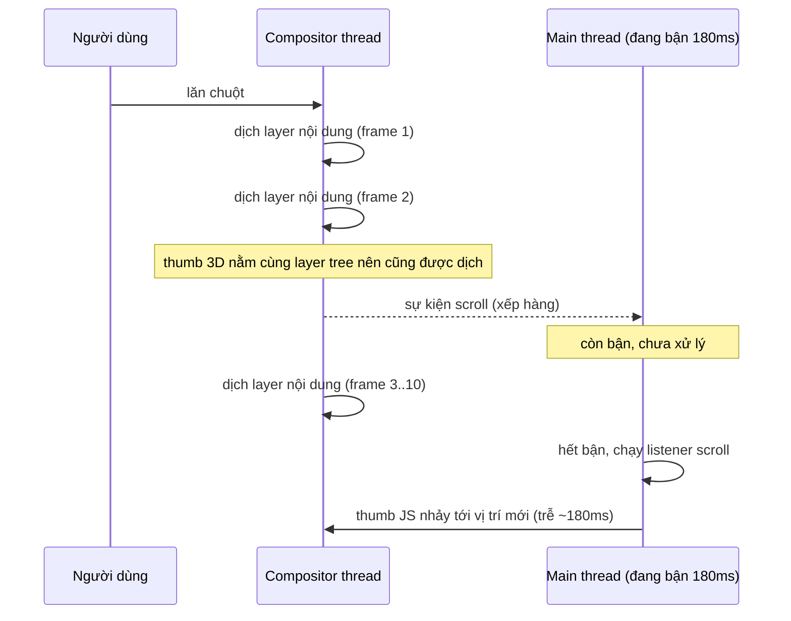

Thanh cuộn mặc định trên Windows khá dày, luôn hiện, và chỉ đổi theo dark mode nếu trang khai báo `color-scheme`. Trên một sidebar hay một popup chat, nó chiếm chỗ và trông lạc tông. Gần như dự án nào cũng muốn thay nó bằng một thanh mảnh, bo tròn, chỉ hiện khi hover.

Thư viện phổ biến làm việc đó bằng JS: ẩn thanh cuộn gốc, vẽ một `div` làm thumb, rồi nghe sự kiện `scroll` để cập nhật vị trí:

```ts
scroller.addEventListener('scroll', () => {
  thumb.style.transform = `translateY(${scroller.scrollTop * ratio}px)`;
});
```

Code này sai ở một chỗ tinh vi: **cuộn trang không chạy trên main thread**, còn listener thì có. Khi main thread bận (render React, parse JSON, chạy quảng cáo), nội dung vẫn cuộn mượt nhưng thumb đứng yên hoặc nhảy cóc.

Facebook giải bài này trong `BaseScrollableArea.react` (thư mục `BaseScrollableArea.react/` trong [facebook-codebase](https://github.com/hunghg255/facebook-codebase)) bằng một mẹo hình học: **đặt thumb vào không gian 3D sao cho phép chiếu phối cảnh tự di chuyển nó đúng tỉ lệ**. Không có listener `scroll` nào đụng tới vị trí thumb. JS chỉ chạy khi kích thước thay đổi (listener `scroll` duy nhất chỉ bật/tắt độ mờ của thumb).

> [!TIP]
> **Tóm tắt**
> - Thumb vẽ bằng JS bị trễ khi main thread bận, vì sự kiện `scroll` chạy trên main thread còn việc cuộn thì không.
> - Facebook đặt thumb bên trong vùng cuộn, ở một chiều sâu Z với ma trận có `w = −1`, sau `perspective: 1px`. Phép chiếu phối cảnh làm thumb đi xuống đúng `h` lần quãng cuộn, và việc này do compositor làm.
> - JS chỉ tính lại `thumb = b²/a` và chuỗi transform khi kích thước đổi.
> - Hôm nay nên thử trước `scrollbar-width`/`scrollbar-color`, rồi tới scroll-driven animations (`animation-timeline: scroll()`), cũng chạy trên compositor.

## Bên trong trình duyệt: vì sao thanh cuộn JS bị trễ

Chrome, Firefox và Safari đều có **compositor thread** riêng. Khi bạn lăn chuột trên một vùng cuộn (không có listener `wheel`/`touchmove` non-passive), compositor tự dịch chuyển layer của nội dung mà không cần hỏi main thread. Sự kiện `scroll` vẫn được gửi về main thread, nhưng **bất đồng bộ**, tối đa một lần mỗi frame, và chỉ khi main thread rảnh.



Muốn thumb bám theo nội dung ở **mọi frame**, vị trí của nó phải được tính **bởi compositor**. Compositor không chạy được JS, nhưng nó tính được transform 3D. Đó là cửa sổ mà Facebook tận dụng.

## Facebook làm thế nào?

Mình đã tra từng class atomic trong file CSS của repo. Phần tử cuộn có các style sau:

| Style | Giá trị thật | Mục đích |
| --- | --- | --- |
| `hideScrollbar` | `scrollbar-width: none`, `::-webkit-scrollbar { display: none }`, `-ms-overflow-style: none` | ẩn thanh cuộn gốc |
| `perspective` | `perspective: 1px; perspective-origin: right top; transform-style: preserve-3d; position: relative` | dựng không gian 3D |

Thumb là con **trực tiếp** của phần tử cuộn (không nằm trong wrapper nội dung):

- `position: absolute; top: 0; right: 0; width: 16px; padding: 0 4px; box-sizing: border-box; transform-origin: right top; pointer-events: none`
- `opacity: 0; transition-duration: .3s`. Khi hover, đang cuộn hoặc đang kéo thì `opacity: 1; transition-duration: 0`, nghĩa là hiện ngay lập tức và ẩn từ từ.
- Bên trong là một div `background-color: var(--scroll-thumb)`, bo góc.

Kế bên là một **track**: `position: absolute; top: 0; right: 0; width: 16px; background: var(--divider); opacity: 0`, hover thì `opacity: .3`. Thumb không nhận chuột, nên mọi thao tác chuột đi vào track.

Hàm đo (chạy khi mount, khi `window` resize và khi `ResizeObserver` báo nội dung hoặc khung đổi kích thước, debounce 100ms):

```js
e.style.display = "none";            // track
d.style.display = "none";            // thumb
var a = c.getBoundingClientRect(), b = a.height;   // b = chiều cao khung
a = c.scrollHeight;                                // a = chiều cao nội dung
f = Math.pow(b, 2) / a;                            // thumb = b² / a
var h = (b - f) / (a - b);
d.style.height = a <= b ? "0px" : f + "px";
e.style.height = a + "px";
d.style.transform = ["matrix3d(1,0,0,0, 0,1,0,0, 0,0,1,0, 0,0,0,-1)",
  "scale(" + 1 / h + ")", "translateZ(" + (1 - 1 / h) + "px)", "translateZ(-2px)"].join(" ");
```

Bốn dòng `transform` cuối là toàn bộ phép màu. Phần còn lại của component chỉ xử lý chuột:

- **Bấm vào rãnh ngoài thumb**: `setInterval` 16ms, mỗi lần `scrollTo(scrollTop ± 20)`, chỉ cuộn khi chuột còn nằm trên track (theo dõi `mouseenter`/`mouseleave`).
- **Kéo thumb**: `scrollTo(top0 + dy * scrollHeight / clientHeight)`.
- **Ẩn thumb**: hiện trong 1 giây sau mỗi sự kiện `scroll`, sau đó ẩn.

Và một danh sách nền tảng **không dùng** kỹ thuật này (hàm `q()` trong file): iOS, Android, Edge, IE và Firefox < 64, phát hiện bằng `UserAgent`. Trên các nền tảng đó, component render một `div` cuộn bình thường.

## Chứng minh: vì sao thumb đi đúng tỉ lệ

Đây là phần thú vị nhất. Ta cần chứng minh: khi nội dung cuộn `S` px, thumb đi xuống đúng `h · S` px, với

- `b` = chiều cao khung, `a` = chiều cao nội dung,
- `f = b² / a` = chiều cao thumb (thumb chiếm phần khung đúng bằng tỉ lệ khung trên nội dung),
- `h = (b − f) / (a − b)` = quãng đường thumb đi được (`b − f`) chia quãng đường cuộn được (`a − b`).

### Bước 1: hệ toạ độ

Gốc toạ độ đặt ở **góc trên bên phải của khung cuộn**, đúng bằng `perspective-origin: right top`. Thumb có `top: 0; right: 0` và `transform-origin: right top`, nên góc trên phải của thumb **trùng** gốc toạ độ khi chưa cuộn.

Thumb là phần tử absolute bên trong vùng cuộn, nên nó cuộn **cùng nội dung**: cuộn `S` px thì vị trí layout của nó dịch lên `S`, tức đang ở `(0, −S)` so với gốc.

Một điểm trên thumb có toạ độ cục bộ `(x, y)` với `x ≤ 0` (thumb nằm bên trái gốc) và `0 ≤ y ≤ f`. Viết dạng toạ độ thuần nhất `(x, y, 0, 1)`.

### Bước 2: áp transform của thumb

Danh sách `transform: A B C D` nghĩa là ma trận `A·B·C·D`, áp vào điểm theo thứ tự **từ phải sang trái**:

1. `translateZ(-2px)` rồi `translateZ(1 − 1/h)`: `z = −2 + 1 − 1/h = −1 − 1/h`. Hai bước này tương đương **một** `translateZ(−1 − 1/h)`; việc tách đôi không ảnh hưởng kết quả.
2. `scale(1/h)` (scale 2D, chỉ x và y): `(x/h, y/h, −1 − 1/h, 1)`.
3. `matrix3d(…, 0,0,0,−1)`: ma trận đơn vị, chỉ có phần tử cuối là `−1`, nên **đổi dấu `w`**: `(x/h, y/h, −1 − 1/h, −1)`.

### Bước 3: đặt vào vị trí và chiếu phối cảnh

Dịch chuyển do vị trí layout `(0, −S)` là một ma trận tịnh tiến. Với toạ độ thuần nhất, phép tịnh tiến cộng `t · w` chứ không cộng `t`:

```text
Y = y/h + (−S) · w = y/h + (−S) · (−1) = y/h + S
```

Đây là chỗ `w = −1` phát huy tác dụng: **dấu của độ dịch do cuộn bị lật**. Nội dung đi lên thì thumb đi xuống.

Phép chiếu với `perspective: 1px` (`d = 1`) biến `w` thành `w − z/d`:

```text
w' = −1 − (−1 − 1/h) = 1/h
```

Cuối cùng trình duyệt chia cho `w'` để ra toạ độ màn hình:

```text
X_màn_hình = (x/h) / (1/h) = x
Y_màn_hình = (y/h + S) / (1/h) = y + h · S
```

- `X = x`: thumb không bị kéo giãn hay lệch ngang, rộng đúng như CSS.
- `Y = y + h·S`: mọi điểm của thumb dịch xuống đúng `h · S`, và chiều cao thumb vẫn là `f`.

**Kiểm tra hai đầu:** `S = 0` thì thumb ở trên cùng. `S = a − b` (cuộn hết) thì thumb dịch `h · (a − b) = b − f`, nằm sát đáy khung. ∎

### Vì sao gốc phối cảnh phải ở góc phải?

Giả sử góc phải của thumb **không** trùng gốc phối cảnh mà lệch `tx` px theo chiều ngang (ví dụ thumb `right: 20px`). Phép tịnh tiến đó cũng bị nhân với `w = −1` rồi nhân `h` khi chiếu:

```text
X_màn_hình = (x/h + tx · (−1)) · h = x − h · tx
```

Thumb hiện ra ở `−h·tx` thay vì `tx`: bị lật sang phía đối diện và co lại theo hệ số `h`. Điều tương tự xảy ra với độ lệch theo chiều dọc. Mẹo chỉ đúng khi độ dịch **duy nhất** đi qua phép lật là độ dịch do cuộn. Vì vậy `perspective-origin`, `transform-origin` đều là `right top` và thumb nằm đúng `top: 0; right: 0`.

### Thử với số thật trong demo

Khung `b = 298`, nội dung `a = 2060`:

| Đại lượng | Giá trị |
| --- | --- |
| thumb `f = b²/a` | 43.1px |
| `h = (298 − 43.1) / (2060 − 298)` | 0.1447 |
| `scale(1/h)` | `scale(6.91)` |
| tổng `translateZ` | `−7.91px` |
| cuộn `S = 441` | thumb ở `63.8px` (đo thật trong Chrome: 63.7px) |
| cuộn hết `S = 1762` | thumb ở `254.9px`, đáy thumb ở `298px` |

Mình đo các con số này bằng Playwright khi viết bài (script đo không nằm trong repo; đoạn tương tự ở phần Kiểm thử).

## Viết lại

Bản viết lại tách làm ba phần: hàm thuần `computeThumb` (dễ test), các style object, và `attachPerspectiveScrollbar` gắn hành vi vào 4 phần tử DOM. Không phụ thuộc React, nên dùng được ở bất kỳ đâu. Phần cốt lõi là `computeThumb`:

```ts title=src/lib/perspectiveScrollbar.ts
/**
 * Tính kích thước + transform của thumb.
 * - Thumb chiếm tỉ lệ viewport/content của rãnh: thumb = b² / a (giống thanh cuộn hệ thống),
 *   nhưng không nhỏ hơn `minThumb` (Facebook không có giới hạn này).
 * - ratio = quãng đường thumb đi được / quãng đường nội dung cuộn được.
 * - Sau phép chiếu, toạ độ y của thumb trên màn hình = y + ratio * scrollTop (xem bài viết).
 */
export function computeThumb(viewport: number, content: number, minThumb = 0): ThumbMetrics {
  if (content <= viewport || viewport <= 0) {
    return { viewport, content, thumbHeight: 0, ratio: 0, transform: 'none', visible: false };
  }
  const thumbHeight = Math.min(viewport, Math.max(minThumb, (viewport * viewport) / content));
  const ratio = (viewport - thumbHeight) / (content - viewport);
  const transform = [
    // w' = -w: lật dấu phần dịch chuyển do cuộn -> thumb đi ngược chiều nội dung
    'matrix3d(1,0,0,0, 0,1,0,0, 0,0,1,0, 0,0,0,-1)',
    // thu nhỏ trước để sau khi chia cho w' = 1/ratio thì kích thước trở lại như cũ
    `scale(${1 / ratio})`,
    // tổng z = -1 - 1/ratio  ->  w' = -1 - z = 1/ratio (với perspective 1px)
    `translateZ(${1 - 1 / ratio}px)`,
    'translateZ(-2px)',
  ].join(' ');
  return { viewport, content, thumbHeight, ratio, transform, visible: true };
}
```

::: spoiler Xem toàn bộ src/lib/perspectiveScrollbar.ts

```ts title=src/lib/perspectiveScrollbar.ts
import type { CSSProperties } from 'react';

/**
 * Thanh cuộn tuỳ biến mà thumb di chuyển hoàn toàn trên compositor: không có listener
 * `scroll` nào cập nhật vị trí thumb (ý tưởng từ BaseScrollableArea của Facebook).
 *
 * Phần tử cuộn có `perspective: 1px`. Thumb là con `position: absolute` của nó (nên cuộn theo
 * nội dung), nhưng được đặt ở một chiều sâu Z và một ma trận có w = -1 sao cho sau phép chiếu
 * phối cảnh, nó đi XUỐNG với tốc độ `ratio` lần tốc độ cuộn. JS chỉ tính lại khi kích thước đổi.
 */

export interface ThumbMetrics {
  /** chiều cao vùng nhìn thấy (b) */
  viewport: number;
  /** tổng chiều cao nội dung (a = scrollHeight) */
  content: number;
  thumbHeight: number;
  /** thumb đi được bao nhiêu px khi nội dung cuộn 1px: (b - thumb) / (a - b) */
  ratio: number;
  transform: string;
  visible: boolean;
}

/**
 * Tính kích thước + transform của thumb.
 * - Thumb chiếm tỉ lệ viewport/content của rãnh: thumb = b² / a (giống thanh cuộn hệ thống),
 *   nhưng không nhỏ hơn `minThumb` (Facebook không có giới hạn này).
 * - ratio = quãng đường thumb đi được / quãng đường nội dung cuộn được.
 * - Sau phép chiếu, toạ độ y của thumb trên màn hình = y + ratio * scrollTop (xem bài viết).
 */
export function computeThumb(viewport: number, content: number, minThumb = 0): ThumbMetrics {
  if (content <= viewport || viewport <= 0) {
    return { viewport, content, thumbHeight: 0, ratio: 0, transform: 'none', visible: false };
  }
  const thumbHeight = Math.min(viewport, Math.max(minThumb, (viewport * viewport) / content));
  const ratio = (viewport - thumbHeight) / (content - viewport);
  const transform = [
    // w' = -w: lật dấu phần dịch chuyển do cuộn -> thumb đi ngược chiều nội dung
    'matrix3d(1,0,0,0, 0,1,0,0, 0,0,1,0, 0,0,0,-1)',
    // thu nhỏ trước để sau khi chia cho w' = 1/ratio thì kích thước trở lại như cũ
    `scale(${1 / ratio})`,
    // tổng z = -1 - 1/ratio  ->  w' = -1 - z = 1/ratio (với perspective 1px)
    `translateZ(${1 - 1 / ratio}px)`,
    'translateZ(-2px)',
  ].join(' ');
  return { viewport, content, thumbHeight, ratio, transform, visible: true };
}

/** Style cho phần tử cuộn. Cần thêm CSS `::-webkit-scrollbar { display: none }` để ẩn thanh cuộn gốc. */
export const perspectiveScrollerStyle: CSSProperties = {
  position: 'relative',
  overflowY: 'auto',
  overscrollBehaviorY: 'contain',
  perspective: '1px',
  perspectiveOrigin: 'right top',
  transformStyle: 'preserve-3d',
  scrollbarWidth: 'none',
};

/** Thumb: con trực tiếp của phần tử cuộn. Không nhận chuột, chuột đi vào track bên dưới. */
export const perspectiveThumbStyle: CSSProperties = {
  position: 'absolute',
  top: 0,
  right: 0,
  width: 12,
  padding: '0 3px',
  boxSizing: 'border-box',
  transformOrigin: 'right top',
  pointerEvents: 'none',
  opacity: 0,
  display: 'none',
};

/** Track: cao bằng toàn bộ nội dung nên luôn phủ dải bên phải khi cuộn. Nhận chuột. */
export const perspectiveTrackStyle: CSSProperties = {
  position: 'absolute',
  top: 0,
  right: 0,
  width: 12,
  display: 'none',
};

export interface PerspectiveScrollbarElements {
  scroller: HTMLElement;
  /** bọc nội dung, để ResizeObserver biết khi nội dung đổi chiều cao */
  content: HTMLElement;
  thumb: HTMLElement;
  track: HTMLElement;
}

export interface PerspectiveScrollbarOptions {
  minThumb?: number;
  /** ẩn thumb sau bao lâu không cuộn */
  hideAfterMs?: number;
  onMetrics?: (metrics: ThumbMetrics) => void;
}

/**
 * Gắn hành vi vào 4 phần tử. Trả về hàm huỷ. Dùng được với bất kỳ framework nào.
 * Thứ duy nhất chạy theo `scroll` là bật/tắt độ mờ của thumb, không đụng tới vị trí.
 */
export function attachPerspectiveScrollbar(
  { scroller, content, thumb, track }: PerspectiveScrollbarElements,
  { minThumb = 24, hideAfterMs = 1000, onMetrics }: PerspectiveScrollbarOptions = {},
): () => void {
  let metrics = computeThumb(0, 0);
  let hovered = false;
  let dragging = false;
  let scrolling = false;
  let scrollTimer: ReturnType<typeof setTimeout> | undefined;

  const render = () => {
    const show = metrics.visible && (hovered || dragging || scrolling);
    thumb.style.opacity = show ? '1' : '0';
    // hiện ngay lập tức, ẩn thì mờ dần (Facebook: 0s khi hiện, .3s khi ẩn)
    thumb.style.transition = show ? 'opacity 0s' : 'opacity .3s';
  };

  const measure = () => {
    // Ẩn thumb + track TRƯỚC khi đo: track cao bằng scrollHeight cũ, nếu để nguyên thì nội dung
    // co lại mà scrollHeight vẫn giữ giá trị cũ (track tự "chống" chiều cao của chính nó).
    thumb.style.display = 'none';
    track.style.display = 'none';
    metrics = computeThumb(scroller.clientHeight, scroller.scrollHeight, minThumb);
    thumb.style.height = `${metrics.thumbHeight}px`;
    thumb.style.transform = metrics.transform;
    track.style.height = `${metrics.content}px`;
    thumb.style.display = metrics.visible ? 'block' : 'none';
    track.style.display = metrics.visible ? 'block' : 'none';
    render();
    onMetrics?.(metrics);
  };

  let resizeTimer: ReturnType<typeof setTimeout> | undefined;
  const scheduleMeasure = () => {
    clearTimeout(resizeTimer);
    resizeTimer = setTimeout(measure, 100); // debounce 100ms như Facebook
  };

  const onScroll = () => {
    scrolling = true;
    render();
    clearTimeout(scrollTimer);
    scrollTimer = setTimeout(() => {
      scrolling = false;
      render();
    }, hideAfterMs);
  };
  const onEnter = () => {
    hovered = true;
    render();
  };
  const onLeave = () => {
    hovered = false;
    render();
  };

  // Kéo thumb / giữ chuột trên rãnh
  let repeatTimer: ReturnType<typeof setInterval> | undefined;
  const onPointerDown = (event: PointerEvent) => {
    if (event.button !== 0 || !metrics.visible) return;
    event.preventDefault();
    const scrollerTop = scroller.getBoundingClientRect().top;
    const startY = event.clientY;
    const startScroll = scroller.scrollTop;
    const thumbTop = scrollerTop + startScroll * metrics.ratio;
    let pointerY = startY;
    track.setPointerCapture(event.pointerId);

    if (startY < thumbTop || startY > thumbTop + metrics.thumbHeight) {
      // Bấm vào rãnh ngoài thumb: cuộn dần 20px mỗi 16ms về phía con trỏ, và DỪNG khi thumb đã
      // chạm tới con trỏ (giống thanh cuộn hệ thống), không cuộn tuốt tới cuối.
      const step = startY < thumbTop ? -20 : 20;
      repeatTimer = setInterval(() => {
        const top = scroller.getBoundingClientRect().top + scroller.scrollTop * metrics.ratio;
        const reached = step < 0 ? pointerY >= top : pointerY <= top + metrics.thumbHeight;
        if (reached) clearInterval(repeatTimer);
        else scroller.scrollBy({ top: step });
      }, 16);
    } else {
      dragging = true;
      render();
    }

    const onMove = (e: PointerEvent) => {
      pointerY = e.clientY;
      if (!dragging) return;
      // thumb đi 1px thì nội dung đi 1/ratio px
      scroller.scrollTop = startScroll + (e.clientY - startY) / metrics.ratio;
    };
    const onUp = () => {
      clearInterval(repeatTimer);
      dragging = false;
      render();
      track.removeEventListener('pointermove', onMove);
      track.removeEventListener('pointerup', onUp);
      track.removeEventListener('pointercancel', onUp);
    };
    track.addEventListener('pointermove', onMove);
    track.addEventListener('pointerup', onUp);
    track.addEventListener('pointercancel', onUp);
  };

  const observer = new ResizeObserver(scheduleMeasure);
  observer.observe(scroller);
  observer.observe(content);
  window.addEventListener('resize', scheduleMeasure);
  scroller.addEventListener('scroll', onScroll, { passive: true });
  scroller.addEventListener('pointerenter', onEnter);
  scroller.addEventListener('pointerleave', onLeave);
  track.addEventListener('pointerdown', onPointerDown);
  measure();

  return () => {
    observer.disconnect();
    clearTimeout(resizeTimer);
    clearTimeout(scrollTimer);
    clearInterval(repeatTimer);
    window.removeEventListener('resize', scheduleMeasure);
    scroller.removeEventListener('scroll', onScroll);
    scroller.removeEventListener('pointerenter', onEnter);
    scroller.removeEventListener('pointerleave', onLeave);
    track.removeEventListener('pointerdown', onPointerDown);
  };
}

/**
 * Facebook tắt kỹ thuật này (dùng thanh cuộn gốc) trên iOS, Android, Edge (EdgeHTML), IE và
 * Firefox < 64 bằng UA sniffing. Bản viết lại dùng feature query: trình duyệt phải hỗ trợ
 * perspective + preserve-3d, và thiết bị có con trỏ chính là chuột/trackpad (màn hình cảm ứng
 * đã có thanh cuộn overlay mỏng sẵn, không cần thay).
 */
export function shouldUsePerspectiveScrollbar(): boolean {
  if (typeof window === 'undefined' || typeof CSS === 'undefined') return false;
  if (!CSS.supports('perspective', '1px') || !CSS.supports('transform-style', 'preserve-3d')) return false;
  return !window.matchMedia('(pointer: coarse)').matches;
}
```

:::

**Khác bản gốc:** kéo thumb dùng Pointer Events + `setPointerCapture` thay cho `mousemove`/`mouseup` trên `window`; bấm vào rãnh thì cuộn tới khi thumb **chạm con trỏ** rồi dừng (Facebook cuộn mãi trong lúc chuột còn trên rãnh); thumb có kích thước tối thiểu `minThumb`; chọn nền tảng bằng feature query thay vì dò User-Agent.

## Đi qua code

**`computeThumb`** là bốn dòng của Facebook, thêm hai cải tiến nhỏ:

- `minThumb`: nội dung rất dài thì `b²/a` có thể chỉ còn 2–3px, gần như không bấm được. Công thức chứng minh ở trên đúng với **mọi** chiều cao thumb `f`, chỉ cần tính `h` từ chính `f` đó. Vì vậy kẹp `f ≥ 24px` vẫn chính xác.
- Trả về `visible: false` khi nội dung không dài hơn khung, thay vì chia cho 0.

**`perspectiveScrollerStyle`** ngoài bộ ba `perspective`/`perspective-origin`/`transform-style` còn có `overscroll-behavior-y: contain`: cuộn tới cuối danh sách thì trang phía sau không bị cuộn theo (scroll chaining), hợp với sidebar và popup chat.

**`measure`** ẩn thumb và track **trước khi** đo, đúng như Facebook. Lý do: track cao bằng `scrollHeight` cũ. Nếu nội dung co lại mà track vẫn hiện, track sẽ "chống" vùng cuộn giữ nguyên chiều cao cũ, và `scrollHeight` không bao giờ giảm được. Ẩn đi, đo, rồi hiện lại, tất cả trong cùng một task nên không có frame nào bị vẽ ở trạng thái ẩn.

**`render`** chỉ đổi `opacity` và `transition`. Đây là việc **duy nhất** chạy theo `scroll`, và nếu nó trễ thì chỉ là thumb hiện muộn một chút, không lệch vị trí.

**Kéo thumb**: thumb đi 1px thì nội dung đi `1/h` px. Nhờ `setPointerCapture`, kéo ra ngoài cửa sổ vẫn nhận được sự kiện, và chạy được với bút cảm ứng.

**Bấm vào rãnh**: mỗi 16ms cuộn 20px về phía con trỏ, và tính lại vị trí thumb (`top + scrollTop · h`) để **dừng** khi thumb đã chạm con trỏ, giống thanh cuộn hệ thống.

**`shouldUsePerspectiveScrollbar`**: Facebook dò User-Agent. Bản viết lại dùng feature query: không hỗ trợ `perspective`/`preserve-3d` thì thôi, và **thiết bị cảm ứng chính** (`pointer: coarse`) thì cũng thôi. Thanh cuộn overlay của iOS và Android vốn đã mảnh và tự ẩn, không cần thay.

## Dùng trong dự án

```tsx
function ScrollArea({ children }: { children: ReactNode }) {
  const scroller = useRef<HTMLDivElement>(null);
  const content = useRef<HTMLDivElement>(null);
  const thumb = useRef<HTMLDivElement>(null);
  const track = useRef<HTMLDivElement>(null);

  useEffect(() => {
    if (!shouldUsePerspectiveScrollbar()) return;
    return attachPerspectiveScrollbar({
      scroller: scroller.current!, content: content.current!,
      thumb: thumb.current!, track: track.current!,
    });
  }, []);

  return (
    // tabIndex: vùng cuộn không có phần tử focus được bên trong thì bàn phím vẫn cuộn được
    <div ref={scroller} className='scroll-area' style={perspectiveScrollerStyle} tabIndex={0}>
      <div ref={content}>{children}</div>
      {/* chỉ để nhìn và kéo bằng chuột: trình đọc màn hình bỏ qua */}
      <div ref={track} style={perspectiveTrackStyle} aria-hidden />
      <div ref={thumb} style={perspectiveThumbStyle} aria-hidden><div className='thumb' /></div>
    </div>
  );
}
```

```css
.scroll-area::-webkit-scrollbar { display: none; }
.thumb { height: 100%; border-radius: 6px; background: rgb(0 0 0 / .4); }
```

## Demo

Bật **"Chặn main thread"** (cứ 200ms thì bận liên tục 180ms), rồi lăn chuột hoặc touchpad trên cả hai khung:

- Khung trái (perspective): thumb xám luôn bám theo nội dung.
- Khung phải (JS): thumb đỏ đứng yên rồi nhảy cóc.

Bấm "Thêm 20 dòng" để thấy `ResizeObserver` tính lại kích thước thumb. Các con số `b`, `a`, `thumb`, `ratio` và chuỗi transform thật được in ra bên dưới.

<iframe class="demo-frame" src="/demos/facebook-patterns/index.html?theme=dark#/custom-scrollbar" title="Demo custom-scrollbar" loading="lazy" style="height: 780px"></iframe>

<p class="demo-links">▶ <a href="/demos/facebook-patterns/index.html#/custom-scrollbar" target="_blank" rel="noopener">Mở demo toàn màn hình ↗</a> · <a href="https://stackblitz.com/github/hunghg255/blog-hunghg/tree/master/examples/facebook-patterns?file=src/lib/perspectiveScrollbar.ts" target="_blank" rel="noopener">Sửa code trên StackBlitz ↗</a> · <a href="https://github.com/hunghg255/blog-hunghg/blob/master/examples/facebook-patterns/src/lib/perspectiveScrollbar.ts" target="_blank" rel="noopener">Xem source trên GitHub ↗</a></p>

> [!NOTE]
> Khác biệt rõ nhất khi cuộn bằng chuột hoặc touchpad thật. Cuộn bằng cách kéo thumb hoặc bấm phím thì chính việc cuộn đó cũng phải chờ main thread, nên cả hai khung đều đứng.

## Tại sao không làm cách khác?

**"`position: sticky` cho thumb?"** Sticky giữ thumb đứng yên tại một chỗ, nhưng không làm nó **di chuyển** theo tỉ lệ khác 1:1 hay 0:1. Thumb cần đi chậm hơn nội dung `h` lần.

**"Dùng `requestAnimationFrame` thay cho listener `scroll`?"** rAF cũng chạy trên main thread. Main thread bận thì rAF cũng không được gọi.

**"Sao không dùng scroll-driven animations?"** Đó đúng là lời giải hiện đại, xem phần cuối bài. Nhưng code này có từ thời Comet (bản facebook.com viết lại, ra mắt năm 2020), khi tính năng đó chưa tồn tại. Ngay cả hôm nay, `animation-timeline` vẫn chưa có ở mọi trình duyệt.

**"Sao không giữ thanh cuộn gốc và chỉ đổi màu?"** `scrollbar-color` và `scrollbar-width` (chuẩn CSS) đã có ở Chrome 121+ và Firefox; với Safari hãy kiểm tra [caniuse](https://caniuse.com/css-scrollbar) (tính tới 10/2026). Nhưng chúng chỉ đổi được màu và độ dày; không làm được "ẩn khi không hover, hiện ngay khi cuộn". Với nhiều sản phẩm như vậy là đủ, và đó nên là lựa chọn đầu tiên của bạn.

## Edge case và cạm bẫy

- **`perspective` tạo containing block mới.** Mọi phần tử `position: fixed` **bên trong** vùng cuộn sẽ fixed theo vùng cuộn, không theo viewport nữa. Cùng với `transform-style: preserve-3d`, nó cũng tạo stacking context mới. Popover hay tooltip dùng `fixed` mà render bên trong vùng cuộn sẽ bị kẹt. Hãy render chúng qua portal ra `body` (Facebook làm vậy với mọi layer).
- **Nội dung trong không gian 3D.** `preserve-3d` cho phép các con có transform 3D tương tác với nhau. Nội dung bình thường (z = 0) không bị ảnh hưởng. Nhưng nếu nội dung bản thân có transform 3D (card lật, parallax) thì có thể đi vào không gian của thumb. Hiếm gặp, nhưng là lý do nên tách vùng cuộn và nội dung 3D.
- **Track phải cao bằng nội dung.** Track là `absolute`, cuộn theo nội dung. Nó cao bằng `scrollHeight` thì ở vị trí cuộn nào cũng phủ kín dải bên phải. Cao thiếu thì cuộn xuống dưới sẽ mất chỗ bấm.
- **Thumb `pointer-events: none`.** Hit-test trên phần tử có transform 3D phức tạp, và vị trí *layout* của thumb (luôn ở `top: 0` của nội dung) khác với vị trí *nhìn thấy*. Facebook chuyển mọi thao tác chuột sang track phẳng rồi tự tính thumb đang nằm đâu (`scrollTop · h`).
- **RTL.** Thanh cuộn phải nằm bên trái: đổi `perspective-origin`, `transform-origin` thành `left top`, đổi `right: 0` thành `left: 0`. Chứng minh ở trên vẫn đúng nguyên vẹn.
- **Cuộn ngang.** Cùng ý tưởng nhưng đổi vai trò x và y. Facebook không làm (nhánh `horizontal` dùng thanh cuộn gốc).
- **Accessibility.** Thanh cuộn gốc bị ẩn nhưng vùng cuộn vẫn là vùng cuộn: phím mũi tên, Page Down và trình đọc màn hình vẫn hoạt động. Thumb và track tự vẽ chỉ để nhìn, nên đặt `aria-hidden` và không đặt `tabIndex` cho chúng. Ngược lại, chính **vùng cuộn** cần `tabIndex={0}` nếu bên trong không có phần tử nào focus được, nếu không người dùng bàn phím không cuộn được nó.
- **Khoảng trễ 100ms khi kích thước đổi.** `measure` được debounce 100ms. Trong khoảng đó (nội dung vừa dài ra, ảnh vừa tải xong), `h` vẫn là giá trị cũ: thumb có thể sai kích thước, thậm chí trôi quá đáy khung một chút, cho tới lần đo kế tiếp. Muốn chặt hơn thì đo ngay trong callback của `ResizeObserver` (nó chạy trước khi vẽ) thay vì debounce, đổi lại tốn thêm vài lần đo khi nội dung đổi liên tục.

## Kiểm thử

::: spoiler Ví dụ test (bản phác, không có trong repo)

Phần toán là hàm thuần, test rất dễ:

```ts
import { computeThumb } from './perspectiveScrollbar';

test('thumb chiếm đúng tỉ lệ và đi hết rãnh', () => {
  const m = computeThumb(298, 2060);
  expect(m.thumbHeight).toBeCloseTo(43.11, 1);
  // cuộn hết (a - b) thì thumb đi đúng (b - thumb)
  expect(m.ratio * (2060 - 298)).toBeCloseTo(298 - m.thumbHeight, 5);
});

test('minThumb vẫn giữ đúng hai đầu', () => {
  const m = computeThumb(300, 100_000, 24);
  expect(m.thumbHeight).toBe(24);
  expect(m.ratio * (100_000 - 300)).toBeCloseTo(300 - 24, 5);
});
```

Còn phép chiếu thì phải để trình duyệt thật tính. Playwright đo `getBoundingClientRect()` của thumb ở nhiều vị trí cuộn:

```ts
for (const frac of [0, 0.25, 0.5, 1]) {
  await area.evaluate((el, f) => (el.scrollTop = (el.scrollHeight - el.clientHeight) * f), frac);
  const { top, scrollTop, ratio } = await page.evaluate(/* đọc rect + metrics */);
  expect(top).toBeCloseTo(scrollTop * ratio, 0);
}
```

:::

## Lựa chọn hiện đại

**1. Chỉ đổi màu và độ dày**: chuẩn CSS, ngắn nhất.

```css
.scroll-area { scrollbar-width: thin; scrollbar-color: rgb(0 0 0 / .4) transparent; }
```

**2. `::-webkit-scrollbar`**: tuỳ biến nhiều hơn trên Chromium và Safari. Chrome 121+ ưu tiên `scrollbar-color`/`scrollbar-width` nếu cả hai cùng được khai báo.

**3. Scroll-driven animations**: cũng chạy trên compositor như mẹo của Facebook, nhưng rõ ràng hơn nhiều:

```css
/* thumb nằm ngoài vùng cuộn nên cần timeline-scope ở phần tử cha chung */
.wrap { position: relative; timeline-scope: --list; }
.scroll-area { height: 300px; overflow-y: auto; scrollbar-width: none; scroll-timeline: --list y; }
.thumb {
  position: absolute; top: 0; right: 2px; width: 6px; height: 40px;
  border-radius: 3px; background: rgb(0 0 0 / .4);
  animation: move-thumb linear both;
  animation-timeline: --list; /* tiến độ animation = tiến độ cuộn */
}
@keyframes move-thumb { to { translate: 0 calc(300px - 40px); } }
```

Ví dụ này để thumb cố định 40px cho gọn. Muốn thumb tỉ lệ với nội dung thì vẫn cần JS tính `b²/a` khi kích thước đổi, giống hệt Facebook.

Chromium hỗ trợ `animation-timeline` từ bản 115 và Safari từ bản 26; với Firefox hãy kiểm tra [caniuse](https://caniuse.com/mdn-css_properties_animation-timeline) (tính tới 10/2026) trước khi bỏ hẳn phương án dự phòng.

Mẹo perspective của Facebook vẫn đáng học vì một lý do khác: nó là bài tập rất hay về ma trận 3D trong CSS. Hiểu nó rồi thì những thứ như parallax thuần CSS (`perspective` + `translateZ` + `scale`) cũng trở nên hiển nhiên.

---

Bài này thuộc series **[Học từ mã nguồn Facebook](/series/facebook)** (21 bài, đọc theo thứ tự).

::: spoiler Xem nhanh danh sách bài trong series

*Phần 1*

- [Mở đầu: cách đọc code minify của Facebook](/blogs/learn-from-facebook-source-code)
- [#1 Dùng chung IntersectionObserver + infinite scroll](/blogs/facebook-shared-intersection-observer)
- [#2 useViewportDuration: đo thời gian thực sự được xem](/blogs/facebook-use-viewport-duration)
- [#3 Preload code + data khi hover](/blogs/facebook-preload-on-hover)
- [#4 Toast manager với external store](/blogs/facebook-toast-manager)
- [#5 Network status + heartbeat backoff](/blogs/facebook-network-status-heartbeat)
- [#6 ErrorGuard: bắt lỗi theo ngữ cảnh](/blogs/facebook-error-guard)
- [#7 Banzai: gom log theo lô + sendBeacon](/blogs/facebook-batch-logger)
- [#8 Focus trap + Esc theo layer](/blogs/facebook-focus-trap)

*Phần 2*

- [#9 Mẹo calc(… * 9999): container query, line-clamp, mũi tên carousel bằng CSS](/blogs/facebook-css-9999-trick)
- **#10 Thanh cuộn tuỳ biến bằng CSS 3D** (bài này)
- [#11 Modal cuộn bằng window, giữ vị trí trang nền](/blogs/facebook-document-scroll-modal)
- [#12 Popover, tooltip group và hovercard](/blogs/facebook-popover-tooltip)
- [#13 Primitive Pressable + focus-visible](/blogs/facebook-pressable)
- [#14 Tab "Xem thêm" + sticky header bằng IntersectionObserver](/blogs/facebook-priority-tabs-sticky-header)
- [#15 Avatar khoét mask, gradient Messenger, skeleton steps()](/blogs/facebook-visual-tricks)
- [#16 Khung chat không giật](/blogs/facebook-chat-scroller)
- [#17 Thuật toán chọn bố cục collage ảnh](/blogs/facebook-photo-collage-layout)
- [#18 Keep-alive tab trong SPA](/blogs/facebook-keep-alive-tabs)
- [#19 Tự đo Visual Completion & interaction tracing](/blogs/facebook-visual-completion)
- [#20 Router SPA bền bỉ & tải chunk có retry](/blogs/facebook-spa-router-resilient-loading)

:::

Code + demo: [`examples/facebook-patterns`](https://github.com/hunghg255/blog-hunghg/tree/master/examples/facebook-patterns) · [Mở trên StackBlitz](https://stackblitz.com/github/hunghg255/blog-hunghg/tree/master/examples/facebook-patterns)
