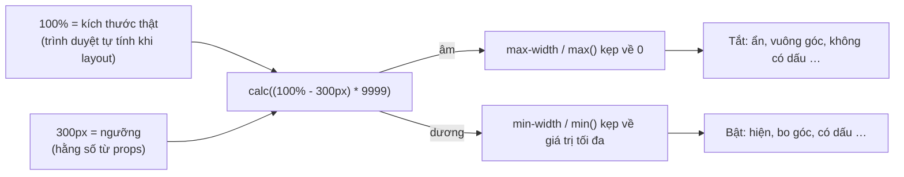

Rất nhiều giao diện cần đổi theo **kích thước của chính phần tử**, không phải của màn hình:

- Card bo góc khi nằm giữa trang, nhưng **vuông góc** khi tràn sát hai mép điện thoại.
- Hàng avatar "An, Bình, Chi và 5 người khác" hiện được bao nhiêu avatar thì hiện bấy nhiêu, phần còn lại gom vào nút "…".
- Dấu "…" chỉ xuất hiện khi chữ **thật sự** bị cắt sau 2 dòng.
- Carousel chỉ có mũi tên khi các thẻ không vừa khung.

Cách quen thuộc là JS: `ResizeObserver` đo kích thước, `setState`, render lại. Cách này có ba vấn đề:

1. **Nháy giao diện**: lần render đầu (đặc biệt khi SSR) chưa biết kích thước, nên phải đoán. Đo xong mới sửa, người dùng thấy giao diện nhảy.
2. **Tốn kém**: hàng trăm card trong feed, mỗi card một observer và một lần re-render mỗi khi kích thước đổi.
3. **Lệch hydration**: server không có kích thước, client có. Render khác nhau là React báo lỗi.

Facebook giải quyết cả bốn trường hợp trên **chỉ bằng CSS**, với một mẹo duy nhất: `calc((A - B) * 9999)`. Bài này mổ xẻ mẹo đó trong mã nguồn của họ (thư mục `14.CometCard/`, `0 000A/TetraFacepileUnstyled.js`, `TetraText/`, `03 GallerySlider/` trong [facebook-codebase](https://github.com/hunghg255/facebook-codebase)), rồi viết lại thành vài helper TypeScript dùng được ngay.

## Nguyên lý: biến phép so sánh thành công tắc

CSS không có `if`. Nhưng có `min()`, `max()` và các thuộc tính kẹp giá trị như `min-width`, `max-width`, `max-height`. Kết hợp với một phép nhân thật lớn, ta có công tắc:

```css
width: calc((A - B) * 9999);
min-width: 0;
max-width: 68px;
```

| Khi | `(A - B) * 9999` | Sau khi kẹp |
| --- | --- | --- |
| A < B | số âm rất lớn | `0` ("tắt") |
| A = B | `0` | `0` ("tắt") |
| A > B dù chỉ 0.1px | ≥ 999.9px | `68px` ("bật") |

Hệ số 9999 chỉ cần đủ lớn để **mọi** chênh lệch có ý nghĩa (≥ 0.1px) đều vượt giá trị tối đa. Giữa "tắt" và "bật" chỉ có một dải chuyển tiếp rộng khoảng 1/9999 px, coi như một bước nhảy.

Điểm mấu chốt: `A` hoặc `B` có thể là **phần trăm**, mà phần trăm thì trình duyệt tự phân giải theo kích thước thật của container (hoặc của chính phần tử) **ngay trong lúc layout**. Không có dòng JS nào đo gì cả.



## Facebook dùng mẹo này ở đâu?

### 1. Card chỉ bo góc khi không tràn viền (`CometCard`)

Trong `14.CometCard/CometCard.js`, phần tử gốc của card có style inline:

```js
borderRadius: "max(0px, min(8px, calc((100vw - 4px - 100%) * 9999))) / 8px"
```

Đọc từ trong ra ngoài:

- `100%` ở đây là **chiều rộng của chính card** (xem lý do ở dưới).
- `100vw - 4px - 100%` dương khi card **hẹp hơn** màn hình ít nhất 4px. Nhân 9999 rồi `min(8px, …)`, ta được góc bo 8px.
- Card rộng sát màn hình (trên điện thoại, card feed tràn hai mép) thì biểu thức âm, `max(0px, …)` kẹp về 0, góc vuông.

**Vì sao có `/ 8px`?** `border-radius: X / Y` tách bán kính ngang (X) và bán kính dọc (Y). Theo đặc tả, phần trăm trong bán kính **ngang** tính theo **chiều rộng** của box, còn trong bán kính **dọc** tính theo **chiều cao**. Biểu thức điều kiện cần `100%` là chiều rộng, nên chỉ được đặt ở bán kính ngang. Nếu viết `border-radius: max(0px, min(8px, …))` không có dấu `/`, bán kính dọc cũng dùng biểu thức đó nhưng `100%` lại thành chiều cao card, sai hoàn toàn. Bán kính ngang bằng 0 là đủ để góc vuông, bất kể bán kính dọc.

**Vì sao `- 4px`?** Để có một khoảng an toàn: card hẹp hơn màn hình 1–2px do làm tròn subpixel vẫn được coi là tràn viền. Trên desktop có thanh cuộn cổ điển, `100vw` bao gồm cả độ rộng thanh cuộn (khoảng 15px) nên card luôn hẹp hơn `100vw - 4px` và luôn được bo góc. Đây cũng chính là hành vi mong muốn.

### 2. Facepile tự ẩn avatar (`BaseContainerQueryElement`)

Facepile ("An, Bình, Chi đã thích") dùng một component rất nhỏ tên `BaseContainerQueryElement.react` (nằm trong `17.js`). Toàn bộ logic của nó là một dòng style:

```js
width: e /* inverseToContainer */
  ? "calc((" + d + "px - 100%) * 9999)"
  : "calc((100% - " + (d - .1) + "px) * 9999)"
```

Kèm theo `maxWidth`, `minWidth` lấy từ props và `flexShrink: 0` (class `pfnyh3mw` = `flex-shrink:0`). Đây là một "container query" thu nhỏ:

- Chế độ thường: phần tử **rộng ra** khi container ≥ `breakpoint`.
- Chế độ `inverseToContainer`: phần tử **rộng ra** khi container < `breakpoint`.

`TetraFacepileUnstyled.js` dùng nó theo cách rất khéo. Hàng avatar là `display: flex; flex-direction: row; overflow-x: hidden` (đã tra class: `j83agx80`, `btwxx1t3`, `ni8dbmo4`). **Trước mỗi avatar** thứ `c`, nó chèn một phần tử đệm:

```js
k.jsx(b("BaseContainerQueryElement.react"), {
  breakpoint: (c + 1) * (w + z) - z,   // w = cỡ avatar, z = khoảng cách
  inverseToContainer: !0,
  maxWidth: "100%",
  minWidth: 0
})
```

`(c + 1) * (w + z) - z` là chiều rộng cần để hiện đủ `c + 1` avatar. Container hẹp hơn mức đó thì phần tử đệm phình ra **100%**, đẩy avatar thứ `c` cùng mọi avatar phía sau ra ngoài vùng `overflow: hidden`. Container đủ rộng thì phần tử đệm rộng 0, coi như không tồn tại.

Nút "…" nằm trong một lớp phủ `position: absolute` riêng (`overflowItemContainer`). Lớp này cũng là một hàng flex, gồm các phần tử đệm chế độ **thường**, mỗi cái tối đa `w + z` (đúng một ô avatar), có key là `"overflowPusher" + c`. Có bao nhiêu avatar vừa thì có bấy nhiêu phần tử đệm mở ra, đẩy nút "…" tới **đúng ô của avatar cuối cùng còn thấy được** và đè lên nó.

Facebook chỉ dùng JS cho phần CSS không làm được: `useIntersectionObserver` với `threshold: .5` để biết avatar nào đang bị đẩy ra ngoài, từ đó tắt focus và tooltip cho chúng (người dùng bàn phím không Tab vào avatar vô hình).

### 3. Dấu "…" chỉ hiện khi chữ tràn (`TetraLineClamp`)

`TetraText/TetraLineClamp.react.js` có hai nhánh. Gatekeeper `gkx("1105608")` bật thì dùng `-webkit-line-clamp` quen thuộc. Còn nhánh mặc định:

```js
o = { maxHeight: p * f + .1 };            // p = line-height, f = số dòng
m = {
  maxHeight: "calc((100% - " + p * f + "px) * 999)",
  top: p * (f - 1)
};
// … children + <span aria-hidden className={ellipsis} style={m}>…</span>
```

Root là `display: block; overflow: hidden; position: relative`. Span "…" là `position: absolute; right: 0; overflow: hidden` (đã tra class `n7fi1qx3` = `right:0`, `pmk7jnqg` = `position:absolute`).

Hãy để ý con số **`.1`** lẻ loi:

- Chữ ngắn hơn N dòng: root cao ≤ `p * f`. Trong span, `100%` chính là chiều cao root (containing block của phần tử absolute), nên `100% - p*f ≤ 0`, `max-height: 0`, span bị ẩn.
- Chữ dài hơn: root bị `max-height` chặn ở đúng `p * f + 0.1`. Lúc này `100% - p*f = 0.1`, nhân 999 được 99.9px, span hiện ra.

0.1px là **"bit" phân biệt** giữa "vừa khít N dòng" và "bị cắt". Nó nhỏ tới mức mắt thường không thấy, nhưng đủ để công tắc bật.

**Vì sao span phải là `position: absolute`?** Vì `max-height: X%` trên phần tử thường **bị bỏ qua** nếu chiều cao của cha là `auto`: phần trăm chiều cao chỉ phân giải được khi cha có chiều cao xác định. Phần tử absolute thì khác: phần trăm của nó tính theo containing block **sau khi layout xong**, kể cả khi chiều cao đó là `auto`. Không có `absolute`, mẹo này không chạy.

### 4. Mũi tên carousel chỉ hiện khi cần (`TetraishHScroll`)

`03 GallerySlider/TetraishHScroll.js` bọc mỗi nút mũi tên trong một div:

```js
style: G == null ? {
  maxWidth: 68,
  minWidth: 0,
  width: "calc((" + e.length * (d + 8) + "px - 100%) * 9999)"
} : {}
```

`e.length * (d + 8)` là tổng chiều rộng các thẻ (cộng 8px khoảng cách). Lớn hơn khung thì wrapper rộng 68px và mũi tên hiện. Vừa khung thì wrapper rộng 0 và mũi tên bị cắt.

Chi tiết quan trọng là điều kiện `G == null`. `G` và `C` là trạng thái "đang ở đầu", "đang ở cuối" do JS đo sau khi mount. Nghĩa là mẹo CSS chỉ dùng **trước lần đo đầu tiên**: lúc SSR, lúc chưa hydrate, lúc JS chưa tải xong. Khi đã có số đo, JS thay bằng trạng thái thật, vì CSS không biết người dùng đã cuộn tới đâu. Đây là cách kết hợp rất thực tế: **CSS lo frame đầu tiên, JS lo phần còn lại.**

### 5. Bonus: cắt "leading" thừa (`TetraText`)

Không dùng 9999, nhưng cùng tinh thần "CSS thuần thay cho đo đạc". `TetraTextTypography.js` ghi cho mỗi kiểu chữ một cặp `offsets`:

```js
body3: { fontSize: 15, lineHeight: 20, offsets: [4, 5] },
body4: { fontSize: 13, lineHeight: 16, offsets: [3, 4] },
```

`line-height: 20px` cho chữ 15px tạo ra khoảng trống phía trên chữ hoa và phía dưới baseline. Designer đo "khoảng cách từ chữ tới viền" trên Figma thì không tính khoảng trống này, dev code theo `padding` thì luôn dư vài px. TetraText thêm `::before { content:""; display:block; height:0; margin-top:-4px }` và `::after { …; margin-bottom:-5px }` để "cắt" phần dư. Mỗi giá trị px là một class atomic riêng, ví dụ `.l2xehx30::before{margin-top:-1px}`.

Nó chỉ cắt ở `TetraText` **ngoài cùng**. Text lồng nhau (có `TetraTextContext` từ cha) thì không cắt nữa, tránh cắt hai lần. Đây chính là thứ mà CSS ngày nay chuẩn hoá thành `text-box-trim`.

## Viết lại thành helper

Tất cả gói trong một file. Mỗi hàm trả về `CSSProperties` (dùng thẳng cho prop `style`) hoặc chuỗi CSS:

```ts title=src/lib/cssOverflowTricks.ts
import type { CSSProperties } from 'react';

/**
 * Mẹo `calc((A - B) * 9999)` của Facebook: biến một phép so sánh kích thước thành một
 * "công tắc" 0 / tối đa, rồi để `min()`, `max()`, `max-width`, `min-width` kẹp lại.
 * Không có JS đo đạc, không ResizeObserver, chạy được cả khi SSR chưa hydrate.
 *
 *   A - B < 0  -> nhân 9999 thành số âm rất lớn -> bị kẹp về 0      ("tắt")
 *   A - B > 0  -> dù chỉ hơn 0.1px, nhân 9999 thành ~1000px -> bị kẹp về max ("bật")
 */

const AMPLIFY = 9999;

// ---------------------------------------------------------------------------
// 1. Bo góc card chỉ khi card KHÔNG tràn viền (CometCard)
// ---------------------------------------------------------------------------

/**
 * `border-radius` = `radius` nếu phần tử hẹp hơn viewport (trừ `gutter`), = 0 nếu tràn viền.
 *
 * Chỉ bán kính ngang được điều kiện hoá (phần trước dấu `/`): trong `border-radius`,
 * phần trăm của bán kính ngang tính theo CHIỀU RỘNG phần tử, còn của bán kính dọc tính theo
 * CHIỀU CAO. `100%` ở đây phải là chiều rộng, nên bán kính dọc để cố định. Bán kính ngang = 0
 * là đủ để góc vuông.
 */
export function radiusUnlessFullBleed(radius: number, gutter = 4): string {
  return `max(0px, min(${radius}px, calc((100vw - ${gutter}px - 100%) * ${AMPLIFY}))) / ${radius}px`;
}

// ---------------------------------------------------------------------------
// 2. "Container query" bằng chiều rộng của một phần tử đệm (BaseContainerQueryElement)
// ---------------------------------------------------------------------------

/**
 * Style cho một phần tử đệm trong flex row. `100%` của `width` = chiều rộng container.
 * - `whenAtLeast`: rộng ra (tới `maxWidth`) khi container ≥ `breakpoint`, ngược lại 0.
 * - `whenBelow`:   rộng ra khi container < `breakpoint`, ngược lại 0.
 *
 * `- 0.1` ở nhánh `whenAtLeast` để đúng bằng breakpoint cũng tính là "đủ chỗ"
 * (0.1 * 9999 ≈ 1000px > mọi maxWidth dùng trong thực tế).
 */
export function containerSwitch(
  breakpoint: number,
  mode: 'whenAtLeast' | 'whenBelow',
  maxWidth: number | string,
): CSSProperties {
  const width =
    mode === 'whenAtLeast'
      ? `calc((100% - ${breakpoint - 0.1}px) * ${AMPLIFY})`
      : `calc((${breakpoint}px - 100%) * ${AMPLIFY})`;
  return { width, minWidth: 0, maxWidth, flexShrink: 0, boxSizing: 'border-box' };
}

/** Chiều rộng cần để hiện đủ `count` avatar cỡ `size`, cách nhau `gap`. */
export function facepileBreakpoint(count: number, size: number, gap: number): number {
  return count * (size + gap) - gap;
}

/**
 * Phần tử đệm đặt TRƯỚC avatar thứ `index` (0-based) trong một hàng `overflow: hidden`.
 * Container hẹp hơn chỗ cần cho `index + 1` avatar thì phần tử đệm phình ra 100%,
 * đẩy avatar này (và mọi avatar sau) ra khỏi vùng nhìn thấy.
 */
export function facepilePusher(index: number, size: number, gap: number): CSSProperties {
  return containerSwitch(facepileBreakpoint(index + 1, size, gap), 'whenBelow', '100%');
}

// ---------------------------------------------------------------------------
// 3. Dấu "…" chỉ hiện khi chữ thật sự tràn (TetraLineClamp)
// ---------------------------------------------------------------------------

export interface OverflowEllipsisStyles {
  /** gắn vào phần tử chứa chữ (cần `position: relative; overflow: hidden`) */
  root: CSSProperties;
  /** gắn vào span "…" `position: absolute; right: 0; overflow: hidden` */
  ellipsis: CSSProperties;
}

/**
 * - root bị giới hạn `lineHeight * lines + 0.1` px.
 * - span "…" nằm ở dòng cuối, có `max-height: calc((100% - lineHeight*lines px) * 999)`.
 *   `100%` = chiều cao root. Chữ ngắn: root thấp hơn N dòng -> âm -> "…" bị kẹp về 0, ẩn.
 *   Chữ dài: root cao đúng N dòng + 0.1px -> 0.1 * 999 ≈ 100px -> "…" hiện.
 *   Đó là lý do có con số 0.1 lẻ loi: nó là "bit" phân biệt "vừa khít" với "bị cắt".
 */
export function overflowEllipsis(lineHeight: number, lines: number): OverflowEllipsisStyles {
  const full = lineHeight * lines;
  return {
    root: { maxHeight: full + 0.1 },
    ellipsis: {
      top: lineHeight * (lines - 1),
      lineHeight: `${lineHeight}px`,
      maxHeight: `calc((100% - ${full}px) * 999)`,
    },
  };
}

// ---------------------------------------------------------------------------
// 4. Mũi tên carousel chỉ hiện khi nội dung tràn (TetraishHScroll)
// ---------------------------------------------------------------------------

/**
 * Wrapper của nút mũi tên: rộng `maxWidth` khi tổng chiều rộng các thẻ > container,
 * rộng 0 (nút bị `overflow: hidden` che) khi vừa đủ chỗ.
 * Facebook chỉ dùng style này TRƯỚC lần đo đầu tiên (SSR / chưa hydrate); sau đó JS biết
 * chính xác đang ở đầu hay cuối danh sách và thay bằng trạng thái thật.
 */
export function arrowWhenOverflowing(
  itemCount: number,
  itemWidth: number,
  gap: number,
  maxWidth = 68,
): CSSProperties {
  return {
    width: `calc((${itemCount * (itemWidth + gap)}px - 100%) * ${AMPLIFY})`,
    minWidth: 0,
    maxWidth,
    overflow: 'hidden',
    flexShrink: 0,
  };
}

// ---------------------------------------------------------------------------
// 5. Cắt "leading" thừa phía trên / dưới dòng chữ (TetraText + TetraTextTypography)
// ---------------------------------------------------------------------------

/**
 * Sinh CSS cắt khoảng trống do `line-height` tạo ra phía trên chữ hoa và phía dưới baseline,
 * để khoảng cách trong code khớp đúng con số designer đo trên Figma.
 * `offsets` = [px cắt phía trên, px cắt phía dưới], phụ thuộc font + cỡ chữ + line-height
 * (Facebook ghi sẵn cho từng kiểu chữ, ví dụ body3 15/20 -> [4, 5]).
 */
export function leadingTrimCSS(selector: string, [top, bottom]: [number, number]): string {
  return [
    `${selector} { display: block; }`,
    `${selector}::before { content: ''; display: block; height: 0; margin-top: -${top}px; }`,
    `${selector}::after { content: ''; display: block; height: 0; margin-bottom: -${bottom}px; }`,
  ].join('\n');
}
```

### Đi qua từng helper

**`radiusUnlessFullBleed(radius, gutter)`** sinh đúng chuỗi của CometCard, có tham số hoá. Dùng:

```tsx
<div className='card' style={{ borderRadius: radiusUnlessFullBleed(12) }} />
```

**`containerSwitch(breakpoint, mode, maxWidth)`** là `BaseContainerQueryElement` không có React. Luôn trả kèm `minWidth: 0` (kẹp dưới) và `flexShrink: 0`. Thiếu `flex-shrink: 0`, flexbox sẽ co phần tử đệm lại khi hết chỗ, và nó không còn đẩy được gì.

**`facepilePusher(index, size, gap)`** là phần tử đệm chèn **trước** avatar thứ `index`. Chỉ cần render:

```tsx
{people.map((p, i) => (
  <Fragment key={p.id}>
    <div style={facepilePusher(i, 36, 6)} aria-hidden />
    <Avatar person={p} />
  </Fragment>
))}
```

**`overflowEllipsis(lineHeight, lines)`** trả hai style: cho root và cho span "…". Đừng quên root cần `position: relative; overflow: hidden`, còn span cần `position: absolute; right: 0; overflow: hidden`, và nên có nền để che chữ phía dưới. Demo dùng gradient từ trong suốt sang màu nền.

**`arrowWhenOverflowing(count, itemWidth, gap, maxWidth)`** dành cho wrapper của mũi tên. Wrapper phải là anh em của vùng cuộn, nằm trong cùng một container, vì `100%` là chiều rộng của container đó.

**`leadingTrimCSS(selector, offsets)`** sinh CSS cho `::before` và `::after`. Pseudo-element không viết được qua `style` inline, nên hàm trả về chuỗi để bỏ vào `<style>` hoặc file CSS.

## Demo

Kéo slider "Khung rộng" từ trái sang phải:

- Facepile mất dần avatar và nút "…" trượt theo.
- Đoạn chữ thứ hai đổi qua lại giữa có và không có "…".
- Mũi tên carousel biến mất khi khung đủ rộng.

Kéo slider "Card rộng" tới 100vw thì góc card vuông lại. Bật tắt ô "Cắt 4px trên, 5px dưới" để thấy hộp chữ (viền cam) ôm sát chữ hoa.

Mở DevTools ra: không có `ResizeObserver` nào, và component không re-render theo kích thước.

<iframe class="demo-frame" src="/demos/facebook-patterns/index.html?theme=dark#/css-9999" title="Demo css-9999" loading="lazy" style="height: 900px"></iframe>

<p class="demo-links">▶ <a href="/demos/facebook-patterns/index.html#/css-9999" target="_blank" rel="noopener">Mở demo toàn màn hình ↗</a> · <a href="https://stackblitz.com/github/hunghg255/blog-hunghg/tree/master/examples/facebook-patterns?file=src/lib/cssOverflowTricks.ts" target="_blank" rel="noopener">Sửa code trên StackBlitz ↗</a> · <a href="https://github.com/hunghg255/blog-hunghg/blob/master/examples/facebook-patterns/src/lib/cssOverflowTricks.ts" target="_blank" rel="noopener">Xem source trên GitHub ↗</a></p>

## Tại sao không làm cách khác?

**"Dùng ResizeObserver cho dễ hiểu?"** Dễ hiểu hơn, nhưng gặp lại cả ba vấn đề ở đầu bài: frame đầu tiên sai, chi phí tỉ lệ với số phần tử, và lệch hydration. Mẹo 9999 chạy đúng ngay từ HTML server trả về, kể cả khi JS chưa tải.

**"Dùng media query?"** Media query hỏi về **màn hình**. Facepile nằm trong sidebar 300px hay trong cột chính 680px trên cùng một màn hình thì cần hiện số avatar khác nhau. Chỉ kích thước container mới trả lời được.

**"Bây giờ đã có container queries rồi, còn cần mẹo này không?"** Container queries (Baseline từ 2023) là lựa chọn đầu tiên cho chuyện "card đổi layout theo container". Nhưng mẹo 9999 vẫn có chỗ đứng:

- Container queries cần một phần tử **tổ tiên** khai báo `container-type`, và phần tử không query được **chính nó**. Bán kính của CometCard phụ thuộc chiều rộng của chính card. Với container query, bạn phải bọc thêm một lớp.
- Container queries hỏi kích thước container; chúng không hỏi được **nội dung có tràn không**. Line-clamp của Facebook thực chất so "chiều cao nội dung" với "N dòng". Đây là thứ container query không làm được.
- Mỗi avatar trong facepile cần một ngưỡng riêng (`(i+1) * 42 - 6`), tính từ props lúc runtime. Container query thì phải viết trước trong CSS, hoặc sinh ra động.

**"Sao không chọn 99999 cho chắc?"** Giá trị lớn quá có thể vượt giới hạn độ dài mà engine lưu được (Chromium kẹp độ dài trong khoảng vài chục triệu px). Chưa tới mức đó, nhưng không có lý do gì để mạo hiểm. 9999 × 0.1px ≈ 1000px là đủ.

## Edge case và cạm bẫy

- **`min-width: 0` trong flexbox.** Flex item có `min-width: auto` mặc định, nghĩa là không co nhỏ hơn nội dung. Phần tử đệm rỗng thì không sao, nhưng wrapper của mũi tên có nút bên trong sẽ không chịu về 0. Luôn đặt `min-width: 0` rõ ràng.
- **Phần trăm phân giải theo cái gì?** `width: %` theo chiều rộng containing block. `max-height: %` theo chiều cao, và **chỉ khi chiều cao đó xác định** (hoặc phần tử là absolute). `border-radius: %` theo chính box. Đặt nhầm thuộc tính là công tắc so sánh sai thứ.
- **Phần tử bị đẩy ra ngoài vẫn còn trong DOM.** Avatar bị ẩn vẫn Tab tới được và trình đọc màn hình vẫn đọc. Facebook dùng IntersectionObserver để vô hiệu hoá chúng. Nếu không làm vậy, hãy đảm bảo nội dung đó cũng có ở chỗ khác (ví dụ tooltip của nút "…").
- **RTL.** Span "…" dùng `right: 0` sẽ sai ở tiếng Ả Rập. Facebook dùng thuộc tính logic (`end`), CSS hiện đại là `inset-inline-end: 0`.
- **Khoảng chuyển tiếp 0.0001px.** Trong khoảng hẹp đó, giá trị nằm giữa 0 và max. Thực tế không ai thấy, nhưng đừng dùng mẹo này cho thứ cần nhị phân tuyệt đối (ví dụ quyết định logic). Nó là công tắc **hiển thị**.
- **Zoom và subpixel.** Ở zoom 110%, 125%, kích thước lẻ subpixel. Ngưỡng đúng bằng kích thước (ví dụ facepile vừa khít) có thể nhảy qua lại. Đó là lý do Facebook dùng `- .1` ở chế độ thường và `- 4px` ở card.
- **Dấu "…" che chữ.** Span absolute nằm đè lên cuối dòng cuối. Không có nền thì chữ và dấu "…" chồng lên nhau. Facebook để màu nền do component cha quyết định.

## Dùng trong dự án

Ba chỗ mình thấy đáng dùng ngay:

1. **Card feed/mobile**: `radiusUnlessFullBleed` thay cho media query `@media (max-width: 600px) { border-radius: 0 }`. Card nằm trong sidebar hẹp trên desktop vẫn được bo góc đúng.
2. **Danh sách tag, avatar, chip**: `facepilePusher` cho hàng "+N" tự co giãn không cần JS. Đếm số bị ẩn để hiện "+3" thì vẫn cần JS (CSS không đếm được), nhưng có thể làm lười, chỉ khi người dùng hover.
3. **SSR**: bất cứ thứ gì đang nháy ở frame đầu vì phải đo. Dùng 9999 cho frame đầu, sau đó để JS tinh chỉnh như cách TetraishHScroll làm.

## Kiểm thử

Mẹo CSS thì phải kiểm thử bằng trình duyệt thật. Ví dụ Playwright (không có trong repo):

```ts
test('facepile ẩn bớt avatar khi khung hẹp', async ({ page }) => {
  await page.goto('/#/css-9999');
  await page.locator('#ct-width').fill('260');
  const visible = await page.evaluate(() => {
    const row = document.querySelector('.ct-pile-row')!.getBoundingClientRect();
    return [...document.querySelectorAll('.ct-pile-row .ct-avatar')].filter(
      (a) => a.getBoundingClientRect().right <= row.right + 0.5,
    ).length;
  });
  expect(visible).toBe(5); // floor((260 - 2*8 padding + 6) / 42)
});

test('"…" chỉ hiện khi chữ tràn', async ({ page }) => {
  await page.goto('/#/css-9999');
  const heights = await page.$$eval('.ct-clamp-ellipsis', (els) =>
    els.map((e) => e.getBoundingClientRect().height),
  );
  expect(heights[0]).toBe(0); // chữ ngắn
  expect(heights[2]).toBeGreaterThan(0); // chữ dài
});
```

Đừng dùng `getComputedStyle(el).borderRadius` để kiểm thử góc bo: trình duyệt trả lại nguyên biểu thức `calc(...)`, không phải giá trị đã tính. Hãy đo kích thước thật, hoặc chụp ảnh so sánh (`toHaveScreenshot`).

## So với CSS hiện đại

| Nhu cầu | Mẹo 9999 | CSS hiện đại |
| --- | --- | --- |
| Đổi style theo kích thước container | `containerSwitch` | `container-type: inline-size` + `@container (width < 300px)` |
| Cắt N dòng + "…" | `overflowEllipsis` | `-webkit-line-clamp` (chạy ở mọi trình duyệt lớn), `line-clamp` đang được chuẩn hoá |
| Cắt leading | `leadingTrimCSS` + offsets đo tay | `text-box: trim-both cap alphabetic` (Chrome 133+, Safari 18.2+) |
| Mũi tên khi cuộn được | `arrowWhenOverflowing` | scroll-state container query: `container-type: scroll-state` + `@container scroll-state(scrollable: right)` (Chromium 133+) |

Nếu trình duyệt mục tiêu đã hỗ trợ, hãy dùng cột bên phải. Mẹo 9999 vẫn đáng biết vì ba lý do: chạy trên mọi trình duyệt từ khi có `calc()`, so sánh được những thứ container query không so được, và rất ngắn.

---

**Series "Học từ mã nguồn Facebook"**

*Phần 1*

- [Mở đầu: cách đọc code minify của Facebook](/blogs/learn-from-facebook-source-code)
- [#1 Dùng chung IntersectionObserver + infinite scroll](/blogs/facebook-shared-intersection-observer)
- [#2 useViewportDuration: đo thời gian thực sự được xem](/blogs/facebook-use-viewport-duration)
- [#3 Preload code + data khi hover](/blogs/facebook-preload-on-hover)
- [#4 Toast manager với external store](/blogs/facebook-toast-manager)
- [#5 Network status + heartbeat backoff](/blogs/facebook-network-status-heartbeat)
- [#6 ErrorGuard: bắt lỗi theo ngữ cảnh](/blogs/facebook-error-guard)
- [#7 Banzai: gom log theo lô + sendBeacon](/blogs/facebook-batch-logger)
- [#8 Focus trap + Esc theo layer](/blogs/facebook-focus-trap)

*Phần 2*

- **#9 Mẹo calc(… * 9999): container query, line-clamp, mũi tên carousel bằng CSS** (bài này)
- [#10 Thanh cuộn tuỳ biến bằng CSS 3D](/blogs/facebook-css-3d-scrollbar)
- [#11 Modal cuộn bằng window, giữ vị trí trang nền](/blogs/facebook-document-scroll-modal)
- [#12 Popover, tooltip group và hovercard](/blogs/facebook-popover-tooltip)
- [#13 Primitive Pressable + focus-visible](/blogs/facebook-pressable)
- [#14 Tab "Xem thêm" + sticky header bằng IntersectionObserver](/blogs/facebook-priority-tabs-sticky-header)
- [#15 Avatar khoét mask, gradient Messenger, skeleton steps()](/blogs/facebook-visual-tricks)
- [#16 Khung chat không giật](/blogs/facebook-chat-scroller)
- [#17 Thuật toán chọn bố cục collage ảnh](/blogs/facebook-photo-collage-layout)
- [#18 Keep-alive tab trong SPA](/blogs/facebook-keep-alive-tabs)
- [#19 Tự đo Visual Completion & interaction tracing](/blogs/facebook-visual-completion)
- [#20 Router SPA bền bỉ & tải chunk có retry](/blogs/facebook-spa-router-resilient-loading)

Code + demo: [`examples/facebook-patterns`](https://github.com/hunghg255/blog-hunghg/tree/master/examples/facebook-patterns) · [Mở trên StackBlitz](https://stackblitz.com/github/hunghg255/blog-hunghg/tree/master/examples/facebook-patterns)
