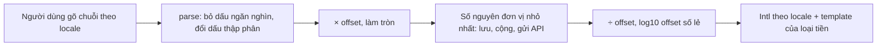

Ngân sách quảng cáo là tiền thật, nên mọi sai số đều có người để ý. Mấy chuyện thường gặp khi làm ô nhập tiền:

- `0.1 + 0.2 === 0.30000000000000004`. Lưu tiền bằng số thực rồi cộng dồn là sớm muộn lệch một xu.
- Yên Nhật không có số lẻ, đô la có hai, dinar Bahrain có **ba**. Code giả định "luôn hai số lẻ" sẽ sai với cả JPY lẫn BHD.
- Người Việt gõ `1.234,56`, người Mỹ gõ `1,234.56`. Cùng một chuỗi `1.234` là một nghìn hai trăm ba mươi tư ở Việt Nam, và một phẩy hai ba bốn ở Mỹ.
- Giá mỗi lượt hiển thị có thể là 0,3 cent. Làm tròn hai số lẻ thì thành `$0.00`, trông như miễn phí.
- Đang gõ `1.2` mà ô tự format lại thành `1.20` thì con trỏ nhảy, người dùng gõ tiếp bị sai.

Ads Manager của Facebook giải mấy chuyện này bằng một quy ước đơn giản và hai module nhỏ: `AdsCurrencyFormatter` và `AdsAbstractCurrencyInput.react`.

> [!TIP]
> **Tóm tắt**
> - Lưu tiền bằng **số nguyên** theo `offset` của loại tiền (USD 100, JPY 1, BHD 1000). Số chữ số lẻ khi hiển thị là `log10(offset)`.
> - Giá trị rất nhỏ thì tăng dần số chữ số lẻ tới khi có ít nhất một chữ số khác 0: 0,3 cent hiện là `$0.003`.
> - Ô nhập giữ nguyên chuỗi đang gõ (dirty value), chỉ parse và format lại khi blur hoặc Enter.
> - Lỗi nhỏ ở bản gốc: ngưỡng `> 1e6` làm 1 000 000 hiện thành `$1000.0K`; bộ bắt "dán hai lần" bỏ lỡ cặp dán nhanh ngay sau một lần dán chậm.

<iframe class="demo-frame" src="/demos/facebook-patterns/index.html?theme=dark#/currency" title="Demo currency" loading="lazy" style="height: 1250px"></iframe>

<p class="demo-links">▶ <a href="/demos/facebook-patterns/index.html#/currency" target="_blank" rel="noopener">Mở demo toàn màn hình ↗</a> · <a href="https://stackblitz.com/github/hunghg255/blog-hunghg/tree/master/examples/facebook-patterns?file=src/lib/currency.ts" target="_blank" rel="noopener">Sửa code trên StackBlitz ↗</a> · <a href="https://github.com/hunghg255/blog-hunghg/blob/master/examples/facebook-patterns/src/lib/currency.ts" target="_blank" rel="noopener">Xem source trên GitHub ↗</a></p>

## Facebook làm thế nào?

### Offset và số chữ số lẻ

`AdsCurrencyFormatter` nằm trong `80.js`. Mọi hàm đều nhận số tiền ở **đơn vị nhỏ nhất** và mã tiền tệ:

```js
function log10Round(offset) { return Math.round(Math.log(offset) / Math.LN10); }

function formatAmount(currency, minor, withDelimiters, withDecimals = true) {
  const offset = Currency.getOffset(currency) || 100;
  const decimals = withDecimals ? log10Round(offset) : 0;
  return withDelimiters
    ? intlNumUtils.formatNumberWithThousandDelimiters(minor / offset, decimals)
    : intlNumUtils.formatNumber(minor / offset, decimals);
}

function applyTemplate(currency, amount, withISO) {
  const tpl = Currency.getFormat(currency) || '{symbol}{amount}';
  const s = tpl.replace('{symbol}', Currency.getSymbol(currency) || '').replace('{amount}', amount);
  return withISO ? s + ' ' + Currency.getISO(currency) : s;
}
```

`log10(100) = 2` số lẻ, `log10(1) = 0`, `log10(1000) = 3`. Không cần bảng "loại tiền nào mấy số lẻ" riêng: offset đã nói hết. Vị trí ký hiệu tiền nằm trong template (`{symbol}{amount}` hay `{amount} {symbol}`), cũng lấy từ cấu hình.

Bảng `CurrencyConfig.allCurrenciesByCode` (iso, symbol, format, offset) do server nạp vào trang, không có trong bản dump. Một chi tiết nhỏ: `Currency.getOffset` trả về `1` cho mã tiền không có trong bảng, nên vế `|| 100` trong formatter không bao giờ chạy. Mã tiền lạ sẽ được hiển thị không có số lẻ, chứ không phải hai số lẻ như tác giả formatter có lẽ đã định.

### Ít nhất một chữ số có nghĩa

```js
function decimalsForOneSigFig(currency, minor) {
  const offset = Currency.getOffset(currency) || 100;
  let d = log10Round(offset);
  while (minor !== 0 && Math.round(Math.abs(minor) * Math.pow(10, d) / offset) < 1) d++;
  return d;
}
```

Với 0,3 cent (`minor = 0.3`, offset 100): 2 số lẻ thì `round(0.3 × 100 / 100) = 0`, tăng lên 3 thì `round(0.3 × 1000 / 100) = 3 ≥ 1`. Kết quả `$0.003`. Đây là thứ cần cho "giá mỗi lượt hiển thị" hay "giá mỗi lượt click" trung bình, vốn thường nhỏ hơn 1 cent.

Còn có các biến thể: bỏ số lẻ khi chia hết (`minor % offset === 0`, nên `$5` thay cho `$5.00`), khoảng tiền nối bằng en dash `–`, và bản rút gọn K/M:

```js
function formatWithLargerNumber(currency, minor) {
  const symbol = Currency.getSymbol(currency);
  let value = minor / (Currency.getOffset(currency) || 100);
  let suffix = '';
  if (value > 1e6) { value /= 1e6; suffix = 'M'; }
  else if (value > 1e3) { value /= 1e3; suffix = 'K'; }
  else return formatOptionalDecimals(currency, minor, true, true);
  value = Math.round(value * 10) / 10;
  return symbol + intlNumUtils.formatNumber(value, 1) + suffix;
}
```

Hai lỗi nhỏ ở hàm này (đã chạy lại bằng Node trên bản sao logic):

- Ngưỡng dùng `>`, nên đúng 1 000 000 không qua được nhánh `M`, rơi xuống nhánh `K` và thành `$1000.0K`. Với 999 950 thì nhánh K làm tròn 999,95 lên 1000,0, cũng ra `$1000.0K`.
- Ký hiệu tiền luôn đứng **trước**, bỏ qua template của loại tiền. Đồng có template `{amount} {symbol}` thì hàm này vẫn in `₫100.0M`.

### Parse

```js
function parseOptionalCurrency(currency, text, decimalSeparator = NumberFormatConfig.decimalSeparator) {
  const offset = Currency.getOffset(currency);
  const value = intlNumUtils.parseNumberRaw(text, decimalSeparator, NumberFormatConfig.numberDelimiter);
  return value == null ? null : Math.round(value * offset);
}
```

Dấu thập phân và dấu ngăn nghìn lấy từ `NumberFormatConfig` của locale hiện tại. Kết quả làm tròn về số nguyên đơn vị nhỏ nhất, nên người dùng **không** nhập được 0,3 cent dù màn hình hiển thị được.

### Ô nhập: giữ chuỗi đang gõ

`AdsAbstractCurrencyInput.react` (trong `237.js`) là một class component với state `dirtyValue`:

```js
handleChange(e) {
  const raw = e.target.value;
  this.setState({ dirtyValue: raw, xuiError: this.validate(raw) });
  if (this.props.eventType === 'change') this.props.onDataUpdate(this.parse(raw));
}
displayValue() {
  if (this.state.dirtyValue != null) return this.state.dirtyValue;          // đang gõ: hiện đúng chuỗi gõ
  return this.props.value != null ? formatCurrencyFullFormat(this.props.currency, this.props.value, …) : '';
}
updateValue(e) {                                   // gọi khi blur hoặc Enter
  const parsed = this.parse(e.target.value);
  this.props.onDataUpdate(parsed);
  this.setState({ dirtyValue: null, xuiError: this.validate(parsed) });
}
```

Mặc định `eventType: 'blur'`: giá trị chỉ được gửi lên khi rời ô hoặc bấm Enter. Trong lúc gõ, ô hiển thị nguyên văn, không format lại, nên con trỏ không nhảy.

Kiểm tra hợp lệ bằng một regex dựng từ dấu của locale:

```js
const valid = new RegExp('^\\D*[' + escapeRegex(numberDelimiter) + '\\d]*'
                        + escapeRegex(decimalSeparator) + '?\\d{0,8}\\D*$');
```

Đọc ra: ký tự không phải số ở đầu (ký hiệu tiền), chữ số và dấu ngăn nghìn, tối đa một dấu thập phân, tối đa 8 chữ số lẻ, ký tự không phải số ở cuối. Regex này khá dễ dãi: `12abc` vẫn qua vì `abc` khớp `\D*` ở cuối, rồi phần parse sẽ quyết định.

### Bắt "dán hai lần liên tiếp"

```js
const PASTE_WINDOW = 500;
handlePaste() {
  if (!this.props.onMultiplePaste) return;
  const last = this.state.pasteTime;
  if (!last) this.setState({ pasteTime: Date.now() });
  else {
    if (Date.now() - last < PASTE_WINDOW) this.props.onMultiplePaste();
    this.setState({ pasteTime: null });
  }
}
```

Dán hai lần trong 500 ms thì gọi `onMultiplePaste`, có lẽ để mở chế độ dán nhiều giá trị cùng lúc (ví dụ dán một cột ngân sách từ bảng tính). Lỗi nhỏ: lần dán thứ hai đến **chậm** thì `pasteTime` bị xoá về `null` thay vì thành mốc mới. Chuỗi dán ở giây 0, giây 2, giây 2,1: cặp 2 → 2,1 cách nhau 100 ms nhưng không được bắt, vì lần dán ở giây 2 đã bị dùng để "kết thúc" cặp với giây 0.

## Bên trong: vì sao số nguyên



Số nguyên trong JavaScript chính xác tới `Number.MAX_SAFE_INTEGER` (khoảng 9 × 10¹⁵). Tính bằng cent, đó là 90 nghìn tỷ đô la, dư cho ngân sách quảng cáo. Mọi phép cộng trừ trên số nguyên đều chính xác; chỉ phép chia (ví dụ chia ngân sách cho số ngày) mới cần chọn làm tròn ở đâu, và việc chọn đó lộ rõ trong code thay vì ẩn trong sai số dấu phẩy động.

Phần định dạng thì nên giao cho `Intl.NumberFormat`: nó biết dấu thập phân, dấu ngăn nghìn, cách nhóm số của từng locale (tiếng Ấn nhóm theo 2 chữ số sau nhóm 3 đầu tiên, tiếng Pháp dùng khoảng trắng hẹp).

## Viết lại

Số lẻ theo offset và "ít nhất một chữ số có nghĩa":

```ts title=src/lib/currency.ts
export function decimalsOf(offset: number) {
  return Math.round(Math.log10(offset));
}

/** Dấu thập phân và dấu ngăn nghìn của locale, lấy từ chính Intl. */
export function separatorsOf(locale: string) {
  const parts = new Intl.NumberFormat(locale).formatToParts(1234567.5);
  return {
    decimal: parts.find((p) => p.type === 'decimal')?.value ?? '.',
    group: parts.find((p) => p.type === 'group')?.value ?? ',',
  };
}

function formatNumber(value: number, decimals: number, locale: string, grouping = true) {
  return new Intl.NumberFormat(locale, {
    minimumFractionDigits: decimals,
    maximumFractionDigits: decimals,
    useGrouping: grouping,
  }).format(value);
}

export function applyTemplate(currency: CurrencyInfo, amount: string) {
  return currency.template.replace('{symbol}', currency.symbol).replace('{amount}', amount);
}

/** Định dạng đầy đủ: số lẻ cố định theo offset. */
export function formatMinor(minor: number, currency: CurrencyInfo, locale: string) {
  return applyTemplate(currency, formatNumber(minor / currency.offset, decimalsOf(currency.offset), locale));
}

/** Bỏ phần lẻ khi chia hết: $5 thay vì $5.00, nhưng $5.20 vẫn giữ đủ hai số lẻ. */
export function formatMinorOptionalDecimals(minor: number, currency: CurrencyInfo, locale: string) {
  const decimals = minor % currency.offset === 0 ? 0 : decimalsOf(currency.offset);
  return applyTemplate(currency, formatNumber(minor / currency.offset, decimals, locale));
}

/** Số chữ số lẻ tối thiểu để giá trị khác 0 không bị làm tròn thành 0. */
export function decimalsForOneSigFig(minor: number, offset: number) {
  let decimals = decimalsOf(offset);
  // giới hạn 20 cho chắc: Intl chỉ nhận tối đa 20 chữ số lẻ
  while (minor !== 0 && Number.isFinite(minor) && decimals < 20 && Math.round((Math.abs(minor) * 10 ** decimals) / offset) < 1) {
    decimals++;
  }
  return decimals;
}

export function formatMinorAtLeastOneSigFig(minor: number, currency: CurrencyInfo, locale: string) {
  return applyTemplate(currency, formatNumber(minor / currency.offset, decimalsForOneSigFig(minor, currency.offset), locale));
}
```

Rút gọn K/M dùng ngưỡng sau khi đã làm tròn, và đi qua template:

```ts title=src/lib/currency.ts
/** Rút gọn K/M, dùng ngưỡng >= (1 000 000 là 1M) và vẫn đi qua template của loại tiền. */
export function formatMinorCompact(minor: number, currency: CurrencyInfo, locale: string) {
  const value = minor / currency.offset;
  const abs = Math.abs(value);
  // làm tròn trước khi chọn đơn vị: 999 950 làm tròn 1 số lẻ theo K là 1000.0K, nên phải lên M
  const unit = abs >= 999_950 ? { div: 1e6, suffix: 'M' } : abs >= 1_000 ? { div: 1e3, suffix: 'K' } : null;
  if (!unit) return formatMinorOptionalDecimals(minor, currency, locale);
  const short = Math.round((value / unit.div) * 10) / 10;
  return applyTemplate(currency, formatNumber(short, 1, locale) + unit.suffix);
}
```

Bộ bắt dán đôi, lần dán chậm trở thành mốc mới:

```ts title=src/lib/currency.ts
/**
 * Bắt "dán hai lần liên tiếp" (bản gốc dùng để mở chế độ dán nhiều giá trị).
 * Bản gốc: lần dán thứ hai đến chậm thì xoá mốc thời gian về null, nên lần dán thứ ba
 * (dù sát ngay sau) lại bị coi là lần đầu. Ở đây lần dán chậm trở thành mốc mới.
 */
export function createDoublePasteDetector(windowMs = 500, now: () => number = Date.now) {
  let last: number | null = null;
  return function onPaste(): boolean {
    const t = now();
    if (last !== null && t - last < windowMs) {
      last = null;
      return true;
    }
    last = t;
    return false;
  };
}
```

Phần parse (`separatorsOf`, `inputPattern`, `parseToMinor`) lấy dấu của locale từ chính `Intl`, xem trong file đầy đủ.

::: spoiler Xem toàn bộ src/lib/currency.ts

```ts title=src/lib/currency.ts
/**
 * Tiền tệ lưu bằng đơn vị nhỏ nhất (ý tưởng từ AdsCurrencyFormatter + AdsAbstractCurrencyInput
 * của Facebook Ads Manager).
 *
 * - Giá trị luôn là số nguyên theo "offset" của loại tiền: USD offset 100 (cent), JPY offset 1,
 *   BHD offset 1000. Số chữ số thập phân = log10(offset).
 * - Hiển thị qua template riêng từng loại tiền ("{symbol}{amount}" hay "{amount} {symbol}").
 * - "Ít nhất một chữ số có nghĩa": 0,3 cent hiện là $0.003 chứ không phải $0.00.
 * - Ô nhập giữ chuỗi người dùng đang gõ (dirty value), chỉ parse khi blur/Enter.
 */

export interface CurrencyInfo {
  code: string;
  /** số đơn vị nhỏ nhất trong 1 đơn vị tiền */
  offset: number;
  symbol: string;
  template: string;
}

export const CURRENCIES: Record<string, CurrencyInfo> = {
  USD: { code: 'USD', offset: 100, symbol: '$', template: '{symbol}{amount}' },
  EUR: { code: 'EUR', offset: 100, symbol: '€', template: '{amount} {symbol}' },
  JPY: { code: 'JPY', offset: 1, symbol: '¥', template: '{symbol}{amount}' },
  VND: { code: 'VND', offset: 1, symbol: '₫', template: '{amount} {symbol}' },
  BHD: { code: 'BHD', offset: 1000, symbol: 'BD', template: '{symbol} {amount}' },
};

export function decimalsOf(offset: number) {
  return Math.round(Math.log10(offset));
}

/** Dấu thập phân và dấu ngăn nghìn của locale, lấy từ chính Intl. */
export function separatorsOf(locale: string) {
  const parts = new Intl.NumberFormat(locale).formatToParts(1234567.5);
  return {
    decimal: parts.find((p) => p.type === 'decimal')?.value ?? '.',
    group: parts.find((p) => p.type === 'group')?.value ?? ',',
  };
}

function formatNumber(value: number, decimals: number, locale: string, grouping = true) {
  return new Intl.NumberFormat(locale, {
    minimumFractionDigits: decimals,
    maximumFractionDigits: decimals,
    useGrouping: grouping,
  }).format(value);
}

export function applyTemplate(currency: CurrencyInfo, amount: string) {
  return currency.template.replace('{symbol}', currency.symbol).replace('{amount}', amount);
}

/** Định dạng đầy đủ: số lẻ cố định theo offset. */
export function formatMinor(minor: number, currency: CurrencyInfo, locale: string) {
  return applyTemplate(currency, formatNumber(minor / currency.offset, decimalsOf(currency.offset), locale));
}

/** Bỏ phần lẻ khi chia hết: $5 thay vì $5.00, nhưng $5.20 vẫn giữ đủ hai số lẻ. */
export function formatMinorOptionalDecimals(minor: number, currency: CurrencyInfo, locale: string) {
  const decimals = minor % currency.offset === 0 ? 0 : decimalsOf(currency.offset);
  return applyTemplate(currency, formatNumber(minor / currency.offset, decimals, locale));
}

/** Số chữ số lẻ tối thiểu để giá trị khác 0 không bị làm tròn thành 0. */
export function decimalsForOneSigFig(minor: number, offset: number) {
  let decimals = decimalsOf(offset);
  // giới hạn 20 cho chắc: Intl chỉ nhận tối đa 20 chữ số lẻ
  while (minor !== 0 && Number.isFinite(minor) && decimals < 20 && Math.round((Math.abs(minor) * 10 ** decimals) / offset) < 1) {
    decimals++;
  }
  return decimals;
}

export function formatMinorAtLeastOneSigFig(minor: number, currency: CurrencyInfo, locale: string) {
  return applyTemplate(currency, formatNumber(minor / currency.offset, decimalsForOneSigFig(minor, currency.offset), locale));
}

/** Rút gọn K/M, dùng ngưỡng >= (1 000 000 là 1M) và vẫn đi qua template của loại tiền. */
export function formatMinorCompact(minor: number, currency: CurrencyInfo, locale: string) {
  const value = minor / currency.offset;
  const abs = Math.abs(value);
  // làm tròn trước khi chọn đơn vị: 999 950 làm tròn 1 số lẻ theo K là 1000.0K, nên phải lên M
  const unit = abs >= 999_950 ? { div: 1e6, suffix: 'M' } : abs >= 1_000 ? { div: 1e3, suffix: 'K' } : null;
  if (!unit) return formatMinorOptionalDecimals(minor, currency, locale);
  const short = Math.round((value / unit.div) * 10) / 10;
  return applyTemplate(currency, formatNumber(short, 1, locale) + unit.suffix);
}

/** Cách rút gọn của bản gốc: ngưỡng ">" và ký hiệu tiền luôn đứng trước, bỏ qua template. */
export function fbStyleCompact(minor: number, currency: CurrencyInfo) {
  let value = minor / currency.offset;
  let suffix = '';
  if (value > 1e6) {
    value /= 1e6;
    suffix = 'M';
  } else if (value > 1e3) {
    value /= 1e3;
    suffix = 'K';
  } else {
    return formatMinorOptionalDecimals(minor, currency, 'en-US');
  }
  value = Math.round(value * 10) / 10;
  return currency.symbol + value.toFixed(1) + suffix;
}

/** Regex cho chuỗi đang gõ: ký tự không phải số ở hai đầu, dấu ngăn nghìn của locale, tối đa 8 số lẻ. */
export function inputPattern(locale: string) {
  const { decimal, group } = separatorsOf(locale);
  const esc = (s: string) => s.replace(/[.*+?^${}()|[\]\\]/g, '\\$&');
  // khoảng trắng hẹp (fr-FR, ru-RU…) khó gõ: chấp nhận cả khoảng trắng thường
  const groupClass = /\s/.test(group) ? `${esc(group)} ` : esc(group);
  return new RegExp(`^\\D*[${groupClass}\\d]*${esc(decimal)}?\\d{0,8}\\D*$`);
}

/**
 * Parse chuỗi người dùng gõ ra số nguyên đơn vị nhỏ nhất, null nếu không hợp lệ.
 * Làm tròn tới đơn vị nhỏ nhất: "0,003" USD → 0 cent (giống bản gốc, Math.round).
 */
export function parseToMinor(text: string, currency: CurrencyInfo, locale: string): number | null {
  if (!inputPattern(locale).test(text)) return null;
  const { decimal, group } = separatorsOf(locale);
  const cleaned = text
    .replace(/[^\d\-\s.,'’  ]/g, '')
    .split(group)
    .join('')
    .replace(/[\s  ]/g, '')
    .replace(decimal, '.');
  if (!/\d/.test(cleaned)) return null;
  const value = Number(cleaned);
  if (!Number.isFinite(value)) return null;
  return Math.round(value * currency.offset);
}

/**
 * Bắt "dán hai lần liên tiếp" (bản gốc dùng để mở chế độ dán nhiều giá trị).
 * Bản gốc: lần dán thứ hai đến chậm thì xoá mốc thời gian về null, nên lần dán thứ ba
 * (dù sát ngay sau) lại bị coi là lần đầu. Ở đây lần dán chậm trở thành mốc mới.
 */
export function createDoublePasteDetector(windowMs = 500, now: () => number = Date.now) {
  let last: number | null = null;
  return function onPaste(): boolean {
    const t = now();
    if (last !== null && t - last < windowMs) {
      last = null;
      return true;
    }
    last = t;
    return false;
  };
}

export function createFbStyleDoublePasteDetector(windowMs = 500, now: () => number = Date.now) {
  let pasteTime: number | null = null;
  return function onPaste(): boolean {
    if (!pasteTime) {
      pasteTime = now();
      return false;
    }
    const fired = now() - pasteTime < windowMs;
    pasteTime = null;
    return fired;
  };
}
```

:::

**Khác bản gốc:**

- Dấu thập phân/ngăn nghìn lấy từ `Intl.NumberFormat(locale).formatToParts(…)`, không cần cấu hình riêng. Chấp nhận cả khoảng trắng thường cho locale dùng khoảng trắng hẹp (`fr-FR`).
- Rút gọn: chọn đơn vị theo giá trị **sau khi làm tròn** (≥ 999 950 là M), và dùng template của loại tiền.
- Bộ bắt dán đôi: lần dán chậm trở thành mốc mới.
- Bảng `CURRENCIES` trong demo là dữ liệu mẫu theo ISO 4217 (USD, EUR 2 số lẻ; JPY, VND 0; BHD 3), không phải cấu hình của Facebook.

## Đi qua code

- `decimalsOf` dùng `Math.log10` thay cho `log / LN10`; vẫn `Math.round` để offset như 100 không ra 1,9999.
- `formatNumber` đặt cả `minimumFractionDigits` và `maximumFractionDigits` bằng nhau để số lẻ cố định.
- `decimalsForOneSigFig` có giới hạn 20 vì `Intl.NumberFormat` không nhận quá 20 chữ số lẻ, và chặn `Infinity`/`NaN`.
- `parseToMinor` kiểm regex trước (giống bản gốc), rồi bỏ ký tự lạ, bỏ dấu ngăn nghìn, đổi dấu thập phân thành `.`, rồi mới `Number()`. Chuỗi như `12,,` (vi-VN) qua được regex nhưng ra `NaN` ở bước này và trả `null`.
- Trong `CurrencyInput` của demo, `key={code-locale}` để đổi loại tiền hoặc locale thì component reset `dirty`.

## Tại sao không làm cách khác?

**Lưu số thực, làm tròn khi hiển thị?** Cộng 0,1 mười lần ra 0,9999999999999999. Hiển thị vẫn đúng nhờ làm tròn, nhưng so sánh "ngân sách đã tiêu ≥ ngân sách tối đa" sẽ sai ở xu cuối.

**Lưu chuỗi decimal như `"1234.56"`?** Chính xác, nhưng mọi phép tính phải qua thư viện decimal. Số nguyên đơn vị nhỏ nhất cho cùng độ chính xác với phép toán gốc của ngôn ngữ, và là định dạng mà Stripe, Adyen… dùng trong API.

**Dùng `Intl.NumberFormat` với `style: 'currency'` cho hết?** Rất tốt cho hiển thị, và nó biết luôn số chữ số lẻ chuẩn (`resolvedOptions().maximumFractionDigits` là 3 cho BHD, 0 cho JPY). Nhưng nó không parse ngược chuỗi người dùng gõ, và không có chế độ "ít nhất một chữ số có nghĩa" cho giá trị dưới đơn vị nhỏ nhất.

## Edge case và cạm bẫy

- **Đổi loại tiền**: 1 234,56 USD (123 456 cent) đổi sang BHD thì phải nhân lại theo offset mới (1 234 560 fils), không giữ nguyên con số nguyên. Demo làm vậy; đây không phải quy đổi tỷ giá.
- **Giá trị dưới đơn vị nhỏ nhất**: hiển thị được nhờ "ít nhất một chữ số có nghĩa", nhưng không nhập được vì parse làm tròn về số nguyên. Nếu nghiệp vụ cần nhập giá dưới 1 cent (ví dụ giá thầu CPM), dùng đơn vị nhỏ hơn cho riêng trường đó.
- **Số âm**: `Math.round(-0.5)` là `-0`, không phải `-1`. Hoàn tiền, điều chỉnh âm nên làm tròn theo trị tuyệt đối rồi gắn dấu.
- **Locale khác ngôn ngữ giao diện**: người Việt dùng giao diện tiếng Anh vẫn có thể gõ `1.234,56`. Nên hiển thị một ví dụ định dạng ngay dưới ô.
- **Dán từ bảng tính**: chuỗi dán có thể kèm tab, xuống dòng, ký hiệu tiền ở cuối (`1.234,56 ₫`). Regex `\D*` ở hai đầu bỏ qua được ký hiệu, nhưng tab ở giữa thì không.

## Dùng trong dự án

```tsx
const [budgetMinor, setBudgetMinor] = useState<number | null>(50_000_00); // 50 000 USD

<CurrencyInput
  value={budgetMinor}
  currency={CURRENCIES.USD}
  locale={navigator.language}
  onCommit={(minor) => minor != null && setBudgetMinor(minor)}
/>

// gửi API đúng số nguyên, không gửi chuỗi đã format
await api.updateCampaign({ daily_budget: budgetMinor, currency: 'USD' });
```

## Kiểm thử

::: spoiler Ví dụ test (bản phác, không có trong repo)

```ts
import { describe, expect, it } from 'vitest';
import {
  CURRENCIES, createDoublePasteDetector, createFbStyleDoublePasteDetector, fbStyleCompact,
  formatMinor, formatMinorAtLeastOneSigFig, formatMinorCompact, formatMinorOptionalDecimals, parseToMinor,
} from './currency';

const { USD, JPY, BHD, VND } = CURRENCIES;

describe('currency', () => {
  it('số lẻ theo offset', () => {
    expect(formatMinor(123456, USD, 'en-US')).toBe('$1,234.56');
    expect(formatMinor(123456, JPY, 'en-US')).toBe('¥123,456');
    expect(formatMinor(123456, BHD, 'en-US')).toBe('BD 123.456');
    expect(formatMinorOptionalDecimals(500, USD, 'en-US')).toBe('$5');
  });

  it('ít nhất một chữ số có nghĩa', () => {
    expect(formatMinor(0.3, USD, 'en-US')).toBe('$0.00');
    expect(formatMinorAtLeastOneSigFig(0.3, USD, 'en-US')).toBe('$0.003');
  });

  it('rút gọn: 1 000 000 là 1,0M, bản gốc ra 1000.0K', () => {
    expect(formatMinorCompact(1_000_000_00, USD, 'en-US')).toBe('$1.0M');
    expect(fbStyleCompact(1_000_000_00, USD)).toBe('$1000.0K');
    expect(fbStyleCompact(999_950_00, USD)).toBe('$1000.0K');
    expect(formatMinorCompact(100_000_000, VND, 'vi-VN')).toBe('100,0M ₫');
  });

  it('parse theo locale', () => {
    expect(parseToMinor('1.234,56', USD, 'vi-VN')).toBe(123456);
    expect(parseToMinor('1,234.56', USD, 'en-US')).toBe(123456);
    expect(parseToMinor('1 234,56', USD, 'fr-FR')).toBe(123456);
    expect(parseToMinor('1,2,3', USD, 'vi-VN')).toBeNull();
    expect(parseToMinor('0,003', USD, 'vi-VN')).toBe(0); // làm tròn về cent
  });

  it('dán đôi: bản gốc bỏ lỡ cặp nhanh sau một lần dán chậm', () => {
    let t = 10_000;
    const now = () => t;
    const fixed = createDoublePasteDetector(500, now);
    const fb = createFbStyleDoublePasteDetector(500, now);
    const run = (d: () => boolean) => [10_000, 12_000, 12_100].map((x) => ((t = x), d()));
    expect(run(fixed)).toEqual([false, false, true]);
    t = 10_000;
    expect(run(fb)).toEqual([false, false, false]);
  });
});
```

:::

## So với thư viện và chuẩn web

- **`Intl.NumberFormat`** với `style: 'currency'` lo phần hiển thị chuẩn theo locale và biết số chữ số lẻ của từng loại tiền; `notation: 'compact'` cho `$1M` (cách rút gọn có thể khác tuỳ locale). Không parse ngược được.
- **Dinero.js** lưu tiền bằng số nguyên kèm "scale" và loại tiền, có phép chia theo tỷ lệ không làm mất xu (allocate). Nếu dự án tính toán tiền nhiều (chia ngân sách, thuế), nên dùng nó thay vì tự viết.
- **`<input inputmode="decimal">`** mở bàn phím số có dấu thập phân trên điện thoại; dấu hiển thị trên bàn phím phụ thuộc hệ điều hành, nên vẫn phải parse cả `.` lẫn `,`.

Bài liên quan: [Học từ web lớn #50: Intl thực chiến](/blogs/web-intl-in-production), [Học từ web lớn #26: parse ngày giờ gõ tay khoan dung](/blogs/web-lenient-date-parser).

---

Bài này thuộc series **[Học từ mã nguồn Facebook](/series/facebook)** (106 bài, đọc theo thứ tự).

::: spoiler Xem nhanh danh sách bài trong series

*Phần 1*

- [Mở đầu: cách đọc code minify của Facebook](/blogs/learn-from-facebook-source-code)
- [#1 Dùng chung IntersectionObserver + infinite scroll](/blogs/facebook-shared-intersection-observer)
- [#2 useViewportDuration: đo thời gian thực sự được xem](/blogs/facebook-use-viewport-duration)
- [#3 Preload code + data khi hover](/blogs/facebook-preload-on-hover)
- [#4 Toast manager với external store](/blogs/facebook-toast-manager)
- [#5 Network status + heartbeat backoff](/blogs/facebook-network-status-heartbeat)
- [#6 ErrorGuard: bắt lỗi theo ngữ cảnh](/blogs/facebook-error-guard)
- [#7 Banzai: gom log theo lô + sendBeacon](/blogs/facebook-batch-logger)
- [#8 Focus trap + Esc theo layer](/blogs/facebook-focus-trap)

*Phần 2*

- [#9 Mẹo calc(… * 9999): container query, line-clamp, mũi tên carousel bằng CSS](/blogs/facebook-css-9999-trick)
- [#10 Thanh cuộn tuỳ biến bằng CSS 3D](/blogs/facebook-css-3d-scrollbar)
- [#11 Modal cuộn bằng window, giữ vị trí trang nền](/blogs/facebook-document-scroll-modal)
- [#12 Popover, tooltip group và hovercard](/blogs/facebook-popover-tooltip)
- [#13 Primitive Pressable + focus-visible](/blogs/facebook-pressable)
- [#14 Tab "Xem thêm" + sticky header bằng IntersectionObserver](/blogs/facebook-priority-tabs-sticky-header)
- [#15 Avatar khoét mask, gradient Messenger, skeleton steps()](/blogs/facebook-visual-tricks)
- [#16 Khung chat không giật](/blogs/facebook-chat-scroller)
- [#17 Thuật toán chọn bố cục collage ảnh](/blogs/facebook-photo-collage-layout)
- [#18 Keep-alive tab trong SPA](/blogs/facebook-keep-alive-tabs)
- [#19 Tự đo Visual Completion & interaction tracing](/blogs/facebook-visual-completion)
- [#20 Router SPA bền bỉ & tải chunk có retry](/blogs/facebook-spa-router-resilient-loading)

*Phần 3*

- [#21 Smart Compose: gợi ý chữ mờ khi gõ](/blogs/facebook-smart-compose-ghost-text)
- [#22 MQTT ngay trong trình duyệt, tự chuyển sang long-poll](/blogs/facebook-mqtt-in-browser)
- [#23 Đo thời gian dùng bằng bitmap 64 giây](/blogs/facebook-time-spent-bitmap)
- [#24 Bảng reaction nhấn giữ rồi trượt](/blogs/facebook-reaction-press-slide)
- [#25 Tìm kiếm gấp dấu, phiên âm và highlight đầu từ](/blogs/facebook-search-diacritics-tokenize)
- [#26 Ring buffer biết trace nào đã mất log](/blogs/facebook-trace-ring-buffer)
- [#27 Engine animation JS: một vòng rAF và solver cubic-bezier](/blogs/facebook-keyframes-loop-cubic-bezier)
- [#28 Bootloader: bitmap tài nguyên đã tải, chỉ reload khi cần](/blogs/facebook-bootloader-bitmap-consistency)
- [#29 Nhận biết click do screen reader tạo ra](/blogs/facebook-virtual-cursor-detection)
- [#30 Tải trước feed theo chất lượng mạng, đoán hạng thiết bị](/blogs/facebook-network-aware-prefetch)
- [#31 Hàng đợi gửi tin chat giữ đúng thứ tự](/blogs/facebook-ordered-send-queue)
- [#32 Gộp lời gọi API trong cùng một tick](/blogs/facebook-api-batcher)
- [#33 Resize ảnh trong pool Web Worker](/blogs/facebook-jpeg-resize-worker-pool)
- [#34 Crop ảnh theo nhiều khuôn mặt](/blogs/facebook-face-aware-crop)
- [#35 Kéo-thả sắp xếp và vùng thả file không nhấp nháy](/blogs/facebook-flicker-free-drag-drop)
- [#36 Tiện ích UI: fade-out, sticky event, hàm huỷ được](/blogs/facebook-ui-utility-hooks)
- [#37 Hạ tầng nhỏ: cookie, hash lỗi, prefetch khi chuột dừng](/blogs/facebook-small-infra-cookie-hash-idle)

*Phần 4–6*

- [#38 Đồng bộ tin nhắn: phát hiện lỗ seqID và fetch bù theo tầng](/blogs/facebook-messenger-sync-seqid-gaps)
- [#39 OTID: ID tin nhắn kiểu Snowflake sinh ở client](/blogs/facebook-otid-client-snowflake)
- [#40 QPL: lấy mẫu từ lúc bắt đầu, đo RTT gửi tin đầu-cuối](/blogs/facebook-qpl-send-rtt)
- [#41 Bộ điều phối request bảy chế độ gộp và chống trùng](/blogs/facebook-request-dispatcher-modes)
- [#42 Thread list theo mốc thời gian, cookie presence có version](/blogs/facebook-threadlist-ranged-presence)
- [#43 Composer dạng plugin: reducer, dirty checker, chuỗi kiểm tra](/blogs/facebook-plugin-composer)
- [#44 Thanh toán bất đồng bộ: subscribe trước, poll dự phòng](/blogs/facebook-async-checkout)
- [#45 Validate số thẻ: sửa lỗi gõ, dải BIN, Luhn](/blogs/facebook-card-validation)
- [#46 Lịch chọn khoảng ngày: bo góc dải chọn, phím đủ bộ, RTL](/blogs/facebook-range-calendar-a11y)
- [#47 Giờ mở cửa theo tuần: qua đêm, gộp khoảng, phần bù](/blogs/facebook-weekly-hours-intervals)
- [#48 Tiến độ đăng realtime: giữ event chờ snapshot, watchdog](/blogs/facebook-realtime-publish-snapshot)
- **#49 Tiền tệ theo đơn vị nhỏ nhất và ô nhập tiền** (bài này)
- [#50 Sửa hàng loạt Empty/Uniform/Mixed, seen/read bằng 2 bit](/blogs/facebook-bulk-edit-seen-bits)
- [#51 Phát hiện script lạ hook vào hàm native](/blogs/facebook-native-hook-detection)
- [#52 localStorage tự dọn khi đầy quota](/blogs/facebook-quota-aware-storage)
- [#53 Cache tuyến do server phân giải, chờ sẵn promise](/blogs/facebook-route-cache-prefetch)
- [#54 Lưới phím mũi tên 2D và focus không làm cuộn trang](/blogs/facebook-focus-table-grid)
- [#55 Tách emoji bằng máy trạng thái](/blogs/facebook-emoji-segmentation)
- [#56 Đọc trước ghi sau trong một frame, con tự biết vị trí](/blogs/facebook-read-then-write-dom)
- [#57 Hàng đợi lệnh cho video và stream sắp lại chunk](/blogs/facebook-video-command-queue)

*Phần 7–10*

- [#58 Ước lượng băng thông EWMA: loại outlier, nhớ qua phiên](/blogs/facebook-bandwidth-ewma-estimator)
- [#59 ABR theo độ tự tin phát và cắt bậc bitrate theo MOS](/blogs/facebook-abr-playback-confidence)
- [#60 Prefetch segment dự đoán từ manifest, parse hộp sidx](/blogs/facebook-dash-predicted-segments)
- [#61 Đọc metadata MP4/MOV ngay trên client](/blogs/facebook-mp4-metadata-client)
- [#62 Upload tiếp tục được: offset, hash dedupe, phát hiện treo](/blogs/facebook-resumable-upload)
- [#63 Fenwick tree: chọn ngẫu nhiên có trọng số và offset dòng](/blogs/facebook-fenwick-weighted-random)
- [#64 Vạch trục số và trục thời gian "đẹp"](/blogs/facebook-nice-axis-ticks)
- [#65 Damerau-Levenshtein theo dải chéo và tự sửa tên gõ sai](/blogs/facebook-damerau-levenshtein)
- [#66 PRNG có seed, shuffle tái lập và lấy mẫu trace](/blogs/facebook-seeded-prng-sampling)
- [#67 Cặp min/max-heap tái dùng vị trí trong danh sách ảo](/blogs/facebook-dual-heap-buffer-set)
- [#68 Memo nhiều đối số bằng Map/WeakMap và interning object](/blogs/facebook-multikey-memo-interning)
- [#69 Thống kê cửa sổ trượt và đại số khoảng thời gian](/blogs/facebook-moving-stat-intervals)
- [#70 Int64 từ hai số 32-bit, decode UTF, offset theo code point](/blogs/facebook-int64-utf-codepoints)
- [#71 Engine múi giờ IANA trên client, phát hiện lệch giờ](/blogs/facebook-client-iana-timezone)
- [#72 Tự cài semver range](/blogs/facebook-semver-range)
- [#73 Auto-link URL, cắt chữ an toàn, giới hạn LaTeX](/blogs/facebook-autolink-safe-truncate)
- [#74 Parser query kiểu PHP chống prototype pollution](/blogs/facebook-php-query-serializer)
- [#75 Popover tự lật theo phần tràn nhỏ nhất](/blogs/facebook-popover-auto-flip)
- [#76 Tiền tố for(;;) chống JSON hijacking, đọc stream](/blogs/facebook-csrf-prefix-streaming)
- [#77 Chống lộ Referer, linkshim, xoá token trên URL](/blogs/facebook-referrer-linkshim-url-scrub)
- [#78 setImmediate bằng postMessage, gom delta chuột theo frame](/blogs/facebook-setimmediate-mouse-batching)
- [#79 Phát hiện crash qua heartbeat, dò proxy cache hỏng](/blogs/facebook-crash-heartbeat-proxy-check)
- [#80 DPR vào cookie cho ảnh @2x, che khoá trong log](/blogs/facebook-dpr-cookie-secret-redaction)
- [#81 Flux waitFor tự viết và proxy có đệm](/blogs/facebook-flux-dispatch-buffered-proxy)
- [#82 Crop đúng tỉ lệ, xoay sticker bằng ma trận](/blogs/facebook-image-crop-rotation-geometry)

*Phần 11–15*

- [#83 Chia subdomain giữa các tab bằng lease, long-poll theo bảng trạng thái](/blogs/facebook-tab-subdomain-lease-longpoll)
- [#84 MQTT QoS1: giữ publish chờ ack, gửi lại khi kết nối lại](/blogs/facebook-mqtt-qos1-republish)
- [#85 Cache Promise gộp request, cache lỗi ngắn, đua dữ liệu nhúng sẵn](/blogs/facebook-promise-cache-preload-race)
- [#86 Lịch retry: backoff có trần, Fibonacci, báo lỗi CDN mỗi N ngày](/blogs/facebook-retry-backoff-schedules)
- [#87 Giữ nguyên tham chiếu nhánh dữ liệu không đổi](/blogs/facebook-relay-recycle-nodes)
- [#88 Store optimistic: copy-on-write, rollback rồi áp lại](/blogs/facebook-relay-optimistic-store)
- [#89 Chỉ mục subscription theo record, hàng đợi task theo chiều sâu](/blogs/facebook-relay-subscription-index)
- [#90 Phân trang connection: cursor khớp đầu, edge không trùng](/blogs/facebook-relay-connection-pagination)
- [#91 Profiler kiểu middleware và memo selector có lấy mẫu kiểm tra](/blogs/facebook-profiler-middleware-memo-check)
- [#92 Đọc EBML/WebM Cues để tìm byte range của segment](/blogs/facebook-webm-ebml-cues)
- [#93 Stream HTTP Range tạm dừng được, tải tiếp đúng byte](/blogs/facebook-pausable-range-stream)
- [#94 Bảng khoảng thời gian gắn nhãn và nhảy qua lỗ buffer](/blogs/facebook-tagged-time-ranges-gaps)
- [#95 Gom chunk cho SourceBuffer, đồng bộ video bằng playbackRate](/blogs/facebook-sourcebuffer-video-sync)
- [#96 Gom tin nhắn thành cụm, vạch ngày và avatar đã xem](/blogs/facebook-message-grouping)
- [#97 Bao nhiêu tab chat vừa màn hình, chuỗi luật mở tab](/blogs/facebook-chat-tab-policy)
- [#98 Phím tắt Markdown trong editor, Backspace để hoàn tác](/blogs/facebook-markdown-shortcuts-editor)
- [#99 Offset theo code point hay UTF-16: bốn bug cùng một gốc](/blogs/facebook-codepoint-offset-bugs)
- [#100 Typeahead không nhảy: cache tiền tố, chặn reflow, khoá hover](/blogs/facebook-typeahead-stable-results)
- [#101 Hit-test trên canvas bằng phát lại path, nét đứt và cung Bézier](/blogs/facebook-canvas-hit-regions)
- [#102 Vòng tròn theo mét trên bản đồ Mercator](/blogs/facebook-mercator-meter-circles)
- [#103 Dò tính năng trình duyệt: ảnh EXIF 2×1, getter bẫy, scrollbar](/blogs/facebook-feature-probe-tricks)
- [#104 Bug định dạng số và kiểm tra dữ liệu theo locale](/blogs/facebook-locale-validation-bugs)
- [#105 Dispose cho đúng: idle callback, splice(-1), xoá nhầm key](/blogs/facebook-dispose-leak-bugs)

:::

Code + demo: [`examples/facebook-patterns`](https://github.com/hunghg255/blog-hunghg/tree/master/examples/facebook-patterns) · [Mở trên StackBlitz](https://stackblitz.com/github/hunghg255/blog-hunghg/tree/master/examples/facebook-patterns)
