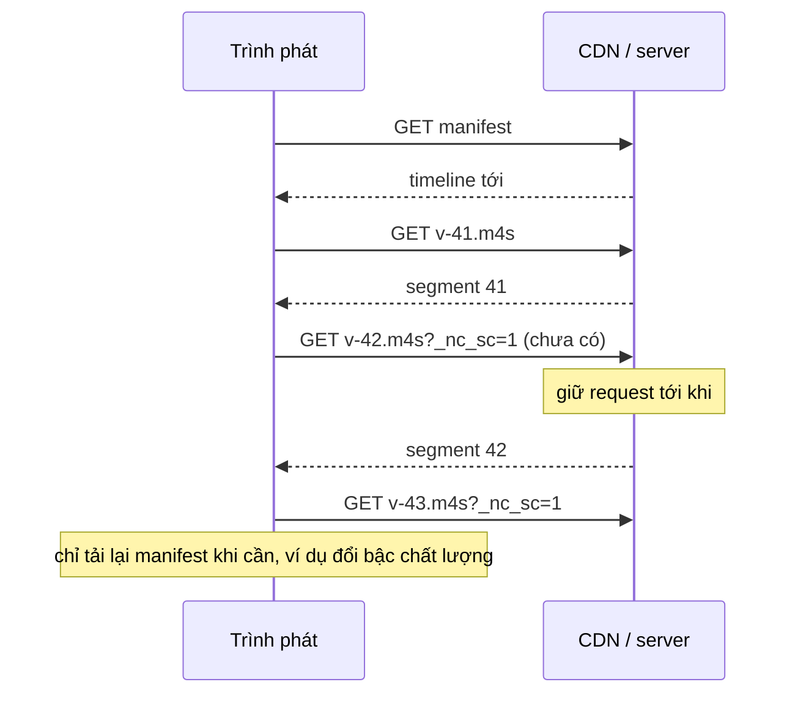

Video trên web hiện đại ít khi là một file `.mp4` tải từ đầu đến cuối. Nó được cắt thành nhiều **segment** vài giây, và một file **manifest** (MPD của chuẩn DASH, hoặc playlist `.m3u8` của HLS) cho trình phát biết segment nào nằm ở đâu. Với video phát trực tiếp (live), manifest phải được tải lại liên tục để biết segment mới nhất.

Hai bài trước ([#58](/blogs/facebook-bandwidth-ewma-estimator), [#59](/blogs/facebook-abr-playback-confidence)) chọn **bậc chất lượng**. Bài này nói về câu hỏi "tải **segment nào**, ở **byte nào**", qua hai mẹo trong oz-player của Facebook.

> [!TIP]
> **Tóm tắt**
> - Với live, manifest của Facebook có thêm thuộc tính `FBPredictedMedia` (template URL cho segment **chưa tồn tại**) và `FBPredictedMediaEndNumber` (số của segment mới nhất). Trình phát xin luôn segment `n + 1` mà không chờ manifest kế tiếp; server giữ request tới khi segment xong.
> - Manifest chỉ giữ vài segment gần nhất; thời lượng trung bình `FBAverageDuration` cho phép ước lượng số thứ tự của segment cũ hơn cửa sổ đó.
> - Với video theo yêu cầu (VOD), trình phát đọc **hộp `sidx`** trong file MP4 để biết byte-range của từng segment, rồi tải bằng header `Range`.
> - Bộ đọc sidx gốc tạo `new DataView(u8.buffer)`, bỏ qua `byteOffset` của view. Truyền vào một `subarray` là đọc sai chỗ. Bản viết lại dùng `new DataView(buf, byteOffset, byteLength)`.

<iframe class="demo-frame" src="/demos/facebook-patterns/index.html?theme=dark#/dash-segments" title="Demo dash-segments" loading="lazy" style="height: 980px"></iframe>

<p class="demo-links">▶ <a href="/demos/facebook-patterns/index.html#/dash-segments" target="_blank" rel="noopener">Mở demo toàn màn hình ↗</a> · <a href="https://stackblitz.com/github/hunghg255/blog-hunghg/tree/master/examples/facebook-patterns?file=src/lib/dashSegments.ts" target="_blank" rel="noopener">Sửa code trên StackBlitz ↗</a> · <a href="https://github.com/hunghg255/blog-hunghg/blob/master/examples/facebook-patterns/src/lib/dashSegments.ts" target="_blank" rel="noopener">Xem source trên GitHub ↗</a></p>

## Facebook làm thế nào?

### Manifest live có thêm "segment dự đoán"

Một SegmentTimeline DASH chuẩn liệt kê các segment đã có bằng thẻ `<S t="…" d="…"/>` (thời điểm bắt đầu, thời lượng). Module `OzPredictedSegmentTimelineParser` (bundle `26.VideoPlayer/all.js`, bản trùng ở `21.js`) đọc thêm bốn thuộc tính riêng của Facebook trên thẻ `SegmentTimeline`:

```js
// đổi tên biến
const attrs = template.SegmentTimeline[0].$;
let predictedUrl;
if (attrs.FBPredictedMedia) {
  predictedUrl = new URI(joinUrlPaths(rep.baseUrl, attrs.FBPredictedMedia)).addQueryData('_nc_sc', 1).toString();
}
const startNumber = attrs.FBPredictedMediaStartNumber && Number.parseInt(attrs.FBPredictedMediaStartNumber, 0);
const endNumber   = attrs.FBPredictedMediaEndNumber   && Number.parseInt(attrs.FBPredictedMediaEndNumber, 0);
const avgDuration = attrs.FBAverageDuration           && Number.parseInt(attrs.FBAverageDuration, 0);
const segments = OzDefaultSegmentTimelineParser.parseSegments(config, template);

return ((rep.isTemplatedMpd && startNumber != null && avgDuration != null) || !rep.isTemplatedMpd)
       && predictedUrl != null && endNumber != null
  ? new PredictedSegmentTemplateSegmentsContainer(config, mediaUrl, timescale, segments, predictedUrl, startNumber, endNumber, avgDuration, rep.isStaticMpd)
  : new SegmentTemplateSegmentsContainer(config, mediaUrl, timescale, segments, predictedUrl, rep.isStaticMpd);
```

Thiếu thuộc tính nào thì rơi về container thường. Manifest cũ, hoặc CDN đã cắt thuộc tính lạ, vẫn phát được.

`parseInt(x, 0)` là chi tiết nhỏ: radix 0 được đặc tả coi như "không truyền", tức hệ 10, trừ khi chuỗi bắt đầu bằng `0x` thì thành hệ 16. Chạy đúng với số thường, nhưng dòng `timescale` ngay bên dưới lại dùng radix 10, nên nhiều khả năng đây là lỗi gõ.

### Đánh số từ cuối

`PredictedSegmentTemplateSegmentsContainer` không đánh số từ đầu timeline mà **từ cuối**: entry cuối mang số `endNumber`, entry trước nó `endNumber − 1`, và cứ thế lùi. Manifest live chỉ giữ cửa sổ vài segment gần nhất, nên "segment cuối là số mấy" là thông tin chắc chắn nhất.

```js
getSegmentByTime(sec) {            // nhánh thường
  const x = sec * this.timescale;
  let found = null, fromEnd = 0;
  for (let i = 0; i < this.segments.length; i++) {
    const s = this.segments[this.segments.length - 1 - i];
    invariant(s.r === 0);           // không hỗ trợ @r
    if (lessThanOrEqual(s.t + s.d * (s.r + 1), x, epsilon)) break;
    found = s; fromEnd = i;
  }
  return found && this.makeSegment(found.t / ts, (found.t + found.d) / ts, this.endNumber - fromEnd);
}

getPredictedSegmentAfter(segment) {
  return segment?.getSequenceNumber() != null && this.canPredict()   // num_predictive_segments > 0
    ? this.makeSegment(0, 0, segment.getSequenceNumber() + 1)
    : null;
}
```

`makeSegment` thay `$Number$` trong template dự đoán. Segment dự đoán có khoảng thời gian `0–0` vì chưa ai biết nó dài bao nhiêu; trình phát chỉ cần URL để xin nó, thời gian thật sẽ biết khi nhận được dữ liệu hoặc khi manifest sau liệt kê nó.

Khi bật cờ `pdash_seq_based_approx`, container còn trả lời được thời điểm **trước** cửa sổ timeline. Số segment trước cửa sổ là `endNumber − số entry + 1 − startNumber`, mỗi cái dài khoảng `FBAverageDuration`, nên khoảng thời gian manifest phủ bắt đầu từ:

```js
start = (segments[0].t - avgDuration - (endNumber - segments.length - startNumber) * avgDuration) / timescale
```

Người xem kéo ngược về 5 phút trước trong một buổi live, trình phát vẫn đoán được số segment cần xin mà manifest không phải liệt kê hàng trăm entry.

### Vì sao đoán URL lại nhanh hơn

Không có URL dự đoán, trình phát phải: chờ tới lượt tải lại manifest, tải manifest, thấy segment mới, rồi mới xin segment. Độ trễ trung bình cỡ nửa chu kỳ tải lại manifest cộng hai vòng mạng. Có URL dự đoán thì trình phát xin `n + 1` ngay khi nhận xong `n`; server (hoặc CDN) **giữ request** tới khi segment được đóng gói xong rồi trả về. Trong demo, độ trễ trung bình giảm từ khoảng 2 giây xuống bằng một vòng mạng.

Tham số `_nc_sc=1` gắn vào URL dự đoán, và cờ `touch_cb_key` thêm hậu tố `_oz` vào tham số `cb`. Có lẽ để CDN và log phân biệt request dự đoán với request thường; bundle không cho biết thêm.



### Hộp sidx: mục lục nằm ngay trong file

Với VOD, Facebook có thể phục vụ mỗi bậc chất lượng là **một file MP4 duy nhất**. Đầu file có hộp `sidx` (Segment Index Box, ISO/IEC 14496-12): một bảng liệt kê từng đoạn với kích thước byte và thời lượng. Trình phát tải phần đầu file, đọc `sidx`, rồi xin từng đoạn bằng `Range: bytes=…`. Không cần manifest liệt kê từng segment, và CDN chỉ phải lưu một file.

`oz-player/parsers/OzMp4SidxParser`:

```js
const SIDX = 1936286840;             // 0x73696478 = 'sidx'
function parse(url, sidxOffset, u8) {
  const r = new OzDataViewReader(new DataView(u8.buffer));   // ← bỏ qua u8.byteOffset
  let size = r.readUint32();
  if (r.readUint32() !== SIDX) throw new Error('Invalid box type, expected "sidx".');
  if (size == 1) size = r.readUint64();                     // largesize
  const version = r.readUint8(); r.skip(3); r.skip(4);       // flags, reference_ID
  const timescale = r.readUint32();
  let t, firstOffset;
  version == 0 ? (t = r.readUint32(), firstOffset = r.readUint32())
               : (t = r.readUint64(), firstOffset = r.readUint64());
  r.skip(2);
  const count = r.readUint16();
  let byte = sidxOffset + size + firstOffset, first = 0;
  for (let i = 0; i < count; i++) {
    const a = r.readUint32();
    const isIndex = (a & 0x80000000) >>> 31, refSize = a & 0x7fffffff;
    const duration = r.readUint32();
    r.readUint32();                                          // SAP
    if (isIndex == 1) throw new Error('Heirarchical SIDXs are not supported.');
    if (i === 0) first = t / timescale;
    segments.push({ time: [t / timescale - first, (t + duration) / timescale - first], bytes: [byte, byte + refSize - 1] });
    t += duration; byte += refSize;
  }
}
```

Điểm cần biết khi đọc:

- **Bit cao nhất của mỗi entry là `reference_type`**: 0 là đoạn media, 1 là trỏ tới một sidx khác (sidx phân cấp, dùng cho file rất dài). Bản gốc không hỗ trợ loại 1 và ném lỗi (chữ "Heirarchical" viết sai chính tả).
- **Byte bắt đầu = vị trí hộp sidx + kích thước hộp + `first_offset`.** Theo chuẩn, `first_offset` tính từ byte ngay sau hộp sidx.
- **Thời gian bị trừ đi mốc của đoạn đầu**, nên đoạn đầu luôn bắt đầu ở 0 giây.

Lỗi thật nằm ở dòng đầu: `new DataView(u8.buffer)` tạo view trên **toàn bộ** ArrayBuffer bên dưới. Nếu `u8` là `subarray` (ví dụ trình phát tải một lần cả `moov` lẫn `sidx` rồi cắt lấy phần sidx), DataView sẽ đọc từ byte 0 của buffer lớn, gặp `ftyp` thay vì `sidx`. Phần "Hộp sidx" trong demo tái hiện đúng điều đó: đọc kiểu gốc báo "Không phải hộp sidx". Có lẽ ở Facebook phần sidx luôn được tải bằng một request riêng nên buffer bắt đầu đúng chỗ và lỗi không lộ ra.

## Bên trong trình duyệt

- **`fetch` với `Range`**: `fetch(url, { headers: { Range: 'bytes=1304-62170' } })` trả `206 Partial Content`. Server và CDN phải hỗ trợ range; CORS khác origin cần `Access-Control-Expose-Headers: Content-Range` nếu muốn đọc header đó.
- **`ArrayBuffer`, typed array và `DataView`**: một `Uint8Array` là một "cửa sổ" trên ArrayBuffer, có `byteOffset` và `byteLength` riêng. `subarray()` tạo cửa sổ mới **không sao chép**; `slice()` thì sao chép. Code nhận `Uint8Array` mà dùng `.buffer` thì phải dùng kèm offset và length của nó.
- **Big-endian**: số trong hộp MP4 lưu theo thứ tự byte lớn trước. `DataView.getUint32(offset)` mặc định là big-endian, đúng với MP4; typed array như `Uint32Array` thì dùng thứ tự của máy (thường little-endian), không dùng được để đọc MP4.
- **Số 64-bit**: `getBigUint64` trả `BigInt`. Ghép hai `getUint32` thành `Number` thì chỉ an toàn tới 2^53; thời gian và byte của video thực tế còn xa giới hạn đó, nhưng nên kiểm tra.
- **MSE**: segment tải về được đưa vào `SourceBuffer.appendBuffer()`. Segment dự đoán cũng vậy; MSE không quan tâm segment được xin bằng URL nào.

## Viết lại

Template URL hỗ trợ `$Number$`, `$Number%05d$` và `$Time$`. Timeline được trải `@r` ra và đánh số từ cuối như bản gốc:

```ts title=src/lib/dashSegments.ts
export const fillTemplate = (template: string, number: number, time?: number) =>
  template
    .replace(/\$Number(?:%0(\d+)d)?\$/g, (_, w) => String(number).padStart(Number(w ?? 0), '0'))
    .replace(/\$Time\$/g, String(time ?? ''));

/** Trải @r ra thành từng segment, đánh số sao cho entry cuối mang số endNumber. */
function expand(info: PredictedTimelineInfo) {
  const flat: { t: number; d: number }[] = [];
  for (const e of info.entries) for (let i = 0; i <= (e.r ?? 0); i++) flat.push({ t: e.t + i * e.d, d: e.d });
  const last = info.endNumber ?? flat.length;
  return flat.map((s, i) => ({ ...s, number: last - (flat.length - 1 - i) }));
}
```

Khoảng thời gian manifest phủ, tìm segment theo thời gian (kể cả trước cửa sổ), và đoán segment kế tiếp:

```ts title=src/lib/dashSegments.ts
  /** Khoảng thời gian manifest này phủ, tính cả phần trước cửa sổ timeline nếu biết startNumber. */
  timeRange(): { start: number; end: number } | null {
    if (this.flat.length === 0) return null;
    const ts = this.info.timescale;
    const first = this.flat[0];
    const last = this.flat[this.flat.length - 1];
    const { startNumber, averageDuration } = this.info;
    const before = startNumber != null && averageDuration ? Math.max(0, first.number - startNumber) * averageDuration : 0;
    return { start: (first.t - before) / ts, end: (last.t + last.d) / ts };
  }

  /** Segment chứa thời điểm `sec`. Trước cửa sổ timeline thì ước lượng số theo thời lượng trung bình. */
  segmentAt(sec: number): SegmentRef | null {
    const ts = this.info.timescale;
    const x = sec * ts;
    const hit = this.flat.find((s) => s.t <= x && x < s.t + s.d);
    if (hit) return this.ref(hit);
    const range = this.timeRange();
    const { startNumber, averageDuration } = this.info;
    if (!range || sec < range.start || sec >= range.end || startNumber == null || !averageDuration) return null;
    const first = this.flat[0];
    const back = Math.ceil((first.t - x) / averageDuration);
    const number = Math.max(startNumber, first.number - back);
    const start = (first.t - (first.number - number) * averageDuration) / ts;
    return { number, url: fillTemplate(this.info.media, number), start, end: start + averageDuration / ts, predicted: false };
  }

  /** `count` segment SAU segment số `after`, lấy URL từ template dự đoán. */
  predictAfter(after: number, count = 1): SegmentRef[] {
    if (!this.canPredict) return [];
    const out: SegmentRef[] = [];
    for (let n = after + 1; n <= after + count; n++)
      out.push({ number: n, url: fillTemplate(this.info.predictedMedia!, n), start: NaN, end: NaN, predicted: true });
    return out;
  }
```

Đọc sidx với DataView đúng offset, giữ lại tham chiếu loại "index" thay vì ném lỗi:

```ts title=src/lib/dashSegments.ts
const SIDX = 0x73696478; // 'sidx'

/**
 * Đọc hộp sidx. `bytes` có thể là view nằm giữa một ArrayBuffer lớn hơn:
 * DataView phải dùng đúng byteOffset/byteLength của view (bản gốc dùng `new DataView(u8.buffer)`).
 * `boxOffset` là vị trí của hộp sidx trong file, để tính byte tuyệt đối.
 */
export function parseSidx(bytes: Uint8Array, boxOffset: number): { timescale: number; references: SidxReference[] } {
  const v = new DataView(bytes.buffer, bytes.byteOffset, bytes.byteLength);
  let p = 0;
  const u32 = () => ((p += 4), v.getUint32(p - 4));
  const u64 = () => {
    const hi = u32();
    const lo = u32();
    const n = hi * 2 ** 32 + lo;
    if (!Number.isSafeInteger(n)) throw new Error('Giá trị 64-bit vượt Number.MAX_SAFE_INTEGER');
    return n;
  };
  let size = u32();
  if (u32() !== SIDX) throw new Error('Không phải hộp sidx');
  if (size === 1) size = u64(); // largesize
  const version = v.getUint8(p);
  p += 4; // version + flags
  p += 4; // reference_ID
  const timescale = u32();
  if (!timescale) throw new Error('timescale = 0');
  let time = version === 0 ? u32() : u64(); // earliest_presentation_time
  const firstOffset = version === 0 ? u32() : u64();
  p += 2; // reserved
  const count = v.getUint16(p);
  p += 2;
  let byte = boxOffset + size + firstOffset; // mốc: byte ngay sau hộp sidx
  const references: SidxReference[] = [];
  for (let i = 0; i < count; i++) {
    const a = u32();
    const duration = u32();
    const sap = u32();
    const refSize = a & 0x7fffffff;
    references.push({
      kind: a >>> 31 ? 'index' : 'media',
      startByte: byte,
      endByte: byte + refSize - 1,
      start: time / timescale,
      end: (time + duration) / timescale,
      startsWithSap: sap >>> 31 === 1,
    });
    time += duration;
    byte += refSize;
  }
  return { timescale, references };
}
```

::: spoiler Xem toàn bộ src/lib/dashSegments.ts

```ts title=src/lib/dashSegments.ts
/**
 * Hai cách tìm segment DASH mà không cần manifest liệt kê hết:
 * 1. SegmentTimeline kèm "predicted media" (kiểu oz-player của Facebook): đoán URL segment kế tiếp
 *    của luồng live trước khi manifest kịp cập nhật.
 * 2. Hộp sidx của MP4 (ISO-BMFF): đọc bảng byte-range/thời gian của từng segment từ chính file.
 * Viết lại từ đầu.
 */

export interface TimelineEntry {
  /** Thời điểm bắt đầu (đơn vị timescale). */
  t: number;
  /** Thời lượng (đơn vị timescale). */
  d: number;
  /** Số lần lặp thêm (DASH @r). Bản gốc yêu cầu r = 0. */
  r?: number;
}

export interface PredictedTimelineInfo {
  timescale: number;
  /** Template URL của segment đã có, ví dụ "seg-$Number$.m4s". */
  media: string;
  entries: TimelineEntry[];
  /** Template URL cho segment CHƯA có trong manifest (FBPredictedMedia). */
  predictedMedia?: string;
  /** Số thứ tự segment đầu tiên còn trên server (FBPredictedMediaStartNumber). */
  startNumber?: number;
  /** Số thứ tự của entry cuối trong timeline (FBPredictedMediaEndNumber). */
  endNumber?: number;
  /** Thời lượng trung bình một segment, đơn vị timescale (FBAverageDuration). */
  averageDuration?: number;
}

export interface SegmentRef {
  number: number | null;
  url: string;
  /** Giây. Segment dự đoán chưa biết thời lượng thì start = end = NaN. */
  start: number;
  end: number;
  predicted: boolean;
}

const int = (v: string | null | undefined) => (v == null || v === '' ? undefined : Number.parseInt(v, 10));

/** Đọc <SegmentTemplate> chứa <SegmentTimeline> từ chuỗi XML (cần DOMParser: trình duyệt hoặc jsdom). */
export function parseSegmentTemplate(xml: string): PredictedTimelineInfo {
  const doc = new DOMParser().parseFromString(xml, 'application/xml');
  const tpl = doc.getElementsByTagName('SegmentTemplate')[0];
  const tl = tpl?.getElementsByTagName('SegmentTimeline')[0];
  if (!tpl || !tl) throw new Error('Thiếu SegmentTemplate/SegmentTimeline');
  const entries: TimelineEntry[] = [];
  let next = 0;
  for (const s of Array.from(tl.getElementsByTagName('S'))) {
    const t = int(s.getAttribute('t')) ?? next; // @t vắng mặt: nối tiếp entry trước
    const d = int(s.getAttribute('d'))!;
    const r = int(s.getAttribute('r')) ?? 0;
    entries.push({ t, d, r });
    next = t + d * (r + 1);
  }
  return {
    timescale: int(tpl.getAttribute('timescale')) ?? 1,
    media: tpl.getAttribute('media') ?? '',
    entries,
    predictedMedia: tl.getAttribute('FBPredictedMedia') ?? undefined,
    startNumber: int(tl.getAttribute('FBPredictedMediaStartNumber')),
    endNumber: int(tl.getAttribute('FBPredictedMediaEndNumber')),
    averageDuration: int(tl.getAttribute('FBAverageDuration')),
  };
}

export const fillTemplate = (template: string, number: number, time?: number) =>
  template
    .replace(/\$Number(?:%0(\d+)d)?\$/g, (_, w) => String(number).padStart(Number(w ?? 0), '0'))
    .replace(/\$Time\$/g, String(time ?? ''));

/** Trải @r ra thành từng segment, đánh số sao cho entry cuối mang số endNumber. */
function expand(info: PredictedTimelineInfo) {
  const flat: { t: number; d: number }[] = [];
  for (const e of info.entries) for (let i = 0; i <= (e.r ?? 0); i++) flat.push({ t: e.t + i * e.d, d: e.d });
  const last = info.endNumber ?? flat.length;
  return flat.map((s, i) => ({ ...s, number: last - (flat.length - 1 - i) }));
}

export class PredictedTimeline {
  private readonly flat: { t: number; d: number; number: number }[];

  constructor(private readonly info: PredictedTimelineInfo) {
    this.flat = expand(info);
  }

  get canPredict(): boolean {
    return !!this.info.predictedMedia && this.info.endNumber != null;
  }

  private ref(s: { t: number; d: number; number: number }): SegmentRef {
    const ts = this.info.timescale;
    return { number: s.number, url: fillTemplate(this.info.media, s.number, s.t), start: s.t / ts, end: (s.t + s.d) / ts, predicted: false };
  }

  /** Khoảng thời gian manifest này phủ, tính cả phần trước cửa sổ timeline nếu biết startNumber. */
  timeRange(): { start: number; end: number } | null {
    if (this.flat.length === 0) return null;
    const ts = this.info.timescale;
    const first = this.flat[0];
    const last = this.flat[this.flat.length - 1];
    const { startNumber, averageDuration } = this.info;
    const before = startNumber != null && averageDuration ? Math.max(0, first.number - startNumber) * averageDuration : 0;
    return { start: (first.t - before) / ts, end: (last.t + last.d) / ts };
  }

  /** Segment chứa thời điểm `sec`. Trước cửa sổ timeline thì ước lượng số theo thời lượng trung bình. */
  segmentAt(sec: number): SegmentRef | null {
    const ts = this.info.timescale;
    const x = sec * ts;
    const hit = this.flat.find((s) => s.t <= x && x < s.t + s.d);
    if (hit) return this.ref(hit);
    const range = this.timeRange();
    const { startNumber, averageDuration } = this.info;
    if (!range || sec < range.start || sec >= range.end || startNumber == null || !averageDuration) return null;
    const first = this.flat[0];
    const back = Math.ceil((first.t - x) / averageDuration);
    const number = Math.max(startNumber, first.number - back);
    const start = (first.t - (first.number - number) * averageDuration) / ts;
    return { number, url: fillTemplate(this.info.media, number), start, end: start + averageDuration / ts, predicted: false };
  }

  /** `count` segment SAU segment số `after`, lấy URL từ template dự đoán. */
  predictAfter(after: number, count = 1): SegmentRef[] {
    if (!this.canPredict) return [];
    const out: SegmentRef[] = [];
    for (let n = after + 1; n <= after + count; n++)
      out.push({ number: n, url: fillTemplate(this.info.predictedMedia!, n), start: NaN, end: NaN, predicted: true });
    return out;
  }

  last(): SegmentRef | null {
    return this.flat.length ? this.ref(this.flat[this.flat.length - 1]) : null;
  }
}

// ---------------------------------------------------------------- sidx

export interface SidxReference {
  /** 'media' = segment thật; 'index' = trỏ tới một sidx khác (sidx phân cấp). */
  kind: 'media' | 'index';
  startByte: number;
  endByte: number;
  start: number;
  end: number;
  startsWithSap: boolean;
}

const SIDX = 0x73696478; // 'sidx'

/**
 * Đọc hộp sidx. `bytes` có thể là view nằm giữa một ArrayBuffer lớn hơn:
 * DataView phải dùng đúng byteOffset/byteLength của view (bản gốc dùng `new DataView(u8.buffer)`).
 * `boxOffset` là vị trí của hộp sidx trong file, để tính byte tuyệt đối.
 */
export function parseSidx(bytes: Uint8Array, boxOffset: number): { timescale: number; references: SidxReference[] } {
  const v = new DataView(bytes.buffer, bytes.byteOffset, bytes.byteLength);
  let p = 0;
  const u32 = () => ((p += 4), v.getUint32(p - 4));
  const u64 = () => {
    const hi = u32();
    const lo = u32();
    const n = hi * 2 ** 32 + lo;
    if (!Number.isSafeInteger(n)) throw new Error('Giá trị 64-bit vượt Number.MAX_SAFE_INTEGER');
    return n;
  };
  let size = u32();
  if (u32() !== SIDX) throw new Error('Không phải hộp sidx');
  if (size === 1) size = u64(); // largesize
  const version = v.getUint8(p);
  p += 4; // version + flags
  p += 4; // reference_ID
  const timescale = u32();
  if (!timescale) throw new Error('timescale = 0');
  let time = version === 0 ? u32() : u64(); // earliest_presentation_time
  const firstOffset = version === 0 ? u32() : u64();
  p += 2; // reserved
  const count = v.getUint16(p);
  p += 2;
  let byte = boxOffset + size + firstOffset; // mốc: byte ngay sau hộp sidx
  const references: SidxReference[] = [];
  for (let i = 0; i < count; i++) {
    const a = u32();
    const duration = u32();
    const sap = u32();
    const refSize = a & 0x7fffffff;
    references.push({
      kind: a >>> 31 ? 'index' : 'media',
      startByte: byte,
      endByte: byte + refSize - 1,
      start: time / timescale,
      end: (time + duration) / timescale,
      startsWithSap: sap >>> 31 === 1,
    });
    time += duration;
    byte += refSize;
  }
  return { timescale, references };
}

/** Bản đọc giống bản gốc (bỏ qua byteOffset của view), chỉ để demo cho thấy lỗi. */
export function parseSidxIgnoringOffset(bytes: Uint8Array, boxOffset: number) {
  return parseSidx(new Uint8Array(bytes.buffer), boxOffset);
}

/** Tạo hộp sidx version 0 từ danh sách segment, dùng cho demo và test. */
export function buildSidx(timescale: number, segments: { size: number; duration: number }[], earliest = 0, firstOffset = 0): Uint8Array {
  const size = 32 + segments.length * 12;
  const v = new DataView(new ArrayBuffer(size));
  v.setUint32(0, size);
  v.setUint32(4, SIDX);
  v.setUint32(12, 1); // reference_ID
  v.setUint32(16, timescale);
  v.setUint32(20, earliest);
  v.setUint32(24, firstOffset);
  v.setUint16(30, segments.length);
  segments.forEach((s, i) => {
    const o = 32 + i * 12;
    v.setUint32(o, s.size & 0x7fffffff);
    v.setUint32(o + 4, s.duration);
    v.setUint32(o + 8, 0x90000000); // starts_with_SAP = 1, SAP_type = 1
  });
  return new Uint8Array(v.buffer);
}
```

:::

**Khác bản gốc:**

- `parseSidx` tạo `DataView` theo `byteOffset`/`byteLength` của view, nên nhận được `subarray`.
- Sidx phân cấp không ném lỗi: entry trỏ tới sidx con được trả về với `kind: 'index'`, lớp gọi tự quyết định tải tiếp.
- Thời gian sidx giữ nguyên mốc `earliest_presentation_time` thay vì trừ về 0; muốn bắt đầu từ 0 thì trừ `references[0].start`.
- Số 64-bit vượt `Number.MAX_SAFE_INTEGER` thì báo lỗi thay vì lặng lẽ mất độ chính xác.
- Timeline hỗ trợ `@r` (lặp) và `@t` vắng mặt, hai thứ chuẩn DASH cho phép mà bản gốc khẳng định không xảy ra.
- `parseInt` luôn dùng radix 10.

## Đi qua code

- **`parseSegmentTemplate()`** đọc XML bằng `DOMParser`. `@t` vắng mặt thì segment nối tiếp segment trước, đúng chuẩn.
- **`expand()`** trải mỗi entry `{t, d, r}` thành `r + 1` segment, rồi gán số sao cho segment cuối mang `endNumber`. Không có `endNumber` thì đánh số 1..n.
- **`timeRange()`** cộng thêm phần trước cửa sổ: `(số đầu cửa sổ − startNumber) × thời lượng trung bình`.
- **`segmentAt()`** tìm trong cửa sổ trước; ngoài cửa sổ thì lùi `ceil((t đầu − x) / trung bình)` segment, không lùi quá `startNumber`. Thời gian của segment ước lượng tính từ số của nó, không lấy chính thời điểm được hỏi làm điểm bắt đầu như bản gốc.
- **`predictAfter(n, count)`** trả `count` segment dự đoán liên tiếp. Bản gốc chỉ đoán một; cấu hình `num_predictive_segments` có lẽ giới hạn số request dự đoán đang treo.
- **`parseSidx()`** đọc tuần tự bằng con trỏ `p`. `u64()` ghép hai nửa 32-bit.
- **`buildSidx()`** tạo hộp sidx version 0 để demo và test không cần file MP4 thật.

## Tại sao không làm cách khác?

**Tải lại manifest thường xuyên hơn (mỗi giây)?** Với hàng triệu người xem một buổi live, mỗi người tải manifest mỗi giây là hàng triệu request mỗi giây chỉ để hỏi "có gì mới không". Xin thẳng segment kế tiếp gộp câu hỏi và câu trả lời thành một request.

**Low-Latency DASH chuẩn (chunked CMAF)?** LL-DASH cho phép tải segment khi nó **đang** được ghi, bằng chunked transfer, và dùng `availabilityTimeOffset` để báo trình phát xin sớm. Ý tưởng gần giống. Thuộc tính `FB*` có lẽ có trước khi các chuẩn này phổ biến, hoặc phục vụ hạ tầng CDN riêng của Facebook.

**Liệt kê mọi segment VOD trong manifest thay vì dùng sidx?** Manifest của một video 2 giờ với segment 2 giây có 3600 entry cho mỗi bậc chất lượng. sidx để mục lục nằm trong file, tải khi cần.

## Edge case và cạm bẫy

- **Đoán sai số segment.** Server có thể đổi cấu hình giữa chừng (khởi động lại encoder, đổi thời lượng segment). Request dự đoán trả 404 thì quay về tải manifest; đừng đoán mù nhiều lượt liên tiếp.
- **Request treo quá lâu.** Server giữ request dự đoán, nhưng proxy hoặc trình duyệt có thể cắt kết nối sau một khoảng thời gian. Đặt timeout rõ ràng và thử lại.
- **Buổi live kết thúc.** Segment `n + 1` sẽ không bao giờ có. Bản gốc dùng `isStaticMpd` và `isEndingSegment` để biết segment cuối; manifest chuyển sang `type="static"` là tín hiệu dừng đoán.
- **Sidx phân cấp** gặp ở file rất dài hoặc file được ghép. Bộ đọc nên ít nhất báo lỗi rõ ràng, hoặc tải sidx con.
- **Byte-range sai một byte.** `endByte` trong header `Range` là **bao gồm**, nên là `start + size − 1`.

## Dùng trong dự án

```ts
import { parseSegmentTemplate, parseSidx, PredictedTimeline } from './dashSegments';

// Live: theo segment dự đoán, quay lại manifest khi đoán hỏng
async function followLive(manifestUrl: string, append: (b: ArrayBuffer) => Promise<void>, signal: AbortSignal) {
  let tl = new PredictedTimeline(parseSegmentTemplate(await (await fetch(manifestUrl, { signal })).text()));
  let n = tl.last()?.number ?? 0;
  while (!signal.aborted) {
    const [next] = tl.predictAfter(n);
    const res = next && (await fetch(next.url, { signal }).catch(() => null));
    if (!res?.ok) {
      tl = new PredictedTimeline(parseSegmentTemplate(await (await fetch(manifestUrl, { signal })).text()));
      continue;
    }
    await append(await res.arrayBuffer());
    n = next.number!;
  }
}

// VOD: đọc sidx rồi tải đoạn thứ i
async function fetchSegment(url: string, indexRange: [number, number], i: number) {
  const head = await fetch(url, { headers: { Range: `bytes=${indexRange[0]}-${indexRange[1]}` } });
  const { references } = parseSidx(new Uint8Array(await head.arrayBuffer()), indexRange[0]);
  const ref = references[i];
  return fetch(url, { headers: { Range: `bytes=${ref.startByte}-${ref.endByte}` } });
}
```

## Kiểm thử

::: spoiler Ví dụ test (bản phác, không có trong repo)

```ts
// @vitest-environment jsdom
import { describe, expect, it } from 'vitest';
import { buildSidx, fillTemplate, parseSegmentTemplate, parseSidx, parseSidxIgnoringOffset, PredictedTimeline } from './dashSegments';

const xml = `<SegmentTemplate timescale="1000" media="v-$Number$.m4s">
  <SegmentTimeline FBPredictedMedia="p-$Number$.m4s" FBPredictedMediaStartNumber="1"
                   FBPredictedMediaEndNumber="40" FBAverageDuration="2000">
    <S t="74000" d="2000" r="2"/>
  </SegmentTimeline>
</SegmentTemplate>`;

describe('PredictedTimeline', () => {
  const tl = new PredictedTimeline(parseSegmentTemplate(xml));
  it('đánh số từ cuối và đoán segment kế tiếp', () => {
    expect(tl.last()).toMatchObject({ number: 40, start: 78, end: 80 });
    expect(tl.predictAfter(40, 2).map((s) => s.url)).toEqual(['p-41.m4s', 'p-42.m4s']);
  });
  it('ước lượng segment trước cửa sổ bằng thời lượng trung bình', () => {
    expect(tl.timeRange()).toEqual({ start: 0, end: 80 }); // 37 segment × 2 s trước cửa sổ
    expect(tl.segmentAt(75)).toMatchObject({ number: 38 });
    expect(tl.segmentAt(11)).toMatchObject({ number: 6, start: 10, end: 12 });
    expect(tl.segmentAt(1)).toMatchObject({ number: 1, start: 0 });
    expect(tl.segmentAt(80)).toBeNull();
  });
  it('template có độ rộng', () => {
    expect(fillTemplate('s-$Number%05d$.m4s', 42)).toBe('s-00042.m4s');
  });
});

describe('parseSidx', () => {
  const sidx = buildSidx(1000, [{ size: 100, duration: 2000 }, { size: 50, duration: 2000 }]);
  it('tính byte tuyệt đối từ vị trí hộp', () => {
    const { references } = parseSidx(sidx, 500);
    expect(references.map((r) => [r.startByte, r.endByte, r.start, r.end])).toEqual([
      [500 + sidx.length, 500 + sidx.length + 99, 0, 2],
      [500 + sidx.length + 100, 500 + sidx.length + 149, 2, 4],
    ]);
  });
  it('đọc được subarray, còn cách gốc thì không', () => {
    const file = new Uint8Array(64 + sidx.length);
    file.set(sidx, 64);
    const view = file.subarray(64);
    expect(parseSidx(view, 64).references).toHaveLength(2);
    expect(() => parseSidxIgnoringOffset(view, 64)).toThrow('Không phải hộp sidx');
  });
});
```

:::

## So với thư viện và chuẩn web

- **shaka-player** và **dash.js** đều có bộ đọc sidx riêng (shaka: `shaka.media.Mp4SegmentIndexParser`, dash.js: trong `SegmentBaseLoader`) và hỗ trợ `SegmentBase@indexRange` của DASH, là cách chuẩn để manifest chỉ chỗ hộp sidx trong file.
- **Low-Latency DASH** (DVB-DASH, DASH-IF IOP) dùng `availabilityTimeOffset` và chunked CMAF để xin segment trước khi nó hoàn tất; **LL-HLS** dùng `#EXT-X-PRELOAD-HINT` để báo URL phần kế tiếp và "blocking playlist reload". Đây là bản chuẩn hoá của đúng ý tưởng `FBPredictedMedia`.
- **mp4box.js** đọc được toàn bộ cấu trúc hộp MP4, kể cả sidx; nặng hơn nhiều so với một hàm đọc riêng sidx.
- **`DataView`** và **`getBigUint64`** có trên mọi trình duyệt hiện đại (tính tới 10/2026).

---

Bài này thuộc series **[Học từ mã nguồn Facebook](/series/facebook)** (83 bài, đọc theo thứ tự).

::: spoiler Xem nhanh danh sách bài trong series

*Phần 1*

- [Mở đầu: cách đọc code minify của Facebook](/blogs/learn-from-facebook-source-code)
- [#1 Dùng chung IntersectionObserver + infinite scroll](/blogs/facebook-shared-intersection-observer)
- [#2 useViewportDuration: đo thời gian thực sự được xem](/blogs/facebook-use-viewport-duration)
- [#3 Preload code + data khi hover](/blogs/facebook-preload-on-hover)
- [#4 Toast manager với external store](/blogs/facebook-toast-manager)
- [#5 Network status + heartbeat backoff](/blogs/facebook-network-status-heartbeat)
- [#6 ErrorGuard: bắt lỗi theo ngữ cảnh](/blogs/facebook-error-guard)
- [#7 Banzai: gom log theo lô + sendBeacon](/blogs/facebook-batch-logger)
- [#8 Focus trap + Esc theo layer](/blogs/facebook-focus-trap)

*Phần 2*

- [#9 Mẹo calc(… * 9999): container query, line-clamp, mũi tên carousel bằng CSS](/blogs/facebook-css-9999-trick)
- [#10 Thanh cuộn tuỳ biến bằng CSS 3D](/blogs/facebook-css-3d-scrollbar)
- [#11 Modal cuộn bằng window, giữ vị trí trang nền](/blogs/facebook-document-scroll-modal)
- [#12 Popover, tooltip group và hovercard](/blogs/facebook-popover-tooltip)
- [#13 Primitive Pressable + focus-visible](/blogs/facebook-pressable)
- [#14 Tab "Xem thêm" + sticky header bằng IntersectionObserver](/blogs/facebook-priority-tabs-sticky-header)
- [#15 Avatar khoét mask, gradient Messenger, skeleton steps()](/blogs/facebook-visual-tricks)
- [#16 Khung chat không giật](/blogs/facebook-chat-scroller)
- [#17 Thuật toán chọn bố cục collage ảnh](/blogs/facebook-photo-collage-layout)
- [#18 Keep-alive tab trong SPA](/blogs/facebook-keep-alive-tabs)
- [#19 Tự đo Visual Completion & interaction tracing](/blogs/facebook-visual-completion)
- [#20 Router SPA bền bỉ & tải chunk có retry](/blogs/facebook-spa-router-resilient-loading)

*Phần 3*

- [#21 Smart Compose: gợi ý chữ mờ khi gõ](/blogs/facebook-smart-compose-ghost-text)
- [#22 MQTT ngay trong trình duyệt, tự chuyển sang long-poll](/blogs/facebook-mqtt-in-browser)
- [#23 Đo thời gian dùng bằng bitmap 64 giây](/blogs/facebook-time-spent-bitmap)
- [#24 Bảng reaction nhấn giữ rồi trượt](/blogs/facebook-reaction-press-slide)
- [#25 Tìm kiếm gấp dấu, phiên âm và highlight đầu từ](/blogs/facebook-search-diacritics-tokenize)
- [#26 Ring buffer biết trace nào đã mất log](/blogs/facebook-trace-ring-buffer)
- [#27 Engine animation JS: một vòng rAF và solver cubic-bezier](/blogs/facebook-keyframes-loop-cubic-bezier)
- [#28 Bootloader: bitmap tài nguyên đã tải, chỉ reload khi cần](/blogs/facebook-bootloader-bitmap-consistency)
- [#29 Nhận biết click do screen reader tạo ra](/blogs/facebook-virtual-cursor-detection)
- [#30 Tải trước feed theo chất lượng mạng, đoán hạng thiết bị](/blogs/facebook-network-aware-prefetch)
- [#31 Hàng đợi gửi tin chat giữ đúng thứ tự](/blogs/facebook-ordered-send-queue)
- [#32 Gộp lời gọi API trong cùng một tick](/blogs/facebook-api-batcher)
- [#33 Resize ảnh trong pool Web Worker](/blogs/facebook-jpeg-resize-worker-pool)
- [#34 Crop ảnh theo nhiều khuôn mặt](/blogs/facebook-face-aware-crop)
- [#35 Kéo-thả sắp xếp và vùng thả file không nhấp nháy](/blogs/facebook-flicker-free-drag-drop)
- [#36 Tiện ích UI: fade-out, sticky event, hàm huỷ được](/blogs/facebook-ui-utility-hooks)
- [#37 Hạ tầng nhỏ: cookie, hash lỗi, prefetch khi chuột dừng](/blogs/facebook-small-infra-cookie-hash-idle)

*Phần 4–6*

- [#38 Đồng bộ tin nhắn: phát hiện lỗ seqID và fetch bù theo tầng](/blogs/facebook-messenger-sync-seqid-gaps)
- [#39 OTID: ID tin nhắn kiểu Snowflake sinh ở client](/blogs/facebook-otid-client-snowflake)
- [#40 QPL: lấy mẫu từ lúc bắt đầu, đo RTT gửi tin đầu-cuối](/blogs/facebook-qpl-send-rtt)
- [#41 Bộ điều phối request bảy chế độ gộp và chống trùng](/blogs/facebook-request-dispatcher-modes)
- [#42 Thread list theo mốc thời gian, cookie presence có version](/blogs/facebook-threadlist-ranged-presence)
- [#43 Composer dạng plugin: reducer, dirty checker, chuỗi kiểm tra](/blogs/facebook-plugin-composer)
- [#44 Thanh toán bất đồng bộ: subscribe trước, poll dự phòng](/blogs/facebook-async-checkout)
- [#45 Validate số thẻ: sửa lỗi gõ, dải BIN, Luhn](/blogs/facebook-card-validation)
- [#46 Lịch chọn khoảng ngày: bo góc dải chọn, phím đủ bộ, RTL](/blogs/facebook-range-calendar-a11y)
- [#47 Giờ mở cửa theo tuần: qua đêm, gộp khoảng, phần bù](/blogs/facebook-weekly-hours-intervals)
- [#48 Tiến độ đăng realtime: giữ event chờ snapshot, watchdog](/blogs/facebook-realtime-publish-snapshot)
- [#49 Tiền tệ theo đơn vị nhỏ nhất và ô nhập tiền](/blogs/facebook-currency-minor-units)
- [#50 Sửa hàng loạt Empty/Uniform/Mixed, seen/read bằng 2 bit](/blogs/facebook-bulk-edit-seen-bits)
- [#51 Phát hiện script lạ hook vào hàm native](/blogs/facebook-native-hook-detection)
- [#52 localStorage tự dọn khi đầy quota](/blogs/facebook-quota-aware-storage)
- [#53 Cache tuyến do server phân giải, chờ sẵn promise](/blogs/facebook-route-cache-prefetch)
- [#54 Lưới phím mũi tên 2D và focus không làm cuộn trang](/blogs/facebook-focus-table-grid)
- [#55 Tách emoji bằng máy trạng thái](/blogs/facebook-emoji-segmentation)
- [#56 Đọc trước ghi sau trong một frame, con tự biết vị trí](/blogs/facebook-read-then-write-dom)
- [#57 Hàng đợi lệnh cho video và stream sắp lại chunk](/blogs/facebook-video-command-queue)

*Phần 7–10*

- [#58 Ước lượng băng thông EWMA: loại outlier, nhớ qua phiên](/blogs/facebook-bandwidth-ewma-estimator)
- [#59 ABR theo độ tự tin phát và cắt bậc bitrate theo MOS](/blogs/facebook-abr-playback-confidence)
- **#60 Prefetch segment dự đoán từ manifest, parse hộp sidx** (bài này)
- [#61 Đọc metadata MP4/MOV ngay trên client](/blogs/facebook-mp4-metadata-client)
- [#62 Upload tiếp tục được: offset, hash dedupe, phát hiện treo](/blogs/facebook-resumable-upload)
- [#63 Fenwick tree: chọn ngẫu nhiên có trọng số và offset dòng](/blogs/facebook-fenwick-weighted-random)
- [#64 Vạch trục số và trục thời gian "đẹp"](/blogs/facebook-nice-axis-ticks)
- [#65 Damerau-Levenshtein theo dải chéo và tự sửa tên gõ sai](/blogs/facebook-damerau-levenshtein)
- [#66 PRNG có seed, shuffle tái lập và lấy mẫu trace](/blogs/facebook-seeded-prng-sampling)
- [#67 Cặp min/max-heap tái dùng vị trí trong danh sách ảo](/blogs/facebook-dual-heap-buffer-set)
- [#68 Memo nhiều đối số bằng Map/WeakMap và interning object](/blogs/facebook-multikey-memo-interning)
- [#69 Thống kê cửa sổ trượt và đại số khoảng thời gian](/blogs/facebook-moving-stat-intervals)
- [#70 Int64 từ hai số 32-bit, decode UTF, offset theo code point](/blogs/facebook-int64-utf-codepoints)
- [#71 Engine múi giờ IANA trên client, phát hiện lệch giờ](/blogs/facebook-client-iana-timezone)
- [#72 Tự cài semver range](/blogs/facebook-semver-range)
- [#73 Auto-link URL, cắt chữ an toàn, giới hạn LaTeX](/blogs/facebook-autolink-safe-truncate)
- [#74 Parser query kiểu PHP chống prototype pollution](/blogs/facebook-php-query-serializer)
- [#75 Popover tự lật theo phần tràn nhỏ nhất](/blogs/facebook-popover-auto-flip)
- [#76 Tiền tố for(;;) chống JSON hijacking, đọc stream](/blogs/facebook-csrf-prefix-streaming)
- [#77 Chống lộ Referer, linkshim, xoá token trên URL](/blogs/facebook-referrer-linkshim-url-scrub)
- [#78 setImmediate bằng postMessage, gom delta chuột theo frame](/blogs/facebook-setimmediate-mouse-batching)
- [#79 Phát hiện crash qua heartbeat, dò proxy cache hỏng](/blogs/facebook-crash-heartbeat-proxy-check)
- [#80 DPR vào cookie cho ảnh @2x, che khoá trong log](/blogs/facebook-dpr-cookie-secret-redaction)
- [#81 Flux waitFor tự viết và proxy có đệm](/blogs/facebook-flux-dispatch-buffered-proxy)
- [#82 Crop đúng tỉ lệ, xoay sticker bằng ma trận](/blogs/facebook-image-crop-rotation-geometry)

:::

Code + demo: [`examples/facebook-patterns`](https://github.com/hunghg255/blog-hunghg/tree/master/examples/facebook-patterns) · [Mở trên StackBlitz](https://stackblitz.com/github/hunghg255/blog-hunghg/tree/master/examples/facebook-patterns)
