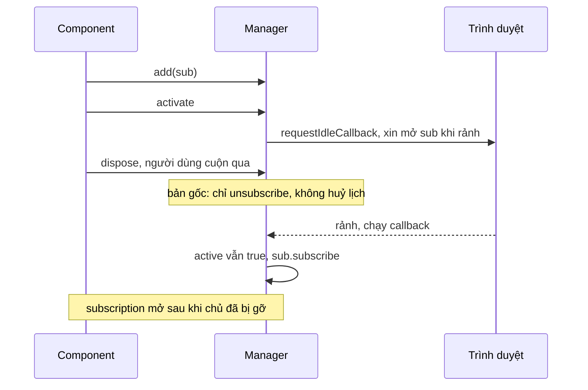

Code đăng ký thì ai cũng viết cẩn thận: thêm listener, mở subscription, hẹn timer. Code **huỷ** đăng ký thì thường được viết sau cùng, ít được test, và chỉ chạy trong những tình huống khó tái hiện: component bị gỡ giữa chừng, cleanup chạy hai lần, story bị cuộn qua trước khi trình duyệt kịp rảnh.

Bài cuối của phần 15 gom sáu lỗi dọn dẹp đọc được trong mã Facebook. Không lỗi nào làm sập trang ngay; chúng làm rò bộ nhớ, để lại kết nối realtime "ma", hoặc gỡ nhầm listener của người khác. Mỗi lỗi một dòng, mỗi cách sửa cũng chỉ vài dòng.

> [!TIP]
> **Tóm tắt**
> - `list.splice(list.indexOf(fn), 1)`: gọi lần hai thì `indexOf` trả `-1`, và `splice(-1, 1)` **xoá phần tử cuối**, tức listener của người khác. `filter(b => b === fn)` thì ngược điều kiện: giữ đúng cái cần xoá, xoá hết phần còn lại.
> - Map ghi bằng khoá A mà xoá bằng khoá B thì không bao giờ rỗng. Subscription được hẹn mở "khi rảnh" phải huỷ cả lịch hẹn lúc dispose, nếu không nó tự mở lại sau khi đã bị gỡ.
> - `arr.concat(x)` không đổi `arr`. `useEffect(() => { t.cancel() }, [])` chạy lúc mount, không phải unmount.
> - Quy tắc: dispose phải **idempotent** (gọi nhiều lần như một), huỷ **mọi giai đoạn** đang chờ, và xoá đúng thứ đã thêm. `AbortController`, `DisposableStack` giúp viết đúng ngay từ đầu.

<iframe class="demo-frame" src="/demos/facebook-patterns/index.html?theme=dark#/dispose-leak-bugs" title="Demo dispose-leak-bugs" loading="lazy" style="height: 720px"></iframe>

<p class="demo-links">▶ <a href="/demos/facebook-patterns/index.html#/dispose-leak-bugs" target="_blank" rel="noopener">Mở demo toàn màn hình ↗</a> · <a href="https://stackblitz.com/github/hunghg255/blog-hunghg/tree/master/examples/facebook-patterns?file=src/lib/disposeSafe.ts" target="_blank" rel="noopener">Sửa code trên StackBlitz ↗</a> · <a href="https://github.com/hunghg255/blog-hunghg/blob/master/examples/facebook-patterns/src/lib/disposeSafe.ts" target="_blank" rel="noopener">Xem source trên GitHub ↗</a></p>

## Lỗi 1 và 2: gỡ listener khỏi mảng

### `splice(indexOf)` không kiểm −1: `GHLAriaLabelTracker` (bundle `2.js`)

Một registry nhỏ: `onAdd(cb)` thêm callback vào mảng, trả về `{ dispose }`.

```js
const listeners = [];
function onAdd(cb) {
  if (ready) cb();
  listeners.push(cb);
  return { dispose: () => listeners.splice(listeners.indexOf(cb), 1) };
}
```

Gọi `dispose()` lần đầu thì đúng. Gọi lần hai (cleanup của effect chạy hai lần, hay một đường dọn dẹp khác cũng gọi), `indexOf` trả `-1`, và `splice(-1, 1)` nghĩa là "xoá 1 phần tử tính từ cuối". Kết quả: `[A, B, C]`, dispose A hai lần, còn `[B]`. Listener C của một component khác biến mất mà không ai biết. Chạy lại bằng Node cho đúng kết quả đó; demo phần 1 cho bạn bấm thử.

Cùng bundle, `LoadingMarkerGlobalListener` (`233.js`) viết đúng: `const i = list.indexOf(cb); i > -1 && list.splice(i, 1)`. Hai đội, hai thói quen.

### `filter` ngược điều kiện: `GHLInternalMonitorStore_DO_NOT_USE` (bundle `132.js`)

```js
function observeAny(cb) {
  anyObservers.push(cb);
  /* ... */
  return { dispose: () => (anyObservers = anyObservers.filter((b) => b === cb)) };
}
```

Đúng ra là `b !== cb`. Với `===`, dispose A **giữ lại mỗi A** và xoá mọi observer khác: `[A, B, C]` thành `[A]`. Lỗi kiểu này sống sót được vì trong thực tế có lẽ chỉ có một observer, nên danh sách sau dispose "trông có vẻ" bình thường.

(Hai module GHL thuộc nhóm phát hiện trình chặn quảng cáo; ở đây chỉ bàn chuyện quản lý listener.)

## Lỗi 3: Map xoá sai khoá

### `SetIdleTimeoutAcrossTransitions` (`99 ChatComposer/all.js`)

Sau khi trang tải xong (`all_pagelets_loaded`), các timer "không gấp" không chạy ngay khi tới giờ, mà xin thêm một `requestIdleCallback` để chạy lúc trình duyệt rảnh. Để `clear(timeoutId)` huỷ được ở cả hai giai đoạn, module nhớ cặp `timeoutId → idleId` trong một Map:

```js
function start(fn, ms) {
  const timeoutId = setTimeout(() => {
    const idleId = requestIdleCallback(() => {
      fn();
      map.delete(idleId);            // khoá sai: map được set bằng timeoutId
    });
    map.set(timeoutId, idleId);
  }, ms);
  return timeoutId;
}
```

Mỗi timer chạy xong để lại một entry vĩnh viễn. Demo phần 2 chạy 1.000 timer: Map của bản gốc còn khoảng **960 đến 1.000** entry. Không phải đúng 1.000, vì id của `setTimeout` và id của `requestIdleCallback` là hai dãy số riêng có thể trùng nhau: `map.delete(idleId)` đôi khi xoá nhầm entry của một timer **khác** có `timeoutId` bằng đúng số đó. Timer đó mất khả năng bị huỷ ở giai đoạn idle. Một lỗi đẻ ra lỗi thứ hai.

Map chỉ chứa số, nên rò rỉ nhỏ (vài chục byte mỗi entry). Nhưng trên một trang mở cả ngày như Messenger, nó tăng không giới hạn.

## Lỗi 4: subscription mở lại sau dispose

### `UFI2SubscriptionManager` (bundle `183.js`) và `useCometUFISubscriptionManager` (`26.VideoPlayer/all.js`)

Phần bình luận và cảm xúc dưới mỗi bài (UFI) nhận cập nhật realtime qua subscription. Mở subscription cho mọi bài trong feed ngay khi render thì tốn, nên cả hai module (một lớp cho giao diện cũ, một hook cho Comet) đều làm cùng một việc: khi bài hiện lên thì **hẹn** mở từng subscription vào lúc trình duyệt rảnh (`requestIdleCallback`, hoặc `JSScheduler.scheduleSpeculativeCallback` ở bản hook), khi bài khuất thì huỷ các lịch hẹn và đóng subscription. Và cả hai mắc **cùng một lỗi** ở `add().dispose`:

```js
add(sub) {
  this.subs.add(sub);
  if (this.active) sub.subscribe();
  return { dispose: () => { sub.unsubscribe(); this.subs.delete(sub); } };   // không huỷ lịch hẹn của sub
}
activateOnIdle() {
  this.active = true;
  for (const sub of this.subs) {
    const h = requestIdleCallback(() => { this.pending.delete(h); if (this.active) sub.subscribe(); });
    this.pending.add(h);
  }
}
```

Trình tự gây lỗi: bài hiện lên (`activate`, các lịch hẹn được xếp), rồi component bị gỡ **trước khi trình duyệt rảnh** (người dùng cuộn rất nhanh, hay chuyển trang). `dispose()` đóng một subscription chưa từng mở và xoá nó khỏi tập, nhưng lịch hẹn vẫn còn. Khi trình duyệt rảnh, callback kiểm tra `this.active`, thấy vẫn `true` (manager chưa bị `deactivate`), và gọi `sub.subscribe()`. Subscription mở ra **sau khi** chủ của nó đã bị gỡ, và không còn ai giữ tham chiếu để đóng.

Bản hook có thêm `recoverableViolation("Scheduled callback to activate subscription was not canceled")`, nhưng nó chỉ báo khi `active` là `false`, tức đúng trường hợp ngược lại. Demo phần 3: activate rồi dispose ngay 5 subscription, sau 300 ms bản gốc còn **5** subscription mở, bản sửa còn 0.

Bản lớp còn một lỗi nhỏ nữa: `unsubscribeAll` huỷ các lịch hẹn nhưng **không xoá** chúng khỏi tập `pending` (callback bị huỷ thì không bao giờ chạy để tự xoá). Demo: 50 lần bài ra vào màn hình, mỗi lần 5 subscription, tập còn 250 handle đã chết. Bản hook thì có `clear()` sau khi huỷ.

## Lỗi 5 và 6: hai hook React

### `concat` không gán: `useCometLoadingStateTracker` (`99 ChatComposer/all.js`)

```js
useEffect(() => {
  const el = ref.current, cleanups = [];
  if (InteractionTracker && el) cleanups.concat(InteractionTracker.trackLoadingState(el));   // mất
  if (NavigationTracker && el) cleanups.push(NavigationTracker.trackLoadingState(el));
  return () => cleanups.forEach((fn) => fn());
}, []);
```

`Array.prototype.concat` trả về **mảng mới**, không đổi mảng gốc. Hàm dọn dẹp của tracker interaction bị vứt đi ngay, chỉ tracker navigation được dọn khi unmount. Dòng bên dưới dùng `push` đúng; hai dòng nằm cạnh nhau mà khác nhau.

### Cancel lúc mount: `useThrottledComet` (bundle `6.js`)

```js
const throttled = useMemo(() => throttle((...args) => ref.current?.(...args), wait), [wait]);
useEffect(() => {
  throttled.cancel();      // chạy lúc MOUNT, và không trả về hàm cleanup
}, []);
return throttled;
```

Ý định rõ ràng là "huỷ lời gọi còn treo khi unmount", nhưng thiếu chữ `return`. Effect chạy một lần lúc mount (không có gì để huỷ), và không có cleanup nào chạy lúc unmount. Lời gọi throttled cuối cùng vẫn chạy sau khi component đã bị gỡ: gửi request, ghi log, hay gọi `setState` trên component đã chết. Hook anh em `useDebounced` cùng thư viện viết đúng: `useEffect(() => debounced.reset, [debounced])`. Demo phần 4: gõ 5 phím rồi đóng ô sau 30 ms, hook kiểu gốc chạy **1** lời gọi sau unmount, bản sửa 0.



## Bên trong: vì sao dọn dẹp hay sai

**Dispose bị gọi nhiều lần là chuyện bình thường.** React 18+ ở StrictMode chạy mount → cleanup → mount cho mọi effect trong môi trường dev. Một đối tượng có thể được dọn bởi cả effect cleanup lẫn một `unsubscribeAll` ở cấp cha. Đường lỗi (`catch`, `finally`) có thể gọi dọn dẹp lần nữa. Vì vậy mọi `dispose` phải **idempotent**: gọi lần hai không làm gì.

**Việc bất đồng bộ có nhiều giai đoạn.** "Hẹn giờ rồi chờ rảnh", "xếp lịch rồi mở kết nối", "fetch rồi parse": mỗi giai đoạn có một handle riêng. Huỷ phải huỷ **giai đoạn đang chờ**, và mỗi callback, khi chạy, phải tự hỏi "mình còn được cần không?" bằng trạng thái của **chính nó**, không bằng một cờ chung.

**Các API của mảng không đồng nhất.** `push`, `splice`, `sort`, `reverse` đổi mảng gốc; `concat`, `slice`, `filter`, `map`, `toSorted` trả mảng mới. `splice` nhận chỉ số âm (tính từ cuối), nên `-1` của `indexOf` biến thành một chỉ số hợp lệ. Đây là cặp bẫy kinh điển nhất trong JavaScript.

**Id timer không duy nhất giữa các API.** `setTimeout`, `setInterval` dùng chung một dãy; `requestAnimationFrame` và `requestIdleCallback` có dãy riêng. Hai id từ hai API có thể trùng số, nên một Map trộn khoá từ nhiều nguồn sẽ đụng nhau.

## Viết lại

`src/lib/disposeSafe.ts` gồm các mảnh nhỏ, mỗi mảnh sửa một lỗi.

Dispose một lần, và danh sách listener theo entry (thêm cùng một hàm hai lần là hai entry riêng):

```ts title=src/lib/disposeSafe.ts
/** Bọc một hàm dọn dẹp cho nó chỉ chạy một lần, dù bị gọi bao nhiêu lần. */
export function disposeOnce(fn: () => void): Disposable {
  let done = false;
  return {
    dispose() {
      if (done) return;
      done = true;
      fn();
    },
  };
}

// ---------- 1. Danh sách listener ----------

/**
 * Mỗi lần add tạo một entry riêng (thêm cùng một hàm hai lần là hai entry),
 * dispose xoá đúng entry đó và chỉ một lần.
 */
export function createListenerSet<A extends unknown[] = []>() {
  const entries = new Set<{ fn: (...args: A) => void }>();
  return {
    add(fn: (...args: A) => void): Disposable {
      const entry = { fn };
      entries.add(entry);
      return disposeOnce(() => entries.delete(entry));
    },
    emit(...args: A) {
      // chụp danh sách trước khi phát; entry bị gỡ giữa chừng thì bỏ qua
      for (const e of [...entries]) if (entries.has(e)) e.fn(...args);
    },
    get size() {
      return entries.size;
    },
    names(): string[] {
      return [...entries].map((e) => e.fn.name || '?');
    },
  };
}
```

Timer idle xoá đúng khoá:

```ts title=src/lib/disposeSafe.ts
/** Chờ `ms` rồi chờ thêm lúc trình duyệt rảnh mới chạy. clear() huỷ được ở cả hai giai đoạn. */
export function createIdleTimeouts(idle: IdleApi = browserIdle) {
  const idleOf = new Map<number, number>(); // timeoutId → idleId, chỉ khi đang chờ idle
  return {
    start(fn: () => void, ms: number): number {
      const timeoutId = window.setTimeout(() => {
        idleOf.set(timeoutId, idle.request(() => {
          idleOf.delete(timeoutId); // xoá bằng đúng khoá đã set
          fn();
        }));
      }, ms);
      return timeoutId;
    },
    clear(timeoutId: number) {
      window.clearTimeout(timeoutId);
      const idleId = idleOf.get(timeoutId);
      if (idleId !== undefined) {
        idle.cancel(idleId);
        idleOf.delete(timeoutId);
      }
    },
    get pending() {
      return idleOf.size;
    },
  };
}
```

Subscription: mỗi subscription có một "slot" nhớ lịch hẹn của nó; dispose huỷ lịch, callback kiểm tra slot của chính nó.

```ts title=src/lib/disposeSafe.ts
/**
 * Giữ các subscription realtime (comment, reaction) của một story.
 * activate(): mở từng cái lúc trình duyệt rảnh. deactivate(): huỷ hết, kể cả cái đang chờ.
 * dispose của từng cái huỷ luôn lịch đang chờ của nó.
 */
export class IdleSubscriptions {
  private slots = new Map<Subscribable, Slot>();
  private active = false;

  constructor(private readonly idle: IdleApi = browserIdle) {}

  add(sub: Subscribable): Disposable {
    const slot: Slot = { idle: null, subscribed: false };
    this.slots.set(sub, slot);
    if (this.active) this.open(sub, slot);
    return disposeOnce(() => {
      if (this.slots.get(sub) !== slot) return;
      this.close(sub, slot);
      this.slots.delete(sub);
    });
  }

  activate() {
    if (this.active) return;
    this.active = true;
    for (const [sub, slot] of this.slots) {
      slot.idle = this.idle.request(() => {
        slot.idle = null;
        if (this.active && this.slots.get(sub) === slot) this.open(sub, slot);
      });
    }
  }

  deactivate() {
    if (!this.active) return;
    this.active = false;
    for (const [sub, slot] of this.slots) this.close(sub, slot);
  }

  get pendingCount() {
    let n = 0;
    for (const s of this.slots.values()) if (s.idle !== null) n++;
    return n;
  }

  private open(sub: Subscribable, slot: Slot) {
    if (slot.subscribed) return;
    slot.subscribed = true;
    sub.subscribe();
  }

  private close(sub: Subscribable, slot: Slot) {
    if (slot.idle !== null) {
      this.idle.cancel(slot.idle);
      slot.idle = null;
    }
    if (slot.subscribed) {
      slot.subscribed = false;
      sub.unsubscribe();
    }
  }
}
```

Hook throttle trả về cleanup:

```ts title=src/lib/disposeSafe.ts
/** Hook throttle: luôn gọi bản fn mới nhất, huỷ lời gọi còn treo khi unmount (hoặc khi đổi wait). */
export function useThrottledCallback<A extends unknown[]>(fn: (...args: A) => void, wait = 100): Throttled<A> {
  const ref = useRef(fn);
  useEffect(() => {
    ref.current = fn;
  }, [fn]);
  const throttled = useMemo(() => throttle((...args: A) => ref.current(...args), wait), [wait]);
  useEffect(() => () => throttled.cancel(), [throttled]); // trả về cleanup, không gọi cancel lúc mount
  return throttled;
}
```

::: spoiler Xem toàn bộ src/lib/disposeSafe.ts

```ts title=src/lib/disposeSafe.ts
/**
 * Dispose cho đúng: danh sách listener gỡ hai lần không hại ai, timer idle không để rác trong Map,
 * subscription bị huỷ trước khi kịp mở thì không mở nữa, throttle huỷ khi unmount, gom cleanup.
 * Sửa các bug đọc được trong GHLAriaLabelTracker, GHLInternalMonitorStore, SetIdleTimeoutAcrossTransitions,
 * UFI2SubscriptionManager / useCometUFISubscriptionManager, useCometLoadingStateTracker, useThrottledComet
 * (Facebook). Viết lại từ đầu.
 */
import { useEffect, useMemo, useRef } from 'react';

export interface Disposable {
  dispose(): void;
}

/** Bọc một hàm dọn dẹp cho nó chỉ chạy một lần, dù bị gọi bao nhiêu lần. */
export function disposeOnce(fn: () => void): Disposable {
  let done = false;
  return {
    dispose() {
      if (done) return;
      done = true;
      fn();
    },
  };
}

// ---------- 1. Danh sách listener ----------

/**
 * Mỗi lần add tạo một entry riêng (thêm cùng một hàm hai lần là hai entry),
 * dispose xoá đúng entry đó và chỉ một lần.
 */
export function createListenerSet<A extends unknown[] = []>() {
  const entries = new Set<{ fn: (...args: A) => void }>();
  return {
    add(fn: (...args: A) => void): Disposable {
      const entry = { fn };
      entries.add(entry);
      return disposeOnce(() => entries.delete(entry));
    },
    emit(...args: A) {
      // chụp danh sách trước khi phát; entry bị gỡ giữa chừng thì bỏ qua
      for (const e of [...entries]) if (entries.has(e)) e.fn(...args);
    },
    get size() {
      return entries.size;
    },
    names(): string[] {
      return [...entries].map((e) => e.fn.name || '?');
    },
  };
}

// ---------- 2. setTimeout rồi requestIdleCallback ----------

export interface IdleApi {
  request(cb: () => void): number;
  cancel(handle: number): void;
}

/** requestIdleCallback nếu có (Safari chưa có), không thì setTimeout. */
export const browserIdle: IdleApi =
  typeof requestIdleCallback === 'function'
    ? { request: (cb) => requestIdleCallback(() => cb()), cancel: (h) => cancelIdleCallback(h) }
    : { request: (cb) => window.setTimeout(cb, 1), cancel: (h) => window.clearTimeout(h) };

/** Chờ `ms` rồi chờ thêm lúc trình duyệt rảnh mới chạy. clear() huỷ được ở cả hai giai đoạn. */
export function createIdleTimeouts(idle: IdleApi = browserIdle) {
  const idleOf = new Map<number, number>(); // timeoutId → idleId, chỉ khi đang chờ idle
  return {
    start(fn: () => void, ms: number): number {
      const timeoutId = window.setTimeout(() => {
        idleOf.set(timeoutId, idle.request(() => {
          idleOf.delete(timeoutId); // xoá bằng đúng khoá đã set
          fn();
        }));
      }, ms);
      return timeoutId;
    },
    clear(timeoutId: number) {
      window.clearTimeout(timeoutId);
      const idleId = idleOf.get(timeoutId);
      if (idleId !== undefined) {
        idle.cancel(idleId);
        idleOf.delete(timeoutId);
      }
    },
    get pending() {
      return idleOf.size;
    },
  };
}

// ---------- 3. Subscription bật khi rảnh ----------

export interface Subscribable {
  subscribe(): void;
  unsubscribe(): void;
}

interface Slot {
  idle: number | null;
  subscribed: boolean;
}

/**
 * Giữ các subscription realtime (comment, reaction) của một story.
 * activate(): mở từng cái lúc trình duyệt rảnh. deactivate(): huỷ hết, kể cả cái đang chờ.
 * dispose của từng cái huỷ luôn lịch đang chờ của nó.
 */
export class IdleSubscriptions {
  private slots = new Map<Subscribable, Slot>();
  private active = false;

  constructor(private readonly idle: IdleApi = browserIdle) {}

  add(sub: Subscribable): Disposable {
    const slot: Slot = { idle: null, subscribed: false };
    this.slots.set(sub, slot);
    if (this.active) this.open(sub, slot);
    return disposeOnce(() => {
      if (this.slots.get(sub) !== slot) return;
      this.close(sub, slot);
      this.slots.delete(sub);
    });
  }

  activate() {
    if (this.active) return;
    this.active = true;
    for (const [sub, slot] of this.slots) {
      slot.idle = this.idle.request(() => {
        slot.idle = null;
        if (this.active && this.slots.get(sub) === slot) this.open(sub, slot);
      });
    }
  }

  deactivate() {
    if (!this.active) return;
    this.active = false;
    for (const [sub, slot] of this.slots) this.close(sub, slot);
  }

  get pendingCount() {
    let n = 0;
    for (const s of this.slots.values()) if (s.idle !== null) n++;
    return n;
  }

  private open(sub: Subscribable, slot: Slot) {
    if (slot.subscribed) return;
    slot.subscribed = true;
    sub.subscribe();
  }

  private close(sub: Subscribable, slot: Slot) {
    if (slot.idle !== null) {
      this.idle.cancel(slot.idle);
      slot.idle = null;
    }
    if (slot.subscribed) {
      slot.subscribed = false;
      sub.unsubscribe();
    }
  }
}

// ---------- 4. Gom cleanup, throttle trong React ----------

/** Gom hàm dọn dẹp, chạy ngược thứ tự thêm (giống DisposableStack), lỗi không chặn cái sau. */
export class CleanupBag {
  private fns: Array<() => void> = [];

  add(fn: (() => void) | null | undefined) {
    if (fn) this.fns.push(fn);
    return this;
  }

  get size() {
    return this.fns.length;
  }

  disposeAll() {
    const errors: unknown[] = [];
    for (const fn of this.fns.splice(0).reverse()) {
      try {
        fn();
      } catch (e) {
        errors.push(e);
      }
    }
    if (errors.length) throw new AggregateError(errors, 'Cleanup lỗi');
  }
}

export interface Throttled<A extends unknown[]> {
  (...args: A): void;
  cancel(): void;
}

/** Throttle leading + trailing: chạy ngay lần đầu, lần cuối trong cửa sổ chạy khi hết `wait`. */
export function throttle<A extends unknown[]>(fn: (...args: A) => void, wait: number): Throttled<A> {
  let last = -Infinity;
  let timer: ReturnType<typeof setTimeout> | null = null;
  let pending: A | null = null;
  const run = (args: A) => {
    last = Date.now();
    fn(...args);
  };
  const t = ((...args: A) => {
    const left = wait - (Date.now() - last);
    if (left <= 0 && !timer) return run(args);
    pending = args;
    timer ??= setTimeout(() => {
      timer = null;
      const a = pending;
      pending = null;
      if (a) run(a);
    }, Math.max(0, left));
  }) as Throttled<A>;
  t.cancel = () => {
    if (timer) clearTimeout(timer);
    timer = null;
    pending = null;
  };
  return t;
}

/** Hook throttle: luôn gọi bản fn mới nhất, huỷ lời gọi còn treo khi unmount (hoặc khi đổi wait). */
export function useThrottledCallback<A extends unknown[]>(fn: (...args: A) => void, wait = 100): Throttled<A> {
  const ref = useRef(fn);
  useEffect(() => {
    ref.current = fn;
  }, [fn]);
  const throttled = useMemo(() => throttle((...args: A) => ref.current(...args), wait), [wait]);
  useEffect(() => () => throttled.cancel(), [throttled]); // trả về cleanup, không gọi cancel lúc mount
  return throttled;
}
```

:::

## Đi qua code

- **`disposeOnce`** là nền của mọi thứ: cờ `done` làm lần gọi thứ hai thành không làm gì. Đây chính là phần thiếu ở lỗi 1.
- **`createListenerSet`** lưu object `{ fn }` thay vì `fn`: thêm cùng một hàm hai lần thì gỡ một lần chỉ mất một bản. `emit` chụp danh sách rồi kiểm `entries.has(e)` trước khi gọi, nên listener bị gỡ giữa lúc phát sẽ không chạy nữa, listener thêm giữa lúc phát chờ lần sau.
- **`createIdleTimeouts`** chỉ có một loại khoá (`timeoutId`), set và delete cùng khoá. Map chỉ chứa timer **đang chờ idle**, nên `pending` về 0 khi mọi thứ xong.
- **`IdleSubscriptions`**: callback idle kiểm `this.slots.get(sub) === slot`, tức "slot của mình còn đó không", chứ không chỉ "manager còn active không". `close()` huỷ lịch hẹn rồi mới đóng, và chỉ `unsubscribe` cái đã thật sự `subscribe` (cờ `subscribed`).
- **`deactivate`** đặt `slot.idle = null` sau khi huỷ, nên không còn handle chết nào nằm lại.
- **`CleanupBag`** thay cho mảng `cleanups` tự quản: `add` bỏ qua `null`/`undefined`, `disposeAll` chạy ngược thứ tự thêm (cái mở sau đóng trước), lỗi của một hàm không chặn các hàm sau và được gom thành `AggregateError`.
- **`useThrottledCallback`**: `useEffect(() => () => throttled.cancel(), [throttled])`. Hai dấu `=>` liên tiếp là toàn bộ khác biệt với bản gốc. Khi `wait` đổi, throttle cũ cũng bị huỷ.

**Khác bản gốc:** ngoài các chỗ sửa, `createListenerSet` không gọi ngay callback khi đã "ready" như `GHLAriaLabelTracker`; `IdleSubscriptions` dùng một lớp cho cả hai bản (lớp và hook); `browserIdle` tự lùi về `setTimeout` khi không có `requestIdleCallback` (Safari).

## Tại sao không làm cách khác?

- **`Set` thay cho mảng**: `set.delete(fn)` tự idempotent và không có bẫy `-1`. Đổi lại, thêm cùng một hàm hai lần chỉ còn một bản. Với registry listener thì `Set` thường là đủ và là lựa chọn đầu tiên nên nghĩ tới.
- **`AbortController`**: một `signal` truyền cho `addEventListener(type, fn, { signal })`, `fetch`, và code của bạn. `abort()` một lần là gỡ tất cả, gọi lại không sao. Rất hợp cho "mọi thứ của component này".
- **`WeakMap` / `WeakRef`**: tránh giữ đối tượng đã chết, nhưng không thay được việc huỷ timer và đóng kết nối: GC không đóng WebSocket hộ bạn.
- **Thư viện (lodash `throttle`, `use-debounce`)**: có `cancel`/`flush` sẵn; vẫn phải tự gọi `cancel` trong cleanup.

## Edge case và cạm bẫy

- **Gỡ listener trong lúc đang phát sự kiện**: duyệt thẳng mảng mà `splice` giữa chừng sẽ bỏ sót phần tử kế tiếp. Chụp danh sách trước, hoặc dùng `Set` (duyệt `Set` khi xoá phần tử chưa tới là an toàn).
- **Callback hẹn giờ đóng khung trạng thái cũ** (stale closure): kiểm trạng thái qua ref hoặc slot, không qua biến bắt từ lúc hẹn.
- **StrictMode**: nếu chức năng chạy đúng ở production mà sai ở dev, nhiều khả năng cleanup chưa đúng; đừng tắt StrictMode để "sửa".
- **Rò rỉ nhỏ vẫn là rò rỉ**: Map vài chục byte mỗi entry thì vô hại trong một trang đọc tin 5 phút, nhưng Messenger, Gmail mở cả tuần. Đo bằng DevTools Memory (so hai heap snapshot) sau khi lặp thao tác 100 lần.
- **Bỏ qua kết quả trả về**: TypeScript không cảnh báo `arr.concat(x);` đứng một mình, và luật `no-unused-expressions` của ESLint cũng bỏ qua mọi lời gọi hàm (coi như có tác dụng phụ). Cách phòng là thói quen: thêm vào mảng thì `push`, hoặc dùng `CleanupBag.add`.

## Dùng trong dự án

```tsx
import { useEffect, useMemo } from 'react';
import { CleanupBag, createListenerSet, IdleSubscriptions, useThrottledCallback } from './disposeSafe';

const resized = createListenerSet<[number]>();
const off = resized.add((w) => console.log(w));
off.dispose();
off.dispose(); // vô hại

function StoryUFI({ story }: { story: Story }) {
  const manager = useMemo(() => new IdleSubscriptions(), []);
  useEffect(() => {
    const bag = new CleanupBag();
    bag.add(manager.add(commentsSubscription(story.id)).dispose);
    bag.add(manager.add(reactionsSubscription(story.id)).dispose);
    return () => bag.disposeAll();
  }, [manager, story.id]);
  useEffect(() => onVisibilityChange(story.id, (v) => (v ? manager.activate() : manager.deactivate())), [manager, story.id]);
  const logTyping = useThrottledCallback((q: string) => log('typeahead', q), 200);
  return <CommentBox onInput={(e) => logTyping(e.currentTarget.value)} />;
}
```

## Kiểm thử

::: spoiler Ví dụ test (bản phác, không có trong repo)

```ts
import { describe, expect, it, vi } from 'vitest';
import { CleanupBag, createIdleTimeouts, createListenerSet, IdleSubscriptions, type IdleApi } from './disposeSafe';

/** idle giả: chạy khi gọi flush() */
function fakeIdle() {
  let id = 0;
  const q = new Map<number, () => void>();
  const api: IdleApi = { request: (cb) => (q.set(++id, cb), id), cancel: (h) => void q.delete(h) };
  return { api, flush: () => { const cbs = [...q.values()]; q.clear(); cbs.forEach((cb) => cb()); }, size: () => q.size };
}

describe('listener', () => {
  it('dispose hai lần không xoá nhầm', () => {
    const s = createListenerSet();
    const a = s.add(function A() {}); s.add(function B() {}); s.add(function C() {});
    a.dispose(); a.dispose();
    expect(s.names()).toEqual(['B', 'C']);
  });
});

describe('idle timeouts', () => {
  it('map về 0 sau khi chạy', () => {
    vi.useFakeTimers();
    const idle = fakeIdle();
    const t = createIdleTimeouts(idle.api);
    const fn = vi.fn();
    for (let i = 0; i < 100; i++) t.start(fn, 10);
    vi.advanceTimersByTime(10);
    expect(t.pending).toBe(100);
    idle.flush();
    expect(fn).toHaveBeenCalledTimes(100);
    expect(t.pending).toBe(0);
    vi.useRealTimers();
  });
});

describe('IdleSubscriptions', () => {
  it('dispose trước lúc rảnh thì không mở', () => {
    const idle = fakeIdle();
    const m = new IdleSubscriptions(idle.api);
    const sub = { subscribe: vi.fn(), unsubscribe: vi.fn() };
    const d = m.add(sub);
    m.activate();
    d.dispose();
    idle.flush();
    expect(sub.subscribe).not.toHaveBeenCalled();
    expect(idle.size()).toBe(0);
  });

  it('activate/deactivate lặp lại không để lại lịch', () => {
    const idle = fakeIdle();
    const m = new IdleSubscriptions(idle.api);
    m.add({ subscribe() {}, unsubscribe() {} });
    for (let i = 0; i < 50; i++) { m.activate(); m.deactivate(); }
    expect(idle.size()).toBe(0);
    expect(m.pendingCount).toBe(0);
  });
});

describe('CleanupBag', () => {
  it('chạy ngược thứ tự, lỗi không chặn', () => {
    const order: number[] = [];
    const bag = new CleanupBag().add(() => order.push(1)).add(() => { throw new Error('x'); }).add(() => order.push(3));
    expect(() => bag.disposeAll()).toThrow(AggregateError);
    expect(order).toEqual([3, 1]);
  });
});
```

:::

## So với thư viện và chuẩn web

- **`AbortController` + `addEventListener(…, { signal })`**: có ở mọi trình duyệt chính (tính tới 10/2026); cách gọn nhất để gỡ nhiều listener một lần.
- **Explicit Resource Management** (`using`, `DisposableStack`, `Symbol.dispose`): đề xuất của TC39, đã có ở Chrome và Firefox bản mới, Safari chưa đầy đủ (tính tới 10/2026, xem [caniuse](https://caniuse.com/?search=DisposableStack)); TypeScript hỗ trợ cú pháp từ bản 5.2. `CleanupBag` ở trên là phiên bản tay của `DisposableStack`.
- **RxJS `Subscription`**: `unsubscribe()` idempotent, `add()` gom con; đúng mô hình mà các lỗi trên thiếu.
- **VS Code `DisposableStore`**: cùng ý tưởng, kèm cảnh báo khi thêm vào store đã dispose.
- **React**: hàm trả về từ `useEffect` là cleanup; React Compiler và luật `react-hooks/exhaustive-deps` không bắt được lỗi "quên `return`".
- Bài liên quan: [#78 setImmediate và hàng đợi](/blogs/facebook-setimmediate-mouse-batching), [#36 tiện ích UI dùng khắp nơi](/blogs/facebook-ui-utility-hooks).

---

Bài này thuộc series **[Học từ mã nguồn Facebook](/series/facebook)** (106 bài, đọc theo thứ tự).

::: spoiler Xem nhanh danh sách bài trong series

*Phần 1*

- [Mở đầu: cách đọc code minify của Facebook](/blogs/learn-from-facebook-source-code)
- [#1 Dùng chung IntersectionObserver + infinite scroll](/blogs/facebook-shared-intersection-observer)
- [#2 useViewportDuration: đo thời gian thực sự được xem](/blogs/facebook-use-viewport-duration)
- [#3 Preload code + data khi hover](/blogs/facebook-preload-on-hover)
- [#4 Toast manager với external store](/blogs/facebook-toast-manager)
- [#5 Network status + heartbeat backoff](/blogs/facebook-network-status-heartbeat)
- [#6 ErrorGuard: bắt lỗi theo ngữ cảnh](/blogs/facebook-error-guard)
- [#7 Banzai: gom log theo lô + sendBeacon](/blogs/facebook-batch-logger)
- [#8 Focus trap + Esc theo layer](/blogs/facebook-focus-trap)

*Phần 2*

- [#9 Mẹo calc(… * 9999): container query, line-clamp, mũi tên carousel bằng CSS](/blogs/facebook-css-9999-trick)
- [#10 Thanh cuộn tuỳ biến bằng CSS 3D](/blogs/facebook-css-3d-scrollbar)
- [#11 Modal cuộn bằng window, giữ vị trí trang nền](/blogs/facebook-document-scroll-modal)
- [#12 Popover, tooltip group và hovercard](/blogs/facebook-popover-tooltip)
- [#13 Primitive Pressable + focus-visible](/blogs/facebook-pressable)
- [#14 Tab "Xem thêm" + sticky header bằng IntersectionObserver](/blogs/facebook-priority-tabs-sticky-header)
- [#15 Avatar khoét mask, gradient Messenger, skeleton steps()](/blogs/facebook-visual-tricks)
- [#16 Khung chat không giật](/blogs/facebook-chat-scroller)
- [#17 Thuật toán chọn bố cục collage ảnh](/blogs/facebook-photo-collage-layout)
- [#18 Keep-alive tab trong SPA](/blogs/facebook-keep-alive-tabs)
- [#19 Tự đo Visual Completion & interaction tracing](/blogs/facebook-visual-completion)
- [#20 Router SPA bền bỉ & tải chunk có retry](/blogs/facebook-spa-router-resilient-loading)

*Phần 3*

- [#21 Smart Compose: gợi ý chữ mờ khi gõ](/blogs/facebook-smart-compose-ghost-text)
- [#22 MQTT ngay trong trình duyệt, tự chuyển sang long-poll](/blogs/facebook-mqtt-in-browser)
- [#23 Đo thời gian dùng bằng bitmap 64 giây](/blogs/facebook-time-spent-bitmap)
- [#24 Bảng reaction nhấn giữ rồi trượt](/blogs/facebook-reaction-press-slide)
- [#25 Tìm kiếm gấp dấu, phiên âm và highlight đầu từ](/blogs/facebook-search-diacritics-tokenize)
- [#26 Ring buffer biết trace nào đã mất log](/blogs/facebook-trace-ring-buffer)
- [#27 Engine animation JS: một vòng rAF và solver cubic-bezier](/blogs/facebook-keyframes-loop-cubic-bezier)
- [#28 Bootloader: bitmap tài nguyên đã tải, chỉ reload khi cần](/blogs/facebook-bootloader-bitmap-consistency)
- [#29 Nhận biết click do screen reader tạo ra](/blogs/facebook-virtual-cursor-detection)
- [#30 Tải trước feed theo chất lượng mạng, đoán hạng thiết bị](/blogs/facebook-network-aware-prefetch)
- [#31 Hàng đợi gửi tin chat giữ đúng thứ tự](/blogs/facebook-ordered-send-queue)
- [#32 Gộp lời gọi API trong cùng một tick](/blogs/facebook-api-batcher)
- [#33 Resize ảnh trong pool Web Worker](/blogs/facebook-jpeg-resize-worker-pool)
- [#34 Crop ảnh theo nhiều khuôn mặt](/blogs/facebook-face-aware-crop)
- [#35 Kéo-thả sắp xếp và vùng thả file không nhấp nháy](/blogs/facebook-flicker-free-drag-drop)
- [#36 Tiện ích UI: fade-out, sticky event, hàm huỷ được](/blogs/facebook-ui-utility-hooks)
- [#37 Hạ tầng nhỏ: cookie, hash lỗi, prefetch khi chuột dừng](/blogs/facebook-small-infra-cookie-hash-idle)

*Phần 4–6*

- [#38 Đồng bộ tin nhắn: phát hiện lỗ seqID và fetch bù theo tầng](/blogs/facebook-messenger-sync-seqid-gaps)
- [#39 OTID: ID tin nhắn kiểu Snowflake sinh ở client](/blogs/facebook-otid-client-snowflake)
- [#40 QPL: lấy mẫu từ lúc bắt đầu, đo RTT gửi tin đầu-cuối](/blogs/facebook-qpl-send-rtt)
- [#41 Bộ điều phối request bảy chế độ gộp và chống trùng](/blogs/facebook-request-dispatcher-modes)
- [#42 Thread list theo mốc thời gian, cookie presence có version](/blogs/facebook-threadlist-ranged-presence)
- [#43 Composer dạng plugin: reducer, dirty checker, chuỗi kiểm tra](/blogs/facebook-plugin-composer)
- [#44 Thanh toán bất đồng bộ: subscribe trước, poll dự phòng](/blogs/facebook-async-checkout)
- [#45 Validate số thẻ: sửa lỗi gõ, dải BIN, Luhn](/blogs/facebook-card-validation)
- [#46 Lịch chọn khoảng ngày: bo góc dải chọn, phím đủ bộ, RTL](/blogs/facebook-range-calendar-a11y)
- [#47 Giờ mở cửa theo tuần: qua đêm, gộp khoảng, phần bù](/blogs/facebook-weekly-hours-intervals)
- [#48 Tiến độ đăng realtime: giữ event chờ snapshot, watchdog](/blogs/facebook-realtime-publish-snapshot)
- [#49 Tiền tệ theo đơn vị nhỏ nhất và ô nhập tiền](/blogs/facebook-currency-minor-units)
- [#50 Sửa hàng loạt Empty/Uniform/Mixed, seen/read bằng 2 bit](/blogs/facebook-bulk-edit-seen-bits)
- [#51 Phát hiện script lạ hook vào hàm native](/blogs/facebook-native-hook-detection)
- [#52 localStorage tự dọn khi đầy quota](/blogs/facebook-quota-aware-storage)
- [#53 Cache tuyến do server phân giải, chờ sẵn promise](/blogs/facebook-route-cache-prefetch)
- [#54 Lưới phím mũi tên 2D và focus không làm cuộn trang](/blogs/facebook-focus-table-grid)
- [#55 Tách emoji bằng máy trạng thái](/blogs/facebook-emoji-segmentation)
- [#56 Đọc trước ghi sau trong một frame, con tự biết vị trí](/blogs/facebook-read-then-write-dom)
- [#57 Hàng đợi lệnh cho video và stream sắp lại chunk](/blogs/facebook-video-command-queue)

*Phần 7–10*

- [#58 Ước lượng băng thông EWMA: loại outlier, nhớ qua phiên](/blogs/facebook-bandwidth-ewma-estimator)
- [#59 ABR theo độ tự tin phát và cắt bậc bitrate theo MOS](/blogs/facebook-abr-playback-confidence)
- [#60 Prefetch segment dự đoán từ manifest, parse hộp sidx](/blogs/facebook-dash-predicted-segments)
- [#61 Đọc metadata MP4/MOV ngay trên client](/blogs/facebook-mp4-metadata-client)
- [#62 Upload tiếp tục được: offset, hash dedupe, phát hiện treo](/blogs/facebook-resumable-upload)
- [#63 Fenwick tree: chọn ngẫu nhiên có trọng số và offset dòng](/blogs/facebook-fenwick-weighted-random)
- [#64 Vạch trục số và trục thời gian "đẹp"](/blogs/facebook-nice-axis-ticks)
- [#65 Damerau-Levenshtein theo dải chéo và tự sửa tên gõ sai](/blogs/facebook-damerau-levenshtein)
- [#66 PRNG có seed, shuffle tái lập và lấy mẫu trace](/blogs/facebook-seeded-prng-sampling)
- [#67 Cặp min/max-heap tái dùng vị trí trong danh sách ảo](/blogs/facebook-dual-heap-buffer-set)
- [#68 Memo nhiều đối số bằng Map/WeakMap và interning object](/blogs/facebook-multikey-memo-interning)
- [#69 Thống kê cửa sổ trượt và đại số khoảng thời gian](/blogs/facebook-moving-stat-intervals)
- [#70 Int64 từ hai số 32-bit, decode UTF, offset theo code point](/blogs/facebook-int64-utf-codepoints)
- [#71 Engine múi giờ IANA trên client, phát hiện lệch giờ](/blogs/facebook-client-iana-timezone)
- [#72 Tự cài semver range](/blogs/facebook-semver-range)
- [#73 Auto-link URL, cắt chữ an toàn, giới hạn LaTeX](/blogs/facebook-autolink-safe-truncate)
- [#74 Parser query kiểu PHP chống prototype pollution](/blogs/facebook-php-query-serializer)
- [#75 Popover tự lật theo phần tràn nhỏ nhất](/blogs/facebook-popover-auto-flip)
- [#76 Tiền tố for(;;) chống JSON hijacking, đọc stream](/blogs/facebook-csrf-prefix-streaming)
- [#77 Chống lộ Referer, linkshim, xoá token trên URL](/blogs/facebook-referrer-linkshim-url-scrub)
- [#78 setImmediate bằng postMessage, gom delta chuột theo frame](/blogs/facebook-setimmediate-mouse-batching)
- [#79 Phát hiện crash qua heartbeat, dò proxy cache hỏng](/blogs/facebook-crash-heartbeat-proxy-check)
- [#80 DPR vào cookie cho ảnh @2x, che khoá trong log](/blogs/facebook-dpr-cookie-secret-redaction)
- [#81 Flux waitFor tự viết và proxy có đệm](/blogs/facebook-flux-dispatch-buffered-proxy)
- [#82 Crop đúng tỉ lệ, xoay sticker bằng ma trận](/blogs/facebook-image-crop-rotation-geometry)

*Phần 11–15*

- [#83 Chia subdomain giữa các tab bằng lease, long-poll theo bảng trạng thái](/blogs/facebook-tab-subdomain-lease-longpoll)
- [#84 MQTT QoS1: giữ publish chờ ack, gửi lại khi kết nối lại](/blogs/facebook-mqtt-qos1-republish)
- [#85 Cache Promise gộp request, cache lỗi ngắn, đua dữ liệu nhúng sẵn](/blogs/facebook-promise-cache-preload-race)
- [#86 Lịch retry: backoff có trần, Fibonacci, báo lỗi CDN mỗi N ngày](/blogs/facebook-retry-backoff-schedules)
- [#87 Giữ nguyên tham chiếu nhánh dữ liệu không đổi](/blogs/facebook-relay-recycle-nodes)
- [#88 Store optimistic: copy-on-write, rollback rồi áp lại](/blogs/facebook-relay-optimistic-store)
- [#89 Chỉ mục subscription theo record, hàng đợi task theo chiều sâu](/blogs/facebook-relay-subscription-index)
- [#90 Phân trang connection: cursor khớp đầu, edge không trùng](/blogs/facebook-relay-connection-pagination)
- [#91 Profiler kiểu middleware và memo selector có lấy mẫu kiểm tra](/blogs/facebook-profiler-middleware-memo-check)
- [#92 Đọc EBML/WebM Cues để tìm byte range của segment](/blogs/facebook-webm-ebml-cues)
- [#93 Stream HTTP Range tạm dừng được, tải tiếp đúng byte](/blogs/facebook-pausable-range-stream)
- [#94 Bảng khoảng thời gian gắn nhãn và nhảy qua lỗ buffer](/blogs/facebook-tagged-time-ranges-gaps)
- [#95 Gom chunk cho SourceBuffer, đồng bộ video bằng playbackRate](/blogs/facebook-sourcebuffer-video-sync)
- [#96 Gom tin nhắn thành cụm, vạch ngày và avatar đã xem](/blogs/facebook-message-grouping)
- [#97 Bao nhiêu tab chat vừa màn hình, chuỗi luật mở tab](/blogs/facebook-chat-tab-policy)
- [#98 Phím tắt Markdown trong editor, Backspace để hoàn tác](/blogs/facebook-markdown-shortcuts-editor)
- [#99 Offset theo code point hay UTF-16: bốn bug cùng một gốc](/blogs/facebook-codepoint-offset-bugs)
- [#100 Typeahead không nhảy: cache tiền tố, chặn reflow, khoá hover](/blogs/facebook-typeahead-stable-results)
- [#101 Hit-test trên canvas bằng phát lại path, nét đứt và cung Bézier](/blogs/facebook-canvas-hit-regions)
- [#102 Vòng tròn theo mét trên bản đồ Mercator](/blogs/facebook-mercator-meter-circles)
- [#103 Dò tính năng trình duyệt: ảnh EXIF 2×1, getter bẫy, scrollbar](/blogs/facebook-feature-probe-tricks)
- [#104 Bug định dạng số và kiểm tra dữ liệu theo locale](/blogs/facebook-locale-validation-bugs)
- **#105 Dispose cho đúng: idle callback, splice(-1), xoá nhầm key** (bài này)

:::

Code + demo: [`examples/facebook-patterns`](https://github.com/hunghg255/blog-hunghg/tree/master/examples/facebook-patterns) · [Mở trên StackBlitz](https://stackblitz.com/github/hunghg255/blog-hunghg/tree/master/examples/facebook-patterns)
