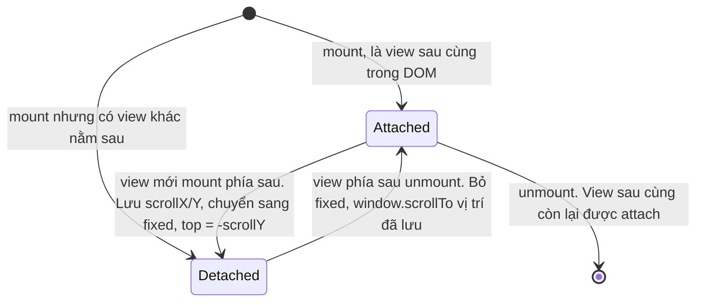
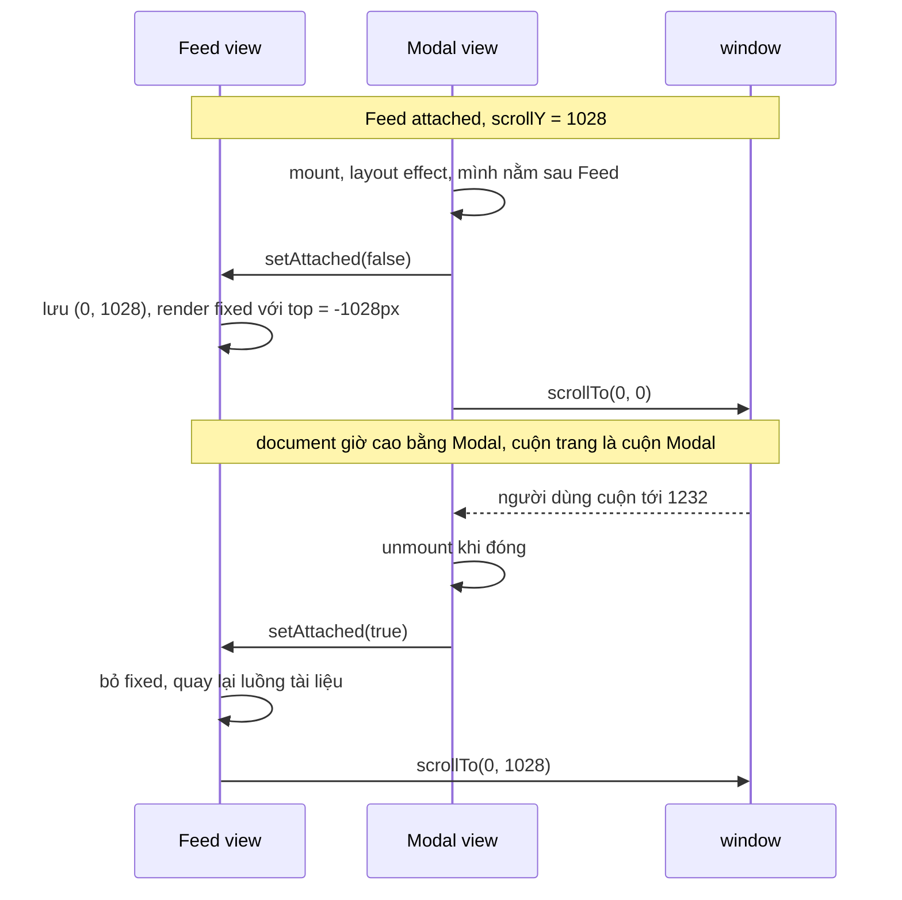

Bạn đang cuộn feed tới bài thứ 30, bấm vào một ảnh. Một modal "permalink" mở ra, dài hơn màn hình vì có cả trăm bình luận. Bạn cuộn hết bình luận, bấm vào một ảnh khác (modal thứ hai), rồi đóng cả hai. Feed phải về **đúng** bài thứ 30.

Nghe đơn giản, nhưng gần như mọi cách làm quen thuộc đều hỏng ở đâu đó:

- **Overlay `position: fixed` + `overflow: auto` bên trong, `body { overflow: hidden }`**: trên iOS Safari đời cũ, `overflow: hidden` trên `body` không chặn được việc cuộn trang nền. Cuộn tới cuối modal thì trang nền bị cuộn theo (scroll chaining). Thanh cuộn biến mất làm cả trang xô ngang 15px trên Windows. Còn modal cuộn bằng một `div` nên mất một số hành vi của trang thật: thanh địa chỉ trên mobile không thu gọn (vùng nhìn thấy nhỏ hơn), và phím Space/PageDown thì phải focus đúng chỗ mới chạy.
- **Mẹo `body { position: fixed; top: -scrollY }`** (thư viện body-scroll-lock làm vậy): chặn được iOS, nhưng modal vẫn cuộn bằng `div`.
- **Chuyển hẳn sang trang mới**: cuộn bằng window thật, nhưng feed bị unmount, quay lại thì phải tải lại và đoán vị trí cuộn.

Facebook chọn cách thứ tư: **modal cuộn bằng chính `window`**, còn trang nền bị "đóng băng" tại chỗ nhưng vẫn mount nguyên vẹn. Toàn bộ nằm trong `CometDocumentScrollView.react` (thư mục `Modal/` trong [facebook-codebase](https://github.com/hunghg255/facebook-codebase)).

> [!TIP]
> **Tóm tắt**
> - Mỗi màn hình (trang chính, từng modal) là một "scroll view". Chỉ view nằm **sau cùng trong DOM** ở trong luồng tài liệu, nên cuộn trang là cuộn nó.
> - Các view bên dưới bị "đóng băng": `position: fixed; top: -scrollY; left: -scrollX`. Trông y như cũ nhưng không còn góp chiều cao vào document.
> - Đóng modal: view bên dưới bỏ `fixed` rồi `window.scrollTo()` về vị trí đã lưu, trong cùng một lần commit nên không nháy.
> - Dialog nhỏ thì `<dialog>` + `overscroll-behavior: contain` là đủ; kỹ thuật này đáng dùng cho modal dạng "trang" (permalink, xem ảnh).

## Ý tưởng: một chồng màn hình, chỉ màn hình trên cùng được dùng window

Mỗi "màn hình" (trang chính, mỗi modal) được bọc trong một `CometDocumentScrollView`. Tại mọi thời điểm:

- Màn hình nằm **sau cùng trong DOM** (thường là modal mở sau cùng, vì portal được append vào cuối `body`) là màn hình **attached**. Nó nằm trong luồng tài liệu bình thường, nên chiều cao của document chính là chiều cao của nó. Cuộn trang chính là cuộn nó.
- Mọi màn hình khác là **detached**: `position: fixed; top: -y; left: -x; width: 100%`, với `(x, y)` là vị trí cuộn lúc nó bị che. Nhờ `top` âm đúng bằng vị trí cuộn cũ, nó **trông y hệt** lúc trước, nhưng không còn góp chiều cao vào document.



Khi modal đóng, màn hình bên dưới được attach lại: bỏ `fixed`, trở về luồng tài liệu (document lại dài như cũ), rồi `window.scrollTo(x, y)`. Người dùng không thấy gì nhảy vì mọi bước chạy trong **layout effect**: `setState` gọi trong layout effect được React xử lý đồng bộ, render lại và commit ngay, trước khi trình duyệt vẽ frame tiếp theo. (Facebook còn bọc `setAttached` trong `runWithPriority(Immediate)` để chắc chắn điều đó.)

## Facebook làm thế nào?

Đọc `Modal/CometDocumentScrollView.react.js`:

**Registry ở module scope.** Ba biến dùng chung cho mọi instance:

```js
i = new Map(),   // element -> hàm setAttached
j = new Set(),   // các view đang bị ẩn (HiddenSubtree)
k = null;        // view đang attached
```

**So thứ tự DOM** bằng `compareDocumentPosition`:

```js
function l(a, b) { return !!(a.compareDocumentPosition(b) & Node.DOCUMENT_POSITION_FOLLOWING) }
```

`l(a, b)` đúng khi `b` nằm sau `a` trong tài liệu. Hàm `m()` duyệt registry, tìm view nằm sau cùng và không bị ẩn.

**Khi mount (layout effect)**: nếu chưa có view active hoặc view mới nằm sau view active, thì gọi `setAttached(false)` cho view cũ và view mới thành active. Ngược lại, view mới tự đặt mình là detached. Hàm `setAttached` được đăng ký vào map, và bọc trong `JSScheduler.runWithPriority(unstable_Immediate, …)` để cập nhật state **đồng bộ**, không để sang frame sau. Khi bị detach, nó chép vị trí cuộn đã lưu (`r.current`) vào state `w`, dùng để vẽ `top`/`left` âm.

**Khi unmount**: xoá khỏi map. Nếu chính nó đang active thì `k = m()` (view sau cùng còn lại) và gọi `setAttached(true)` cho view đó.

**Theo dõi vị trí cuộn**: chỉ view attached mới gắn listener `scroll` (passive) lên window, lưu `pageXOffset`/`pageYOffset` vào ref, và nếu có `contextKey` thì lưu thêm vào một map theo key.

**Khôi phục**: một layout effect khác thấy view vừa chuyển từ detached sang attached thì `window.scrollTo(w.x, w.y)`. View mới mount thì cuộn về `(0, 0)` nếu `resetScrollOnMount` (mặc định `true`, nên modal mới luôn bắt đầu từ trên cùng).

**Style khi detached**:

```js
"aria-hidden": !0,
style: { left: -w.x, top: -w.y },
xstyle: [h.detached /* position:fixed; left:0; top:0; width:100% */, …]
```

Thêm một chi tiết: gatekeeper `gkx("1660344")` trên Chrome/Edge thêm `overflow: hidden` cho view detached (style tên `disablePositionSticky`). Cái tên cho thấy mục đích: tắt các phần tử `position: sticky` bên trong màn hình đã bị đóng băng.

**Liên kết với "HiddenSubtree"**: mỗi view bọc con trong `HiddenSubtreeContextProvider` với `isBackgrounded = detached`. Mọi component bên trong (video, timer, tracking thời gian xem ở [bài #2](/blogs/facebook-use-viewport-duration)) biết mình đang bị che để tạm dừng.

**Ai dùng nó?** Hai chỗ, đã tra trong repo:

- `BaseCometModal.react` bọc **mỗi modal** trong một `CometDocumentScrollView`. Trong đó có một lớp mask `position: fixed` phủ kín màn hình, và phần nội dung `position: relative; min-height: 100vh`. Modal cũng dùng `FocusRegion` (focus vào heading đầu tiên, giữ focus, trả focus khi đóng, xem [bài #8](/blogs/facebook-focus-trap)) và đặt lại cấp heading về 1.
- `CometTabBarView.react` bọc **toàn bộ trang chính** với `resetScrollOnMount: false` (trang chính không cuộn về đầu khi mount), `contextKey` là key cuộn của route hiện tại và `maintainScrollForContext` khi route được "giữ sống". Nhờ `contextKey`, đổi route trong cùng màn hình cũng nhớ được vị trí cuộn riêng của từng route.



## Viết lại

Bản viết lại giữ nguyên cơ chế, bỏ phần gắn với hạ tầng của Facebook (JSScheduler, gatekeeper). Phần cốt lõi là hai layout effect: đăng ký vào registry, và đặt lại vị trí cuộn khi vừa mount hoặc vừa được attach lại:

```tsx title=src/lib/documentScrollView.tsx
  // Đăng ký vào registry. Layout effect: phải xong trước khi trình duyệt vẽ frame đầu tiên.
  useLayoutEffect(() => {
    const el = ref.current;
    if (!el) return;
    if (activeView == null || isAfter(activeView, el)) {
      // mình nằm sau view đang active -> mình lên làm active, view cũ bị detach
      if (activeView != null) views.get(activeView)?.(false);
      activeView = el;
    } else {
      setDetached(true);
    }
    views.set(el, (attached) => {
      if (!attached) {
        // Đọc vị trí THẬT ngay lúc bị detach: listener `scroll` chỉ chạy ở frame sau, nên nếu
        // trang vừa bị cuộn trong cùng frame (scrollIntoView, focus…) thì giá trị của nó đã cũ.
        // Ngoại lệ: view khác vừa kéo window về 0 trong task này (StrictMode chạy effect 2 lần),
        // khi đó giá trị đúng là giá trị đã lưu ở lần trước.
        if (!resettingScroll) lastScrollRef.current = { x: window.scrollX, y: window.scrollY };
        setOffset({ ...lastScrollRef.current });
      }
      setDetached(!attached);
    });
    return () => {
      views.delete(el);
      if (activeView === el) {
        activeView = findLastView();
        if (activeView != null) views.get(activeView)?.(true);
      }
    };
  }, []);

  // Vừa mount (đang attached) hoặc vừa được attach lại -> đặt vị trí cuộn của window.
  useLayoutEffect(() => {
    const wasDetached = wasDetachedRef.current;
    wasDetachedRef.current = detached;
    if (detached) return;
    if (wasDetached === null) {
      if (resetScrollOnMount) {
        scrollWindowTo(0, 0);
        resettingScroll = true;
        queueMicrotask(() => {
          resettingScroll = false;
        });
      }
    } else if (wasDetached) {
      scrollWindowTo(offset.x, offset.y);
    }
  }, [detached, offset, resetScrollOnMount]);
```

::: spoiler Xem toàn bộ src/lib/documentScrollView.tsx

```tsx title=src/lib/documentScrollView.tsx
import {
  createContext,
  useContext,
  useEffect,
  useLayoutEffect,
  useRef,
  useState,
  type CSSProperties,
  type ReactNode,
} from 'react';

/**
 * Nhiều "màn hình" chồng lên nhau (trang feed, modal permalink, modal lồng trong modal…)
 * nhưng chỉ MỘT màn hình được dùng thanh cuộn thật của `window` (ý tưởng từ
 * CometDocumentScrollView của Facebook).
 *
 * - View nằm SAU CÙNG trong DOM là view "attached": nó nằm trong luồng bình thường, nên
 *   chiều cao document = chiều cao của nó và cuộn trang chính là cuộn nó.
 * - Mọi view khác bị "detached": `position: fixed; top: -scrollY; left: -scrollX`. Nhìn vẫn
 *   y như cũ (đứng yên tại đúng chỗ đang xem), nhưng không còn góp chiều cao vào document.
 * - Khi view trên cùng đóng, view kế tiếp được attach lại và `window.scrollTo()` về đúng
 *   vị trí đã lưu.
 */

type SetAttached = (attached: boolean) => void;

const views = new Map<HTMLElement, SetAttached>();
let activeView: HTMLElement | null = null;

function isAfter(a: Node, b: Node) {
  return !!(a.compareDocumentPosition(b) & Node.DOCUMENT_POSITION_FOLLOWING);
}

/** View nằm sau cùng trong DOM trong số các view còn đăng ký. */
function findLastView(): HTMLElement | null {
  let last: HTMLElement | null = null;
  views.forEach((_, el) => {
    if (last == null || isAfter(last, el)) last = el;
  });
  return last;
}

// Bật khi một view vừa mount đặt lại cuộn về đầu, tắt ở microtask kế tiếp.
// Dùng để nhận ra lần chạy effect thứ hai của StrictMode, khi window đã bị kéo về 0.
let resettingScroll = false;

function scrollWindowTo(x: number, y: number) {
  // 'instant': không để `scroll-behavior: smooth` của trang làm nội dung trôi
  window.scrollTo({ left: x, top: y, behavior: 'instant' });
}

const DetachedContext = createContext(false);

/** true khi màn hình chứa component này đang bị một màn hình khác che (vd: để dừng video). */
export function useIsDocumentScrollViewDetached() {
  return useContext(DetachedContext);
}

export interface DocumentScrollViewProps {
  children: ReactNode;
  /**
   * Nhớ vị trí cuộn theo key (vd: theo route). Đổi key -> cuộn về vị trí đã nhớ cho key đó
   * (nếu `maintainScrollForContext`) hoặc về đầu trang.
   */
  contextKey?: string;
  maintainScrollForContext?: boolean;
  /** View mới mount thì cuộn về đầu (modal mới mở luôn bắt đầu từ trên cùng). */
  resetScrollOnMount?: boolean;
  className?: string;
  style?: CSSProperties;
}

export function DocumentScrollView({
  children,
  contextKey,
  maintainScrollForContext = false,
  resetScrollOnMount = true,
  className,
  style,
}: DocumentScrollViewProps) {
  const ref = useRef<HTMLDivElement>(null);
  const [detached, setDetached] = useState(false);
  // vị trí cuộn lúc bị detach: dùng để vẽ (top/left âm) và để khôi phục khi attach lại
  const [offset, setOffset] = useState({ x: 0, y: 0 });
  const lastScrollRef = useRef({ x: 0, y: 0 });
  const savedByContextRef = useRef(new Map<string, { x: number; y: number }>());
  const wasDetachedRef = useRef<boolean | null>(null);
  const prevContextKeyRef = useRef(contextKey);

  // Đăng ký vào registry. Layout effect: phải xong trước khi trình duyệt vẽ frame đầu tiên.
  useLayoutEffect(() => {
    const el = ref.current;
    if (!el) return;
    if (activeView == null || isAfter(activeView, el)) {
      // mình nằm sau view đang active -> mình lên làm active, view cũ bị detach
      if (activeView != null) views.get(activeView)?.(false);
      activeView = el;
    } else {
      setDetached(true);
    }
    views.set(el, (attached) => {
      if (!attached) {
        // Đọc vị trí THẬT ngay lúc bị detach: listener `scroll` chỉ chạy ở frame sau, nên nếu
        // trang vừa bị cuộn trong cùng frame (scrollIntoView, focus…) thì giá trị của nó đã cũ.
        // Ngoại lệ: view khác vừa kéo window về 0 trong task này (StrictMode chạy effect 2 lần),
        // khi đó giá trị đúng là giá trị đã lưu ở lần trước.
        if (!resettingScroll) lastScrollRef.current = { x: window.scrollX, y: window.scrollY };
        setOffset({ ...lastScrollRef.current });
      }
      setDetached(!attached);
    });
    return () => {
      views.delete(el);
      if (activeView === el) {
        activeView = findLastView();
        if (activeView != null) views.get(activeView)?.(true);
      }
    };
  }, []);

  // Vừa mount (đang attached) hoặc vừa được attach lại -> đặt vị trí cuộn của window.
  useLayoutEffect(() => {
    const wasDetached = wasDetachedRef.current;
    wasDetachedRef.current = detached;
    if (detached) return;
    if (wasDetached === null) {
      if (resetScrollOnMount) {
        scrollWindowTo(0, 0);
        resettingScroll = true;
        queueMicrotask(() => {
          resettingScroll = false;
        });
      }
    } else if (wasDetached) {
      scrollWindowTo(offset.x, offset.y);
    }
  }, [detached, offset, resetScrollOnMount]);

  // Đổi context (vd: chuyển route trong cùng màn hình): khôi phục vị trí đã nhớ hoặc lên đầu.
  useLayoutEffect(() => {
    if (prevContextKeyRef.current === contextKey) return;
    prevContextKeyRef.current = contextKey;
    const saved =
      maintainScrollForContext && contextKey != null
        ? savedByContextRef.current.get(contextKey)
        : undefined;
    const target = saved ?? { x: 0, y: 0 };
    if (detached) setOffset(target);
    else scrollWindowTo(target.x, target.y);
  }, [contextKey, maintainScrollForContext, detached]);

  // Chỉ view đang attached mới theo dõi vị trí cuộn của window.
  useEffect(() => {
    if (detached) return;
    const onScroll = () => {
      const position = { x: window.scrollX, y: window.scrollY };
      lastScrollRef.current = position;
      if (contextKey != null) savedByContextRef.current.set(contextKey, position);
    };
    onScroll();
    window.addEventListener('scroll', onScroll, { passive: true });
    return () => window.removeEventListener('scroll', onScroll);
  }, [detached, contextKey]);

  const detachedStyle: CSSProperties | undefined = detached
    ? { position: 'fixed', top: -offset.y, left: -offset.x, width: '100%' }
    : undefined;

  return (
    <DetachedContext.Provider value={detached}>
      <div
        ref={ref}
        className={className}
        style={{ ...style, ...detachedStyle }}
        // màn hình bị che: trình đọc màn hình bỏ qua, Tab không đi vào được
        aria-hidden={detached || undefined}
        inert={detached}
        data-scroll-view={detached ? 'detached' : 'attached'}
      >
        {children}
      </div>
    </DetachedContext.Provider>
  );
}
```

:::

**Khác bản gốc:** đọc vị trí cuộn thật ngay lúc bị detach (sửa 1), `scrollTo` với `behavior: 'instant'` (sửa 2), thêm `inert` cho view bị che (sửa 3); bỏ tắt sticky bằng `overflow: hidden` và bỏ HiddenSubtree (thay bằng một context nhỏ). Chi tiết ở dưới.

## Đi qua code

**Registry (`views`, `activeView`, `isAfter`, `findLastView`)** là bản gọn của `i`, `k`, `l`, `m`. Thứ tự trong DOM quyết định ai ở trên cùng, không phải thứ tự mount. Nhờ vậy modal render qua portal (luôn ở cuối `body`) tự nhiên nằm trên trang chính, kể cả khi trang chính mount sau (ví dụ khi tải thẳng URL permalink rồi mới hydrate feed bên dưới).

**Effect đăng ký** dùng `useLayoutEffect`: phải đổi vai trò attached/detached **trước** khi trình duyệt vẽ frame đầu tiên của modal. Dùng `useEffect` thì sẽ có một frame modal hiện ra mà trang nền chưa đóng băng, document vẫn dài, và người dùng thấy nhảy.

**Sửa 1, đọc vị trí cuộn thật lúc bị detach.** Bản gốc lấy vị trí từ ref mà listener `scroll` cập nhật. Nhưng sự kiện `scroll` chỉ được gửi **một lần mỗi frame, ở bước render tiếp theo**. Nếu trang vừa bị cuộn trong cùng frame với cú click (ví dụ `element.focus()` hay `scrollIntoView()` tự cuộn tới nút ngay trước khi nó được bấm), ref vẫn giữ giá trị cũ. Mình gặp đúng lỗi này khi viết test: Playwright tự `scrollIntoView` trước khi click, và đóng modal xong feed về sai chỗ gần 500px. Bản viết lại đọc `window.scrollX/Y` ngay trong `setAttached(false)`, vì lúc đó view vẫn đang attached nên vị trí cuộn của window chính là của nó.

**Ngoại lệ cho StrictMode.** Ở chế độ phát triển, StrictMode cho mỗi component vừa mount chạy effect thêm một lượt (mount → unmount → mount) để lộ bug. Lần chạy đầu, modal đã kéo window về `(0, 0)`. Lần chạy thứ hai mà đọc window thì sẽ lưu nhầm `0`. Cờ `resettingScroll` (bật khi một view vừa reset cuộn, tắt ở microtask kế tiếp) nhận ra trường hợp này để dùng lại giá trị đã lưu ở lần trước.

**Sửa 2, `behavior: 'instant'`.** Nếu trang có `html { scroll-behavior: smooth }`, mọi `scrollTo` mặc định sẽ cuộn mượt và feed trôi từ đầu trang xuống đúng chỗ ngay trước mắt người dùng. Truyền rõ `behavior: 'instant'` để bỏ qua CSS đó.

**Sửa 3, thêm `inert`.** Facebook chỉ đặt `aria-hidden` cho view bị che, còn chuyện chặn Tab giao cho FocusRegion của modal. Thuộc tính `inert` (đã có ở mọi trình duyệt hiện đại, React 19 hỗ trợ dạng boolean) làm cả hai việc trong một: trình đọc màn hình bỏ qua, và không focus hay click được.

**Context `useIsDocumentScrollViewDetached`** là bản thu nhỏ của HiddenSubtree: component bên trong biết mình đang bị che để dừng video hoặc ngừng đếm giờ.

## Demo

Cuộn xuống giữa feed, bấm "Mở bài viết", cuộn hết bình luận (để ý `window.scrollY` ở góc phải: cuộn modal là cuộn trang thật). Mở thêm ảnh (modal lồng), bấm Esc rồi bấm Đóng. Ô góc phải sẽ báo bài viết đã về đúng chỗ cũ hay chưa. Chuyển sang chế độ "Kiểu thường" để so sánh: lúc đó `window.scrollY` đứng yên vì modal cuộn bằng `div`.

<iframe class="demo-frame" src="/demos/facebook-patterns/index.html?theme=dark#/document-scroll-modal" title="Demo document-scroll-modal" loading="lazy" style="height: 620px"></iframe>

<p class="demo-links">▶ <a href="/demos/facebook-patterns/index.html#/document-scroll-modal" target="_blank" rel="noopener">Mở demo toàn màn hình ↗</a> · <a href="https://stackblitz.com/github/hunghg255/blog-hunghg/tree/master/examples/facebook-patterns?file=src/lib/documentScrollView.tsx" target="_blank" rel="noopener">Sửa code trên StackBlitz ↗</a> · <a href="https://github.com/hunghg255/blog-hunghg/blob/master/examples/facebook-patterns/src/lib/documentScrollView.tsx" target="_blank" rel="noopener">Xem source trên GitHub ↗</a></p>

## Tại sao không làm cách khác?

**"`body { overflow: hidden }` là đủ rồi?"** Trên desktop thì gần đủ, trừ việc trang xô ngang khi thanh cuộn biến mất. Trên mobile thì không:

- iOS Safari trong nhiều năm bỏ qua `overflow: hidden` trên `body` khi người dùng vuốt. Các bản Safari gần đây đã cải thiện, nhưng nếu còn phải hỗ trợ iPhone đời cũ thì đừng dựa vào nó.
- Modal cuộn bằng `div` thì thanh địa chỉ không thu gọn, nên vùng nhìn thấy nhỏ hơn.
- Cuộn tới cuối `div` rồi vuốt tiếp thì trình duyệt "chuyền" cú cuộn cho trang nền (scroll chaining). Muốn chặn phải thêm `overscroll-behavior: contain`.

**"Dùng `<dialog>` với `showModal()`?"** `<dialog>` giải quyết rất tốt phần **focus và accessibility**: phần còn lại của trang tự thành `inert`, Esc tự đóng, focus tự quay về. Nhưng bản thân dialog vẫn là một hộp `overflow: auto` nằm trên top layer, tức vẫn là "modal cuộn bằng div", và **không chặn** được việc cuộn trang nền. Bạn hoàn toàn có thể kết hợp: dùng `<dialog>` cho focus, và kỹ thuật trong bài cho phần cuộn.

**"Sao không chuyển hẳn sang route mới?"** Facebook vẫn đổi URL khi mở permalink, nên Back, share link hay mở tab mới đều chạy. Điểm khác là trang bên dưới **không unmount**. Feed không phải tải lại, video đang phát chỉ tạm dừng, và vị trí cuộn được giữ chính xác tới từng pixel.

**"Sao không lưu vị trí rồi dùng `scroll-restoration`?"** `history.scrollRestoration` của trình duyệt chỉ khôi phục khi điều hướng Back/Forward, và chỉ cho document. Nó không biết gì về chuyện một modal che lên trang.

## Edge case và cạm bẫy

- **Modal ngắn hơn màn hình.** Nội dung modal `min-height: 100vh` thì document cao đúng một màn hình. Trên Windows, thanh cuộn biến mất và trang xô ngang. Thêm `html { scrollbar-gutter: stable }` để luôn chừa chỗ cho thanh cuộn.
- **`100vh` trên mobile.** `100vh` là chiều cao viewport **lớn** (khi thanh địa chỉ đã thu lại), nên lúc thanh địa chỉ còn hiện, modal ngắn vẫn dư ra một khoảng cuộn nhỏ. Dùng `min-height: 100dvh` (viewport động) và giữ `100vh` phía trước làm fallback; demo làm vậy.
- **`position: sticky` trong view bị đóng băng.** Header sticky của feed nằm trong một hộp `fixed`, có thể dính sai chỗ. Facebook tắt nó bằng `overflow: hidden` trên view detached (chỉ ở Chrome/Edge, qua gatekeeper). Bản viết lại chưa làm; nếu feed của bạn có sticky header, hãy thêm style đó.
- **Phần tử `fixed` bên trong view bị đóng băng** vẫn fixed theo viewport, vì view detached không có `transform`. Đừng thêm `transform` vào view detached, vì nó sẽ biến các phần tử `fixed` bên trong thành tương đối với view.
- **Đổi kích thước cửa sổ khi đang có modal.** View detached dùng `top` tính bằng pixel. Nội dung bên dưới reflow (cửa sổ hẹp lại, chữ xuống dòng) thì bài viết bạn đang xem có thể dịch đi một chút. Facebook cũng chấp nhận điều này.
- **Scroll anchoring.** Khi view được attach lại, trình duyệt có thể tự chỉnh `scrollTop` nếu nội dung phía trên thay đổi chiều cao (ví dụ ảnh vừa tải xong). Đây thường là điều tốt: thứ người dùng đang nhìn đứng yên.
- **SSR.** Toàn bộ logic nằm trong layout effect nên không chạy trên server. HTML server trả về có **mọi** view ở trạng thái attached, và trình duyệt **vẽ HTML đó trước khi hydrate**: tải thẳng URL permalink thì người dùng thấy feed và modal xếp chồng theo chiều dọc trong tích tắc, rồi mới nhảy về đúng hình. Cách sửa: quyết định trạng thái ban đầu ngay trên server theo route (route permalink thì view trang nền render sẵn ở dạng detached với `top: 0`, vì lần tải đầu luôn ở `scrollY = 0`). Bản viết lại chưa có prop cho việc này.
- **Nhiều `DocumentScrollView` lồng nhau** không được hỗ trợ: registry giả định các view là anh em trong cây (trang chính và các portal). Đừng bọc view trong view.

## Dùng trong dự án

Với Next.js App Router, "intercepting routes" + "parallel routes" là cách chuẩn để làm modal permalink (URL đổi, trang nền giữ nguyên). Kết hợp với `DocumentScrollView` (file `documentScrollView.tsx` dùng hook nên cần dòng `'use client'` ở đầu file):

```tsx
// app/layout.tsx
export default function RootLayout({ children, modal }: { children: ReactNode; modal: ReactNode }) {
  return (
    <html lang='vi'>
      <body>
        <DocumentScrollView resetScrollOnMount={false}>{children}</DocumentScrollView>
        {modal /* @modal slot: mỗi modal tự bọc DocumentScrollView */}
      </body>
    </html>
  );
}
```

```tsx
// app/@modal/(.)photo/[id]/page.tsx
'use client';

export default function PhotoModal() {
  const router = useRouter();
  return (
    <DocumentScrollView>
      <div className='mask' onClick={() => router.back()} />
      <article className='modal-content'>…</article>
    </DocumentScrollView>
  );
}
```

```tsx
// app/@modal/default.tsx: slot không khớp route nào (vd: tải lại trang) thì không render gì
export default function Default() {
  return null;
}
```

Hai chỗ Next.js tự cuộn có thể "đánh nhau" với `window.scrollTo` của DocumentScrollView:

- `<Link>` mặc định cuộn trang về đầu (hoặc tới phần tử mới) khi điều hướng. Link mở modal nên đặt `scroll={false}`, để việc cuộn do DocumentScrollView quyết định.
- Khi Back/Forward, trình duyệt và router có thể tự khôi phục vị trí cuộn của entry lịch sử. Kiểm tra kỹ thao tác "mở modal → Back" trên app thật; nếu thấy trang nhảy hai lần, cân nhắc `history.scrollRestoration = 'manual'` (và tự khôi phục vị trí cho các trang không có modal).

Thêm focus trap và Esc theo layer từ [bài #8](/blogs/facebook-focus-trap) là có một modal đầy đủ như của Facebook.

## Kiểm thử

Cách kiểm thử đáng tin nhất là đo vị trí **trên màn hình** của chính bài viết đã bấm, trước khi mở và sau khi đóng.

::: spoiler Ví dụ test (bản phác, không có trong repo)

Ví dụ Playwright, `baseURL` trỏ tới `/demos/facebook-patterns/index.html`:

```ts
test('đóng modal thì feed về đúng chỗ', async ({ page }) => {
  await page.goto('#/document-scroll-modal');
  await page.evaluate(() => window.scrollTo(0, 1500));
  // Playwright tự cuộn nút vào khung nhìn trước khi click: demo tự ghi lại vị trí
  // của bài viết NGAY lúc click và so với vị trí sau khi đóng.
  await page.locator('#sm-post-12').getByRole('button').click();
  // modal đang cuộn bằng window thật
  await page.mouse.wheel(0, 2000);
  expect(await page.evaluate(() => window.scrollY)).toBeGreaterThan(0);
  await page.getByRole('button', { name: 'Đóng' }).click();
  await expect(page.getByTestId('sm-result')).toContainText('về đúng chỗ cũ');
});
```

Đừng so `window.scrollY` trước và sau, vì Playwright (và người dùng thật) có thể cuộn ngay trước khi click. Hãy so thứ người dùng thực sự nhìn thấy: vị trí của bài viết.

:::

## So với thư viện

- **react-remove-scroll** (Radix Dialog dùng nó) và **body-scroll-lock**: chặn cuộn trang nền bằng cách huỷ sự kiện `wheel`/`touchmove` và chỉnh style của `body`. Modal vẫn cuộn bằng `div`. Đơn giản, đủ dùng cho dialog nhỏ.
- **`<dialog>` + `overscroll-behavior: contain`**: cách thuần web, tốt cho focus và accessibility, nhưng vẫn là cuộn bằng `div`.
- **Scroll view stack của Facebook**: phức tạp hơn, nhưng cho modal toàn trang các hành vi cuộn của trang thật (thanh địa chỉ thu gọn trên mobile, phím cuộn không cần focus) mà trang nền vẫn đứng yên đúng chỗ. Đổi lại, pull-to-refresh cũng là của cả trang: kéo ở đầu modal sẽ tải lại toàn bộ trang, nên có thể bạn muốn chặn nó bằng `overscroll-behavior-y: none` trên `html`. Đáng dùng cho modal dạng "trang": permalink, xem ảnh, chi tiết sản phẩm.

---

Bài này thuộc series **[Học từ mã nguồn Facebook](/series/facebook)** (21 bài, đọc theo thứ tự).

::: spoiler Xem nhanh danh sách bài trong series

*Phần 1*

- [Mở đầu: cách đọc code minify của Facebook](/blogs/learn-from-facebook-source-code)
- [#1 Dùng chung IntersectionObserver + infinite scroll](/blogs/facebook-shared-intersection-observer)
- [#2 useViewportDuration: đo thời gian thực sự được xem](/blogs/facebook-use-viewport-duration)
- [#3 Preload code + data khi hover](/blogs/facebook-preload-on-hover)
- [#4 Toast manager với external store](/blogs/facebook-toast-manager)
- [#5 Network status + heartbeat backoff](/blogs/facebook-network-status-heartbeat)
- [#6 ErrorGuard: bắt lỗi theo ngữ cảnh](/blogs/facebook-error-guard)
- [#7 Banzai: gom log theo lô + sendBeacon](/blogs/facebook-batch-logger)
- [#8 Focus trap + Esc theo layer](/blogs/facebook-focus-trap)

*Phần 2*

- [#9 Mẹo calc(… * 9999): container query, line-clamp, mũi tên carousel bằng CSS](/blogs/facebook-css-9999-trick)
- [#10 Thanh cuộn tuỳ biến bằng CSS 3D](/blogs/facebook-css-3d-scrollbar)
- **#11 Modal cuộn bằng window, giữ vị trí trang nền** (bài này)
- [#12 Popover, tooltip group và hovercard](/blogs/facebook-popover-tooltip)
- [#13 Primitive Pressable + focus-visible](/blogs/facebook-pressable)
- [#14 Tab "Xem thêm" + sticky header bằng IntersectionObserver](/blogs/facebook-priority-tabs-sticky-header)
- [#15 Avatar khoét mask, gradient Messenger, skeleton steps()](/blogs/facebook-visual-tricks)
- [#16 Khung chat không giật](/blogs/facebook-chat-scroller)
- [#17 Thuật toán chọn bố cục collage ảnh](/blogs/facebook-photo-collage-layout)
- [#18 Keep-alive tab trong SPA](/blogs/facebook-keep-alive-tabs)
- [#19 Tự đo Visual Completion & interaction tracing](/blogs/facebook-visual-completion)
- [#20 Router SPA bền bỉ & tải chunk có retry](/blogs/facebook-spa-router-resilient-loading)

:::

Code + demo: [`examples/facebook-patterns`](https://github.com/hunghg255/blog-hunghg/tree/master/examples/facebook-patterns) · [Mở trên StackBlitz](https://stackblitz.com/github/hunghg255/blog-hunghg/tree/master/examples/facebook-patterns)
