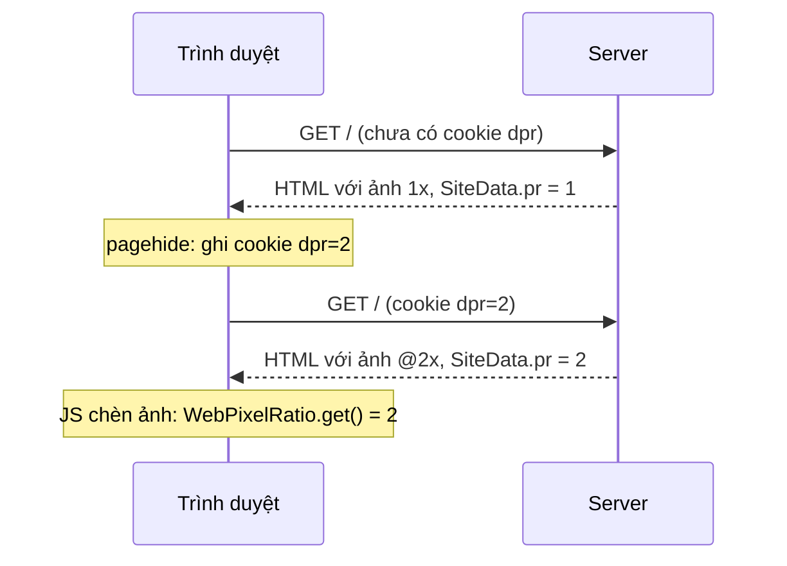

Bài này gồm hai module rất nhỏ của hạ tầng web Facebook. Mỗi module chỉ mười mấy dòng, và cả hai đều có lỗi.

**Ảnh @2x.** HTML của News Feed được render ở server, kèm sẵn URL ảnh. Server không biết màn hình của bạn là 1x, 2x hay 3x, nên không biết gửi ảnh nào. Gửi ảnh 3x cho mọi người thì tốn băng thông; gửi ảnh 1x thì màn Retina thấy mờ. `srcset` giải được cho thẻ ``, nhưng không giải được cho ảnh nền CSS, sprite, hay URL ảnh mà JavaScript dựng. Cách của Facebook: client ghi `devicePixelRatio` vào cookie `dpr`, lần tải sau server đọc cookie.

**Khoá trong log.** Gọi video/thoại qua WebRTC có một đoạn SDP. Với SDES (cách trao khoá cũ), SDP chứa dòng `a=crypto:… inline:<khoá base64>`. Đó là khoá giải mã âm thanh của cuộc gọi. Log nguyên SDP lên server là làm lộ khoá. Facebook chặn bằng `ZenonSDESKeyDetector`: một regex.

> [!TIP]
> **Tóm tắt**
> - `WebPixelRatioDetector` ghi cookie `dpr` lúc rời trang (`pagehide`/`beforeunload`), chỉ ghi khi DPR khác 1. `WebPixelRatio.get()` ưu tiên giá trị server đã dùng (`SiteData.pr`) hơn DPR thật, để JavaScript chọn ảnh khớp với HTML.
> - Bản Comet (`CometPixelRatioUpdater`) nghe `"pageHide"` (chữ H hoa). Tên sự kiện phân biệt hoa thường, nên listener này không bao giờ chạy.
> - Regex SDES `/inline:\s*[0-9a-zA-z+/]{40}(\b|\s|$)/` chỉ nhận đúng 40 ký tự. Thử 10.000 khoá ngẫu nhiên: lọt 2,8% khoá AES-128 (khoá kết thúc bằng `+` hoặc `/`) và 94% khoá AES-256 (64 ký tự).
> - Bản viết lại ghi cookie ngay và mỗi khi DPR đổi (theo dõi bằng `matchMedia`), và che khoá thay vì chỉ phát hiện.

<iframe class="demo-frame" src="/demos/facebook-patterns/index.html?theme=dark#/dpr-cookie" title="Demo dpr-cookie" loading="lazy" style="height: 1000px"></iframe>

<p class="demo-links">▶ <a href="/demos/facebook-patterns/index.html#/dpr-cookie" target="_blank" rel="noopener">Mở demo toàn màn hình ↗</a> · <a href="https://stackblitz.com/github/hunghg255/blog-hunghg/tree/master/examples/facebook-patterns?file=src/lib/dprCookie.ts" target="_blank" rel="noopener">Sửa code trên StackBlitz ↗</a> · <a href="https://github.com/hunghg255/blog-hunghg/blob/master/examples/facebook-patterns/src/lib/dprCookie.ts" target="_blank" rel="noopener">Xem source trên GitHub ↗</a></p>

## Facebook làm thế nào?

### `WebPixelRatioDetector` (bundle `278.js`)

Phần chính, đổi tên biến (bản đầy đủ trong spoiler):

```js
function onLeave() {
  if (written) return;
  written = true;
  dpr() !== 1 ? Cookie.set('dpr', String(dpr())) : Cookie.clear('dpr');
}
// startDetecting(): nghe 'pagehide' (nếu có) và Run.onBeforeUnload(onLeave)
```

::: spoiler Code gốc đã đổi tên biến: WebPixelRatioDetector

```js
const COOKIE = PixelRatioConst.cookieName;   // 'dpr'
let started = false, written = false, clearFirst = false;

const dpr = () => window.devicePixelRatio || 1;

function onLeave() {
  if (written) return;
  written = true;
  if (clearFirst) Cookie.clear(COOKIE);
  dpr() !== 1 ? Cookie.set(COOKIE, String(dpr())) : Cookie.clear(COOKIE);
}

export function startDetecting(clear) {
  if (clear) clearFirst = true;
  if (started) return;
  started = true;
  if ('onpagehide' in window) DOMEventListener.add(window, 'pagehide', onLeave);
  Run.onBeforeUnload(onLeave, false);
}
```

:::

Cookie được ghi **lúc rời trang**, không phải lúc tải. Code không giải thích vì sao. Có lẽ để lấy giá trị DPR cuối cùng: người dùng có thể zoom trong lúc xem (zoom 110% trên màn 1x cho DPR 1,1), hoặc kéo cửa sổ sang màn khác. Hệ quả là lượt tải đầu tiên trên một trình duyệt mới luôn không có cookie, và lượt tải thứ hai mới có ảnh đúng.

`DPR = 1` thì xoá cookie thay vì ghi `dpr=1`, tiết kiệm vài byte cho mọi request của phần đông người dùng máy bàn.

### `WebPixelRatio` (bundle `26.js`)

```js
function get() {
  return SiteData.pr != null && SiteData.pr > 0 ? SiteData.pr : window.devicePixelRatio || 1;
}
```

`SiteData.pr` là DPR mà server đã dùng khi render HTML (đọc từ cookie). JavaScript hỏi "dùng ảnh tỉ lệ nào" thì nhận giá trị **của server**, không phải DPR thật. Nhờ vậy ảnh do JavaScript chèn sau cùng độ phân giải với ảnh trong HTML. Nếu bạn vừa kéo cửa sổ sang màn 2x, trang vẫn dùng ảnh 1x cho tới lần tải sau.

### `CometPixelRatioUpdater` (bundle `16.js`)

Bản cho giao diện mới (Comet), viết lại gọn hơn:

```js
function update() {
  window.devicePixelRatio !== 1 ? Cookie.set('dpr', String(window.devicePixelRatio)) : Cookie.clear('dpr');
}

export function startDetecting() {
  Run.onBeforeUnload(update, false);
  'onpagehide' in window && window.addEventListener('pageHide', update);   // ← "pageHide"
}
```

Kiểm tra `'onpagehide' in window` dùng tên đúng, nhưng `addEventListener` dùng `'pageHide'`. `addEventListener` không báo lỗi với tên lạ (bạn có thể nghe sự kiện tuỳ ý), nên lỗi này im lặng. Cookie vẫn được ghi nhờ `beforeunload`, nhưng `beforeunload` không chạy đáng tin trên di động (đóng tab bằng cách vuốt, hệ điều hành giết app nền). Trên di động, `pagehide` mới là sự kiện đáng tin, và đó đúng là cái bị gõ sai. Demo có nút phát `pagehide` vào hai listener để thấy listener `'pageHide'` chạy 0 lần.



### `ZenonSDESKeyDetector` (bundle `15.js`, `17.js`, `105.js`, `145.js`)

```js
const SDES = /inline:\s*[0-9a-zA-z+/]{40}(\b|\s|$)/;
export default function containsSdesKey(event) {
  return SDES.test(JSON.stringify(event));
}

// ScotchRTWebUserActionLogger.logEvent (17.js), tương tự ở RTWebUserActionLogger, ZenonUserActionLogger
logEvent(event) {
  if (ZenonSDESKeyDetector(event))
    throw unrecoverableViolation('ScotchRTWebUserAction event contains SDES crypto key! This log entry must be removed!', 'rtc_www');
  …
}
```

Có log chứa khoá thì **ném lỗi**, không gửi. Cách này đúng tinh thần: lỗi làm đội phát hiện và sửa chỗ log. Nhưng regex có ba chỗ hở.

## Bên trong: khoá SDES trông thế nào và regex hở ở đâu

RFC 4568 định nghĩa `inline:` theo sau là base64 của **key ‖ salt**:

| Bộ mã | Key + salt | Base64 |
| --- | --- | --- |
| `AES_CM_128_HMAC_SHA1_80` | 16 + 14 = 30 byte | 40 ký tự |
| `AES_256_CM_HMAC_SHA1_80` (RFC 6188) | 32 + 14 = 46 byte | 64 ký tự, có `==` |

Sau khoá thường là `|2^31|1:1` (thời hạn, chỉ số khoá) hoặc xuống dòng.

1. **`(\b|\s|$)` sau 40 ký tự.** `\b` là ranh giới giữa ký tự "từ" (`[A-Za-z0-9_]`) và ký tự không phải từ. Khoá kết thúc bằng `+` hoặc `/` (không phải ký tự từ) mà theo sau là `|` (cũng không phải) thì không có ranh giới. Xác suất ký tự cuối là `+` hoặc `/` là 2/64, khoảng 3%. Đo được 2,8%.
2. **Khoá 64 ký tự.** Sau 40 ký tự đầu là ký tự thứ 41, thường cũng là chữ hoặc số, nên không có ranh giới; regex chỉ khớp được khi ký tự 40 hoặc 41 tình cờ là `+`/`/`. Đo được 94% khoá AES-256 lọt.
3. **`A-z` thay vì `A-Z`.** Khoảng `A-z` trong bảng ASCII gồm cả `[ \ ] ^ _` và dấu backtick. Không làm lọt khoá, nhưng khớp nhầm chuỗi như `inline:` + 40 dấu `_`. Lỗi gõ kinh điển.

Có lẽ khi viết, mọi cuộc gọi đều dùng AES-128 nên lỗi 2 không xuất hiện; còn lỗi 1 lọt khoảng 1 trên 35 khoá, đủ hiếm để không ai thấy.

## Viết lại

Cookie DPR: ghi ngay, ghi lại khi rời trang hoặc khi DPR đổi.

```ts title=src/lib/dprCookie.ts
  const write = () => {
    const value = formatDpr(getDpr());
    if (value === last) return; // không ghi cookie thừa
    last = value;
    setCookie(name, value);
  };

  // `matchMedia` chỉ báo khi ĐÚNG giá trị DPR hiện tại hết khớp, nên mỗi lần đổi phải đăng ký lại.
  let query: MediaQueryList | null = null;
  const watch = () => {
    query?.removeEventListener('change', onDprChange);
    query = window.matchMedia?.(`(resolution: ${getDpr()}dppx)`) ?? null;
    query?.addEventListener('change', onDprChange);
  };
  function onDprChange() {
    write();
    options.onChange?.(getDpr());
    watch();
  }
  const onHide = () => {
    if (document.visibilityState === 'hidden') write();
  };

  write(); // ghi ngay: bản gốc chỉ ghi lúc rời trang nên lượt tải thứ hai vẫn chưa có cookie
  watch();
  window.addEventListener('pagehide', write);
  document.addEventListener('visibilitychange', onHide);
```

Phát hiện và che khoá:

```ts title=src/lib/dprCookie.ts
/**
 * Khoá SDES (RFC 4568): base64 của key‖salt. AES_CM_128: 30 byte → 40 ký tự;
 * AES_256_CM: 46 byte → 64 ký tự (có `==`). Sau khoá là `|`, khoảng trắng hoặc hết chuỗi.
 */
const SDES_KEY = /(inline:\s*)[A-Za-z0-9+/]{40,}={0,2}(?![A-Za-z0-9+/=])/g;

export function containsSdesKey(text: string) {
  SDES_KEY.lastIndex = 0;
  return SDES_KEY.test(text);
}

export function redactSdesKeys(text: string) {
  let count = 0;
  const redacted = text.replace(SDES_KEY, (_, prefix: string) => {
    count++;
    return `${prefix}[đã che]`;
  });
  return { text: redacted, count };
}
```

## Đi qua code

- `write` so giá trị mới với `last` trước khi ghi: `pagehide`, `visibilitychange` và `matchMedia` có thể cùng bắn, nhưng cookie chỉ đổi khi DPR thật sự đổi.
- `matchMedia('(resolution: 2dppx)')` chỉ báo `change` khi điều kiện "DPR đúng bằng 2" đổi từ đúng sang sai. Sau mỗi lần đổi phải tạo truy vấn mới với giá trị mới; đây là cách MDN hướng dẫn theo dõi `devicePixelRatio`.
- `formatDpr` làm tròn 2 chữ số và trả `null` cho DPR 1, để `setCookie` xoá cookie thay vì ghi `dpr=1`.
- Regex khoá dùng `(?![A-Za-z0-9+/=])` (ký tự sau không thuộc bảng base64) thay cho `\b`. Điều kiện này đúng với mọi ký tự cuối, kể cả `+` và `/`, và buộc regex nuốt hết khoá dài thay vì dừng ở ký tự thứ 40.
- `redactSdesKeys` giữ lại tiền tố `inline:` và thay phần khoá: người đọc log vẫn thấy cuộc gọi dùng SDES, chỉ không thấy khoá.

**Khác bản gốc:**

- Ghi cookie ngay lúc tải, không đợi rời trang; lượt tải thứ hai đã có ảnh đúng.
- Theo dõi DPR đổi bằng `matchMedia('(resolution: Xdppx)')`, đăng ký lại sau mỗi lần đổi (truy vấn chỉ báo khi giá trị hiện tại hết khớp).
- Dùng `pagehide` và `visibilitychange` (tên đúng), bỏ `beforeunload` (làm mất bfcache ở một số trình duyệt).
- Làm tròn 2 chữ số: DPR Android như `2.625` hay zoom `1.100000023841858` không làm cookie dài vô ích.
- Regex khoá nhận 40 ký tự trở lên, có `=`, và kiểm tra "ký tự sau không phải base64" thay cho `\b`. `redactSecrets` che khoá trong mọi chuỗi của object log (xử lý cả vòng tham chiếu), thay vì ném lỗi và mất cả dòng log.

::: spoiler Xem toàn bộ src/lib/dprCookie.ts

```ts title=src/lib/dprCookie.ts
/**
 * Hai việc nhỏ của hạ tầng Facebook web:
 * 1. Ghi devicePixelRatio vào cookie `dpr` để lần tải sau server chọn sẵn ảnh @2x/@3x
 *    (ý tưởng từ WebPixelRatioDetector / CometPixelRatioUpdater).
 * 2. Không để khoá mã hoá SRTP (SDES `inline:`) lọt vào log (ý tưởng từ ZenonSDESKeyDetector).
 * Khác bản gốc: tên sự kiện đúng (`pagehide`, bản Comet viết nhầm `pageHide`), cập nhật ngay khi
 * DPR đổi (zoom, kéo cửa sổ sang màn khác), và che khoá thay vì chỉ phát hiện; regex nhận cả khoá
 * 64 ký tự và khoá kết thúc bằng `+`, `/`.
 */

export interface DprCookieOptions {
  name?: string;
  /** mặc định ghi vào document.cookie, path=/, 1 năm */
  setCookie?: (name: string, value: string | null) => void;
  getDpr?: () => number;
  /** báo khi DPR đổi trong lúc trang đang mở */
  onChange?: (dpr: number) => void;
}

/** 2 chữ số thập phân là đủ: 1.25, 1.5, 2.625 (Android) → '2.63'; DPR = 1 thì xoá cookie */
export function formatDpr(dpr: number): string | null {
  if (!Number.isFinite(dpr) || dpr <= 0) return null;
  const rounded = Math.round(dpr * 100) / 100;
  return rounded === 1 ? null : String(rounded);
}

function defaultSetCookie(name: string, value: string | null) {
  document.cookie =
    value == null
      ? `${name}=; path=/; max-age=0; samesite=lax`
      : `${name}=${value}; path=/; max-age=31536000; samesite=lax`;
}

export function syncDprCookie(options: DprCookieOptions = {}) {
  const name = options.name ?? 'dpr';
  const setCookie = options.setCookie ?? defaultSetCookie;
  const getDpr = options.getDpr ?? (() => window.devicePixelRatio || 1);
  let last: string | null | undefined;

  const write = () => {
    const value = formatDpr(getDpr());
    if (value === last) return; // không ghi cookie thừa
    last = value;
    setCookie(name, value);
  };

  // `matchMedia` chỉ báo khi ĐÚNG giá trị DPR hiện tại hết khớp, nên mỗi lần đổi phải đăng ký lại.
  let query: MediaQueryList | null = null;
  const watch = () => {
    query?.removeEventListener('change', onDprChange);
    query = window.matchMedia?.(`(resolution: ${getDpr()}dppx)`) ?? null;
    query?.addEventListener('change', onDprChange);
  };
  function onDprChange() {
    write();
    options.onChange?.(getDpr());
    watch();
  }
  const onHide = () => {
    if (document.visibilityState === 'hidden') write();
  };

  write(); // ghi ngay: bản gốc chỉ ghi lúc rời trang nên lượt tải thứ hai vẫn chưa có cookie
  watch();
  window.addEventListener('pagehide', write);
  document.addEventListener('visibilitychange', onHide);
  return () => {
    query?.removeEventListener('change', onDprChange);
    window.removeEventListener('pagehide', write);
    document.removeEventListener('visibilitychange', onHide);
  };
}

/** Bản của Facebook, giữ lại để demo và test so sánh. */
export const FB_SDES_PATTERN = /inline:\s*[0-9a-zA-z+/]{40}(\b|\s|$)/;

/**
 * Khoá SDES (RFC 4568): base64 của key‖salt. AES_CM_128: 30 byte → 40 ký tự;
 * AES_256_CM: 46 byte → 64 ký tự (có `==`). Sau khoá là `|`, khoảng trắng hoặc hết chuỗi.
 */
const SDES_KEY = /(inline:\s*)[A-Za-z0-9+/]{40,}={0,2}(?![A-Za-z0-9+/=])/g;

export function containsSdesKey(text: string) {
  SDES_KEY.lastIndex = 0;
  return SDES_KEY.test(text);
}

export function redactSdesKeys(text: string) {
  let count = 0;
  const redacted = text.replace(SDES_KEY, (_, prefix: string) => {
    count++;
    return `${prefix}[đã che]`;
  });
  return { text: redacted, count };
}

/** Đi qua mọi chuỗi trong object log (không sửa object gốc), che khoá, trả số chỗ đã che. */
export function redactSecrets<T>(value: T): { value: T; count: number } {
  let count = 0;
  const seen = new WeakMap<object, unknown>();
  const walk = (v: unknown): unknown => {
    if (typeof v === 'string') {
      const r = redactSdesKeys(v);
      count += r.count;
      return r.text;
    }
    if (v === null || typeof v !== 'object') return v;
    if (seen.has(v)) return seen.get(v); // vòng tham chiếu
    const out: Record<string, unknown> | unknown[] = Array.isArray(v) ? [] : {};
    seen.set(v, out);
    for (const [k, child] of Object.entries(v)) (out as Record<string, unknown>)[k] = walk(child);
    return out;
  };
  return { value: walk(value) as T, count };
}
```

:::

## Tại sao không làm cách khác?

- **Chỉ dùng `srcset`/`<picture>`**: đúng cách cho ``, trình duyệt tự chọn. Nhưng không dùng được cho URL ảnh trong JSON, ảnh nền CSS render ở server, hay khi server muốn cắt ảnh theo đúng kích thước pixel.
- **Client Hints** (`Sec-CH-DPR`, header `Accept-CH: Sec-CH-DPR`): trình duyệt tự gửi DPR trong request, không cần cookie. Chỉ Chromium hỗ trợ (tính tới 10/2026), và request đầu tiên vẫn không có (trừ khi dùng `Critical-CH`, tốn một lượt khứ hồi).
- **Chỉ phát hiện rồi ném lỗi (như bản gốc)**: tốt trong lúc phát triển, nhưng ở production thì mất dòng log và lỗi có khi bị nuốt bởi chỗ gọi. Che rồi gửi, kèm số lượng đã che, vừa an toàn vừa giữ được dữ liệu. Có thể kết hợp: che ở production, ném ở môi trường dev.
- **Không log SDP**: tốt nhất. Nhưng SDP là thứ đầu tiên người ta muốn xem khi gỡ lỗi cuộc gọi. Và DTLS-SRTP (cách trao khoá hiện đại của WebRTC) không đưa khoá vào SDP, chỉ có fingerprint; regex này chủ yếu cho SDES còn sót lại.

## Edge case và cạm bẫy

- **Tên sự kiện phân biệt hoa thường**: `pagehide`, `visibilitychange`, `DOMContentLoaded`. TypeScript bắt được lỗi này nếu bạn dùng `window.addEventListener` với overload có kiểu (tên lạ vẫn được chấp nhận, nhưng tham số handler thành `Event` chung). Một lint rule danh sách trắng tên sự kiện là cách chắc nhất.
- **Zoom thay đổi DPR**: trên máy bàn, Ctrl + làm `devicePixelRatio` tăng. Người zoom 150% trên màn 1x nhận ảnh @2x. Đó thường là điều bạn muốn (ảnh nét hơn khi phóng to).
- **Cookie gửi theo mọi request**: kể cả request ảnh, CSS. Giữ cookie ngắn (`dpr=2`), đặt `path=/` một lần, đừng ghi thừa (bản viết lại so với giá trị cũ trước khi ghi).
- **JSON.stringify trước khi kiểm tra**: object có vòng tham chiếu làm `JSON.stringify` ném lỗi; bản gốc sẽ ném `TypeError` thay vì kiểm tra. `redactSecrets` tự đi qua object nên không gặp.
- **Khoá bị escape**: nếu SDP đã qua `encodeURIComponent` (`inline%3A…`, `%2B`, `%2F`), cả hai regex đều lọt. Che ở chỗ gần nguồn nhất, trước khi dữ liệu bị mã hoá thêm.

## Dùng trong dự án

```ts
import { redactSecrets, syncDprCookie } from './dprCookie';

// một lần lúc khởi động app
syncDprCookie({ onChange: (dpr) => imageCache.invalidate(dpr) });

// logger: che khoá trước khi gửi
function logCallEvent(event: Record<string, unknown>) {
  const { value, count } = redactSecrets(event);
  if (count && import.meta.env.DEV) throw new Error('Log chứa khoá SDES, sửa chỗ log này');
  navigator.sendBeacon('/log/rtc', JSON.stringify({ ...value, redacted: count }));
}
```

Ở server, đọc `req.cookies.dpr`, kẹp trong khoảng 1–3, chọn ảnh `@${Math.ceil(dpr)}x` và nhúng giá trị đó vào HTML (như `SiteData.pr`) để JavaScript chọn ảnh cùng độ phân giải.

## Kiểm thử

::: spoiler Ví dụ test (bản phác, không có trong repo)

```ts
import { describe, expect, it, vi } from 'vitest';
import { containsSdesKey, FB_SDES_PATTERN, formatDpr, redactSecrets, syncDprCookie } from './dprCookie';

const key = (bytes: number) => btoa(String.fromCharCode(...crypto.getRandomValues(new Uint8Array(bytes))));
const sdp = (k: string) => `a=crypto:1 AES_CM_128_HMAC_SHA1_80 inline:${k}|2^31|1:1\r\n`;

describe('SDES', () => {
  it('bản gốc lọt khoá kết thúc bằng /, bản viết lại thì không', () => {
    const k = 'S2cNZYehpoL+qjcULEZAkm7vcztYC5zcDmjYx3n/';
    expect(FB_SDES_PATTERN.test(sdp(k))).toBe(false);
    expect(containsSdesKey(sdp(k))).toBe(true);
  });

  it('nhận khoá 30 và 46 byte ngẫu nhiên', () => {
    for (let i = 0; i < 1000; i++) {
      expect(containsSdesKey(sdp(key(30)))).toBe(true);
      expect(containsSdesKey(sdp(key(46)))).toBe(true);
    }
  });

  it('không khớp nhầm', () => {
    expect(containsSdesKey('inline:' + '_'.repeat(40))).toBe(false);
    expect(containsSdesKey('inline: abc')).toBe(false);
  });

  it('che trong object lồng nhau, có vòng tham chiếu', () => {
    const event: Record<string, unknown> = { a: { sdp: sdp(key(30)) }, list: [sdp(key(46))] };
    event.self = event;
    const { value, count } = redactSecrets(event);
    expect(count).toBe(2);
    expect(JSON.stringify({ ...value, self: undefined })).not.toMatch(/inline:[A-Za-z0-9+/]{40}/);
    expect(event.a).toEqual({ sdp: expect.stringContaining('inline:') }); // object gốc không đổi
  });
});

describe('DPR cookie', () => {
  it('làm tròn và bỏ DPR = 1', () => {
    expect([1, 2, 2.625, 1.100000023841858].map(formatDpr)).toEqual([null, '2', '2.63', '1.1']);
  });

  it('ghi ngay, không ghi trùng, ghi lại khi pagehide', () => {
    const setCookie = vi.fn();
    let dpr = 2;
    const stop = syncDprCookie({ setCookie, getDpr: () => dpr });
    expect(setCookie).toHaveBeenCalledWith('dpr', '2');
    window.dispatchEvent(new Event('pagehide'));
    expect(setCookie).toHaveBeenCalledTimes(1);
    dpr = 3;
    window.dispatchEvent(new Event('pagehide'));
    expect(setCookie).toHaveBeenLastCalledWith('dpr', '3');
    stop();
  });
});
```

:::

## So với thư viện và chuẩn web

- **`srcset` + `sizes`**, **`image-set()`** trong CSS: trình duyệt tự chọn theo DPR, mọi trình duyệt chính đều hỗ trợ. Nên là lựa chọn đầu tiên.
- **Client Hints** (`Sec-CH-DPR`, `Sec-CH-Viewport-Width`): chuẩn hoá đúng việc mà cookie `dpr` làm thủ công. Chỉ Chromium (tính tới 10/2026); Safari và Firefox chưa gửi.
- **CDN ảnh** (Cloudinary, imgix, Cloudflare Images): nhận tham số `dpr` trong URL hoặc đọc Client Hints, trả ảnh đúng kích thước.
- **Che dữ liệu nhạy cảm trong log**: Sentry có `beforeSend` và danh sách trường bị che phía server; OpenTelemetry Collector có processor `redaction`. Đều dựa trên tên trường hoặc regex, nên regex phải được test với dữ liệu thật như ở đây.
- **WebRTC hiện đại** dùng DTLS-SRTP: Chrome đã bỏ SDES từ lâu; khoá không còn xuất hiện trong SDP. Nhưng hệ thống gọi nội bộ, SIP gateway vẫn có thể dùng SDES.

---

Bài này thuộc series **[Học từ mã nguồn Facebook](/series/facebook)** (106 bài, đọc theo thứ tự).

::: spoiler Xem nhanh danh sách bài trong series

*Phần 1*

- [Mở đầu: cách đọc code minify của Facebook](/blogs/learn-from-facebook-source-code)
- [#1 Dùng chung IntersectionObserver + infinite scroll](/blogs/facebook-shared-intersection-observer)
- [#2 useViewportDuration: đo thời gian thực sự được xem](/blogs/facebook-use-viewport-duration)
- [#3 Preload code + data khi hover](/blogs/facebook-preload-on-hover)
- [#4 Toast manager với external store](/blogs/facebook-toast-manager)
- [#5 Network status + heartbeat backoff](/blogs/facebook-network-status-heartbeat)
- [#6 ErrorGuard: bắt lỗi theo ngữ cảnh](/blogs/facebook-error-guard)
- [#7 Banzai: gom log theo lô + sendBeacon](/blogs/facebook-batch-logger)
- [#8 Focus trap + Esc theo layer](/blogs/facebook-focus-trap)

*Phần 2*

- [#9 Mẹo calc(… * 9999): container query, line-clamp, mũi tên carousel bằng CSS](/blogs/facebook-css-9999-trick)
- [#10 Thanh cuộn tuỳ biến bằng CSS 3D](/blogs/facebook-css-3d-scrollbar)
- [#11 Modal cuộn bằng window, giữ vị trí trang nền](/blogs/facebook-document-scroll-modal)
- [#12 Popover, tooltip group và hovercard](/blogs/facebook-popover-tooltip)
- [#13 Primitive Pressable + focus-visible](/blogs/facebook-pressable)
- [#14 Tab "Xem thêm" + sticky header bằng IntersectionObserver](/blogs/facebook-priority-tabs-sticky-header)
- [#15 Avatar khoét mask, gradient Messenger, skeleton steps()](/blogs/facebook-visual-tricks)
- [#16 Khung chat không giật](/blogs/facebook-chat-scroller)
- [#17 Thuật toán chọn bố cục collage ảnh](/blogs/facebook-photo-collage-layout)
- [#18 Keep-alive tab trong SPA](/blogs/facebook-keep-alive-tabs)
- [#19 Tự đo Visual Completion & interaction tracing](/blogs/facebook-visual-completion)
- [#20 Router SPA bền bỉ & tải chunk có retry](/blogs/facebook-spa-router-resilient-loading)

*Phần 3*

- [#21 Smart Compose: gợi ý chữ mờ khi gõ](/blogs/facebook-smart-compose-ghost-text)
- [#22 MQTT ngay trong trình duyệt, tự chuyển sang long-poll](/blogs/facebook-mqtt-in-browser)
- [#23 Đo thời gian dùng bằng bitmap 64 giây](/blogs/facebook-time-spent-bitmap)
- [#24 Bảng reaction nhấn giữ rồi trượt](/blogs/facebook-reaction-press-slide)
- [#25 Tìm kiếm gấp dấu, phiên âm và highlight đầu từ](/blogs/facebook-search-diacritics-tokenize)
- [#26 Ring buffer biết trace nào đã mất log](/blogs/facebook-trace-ring-buffer)
- [#27 Engine animation JS: một vòng rAF và solver cubic-bezier](/blogs/facebook-keyframes-loop-cubic-bezier)
- [#28 Bootloader: bitmap tài nguyên đã tải, chỉ reload khi cần](/blogs/facebook-bootloader-bitmap-consistency)
- [#29 Nhận biết click do screen reader tạo ra](/blogs/facebook-virtual-cursor-detection)
- [#30 Tải trước feed theo chất lượng mạng, đoán hạng thiết bị](/blogs/facebook-network-aware-prefetch)
- [#31 Hàng đợi gửi tin chat giữ đúng thứ tự](/blogs/facebook-ordered-send-queue)
- [#32 Gộp lời gọi API trong cùng một tick](/blogs/facebook-api-batcher)
- [#33 Resize ảnh trong pool Web Worker](/blogs/facebook-jpeg-resize-worker-pool)
- [#34 Crop ảnh theo nhiều khuôn mặt](/blogs/facebook-face-aware-crop)
- [#35 Kéo-thả sắp xếp và vùng thả file không nhấp nháy](/blogs/facebook-flicker-free-drag-drop)
- [#36 Tiện ích UI: fade-out, sticky event, hàm huỷ được](/blogs/facebook-ui-utility-hooks)
- [#37 Hạ tầng nhỏ: cookie, hash lỗi, prefetch khi chuột dừng](/blogs/facebook-small-infra-cookie-hash-idle)

*Phần 4–6*

- [#38 Đồng bộ tin nhắn: phát hiện lỗ seqID và fetch bù theo tầng](/blogs/facebook-messenger-sync-seqid-gaps)
- [#39 OTID: ID tin nhắn kiểu Snowflake sinh ở client](/blogs/facebook-otid-client-snowflake)
- [#40 QPL: lấy mẫu từ lúc bắt đầu, đo RTT gửi tin đầu-cuối](/blogs/facebook-qpl-send-rtt)
- [#41 Bộ điều phối request bảy chế độ gộp và chống trùng](/blogs/facebook-request-dispatcher-modes)
- [#42 Thread list theo mốc thời gian, cookie presence có version](/blogs/facebook-threadlist-ranged-presence)
- [#43 Composer dạng plugin: reducer, dirty checker, chuỗi kiểm tra](/blogs/facebook-plugin-composer)
- [#44 Thanh toán bất đồng bộ: subscribe trước, poll dự phòng](/blogs/facebook-async-checkout)
- [#45 Validate số thẻ: sửa lỗi gõ, dải BIN, Luhn](/blogs/facebook-card-validation)
- [#46 Lịch chọn khoảng ngày: bo góc dải chọn, phím đủ bộ, RTL](/blogs/facebook-range-calendar-a11y)
- [#47 Giờ mở cửa theo tuần: qua đêm, gộp khoảng, phần bù](/blogs/facebook-weekly-hours-intervals)
- [#48 Tiến độ đăng realtime: giữ event chờ snapshot, watchdog](/blogs/facebook-realtime-publish-snapshot)
- [#49 Tiền tệ theo đơn vị nhỏ nhất và ô nhập tiền](/blogs/facebook-currency-minor-units)
- [#50 Sửa hàng loạt Empty/Uniform/Mixed, seen/read bằng 2 bit](/blogs/facebook-bulk-edit-seen-bits)
- [#51 Phát hiện script lạ hook vào hàm native](/blogs/facebook-native-hook-detection)
- [#52 localStorage tự dọn khi đầy quota](/blogs/facebook-quota-aware-storage)
- [#53 Cache tuyến do server phân giải, chờ sẵn promise](/blogs/facebook-route-cache-prefetch)
- [#54 Lưới phím mũi tên 2D và focus không làm cuộn trang](/blogs/facebook-focus-table-grid)
- [#55 Tách emoji bằng máy trạng thái](/blogs/facebook-emoji-segmentation)
- [#56 Đọc trước ghi sau trong một frame, con tự biết vị trí](/blogs/facebook-read-then-write-dom)
- [#57 Hàng đợi lệnh cho video và stream sắp lại chunk](/blogs/facebook-video-command-queue)

*Phần 7–10*

- [#58 Ước lượng băng thông EWMA: loại outlier, nhớ qua phiên](/blogs/facebook-bandwidth-ewma-estimator)
- [#59 ABR theo độ tự tin phát và cắt bậc bitrate theo MOS](/blogs/facebook-abr-playback-confidence)
- [#60 Prefetch segment dự đoán từ manifest, parse hộp sidx](/blogs/facebook-dash-predicted-segments)
- [#61 Đọc metadata MP4/MOV ngay trên client](/blogs/facebook-mp4-metadata-client)
- [#62 Upload tiếp tục được: offset, hash dedupe, phát hiện treo](/blogs/facebook-resumable-upload)
- [#63 Fenwick tree: chọn ngẫu nhiên có trọng số và offset dòng](/blogs/facebook-fenwick-weighted-random)
- [#64 Vạch trục số và trục thời gian "đẹp"](/blogs/facebook-nice-axis-ticks)
- [#65 Damerau-Levenshtein theo dải chéo và tự sửa tên gõ sai](/blogs/facebook-damerau-levenshtein)
- [#66 PRNG có seed, shuffle tái lập và lấy mẫu trace](/blogs/facebook-seeded-prng-sampling)
- [#67 Cặp min/max-heap tái dùng vị trí trong danh sách ảo](/blogs/facebook-dual-heap-buffer-set)
- [#68 Memo nhiều đối số bằng Map/WeakMap và interning object](/blogs/facebook-multikey-memo-interning)
- [#69 Thống kê cửa sổ trượt và đại số khoảng thời gian](/blogs/facebook-moving-stat-intervals)
- [#70 Int64 từ hai số 32-bit, decode UTF, offset theo code point](/blogs/facebook-int64-utf-codepoints)
- [#71 Engine múi giờ IANA trên client, phát hiện lệch giờ](/blogs/facebook-client-iana-timezone)
- [#72 Tự cài semver range](/blogs/facebook-semver-range)
- [#73 Auto-link URL, cắt chữ an toàn, giới hạn LaTeX](/blogs/facebook-autolink-safe-truncate)
- [#74 Parser query kiểu PHP chống prototype pollution](/blogs/facebook-php-query-serializer)
- [#75 Popover tự lật theo phần tràn nhỏ nhất](/blogs/facebook-popover-auto-flip)
- [#76 Tiền tố for(;;) chống JSON hijacking, đọc stream](/blogs/facebook-csrf-prefix-streaming)
- [#77 Chống lộ Referer, linkshim, xoá token trên URL](/blogs/facebook-referrer-linkshim-url-scrub)
- [#78 setImmediate bằng postMessage, gom delta chuột theo frame](/blogs/facebook-setimmediate-mouse-batching)
- [#79 Phát hiện crash qua heartbeat, dò proxy cache hỏng](/blogs/facebook-crash-heartbeat-proxy-check)
- **#80 DPR vào cookie cho ảnh @2x, che khoá trong log** (bài này)
- [#81 Flux waitFor tự viết và proxy có đệm](/blogs/facebook-flux-dispatch-buffered-proxy)
- [#82 Crop đúng tỉ lệ, xoay sticker bằng ma trận](/blogs/facebook-image-crop-rotation-geometry)

*Phần 11–15*

- [#83 Chia subdomain giữa các tab bằng lease, long-poll theo bảng trạng thái](/blogs/facebook-tab-subdomain-lease-longpoll)
- [#84 MQTT QoS1: giữ publish chờ ack, gửi lại khi kết nối lại](/blogs/facebook-mqtt-qos1-republish)
- [#85 Cache Promise gộp request, cache lỗi ngắn, đua dữ liệu nhúng sẵn](/blogs/facebook-promise-cache-preload-race)
- [#86 Lịch retry: backoff có trần, Fibonacci, báo lỗi CDN mỗi N ngày](/blogs/facebook-retry-backoff-schedules)
- [#87 Giữ nguyên tham chiếu nhánh dữ liệu không đổi](/blogs/facebook-relay-recycle-nodes)
- [#88 Store optimistic: copy-on-write, rollback rồi áp lại](/blogs/facebook-relay-optimistic-store)
- [#89 Chỉ mục subscription theo record, hàng đợi task theo chiều sâu](/blogs/facebook-relay-subscription-index)
- [#90 Phân trang connection: cursor khớp đầu, edge không trùng](/blogs/facebook-relay-connection-pagination)
- [#91 Profiler kiểu middleware và memo selector có lấy mẫu kiểm tra](/blogs/facebook-profiler-middleware-memo-check)
- [#92 Đọc EBML/WebM Cues để tìm byte range của segment](/blogs/facebook-webm-ebml-cues)
- [#93 Stream HTTP Range tạm dừng được, tải tiếp đúng byte](/blogs/facebook-pausable-range-stream)
- [#94 Bảng khoảng thời gian gắn nhãn và nhảy qua lỗ buffer](/blogs/facebook-tagged-time-ranges-gaps)
- [#95 Gom chunk cho SourceBuffer, đồng bộ video bằng playbackRate](/blogs/facebook-sourcebuffer-video-sync)
- [#96 Gom tin nhắn thành cụm, vạch ngày và avatar đã xem](/blogs/facebook-message-grouping)
- [#97 Bao nhiêu tab chat vừa màn hình, chuỗi luật mở tab](/blogs/facebook-chat-tab-policy)
- [#98 Phím tắt Markdown trong editor, Backspace để hoàn tác](/blogs/facebook-markdown-shortcuts-editor)
- [#99 Offset theo code point hay UTF-16: bốn bug cùng một gốc](/blogs/facebook-codepoint-offset-bugs)
- [#100 Typeahead không nhảy: cache tiền tố, chặn reflow, khoá hover](/blogs/facebook-typeahead-stable-results)
- [#101 Hit-test trên canvas bằng phát lại path, nét đứt và cung Bézier](/blogs/facebook-canvas-hit-regions)
- [#102 Vòng tròn theo mét trên bản đồ Mercator](/blogs/facebook-mercator-meter-circles)
- [#103 Dò tính năng trình duyệt: ảnh EXIF 2×1, getter bẫy, scrollbar](/blogs/facebook-feature-probe-tricks)
- [#104 Bug định dạng số và kiểm tra dữ liệu theo locale](/blogs/facebook-locale-validation-bugs)
- [#105 Dispose cho đúng: idle callback, splice(-1), xoá nhầm key](/blogs/facebook-dispose-leak-bugs)

:::

Code + demo: [`examples/facebook-patterns`](https://github.com/hunghg255/blog-hunghg/tree/master/examples/facebook-patterns) · [Mở trên StackBlitz](https://stackblitz.com/github/hunghg255/blog-hunghg/tree/master/examples/facebook-patterns)
