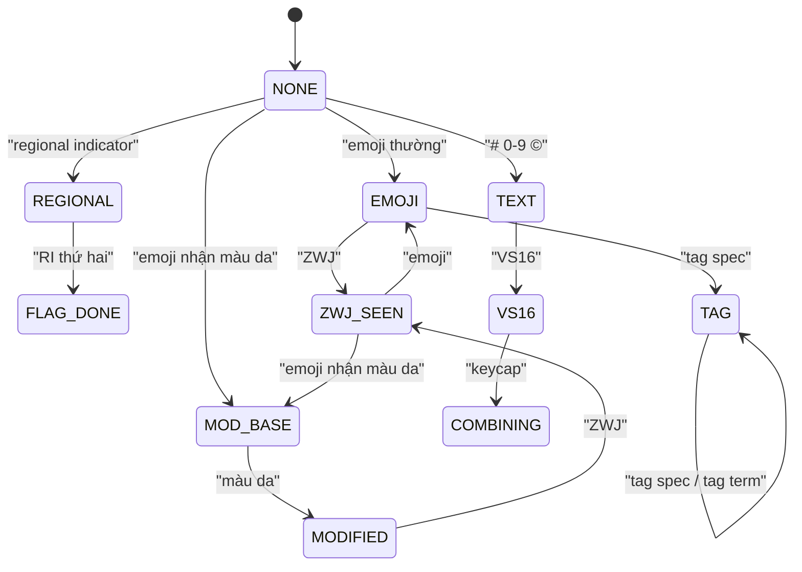

`'👩🏽‍💻'.length` bằng 7. Với người dùng đó là **một** emoji, với JavaScript là 7 đơn vị UTF-16, 4 code point: 👩, 🏽 (màu da), ZWJ (ký tự nối vô hình), 💻. Lá cờ 🇻🇳 là hai "regional indicator" đứng cạnh nhau. `1️⃣` là chữ số `1` + VS16 + dấu keycap. Cờ Scotland 🏴󠁧󠁢󠁳󠁣󠁴󠁿 dài 14 đơn vị UTF-16.

Đếm sai thì giới hạn "tối đa 3 emoji" sai, cắt chuỗi giữa cụm thì ra ký tự vỡ, thay emoji bằng ảnh (để mọi máy thấy cùng kiểu vẽ) mà tách sai thì ra nửa người nửa laptop.

> [!TIP]
> **Tóm tắt**
> - Một emoji người dùng thấy là một **cụm** nhiều code point: ZWJ, màu da, cặp regional indicator, keycap, chuỗi tag, VS15/VS16.
> - Facebook duyệt từng code point qua một **máy trạng thái 12 trạng thái**, trả về `{ emoji, offset, length }` để thay bằng ``.
> - `#`, chữ số, `©` chỉ là emoji khi có VS16 hoặc keycap; có VS15 thì là chữ. Lọc bước này nếu không sẽ đếm "#1" là emoji.
> - Ngày nay: `Intl.Segmenter` tách grapheme, rồi lọc grapheme nào là emoji. Cẩn thận: `\p{Extended_Pictographic}` một mình chưa đủ.

<iframe class="demo-frame" src="/demos/facebook-patterns/index.html?theme=dark#/emoji-segment" title="Demo emoji-segment" loading="lazy" style="height: 900px"></iframe>

<p class="demo-links">▶ <a href="/demos/facebook-patterns/index.html#/emoji-segment" target="_blank" rel="noopener">Mở demo toàn màn hình ↗</a> · <a href="https://stackblitz.com/github/hunghg255/blog-hunghg/tree/master/examples/facebook-patterns?file=src/lib/emojiSegment.ts" target="_blank" rel="noopener">Sửa code trên StackBlitz ↗</a> · <a href="https://github.com/hunghg255/blog-hunghg/blob/master/examples/facebook-patterns/src/lib/emojiSegment.ts" target="_blank" rel="noopener">Xem source trên GitHub ↗</a></p>

## Facebook làm thế nào?

Module `EmojiRenderer` (bundle `26.js`) export bốn hàm: `parse`, `render`, `containsEmoji`, `countEmoji`. Dữ liệu (`isEmoji`, `isEmojiModifierBase`, `isRegionalIndicator`…) nằm ở `EmojiRendererData`: các hàm so sánh khoảng code point sinh tự động từ dữ liệu Unicode, không dùng regex.

Máy trạng thái có 12 trạng thái, đặt bằng số `i=0 … t=11`. Giải mã (đổi tên):

```js
const EMOJI = 0, COMBINING = 1, VS16 = 2, FLAG_DONE = 3, MOD_BASE = 4, MODIFIED = 5,
      TAG = 6, ZWJ_SEEN = 7, NONE = 8, REGIONAL = 9, TEXT = 10, VS15 = 11;

switch (state) {
  case REGIONAL:  state = isRegionalIndicator(cp) ? FLAG_DONE : NONE; break;
  case MOD_BASE:  if (isEmojiModifier(cp)) { state = MODIFIED; break; } // rơi xuống case EMOJI
  case EMOJI:     state = isZWJ(cp) ? ZWJ_SEEN : isVS16(cp) ? VS16 : isVS15(cp) ? VS15
                        : isNonSpacingMark(cp) ? COMBINING : isTagSpec(cp) ? TAG : NONE; break;
  case ZWJ_SEEN:  state = isRegionalIndicator(cp) ? REGIONAL : isEmojiModifierBase(cp) ? MOD_BASE
                        : isEmoji(cp) ? EMOJI : NONE; break;
  case TAG:       state = isTagSpec(cp) || isTagTerm(cp) ? TAG : NONE; break;
  // …
}
if (state === NONE) {
  // không nối được: thử mở cụm mới từ ký tự này
  state = isRegionalIndicator(cp) ? REGIONAL : isEmojiModifierBase(cp) ? MOD_BASE
        : isText(cp) ? TEXT : isEmoji(cp) ? EMOJI : NONE;
  if (state !== NONE) { if (current && isValid(current.emoji)) out.push(current); current = { emoji: [ch], offset, length }; }
} else current.emoji.push(ch);
```

Vài chi tiết đáng học:

- **Rơi xuống case (fall-through) có chủ đích.** `MOD_BASE` thử màu da trước, không phải màu da thì xử lý như emoji thường. Viết lại bằng ngôn ngữ khác phải giữ thứ tự này.
- **Lọc sau khi tách.** Hàm `u()` loại cụm không phải emoji thật: ký tự "text" (`#`, `0-9`, `©`) đứng một mình, hoặc chỉ kèm dấu kết hợp không phải keycap; ký tự "symbol" đứng một mình; cụm kết thúc bằng `TagSpec` mà thiếu `TagTerm` (chuỗi tag bị cắt dở).
- **Dừng sớm.** `containsEmoji(s)` gọi `parse(s, 1)`: đủ một cụm là dừng, không quét hết chuỗi dài.
- **Khoá ảnh.** `FBEmojiUtils` nối mã hex các code point bằng `_` và bỏ `_fe0f`: `❤️` → `2764`. `getSupportedModifierSequences` sinh 5 biến thể màu da (U+1F3FB…U+1F3FF) và chỉ giữ biến thể có trong bảng `SupportedEmoji3`.
- `render(text, fn)` trả về mảng xen kẽ chuỗi và kết quả của `fn(emoji)`, để React vẽ `` ngay trong dòng chữ.



## Bên trong Unicode: "grapheme cluster mở rộng"

Unicode định nghĩa cụm ký tự người dùng thấy là một đơn vị trong [UAX #29](https://unicode.org/reports/tr29/) (extended grapheme cluster). Các quy tắc liên quan emoji:

- `Extended_Pictographic (Extend* ZWJ Extended_Pictographic)*`: chuỗi emoji nối bằng ZWJ là một cụm.
- Hai `Regional_Indicator` liên tiếp ghép thành một cụm (đếm theo cặp từ đầu).
- `Extend` (gồm dấu kết hợp, màu da, VS15/VS16, tag) luôn dính vào ký tự trước.

Máy trạng thái của Facebook là một bản thu gọn các quy tắc đó, cộng thêm hiểu biết "cụm nào là emoji" mà UAX #29 không nói (UAX #29 chỉ tách cụm, không phân loại).

## Viết lại

Bản viết lại giữ cấu trúc máy trạng thái, nhưng đặt tên trạng thái bằng chữ và dùng **Unicode property escape** (`\p{Emoji_Modifier_Base}`, `\p{Regional_Indicator}`, `\p{Extended_Pictographic}`) thay bảng dữ liệu sinh sẵn, nên không cần cập nhật bảng khi Unicode thêm emoji.

Bảng chuyển trạng thái (`startState` mở cụm mới, `afterEmoji` xử lý ký tự sau một emoji):

```ts title=src/lib/emojiSegment.ts
function step(state: State, cp: number, ch: string): State {
  switch (state) {
    case 'regional':
      return RE.regional.test(ch) ? 'flagDone' : 'none';
    case 'modifierBase':
      if (RE.modifier.test(ch)) return 'modified';
      return afterEmoji(cp, ch);
    case 'emoji':
      return afterEmoji(cp, ch);
    case 'combining':
    case 'vs16':
      if (RE.combining.test(ch)) return state;
      return cp === ZWJ ? 'zwj' : isTagSpec(cp) ? 'tag' : 'none';
    case 'flagDone':
    case 'modified':
      return cp === ZWJ ? 'zwj' : isTagSpec(cp) ? 'tag' : 'none';
    case 'tag':
      return isTagSpec(cp) || cp === TAG_TERM ? 'tag' : 'none';
    case 'zwj':
      if (RE.regional.test(ch)) return 'regional';
      if (RE.modifierBase.test(ch)) return 'modifierBase';
      return RE.pictographic.test(ch) ? 'emoji' : 'none';
    case 'text':
      if (RE.combining.test(ch)) return 'combining';
      return cp === VS16 ? 'vs16' : 'none';
    default:
      return 'none';
  }
}
```

Vòng duyệt chính:

```ts title=src/lib/emojiSegment.ts
/** Tách các cụm emoji. `limit`: dừng sớm khi đã đủ số cụm (containsEmoji dùng limit = 1). */
export function parseEmoji(text: string, limit = Infinity): EmojiMatch[] {
  const out: EmojiMatch[] = [];
  let current: EmojiMatch | null = null;
  let state: State = 'none';
  let i = 0;
  while (i < text.length) {
    const cp = text.codePointAt(i)!;
    const ch = String.fromCodePoint(cp);
    state = step(state, cp, ch);
    if (state === 'none') {
      // không nối được vào cụm cũ: đóng cụm cũ, xem ký tự này có mở cụm mới không
      if (current && isRealEmoji(current.parts)) out.push(current);
      current = null;
      if (out.length >= limit) return out;
      state = startState(ch);
      if (state !== 'none') current = { parts: [ch], offset: i, length: ch.length };
    } else if (current) {
      current.parts.push(ch);
      current.length += ch.length;
    }
    i += ch.length;
  }
  if (current && isRealEmoji(current.parts) && out.length < limit) out.push(current);
  return out;
}
```

Cách hiện đại để đối chiếu: `Intl.Segmenter` tách grapheme, regex `EMOJI_GRAPHEME` (xem toàn bộ file) phân loại.

```ts title=src/lib/emojiSegment.ts
export function parseEmojiIntl(text: string): EmojiMatch[] | null {
  if (typeof Intl === 'undefined' || !('Segmenter' in Intl)) return null;
  const seg = new Intl.Segmenter(undefined, { granularity: 'grapheme' });
  const out: EmojiMatch[] = [];
  for (const s of seg.segment(text)) {
    if (EMOJI_GRAPHEME.test(s.segment) && !s.segment.includes('\uFE0E')) {
      out.push({ parts: Array.from(s.segment), offset: s.index, length: s.segment.length });
    }
  }
  return out;
}
```

::: spoiler Xem toàn bộ src/lib/emojiSegment.ts

```ts title=src/lib/emojiSegment.ts
/**
 * Tách cụm emoji trong chuỗi (ý tưởng từ EmojiRenderer của Facebook).
 *
 * Một "emoji" người dùng thấy có thể là nhiều code point:
 *   👩🏽‍💻 = 👩 + 🏽 (màu da) + ZWJ + 💻
 *   🇻🇳   = hai regional indicator
 *   1️⃣   = '1' + VS16 + U+20E3 (keycap)
 *   🏴󠁧󠁢󠁳󠁣󠁴󠁿  = 🏴 + chuỗi tag + cancel tag
 * Facebook duyệt từng code point bằng một máy trạng thái. Bản này giữ cấu trúc đó nhưng
 * dùng Unicode property escape thay cho bảng dữ liệu sinh sẵn.
 */

export interface EmojiMatch {
  /** các code point (dạng chuỗi) của cụm */
  parts: string[];
  /** vị trí và độ dài theo đơn vị UTF-16, để cắt chuỗi gốc */
  offset: number;
  length: number;
}

const RE = {
  regional: /^\p{Regional_Indicator}$/u,
  modifierBase: /^\p{Emoji_Modifier_Base}$/u,
  modifier: /^\p{Emoji_Modifier}$/u,
  pictographic: /^\p{Extended_Pictographic}$/u,
  // ký tự "text" có thể thành emoji khi đi kèm VS16/keycap: # * 0-9 © ® ‼ …
  textEmoji: /^[#*0-9\u00a9\u00ae\u203c\u2049\u2122\u2139\u2194-\u2199\u21a9\u21aa]$/u,
  combining: /^[\u0300-\u036f\u20d0-\u20ff]$/u, // gồm U+20E3 keycap
};
const ZWJ = 0x200d;
const VS16 = 0xfe0f;
const VS15 = 0xfe0e;
const isTagSpec = (cp: number) => cp >= 0xe0020 && cp <= 0xe007e;
const TAG_TERM = 0xe007f;

/** Trạng thái giống bản gốc (đặt tên thay cho số 0–11). */
type State =
  | 'emoji' // vừa gặp emoji thường
  | 'combining' // sau dấu kết hợp (keycap)
  | 'vs16' // sau VS16
  | 'flagDone' // đã đủ cặp regional indicator
  | 'modifierBase' // emoji nhận được màu da
  | 'modified' // đã gắn màu da
  | 'tag' // đang trong chuỗi tag (cờ Scotland…)
  | 'zwj' // vừa gặp ZWJ, chờ emoji nối tiếp
  | 'none' // ngoài emoji
  | 'regional' // mới có một regional indicator
  | 'text' // ký tự text có thể thành emoji (#, 0-9…)
  | 'vs15'; // VS15: ép hiển thị dạng chữ

function startState(ch: string): State {
  if (RE.regional.test(ch)) return 'regional';
  if (RE.modifierBase.test(ch)) return 'modifierBase';
  if (RE.textEmoji.test(ch)) return 'text';
  if (RE.pictographic.test(ch)) return 'emoji';
  return 'none';
}

function afterEmoji(cp: number, ch: string): State {
  if (cp === ZWJ) return 'zwj';
  if (cp === VS16) return 'vs16';
  if (cp === VS15) return 'vs15';
  if (RE.combining.test(ch)) return 'combining';
  if (isTagSpec(cp)) return 'tag';
  return 'none';
}

function step(state: State, cp: number, ch: string): State {
  switch (state) {
    case 'regional':
      return RE.regional.test(ch) ? 'flagDone' : 'none';
    case 'modifierBase':
      if (RE.modifier.test(ch)) return 'modified';
      return afterEmoji(cp, ch);
    case 'emoji':
      return afterEmoji(cp, ch);
    case 'combining':
    case 'vs16':
      if (RE.combining.test(ch)) return state;
      return cp === ZWJ ? 'zwj' : isTagSpec(cp) ? 'tag' : 'none';
    case 'flagDone':
    case 'modified':
      return cp === ZWJ ? 'zwj' : isTagSpec(cp) ? 'tag' : 'none';
    case 'tag':
      return isTagSpec(cp) || cp === TAG_TERM ? 'tag' : 'none';
    case 'zwj':
      if (RE.regional.test(ch)) return 'regional';
      if (RE.modifierBase.test(ch)) return 'modifierBase';
      return RE.pictographic.test(ch) ? 'emoji' : 'none';
    case 'text':
      if (RE.combining.test(ch)) return 'combining';
      return cp === VS16 ? 'vs16' : 'none';
    default:
      return 'none';
  }
}

/**
 * Cụm có thật sự là emoji không? '#' hay '1' đứng một mình là chữ; chỉ thành emoji
 * khi có VS16 hoặc keycap. Một regional indicator lẻ cũng không tính.
 */
function isRealEmoji(parts: string[]) {
  const first = parts[0];
  if (!first) return false;
  if (parts.some((p) => p.codePointAt(0) === VS15)) return false;
  if (RE.textEmoji.test(first)) return parts.length > 1;
  if (RE.regional.test(first)) return parts.length >= 2;
  return true;
}

/** Tách các cụm emoji. `limit`: dừng sớm khi đã đủ số cụm (containsEmoji dùng limit = 1). */
export function parseEmoji(text: string, limit = Infinity): EmojiMatch[] {
  const out: EmojiMatch[] = [];
  let current: EmojiMatch | null = null;
  let state: State = 'none';
  let i = 0;
  while (i < text.length) {
    const cp = text.codePointAt(i)!;
    const ch = String.fromCodePoint(cp);
    state = step(state, cp, ch);
    if (state === 'none') {
      // không nối được vào cụm cũ: đóng cụm cũ, xem ký tự này có mở cụm mới không
      if (current && isRealEmoji(current.parts)) out.push(current);
      current = null;
      if (out.length >= limit) return out;
      state = startState(ch);
      if (state !== 'none') current = { parts: [ch], offset: i, length: ch.length };
    } else if (current) {
      current.parts.push(ch);
      current.length += ch.length;
    }
    i += ch.length;
  }
  if (current && isRealEmoji(current.parts) && out.length < limit) out.push(current);
  return out;
}

export const containsEmoji = (text: string) => parseEmoji(text, 1).length === 1;
export const countEmoji = (text: string) => parseEmoji(text).length;

/** Thay mỗi cụm emoji bằng kết quả của `render` (vd thẻ ), giữ nguyên phần chữ. */
export function renderEmoji<T>(text: string, render: (m: EmojiMatch) => T): Array<string | T> {
  const out: Array<string | T> = [];
  let last = 0;
  for (const m of parseEmoji(text)) {
    if (m.offset > last) out.push(text.slice(last, m.offset));
    out.push(render(m));
    last = m.offset + m.length;
  }
  if (last < text.length) out.push(text.slice(last));
  return out;
}

/** Khoá ảnh kiểu Facebook: mã hex các code point nối bằng '_', bỏ VS16. */
export function emojiImageKey(m: EmojiMatch) {
  return m.parts
    .map((p) => p.codePointAt(0)!)
    .filter((cp) => cp !== VS16)
    .map((cp) => cp.toString(16))
    .join('_');
}

/** Năm biến thể màu da cho emoji nhận được màu da (U+1F3FB…U+1F3FF). */
export function skinToneVariants(base: string) {
  if (!RE.modifierBase.test(base)) return [];
  return [0x1f3fb, 0x1f3fc, 0x1f3fd, 0x1f3fe, 0x1f3ff].map((m) => base + String.fromCodePoint(m));
}

// ---- Cách hiện đại: Intl.Segmenter tách grapheme, rồi lọc grapheme nào là emoji ----

// Grapheme là emoji khi: mặc định hiển thị dạng emoji, hoặc có VS16 / màu da / ZWJ / cờ / keycap.
// Chỉ \p{Extended_Pictographic} là chưa đủ: '©' hay '❤' mặc định là CHỮ nếu không có VS16.
const EMOJI_GRAPHEME =
  /\p{Emoji_Presentation}|\p{Extended_Pictographic}(?:\uFE0F|\p{Emoji_Modifier}|\u200D)|\p{Regional_Indicator}{2}|[#*0-9]\uFE0F?\u20E3/u;

export function parseEmojiIntl(text: string): EmojiMatch[] | null {
  if (typeof Intl === 'undefined' || !('Segmenter' in Intl)) return null;
  const seg = new Intl.Segmenter(undefined, { granularity: 'grapheme' });
  const out: EmojiMatch[] = [];
  for (const s of seg.segment(text)) {
    if (EMOJI_GRAPHEME.test(s.segment) && !s.segment.includes('\uFE0E')) {
      out.push({ parts: Array.from(s.segment), offset: s.index, length: s.segment.length });
    }
  }
  return out;
}

/**
 * Cách ngây thơ hay gặp: đếm code point có thuộc tính \p{Emoji}. Sai hai kiểu: đếm lẻ từng mảnh
 * của một cụm (👩🏽‍💻 thành 3), và đếm cả '#', chữ số vì chúng cũng có thuộc tính Emoji.
 */
export function countEmojiNaive(text: string) {
  return Array.from(text).filter((ch) => /\p{Emoji}/u.test(ch)).length;
}
```

:::

## Đi qua code

- `step(state, cp, ch)` là bảng chuyển trạng thái. Trả về `'none'` nghĩa là ký tự này **không nối** được vào cụm đang mở.
- Khi `'none'`, vòng chính đóng cụm cũ (nếu là emoji thật) rồi gọi `startState(ch)` xem ký tự có **mở** cụm mới không. Đây đúng là đoạn `if (f === q)` của bản gốc.
- `isRealEmoji` là hàm `u()`: `'#'` một mình không tính, `'#'` + VS16 + keycap thì tính; cụm có VS15 (ép hiển thị dạng chữ) không tính; một regional indicator lẻ không tính.
- Offset/length tính theo đơn vị UTF-16 (`ch.length` là 1 hoặc 2), khớp với `String.prototype.slice`, nên `renderEmoji` cắt chuỗi gốc chính xác.
- `parseEmojiIntl`: `Intl.Segmenter` tách grapheme đúng chuẩn UAX #29, việc còn lại chỉ là phân loại grapheme nào là emoji.

**Khác bản gốc:**
- Dùng `\p{...}` thay bảng dữ liệu tự sinh. Bản gốc có bảng riêng để chạy được cả trên trình duyệt chưa hỗ trợ Unicode property escape (ES2018).
- Bản gốc có trạng thái riêng cho dấu kết hợp không phải keycap (`j`) và cho ký tự "symbol". Bản viết lại gộp vào `combining` và lọc ở `isRealEmoji`; với mẫu thử trong demo, kết quả trùng với `Intl.Segmenter`.

## Tại sao không làm cách khác?

**Đếm bằng `/\p{Emoji}/gu`?** Đây là lỗi hay gặp nhất. `\p{Emoji}` là thuộc tính của **từng code point**, và `#`, `*`, chữ số `0-9` đều có thuộc tính Emoji (vì có thể thành keycap). Demo: câu "Code xong rồi 👩🏽‍💻🎉 gửi team 🇻🇳" có 3 emoji, cách đếm này ra 6 (đếm lẻ 👩, 🏽, 💻 và hai nửa lá cờ). Câu "Mã đơn #1 và 1️⃣" ra 3 thay vì 1.

**Chỉ dùng `[...str]` (tách theo code point)?** Tách 👩🏽‍💻 thành 4 mảnh, lá cờ thành 2.

**Regex khổng lồ kiểu `emoji-regex`?** Chạy tốt, là cách nhiều thư viện dùng. Nhược điểm: regex hàng chục KB, cần cập nhật theo phiên bản Unicode. Facebook chọn máy trạng thái + bảng khoảng, chạy một lượt O(n) và cho luôn offset.

**`Intl.Segmenter` một mình?** Tách cụm đúng, nhưng không cho biết cụm nào là emoji. Lọc bằng `\p{Extended_Pictographic}` thì sai với `©` và `❤`: hai ký tự này mặc định hiển thị dạng **chữ**, chỉ thành emoji khi có VS16. Bản trong bài lọc bằng `\p{Emoji_Presentation}` hoặc `Extended_Pictographic` đi kèm VS16/màu da/ZWJ. Trong demo, mẫu 5 ("© 2026") lúc đầu ra 1 emoji với cách lọc đơn giản, sau khi sửa ra 0, khớp máy trạng thái.

## Edge case và cạm bẫy

- **Emoji mới.** Máy trạng thái chỉ quan tâm cấu trúc (ZWJ, màu da…), nên emoji ghép mới vẫn tách đúng nếu từng mảnh có trong dữ liệu. Với `\p{...}`, dữ liệu là của engine JavaScript, cập nhật theo trình duyệt.
- **Nhiều regional indicator liền nhau** (🇻🇳🇯🇵): ghép theo cặp từ đầu. Số lẻ thì cái cuối đứng một mình và bị loại.
- **Cắt chuỗi giữa cụm** (giới hạn ký tự của bình luận): cắt tại `offset + length` của cụm, đừng cắt theo `.length` thô.
- **Chuỗi tag bị cắt dở** (cờ Scotland mất `TAG_TERM`): bản gốc loại cụm kết thúc bằng tag spec; bản viết lại vẫn giữ phần 🏴 nếu chuỗi tag dở. Trường hợp này hiếm.
- **Hiệu năng.** Mỗi code point chạy vài regex property. Với văn bản rất dài (hàng trăm KB), dùng bảng khoảng như bản gốc hoặc `Intl.Segmenter` sẽ nhanh hơn.

## Dùng trong dự án

```tsx
// Giới hạn "tối đa 3 emoji" cho tên nhóm
if (countEmoji(name) > 3) setError('Tối đa 3 emoji');

// Vẽ emoji bằng ảnh để mọi máy thấy giống nhau
const parts = renderEmoji(text, (m) => (
  
));
return <p>{parts}</p>;

// Tin nhắn chỉ có emoji thì phóng to (kiểu Messenger, Telegram)
const big = parseEmoji(msg).reduce((n, m) => n + m.length, 0) === msg.trim().length;
```

## Kiểm thử

::: spoiler Ví dụ test (bản phác, không có trong repo)

```ts
import { describe, expect, it } from 'vitest';
import { countEmoji, containsEmoji, emojiImageKey, parseEmoji, parseEmojiIntl } from './emojiSegment';

describe('parseEmoji', () => {
  it('ghép đúng các cụm phức tạp', () => {
    const s = 'a👩🏽‍💻b🇻🇳c1️⃣d🏴󠁧󠁢󠁳󠁣󠁴󠁿';
    expect(parseEmoji(s).map((m) => s.slice(m.offset, m.offset + m.length))).toEqual(['👩🏽‍💻', '🇻🇳', '1️⃣', '🏴󠁧󠁢󠁳󠁣󠁴󠁿']);
  });
  it('# và chữ số đứng một mình không phải emoji, VS15 ép dạng chữ', () => {
    expect(countEmoji('#1 © ❤︎')).toBe(0);
    expect(countEmoji('❤️')).toBe(1);
  });
  it('khoá ảnh bỏ fe0f', () => {
    expect(emojiImageKey(parseEmoji('❤️')[0])).toBe('2764');
  });
  it('containsEmoji dừng sớm', () => {
    expect(containsEmoji('abc')).toBe(false);
    expect(containsEmoji('a😀' + 'x'.repeat(10_000))).toBe(true);
  });
  it('khớp Intl.Segmenter', () => {
    const s = 'Like 👍🏿 👍🏻, tim ❤️ và ❤︎';
    const a = parseEmoji(s).map((m) => [m.offset, m.length]);
    const b = parseEmojiIntl(s)!.map((m) => [m.offset, m.length]);
    expect(a).toEqual(b);
  });
});
```

:::

## So với thư viện và chuẩn web

- `Intl.Segmenter` có trong mọi trình duyệt chính (tính tới 10/2026, xem [MDN](https://developer.mozilla.org/en-US/docs/Web/JavaScript/Reference/Global_Objects/Intl/Segmenter)). Đây là cách nên dùng để **tách cụm**; bước "cụm nào là emoji" vẫn phải tự làm.
- Unicode property escape `\p{...}` (ES2018) có ở mọi trình duyệt hiện đại.
- Thư viện `emoji-regex` (regex sinh từ dữ liệu Unicode) là lựa chọn phổ biến khi cần một regex duy nhất.

Bài liên quan: [Học từ Facebook #25: tìm kiếm gõ không dấu](/blogs/facebook-search-diacritics-tokenize) (cũng là chuyện xử lý Unicode trong ô tìm kiếm).

---

Bài này thuộc series **[Học từ mã nguồn Facebook](/series/facebook)** (83 bài, đọc theo thứ tự).

::: spoiler Xem nhanh danh sách bài trong series

*Phần 1*

- [Mở đầu: cách đọc code minify của Facebook](/blogs/learn-from-facebook-source-code)
- [#1 Dùng chung IntersectionObserver + infinite scroll](/blogs/facebook-shared-intersection-observer)
- [#2 useViewportDuration: đo thời gian thực sự được xem](/blogs/facebook-use-viewport-duration)
- [#3 Preload code + data khi hover](/blogs/facebook-preload-on-hover)
- [#4 Toast manager với external store](/blogs/facebook-toast-manager)
- [#5 Network status + heartbeat backoff](/blogs/facebook-network-status-heartbeat)
- [#6 ErrorGuard: bắt lỗi theo ngữ cảnh](/blogs/facebook-error-guard)
- [#7 Banzai: gom log theo lô + sendBeacon](/blogs/facebook-batch-logger)
- [#8 Focus trap + Esc theo layer](/blogs/facebook-focus-trap)

*Phần 2*

- [#9 Mẹo calc(… * 9999): container query, line-clamp, mũi tên carousel bằng CSS](/blogs/facebook-css-9999-trick)
- [#10 Thanh cuộn tuỳ biến bằng CSS 3D](/blogs/facebook-css-3d-scrollbar)
- [#11 Modal cuộn bằng window, giữ vị trí trang nền](/blogs/facebook-document-scroll-modal)
- [#12 Popover, tooltip group và hovercard](/blogs/facebook-popover-tooltip)
- [#13 Primitive Pressable + focus-visible](/blogs/facebook-pressable)
- [#14 Tab "Xem thêm" + sticky header bằng IntersectionObserver](/blogs/facebook-priority-tabs-sticky-header)
- [#15 Avatar khoét mask, gradient Messenger, skeleton steps()](/blogs/facebook-visual-tricks)
- [#16 Khung chat không giật](/blogs/facebook-chat-scroller)
- [#17 Thuật toán chọn bố cục collage ảnh](/blogs/facebook-photo-collage-layout)
- [#18 Keep-alive tab trong SPA](/blogs/facebook-keep-alive-tabs)
- [#19 Tự đo Visual Completion & interaction tracing](/blogs/facebook-visual-completion)
- [#20 Router SPA bền bỉ & tải chunk có retry](/blogs/facebook-spa-router-resilient-loading)

*Phần 3*

- [#21 Smart Compose: gợi ý chữ mờ khi gõ](/blogs/facebook-smart-compose-ghost-text)
- [#22 MQTT ngay trong trình duyệt, tự chuyển sang long-poll](/blogs/facebook-mqtt-in-browser)
- [#23 Đo thời gian dùng bằng bitmap 64 giây](/blogs/facebook-time-spent-bitmap)
- [#24 Bảng reaction nhấn giữ rồi trượt](/blogs/facebook-reaction-press-slide)
- [#25 Tìm kiếm gấp dấu, phiên âm và highlight đầu từ](/blogs/facebook-search-diacritics-tokenize)
- [#26 Ring buffer biết trace nào đã mất log](/blogs/facebook-trace-ring-buffer)
- [#27 Engine animation JS: một vòng rAF và solver cubic-bezier](/blogs/facebook-keyframes-loop-cubic-bezier)
- [#28 Bootloader: bitmap tài nguyên đã tải, chỉ reload khi cần](/blogs/facebook-bootloader-bitmap-consistency)
- [#29 Nhận biết click do screen reader tạo ra](/blogs/facebook-virtual-cursor-detection)
- [#30 Tải trước feed theo chất lượng mạng, đoán hạng thiết bị](/blogs/facebook-network-aware-prefetch)
- [#31 Hàng đợi gửi tin chat giữ đúng thứ tự](/blogs/facebook-ordered-send-queue)
- [#32 Gộp lời gọi API trong cùng một tick](/blogs/facebook-api-batcher)
- [#33 Resize ảnh trong pool Web Worker](/blogs/facebook-jpeg-resize-worker-pool)
- [#34 Crop ảnh theo nhiều khuôn mặt](/blogs/facebook-face-aware-crop)
- [#35 Kéo-thả sắp xếp và vùng thả file không nhấp nháy](/blogs/facebook-flicker-free-drag-drop)
- [#36 Tiện ích UI: fade-out, sticky event, hàm huỷ được](/blogs/facebook-ui-utility-hooks)
- [#37 Hạ tầng nhỏ: cookie, hash lỗi, prefetch khi chuột dừng](/blogs/facebook-small-infra-cookie-hash-idle)

*Phần 4–6*

- [#38 Đồng bộ tin nhắn: phát hiện lỗ seqID và fetch bù theo tầng](/blogs/facebook-messenger-sync-seqid-gaps)
- [#39 OTID: ID tin nhắn kiểu Snowflake sinh ở client](/blogs/facebook-otid-client-snowflake)
- [#40 QPL: lấy mẫu từ lúc bắt đầu, đo RTT gửi tin đầu-cuối](/blogs/facebook-qpl-send-rtt)
- [#41 Bộ điều phối request bảy chế độ gộp và chống trùng](/blogs/facebook-request-dispatcher-modes)
- [#42 Thread list theo mốc thời gian, cookie presence có version](/blogs/facebook-threadlist-ranged-presence)
- [#43 Composer dạng plugin: reducer, dirty checker, chuỗi kiểm tra](/blogs/facebook-plugin-composer)
- [#44 Thanh toán bất đồng bộ: subscribe trước, poll dự phòng](/blogs/facebook-async-checkout)
- [#45 Validate số thẻ: sửa lỗi gõ, dải BIN, Luhn](/blogs/facebook-card-validation)
- [#46 Lịch chọn khoảng ngày: bo góc dải chọn, phím đủ bộ, RTL](/blogs/facebook-range-calendar-a11y)
- [#47 Giờ mở cửa theo tuần: qua đêm, gộp khoảng, phần bù](/blogs/facebook-weekly-hours-intervals)
- [#48 Tiến độ đăng realtime: giữ event chờ snapshot, watchdog](/blogs/facebook-realtime-publish-snapshot)
- [#49 Tiền tệ theo đơn vị nhỏ nhất và ô nhập tiền](/blogs/facebook-currency-minor-units)
- [#50 Sửa hàng loạt Empty/Uniform/Mixed, seen/read bằng 2 bit](/blogs/facebook-bulk-edit-seen-bits)
- [#51 Phát hiện script lạ hook vào hàm native](/blogs/facebook-native-hook-detection)
- [#52 localStorage tự dọn khi đầy quota](/blogs/facebook-quota-aware-storage)
- [#53 Cache tuyến do server phân giải, chờ sẵn promise](/blogs/facebook-route-cache-prefetch)
- [#54 Lưới phím mũi tên 2D và focus không làm cuộn trang](/blogs/facebook-focus-table-grid)
- **#55 Tách emoji bằng máy trạng thái** (bài này)
- [#56 Đọc trước ghi sau trong một frame, con tự biết vị trí](/blogs/facebook-read-then-write-dom)
- [#57 Hàng đợi lệnh cho video và stream sắp lại chunk](/blogs/facebook-video-command-queue)

*Phần 7–10*

- [#58 Ước lượng băng thông EWMA: loại outlier, nhớ qua phiên](/blogs/facebook-bandwidth-ewma-estimator)
- [#59 ABR theo độ tự tin phát và cắt bậc bitrate theo MOS](/blogs/facebook-abr-playback-confidence)
- [#60 Prefetch segment dự đoán từ manifest, parse hộp sidx](/blogs/facebook-dash-predicted-segments)
- [#61 Đọc metadata MP4/MOV ngay trên client](/blogs/facebook-mp4-metadata-client)
- [#62 Upload tiếp tục được: offset, hash dedupe, phát hiện treo](/blogs/facebook-resumable-upload)
- [#63 Fenwick tree: chọn ngẫu nhiên có trọng số và offset dòng](/blogs/facebook-fenwick-weighted-random)
- [#64 Vạch trục số và trục thời gian "đẹp"](/blogs/facebook-nice-axis-ticks)
- [#65 Damerau-Levenshtein theo dải chéo và tự sửa tên gõ sai](/blogs/facebook-damerau-levenshtein)
- [#66 PRNG có seed, shuffle tái lập và lấy mẫu trace](/blogs/facebook-seeded-prng-sampling)
- [#67 Cặp min/max-heap tái dùng vị trí trong danh sách ảo](/blogs/facebook-dual-heap-buffer-set)
- [#68 Memo nhiều đối số bằng Map/WeakMap và interning object](/blogs/facebook-multikey-memo-interning)
- [#69 Thống kê cửa sổ trượt và đại số khoảng thời gian](/blogs/facebook-moving-stat-intervals)
- [#70 Int64 từ hai số 32-bit, decode UTF, offset theo code point](/blogs/facebook-int64-utf-codepoints)
- [#71 Engine múi giờ IANA trên client, phát hiện lệch giờ](/blogs/facebook-client-iana-timezone)
- [#72 Tự cài semver range](/blogs/facebook-semver-range)
- [#73 Auto-link URL, cắt chữ an toàn, giới hạn LaTeX](/blogs/facebook-autolink-safe-truncate)
- [#74 Parser query kiểu PHP chống prototype pollution](/blogs/facebook-php-query-serializer)
- [#75 Popover tự lật theo phần tràn nhỏ nhất](/blogs/facebook-popover-auto-flip)
- [#76 Tiền tố for(;;) chống JSON hijacking, đọc stream](/blogs/facebook-csrf-prefix-streaming)
- [#77 Chống lộ Referer, linkshim, xoá token trên URL](/blogs/facebook-referrer-linkshim-url-scrub)
- [#78 setImmediate bằng postMessage, gom delta chuột theo frame](/blogs/facebook-setimmediate-mouse-batching)
- [#79 Phát hiện crash qua heartbeat, dò proxy cache hỏng](/blogs/facebook-crash-heartbeat-proxy-check)
- [#80 DPR vào cookie cho ảnh @2x, che khoá trong log](/blogs/facebook-dpr-cookie-secret-redaction)
- [#81 Flux waitFor tự viết và proxy có đệm](/blogs/facebook-flux-dispatch-buffered-proxy)
- [#82 Crop đúng tỉ lệ, xoay sticker bằng ma trận](/blogs/facebook-image-crop-rotation-geometry)

:::

Code + demo: [`examples/facebook-patterns`](https://github.com/hunghg255/blog-hunghg/tree/master/examples/facebook-patterns) · [Mở trên StackBlitz](https://stackblitz.com/github/hunghg255/blog-hunghg/tree/master/examples/facebook-patterns)
