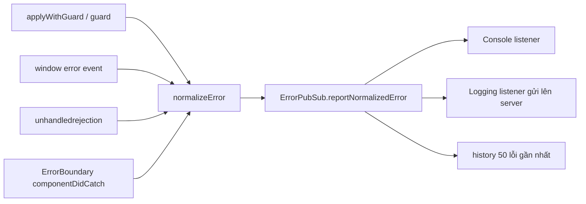
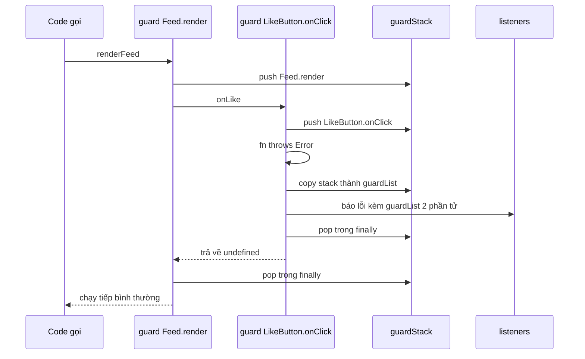

Stack trace từ production sau khi minify trông như sau:

```text
TypeError: Cannot read properties of undefined (reading 'id')
    at a (main.3f9a1c.js:1:48213)
    at Array.forEach (<anonymous>)
    at c (main.3f9a1c.js:1:51002)
```

Có source map thì bạn biết lỗi ở dòng nào. Nhưng thường bạn vẫn không biết **lỗi xảy ra trong ngữ cảnh nào**: người dùng đang bấm Like, đang load comment, hay đó là event từ websocket? Ngoài ra còn hai vấn đề khó chịu hơn:

- Một listener lỗi trong vòng `forEach` sẽ làm **các listener sau nó không bao giờ chạy**. Một plugin viết ẩu có thể làm hỏng cả trang.
- Lỗi đến từ nhiều cửa khác nhau (`try/catch`, `window.onerror`, promise bị reject, React error boundary), mỗi cửa một format. Server nhận về một mớ không gom nhóm được.

> [!TIP]
> **Tóm tắt**
> - Bọc các **điểm vào** (listener, callback của observer, plugin) bằng `guard(fn, { name })`: một callback lỗi không chặn những callback còn lại.
> - Guard lồng nhau tạo **guard stack**, nên lỗi mang theo ngữ cảnh nghiệp vụ như `Feed.render › LikeButton.onClick`.
> - Mọi cửa lỗi (guard, `window.onerror`, `unhandledrejection`, React) đổ về **một hàm chuẩn hoá và một pub/sub**, có lịch sử để phát lại cho listener đăng ký muộn.
> - Guard stack chỉ đúng với code đồng bộ; sau `await` thì phải truyền ngữ cảnh bằng tay.

Facebook có cả một nhóm module cho chuyện này: `ErrorGuard`, `ErrorGuardState`, `ErrorPubSub`, `ErrorNormalizeUtils`, `ErrorSerializer`, `ErrorGlobalEventHandler`, `ErrorUnhandledRejectionHandler`, `ErrorBoundary.react`… (thư mục `ErrorGuard/` và `ErrorBoundary/` của [facebook-codebase](https://github.com/hunghg255/facebook-codebase)). Phiên bản đơn giản hơn của ErrorGuard cũng có trong [React Native](https://github.com/facebook/react-native/blob/main/packages/polyfills/error-guard.js).

## Bức tranh tổng thể

Trước khi đi vào từng module, đây là đường đi của một lỗi trong hệ thống của Facebook:



Mọi cửa đều đổ về **một hàm chuẩn hoá** và **một pub/sub**. Phần còn lại của app chỉ cần đăng ký listener, không cần biết lỗi đến từ đâu.

## Bên trong trình duyệt: lỗi đi đường nào?

Hiểu cơ chế của trình duyệt giúp biết **cửa nào bắt được lỗi nào**.

**Lỗi đồng bộ không ai bắt.** Khi một task (callback của `setTimeout`, một event listener, một script) throw mà không có `catch`, trình duyệt "report the exception": tạo một `ErrorEvent` và dispatch lên `window`. Event có `message`, `filename`, `lineno`, `colno` và `error` (giá trị bị throw). Task đó dừng, nhưng **event loop vẫn chạy tiếp** các task khác.

**Mỗi DOM event listener được trình duyệt "guard" sẵn.** Nếu bạn `addEventListener('click', a)` và `addEventListener('click', b)`, `a` throw thì `b` **vẫn chạy**, vì spec yêu cầu báo lỗi của từng listener riêng rồi gọi listener kế tiếp. Event emitter tự viết bằng `forEach` thì không có cơ chế đó. Đây chính là khoảng trống mà `applyWithGuard` lấp vào.

**"Script error."** Nếu lỗi xảy ra trong một script tải từ origin khác (CDN, `static.example.com`), trình duyệt **che hết thông tin** để không rò dữ liệu xuyên origin: `message = "Script error."`, `filename = ""`, `lineno = 0`, `error = null`. Muốn thấy lỗi thật thì cần **cả hai**:

```html
<script src="https://cdn.example.com/app.js" crossorigin="anonymous"></script>
```

và server CDN trả về header `Access-Control-Allow-Origin` (ví dụ `*` hoặc origin của bạn). Thiếu một trong hai là vẫn "Script error.". Vì vậy khi `event.error` là `null`, handler của bản viết lại (ở dưới) tạo một lỗi riêng tên `OpaqueScriptError` (message `"Script error."`, stack là `filename:line:col` nếu có). Nhìn tên lỗi trên dashboard là biết ngay phải đi kiểm tra cấu hình CORS, thay vì nhầm thành một lỗi "throw không phải Error".

**Promise bị reject mà không ai xử lý.** Không đi qua `error` mà qua `unhandledrejection`. Trình duyệt kiểm tra sau khi microtask queue trống: promise nào đã reject mà chưa có handler thì bắn event, kèm `event.reason` (giá trị reject, không nhất thiết là Error) và `event.promise`. Nếu sau đó có người `.catch()` muộn, trình duyệt bắn thêm `rejectionhandled`. Ứng dụng cẩn thận có thể dùng event này để "rút lại" báo cáo.

**Lỗi trong React.** Lỗi trong render, lifecycle và effect **không** đi qua `try/catch` của bạn. React tự bắt rồi tìm error boundary gần nhất:

- Có boundary: `componentDidCatch(error, info)` được gọi, `info.componentStack` cho biết cây component.
- Từ React 19, `createRoot(container, { onCaughtError, onUncaughtError, onRecoverableError })` cho bạn một chỗ duy nhất để nhận **mọi** lỗi React, kể cả lỗi đã được boundary bắt. Mặc định, lỗi không có boundary nào bắt được báo qua `window.reportError`, nên vẫn tới được handler `error` của bạn. Lỗi đã được boundary bắt mặc định chỉ được `console.error`.
- Lỗi trong **event handler** của React (`onClick`) không đi qua boundary. Nó là lỗi JavaScript bình thường, bay lên `window` như mọi listener khác.

Ghép lại thành bảng "cửa nào bắt cái gì":

| Tình huống | Cửa bắt được |
| --- | --- |
| Callback bọc `guard()` throw | `GUARDED` (lỗi không lan ra ngoài) |
| `setTimeout`/listener/script throw, không có guard | `window` `error` (`GLOBAL`) |
| Script cross-origin throw, thiếu CORS | `GLOBAL`, nhưng chỉ còn `"Script error."` |
| `async` function throw, không ai `await`/`.catch` | `unhandledrejection` |
| Component render throw, có boundary | `componentDidCatch` / `onCaughtError` (`REACT`) |
| Component render throw, không có boundary | `onUncaughtError` → mặc định `window.reportError` → `GLOBAL` |
| `onClick` của React throw | `GLOBAL` |

## Facebook làm thế nào?

### 1. `applyWithGuard` và guard stack

`applyWithGuard(fn, context, args, { name })` gọi hàm trong `try/catch`. Lỗi bị bắt lại, **không văng ra ngoài**, nên code gọi (vòng lặp listener, scheduler, observer) vẫn chạy tiếp.

Trước khi gọi, nó `pushGuard({ name, deferredSource })` vào `ErrorGuardState`, một mảng toàn cục. Gọi xong thì `popGuard()` trong `finally`. Khi lỗi xảy ra, `cloneGuardList()` chụp lại danh sách tên guard đang mở và gắn vào lỗi. Vì JavaScript chạy đơn luồng, **tại thời điểm throw**, stack này phản ánh chính xác chuỗi lời gọi đang diễn ra.

Hai chi tiết nhỏ khi đọc code gốc:

- `ErrorGuardState` dùng `unshift`/`shift`, nên guard **trong cùng đứng đầu** danh sách. (Bản viết lại ở dưới dùng `push`/`pop` để guard ngoài cùng đứng đầu, đọc như breadcrumb.)
- Guard không có tên thì dùng `"func_name:" + fn.name`, nếu không có cả tên hàm thì là `"<anonymous guard>"`.

### 2. `deferredSource`: nối ngữ cảnh qua ranh giới bất đồng bộ

Mỗi guard có thể mang theo `deferredSource`, một `Error` được truyền vào lúc gọi guard. Cách dùng hợp lý là tạo nó **lúc lên lịch** callback (ví dụ lúc gọi `setTimeout`), để giữ lại stack của nơi lên lịch. Khi callback lỗi sau đó, `ErrorPubSub` gọi `findDeferredSource()` để tìm guard gần nhất có `deferredSource` và gắn stack của nó vào lỗi. Nhờ vậy, lỗi trong callback vẫn kèm được câu trả lời cho câu hỏi "ai đã lên lịch callback này?". Đây chính là "async stack trace" tự làm, trước khi DevTools hỗ trợ.

### 3. Chuẩn hoá lỗi

`getErrorSafe` xử lý những thứ "không phải Error" bị throw. Đọc code thấy ba trường hợp:

| Thứ bị throw | Kết quả |
| --- | --- |
| `null`, `undefined`, string, number | `Non-object thrown: <giá trị>` |
| Object không có `message` kiểu string (`throw { code: 1 }`) | `Non-error thrown: …, keys: ["code"]` |
| Error đã bị `Object.freeze` | `Non-extensible thrown: …` (vì không gắn thêm metadata vào được) |

Để ý họ **không** dùng `instanceof Error` mà kiểm tra `typeof a.message === "string"`. Error đến từ iframe khác (một "realm" khác) có `Error` constructor khác, nên `instanceof` sẽ trả về `false` sai.

Sau đó `ErrorNormalizeUtils.normalizeError` đưa mọi thứ về một object phẳng gồm `name`, `message`, `messageFormat`, `messageParams`, `stack`, `stackFrames`, `guardList`, `loggingSource`, `clientTime`, `page_time`, `windowLocationURL`, `componentStackFrames`… Có ba điểm đáng học:

- **`Error.stackTraceLimit` được nâng lên 80** (mặc định của V8 là 10). Với app React nhiều tầng, 10 frame thường chỉ toàn code của React.
- **`messageFormat` tách khỏi `messageParams`**. Lỗi được viết dạng `err("Không tìm thấy story %s", id)`. Server gom nhóm theo `messageFormat`, nên 10.000 lỗi với 10.000 id khác nhau vẫn chỉ là **một** nhóm.
- **Có `hash`** = `getSimpleHash(name, stack, type, project, loggingSource)`, một hash 6 ký tự. Đây là "fingerprint" để gom nhóm và dedupe.

### 4. Global handlers

`ErrorGlobalEventHandler` nghe `window.addEventListener("error")`:

- Có `event.error` thì dùng nó. Không có thì tạo lỗi từ `event.message`.
- Bù `fileName`, `line`, `column` từ `event.filename`, `lineno`, `colno` nếu lỗi thiếu.
- Gắn `guardList = ["<window.onerror>"]` và `loggingSource = "ONERROR"`.
- Lỗi chứa chữ `ResizeObserver` được **hạ xuống mức `warn`**. Lỗi "ResizeObserver loop…" xuất hiện rất nhiều trên mọi trang web lớn nhưng gần như vô hại.

`ErrorUnhandledRejectionHandler` nghe `unhandledrejection`. Nếu `reason` là object không có `name`/`message` thì `JSON.stringify` nó, gặp object vòng thì chỉ in danh sách key. Cuối cùng nó gọi `event.preventDefault()` để trình duyệt khỏi in lỗi thêm lần nữa ra console.

### 5. `ErrorPubSub`: chống vòng lặp báo lỗi

Hàm `reportNormalizedError` có ba chi tiết bảo vệ:

- **Cờ re-entrancy.** Đang trong lúc báo lỗi mà một listener lại gây ra lỗi khác và gọi báo lỗi tiếp, lần gọi sau bị **bỏ qua**. Không có cờ này thì một listener gửi log bị lỗi sẽ tạo vòng lặp vô hạn.
- **Lịch sử có giới hạn.** Giữ khoảng 50 lỗi gần nhất. Khi đầy thì xoá **ở giữa**, nên vẫn giữ được những lỗi đầu tiên (thường là nguyên nhân gốc) và những lỗi mới nhất.
- **Phát lại cho listener đến muộn.** Listener đăng ký sau vẫn nhận được các lỗi đã xảy ra trước đó. Lỗi lúc khởi động trang vẫn được gửi đi dù module logging tải sau.

::: spoiler Chi tiết thêm từ code gốc: error boundary và nocatch

**Error boundary.**

`ErrorBoundary.react` của Facebook trong `componentDidCatch`:

- lấy tên module con (`getReactElementDisplayName`) và tạo `messageFormat = "caught error in module %s (%s)"`,
- gắn `componentStack`, đặt `loggingSource = "ERROR_BOUNDARY"` và `type = "fatal"`,
- đẩy vào cùng `ErrorPubSub`,
- có prop `forceResetErrorCount`: tăng số này lên là boundary reset và thử render lại.

`CometErrorBoundary` còn gắn thêm **pagelet stack** (lỗi xảy ra ở vùng nào của trang: feed, chat, sidebar…) vào metadata.

**`nocatch`.**

Khi `Env.nocatch` bật, guard không bắt lỗi nữa mà để lỗi văng ra. DevTools với "Pause on uncaught exceptions" sẽ dừng **đúng chỗ throw** thay vì trong `catch` của guard.

:::

## Viết lại

Bản viết lại giữ khung: guard stack, chuẩn hoá, pub/sub có lịch sử, global handlers và chế độ `noCatch`. Mình đi qua từng phần.

### Kiểu dữ liệu và chuẩn hoá

```ts title=src/lib/errorGuard.ts
export interface NormalizedError {
  name: string;
  message: string;
  stack?: string;
  source: ErrorSource;
  /** guard stack lúc lỗi xảy ra, ngoài cùng trước */
  guardList: string[];
  /** lỗi gốc có phải Error không (throw "abc" hay throw {} cũng gặp ngoài đời) */
  wasErrorObject: boolean;
  /** giá trị bị throw ban đầu, giữ nguyên để gửi cho Sentry (còn `cause`, field riêng…) */
  original: unknown;
  timestamp: number;
}
```

```ts title=src/lib/errorGuard.ts
export function normalizeError(
  thrown: unknown,
  source: ErrorSource,
  guardList: string[] = [],
): NormalizedError {
  const error = toError(thrown);
  return {
    name: error.name,
    message: error.message,
    stack: error.stack,
    source,
    guardList,
    wasErrorObject: isErrorLike(thrown),
    original: thrown,
    timestamp: Date.now(),
  };
}
```

- `NormalizedError` là "hợp đồng" giữa nơi phát lỗi và nơi nhận lỗi. Bất cứ thứ gì gửi lên server đều phải theo đúng format này.
- `original` giữ nguyên giá trị bị throw để gửi cho Sentry: tạo lại `Error` từ `message`/`stack` sẽ mất `cause` và các field riêng.
- `toError` (trong file đầy đủ) xử lý `throw "abc"`, `throw {}`, `throw null`. `JSON.stringify` có thể throw (object vòng, `BigInt`), nên được bọc thêm `try/catch` và fallback về `String()`. Kiểm tra "có phải Error không" dùng duck typing như Facebook.
- `wasErrorObject` cho biết "có phải Error thật không". Nếu số lượng `throw` không phải Error tăng đột ngột, thường là một thư viện bên thứ ba đang làm bậy.

### Pub/sub có lịch sử

```ts title=src/lib/errorGuard.ts
function callListener(listener: ErrorListener, error: NormalizedError) {
  try {
    listener(error);
  } catch (listenerError) {
    // Không báo lại qua pipeline (sẽ lặp vô hạn), nhưng cũng đừng nuốt im lặng:
    // tích hợp Sentry hỏng mà không ai biết còn tệ hơn.
    console.error('[errorGuard] listener lỗi:', listenerError);
  }
}

let reporting = false;

/**
 * Đưa một lỗi đã chuẩn hoá vào pipeline. Đặt tên khác `window.reportError` (API chuẩn của
 * trình duyệt) để không nhầm lẫn / auto-import nhầm.
 */
export function reportNormalizedError(error: NormalizedError) {
  // Chống vòng lặp: listener (vd: gửi log) gây lỗi -> lỗi đó lại được báo -> listener lại lỗi…
  if (reporting) return;
  reporting = true;
  try {
    history.push(error);
    if (history.length > MAX_HISTORY) history.splice(MAX_HISTORY / 2, 1);
    listeners.forEach((listener) => callListener(listener, error));
  } finally {
    reporting = false;
  }
}

/**
 * Đăng ký nhận lỗi. Mặc định phát lại các lỗi đã xảy ra trước khi đăng ký,
 * để lỗi lúc khởi động không bị mất.
 */
export function onError(listener: ErrorListener, { replay = true }: { replay?: boolean } = {}) {
  if (replay) history.forEach((error) => callListener(listener, error));
  listeners.add(listener);
  return () => {
    listeners.delete(listener);
  };
}
```

- **Cờ `reporting`** chặn vòng lặp: listener gửi log bị lỗi không được phép báo lỗi tiếp vào chính pipeline.
- Listener lỗi **không bị nuốt im lặng**: `console.error` để bạn biết tích hợp Sentry đang hỏng, nhưng không đưa lại vào pipeline.
- **Lịch sử 50 lỗi**, đầy thì bỏ phần giữa, giống Facebook. `onError` mặc định **phát lại** lịch sử cho listener mới, nên lỗi lúc khởi động không mất dù Sentry khởi tạo sau.
- Tên hàm là `reportNormalizedError` (theo Facebook), cố ý tránh trùng với [`window.reportError`](https://developer.mozilla.org/en-US/docs/Web/API/reportError), API chuẩn của trình duyệt.

### `applyWithGuard` từng bước

```ts title=src/lib/errorGuard.ts
export function applyWithGuard<A extends unknown[], R>(
  fn: (...args: A) => R,
  thisArg: unknown,
  args: A,
  options: GuardOptions = {},
): R | undefined {
  guardStack.push(options.name ?? (fn.name ? `func_name:${fn.name}` : '<anonymous guard>'));
  try {
    if (errorGuardConfig.noCatch) return fn.apply(thisArg, args);
    try {
      return fn.apply(thisArg, args);
    } catch (thrown) {
      const normalized = normalizeError(thrown, 'GUARDED', [...guardStack]);
      // onError do người dùng truyền vào cũng có thể ném lỗi; không được để nó phá lời hứa
      // "lỗi không lọt ra ngoài guard".
      if (options.onError) callListener(options.onError, normalized);
      reportNormalizedError(normalized);
      return undefined;
    }
  } finally {
    guardStack.pop();
  }
}

export function guard<A extends unknown[], R>(fn: (...args: A) => R, options: GuardOptions = {}) {
  return function (this: unknown, ...args: A) {
    return applyWithGuard(fn, this, args, options);
  };
}
```

Theo dõi một lời gọi lồng nhau `renderFeed()` → `onLike()` (giống nút "Guard lồng nhau" trong demo):



1. Tên guard được `push` **trước** `try`, nên dù hàm throw hay không, `finally` luôn `pop` đúng một lần. Nếu đặt `pop` ở cuối `try`, một lỗi sẽ làm stack "rò" vĩnh viễn và mọi lỗi sau đó mang guard list sai.
2. Lỗi bị bắt ở guard **trong cùng**. `[...guardStack]` chụp lại toàn bộ chuỗi `["Feed.render", "LikeButton.onClick"]` **trước khi** `finally` pop.
3. Guard ngoài không thấy lỗi nào: với nó, `onLike()` chỉ trả về `undefined`. Vì vậy kiểu trả về là `R | undefined`, và code gọi phải xử lý trường hợp không có kết quả.
4. Nhánh `noCatch` vẫn push/pop, để `inGuard()` vẫn đúng khi debug.
5. `options.onError` cũng được gọi qua `callListener`: nếu chính nó throw, lỗi vẫn không lọt ra ngoài guard.

### Global handlers

```ts title=src/lib/errorGuard.ts
/** Bắt cả lỗi lọt ra ngoài mọi guard. Gọi một lần lúc khởi động app. */
export function installGlobalErrorHandlers() {
  const onWindowError = (event: ErrorEvent) => {
    if (event.error == null) {
      // Lỗi từ script khác origin thiếu `crossorigin` + header CORS: trình duyệt giấu hết
      // chi tiết, chỉ còn message "Script error.". Báo đúng bản chất thay vì "Non-error thrown".
      const error = new Error(event.message || 'Script error.');
      error.name = 'OpaqueScriptError';
      error.stack = `${event.filename || '(unknown)'}:${event.lineno}:${event.colno}`;
      reportNormalizedError(normalizeError(error, 'GLOBAL'));
      return;
    }
    reportNormalizedError(normalizeError(event.error, 'GLOBAL'));
  };
  const onRejection = (event: PromiseRejectionEvent) => {
    reportNormalizedError(normalizeError(event.reason, 'UNHANDLED_REJECTION'));
  };
  window.addEventListener('error', onWindowError);
  window.addEventListener('unhandledrejection', onRejection);
  return () => {
    window.removeEventListener('error', onWindowError);
    window.removeEventListener('unhandledrejection', onRejection);
  };
}
```

**Khác bản gốc:** guard stack ngoài cùng đứng đầu; không có `deferredSource`, `messageFormat`/`messageParams` hay hash; lỗi `ResizeObserver` không được hạ mức; `unhandledrejection` không gọi `preventDefault()` (lỗi vẫn hiện trong console, tiện khi debug).

::: spoiler Xem toàn bộ src/lib/errorGuard.ts

```ts title=src/lib/errorGuard.ts
/**
 * Bắt lỗi theo "ngữ cảnh" (ý tưởng từ ErrorGuard / ErrorPubSub / ErrorNormalizeUtils của Facebook).
 *
 * - `guard(fn, { name })` bọc callback: lỗi bị bắt, chuẩn hoá và gửi tới các listener,
 *   code gọi callback vẫn chạy tiếp.
 * - Guard lồng nhau tạo thành "guard stack", nên khi lỗi ta biết nó xảy ra ở đâu:
 *   ["Feed.onEvent", "LikeButton.onClick"] thay vì chỉ một stack trace đã minify.
 * - Lỗi lọt ra ngoài (window.onerror, unhandledrejection) cũng đi qua cùng một pipeline.
 */

export type ErrorSource = 'GUARDED' | 'GLOBAL' | 'UNHANDLED_REJECTION' | 'REACT';

export interface NormalizedError {
  name: string;
  message: string;
  stack?: string;
  source: ErrorSource;
  /** guard stack lúc lỗi xảy ra, ngoài cùng trước */
  guardList: string[];
  /** lỗi gốc có phải Error không (throw "abc" hay throw {} cũng gặp ngoài đời) */
  wasErrorObject: boolean;
  /** giá trị bị throw ban đầu, giữ nguyên để gửi cho Sentry (còn `cause`, field riêng…) */
  original: unknown;
  timestamp: number;
}

type ErrorListener = (error: NormalizedError) => void;

const guardStack: string[] = [];
const listeners = new Set<ErrorListener>();

// Lịch sử lỗi gần nhất để phát lại cho listener đăng ký muộn (vd: Sentry khởi tạo sau khi
// app đã chạy được một lúc). Đầy thì bỏ phần giữa: giữ lỗi đầu phiên (thường là nguyên nhân
// gốc) và lỗi mới nhất — giống ErrorPubSub của Facebook.
const MAX_HISTORY = 50;
const history: NormalizedError[] = [];

export const errorGuardConfig = {
  /**
   * true = không bắt lỗi, để lỗi văng ra cho DevTools dừng đúng chỗ (FB gọi là `nocatch`).
   * Hữu ích khi debug local.
   */
  noCatch: false,
};

/**
 * Kiểm tra "giống Error" bằng duck typing thay vì instanceof: Error tạo trong iframe khác
 * (realm khác) có prototype khác, `instanceof Error` sẽ trả về false.
 */
function isErrorLike(value: unknown): value is Error {
  return (
    value instanceof Error ||
    (typeof value === 'object' &&
      value !== null &&
      typeof (value as Error).message === 'string' &&
      typeof (value as Error).name === 'string')
  );
}

/** Biến mọi thứ bị `throw` thành Error để luôn có name/message/stack. */
export function toError(thrown: unknown): Error {
  if (isErrorLike(thrown)) return thrown;
  let message: string;
  try {
    message = typeof thrown === 'string' ? thrown : JSON.stringify(thrown);
  } catch {
    message = String(thrown);
  }
  const error = new Error(`Non-error thrown: ${message}`);
  error.name = 'NonError';
  return error;
}

export function normalizeError(
  thrown: unknown,
  source: ErrorSource,
  guardList: string[] = [],
): NormalizedError {
  const error = toError(thrown);
  return {
    name: error.name,
    message: error.message,
    stack: error.stack,
    source,
    guardList,
    wasErrorObject: isErrorLike(thrown),
    original: thrown,
    timestamp: Date.now(),
  };
}

function callListener(listener: ErrorListener, error: NormalizedError) {
  try {
    listener(error);
  } catch (listenerError) {
    // Không báo lại qua pipeline (sẽ lặp vô hạn), nhưng cũng đừng nuốt im lặng:
    // tích hợp Sentry hỏng mà không ai biết còn tệ hơn.
    console.error('[errorGuard] listener lỗi:', listenerError);
  }
}

let reporting = false;

/**
 * Đưa một lỗi đã chuẩn hoá vào pipeline. Đặt tên khác `window.reportError` (API chuẩn của
 * trình duyệt) để không nhầm lẫn / auto-import nhầm.
 */
export function reportNormalizedError(error: NormalizedError) {
  // Chống vòng lặp: listener (vd: gửi log) gây lỗi -> lỗi đó lại được báo -> listener lại lỗi…
  if (reporting) return;
  reporting = true;
  try {
    history.push(error);
    if (history.length > MAX_HISTORY) history.splice(MAX_HISTORY / 2, 1);
    listeners.forEach((listener) => callListener(listener, error));
  } finally {
    reporting = false;
  }
}

/**
 * Đăng ký nhận lỗi. Mặc định phát lại các lỗi đã xảy ra trước khi đăng ký,
 * để lỗi lúc khởi động không bị mất.
 */
export function onError(listener: ErrorListener, { replay = true }: { replay?: boolean } = {}) {
  if (replay) history.forEach((error) => callListener(listener, error));
  listeners.add(listener);
  return () => {
    listeners.delete(listener);
  };
}

export function inGuard() {
  return guardStack.length > 0;
}

export interface GuardOptions {
  name?: string;
  onError?: (error: NormalizedError) => void;
}

export function applyWithGuard<A extends unknown[], R>(
  fn: (...args: A) => R,
  thisArg: unknown,
  args: A,
  options: GuardOptions = {},
): R | undefined {
  guardStack.push(options.name ?? (fn.name ? `func_name:${fn.name}` : '<anonymous guard>'));
  try {
    if (errorGuardConfig.noCatch) return fn.apply(thisArg, args);
    try {
      return fn.apply(thisArg, args);
    } catch (thrown) {
      const normalized = normalizeError(thrown, 'GUARDED', [...guardStack]);
      // onError do người dùng truyền vào cũng có thể ném lỗi; không được để nó phá lời hứa
      // "lỗi không lọt ra ngoài guard".
      if (options.onError) callListener(options.onError, normalized);
      reportNormalizedError(normalized);
      return undefined;
    }
  } finally {
    guardStack.pop();
  }
}

export function guard<A extends unknown[], R>(fn: (...args: A) => R, options: GuardOptions = {}) {
  return function (this: unknown, ...args: A) {
    return applyWithGuard(fn, this, args, options);
  };
}

/** Bắt cả lỗi lọt ra ngoài mọi guard. Gọi một lần lúc khởi động app. */
export function installGlobalErrorHandlers() {
  const onWindowError = (event: ErrorEvent) => {
    if (event.error == null) {
      // Lỗi từ script khác origin thiếu `crossorigin` + header CORS: trình duyệt giấu hết
      // chi tiết, chỉ còn message "Script error.". Báo đúng bản chất thay vì "Non-error thrown".
      const error = new Error(event.message || 'Script error.');
      error.name = 'OpaqueScriptError';
      error.stack = `${event.filename || '(unknown)'}:${event.lineno}:${event.colno}`;
      reportNormalizedError(normalizeError(error, 'GLOBAL'));
      return;
    }
    reportNormalizedError(normalizeError(event.error, 'GLOBAL'));
  };
  const onRejection = (event: PromiseRejectionEvent) => {
    reportNormalizedError(normalizeError(event.reason, 'UNHANDLED_REJECTION'));
  };
  window.addEventListener('error', onWindowError);
  window.addEventListener('unhandledrejection', onRejection);
  return () => {
    window.removeEventListener('error', onWindowError);
    window.removeEventListener('unhandledrejection', onRejection);
  };
}
```

:::

## Demo

- **Emit không guard / có guard**: một event emitter có 3 listener, listener thứ 2 bị lỗi. Không có guard thì listener 3 không chạy (`[1]`). Có guard thì listener 1 và 3 vẫn chạy (`[1, 3]`), lỗi của listener 2 được báo kèm tên guard.
- **Guard lồng nhau**: log hiện đầy đủ `Feed.render › LikeButton.onClick`.
- **throw "string"**, **Promise reject**, **Component lỗi**: đều đi chung pipeline, khác nhau ở `source`.

<iframe class="demo-frame" src="/demos/facebook-patterns/index.html?theme=dark#/error-guard" title="Demo error-guard" loading="lazy" style="height: 560px"></iframe>

<p class="demo-links">▶ <a href="/demos/facebook-patterns/index.html#/error-guard" target="_blank" rel="noopener">Mở demo toàn màn hình ↗</a> · <a href="https://stackblitz.com/github/hunghg255/blog-hunghg/tree/master/examples/facebook-patterns?file=src/lib/errorGuard.ts" target="_blank" rel="noopener">Sửa code trên StackBlitz ↗</a> · <a href="https://github.com/hunghg255/blog-hunghg/blob/master/examples/facebook-patterns/src/lib/errorGuard.ts" target="_blank" rel="noopener">Xem source trên GitHub ↗</a></p>

## Tại sao không làm cách khác?

**"Sao không `try/catch` ngay tại chỗ?"** Bạn vẫn nên làm vậy khi **biết cách xử lý** lỗi (retry, hiện thông báo). Guard dành cho chỗ **không biết làm gì ngoài báo cáo**. Nếu mỗi chỗ tự `try/catch` rồi tự gửi lên Sentry, sẽ có mười format, mười cách gắn context và mười chỗ quên.

**"Sao không chỉ dùng `window.onerror`?"** Vì nó đến **quá muộn**: listener thứ 3 trong ví dụ trên đã không được chạy. Nó cũng **mất ngữ cảnh**: chỉ có stack trace, không có "đang làm gì". Và nó **không thấy** lỗi bị thư viện nuốt hay promise bị reject.

**"Sao không bọc guard mọi hàm?"** Vì nuốt lỗi ở mọi nơi sẽ **che bug**: code chạy tiếp với state sai, lỗi thứ hai xảy ra ở chỗ không liên quan. Facebook đặt guard ở **điểm vào** (entry point), nơi "ai đó bên ngoài gọi vào code của mình": callback của scheduler, của IntersectionObserver (xem [bài #1](/blogs/facebook-shared-intersection-observer)), lời gọi vào storage trong Banzai ([bài #7](/blogs/facebook-batch-logger)), listener của event bus. Bên trong logic nghiệp vụ, cứ để lỗi bay tự nhiên tới guard gần nhất.

**"Chi phí hiệu năng?"** `try/catch` trong các engine hiện đại gần như miễn phí khi không có lỗi. Chi phí thật là closure của `guard()` và thao tác push/pop mảng, rất nhỏ so với một event handler. Đừng bọc guard trong vòng lặp nóng (mỗi frame hàng nghìn lần). Hãy bọc **một lần** ở ngoài vòng lặp.

## Edge case và cạm bẫy

**Bão lỗi (error storm).** Một lỗi trong `requestAnimationFrame` hoặc trong handler `scroll` có thể throw **60 lần mỗi giây** trên **mọi** người dùng. Không chặn thì bạn tự DDoS server log và cháy quota Sentry trong vài phút. Cần ít nhất:

- **Dedupe theo fingerprint** (giống `hash` của Facebook): cùng `name + message + vài frame đầu của stack` thì chỉ gửi lần đầu, các lần sau chỉ tăng bộ đếm.
- **Giới hạn tốc độ**: ví dụ tối đa 10 lỗi mỗi phút mỗi tab.
- **Sampling** cho lỗi ồn ào nhưng vô hại (giống cách Facebook hạ `ResizeObserver` xuống `warn`).

```ts
const seen = new Map<string, number>();
onError((error) => {
  const key = `${error.name}|${error.message}|${error.stack?.split('\n')[1] ?? ''}`;
  const count = (seen.get(key) ?? 0) + 1;
  seen.set(key, count);
  if (count > 1) return; // lần đầu mới gửi; có thể gửi kèm count khi flush
  sendToServer(error);
});
```

**Message chứa dữ liệu thay đổi.** `"Không tìm thấy user 12345"` làm mỗi lỗi một nhóm riêng. Học Facebook: tách `messageFormat` và `messageParams`, hoặc ít nhất thay số và UUID bằng placeholder trước khi tính fingerprint.

**PII trong lỗi.** `message` của lỗi validate có thể chứa email, số điện thoại. URL có thể chứa token. Lọc trước khi gửi (Sentry có `beforeSend` cho việc này).

> [!WARNING]
> **Guard stack không đi qua `await`.**
>
> ```ts
> const loadMore = guard(async () => {
>   await fetchPage(); // ← guard đã pop ngay khi hàm async trả về Promise
>   throw new Error('x'); // lỗi này thành unhandledrejection, guardList rỗng
> }, { name: 'Feed.loadMore' });
> ```
>
> Hàm `async` trả về Promise **ngay lập tức**, nên `finally` pop guard trước khi phần sau `await` kịp chạy. Lỗi sau `await` cũng không bị `catch` đồng bộ của guard bắt; nó biến thành promise bị reject. Cách xử lý:
>
> - Bắt lỗi trong chính hàm async và truyền ngữ cảnh tường minh: `catch (e) { reportNormalizedError(normalizeError(e, 'GUARDED', ['Feed.loadMore'])) }`.
> - Viết thêm `guardAsync` gắn `.catch()` vào promise trả về, kèm guard list chụp lúc bắt đầu.
> - Tương lai: đề xuất [AsyncContext](https://github.com/tc39/proposal-async-context) của TC39 cho phép một giá trị "đi theo" qua `await`, `setTimeout`, promise, giống `AsyncLocalStorage` của Node.js.

**`instanceof Error` sai với lỗi từ iframe.** Error tạo trong một iframe có `Error` constructor riêng, nên `instanceof Error` ở trang cha trả về `false`. Bản viết lại làm giống Facebook: hàm `isErrorLike` kiểm tra bằng duck typing (`typeof message === 'string' && typeof name === 'string'`).

**Đăng ký listener muộn.** Nhờ lịch sử, lỗi xảy ra trước khi Sentry khởi tạo vẫn được phát lại. Nhưng lịch sử chỉ có 50 lỗi; nếu app khởi động ồn ào, hãy đăng ký listener chính càng sớm càng tốt.

**Đừng gửi lỗi bằng chính đường bị lỗi.** Nếu lỗi là "mất mạng", gửi báo cáo ngay sẽ lại lỗi. Đưa vào batch logger ([bài #7](/blogs/facebook-batch-logger)) để được retry và gửi bằng `sendBeacon` khi rời trang.

## Dùng trong dự án

Nối pipeline này với Sentry (hoặc API của bạn) **ở một chỗ duy nhất**:

```ts title=errors.ts
installGlobalErrorHandlers();

onError((error) => {
  // gửi nguyên giá trị bị throw: Sentry giữ được stack gốc, `cause` và các field riêng
  Sentry.captureException(error.wasErrorObject ? error.original : new Error(error.message), {
    tags: { source: error.source },
    extra: { guardList: error.guardList },
  });
});

errorGuardConfig.noCatch = import.meta.env.DEV && localStorage.debugNoCatch === '1';
```

Với React 19, nối lỗi React vào cùng pipeline ngay ở `createRoot`. Error boundary vẫn cần để hiện UI fallback, nhưng việc **báo cáo** thì gom về một chỗ, khỏi phải viết `componentDidCatch` ở từng boundary:

```tsx title=main.tsx
createRoot(document.getElementById('root')!, {
  // lỗi đã được một error boundary bắt (UI fallback đã hiện)
  onCaughtError: (error) => reportNormalizedError(normalizeError(error, 'REACT', ['ErrorBoundary'])),
  // lỗi không boundary nào bắt: cả cây bị unmount
  onUncaughtError: (error) => reportNormalizedError(normalizeError(error, 'REACT', ['root'])),
}).render(<App />);
```

Tham số thứ hai của hai callback này có `componentStack`. Nếu cần, hãy thêm một field riêng vào `NormalizedError` để gửi kèm, giống `componentStackFrames` của Facebook.

Những chỗ nên bọc guard:

- **Event emitter / pub-sub** do bạn tự viết: mỗi listener một guard.
- **Callback đưa cho thư viện bên thứ ba** (map, chart, editor) mà bạn không kiểm soát try/catch của họ.
- **Plugin / extension / widget** do người khác viết chạy trong app của bạn.
- **Callback của observer** (IntersectionObserver, ResizeObserver, MutationObserver) dùng chung cho nhiều component.

### So với Sentry SDK

Sentry SDK cho trình duyệt cũng làm một phần việc này: integration `browserApiErrors` (tên cũ là `TryCatch`) tự bọc callback của `setTimeout`, `setInterval`, `requestAnimationFrame` và `addEventListener` để bắt lỗi kèm thông tin "lỗi trong callback nào". Ngoài ra còn breadcrumbs: dòng thời gian các thao tác (click, request, console) trước khi lỗi xảy ra. Guard stack bổ sung thứ Sentry không tự đoán được: **tên nghiệp vụ** của ngữ cảnh (`Feed.render › LikeButton.onClick`). Hai thứ dùng chung rất tốt: guard lo phần ngữ cảnh, Sentry lo gom nhóm, source map và cảnh báo.

## Kiểm thử

::: spoiler Ví dụ test (bản phác, không có trong repo)

```ts title=errorGuard.test.ts
import { describe, expect, it, vi } from 'vitest';
import { guard, inGuard, normalizeError, onError, reportNormalizedError } from './errorGuard';

describe('guard', () => {
  it('bắt lỗi, ghi lại guard stack lồng nhau và không để lỗi lan ra ngoài', () => {
    const seen = vi.fn();
    const off = onError(seen, { replay: false });
    const inner = guard(() => {
      throw new Error('boom');
    }, { name: 'Inner' });
    const outer = guard(() => inner(), { name: 'Outer' });

    expect(() => outer()).not.toThrow();
    expect(seen).toHaveBeenCalledWith(
      expect.objectContaining({ message: 'boom', source: 'GUARDED', guardList: ['Outer', 'Inner'] }),
    );
    expect(inGuard()).toBe(false); // stack đã được dọn sạch
    off();
  });

  it('chuẩn hoá thứ bị throw không phải Error', () => {
    const seen = vi.fn();
    const off = onError(seen, { replay: false });
    guard(() => {
      throw { code: 42 };
    })();
    expect(seen.mock.calls[0][0]).toMatchObject({ name: 'NonError', wasErrorObject: false });
    off();
  });

  it('phát lại lỗi cũ cho listener đăng ký muộn', () => {
    reportNormalizedError(normalizeError(new Error('lúc khởi động'), 'GLOBAL'));
    const late = vi.fn();
    const off = onError(late);
    expect(late).toHaveBeenCalledWith(expect.objectContaining({ message: 'lúc khởi động' }));
    off();
  });
});
```

:::

Test đầu tiên kiểm tra ba tính chất quan trọng nhất: lỗi không lan ra ngoài, guard list đúng thứ tự, và stack được dọn sạch sau lỗi. Lưu ý `{ replay: false }`: lịch sử là toàn cục, nên không tắt replay thì test sau nhận cả lỗi của test trước.

---

Bài này thuộc series **[Học từ mã nguồn Facebook](/series/facebook)** (83 bài, đọc theo thứ tự).

::: spoiler Xem nhanh danh sách bài trong series

*Phần 1*

- [Mở đầu: cách đọc code minify của Facebook](/blogs/learn-from-facebook-source-code)
- [#1 Dùng chung IntersectionObserver + infinite scroll](/blogs/facebook-shared-intersection-observer)
- [#2 useViewportDuration: đo thời gian thực sự được xem](/blogs/facebook-use-viewport-duration)
- [#3 Preload code + data khi hover](/blogs/facebook-preload-on-hover)
- [#4 Toast manager với external store](/blogs/facebook-toast-manager)
- [#5 Network status + heartbeat backoff](/blogs/facebook-network-status-heartbeat)
- **#6 ErrorGuard: bắt lỗi theo ngữ cảnh** (bài này)
- [#7 Banzai: gom log theo lô + sendBeacon](/blogs/facebook-batch-logger)
- [#8 Focus trap + Esc theo layer](/blogs/facebook-focus-trap)

*Phần 2*

- [#9 Mẹo calc(… * 9999): container query, line-clamp, mũi tên carousel bằng CSS](/blogs/facebook-css-9999-trick)
- [#10 Thanh cuộn tuỳ biến bằng CSS 3D](/blogs/facebook-css-3d-scrollbar)
- [#11 Modal cuộn bằng window, giữ vị trí trang nền](/blogs/facebook-document-scroll-modal)
- [#12 Popover, tooltip group và hovercard](/blogs/facebook-popover-tooltip)
- [#13 Primitive Pressable + focus-visible](/blogs/facebook-pressable)
- [#14 Tab "Xem thêm" + sticky header bằng IntersectionObserver](/blogs/facebook-priority-tabs-sticky-header)
- [#15 Avatar khoét mask, gradient Messenger, skeleton steps()](/blogs/facebook-visual-tricks)
- [#16 Khung chat không giật](/blogs/facebook-chat-scroller)
- [#17 Thuật toán chọn bố cục collage ảnh](/blogs/facebook-photo-collage-layout)
- [#18 Keep-alive tab trong SPA](/blogs/facebook-keep-alive-tabs)
- [#19 Tự đo Visual Completion & interaction tracing](/blogs/facebook-visual-completion)
- [#20 Router SPA bền bỉ & tải chunk có retry](/blogs/facebook-spa-router-resilient-loading)

*Phần 3*

- [#21 Smart Compose: gợi ý chữ mờ khi gõ](/blogs/facebook-smart-compose-ghost-text)
- [#22 MQTT ngay trong trình duyệt, tự chuyển sang long-poll](/blogs/facebook-mqtt-in-browser)
- [#23 Đo thời gian dùng bằng bitmap 64 giây](/blogs/facebook-time-spent-bitmap)
- [#24 Bảng reaction nhấn giữ rồi trượt](/blogs/facebook-reaction-press-slide)
- [#25 Tìm kiếm gấp dấu, phiên âm và highlight đầu từ](/blogs/facebook-search-diacritics-tokenize)
- [#26 Ring buffer biết trace nào đã mất log](/blogs/facebook-trace-ring-buffer)
- [#27 Engine animation JS: một vòng rAF và solver cubic-bezier](/blogs/facebook-keyframes-loop-cubic-bezier)
- [#28 Bootloader: bitmap tài nguyên đã tải, chỉ reload khi cần](/blogs/facebook-bootloader-bitmap-consistency)
- [#29 Nhận biết click do screen reader tạo ra](/blogs/facebook-virtual-cursor-detection)
- [#30 Tải trước feed theo chất lượng mạng, đoán hạng thiết bị](/blogs/facebook-network-aware-prefetch)
- [#31 Hàng đợi gửi tin chat giữ đúng thứ tự](/blogs/facebook-ordered-send-queue)
- [#32 Gộp lời gọi API trong cùng một tick](/blogs/facebook-api-batcher)
- [#33 Resize ảnh trong pool Web Worker](/blogs/facebook-jpeg-resize-worker-pool)
- [#34 Crop ảnh theo nhiều khuôn mặt](/blogs/facebook-face-aware-crop)
- [#35 Kéo-thả sắp xếp và vùng thả file không nhấp nháy](/blogs/facebook-flicker-free-drag-drop)
- [#36 Tiện ích UI: fade-out, sticky event, hàm huỷ được](/blogs/facebook-ui-utility-hooks)
- [#37 Hạ tầng nhỏ: cookie, hash lỗi, prefetch khi chuột dừng](/blogs/facebook-small-infra-cookie-hash-idle)

*Phần 4–6*

- [#38 Đồng bộ tin nhắn: phát hiện lỗ seqID và fetch bù theo tầng](/blogs/facebook-messenger-sync-seqid-gaps)
- [#39 OTID: ID tin nhắn kiểu Snowflake sinh ở client](/blogs/facebook-otid-client-snowflake)
- [#40 QPL: lấy mẫu từ lúc bắt đầu, đo RTT gửi tin đầu-cuối](/blogs/facebook-qpl-send-rtt)
- [#41 Bộ điều phối request bảy chế độ gộp và chống trùng](/blogs/facebook-request-dispatcher-modes)
- [#42 Thread list theo mốc thời gian, cookie presence có version](/blogs/facebook-threadlist-ranged-presence)
- [#43 Composer dạng plugin: reducer, dirty checker, chuỗi kiểm tra](/blogs/facebook-plugin-composer)
- [#44 Thanh toán bất đồng bộ: subscribe trước, poll dự phòng](/blogs/facebook-async-checkout)
- [#45 Validate số thẻ: sửa lỗi gõ, dải BIN, Luhn](/blogs/facebook-card-validation)
- [#46 Lịch chọn khoảng ngày: bo góc dải chọn, phím đủ bộ, RTL](/blogs/facebook-range-calendar-a11y)
- [#47 Giờ mở cửa theo tuần: qua đêm, gộp khoảng, phần bù](/blogs/facebook-weekly-hours-intervals)
- [#48 Tiến độ đăng realtime: giữ event chờ snapshot, watchdog](/blogs/facebook-realtime-publish-snapshot)
- [#49 Tiền tệ theo đơn vị nhỏ nhất và ô nhập tiền](/blogs/facebook-currency-minor-units)
- [#50 Sửa hàng loạt Empty/Uniform/Mixed, seen/read bằng 2 bit](/blogs/facebook-bulk-edit-seen-bits)
- [#51 Phát hiện script lạ hook vào hàm native](/blogs/facebook-native-hook-detection)
- [#52 localStorage tự dọn khi đầy quota](/blogs/facebook-quota-aware-storage)
- [#53 Cache tuyến do server phân giải, chờ sẵn promise](/blogs/facebook-route-cache-prefetch)
- [#54 Lưới phím mũi tên 2D và focus không làm cuộn trang](/blogs/facebook-focus-table-grid)
- [#55 Tách emoji bằng máy trạng thái](/blogs/facebook-emoji-segmentation)
- [#56 Đọc trước ghi sau trong một frame, con tự biết vị trí](/blogs/facebook-read-then-write-dom)
- [#57 Hàng đợi lệnh cho video và stream sắp lại chunk](/blogs/facebook-video-command-queue)

*Phần 7–10*

- [#58 Ước lượng băng thông EWMA: loại outlier, nhớ qua phiên](/blogs/facebook-bandwidth-ewma-estimator)
- [#59 ABR theo độ tự tin phát và cắt bậc bitrate theo MOS](/blogs/facebook-abr-playback-confidence)
- [#60 Prefetch segment dự đoán từ manifest, parse hộp sidx](/blogs/facebook-dash-predicted-segments)
- [#61 Đọc metadata MP4/MOV ngay trên client](/blogs/facebook-mp4-metadata-client)
- [#62 Upload tiếp tục được: offset, hash dedupe, phát hiện treo](/blogs/facebook-resumable-upload)
- [#63 Fenwick tree: chọn ngẫu nhiên có trọng số và offset dòng](/blogs/facebook-fenwick-weighted-random)
- [#64 Vạch trục số và trục thời gian "đẹp"](/blogs/facebook-nice-axis-ticks)
- [#65 Damerau-Levenshtein theo dải chéo và tự sửa tên gõ sai](/blogs/facebook-damerau-levenshtein)
- [#66 PRNG có seed, shuffle tái lập và lấy mẫu trace](/blogs/facebook-seeded-prng-sampling)
- [#67 Cặp min/max-heap tái dùng vị trí trong danh sách ảo](/blogs/facebook-dual-heap-buffer-set)
- [#68 Memo nhiều đối số bằng Map/WeakMap và interning object](/blogs/facebook-multikey-memo-interning)
- [#69 Thống kê cửa sổ trượt và đại số khoảng thời gian](/blogs/facebook-moving-stat-intervals)
- [#70 Int64 từ hai số 32-bit, decode UTF, offset theo code point](/blogs/facebook-int64-utf-codepoints)
- [#71 Engine múi giờ IANA trên client, phát hiện lệch giờ](/blogs/facebook-client-iana-timezone)
- [#72 Tự cài semver range](/blogs/facebook-semver-range)
- [#73 Auto-link URL, cắt chữ an toàn, giới hạn LaTeX](/blogs/facebook-autolink-safe-truncate)
- [#74 Parser query kiểu PHP chống prototype pollution](/blogs/facebook-php-query-serializer)
- [#75 Popover tự lật theo phần tràn nhỏ nhất](/blogs/facebook-popover-auto-flip)
- [#76 Tiền tố for(;;) chống JSON hijacking, đọc stream](/blogs/facebook-csrf-prefix-streaming)
- [#77 Chống lộ Referer, linkshim, xoá token trên URL](/blogs/facebook-referrer-linkshim-url-scrub)
- [#78 setImmediate bằng postMessage, gom delta chuột theo frame](/blogs/facebook-setimmediate-mouse-batching)
- [#79 Phát hiện crash qua heartbeat, dò proxy cache hỏng](/blogs/facebook-crash-heartbeat-proxy-check)
- [#80 DPR vào cookie cho ảnh @2x, che khoá trong log](/blogs/facebook-dpr-cookie-secret-redaction)
- [#81 Flux waitFor tự viết và proxy có đệm](/blogs/facebook-flux-dispatch-buffered-proxy)
- [#82 Crop đúng tỉ lệ, xoay sticker bằng ma trận](/blogs/facebook-image-crop-rotation-geometry)

:::

Code + demo: [`examples/facebook-patterns`](https://github.com/hunghg255/blog-hunghg/tree/master/examples/facebook-patterns) · [Mở trên StackBlitz](https://stackblitz.com/github/hunghg255/blog-hunghg/tree/master/examples/facebook-patterns)
