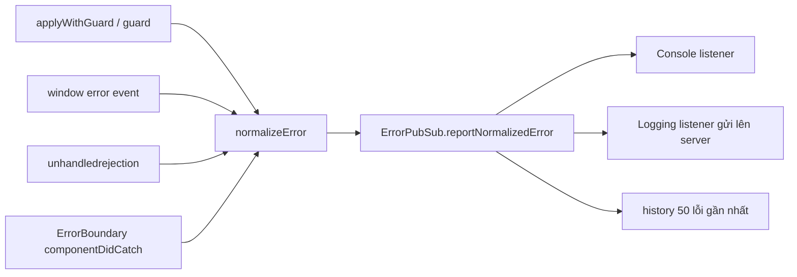
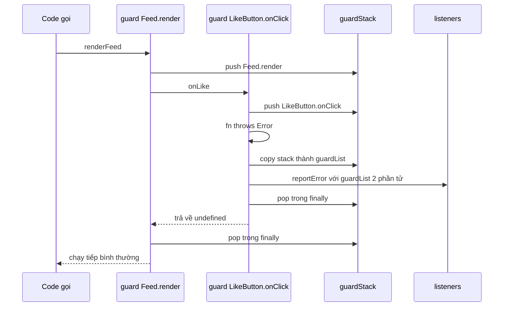

Stack trace từ production sau khi minify trông như sau:

```text
TypeError: Cannot read properties of undefined (reading 'id')
    at a (main.3f9a1c.js:1:48213)
    at Array.forEach (<anonymous>)
    at c (main.3f9a1c.js:1:51002)
```

Có source map thì bạn biết lỗi ở dòng nào. Nhưng thường bạn vẫn không biết **lỗi xảy ra trong ngữ cảnh nào**: người dùng đang bấm Like, đang load comment, hay đó là event từ websocket? Ngoài ra còn hai vấn đề khó chịu hơn:

- Một listener lỗi trong vòng `forEach` sẽ làm **các listener sau nó không bao giờ chạy**. Một plugin viết ẩu có thể làm hỏng cả trang.
- Lỗi đến từ nhiều cửa khác nhau (`try/catch`, `window.onerror`, promise bị reject, React error boundary), mỗi cửa một format. Server nhận về một mớ không gom nhóm được.

Facebook có cả một nhóm module cho chuyện này: `ErrorGuard`, `ErrorGuardState`, `ErrorPubSub`, `ErrorNormalizeUtils`, `ErrorSerializer`, `ErrorGlobalEventHandler`, `ErrorUnhandledRejectionHandler`, `ErrorBoundary.react`… (thư mục `ErrorGuard/` và `ErrorBoundary/` của [facebook-codebase](https://github.com/hunghg255/facebook-codebase)). Phiên bản đơn giản hơn của ErrorGuard cũng có trong [React Native](https://github.com/facebook/react-native/blob/main/packages/polyfills/error-guard.js).

## Bức tranh tổng thể

Trước khi đi vào từng module, đây là đường đi của một lỗi trong hệ thống của Facebook:



Mọi cửa đều đổ về **một hàm chuẩn hoá** và **một pub/sub**. Phần còn lại của app chỉ cần đăng ký listener, không cần biết lỗi đến từ đâu.

## Facebook làm thế nào?

### 1. `applyWithGuard` và guard stack

`applyWithGuard(fn, context, args, { name })` gọi hàm trong `try/catch`. Lỗi bị bắt lại, **không văng ra ngoài**, nên code gọi (vòng lặp listener, scheduler, observer) vẫn chạy tiếp.

Trước khi gọi, nó `pushGuard({ name, deferredSource })` vào `ErrorGuardState`, một mảng toàn cục. Gọi xong thì `popGuard()` trong `finally`. Khi lỗi xảy ra, `cloneGuardList()` chụp lại danh sách tên guard đang mở và gắn vào lỗi. Vì JavaScript chạy đơn luồng, **tại thời điểm throw**, stack này phản ánh chính xác chuỗi lời gọi đang diễn ra.

Hai chi tiết nhỏ khi đọc code gốc:

- `ErrorGuardState` dùng `unshift`/`shift`, nên guard **trong cùng đứng đầu** danh sách. Bản viết lại của mình dùng `push`/`pop`, nên guard **ngoài cùng đứng đầu**, đọc từ trái sang phải giống breadcrumb. Thứ tự nào cũng được, miễn là thống nhất.
- Guard không có tên thì dùng `"func_name:" + fn.name`, nếu không có cả tên hàm thì là `"<anonymous guard>"`.

### 2. `deferredSource`: nối ngữ cảnh qua ranh giới bất đồng bộ

Mỗi guard có thể mang theo `deferredSource`, một `Error` được truyền vào lúc gọi guard. Cách dùng hợp lý là tạo nó **lúc lên lịch** callback (ví dụ lúc gọi `setTimeout`), để giữ lại stack của nơi lên lịch. Khi callback lỗi sau đó, `ErrorPubSub` gọi `findDeferredSource()` để tìm guard gần nhất có `deferredSource` và gắn stack của nó vào lỗi. Nhờ vậy, lỗi trong callback vẫn kèm được câu trả lời cho câu hỏi "ai đã lên lịch callback này?". Đây chính là "async stack trace" tự làm, trước khi DevTools hỗ trợ.

### 3. Chuẩn hoá lỗi

`getErrorSafe` xử lý những thứ "không phải Error" bị throw. Đọc code thấy ba trường hợp:

| Thứ bị throw | Kết quả |
| --- | --- |
| `null`, `undefined`, string, number | `Non-object thrown: <giá trị>` |
| Object không có `message` kiểu string (`throw { code: 1 }`) | `Non-error thrown: …, keys: ["code"]` |
| Error đã bị `Object.freeze` | `Non-extensible thrown: …` (vì không gắn thêm metadata vào được) |

Để ý họ **không** dùng `instanceof Error` mà kiểm tra `typeof a.message === "string"`. Error đến từ iframe khác hoặc từ một realm khác có `Error` constructor khác, nên `instanceof` sẽ trả về `false` sai.

Sau đó `ErrorNormalizeUtils.normalizeError` đưa mọi thứ về một object phẳng gồm `name`, `message`, `messageFormat`, `messageParams`, `stack`, `stackFrames`, `guardList`, `loggingSource`, `clientTime`, `page_time`, `windowLocationURL`, `componentStackFrames`… Có ba điểm đáng học:

- **`Error.stackTraceLimit` được nâng lên 80** (mặc định của V8 là 10). Với app React nhiều tầng, 10 frame thường chỉ toàn code của React.
- **`messageFormat` tách khỏi `messageParams`**. Lỗi được viết dạng `err("Không tìm thấy story %s", id)`. Server gom nhóm theo `messageFormat`, nên 10.000 lỗi với 10.000 id khác nhau vẫn chỉ là **một** nhóm.
- **Có `hash`** = `getSimpleHash(name, stack, type, project, loggingSource)`, một hash 6 ký tự. Đây là "fingerprint" để gom nhóm và dedupe.

### 4. Global handlers

`ErrorGlobalEventHandler` nghe `window.addEventListener("error")`:

- Có `event.error` thì dùng nó. Không có thì tạo lỗi từ `event.message`.
- Bù `fileName`, `line`, `column` từ `event.filename`, `lineno`, `colno` nếu lỗi thiếu.
- Gắn `guardList = ["<window.onerror>"]` và `loggingSource = "ONERROR"`.
- Lỗi chứa chữ `ResizeObserver` được **hạ xuống mức `warn`**. Lỗi "ResizeObserver loop…" xuất hiện rất nhiều trên mọi trang web lớn nhưng gần như vô hại.

`ErrorUnhandledRejectionHandler` nghe `unhandledrejection`. Nếu `reason` là object không có `name`/`message` thì `JSON.stringify` nó, gặp object vòng thì chỉ in danh sách key. Cuối cùng nó gọi `event.preventDefault()` để trình duyệt khỏi in lỗi thêm lần nữa ra console.

### 5. `ErrorPubSub`: chống vòng lặp báo lỗi

Hàm `reportNormalizedError` có ba chi tiết bảo vệ:

- **Cờ re-entrancy.** Đang trong lúc báo lỗi mà một listener lại gây ra lỗi khác và gọi báo lỗi tiếp, lần gọi sau bị **bỏ qua**. Không có cờ này thì một listener gửi log bị lỗi sẽ tạo vòng lặp vô hạn.
- **Lịch sử có giới hạn.** Giữ khoảng 50 lỗi gần nhất. Khi đầy thì xoá **ở giữa**, nên vẫn giữ được những lỗi đầu tiên (thường là nguyên nhân gốc) và những lỗi mới nhất.
- **Phát lại cho listener đến muộn.** Listener đăng ký sau vẫn nhận được các lỗi đã xảy ra trước đó. Lỗi lúc khởi động trang vẫn được gửi đi dù module logging tải sau.

### 6. Error boundary

`ErrorBoundary.react` của Facebook trong `componentDidCatch`:

- lấy tên module con (`getReactElementDisplayName`) và tạo `messageFormat = "caught error in module %s (%s)"`,
- gắn `componentStack`, đặt `loggingSource = "ERROR_BOUNDARY"` và `type = "fatal"`,
- đẩy vào cùng `ErrorPubSub`,
- có prop `forceResetErrorCount`: tăng số này lên là boundary reset và thử render lại.

`CometErrorBoundary` còn gắn thêm **pagelet stack** (lỗi xảy ra ở vùng nào của trang: feed, chat, sidebar…) vào metadata.

### 7. `nocatch`

Khi `Env.nocatch` bật, guard không bắt lỗi nữa mà để lỗi văng ra. DevTools với "Pause on uncaught exceptions" sẽ dừng **đúng chỗ throw** thay vì trong `catch` của guard.

## Viết lại

Bản viết lại giữ khung: guard stack, chuẩn hoá, pub/sub, global handlers và chế độ `noCatch`. Mình đi qua từng phần.

### Kiểu dữ liệu và chuẩn hoá

```ts title=src/lib/errorGuard.ts
/**
 * Bắt lỗi theo "ngữ cảnh" (ý tưởng từ ErrorGuard / ErrorPubSub / ErrorNormalizeUtils của Facebook).
 *
 * - `guard(fn, { name })` bọc callback: lỗi bị bắt, chuẩn hoá và gửi tới các listener,
 *   code gọi callback vẫn chạy tiếp.
 * - Guard lồng nhau tạo thành "guard stack", nên khi lỗi ta biết nó xảy ra ở đâu:
 *   ["Feed.onEvent", "LikeButton.onClick"] thay vì chỉ một stack trace đã minify.
 * - Lỗi lọt ra ngoài (window.onerror, unhandledrejection) cũng đi qua cùng một pipeline.
 */

export type ErrorSource = 'GUARDED' | 'GLOBAL' | 'UNHANDLED_REJECTION' | 'REACT';

export interface NormalizedError {
  name: string;
  message: string;
  stack?: string;
  source: ErrorSource;
  /** guard stack lúc lỗi xảy ra, ngoài cùng trước */
  guardList: string[];
  /** lỗi gốc có phải Error không (throw "abc" hay throw {} cũng gặp ngoài đời) */
  wasErrorObject: boolean;
  timestamp: number;
}

type ErrorListener = (error: NormalizedError) => void;

const guardStack: string[] = [];
const listeners = new Set<ErrorListener>();

export const errorGuardConfig = {
  /**
   * true = không bắt lỗi, để lỗi văng ra cho DevTools dừng đúng chỗ (FB gọi là `nocatch`).
   * Hữu ích khi debug local.
   */
  noCatch: false,
};

/**
 * Kiểm tra "giống Error" bằng duck typing thay vì instanceof: Error tạo trong iframe khác
 * (realm khác) có prototype khác, `instanceof Error` sẽ trả về false.
 */
function isErrorLike(value: unknown): value is Error {
  return (
    value instanceof Error ||
    (typeof value === 'object' &&
      value !== null &&
      typeof (value as Error).message === 'string' &&
      typeof (value as Error).name === 'string')
  );
}

/** Biến mọi thứ bị `throw` thành Error để luôn có name/message/stack. */
export function toError(thrown: unknown): Error {
  if (isErrorLike(thrown)) return thrown;
  let message: string;
  try {
    message = typeof thrown === 'string' ? thrown : JSON.stringify(thrown);
  } catch {
    message = String(thrown);
  }
  const error = new Error(`Non-error thrown: ${message}`);
  error.name = 'NonError';
  return error;
}

export function normalizeError(
  thrown: unknown,
  source: ErrorSource,
  guardList: string[] = [],
): NormalizedError {
  const error = toError(thrown);
  return {
    name: error.name,
    message: error.message,
    stack: error.stack,
    source,
    guardList,
    wasErrorObject: isErrorLike(thrown),
    timestamp: Date.now(),
  };
}
```

- `NormalizedError` là "hợp đồng" giữa nơi phát lỗi và nơi nhận lỗi. Bất cứ thứ gì gửi lên server đều phải theo đúng format này.
- `toError` xử lý `throw "abc"`, `throw {}`, `throw null`. `JSON.stringify` có thể throw (object vòng, `BigInt`), nên được bọc thêm `try/catch` và fallback về `String()`.
- `wasErrorObject` giữ lại thông tin "có phải Error thật không". Nếu số lượng `throw` không phải Error tăng đột ngột, thường là một thư viện bên thứ ba đang làm bậy.

### Pub/sub

```ts title=src/lib/errorGuard.ts
let reporting = false;

export function reportError(error: NormalizedError) {
  // Chống vòng lặp: listener (vd: gửi log) gây lỗi -> lỗi đó lại được báo -> listener lại lỗi…
  if (reporting) return;
  reporting = true;
  try {
    listeners.forEach((listener) => {
      try {
        listener(error);
      } catch {
        // listener lỗi thì bỏ qua
      }
    });
  } finally {
    reporting = false;
  }
}

export function onError(listener: ErrorListener) {
  listeners.add(listener);
  return () => {
    listeners.delete(listener);
  };
}

export function inGuard() {
  return guardStack.length > 0;
}

export interface GuardOptions {
  name?: string;
  onError?: (error: NormalizedError) => void;
}
```

Listener lỗi bị nuốt im lặng. Đây là quyết định có chủ ý: hệ thống báo lỗi **không được phép** tự tạo ra lỗi mới.

### `applyWithGuard` từng bước

```ts title=src/lib/errorGuard.ts
export function applyWithGuard<A extends unknown[], R>(
  fn: (...args: A) => R,
  thisArg: unknown,
  args: A,
  options: GuardOptions = {},
): R | undefined {
  guardStack.push(options.name ?? (fn.name ? `func_name:${fn.name}` : '<anonymous guard>'));
  try {
    if (errorGuardConfig.noCatch) return fn.apply(thisArg, args);
    try {
      return fn.apply(thisArg, args);
    } catch (thrown) {
      const normalized = normalizeError(thrown, 'GUARDED', [...guardStack]);
      options.onError?.(normalized);
      reportError(normalized);
      return undefined;
    }
  } finally {
    guardStack.pop();
  }
}

export function guard<A extends unknown[], R>(fn: (...args: A) => R, options: GuardOptions = {}) {
  return function (this: unknown, ...args: A) {
    return applyWithGuard(fn, this, args, options);
  };
}
```

Theo dõi một lời gọi lồng nhau `renderFeed()` → `onLike()` (giống nút "Guard lồng nhau" trong demo):



1. Tên guard được `push` **trước** `try`, nên dù hàm throw hay không, `finally` luôn `pop` đúng một lần. Nếu đặt `pop` ở cuối `try`, một lỗi sẽ làm stack "rò" vĩnh viễn và mọi lỗi sau đó mang guard list sai.
2. Lỗi bị bắt ở guard **trong cùng**. `[...guardStack]` chụp lại toàn bộ chuỗi `["Feed.render", "LikeButton.onClick"]` **trước khi** `finally` pop.
3. Guard ngoài không thấy lỗi nào: với nó, `onLike()` chỉ trả về `undefined`. Vì vậy kiểu trả về là `R | undefined`, và code gọi phải xử lý trường hợp không có kết quả.
4. Nhánh `noCatch` vẫn push/pop, để `inGuard()` vẫn đúng khi debug.

### Global handlers

```ts title=src/lib/errorGuard.ts
/** Bắt cả lỗi lọt ra ngoài mọi guard. Gọi một lần lúc khởi động app. */
export function installGlobalErrorHandlers() {
  const onWindowError = (event: ErrorEvent) => {
    if (event.error == null) {
      // Lỗi từ script khác origin thiếu `crossorigin` + header CORS: trình duyệt giấu hết
      // chi tiết, chỉ còn message "Script error.". Báo đúng bản chất thay vì "Non-error thrown".
      const error = new Error(event.message || 'Script error.');
      error.name = 'OpaqueScriptError';
      error.stack = `${event.filename || '(unknown)'}:${event.lineno}:${event.colno}`;
      reportError(normalizeError(error, 'GLOBAL'));
      return;
    }
    reportError(normalizeError(event.error, 'GLOBAL'));
  };
  const onRejection = (event: PromiseRejectionEvent) => {
    reportError(normalizeError(event.reason, 'UNHANDLED_REJECTION'));
  };
  window.addEventListener('error', onWindowError);
  window.addEventListener('unhandledrejection', onRejection);
  return () => {
    window.removeEventListener('error', onWindowError);
    window.removeEventListener('unhandledrejection', onRejection);
  };
}
```

## Bên trong trình duyệt: lỗi đi đường nào?

Hiểu cơ chế của trình duyệt giúp biết **cửa nào bắt được lỗi nào**.

**Lỗi đồng bộ không ai bắt.** Khi một task (callback của `setTimeout`, một event listener, một script) throw mà không có `catch`, trình duyệt "report the exception": tạo một `ErrorEvent` và dispatch lên `window`. Event có `message`, `filename`, `lineno`, `colno` và `error` (giá trị bị throw). Task đó dừng, nhưng **event loop vẫn chạy tiếp** các task khác.

**Mỗi DOM event listener được trình duyệt "guard" sẵn.** Nếu bạn `addEventListener('click', a)` và `addEventListener('click', b)`, `a` throw thì `b` **vẫn chạy**, vì spec yêu cầu báo lỗi của từng listener riêng rồi gọi listener kế tiếp. Event emitter tự viết bằng `forEach` thì không có cơ chế đó. Đây chính là khoảng trống mà `applyWithGuard` lấp vào.

**"Script error."** Nếu lỗi xảy ra trong một script tải từ origin khác (CDN, `static.example.com`), trình duyệt **che hết thông tin** để không rò dữ liệu xuyên origin: `message = "Script error."`, `filename = ""`, `lineno = 0`, `error = null`. Muốn thấy lỗi thật thì cần **cả hai**:

```html
<script src="https://cdn.example.com/app.js" crossorigin="anonymous"></script>
```

và server CDN trả về header `Access-Control-Allow-Origin` (ví dụ `*` hoặc origin của bạn). Thiếu một trong hai là vẫn "Script error.". Vì vậy khi `event.error` là `null`, handler của mình tạo một lỗi riêng tên `OpaqueScriptError` (message `"Script error."`, stack là `filename:line:col` nếu có). Nhìn tên lỗi trên dashboard là biết ngay phải đi kiểm tra cấu hình CORS, thay vì nhầm thành một lỗi "throw không phải Error".

**Promise bị reject mà không ai xử lý.** Không đi qua `error` mà qua `unhandledrejection`. Trình duyệt kiểm tra sau khi microtask queue trống: promise nào đã reject mà chưa có handler thì bắn event, kèm `event.reason` (giá trị reject, không nhất thiết là Error) và `event.promise`. Nếu sau đó có người `.catch()` muộn, trình duyệt bắn thêm `rejectionhandled`. Ứng dụng cẩn thận có thể dùng event này để "rút lại" báo cáo.

**Lỗi trong React.** Lỗi trong render, lifecycle và effect **không** đi qua `try/catch` của bạn. React tự bắt rồi tìm error boundary gần nhất:

- Có boundary: `componentDidCatch(error, info)` được gọi, `info.componentStack` cho biết cây component.
- Từ React 19, `createRoot(container, { onCaughtError, onUncaughtError, onRecoverableError })` cho bạn một chỗ duy nhất để nhận **mọi** lỗi React, kể cả lỗi đã được boundary bắt. Mặc định, lỗi không có boundary nào bắt được báo qua `window.reportError`, nên vẫn tới được handler `error` của bạn. Lỗi đã được boundary bắt mặc định chỉ được `console.error`.
- Lỗi trong **event handler** của React (`onClick`) không đi qua boundary. Nó là lỗi JavaScript bình thường, bay lên `window` như mọi listener khác.

Ghép lại thành bảng "cửa nào bắt cái gì":

| Tình huống | Cửa bắt được |
| --- | --- |
| Callback bọc `guard()` throw | `GUARDED` (lỗi không lan ra ngoài) |
| `setTimeout`/listener/script throw, không có guard | `window` `error` (`GLOBAL`) |
| Script cross-origin throw, thiếu CORS | `GLOBAL`, nhưng chỉ còn `"Script error."` |
| `async` function throw, không ai `await`/`.catch` | `unhandledrejection` |
| Component render throw, có boundary | `componentDidCatch` / `onCaughtError` (`REACT`) |
| Component render throw, không có boundary | `onUncaughtError` → mặc định `window.reportError` → `GLOBAL` |
| `onClick` của React throw | `GLOBAL` |

## Demo

- **Emit không guard / có guard**: một event emitter có 3 listener, listener thứ 2 bị lỗi. Không có guard thì listener 3 không chạy (`[1]`). Có guard thì cả 3 đều chạy (`[1, 3]`), lỗi vẫn được báo kèm tên guard.
- **Guard lồng nhau**: log hiện đầy đủ `Feed.render › LikeButton.onClick`.
- **throw "string"**, **Promise reject**, **Component lỗi**: đều đi chung pipeline, khác nhau ở `source`.

<iframe class="demo-frame" src="/demos/facebook-patterns/index.html?theme=dark#/error-guard" title="Demo error-guard" loading="lazy" style="height: 560px"></iframe>

<p class="demo-links">▶ <a href="/demos/facebook-patterns/index.html#/error-guard" target="_blank" rel="noopener">Mở demo toàn màn hình ↗</a> · <a href="https://stackblitz.com/github/hunghg255/blog-hunghg/tree/master/examples/facebook-patterns?file=src/lib/errorGuard.ts" target="_blank" rel="noopener">Sửa code trên StackBlitz ↗</a> · <a href="https://github.com/hunghg255/blog-hunghg/blob/master/examples/facebook-patterns/src/lib/errorGuard.ts" target="_blank" rel="noopener">Xem source trên GitHub ↗</a></p>

## Tại sao không làm cách khác?

**"Sao không `try/catch` ngay tại chỗ?"** Bạn vẫn nên làm vậy khi **biết cách xử lý** lỗi (retry, hiện thông báo). Guard dành cho chỗ **không biết làm gì ngoài báo cáo**. Nếu mỗi chỗ tự `try/catch` rồi tự gửi lên Sentry, sẽ có mười format, mười cách gắn context và mười chỗ quên.

**"Sao không chỉ dùng `window.onerror`?"** Vì nó đến **quá muộn**: listener thứ 3 trong ví dụ trên đã không được chạy. Nó cũng **mất ngữ cảnh**: chỉ có stack trace, không có "đang làm gì". Và nó **không thấy** lỗi bị thư viện nuốt hay promise bị reject.

**"Sao không bọc guard mọi hàm?"** Vì nuốt lỗi ở mọi nơi sẽ **che bug**: code chạy tiếp với state sai, lỗi thứ hai xảy ra ở chỗ không liên quan. Facebook đặt guard ở **điểm vào** (entry point), nơi "ai đó bên ngoài gọi vào code của mình": callback của scheduler, của IntersectionObserver (xem [bài #1](/blogs/facebook-shared-intersection-observer)), lời gọi vào storage trong Banzai ([bài #7](/blogs/facebook-batch-logger)), listener của event bus. Bên trong logic nghiệp vụ, cứ để lỗi bay tự nhiên tới guard gần nhất.

**"Chi phí hiệu năng?"** `try/catch` trong các engine hiện đại gần như miễn phí khi không có lỗi. Chi phí thật là closure của `guard()` và thao tác push/pop mảng, rất nhỏ so với một event handler. Đừng bọc guard trong vòng lặp nóng (mỗi frame hàng nghìn lần). Hãy bọc **một lần** ở ngoài vòng lặp.

## Bẫy khi đưa vào production

**Bão lỗi (error storm).** Một lỗi trong `requestAnimationFrame` hoặc trong handler `scroll` có thể throw **60 lần mỗi giây** trên **mọi** người dùng. Không chặn thì bạn tự DDoS server log và cháy quota Sentry trong vài phút. Cần ít nhất:

- **Dedupe theo fingerprint** (giống `hash` của Facebook): cùng `name + message + vài frame đầu của stack` thì chỉ gửi lần đầu, các lần sau chỉ tăng bộ đếm.
- **Giới hạn tốc độ**: ví dụ tối đa 10 lỗi mỗi phút mỗi tab.
- **Sampling** cho lỗi ồn ào nhưng vô hại (giống cách Facebook hạ `ResizeObserver` xuống `warn`).

```ts
const seen = new Map<string, number>();
onError((error) => {
  const key = `${error.name}|${error.message}|${error.stack?.split('\n')[1] ?? ''}`;
  const count = (seen.get(key) ?? 0) + 1;
  seen.set(key, count);
  if (count > 1) return; // lần đầu mới gửi; có thể gửi kèm count khi flush
  sendToServer(error);
});
```

**Message chứa dữ liệu thay đổi.** `"Không tìm thấy user 12345"` làm mỗi lỗi một nhóm riêng. Học Facebook: tách `messageFormat` và `messageParams`, hoặc ít nhất thay số và UUID bằng placeholder trước khi tính fingerprint.

**PII trong lỗi.** `message` của lỗi validate có thể chứa email, số điện thoại. URL có thể chứa token. Lọc trước khi gửi (Sentry có `beforeSend` cho việc này).

**Guard stack không đi qua `await`.**

```ts
const loadMore = guard(async () => {
  await fetchPage(); // ← guard đã pop ngay khi hàm async trả về Promise
  throw new Error('x'); // lỗi này thành unhandledrejection, guardList rỗng
}, { name: 'Feed.loadMore' });
```

Hàm `async` trả về Promise **ngay lập tức**, nên `finally` pop guard trước khi phần sau `await` kịp chạy. Lỗi sau `await` cũng không bị `catch` đồng bộ của guard bắt. Nó biến thành promise bị reject. Có ba cách xử lý:

- Bắt lỗi trong chính hàm async và truyền ngữ cảnh tường minh: `catch (e) { reportError(normalizeError(e, 'GUARDED', ['Feed.loadMore'])) }`.
- Viết thêm `guardAsync` gắn `.catch()` vào promise trả về, kèm guard list chụp lúc bắt đầu.
- Tương lai: đề xuất [AsyncContext](https://github.com/tc39/proposal-async-context) của TC39 cho phép một giá trị "đi theo" qua `await`, `setTimeout`, promise, giống `AsyncLocalStorage` của Node.js. Khi có nó, guard stack sẽ hoạt động đúng với code async.

**`instanceof Error` sai với lỗi từ iframe.** Như đã nói ở trên, Error tạo trong một iframe có `Error` constructor riêng, nên `instanceof Error` ở trang cha trả về `false`. Bản viết lại làm giống Facebook: hàm `isErrorLike` kiểm tra bằng duck typing (`typeof message === 'string' && typeof name === 'string'`).

**Đừng gửi lỗi bằng chính đường bị lỗi.** Nếu lỗi là "mất mạng", gửi báo cáo ngay sẽ lại lỗi. Đưa vào batch logger ([bài #7](/blogs/facebook-batch-logger)) để được retry và gửi bằng `sendBeacon` khi rời trang.

## Dùng trong dự án

Nối pipeline này với Sentry (hoặc API của bạn) **ở một chỗ duy nhất**:

```ts title=errors.ts
installGlobalErrorHandlers();

onError((error) => {
  // tạo Error mới nhưng giữ nguyên stack gốc, để Sentry không hiển thị stack của dòng này
  const e = new Error(error.message);
  e.name = error.name;
  e.stack = error.stack;
  Sentry.captureException(e, {
    tags: { source: error.source },
    extra: { guardList: error.guardList },
  });
});

errorGuardConfig.noCatch = import.meta.env.DEV && localStorage.debugNoCatch === '1';
```

Với React 19, nối lỗi React vào cùng pipeline ngay ở `createRoot`. Error boundary vẫn cần để hiện UI fallback, nhưng việc **báo cáo** thì gom về một chỗ, khỏi phải viết `componentDidCatch` ở từng boundary:

```tsx title=main.tsx
createRoot(document.getElementById('root')!, {
  // lỗi đã được một error boundary bắt (UI fallback đã hiện)
  onCaughtError: (error) => reportError(normalizeError(error, 'REACT', ['ErrorBoundary'])),
  // lỗi không boundary nào bắt: cả cây bị unmount
  onUncaughtError: (error) => reportError(normalizeError(error, 'REACT', ['root'])),
}).render(<App />);
```

Tham số thứ hai của hai callback này có `componentStack`. Nếu cần, hãy thêm một field riêng vào `NormalizedError` để gửi kèm, giống `componentStackFrames` của Facebook.

Những chỗ nên bọc guard:

- **Event emitter / pub-sub** do bạn tự viết: mỗi listener một guard.
- **Callback đưa cho thư viện bên thứ ba** (map, chart, editor) mà bạn không kiểm soát try/catch của họ.
- **Plugin / extension / widget** do người khác viết chạy trong app của bạn.
- **Callback của observer** (IntersectionObserver, ResizeObserver, MutationObserver) dùng chung cho nhiều component.

### So với Sentry SDK

Sentry SDK cho trình duyệt cũng làm một phần việc này: integration `browserApiErrors` (tên cũ là `TryCatch`) tự bọc callback của `setTimeout`, `setInterval`, `requestAnimationFrame` và `addEventListener` để bắt lỗi kèm thông tin "lỗi trong callback nào". Ngoài ra còn breadcrumbs: dòng thời gian các thao tác (click, request, console) trước khi lỗi xảy ra. Guard stack bổ sung thứ Sentry không tự đoán được: **tên nghiệp vụ** của ngữ cảnh (`Feed.render › LikeButton.onClick`). Hai thứ dùng chung rất tốt: guard lo phần ngữ cảnh, Sentry lo gom nhóm, source map và cảnh báo.

## Kiểm thử

Ví dụ test với Vitest (không có sẵn trong repo, chỉ để minh hoạ cách kiểm tra hành vi quan trọng):

```ts title=errorGuard.test.ts
import { describe, expect, it, vi } from 'vitest';
import { guard, inGuard, onError } from './errorGuard';

describe('guard', () => {
  it('bắt lỗi, ghi lại guard stack lồng nhau và không để lỗi lan ra ngoài', () => {
    const seen = vi.fn();
    const off = onError(seen);
    const inner = guard(() => {
      throw new Error('boom');
    }, { name: 'Inner' });
    const outer = guard(() => inner(), { name: 'Outer' });

    expect(() => outer()).not.toThrow();
    expect(seen).toHaveBeenCalledWith(
      expect.objectContaining({ message: 'boom', source: 'GUARDED', guardList: ['Outer', 'Inner'] }),
    );
    expect(inGuard()).toBe(false); // stack đã được dọn sạch
    off();
  });

  it('chuẩn hoá thứ bị throw không phải Error', () => {
    const seen = vi.fn();
    const off = onError(seen);
    guard(() => {
      throw { code: 42 };
    })();
    expect(seen.mock.calls[0][0]).toMatchObject({ name: 'NonError', wasErrorObject: false });
    off();
  });
});
```

Test đầu tiên kiểm tra cả ba tính chất quan trọng nhất: lỗi không lan ra ngoài, guard list đúng thứ tự, và stack được dọn sạch sau lỗi.

---

**Series "Học từ mã nguồn Facebook"**

- [Mở đầu: cách đọc code minify của Facebook](/blogs/learn-from-facebook-source-code)
- [#1 Dùng chung IntersectionObserver + infinite scroll](/blogs/facebook-shared-intersection-observer)
- [#2 useViewportDuration: đo thời gian thực sự được xem](/blogs/facebook-use-viewport-duration)
- [#3 Preload code + data khi hover](/blogs/facebook-preload-on-hover)
- [#4 Toast manager với external store](/blogs/facebook-toast-manager)
- [#5 Network status + heartbeat backoff](/blogs/facebook-network-status-heartbeat)
- **#6 ErrorGuard: bắt lỗi theo ngữ cảnh** (bài này)
- [#7 Banzai: gom log theo lô + sendBeacon](/blogs/facebook-batch-logger)
- [#8 Focus trap + Esc theo layer](/blogs/facebook-focus-trap)

Code + demo: [`examples/facebook-patterns`](https://github.com/hunghg255/blog-hunghg/tree/master/examples/facebook-patterns) · [Mở trên StackBlitz](https://stackblitz.com/github/hunghg255/blog-hunghg/tree/master/examples/facebook-patterns)
