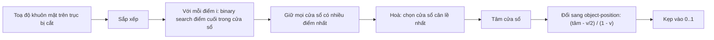

Ảnh nhóm 3:2 đặt vào ô vuông trong khung chat, hoặc ô dọc 9:16 trong story. `object-fit: cover` lấp đầy khung bằng cách cắt bớt hai bên, và mặc định nó cắt **đều hai bên**, giữ phần giữa ảnh. Nếu cả nhóm đứng lệch sang phải, người xem chỉ thấy nửa khuôn mặt của ai đó và một mảng tường.

Facebook biết vị trí khuôn mặt trong ảnh (từ hệ thống nhận diện phía server). Câu hỏi còn lại: **đặt vùng cắt ở đâu để giữ được nhiều mặt nhất?** Module `PixelzFocus` trả lời bằng một thuật toán gọn, dùng binary search. Đọc kỹ thì còn thấy một bug nhỏ ở chỗ nối thuật toán với CSS.

> [!TIP]
> **Tóm tắt**
> - Khi khung khác tỉ lệ ảnh, chỉ một trục bị cắt; trên trục đó ta thấy một "cửa sổ" dài `visible` (0..1).
> - `PixelzFocus` sắp toạ độ các khuôn mặt, dùng binary search tìm mọi cửa sổ chứa nhiều mặt nhất, hoà thì chọn cửa sổ cân lề nhất.
> - Bug của bản gốc: nhánh nhiều khuôn mặt trả về **tâm** cửa sổ mà quên đổi sang giá trị `object-position` như nhánh một khuôn mặt, nên vùng cắt bị lệch.
> - Khi ảnh đã xoay 90/180/270°, đổi toạ độ về ảnh gốc chỉ cần hoán vị trục và trừ cạnh (`rotationCoordinateTransform`).

<iframe class="demo-frame" src="/demos/facebook-patterns/index.html?theme=dark#/face-crop" title="Demo face-crop" loading="lazy" style="height: 900px"></iframe>

<p class="demo-links">▶ <a href="/demos/facebook-patterns/index.html#/face-crop" target="_blank" rel="noopener">Mở demo toàn màn hình ↗</a> · <a href="https://stackblitz.com/github/hunghg255/blog-hunghg/tree/master/examples/facebook-patterns?file=src/lib/faceCrop.ts" target="_blank" rel="noopener">Sửa code trên StackBlitz ↗</a> · <a href="https://github.com/hunghg255/blog-hunghg/blob/master/examples/facebook-patterns/src/lib/faceCrop.ts" target="_blank" rel="noopener">Xem source trên GitHub ↗</a></p>

Chọn preset "Hai nhóm" rồi khung 1:1: cắt giữa thấy 4/5 mặt, bản gốc (có bug) 4/5, bản sửa 5/5. Với "Nhóm lệch phải" ở khung 9:16, bản gốc chỉ giữ 3/5 mặt, bản sửa giữ 4/5 (5 mặt không thể cùng lọt vào 37,5% bề ngang ảnh).

## Facebook làm thế nào?

`PixelzFocus` nằm trong bundle `85.js` của [facebook-codebase](https://github.com/hunghg255/facebook-codebase) (và một bản nữa trong `messenger/MessengerPhotosGroup.react.js`). Nó được component ảnh `Pixelz.react` gọi trong `getFocus()`.

### Trục nào bị cắt, thấy được bao nhiêu?

```js
getVisible(containerRatio, cropRatio) {
  return containerRatio < cropRatio ? containerRatio / cropRatio : cropRatio / containerRatio;
},
focusHorizontally(containerRatio, cropRatio) {
  return containerRatio < cropRatio;   // khung "gầy" hơn ảnh -> cắt trái/phải
},
```

Ảnh 3:2 (1,5) vào khung vuông (1): khung gầy hơn, cắt theo chiều ngang, thấy `1 / 1,5 = 0,667` bề ngang ảnh. Bài toán thu về **một chiều**: trên đoạn [0, 1] có các điểm (toạ độ x của khuôn mặt), đặt một đoạn dài 0,667 sao cho phủ được nhiều điểm nhất.

### Tìm mọi cửa sổ phủ nhiều điểm nhất

```js
search(sorted, value) {            // binary search: chỉ số phần tử cuối <= value (gần đúng)
  let low = 0, high = sorted.length - 1;
  while (low <= high) {
    const mid = low + Math.floor((high - low) / 2);
    if (sorted[mid] > value) high = mid - 1;
    else if (sorted[mid] < value) low = mid + 1;
    else return mid;
  }
  return Math.min(low, high);
},
findBiggestSets(sorted, visible) {
  let sets = [], best = -1;
  for (let i = 0; i < sorted.length; ++i) {
    const high = this.search(sorted, sorted[i] + visible);
    const size = high - i;
    if (size > best) sets = [];
    if (size >= best) { best = size; sets.push({ low: i, high }); }
  }
  return sets;
},
```

Ý tưởng: cửa sổ tốt nhất luôn có thể dời sao cho **mép trái chạm đúng một điểm**. Nên chỉ cần thử n cửa sổ bắt đầu tại từng điểm, mỗi lần dùng binary search tìm điểm cuối cùng còn nằm trong cửa sổ. Tổng chi phí O(n log n) thay vì thử mọi vị trí liên tục. Hàm giữ lại **mọi** cửa sổ hoà nhau về số điểm.

### Hoà thì chọn cửa sổ cân lề nhất

```js
getBestSet(sorted, sets, visible) {
  let bestMargin = -1, best = null;
  for (const set of sets) {
    const first = sorted[set.low], last = sorted[set.high];
    const center = first + (last - first) / 2;
    const margin = Math.min(first - (center - visible), center + visible - last);
    if (margin > bestMargin) { bestMargin = margin; best = set; }
  }
  return best;
},
getFocusFromSet(sorted, set) {
  return sorted[set.low] + (sorted[set.high] - sorted[set.low]) / 2;   // tâm nhóm điểm
},
```

Đặt cửa sổ ở giữa nhóm điểm, đo khoảng trống từ điểm ngoài cùng tới mép cửa sổ, chọn nhóm có khoảng trống nhỏ hơn lớn nhất. Khuôn mặt ít bị sát mép.

Để ý `center - visible` và `center + visible`: lề được tính với **nửa cửa sổ bằng cả `visible`** chứ không phải `visible / 2`. Vì mọi nhóm đều bị cộng cùng một lượng `visible / 2`, thứ tự so sánh không đổi, kết quả chọn vẫn đúng. Chỉ là con số `margin` không mang nghĩa "khoảng trống thật".

### Từ tâm sang `object-position`

Tâm cửa sổ là toạ độ **trên ảnh**. CSS lại cần một giá trị khác: `object-position: 30%` nghĩa là "điểm 30% của phần dư nằm bên trái". Công thức đổi:

```js
convertFromCenterToCSS(center, visible) {
  return Math.abs(1 - visible) < 1e-5 ? 0 : (center - visible / 2) / (1 - visible);
},
```

Mép trái cửa sổ là `center - visible / 2`; phần ảnh có thể trượt là `1 - visible`; chia ra được tỉ lệ 0..1 mà CSS (và hàm `getCropPosition` của component) dùng.

### Bug: nhánh nhiều khuôn mặt quên đổi

Đây là `getFocus()` trong `Pixelz.react` (đã đổi tên biến):

```js
getFocus() {
  const focus = this.props.focus;
  if (!Array.isArray(focus) && focus.type === 'css') return { x: focus.x, y: focus.y };
  const visible = PixelzFocus.getVisible(containerRatio, cropRatio);
  const horizontal = PixelzFocus.focusHorizontally(containerRatio, cropRatio);
  let value;
  if (!Array.isArray(focus)) {
    value = PixelzFocus.convertFromCenterToCSS(horizontal ? focus.x : focus.y, visible);   // một điểm: có đổi
  } else {
    const coords = focus.map((p) => (horizontal ? p.x : p.y));
    coords.sort();
    const sets = PixelzFocus.findBiggestSets(coords, visible);
    const set = PixelzFocus.getBestSet(coords, sets, visible);
    value = PixelzFocus.getFocusFromSet(coords, set);                                       // nhiều điểm: KHÔNG đổi
  }
  return { x: horizontal ? value : 0.5, y: horizontal ? 0.5 : value };
}
```

Nhánh một điểm gọi `convertFromCenterToCSS`, nhánh nhiều điểm thì trả thẳng tâm cửa sổ. Hai đại lượng chỉ trùng nhau khi tâm đúng bằng 0,5. Tâm càng xa giữa ảnh, vùng cắt càng bị kéo ngược về giữa:

| Nhóm lệch phải, khung 9:16 (thấy 37,5%) | Giá trị dùng | Cửa sổ thật | Mặt trong khung |
|---|---|---|---|
| Đúng: `(0,76 − 0,1875) / 0,625` | 0,916 | 0,57 → 0,95 | 4/5 |
| Bản gốc: dùng thẳng tâm | 0,76 | 0,475 → 0,85 | 3/5 |

(Các con số kiểm bằng code viết lại với 5 điểm x = 0,12; 0,62; 0,72; 0,80; 0,90.)

Hai chi tiết nhỏ khác:

- `coords.sort()` không có hàm so sánh nên JavaScript so **như chuỗi**. Với số thập phân trong [0, 1) viết thường (`0.25`, `0.5`), thứ tự chuỗi trùng thứ tự số, nên thực tế gần như vô hại. Chỉ sai khi gặp số dạng mũ (`1e-7`) hoặc số âm.
- Nhánh một điểm không kẹp kết quả vào [0, 1] (`clampFocus` có định nghĩa nhưng không được gọi ở đây). Khuôn mặt sát mép cho ra giá trị lớn hơn 1, có lẽ làm vùng cắt trượt ra ngoài ảnh một chút.



## Bên trong trình duyệt: `object-position` tính phần trăm thế nào?

Với `object-fit: cover`, ảnh được phóng to tới khi phủ kín khung, phần thừa ở trục bị cắt có độ dài `ảnh − khung`. `object-position: p%` đặt điểm p% của ảnh trùng với điểm p% của khung, tương đương dịch ảnh sang trái `p% × phần thừa`. Vì thế:

- `0%` → thấy mép trái ảnh, `100%` → thấy mép phải, `50%` → giữa.
- Muốn cửa sổ bắt đầu tại toạ độ `s` của ảnh (tính theo 0..1), cần `p = s / (1 − visible)`. Thay `s = center − visible / 2` là ra công thức của Facebook.

Đây cũng là lý do giá trị CSS và tâm cửa sổ khác nhau: một cái đo trên **phần thừa**, một cái đo trên **cả ảnh**.

## Viết lại

Các hàm `lastIndexAtMost`, `biggestWindows`, `bestWindow`, `centerToCss` đi theo đúng các bước ở trên (xem file đầy đủ trong spoiler). Hàm chính ghép chúng lại, kèm cờ để lặp lại bug của bản gốc cho demo:

```ts title=src/lib/faceCrop.ts
export function computeCropFocus(
  points: FocusPoint[],
  containerRatio: number,
  imageRatio: number,
  { legacyMultiPoint = false }: FocusOptions = {},
): CropFocus {
  const horizontal = cropsHorizontally(containerRatio, imageRatio);
  const axis = horizontal ? 'x' : 'y';
  const visible = visibleFraction(containerRatio, imageRatio);
  // sort số đúng cách; bản gốc gọi .sort() không comparator (so như chuỗi)
  const coords = points.map((p) => p[axis]).sort((a, b) => a - b);

  let center = 0.5;
  if (coords.length > 0) {
    const window = bestWindow(coords, biggestWindows(coords, visible), visible)!;
    center = (coords[window.low] + coords[window.high]) / 2;
  }
  const value = legacyMultiPoint && coords.length > 1 ? center : centerToCss(center, visible);
  const start = value * (1 - visible);
  const inView = coords.filter((c) => c >= start - 1e-9 && c <= start + visible + 1e-9).length;
  return {
    css: horizontal ? { x: value, y: 0.5 } : { x: 0.5, y: value },
    axis,
    visible,
    center,
    inView,
  };
}
```

::: spoiler Xem toàn bộ src/lib/faceCrop.ts

```ts title=src/lib/faceCrop.ts
/**
 * Chọn vùng crop sao cho giữ được nhiều khuôn mặt nhất (ý tưởng từ PixelzFocus của Facebook).
 *
 * Khi khung hiển thị khác tỉ lệ ảnh, chỉ một trục bị cắt. Trên trục đó ta chỉ thấy được một
 * "cửa sổ" dài `visible` (tính theo tỉ lệ 0..1 của ảnh). Bài toán: đặt cửa sổ ở đâu để chứa
 * nhiều điểm quan tâm (khuôn mặt) nhất, hoà thì chọn chỗ cân lề nhất.
 */

export interface FocusPoint {
  /** 0..1 theo chiều ngang ảnh */
  x: number;
  /** 0..1 theo chiều dọc ảnh */
  y: number;
}

/** Phần nhìn thấy được trên trục bị cắt, 0..1. */
export function visibleFraction(containerRatio: number, imageRatio: number) {
  return containerRatio < imageRatio ? containerRatio / imageRatio : imageRatio / containerRatio;
}

/** Khung "gầy" hơn ảnh -> cắt hai bên trái phải -> focus theo trục x. */
export function cropsHorizontally(containerRatio: number, imageRatio: number) {
  return containerRatio < imageRatio;
}

/** Chỉ số phần tử lớn nhất <= value trong mảng đã sắp xếp (-1 nếu không có). */
export function lastIndexAtMost(sorted: number[], value: number) {
  let low = 0;
  let high = sorted.length - 1;
  while (low <= high) {
    const mid = (low + high) >> 1;
    if (sorted[mid] <= value) low = mid + 1;
    else high = mid - 1;
  }
  return high;
}

export interface Window1D {
  low: number;
  high: number;
}

/** Mọi cửa sổ [sorted[i], sorted[i] + visible] chứa nhiều điểm nhất. O(n log n). */
export function biggestWindows(sorted: number[], visible: number): Window1D[] {
  let best: Window1D[] = [];
  let bestCount = 0;
  for (let i = 0; i < sorted.length; i++) {
    const high = lastIndexAtMost(sorted, sorted[i] + visible);
    const count = high - i + 1;
    if (count > bestCount) {
      best = [];
      bestCount = count;
    }
    if (count === bestCount) best.push({ low: i, high });
  }
  return best;
}

/** Hoà số điểm thì chọn cửa sổ mà các điểm cách mép xa nhất (lề nhỏ hơn lớn nhất). */
export function bestWindow(sorted: number[], windows: Window1D[], visible: number): Window1D | null {
  let best: Window1D | null = null;
  let bestMargin = -Infinity;
  for (const w of windows) {
    const first = sorted[w.low];
    const last = sorted[w.high];
    const center = (first + last) / 2;
    const margin = Math.min(first - (center - visible / 2), center + visible / 2 - last);
    if (margin > bestMargin) {
      bestMargin = margin;
      best = w;
    }
  }
  return best;
}

/** Tâm (0..1 theo ảnh) -> giá trị object-position (0..1). */
export function centerToCss(center: number, visible: number) {
  if (Math.abs(1 - visible) < 1e-5) return 0;
  return Math.min(1, Math.max(0, (center - visible / 2) / (1 - visible)));
}

export interface CropFocus {
  /** giá trị object-position, 0..1 mỗi trục */
  css: { x: number; y: number };
  axis: 'x' | 'y';
  visible: number;
  /** tâm cửa sổ theo toạ độ ảnh */
  center: number;
  /** số điểm nằm trong vùng nhìn thấy */
  inView: number;
}

export interface FocusOptions {
  /** true = lặp lại bug của bản gốc: nhánh nhiều điểm trả tâm thay vì giá trị CSS */
  legacyMultiPoint?: boolean;
}

export function computeCropFocus(
  points: FocusPoint[],
  containerRatio: number,
  imageRatio: number,
  { legacyMultiPoint = false }: FocusOptions = {},
): CropFocus {
  const horizontal = cropsHorizontally(containerRatio, imageRatio);
  const axis = horizontal ? 'x' : 'y';
  const visible = visibleFraction(containerRatio, imageRatio);
  // sort số đúng cách; bản gốc gọi .sort() không comparator (so như chuỗi)
  const coords = points.map((p) => p[axis]).sort((a, b) => a - b);

  let center = 0.5;
  if (coords.length > 0) {
    const window = bestWindow(coords, biggestWindows(coords, visible), visible)!;
    center = (coords[window.low] + coords[window.high]) / 2;
  }
  const value = legacyMultiPoint && coords.length > 1 ? center : centerToCss(center, visible);
  const start = value * (1 - visible);
  const inView = coords.filter((c) => c >= start - 1e-9 && c <= start + visible + 1e-9).length;
  return {
    css: horizontal ? { x: value, y: 0.5 } : { x: 0.5, y: value },
    axis,
    visible,
    center,
    inView,
  };
}

export type Rotation = 0 | 90 | 180 | 270;

/**
 * Đổi toạ độ trên ảnh ĐÃ XOAY (theo chiều kim đồng hồ) về toạ độ ảnh gốc.
 * width/height là kích thước ảnh gốc. Chỉ hoán vị và trừ cạnh, không sin/cos.
 * (rotationCoordinateTransform của Facebook dùng đúng bảng này.)
 */
export function toOriginalCoordinates(x: number, y: number, angle: Rotation, width: number, height: number) {
  switch (angle) {
    case 90:
      return { x: y, y: height - x };
    case 180:
      return { x: width - x, y: height - y };
    case 270:
      return { x: width - y, y: x };
    default:
      return { x, y };
  }
}
```

:::

## Đi qua code

- **`lastIndexAtMost`** là binary search "upper bound − 1" chuẩn: trả chỉ số phần tử cuối cùng `≤ value`. Bản gốc dùng một biến thể trả `Math.min(low, high)`, cho kết quả tương đương trên mảng đã sắp xếp nhưng khó đọc hơn.
- **Đếm điểm bằng `high - i + 1`.** Bản gốc dùng `high - i` (thiếu 1). Vì mọi cửa sổ bị trừ cùng 1, việc so sánh không đổi.
- **`margin` dùng `visible / 2`** nên mang đúng nghĩa khoảng trống thật tới mép cửa sổ.
- **`centerToCss` cho cả hai nhánh, và kẹp vào [0, 1].**
- **`inView`** đếm số điểm thật sự nằm trong cửa sổ cuối cùng, chỉ để demo hiển thị.

**Khác bản gốc:** sửa bug nhánh nhiều điểm; sort bằng comparator số; kẹp giá trị CSS; trả về cả trục, độ rộng cửa sổ và số điểm trong khung để tiện debug.

## Toạ độ trên ảnh đã xoay

Ở trình chỉnh ảnh, người dùng có thể xoay ảnh rồi kéo khung crop. Toạ độ kéo là toạ độ **trên ảnh đã xoay**, còn crop phải áp vào **ảnh gốc**. Module `rotationCoordinateTransform` (thư mục `PhotoEditor/toolbar/`) làm việc đó không cần sin/cos:

```js
switch (angle) {
  case 270: return { intermediateX: W - y, intermediateY: x };
  case 180: return { intermediateX: W - x, intermediateY: H - y };
  case 90:  return { intermediateX: y,     intermediateY: H - x };
  default:  return { intermediateX: x,     intermediateY: y };
}
```

Lý do: xoay 90° theo chiều kim đồng hồ biến điểm `(ox, oy)` của ảnh gốc thành `(H − oy, ox)` trên ảnh xoay. Giải ngược ra `ox = y`, `oy = H − x`. Chỉ có 4 góc vuông nên không cần ma trận tổng quát, không có sai số dấu phẩy động. Trong demo, bấm lên ảnh đã xoay để thấy điểm tương ứng trên ảnh gốc. Mình đã kiểm bằng vòng xuôi-ngược: xoay điểm (120, 50) theo cả 4 góc rồi đổi ngược đều ra đúng (120, 50).

Một điểm cần để ý: trong code gốc, `W` và `H` là `clientImageWidth`/`clientImageHeight` của `mediaViewState`. Công thức chỉ đúng nếu đó là kích thước **ảnh gốc chưa xoay**; mình không thấy chỗ khai báo trường này trong bundle nên không xác nhận được.

## Tại sao không làm cách khác?

**Sao không lấy trung bình toạ độ các khuôn mặt?** Một người đứng xa nhóm sẽ kéo trung bình lệch đi, có khi khung không chứa trọn ai. Thuật toán cửa sổ ưu tiên "nhiều mặt nhất trong khung", đúng với điều người xem quan tâm.

**Sao không thử mọi vị trí cửa sổ?** Vị trí là số thực; rời rạc hoá thì hoặc thô, hoặc tốn. Nhận xét "mép trái chạm một điểm" thu bài toán về n ứng viên.

**Sao không để CSS tự lo?** `object-position` chỉ nhận một vị trí; không có thuộc tính CSS nào "giữ các vùng quan trọng". Phải tính ở JS (hoặc server, khi tạo thumbnail).

## Edge case và cạm bẫy

- **Không có khuôn mặt:** trả về giữa (0,5).
- **Một khuôn mặt sát mép:** tâm nằm gần 0 hoặc 1, giá trị CSS vượt [0, 1] nếu không kẹp.
- **Khung cùng tỉ lệ ảnh:** `visible = 1`, không có phần thừa, công thức chia cho 0. Cả bản gốc lẫn bản viết lại đều trả 0 trong trường hợp này.
- **Khuôn mặt to:** toạ độ chỉ là tâm khuôn mặt. Mặt chiếm 20% bề ngang mà tâm nằm sát mép cửa sổ thì vẫn bị cắt nửa. Có thể mở rộng mỗi điểm thành khoảng `[x − r, x + r]` rồi giải bài toán phủ khoảng.
- **Ảnh có EXIF xoay:** toạ độ khuôn mặt phải cùng hệ với ảnh sau khi áp EXIF.

## Dùng trong dự án

```tsx
function SmartCover({ src, faces, ratio, imageRatio }: { src: string; faces: FocusPoint[]; ratio: number; imageRatio: number }) {
  const { css } = computeCropFocus(faces, ratio, imageRatio);
  return (
    <div style={{ aspectRatio: String(ratio), overflow: 'hidden' }}>
      
    </div>
  );
}
```

Toạ độ khuôn mặt có thể lấy từ server, từ API [Shape Detection](https://developer.mozilla.org/en-US/docs/Web/API/FaceDetector) (`FaceDetector`, tính tới 10/2026 vẫn là API thử nghiệm, chưa có trên Firefox và Safari) hoặc từ một model chạy trong trình duyệt.

## Kiểm thử

::: spoiler Ví dụ test (bản phác, không có trong repo)

```ts
import { describe, expect, it } from 'vitest';
import { biggestWindows, centerToCss, computeCropFocus, toOriginalCoordinates } from './faceCrop';

const right = [0.12, 0.62, 0.72, 0.8, 0.9].map((x) => ({ x, y: 0.5 }));

describe('faceCrop', () => {
  it('tìm cửa sổ chứa nhiều điểm nhất', () => {
    expect(biggestWindows([0.12, 0.62, 0.72, 0.8, 0.9], 0.375)).toEqual([{ low: 1, high: 4 }]);
  });

  it('đổi tâm sang object-position và kẹp vào 0..1', () => {
    expect(centerToCss(0.5, 0.4)).toBeCloseTo(0.5);
    expect(centerToCss(0.95, 0.5)).toBe(1);
    expect(centerToCss(0.5, 1)).toBe(0);
  });

  it('bản sửa giữ nhiều mặt hơn bản có bug', () => {
    const fixed = computeCropFocus(right, 9 / 16, 1.5);
    const legacy = computeCropFocus(right, 9 / 16, 1.5, { legacyMultiPoint: true });
    expect(fixed.inView).toBe(4);
    expect(legacy.inView).toBe(3);
    expect(fixed.css.x).toBeCloseTo(0.916, 2);
  });

  it('đổi toạ độ xoay về ảnh gốc', () => {
    const W = 600, H = 400;
    const rotate = { 90: (x: number, y: number) => [H - y, x], 180: (x: number, y: number) => [W - x, H - y], 270: (x: number, y: number) => [y, W - x] } as const;
    for (const angle of [90, 180, 270] as const) {
      const [rx, ry] = rotate[angle](120, 50);
      expect(toOriginalCoordinates(rx, ry, angle, W, H)).toEqual({ x: 120, y: 50 });
    }
  });
});
```

:::

## So với cách khác

- **Smart crop phía server** (Cloudinary `g_faces`, imgix `crop=faces`, thumbor) cắt sẵn ảnh theo khuôn mặt, client chỉ việc hiển thị. Đổi lại phải lưu nhiều phiên bản ảnh theo từng tỉ lệ.
- **[smartcrop.js](https://github.com/jwagner/smartcrop.js)** chấm điểm vùng ảnh theo cạnh, màu da, độ bão hoà, chạy được trên client, không cần biết trước vị trí mặt.
- Bài [#17 bố cục collage ảnh](/blogs/facebook-photo-collage-layout) xử lý bài toán cạnh bên: xếp nhiều ảnh vào một khung. Hai bài ghép lại là gần đủ cho một lưới ảnh kiểu Facebook.

---

Bài này thuộc series **[Học từ mã nguồn Facebook](/series/facebook)** (58 bài, đọc theo thứ tự).

::: spoiler Xem nhanh danh sách bài trong series

*Phần 1*

- [Mở đầu: cách đọc code minify của Facebook](/blogs/learn-from-facebook-source-code)
- [#1 Dùng chung IntersectionObserver + infinite scroll](/blogs/facebook-shared-intersection-observer)
- [#2 useViewportDuration: đo thời gian thực sự được xem](/blogs/facebook-use-viewport-duration)
- [#3 Preload code + data khi hover](/blogs/facebook-preload-on-hover)
- [#4 Toast manager với external store](/blogs/facebook-toast-manager)
- [#5 Network status + heartbeat backoff](/blogs/facebook-network-status-heartbeat)
- [#6 ErrorGuard: bắt lỗi theo ngữ cảnh](/blogs/facebook-error-guard)
- [#7 Banzai: gom log theo lô + sendBeacon](/blogs/facebook-batch-logger)
- [#8 Focus trap + Esc theo layer](/blogs/facebook-focus-trap)

*Phần 2*

- [#9 Mẹo calc(… * 9999): container query, line-clamp, mũi tên carousel bằng CSS](/blogs/facebook-css-9999-trick)
- [#10 Thanh cuộn tuỳ biến bằng CSS 3D](/blogs/facebook-css-3d-scrollbar)
- [#11 Modal cuộn bằng window, giữ vị trí trang nền](/blogs/facebook-document-scroll-modal)
- [#12 Popover, tooltip group và hovercard](/blogs/facebook-popover-tooltip)
- [#13 Primitive Pressable + focus-visible](/blogs/facebook-pressable)
- [#14 Tab "Xem thêm" + sticky header bằng IntersectionObserver](/blogs/facebook-priority-tabs-sticky-header)
- [#15 Avatar khoét mask, gradient Messenger, skeleton steps()](/blogs/facebook-visual-tricks)
- [#16 Khung chat không giật](/blogs/facebook-chat-scroller)
- [#17 Thuật toán chọn bố cục collage ảnh](/blogs/facebook-photo-collage-layout)
- [#18 Keep-alive tab trong SPA](/blogs/facebook-keep-alive-tabs)
- [#19 Tự đo Visual Completion & interaction tracing](/blogs/facebook-visual-completion)
- [#20 Router SPA bền bỉ & tải chunk có retry](/blogs/facebook-spa-router-resilient-loading)

*Phần 3*

- [#21 Smart Compose: gợi ý chữ mờ khi gõ](/blogs/facebook-smart-compose-ghost-text)
- [#22 MQTT ngay trong trình duyệt, tự chuyển sang long-poll](/blogs/facebook-mqtt-in-browser)
- [#23 Đo thời gian dùng bằng bitmap 64 giây](/blogs/facebook-time-spent-bitmap)
- [#24 Bảng reaction nhấn giữ rồi trượt](/blogs/facebook-reaction-press-slide)
- [#25 Tìm kiếm gấp dấu, phiên âm và highlight đầu từ](/blogs/facebook-search-diacritics-tokenize)
- [#26 Ring buffer biết trace nào đã mất log](/blogs/facebook-trace-ring-buffer)
- [#27 Engine animation JS: một vòng rAF và solver cubic-bezier](/blogs/facebook-keyframes-loop-cubic-bezier)
- [#28 Bootloader: bitmap tài nguyên đã tải, chỉ reload khi cần](/blogs/facebook-bootloader-bitmap-consistency)
- [#29 Nhận biết click do screen reader tạo ra](/blogs/facebook-virtual-cursor-detection)
- [#30 Tải trước feed theo chất lượng mạng, đoán hạng thiết bị](/blogs/facebook-network-aware-prefetch)
- [#31 Hàng đợi gửi tin chat giữ đúng thứ tự](/blogs/facebook-ordered-send-queue)
- [#32 Gộp lời gọi API trong cùng một tick](/blogs/facebook-api-batcher)
- [#33 Resize ảnh trong pool Web Worker](/blogs/facebook-jpeg-resize-worker-pool)
- **#34 Crop ảnh theo nhiều khuôn mặt** (bài này)
- [#35 Kéo-thả sắp xếp và vùng thả file không nhấp nháy](/blogs/facebook-flicker-free-drag-drop)
- [#36 Tiện ích UI: fade-out, sticky event, hàm huỷ được](/blogs/facebook-ui-utility-hooks)
- [#37 Hạ tầng nhỏ: cookie, hash lỗi, prefetch khi chuột dừng](/blogs/facebook-small-infra-cookie-hash-idle)

*Phần 4–6*

- [#38 Đồng bộ tin nhắn: phát hiện lỗ seqID và fetch bù theo tầng](/blogs/facebook-messenger-sync-seqid-gaps)
- [#39 OTID: ID tin nhắn kiểu Snowflake sinh ở client](/blogs/facebook-otid-client-snowflake)
- [#40 QPL: lấy mẫu từ lúc bắt đầu, đo RTT gửi tin đầu-cuối](/blogs/facebook-qpl-send-rtt)
- [#41 Bộ điều phối request bảy chế độ gộp và chống trùng](/blogs/facebook-request-dispatcher-modes)
- [#42 Thread list theo mốc thời gian, cookie presence có version](/blogs/facebook-threadlist-ranged-presence)
- [#43 Composer dạng plugin: reducer, dirty checker, chuỗi kiểm tra](/blogs/facebook-plugin-composer)
- [#44 Thanh toán bất đồng bộ: subscribe trước, poll dự phòng](/blogs/facebook-async-checkout)
- [#45 Validate số thẻ: sửa lỗi gõ, dải BIN, Luhn](/blogs/facebook-card-validation)
- [#46 Lịch chọn khoảng ngày: bo góc dải chọn, phím đủ bộ, RTL](/blogs/facebook-range-calendar-a11y)
- [#47 Giờ mở cửa theo tuần: qua đêm, gộp khoảng, phần bù](/blogs/facebook-weekly-hours-intervals)
- [#48 Tiến độ đăng realtime: giữ event chờ snapshot, watchdog](/blogs/facebook-realtime-publish-snapshot)
- [#49 Tiền tệ theo đơn vị nhỏ nhất và ô nhập tiền](/blogs/facebook-currency-minor-units)
- [#50 Sửa hàng loạt Empty/Uniform/Mixed, seen/read bằng 2 bit](/blogs/facebook-bulk-edit-seen-bits)
- [#51 Phát hiện script lạ hook vào hàm native](/blogs/facebook-native-hook-detection)
- [#52 localStorage tự dọn khi đầy quota](/blogs/facebook-quota-aware-storage)
- [#53 Cache tuyến do server phân giải, chờ sẵn promise](/blogs/facebook-route-cache-prefetch)
- [#54 Lưới phím mũi tên 2D và focus không làm cuộn trang](/blogs/facebook-focus-table-grid)
- [#55 Tách emoji bằng máy trạng thái](/blogs/facebook-emoji-segmentation)
- [#56 Đọc trước ghi sau trong một frame, con tự biết vị trí](/blogs/facebook-read-then-write-dom)
- [#57 Hàng đợi lệnh cho video và stream sắp lại chunk](/blogs/facebook-video-command-queue)

:::

Code + demo: [`examples/facebook-patterns`](https://github.com/hunghg255/blog-hunghg/tree/master/examples/facebook-patterns) · [Mở trên StackBlitz](https://stackblitz.com/github/hunghg255/blog-hunghg/tree/master/examples/facebook-patterns)
