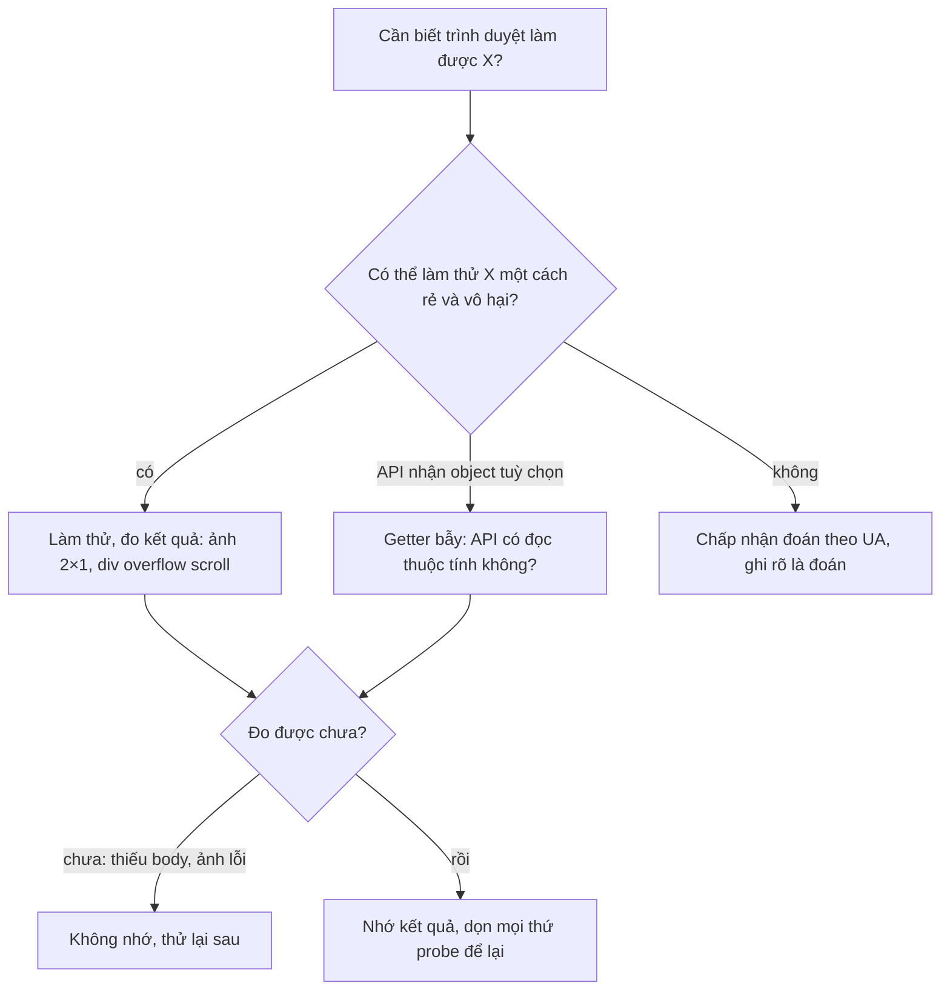

"Trình duyệt này có tự xoay ảnh chụp từ điện thoại không?", "Có hiểu `performance.mark(name, { startTime })` không?", "Thanh cuộn ở đây chiếm chỗ hay nổi trên nội dung?". Câu trả lời khác nhau giữa Chrome, Safari, Firefox, giữa macOS và Windows, thậm chí giữa lúc có chuột và lúc không.

Đọc User-Agent để đoán là cách dễ vỡ nhất: chuỗi UA bị giả, bị đóng băng (Chrome đã giảm thông tin trong UA), và cùng một phiên bản trình duyệt có thể cư xử khác nhau theo hệ điều hành. Cách bền hơn là **dò tính năng** (feature detection): làm thử một việc nhỏ, đo kết quả.

Facebook có ba mẹo dò tính năng đáng học, mỗi mẹo nằm ở một module nhỏ, và mỗi module có một lỗi nhỏ đáng biết.

> [!TIP]
> **Tóm tắt**
> - `ImageUtils` nhúng một JPEG 2×1 có EXIF Orientation = 6 (xoay 90°). Nạp xong mà ảnh thành 1×2 thì trình duyệt tự xoay theo EXIF. Demo sinh ảnh probe ngay bằng canvas + vài chục byte EXIF.
> - `UserTimingUtils` truyền một object có **getter bẫy** `startTime` vào `new PerformanceMark()`. Trình duyệt hỗ trợ User Timing Level 3 sẽ đọc thuộc tính đó và getter bật cờ. Cùng mẹo với dò `{ passive }`. Bản gốc gọi thêm `performance.measure("__v3", {})` mà không dọn, để lại một measure rác.
> - `FBScrollbarsUtils` đo thanh cuộn bằng một div 100×100 `overflow: scroll` đặt ngoài màn hình: `offsetHeight − clientHeight` là độ dày. Bọc trong `once()` nên nếu lần gọi đầu xảy ra trước khi có `<body>`, kết quả `false` bị nhớ mãi. ResizeObserver dùng chung thì `remove()` của một hướng gỡ luôn hướng kia.
> - Quy tắc mang về: dò bằng hành vi thật, nhớ kết quả chỉ khi đo được, và dọn mọi thứ probe để lại.

<iframe class="demo-frame" src="/demos/facebook-patterns/index.html?theme=dark#/feature-probe-tricks" title="Demo feature-probe-tricks" loading="lazy" style="height: 950px"></iframe>

<p class="demo-links">▶ <a href="/demos/facebook-patterns/index.html#/feature-probe-tricks" target="_blank" rel="noopener">Mở demo toàn màn hình ↗</a> · <a href="https://stackblitz.com/github/hunghg255/blog-hunghg/tree/master/examples/facebook-patterns?file=src/lib/featureProbes.ts" target="_blank" rel="noopener">Sửa code trên StackBlitz ↗</a> · <a href="https://github.com/hunghg255/blog-hunghg/blob/master/examples/facebook-patterns/src/lib/featureProbes.ts" target="_blank" rel="noopener">Xem source trên GitHub ↗</a></p>

## Facebook làm thế nào?

### Ảnh 2×1 có EXIF xoay: `ImageUtils` (bundle `302.js`)

Điện thoại chụp ảnh dọc thường lưu pixel theo chiều ngang của cảm biến, rồi ghi tag EXIF **Orientation** (mã `0x0112`) để nói "khi hiển thị, xoay 90°". Có trình duyệt làm theo, có trình duyệt không (trước khoảng năm 2020, hầu hết **không** làm theo với ``). Ứng dụng cần biết để quyết định có tự xoay ảnh trước khi crop, upload hay không.

`ImageUtils` nhúng nguyên một data URI JPEG 667 byte. Giải mã base64 ra thì thấy: kích thước 2×1, segment APP1 dài 34 byte chứa TIFF little-endian với đúng một tag Orientation = 6. Logic dò (đổi tên biến):

```js
let cached = null;
function checkIfBrowserExifAutoRotationEnabled(cb) {
  if (cached != null) return cb(cached);
  const img = new Image();
  img.onload = () => { cached = img.width !== 2; cb(cached); };   // xoay rồi thì rộng 1
  img.onerror = () => { cached = false; cb(cached); };
  img.src = PROBE_JPEG_2x1_ORIENTATION_6;
}
```

Hai chi tiết nhỏ: nhiều lời gọi cùng lúc trước khi ảnh tải xong sẽ tạo nhiều `Image` (không gộp request), và lỗi tải ảnh được nhớ thành `false` vĩnh viễn trong phiên. Cả hai vô hại với một ảnh data URI, nhưng là thói quen nên tránh khi probe tốn kém hơn.

### Getter bẫy: `UserTimingUtils` (bundle `22.js`)

User Timing Level 3 cho `performance.mark(name, { startTime, detail })` và `performance.measure(name, { start, end, duration })`. Level 2 chỉ nhận chuỗi tên mark. Để biết trình duyệt thuộc loại nào, module làm thế này khi nạp:

```js
let isL3 = false;
if (hasUserTiming && window.PerformanceMark != null) {
  const probe = {};
  Object.defineProperty(probe, 'startTime', { get() { isL3 = true; } });  // getter bẫy
  try {
    performance.measure('__v3', {});
    new PerformanceMark('__v3', probe);
  } catch (e) {
  } finally {
    performance.clearMarks('__v3');
  }
}
```

Trình duyệt hỗ trợ L3 sẽ **đọc** `options.startTime` khi dựng mark, getter chạy và bật cờ. Trình duyệt cũ bỏ qua đối số thứ hai hoặc ném lỗi; cờ giữ `false`. Sau đó `measureModern(name, options)` chỉ chạy khi cờ bật; các hàm còn lại bọc `try/catch` và gọi `clearMarks`/`clearMeasures` ngay sau khi đo, để các entry chỉ hiện trong bản ghi DevTools Performance mà không tích tụ trong bộ đệm timeline.

Chỗ đáng chú ý là dòng `performance.measure('__v3', {})`. Với trình duyệt L3, một object rỗng hợp lệ: nó tạo một measure tên `__v3` từ 0 tới hiện tại. Khối `finally` chỉ `clearMarks`, không `clearMeasures`, nên measure đó nằm lại. Demo phần 2 chạy lại đúng trình tự trên Chromium: `performance.getEntriesByName('__v3', 'measure')` trả về **1** entry. Ai đọc `getEntriesByType('measure')` để gửi số liệu sẽ thấy một mục lạ dài bằng thời gian từ lúc mở trang. Lời gọi này có lẽ là phần còn sót của một cách dò cũ.

### Đo thanh cuộn: `FBScrollbarsUtils` (bundle `294.js`)

Thanh cuộn tuỳ biến (đã gặp ở [bài #10](/blogs/facebook-css-3d-scrollbar)) chỉ nên bật khi ẩn được thanh cuộn gốc mà không làm lệch layout. Module dò bằng:

```js
const canHideScrollbars = once(() => {
  const body = document.body;
  if (!(body instanceof HTMLElement)) return false;
  const el = document.createElement('div');
  Object.assign(el.style, { position: 'fixed', top: '-9999px', width: '100px', height: '100px', overflow: 'scroll' });
  el.classList.add(HIDE_SCROLLBAR_CLASS);           // class "_7304", CSS không có trong bundle đã tải
  body.appendChild(el);
  const hidden = el.offsetHeight === el.clientHeight; // thanh cuộn chiếm 0 px
  body.removeChild(el);
  return hidden;
});
```

`offsetHeight` tính cả thanh cuộn ngang, `clientHeight` thì không. Bằng nhau nghĩa là thanh cuộn không chiếm chỗ: hoặc class ẩn có tác dụng, hoặc hệ thống dùng thanh cuộn nổi (overlay, như macOS khi không cắm chuột, hay điện thoại).

Vấn đề nằm ở `once()`. Hàm `once` của Facebook nhớ **kết quả đầu tiên**, kể cả `false`. Nếu lần gọi đầu xảy ra khi `document.body` chưa có (script chạy trong `<head>`), hàm trả `false` và trả `false` mãi mãi, dù sau đó body đã có và thanh cuộn ẩn được.

Cùng module có `addScrollingContainerResizeObserver(el, orientation, cb)`: một `ResizeObserver` dùng chung, callback lưu trong một `MultiKeyMap` theo khoá `[el, 'vertical' | 'horizontal']`. Hàm trả về `{ remove() { ro.unobserve(el) } }`:

- `unobserve(el)` dừng theo dõi **cả phần tử**, nên một thanh cuộn ngang và một thanh cuộn dọc trên cùng phần tử: gỡ một cái là cái kia cũng không nhận sự kiện nữa.
- Callback không bị xoá khỏi map, nên giữ tham chiếu tới phần tử và closure sau khi đã "gỡ".

Demo phần 3 cho thấy cả hai: nút "gọi dò trước khi có body" và khung có hai listener.



## Bên trong trình duyệt

**EXIF và `image-orientation`.** Từ khoảng năm 2020, các trình duyệt chính áp dụng CSS `image-orientation: from-image` làm mặc định: `` và `background-image` hiển thị theo EXIF, và `naturalWidth`/`naturalHeight` cũng báo kích thước **sau khi xoay**. Vì thế probe của Facebook gần như luôn trả `true` trên trình duyệt hiện đại. Muốn xem pixel gốc thì đặt `image-orientation: none`. Khi vẽ `` lên canvas bằng `drawImage`, ảnh cũng đã được xoay. Với `createImageBitmap`, tuỳ chọn `imageOrientation` quyết định; demo đo cả `'from-image'` và `'none'` ngay trên trình duyệt của bạn (bản Chromium headless dùng để kiểm thử cho 90×160 với cả hai, nên đừng giả định, hãy đo).

Điều này dẫn tới một bẫy kinh điển: code cũ tự xoay ảnh theo EXIF (vì "trình duyệt không xoay"), giờ trình duyệt cũng xoay, kết quả là **xoay hai lần**. Probe như của Facebook chính là cách tránh: chỉ tự xoay khi đo được là trình duyệt không xoay.

**Getter bẫy.** Mọi API nhận "dictionary" trong Web IDL đều đọc từng thuộc tính đã biết của object truyền vào, theo thứ tự chữ cái, bằng `[[Get]]` thông thường. Thuộc tính lạ thì không đọc. Vì vậy một getter là cảm biến hoàn hảo: nó chạy khi và chỉ khi API biết thuộc tính đó. Cách dò `{ passive: true }` cho `addEventListener` (2016) phổ biến mẹo này:

```js
let passive = false;
addEventListener('x', null, Object.defineProperty({}, 'passive', { get() { passive = true; } }));
```

**Độ dày thanh cuộn.** Với `overflow: scroll`, trình duyệt luôn vẽ thanh cuộn kiểu cổ điển (chiếm chỗ) nếu hệ thống dùng loại đó, và trừ phần đó khỏi vùng nội dung: `clientWidth = offsetWidth − viền − thanh cuộn`. Trên Windows thường là 15 đến 17 px; macOS có chuột là 15 px; thanh cuộn nổi thì 0. Giá trị đổi khi người dùng cắm chuột (macOS), đổi zoom, hay đổi cài đặt "luôn hiện thanh cuộn", nên không nên nhớ vĩnh viễn.

## Viết lại

EXIF: một segment APP1 tối thiểu và hàm chèn nó vào JPEG do canvas sinh ra. Đây là cách demo tạo ảnh probe mà không cần file nhị phân nào:

```ts title=src/lib/featureProbes.ts
export function exifApp1(orientation: number): Uint8Array {
  const tiff = [
    0x49, 0x49, 0x2a, 0x00, // "II", 42
    0x08, 0x00, 0x00, 0x00, // IFD0 ở offset 8
    0x01, 0x00, // 1 entry
    0x12, 0x01, 0x03, 0x00, // tag 0x0112 Orientation, kiểu SHORT
    0x01, 0x00, 0x00, 0x00, // count = 1
    orientation & 0xff, 0x00, 0x00, 0x00, // giá trị nằm ngay trong entry
    0x00, 0x00, 0x00, 0x00, // không có IFD tiếp theo
  ];
  const payload = [0x45, 0x78, 0x69, 0x66, 0x00, 0x00, ...tiff]; // "Exif\0\0"
  const len = payload.length + 2; // độ dài tính cả 2 byte độ dài
  return Uint8Array.from([0xff, 0xe1, len >> 8, len & 0xff, ...payload]);
}

interface Segment {
  marker: number;
  start: number;
  end: number;
}

/** Duyệt các segment đầu file JPEG tới SOS (0xFFDA). */
function* segments(jpeg: Uint8Array): Generator<Segment> {
  if (jpeg[0] !== 0xff || jpeg[1] !== 0xd8) throw new Error('Không phải JPEG');
  let i = 2;
  while (i + 4 <= jpeg.length && jpeg[i] === 0xff) {
    const marker = jpeg[i + 1];
    if (marker === 0xda) return;
    const len = (jpeg[i + 2] << 8) | jpeg[i + 3];
    yield { marker, start: i, end: i + 2 + len };
    i += 2 + len;
  }
}

const isExif = (jpeg: Uint8Array, s: Segment) =>
  s.marker === 0xe1 && String.fromCharCode(...jpeg.subarray(s.start + 4, s.start + 8)) === 'Exif';

/** Chèn (hoặc thay) EXIF Orientation; đặt sau APP0/JFIF nếu có, như ảnh probe của Facebook. */
export function withOrientation(jpeg: Uint8Array, orientation: number): Uint8Array {
  const segs = [...segments(jpeg)];
  const old = segs.find((s) => isExif(jpeg, s));
  const app0 = segs[0]?.marker === 0xe0 ? segs[0] : null;
  const at = app0 ? app0.end : 2;
  const head = jpeg.subarray(0, at);
  let tail = jpeg.subarray(at);
  if (old) tail = concat(jpeg.subarray(at, old.start), jpeg.subarray(old.end));
  return concat(head, exifApp1(orientation), tail);
}
```

Probe có gộp request và không nhớ lỗi:

```ts title=src/lib/featureProbes.ts
let autoRotate: Promise<boolean> | null = null;

/**
 * Trình duyệt có tự xoay ảnh theo EXIF khi hiển thị không?
 * Single-flight: nhiều lời gọi cùng lúc dùng chung một lần tải; lỗi thì không nhớ, lần sau thử lại.
 */
export function browserAutoRotates(): Promise<boolean> {
  autoRotate ??= (async () => {
    const jpeg = withOrientation(await canvasJpeg(2, 1), 6);
    const img = await loadImage(toDataUri(jpeg));
    return img.naturalWidth === 1; // 2×1 xoay 90° thành 1×2
  })().catch((e) => {
    autoRotate = null;
    throw e;
  });
  return autoRotate;
}
```

Getter bẫy dùng chung, và hai ứng dụng:

```ts title=src/lib/featureProbes.ts
export function readsOption(call: (options: object) => void, key: string): boolean {
  let read = false;
  const options = Object.defineProperty({}, key, {
    get() {
      read = true;
      return undefined;
    },
    enumerable: true,
  });
  try {
    call(options);
  } catch {
    /* API cũ có thể ném lỗi với object lạ, coi như không hỗ trợ */
  }
  return read;
}

/** User Timing Level 3: mark/measure nhận object tuỳ chọn (startTime, detail…). */
export function supportsMarkOptions(): boolean {
  if (typeof PerformanceMark !== 'function') return false;
  // constructor không thêm mark vào timeline nên không có gì phải dọn
  return readsOption((o) => new PerformanceMark('__probe_l3', o as PerformanceMarkOptions), 'startTime');
}

/** Event listener có hiểu { passive } không (mẹo kinh điển cùng họ). */
export function supportsPassive(): boolean {
  const noop = () => {};
  return readsOption((o) => {
    window.addEventListener('__probe', noop, o as AddEventListenerOptions);
    window.removeEventListener('__probe', noop, o as EventListenerOptions);
  }, 'passive');
}
```

Đo thanh cuộn, nhớ có điều kiện, và ResizeObserver dùng chung đếm theo phần tử:

```ts title=src/lib/featureProbes.ts
export function measureScrollbar(doc: Document = document, className = ''): ScrollbarSize | null {
  const body = doc.body;
  if (!body) return null;
  const el = doc.createElement('div');
  el.className = className;
  Object.assign(el.style, { position: 'absolute', top: '-9999px', width: '100px', height: '100px', overflow: 'scroll', visibility: 'hidden' });
  body.appendChild(el);
  const size = { width: el.offsetWidth - el.clientWidth, height: el.offsetHeight - el.clientHeight };
  el.remove();
  return size;
}

/** Nhớ kết quả, nhưng chỉ nhớ khi đo được (khác `once`), và cho phép đo lại. */
export function cachedProbe<T>(probe: () => T | null) {
  let value: T | null = null;
  return {
    get(): T | null {
      if (value === null) value = probe();
      return value;
    },
    invalidate() {
      value = null;
    },
  };
}
```

::: spoiler Xem toàn bộ src/lib/featureProbes.ts

```ts title=src/lib/featureProbes.ts
/**
 * Ba mẹo dò tính năng bằng cách "hỏi thẳng trình duyệt" thay vì đọc User-Agent:
 * 1. Ảnh JPEG 2×1 có EXIF Orientation = 6: trình duyệt tự xoay thì ảnh thành 1×2.
 * 2. Getter bẫy: truyền object có getter, nếu API đọc thuộc tính đó thì nó hiểu tuỳ chọn.
 * 3. Div ẩn overflow:scroll: offset − client = độ dày thanh cuộn.
 * Ý tưởng từ ImageUtils, UserTimingUtils, FBScrollbarsUtils (Facebook), viết lại từ đầu.
 */

// ---------- 1. EXIF Orientation ----------

/** Segment APP1 "Exif" tối thiểu: TIFF little-endian, IFD0 có đúng một tag 0x0112. */
export function exifApp1(orientation: number): Uint8Array {
  const tiff = [
    0x49, 0x49, 0x2a, 0x00, // "II", 42
    0x08, 0x00, 0x00, 0x00, // IFD0 ở offset 8
    0x01, 0x00, // 1 entry
    0x12, 0x01, 0x03, 0x00, // tag 0x0112 Orientation, kiểu SHORT
    0x01, 0x00, 0x00, 0x00, // count = 1
    orientation & 0xff, 0x00, 0x00, 0x00, // giá trị nằm ngay trong entry
    0x00, 0x00, 0x00, 0x00, // không có IFD tiếp theo
  ];
  const payload = [0x45, 0x78, 0x69, 0x66, 0x00, 0x00, ...tiff]; // "Exif\0\0"
  const len = payload.length + 2; // độ dài tính cả 2 byte độ dài
  return Uint8Array.from([0xff, 0xe1, len >> 8, len & 0xff, ...payload]);
}

interface Segment {
  marker: number;
  start: number;
  end: number;
}

/** Duyệt các segment đầu file JPEG tới SOS (0xFFDA). */
function* segments(jpeg: Uint8Array): Generator<Segment> {
  if (jpeg[0] !== 0xff || jpeg[1] !== 0xd8) throw new Error('Không phải JPEG');
  let i = 2;
  while (i + 4 <= jpeg.length && jpeg[i] === 0xff) {
    const marker = jpeg[i + 1];
    if (marker === 0xda) return;
    const len = (jpeg[i + 2] << 8) | jpeg[i + 3];
    yield { marker, start: i, end: i + 2 + len };
    i += 2 + len;
  }
}

const isExif = (jpeg: Uint8Array, s: Segment) =>
  s.marker === 0xe1 && String.fromCharCode(...jpeg.subarray(s.start + 4, s.start + 8)) === 'Exif';

/** Chèn (hoặc thay) EXIF Orientation; đặt sau APP0/JFIF nếu có, như ảnh probe của Facebook. */
export function withOrientation(jpeg: Uint8Array, orientation: number): Uint8Array {
  const segs = [...segments(jpeg)];
  const old = segs.find((s) => isExif(jpeg, s));
  const app0 = segs[0]?.marker === 0xe0 ? segs[0] : null;
  const at = app0 ? app0.end : 2;
  const head = jpeg.subarray(0, at);
  let tail = jpeg.subarray(at);
  if (old) tail = concat(jpeg.subarray(at, old.start), jpeg.subarray(old.end));
  return concat(head, exifApp1(orientation), tail);
}

/** Đọc Orientation (1–8) từ EXIF, null nếu không có. Hỗ trợ cả "II" và "MM". */
export function readOrientation(jpeg: Uint8Array): number | null {
  for (const s of segments(jpeg)) {
    if (!isExif(jpeg, s)) continue;
    const t = s.start + 10; // đầu TIFF
    const le = jpeg[t] === 0x49;
    const u16 = (o: number) => (le ? jpeg[o] | (jpeg[o + 1] << 8) : (jpeg[o] << 8) | jpeg[o + 1]);
    const u32 = (o: number) => (le ? u16(o) + u16(o + 2) * 65536 : u16(o) * 65536 + u16(o + 2));
    const ifd = t + u32(t + 4);
    const count = u16(ifd);
    for (let k = 0; k < count; k++) {
      const e = ifd + 2 + k * 12;
      if (e + 12 > s.end) break;
      if (u16(e) === 0x0112) return u16(e + 8);
    }
  }
  return null;
}

function concat(...parts: Uint8Array[]) {
  const out = new Uint8Array(parts.reduce((n, p) => n + p.length, 0));
  let o = 0;
  for (const p of parts) {
    out.set(p, o);
    o += p.length;
  }
  return out;
}

export function toDataUri(bytes: Uint8Array, mime = 'image/jpeg') {
  let bin = '';
  for (const b of bytes) bin += String.fromCharCode(b);
  return `data:${mime};base64,${btoa(bin)}`;
}

/** Vẽ lên canvas rồi xuất JPEG; dùng để sinh ảnh probe ngay trên trang. */
export async function canvasJpeg(width: number, height: number, paint?: (ctx: CanvasRenderingContext2D) => void): Promise<Uint8Array> {
  const c = document.createElement('canvas');
  c.width = width;
  c.height = height;
  const ctx = c.getContext('2d')!;
  ctx.fillStyle = '#fff';
  ctx.fillRect(0, 0, width, height);
  paint?.(ctx);
  const blob = await new Promise<Blob>((ok, fail) => c.toBlob((b) => (b ? ok(b) : fail(new Error('toBlob lỗi'))), 'image/jpeg', 0.9));
  return new Uint8Array(await blob.arrayBuffer());
}

export function loadImage(src: string): Promise<HTMLImageElement> {
  return new Promise((ok, fail) => {
    const img = new Image();
    img.onload = () => ok(img);
    img.onerror = () => fail(new Error('Ảnh không tải được'));
    img.src = src;
  });
}

let autoRotate: Promise<boolean> | null = null;

/**
 * Trình duyệt có tự xoay ảnh theo EXIF khi hiển thị không?
 * Single-flight: nhiều lời gọi cùng lúc dùng chung một lần tải; lỗi thì không nhớ, lần sau thử lại.
 */
export function browserAutoRotates(): Promise<boolean> {
  autoRotate ??= (async () => {
    const jpeg = withOrientation(await canvasJpeg(2, 1), 6);
    const img = await loadImage(toDataUri(jpeg));
    return img.naturalWidth === 1; // 2×1 xoay 90° thành 1×2
  })().catch((e) => {
    autoRotate = null;
    throw e;
  });
  return autoRotate;
}

// ---------- 2. Getter bẫy ----------

/** API có đọc thuộc tính `key` của object tuỳ chọn không? Lỗi ném ra được nuốt. */
export function readsOption(call: (options: object) => void, key: string): boolean {
  let read = false;
  const options = Object.defineProperty({}, key, {
    get() {
      read = true;
      return undefined;
    },
    enumerable: true,
  });
  try {
    call(options);
  } catch {
    /* API cũ có thể ném lỗi với object lạ, coi như không hỗ trợ */
  }
  return read;
}

/** User Timing Level 3: mark/measure nhận object tuỳ chọn (startTime, detail…). */
export function supportsMarkOptions(): boolean {
  if (typeof PerformanceMark !== 'function') return false;
  // constructor không thêm mark vào timeline nên không có gì phải dọn
  return readsOption((o) => new PerformanceMark('__probe_l3', o as PerformanceMarkOptions), 'startTime');
}

/** Event listener có hiểu { passive } không (mẹo kinh điển cùng họ). */
export function supportsPassive(): boolean {
  const noop = () => {};
  return readsOption((o) => {
    window.addEventListener('__probe', noop, o as AddEventListenerOptions);
    window.removeEventListener('__probe', noop, o as EventListenerOptions);
  }, 'passive');
}

// ---------- 3. Thanh cuộn ----------

export interface ScrollbarSize {
  width: number;
  height: number;
}

/** Độ dày thanh cuộn (px). null khi chưa có body: đừng kết luận khi chưa đo được. */
export function measureScrollbar(doc: Document = document, className = ''): ScrollbarSize | null {
  const body = doc.body;
  if (!body) return null;
  const el = doc.createElement('div');
  el.className = className;
  Object.assign(el.style, { position: 'absolute', top: '-9999px', width: '100px', height: '100px', overflow: 'scroll', visibility: 'hidden' });
  body.appendChild(el);
  const size = { width: el.offsetWidth - el.clientWidth, height: el.offsetHeight - el.clientHeight };
  el.remove();
  return size;
}

/** Nhớ kết quả, nhưng chỉ nhớ khi đo được (khác `once`), và cho phép đo lại. */
export function cachedProbe<T>(probe: () => T | null) {
  let value: T | null = null;
  return {
    get(): T | null {
      if (value === null) value = probe();
      return value;
    },
    invalidate() {
      value = null;
    },
  };
}

/**
 * Một ResizeObserver dùng chung cho nhiều listener trên cùng phần tử.
 * Gỡ listener nào thì chỉ listener đó mất; chỉ unobserve khi phần tử hết listener.
 */
export function createResizeHub() {
  const listeners = new Map<Element, Map<string, () => void>>();
  const ro = new ResizeObserver((entries) => {
    for (const e of entries) listeners.get(e.target)?.forEach((cb) => cb());
  });
  return {
    observe(el: Element, key: string, cb: () => void) {
      let byKey = listeners.get(el);
      if (!byKey) {
        byKey = new Map();
        listeners.set(el, byKey);
        ro.observe(el);
      }
      byKey.set(key, cb);
      let removed = false;
      return () => {
        if (removed) return;
        removed = true;
        const m = listeners.get(el);
        if (m?.get(key) !== cb) return;
        m.delete(key);
        if (m.size === 0) {
          listeners.delete(el);
          ro.unobserve(el);
        }
      };
    },
    get size() {
      let n = 0;
      listeners.forEach((m) => (n += m.size));
      return n;
    },
    disconnect() {
      ro.disconnect();
      listeners.clear();
    },
  };
}
```

:::

## Đi qua code

- **`exifApp1`** dựng đúng 36 byte: marker `FF E1`, độ dài `00 22` (34, tính cả hai byte độ dài), `"Exif\0\0"`, rồi TIFF: `"II"` (little-endian), số 42, offset IFD0 = 8, một entry `12 01 03 00 01 00 00 00 06 00 00 00` (tag 0x0112, kiểu SHORT, 1 giá trị, giá trị 6), và 4 byte 0 báo hết IFD. Demo in ra đúng chuỗi này.
- **`withOrientation`** duyệt segment từ sau `FF D8`, đặt APP1 ngay sau APP0/JFIF nếu có (giống ảnh probe gốc), thay APP1 cũ nếu đã có EXIF. Canvas xuất JPEG không có EXIF, nên thường là chèn mới.
- **`readOrientation`** đọc cả hai thứ tự byte (`II` của Intel, `MM` của Motorola): máy ảnh và điện thoại dùng cả hai.
- **`browserAutoRotates`** lưu Promise, không lưu kết quả: mười lời gọi cùng lúc dùng chung một lần tải. `catch` xoá Promise để lần sau thử lại. So `naturalWidth === 1` thay vì `width !== 2`: rõ nghĩa hơn, và không bị ảnh hưởng nếu ai đó đặt `width` cho ảnh.
- **`supportsMarkOptions`** chỉ dựng `PerformanceMark`. Constructor không thêm mark vào timeline (khác `performance.mark()`), nên không có gì phải dọn. Không có lời gọi `measure` nào.
- **`measureScrollbar`** trả `null` khi chưa có body; `cachedProbe` chỉ nhớ giá trị khác `null` và có `invalidate()` để đo lại khi `resize` hoặc khi `matchMedia('(pointer: fine)')` đổi.
- **`createResizeHub`** giữ `Map<Element, Map<key, callback>>`. Gỡ một listener chỉ xoá khoá đó; phần tử hết listener mới `unobserve` và xoá khỏi map. Hàm gỡ chạy một lần, và không xoá nhầm nếu khoá đã bị listener mới thay.

**Khác bản gốc:**

- Ảnh probe sinh lúc chạy từ canvas, không nhúng base64.
- Không gọi `performance.measure('__v3', {})`; probe không để lại entry nào.
- Không nhớ kết quả khi chưa đo được; hub ResizeObserver đếm theo phần tử thay vì `unobserve` thẳng.
- Div đo dùng thêm `visibility: hidden` để chắc chắn không hiện ra, kể cả khi trang có CSS lạ đẩy nó vào màn hình.

## Tại sao không làm cách khác?

- **Đọc User-Agent**: không phân biệt được cài đặt hệ thống (thanh cuộn nổi hay không) và dễ sai khi trình duyệt cập nhật. Chỉ dùng khi thật sự không có cách đo, và ghi rõ đó là đoán.
- **`CSS.supports('image-orientation', 'from-image')`**: chỉ nói trình duyệt hiểu thuộc tính CSS, không nói `naturalWidth` hay canvas có xoay không. Dò bằng ảnh thật trả lời đúng câu hỏi.
- **`typeof PerformanceMark === 'function'`**: gần đúng, vì constructor ra đời cùng L3. Getter bẫy thì kiểm đúng hành vi cần dùng; có lẽ Facebook chọn nó để phòng polyfill hoặc bản cài đặt dở dang.
- **`window.innerWidth − document.documentElement.clientWidth`**: đo thanh cuộn của trang, nhưng ra 0 khi trang không cuộn. Div riêng với `overflow: scroll` luôn có thanh cuộn để đo.
- **`scrollbar-gutter: stable`**: nếu mục tiêu là tránh layout nhảy khi thanh cuộn xuất hiện, CSS này giải quyết thẳng mà không cần đo.

## Edge case và cạm bẫy

- **Probe chạy quá sớm**: `document.body` là `null` khi script nằm trong `<head>` và chưa có `defer`. Đợi `DOMContentLoaded`, hoặc trả "chưa biết".
- **Ảnh data URI và CSP**: `img-src` không có `data:` thì ảnh probe không tải được. Probe nên coi lỗi là "chưa biết", không phải "không xoay".
- **Kết quả thay đổi trong phiên**: zoom trình duyệt, cắm chuột (macOS), đổi giao diện sáng/tối có thể đổi độ dày thanh cuộn. Đo lại khi cần.
- **Getter bẫy có thể chạy nhiều lần** hoặc bị gọi bởi chính code của bạn (khi log object ra console). Chỉ dùng nó làm cờ, không làm việc nặng trong getter.
- **Đừng để lại rác**: mark, measure, phần tử DOM, listener tạm. Một probe chạy trên mọi lần tải trang để lại một entry là một entry trên mỗi phiên của mọi người dùng.
- **Ảnh thật có Orientation 2, 4, 5, 7**: ngoài xoay còn lật gương. Nếu tự xoay, xử lý đủ 8 giá trị, hoặc dùng `createImageBitmap` để trình duyệt làm.

## Dùng trong dự án

```ts
import { browserAutoRotates, cachedProbe, measureScrollbar, supportsMarkOptions } from './featureProbes';

// 1. Chuẩn bị ảnh trước khi crop/upload: chỉ tự xoay khi trình duyệt không xoay
const rotated = await browserAutoRotates().catch(() => true);
if (!rotated) applyExifRotation(canvas, orientation);

// 2. Đo hiệu năng với detail khi có L3
if (supportsMarkOptions()) performance.mark('feed:ready', { detail: { items: 20 } });
else performance.mark('feed:ready');

// 3. Thanh cuộn tuỳ biến chỉ khi ẩn được thanh cuộn gốc
const canHide = cachedProbe(() => measureScrollbar(document, 'hide-native-scrollbar')?.width === 0 || null);
addEventListener('resize', () => canHide.invalidate());
```

## Kiểm thử

::: spoiler Ví dụ test (bản phác, không có trong repo)

```ts
import { describe, expect, it, vi } from 'vitest';
import { cachedProbe, exifApp1, readOrientation, readsOption, withOrientation } from './featureProbes';

// JPEG tối thiểu đủ để duyệt segment: SOI, APP0 rỗng, SOS
const fakeJpeg = Uint8Array.from([0xff, 0xd8, 0xff, 0xe0, 0x00, 0x04, 0x00, 0x00, 0xff, 0xda, 0x00, 0x02]);

describe('EXIF', () => {
  it('APP1 dài 36 byte, độ dài khai báo 34', () => {
    const a = exifApp1(6);
    expect(a).toHaveLength(36);
    expect((a[2] << 8) | a[3]).toBe(34);
  });

  it('chèn rồi đọc lại', () => {
    const j = withOrientation(fakeJpeg, 6);
    expect(readOrientation(j)).toBe(6);
    expect(readOrientation(withOrientation(j, 3))).toBe(3); // thay, không chèn thêm
    expect(withOrientation(j, 3)).toHaveLength(j.length);
  });
});

describe('readsOption', () => {
  it('phát hiện API đọc thuộc tính', () => {
    expect(readsOption((o) => void (o as { a?: number }).a, 'a')).toBe(true);
    expect(readsOption(() => {}, 'a')).toBe(false);
    expect(readsOption(() => { throw new Error('x'); }, 'a')).toBe(false);
  });
});

describe('cachedProbe', () => {
  it('không nhớ null', () => {
    const probe = vi.fn().mockReturnValueOnce(null).mockReturnValue(15);
    const c = cachedProbe(probe);
    expect(c.get()).toBe(null);
    expect(c.get()).toBe(15);
    expect(c.get()).toBe(15);
    expect(probe).toHaveBeenCalledTimes(2);
  });
});
```

:::

## So với thư viện và chuẩn web

- **Modernizr**: thư viện dò tính năng kinh điển, cũng dùng các mẹo "làm thử rồi đo" (có cả test `exiforientation` bằng ảnh nhỏ, cùng ý tưởng với Facebook).
- **CSS `image-orientation`**: mặc định `from-image` ở mọi trình duyệt chính (tính tới 10/2026, xem [caniuse](https://caniuse.com/css-image-orientation)).
- **User Timing Level 3** (`mark`/`measure` với object, `detail`, constructor `PerformanceMark`): có ở mọi trình duyệt chính (tính tới 10/2026).
- **`scrollbar-width`, `scrollbar-gutter`, `::-webkit-scrollbar`**: `scrollbar-width` đã có ở cả Chrome, Firefox, Safari (tính tới 10/2026); `::-webkit-scrollbar` vẫn cần cho Safari cũ.
- **`ResizeObserver`**: một observer cho nhiều phần tử là khuyến nghị về hiệu năng; nhớ `unobserve` đúng phần tử và chỉ khi không còn ai cần.
- Bài liên quan: [#33 resize ảnh trong Web Worker](/blogs/facebook-jpeg-resize-worker-pool) (EXIF khi resize), [#10 thanh cuộn tuỳ biến](/blogs/facebook-css-3d-scrollbar).

---

Bài này thuộc series **[Học từ mã nguồn Facebook](/series/facebook)** (106 bài, đọc theo thứ tự).

::: spoiler Xem nhanh danh sách bài trong series

*Phần 1*

- [Mở đầu: cách đọc code minify của Facebook](/blogs/learn-from-facebook-source-code)
- [#1 Dùng chung IntersectionObserver + infinite scroll](/blogs/facebook-shared-intersection-observer)
- [#2 useViewportDuration: đo thời gian thực sự được xem](/blogs/facebook-use-viewport-duration)
- [#3 Preload code + data khi hover](/blogs/facebook-preload-on-hover)
- [#4 Toast manager với external store](/blogs/facebook-toast-manager)
- [#5 Network status + heartbeat backoff](/blogs/facebook-network-status-heartbeat)
- [#6 ErrorGuard: bắt lỗi theo ngữ cảnh](/blogs/facebook-error-guard)
- [#7 Banzai: gom log theo lô + sendBeacon](/blogs/facebook-batch-logger)
- [#8 Focus trap + Esc theo layer](/blogs/facebook-focus-trap)

*Phần 2*

- [#9 Mẹo calc(… * 9999): container query, line-clamp, mũi tên carousel bằng CSS](/blogs/facebook-css-9999-trick)
- [#10 Thanh cuộn tuỳ biến bằng CSS 3D](/blogs/facebook-css-3d-scrollbar)
- [#11 Modal cuộn bằng window, giữ vị trí trang nền](/blogs/facebook-document-scroll-modal)
- [#12 Popover, tooltip group và hovercard](/blogs/facebook-popover-tooltip)
- [#13 Primitive Pressable + focus-visible](/blogs/facebook-pressable)
- [#14 Tab "Xem thêm" + sticky header bằng IntersectionObserver](/blogs/facebook-priority-tabs-sticky-header)
- [#15 Avatar khoét mask, gradient Messenger, skeleton steps()](/blogs/facebook-visual-tricks)
- [#16 Khung chat không giật](/blogs/facebook-chat-scroller)
- [#17 Thuật toán chọn bố cục collage ảnh](/blogs/facebook-photo-collage-layout)
- [#18 Keep-alive tab trong SPA](/blogs/facebook-keep-alive-tabs)
- [#19 Tự đo Visual Completion & interaction tracing](/blogs/facebook-visual-completion)
- [#20 Router SPA bền bỉ & tải chunk có retry](/blogs/facebook-spa-router-resilient-loading)

*Phần 3*

- [#21 Smart Compose: gợi ý chữ mờ khi gõ](/blogs/facebook-smart-compose-ghost-text)
- [#22 MQTT ngay trong trình duyệt, tự chuyển sang long-poll](/blogs/facebook-mqtt-in-browser)
- [#23 Đo thời gian dùng bằng bitmap 64 giây](/blogs/facebook-time-spent-bitmap)
- [#24 Bảng reaction nhấn giữ rồi trượt](/blogs/facebook-reaction-press-slide)
- [#25 Tìm kiếm gấp dấu, phiên âm và highlight đầu từ](/blogs/facebook-search-diacritics-tokenize)
- [#26 Ring buffer biết trace nào đã mất log](/blogs/facebook-trace-ring-buffer)
- [#27 Engine animation JS: một vòng rAF và solver cubic-bezier](/blogs/facebook-keyframes-loop-cubic-bezier)
- [#28 Bootloader: bitmap tài nguyên đã tải, chỉ reload khi cần](/blogs/facebook-bootloader-bitmap-consistency)
- [#29 Nhận biết click do screen reader tạo ra](/blogs/facebook-virtual-cursor-detection)
- [#30 Tải trước feed theo chất lượng mạng, đoán hạng thiết bị](/blogs/facebook-network-aware-prefetch)
- [#31 Hàng đợi gửi tin chat giữ đúng thứ tự](/blogs/facebook-ordered-send-queue)
- [#32 Gộp lời gọi API trong cùng một tick](/blogs/facebook-api-batcher)
- [#33 Resize ảnh trong pool Web Worker](/blogs/facebook-jpeg-resize-worker-pool)
- [#34 Crop ảnh theo nhiều khuôn mặt](/blogs/facebook-face-aware-crop)
- [#35 Kéo-thả sắp xếp và vùng thả file không nhấp nháy](/blogs/facebook-flicker-free-drag-drop)
- [#36 Tiện ích UI: fade-out, sticky event, hàm huỷ được](/blogs/facebook-ui-utility-hooks)
- [#37 Hạ tầng nhỏ: cookie, hash lỗi, prefetch khi chuột dừng](/blogs/facebook-small-infra-cookie-hash-idle)

*Phần 4–6*

- [#38 Đồng bộ tin nhắn: phát hiện lỗ seqID và fetch bù theo tầng](/blogs/facebook-messenger-sync-seqid-gaps)
- [#39 OTID: ID tin nhắn kiểu Snowflake sinh ở client](/blogs/facebook-otid-client-snowflake)
- [#40 QPL: lấy mẫu từ lúc bắt đầu, đo RTT gửi tin đầu-cuối](/blogs/facebook-qpl-send-rtt)
- [#41 Bộ điều phối request bảy chế độ gộp và chống trùng](/blogs/facebook-request-dispatcher-modes)
- [#42 Thread list theo mốc thời gian, cookie presence có version](/blogs/facebook-threadlist-ranged-presence)
- [#43 Composer dạng plugin: reducer, dirty checker, chuỗi kiểm tra](/blogs/facebook-plugin-composer)
- [#44 Thanh toán bất đồng bộ: subscribe trước, poll dự phòng](/blogs/facebook-async-checkout)
- [#45 Validate số thẻ: sửa lỗi gõ, dải BIN, Luhn](/blogs/facebook-card-validation)
- [#46 Lịch chọn khoảng ngày: bo góc dải chọn, phím đủ bộ, RTL](/blogs/facebook-range-calendar-a11y)
- [#47 Giờ mở cửa theo tuần: qua đêm, gộp khoảng, phần bù](/blogs/facebook-weekly-hours-intervals)
- [#48 Tiến độ đăng realtime: giữ event chờ snapshot, watchdog](/blogs/facebook-realtime-publish-snapshot)
- [#49 Tiền tệ theo đơn vị nhỏ nhất và ô nhập tiền](/blogs/facebook-currency-minor-units)
- [#50 Sửa hàng loạt Empty/Uniform/Mixed, seen/read bằng 2 bit](/blogs/facebook-bulk-edit-seen-bits)
- [#51 Phát hiện script lạ hook vào hàm native](/blogs/facebook-native-hook-detection)
- [#52 localStorage tự dọn khi đầy quota](/blogs/facebook-quota-aware-storage)
- [#53 Cache tuyến do server phân giải, chờ sẵn promise](/blogs/facebook-route-cache-prefetch)
- [#54 Lưới phím mũi tên 2D và focus không làm cuộn trang](/blogs/facebook-focus-table-grid)
- [#55 Tách emoji bằng máy trạng thái](/blogs/facebook-emoji-segmentation)
- [#56 Đọc trước ghi sau trong một frame, con tự biết vị trí](/blogs/facebook-read-then-write-dom)
- [#57 Hàng đợi lệnh cho video và stream sắp lại chunk](/blogs/facebook-video-command-queue)

*Phần 7–10*

- [#58 Ước lượng băng thông EWMA: loại outlier, nhớ qua phiên](/blogs/facebook-bandwidth-ewma-estimator)
- [#59 ABR theo độ tự tin phát và cắt bậc bitrate theo MOS](/blogs/facebook-abr-playback-confidence)
- [#60 Prefetch segment dự đoán từ manifest, parse hộp sidx](/blogs/facebook-dash-predicted-segments)
- [#61 Đọc metadata MP4/MOV ngay trên client](/blogs/facebook-mp4-metadata-client)
- [#62 Upload tiếp tục được: offset, hash dedupe, phát hiện treo](/blogs/facebook-resumable-upload)
- [#63 Fenwick tree: chọn ngẫu nhiên có trọng số và offset dòng](/blogs/facebook-fenwick-weighted-random)
- [#64 Vạch trục số và trục thời gian "đẹp"](/blogs/facebook-nice-axis-ticks)
- [#65 Damerau-Levenshtein theo dải chéo và tự sửa tên gõ sai](/blogs/facebook-damerau-levenshtein)
- [#66 PRNG có seed, shuffle tái lập và lấy mẫu trace](/blogs/facebook-seeded-prng-sampling)
- [#67 Cặp min/max-heap tái dùng vị trí trong danh sách ảo](/blogs/facebook-dual-heap-buffer-set)
- [#68 Memo nhiều đối số bằng Map/WeakMap và interning object](/blogs/facebook-multikey-memo-interning)
- [#69 Thống kê cửa sổ trượt và đại số khoảng thời gian](/blogs/facebook-moving-stat-intervals)
- [#70 Int64 từ hai số 32-bit, decode UTF, offset theo code point](/blogs/facebook-int64-utf-codepoints)
- [#71 Engine múi giờ IANA trên client, phát hiện lệch giờ](/blogs/facebook-client-iana-timezone)
- [#72 Tự cài semver range](/blogs/facebook-semver-range)
- [#73 Auto-link URL, cắt chữ an toàn, giới hạn LaTeX](/blogs/facebook-autolink-safe-truncate)
- [#74 Parser query kiểu PHP chống prototype pollution](/blogs/facebook-php-query-serializer)
- [#75 Popover tự lật theo phần tràn nhỏ nhất](/blogs/facebook-popover-auto-flip)
- [#76 Tiền tố for(;;) chống JSON hijacking, đọc stream](/blogs/facebook-csrf-prefix-streaming)
- [#77 Chống lộ Referer, linkshim, xoá token trên URL](/blogs/facebook-referrer-linkshim-url-scrub)
- [#78 setImmediate bằng postMessage, gom delta chuột theo frame](/blogs/facebook-setimmediate-mouse-batching)
- [#79 Phát hiện crash qua heartbeat, dò proxy cache hỏng](/blogs/facebook-crash-heartbeat-proxy-check)
- [#80 DPR vào cookie cho ảnh @2x, che khoá trong log](/blogs/facebook-dpr-cookie-secret-redaction)
- [#81 Flux waitFor tự viết và proxy có đệm](/blogs/facebook-flux-dispatch-buffered-proxy)
- [#82 Crop đúng tỉ lệ, xoay sticker bằng ma trận](/blogs/facebook-image-crop-rotation-geometry)

*Phần 11–15*

- [#83 Chia subdomain giữa các tab bằng lease, long-poll theo bảng trạng thái](/blogs/facebook-tab-subdomain-lease-longpoll)
- [#84 MQTT QoS1: giữ publish chờ ack, gửi lại khi kết nối lại](/blogs/facebook-mqtt-qos1-republish)
- [#85 Cache Promise gộp request, cache lỗi ngắn, đua dữ liệu nhúng sẵn](/blogs/facebook-promise-cache-preload-race)
- [#86 Lịch retry: backoff có trần, Fibonacci, báo lỗi CDN mỗi N ngày](/blogs/facebook-retry-backoff-schedules)
- [#87 Giữ nguyên tham chiếu nhánh dữ liệu không đổi](/blogs/facebook-relay-recycle-nodes)
- [#88 Store optimistic: copy-on-write, rollback rồi áp lại](/blogs/facebook-relay-optimistic-store)
- [#89 Chỉ mục subscription theo record, hàng đợi task theo chiều sâu](/blogs/facebook-relay-subscription-index)
- [#90 Phân trang connection: cursor khớp đầu, edge không trùng](/blogs/facebook-relay-connection-pagination)
- [#91 Profiler kiểu middleware và memo selector có lấy mẫu kiểm tra](/blogs/facebook-profiler-middleware-memo-check)
- [#92 Đọc EBML/WebM Cues để tìm byte range của segment](/blogs/facebook-webm-ebml-cues)
- [#93 Stream HTTP Range tạm dừng được, tải tiếp đúng byte](/blogs/facebook-pausable-range-stream)
- [#94 Bảng khoảng thời gian gắn nhãn và nhảy qua lỗ buffer](/blogs/facebook-tagged-time-ranges-gaps)
- [#95 Gom chunk cho SourceBuffer, đồng bộ video bằng playbackRate](/blogs/facebook-sourcebuffer-video-sync)
- [#96 Gom tin nhắn thành cụm, vạch ngày và avatar đã xem](/blogs/facebook-message-grouping)
- [#97 Bao nhiêu tab chat vừa màn hình, chuỗi luật mở tab](/blogs/facebook-chat-tab-policy)
- [#98 Phím tắt Markdown trong editor, Backspace để hoàn tác](/blogs/facebook-markdown-shortcuts-editor)
- [#99 Offset theo code point hay UTF-16: bốn bug cùng một gốc](/blogs/facebook-codepoint-offset-bugs)
- [#100 Typeahead không nhảy: cache tiền tố, chặn reflow, khoá hover](/blogs/facebook-typeahead-stable-results)
- [#101 Hit-test trên canvas bằng phát lại path, nét đứt và cung Bézier](/blogs/facebook-canvas-hit-regions)
- [#102 Vòng tròn theo mét trên bản đồ Mercator](/blogs/facebook-mercator-meter-circles)
- **#103 Dò tính năng trình duyệt: ảnh EXIF 2×1, getter bẫy, scrollbar** (bài này)
- [#104 Bug định dạng số và kiểm tra dữ liệu theo locale](/blogs/facebook-locale-validation-bugs)
- [#105 Dispose cho đúng: idle callback, splice(-1), xoá nhầm key](/blogs/facebook-dispose-leak-bugs)

:::

Code + demo: [`examples/facebook-patterns`](https://github.com/hunghg255/blog-hunghg/tree/master/examples/facebook-patterns) · [Mở trên StackBlitz](https://stackblitz.com/github/hunghg255/blog-hunghg/tree/master/examples/facebook-patterns)
