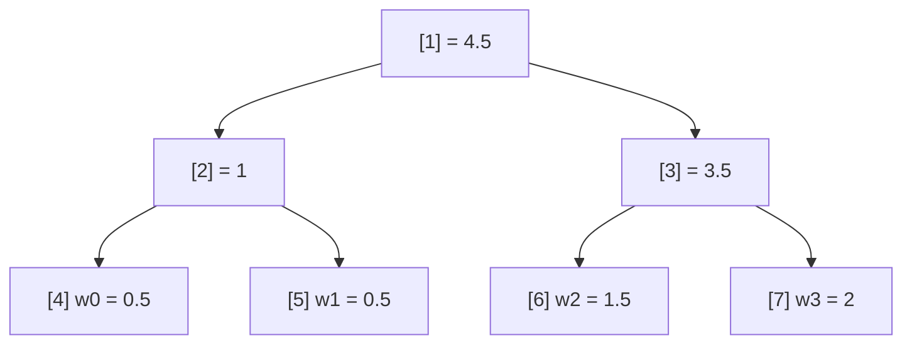

Hai bài toán trông không liên quan:

1. **Rút thăm theo trọng số.** Có 100.000 quảng cáo, mỗi cái một trọng số, trọng số đổi liên tục (ngân sách hết, điểm chất lượng tăng). Mỗi lần cần chọn ngẫu nhiên một cái với xác suất tỉ lệ trọng số.
2. **Danh sách ảo dòng cao không đều.** Bảng 100.000 dòng, mỗi dòng cao khác nhau và chỉ biết chiều cao thật khi đã render. Người dùng kéo thanh cuộn tới pixel 1.234.567: dòng nào nằm ở đó?

Cả hai quy về cùng một câu hỏi: cho dãy số không âm `w[0..n)`, tìm **chỉ số i mà tổng tiền tố vượt qua v** (`w[0] + … + w[i-1] ≤ v < w[0] + … + w[i]`), trong khi `w` vẫn bị sửa liên tục. Mảng tổng tiền tố trả lời nhanh nhưng sửa một phần tử phải tính lại O(n). Duyệt tuyến tính thì sửa O(1) nhưng hỏi O(n). Facebook dùng một **cây tổng nhị phân lưu trong mảng**: cả sửa lẫn hỏi đều O(log n).

> [!TIP]
> **Tóm tắt**
> - Module `BinaryIndexedTree` của Facebook mang tên Fenwick tree (tên khác của Binary Indexed Tree) nhưng thực chất là **cây tổng kiểu heap**: lá ở `[cap, cap + n)`, node `i` là tổng của `2i` và `2i + 1`, gốc ở `1`.
> - `greatestLowerBound(v)` đi **xuống** từ gốc: `v` nhỏ hơn tổng con trái thì rẽ trái, không thì trừ đi rồi rẽ phải. O(log n), là phép "nghịch đảo hàm phân phối" cho rút thăm có trọng số.
> - `FixedDataTableScrollHelper` khởi tạo cây với chiều cao **ước lượng**, đo thật lúc dòng sắp hiện rồi `set` lại.
> - Bản gốc lưu trong `Int32Array`: trọng số `0.5` bị cắt thành `0`, tổng vượt 2³¹ bị tràn ở gốc. Bản viết lại dùng `Float64Array`.

<iframe class="demo-frame" src="/demos/facebook-patterns/index.html?theme=dark#/fenwick-weighted" title="Demo fenwick-weighted" loading="lazy" style="height: 1180px"></iframe>

<p class="demo-links">▶ <a href="/demos/facebook-patterns/index.html#/fenwick-weighted" target="_blank" rel="noopener">Mở demo toàn màn hình ↗</a> · <a href="https://stackblitz.com/github/hunghg255/blog-hunghg/tree/master/examples/facebook-patterns?file=src/lib/fenwick.ts" target="_blank" rel="noopener">Sửa code trên StackBlitz ↗</a> · <a href="https://github.com/hunghg255/blog-hunghg/blob/master/examples/facebook-patterns/src/lib/fenwick.ts" target="_blank" rel="noopener">Xem source trên GitHub ↗</a></p>

## Facebook làm thế nào?

### Cây tổng trong một mảng phẳng

`BinaryIndexedTree` nằm trong bundle `233.js`. Giải mã (đổi tên biến):

```js
function ceilPow2(n) { let b = 1; while (b < n) b *= 2; return b; }

class BinaryIndexedTree {
  constructor(values) {
    this.size = values.length;
    this.cap = ceilPow2(this.size);            // số lá, làm tròn lên luỹ thừa 2
    this.tree = new Int32Array(2 * this.cap);  // (Int32Array || mảng thường)
    for (let i = 0; i < this.size; i++) this.tree[this.cap + i] = values[i];
    for (let i = this.cap - 1; i > 0; i--) this.tree[i] = this.tree[2 * i] + this.tree[2 * i + 1];
  }
  set(index, value) {
    let node = this.cap + index;
    this.tree[node] = value;
    for (node = node >> 1; node !== 0; node = node >> 1)
      this.tree[node] = this.tree[2 * node] + this.tree[2 * node + 1];
  }
  sumUntil(end) {                 // tổng [0, end)
    if (end === 0) return 0;
    let node = this.cap + end - 1;
    let sum = this.tree[node];
    for (; node !== 1; node = node >> 1)
      if (node % 2 === 1) sum += this.tree[node - 1]; // là con phải: cộng anh em trái
    return sum;
  }
  greatestLowerBound(v) {         // chỉ số i lớn nhất với sumUntil(i) <= v
    if (v < 0) return -1;
    let node = 1;
    if (this.tree[node] <= v) return this.size;
    while (node < this.cap) {
      const left = this.tree[2 * node];
      if (v < left) node = 2 * node;
      else { node = 2 * node + 1; v -= left; }
    }
    return node - this.cap;
  }
}
```

Bố cục giống hệt binary heap: gốc ở chỉ số 1, con của `i` là `2i` và `2i + 1`, cha là `i >> 1`. Không có con trỏ, không có object cho từng node, chỉ một mảng số liên tục, rất thân thiện với cache CPU.



Tìm phần tử chứa `v = 2.7`: ở gốc, `2.7 ≥ 1` (tổng con trái) nên trừ còn `1.7` và rẽ phải sang `[3]`. Ở `[3]`, `1.7 ≥ 1.5` nên trừ còn `0.2` và rẽ phải sang `[7]`, tức phần tử 3. Kiểm tra: tổng tiền tố trước phần tử 3 là `0.5 + 0.5 + 1.5 = 2.5 ≤ 2.7 < 4.5`. Đúng.

Module có thêm `greatestStrictLowerBound` (dùng `≤` thay `<` khi so con trái), và hai hàm suy ra từ chúng: `leastUpperBound(v) = greatestStrictLowerBound(v) + 1`, `leastStrictUpperBound(v) = greatestLowerBound(v) + 1`.

### Tên là "Binary Indexed Tree", nhưng không phải Fenwick tree

Fenwick tree chuẩn chỉ dùng **n** ô (không phải 2·cap), ô `i` giữ tổng của đoạn dài `i & -i` kết thúc tại `i`, và duyệt bằng mẹo bit `i += i & -i`. Code của Facebook không có phép `& -i` nào: đây là **cây phân đoạn (segment tree) dạng heap**, tốn gấp đôi bộ nhớ nhưng code hiển nhiên hơn và `greatestLowerBound` viết rất tự nhiên. Fenwick tree cũng làm được phép "tìm theo tổng" (đi từ bit cao xuống), nên với nhu cầu này hai cấu trúc tương đương về độ phức tạp. Bài này gọi nó là **cây tổng** cho đúng bản chất.

### FixedDataTableScrollHelper: vị trí dòng khi chiều cao chưa biết

Người dùng chính của `BinaryIndexedTree` trong bundle là `FixedDataTableScrollHelper` (bundle `51.js`), bộ não cuộn của FixedDataTable (bảng dữ liệu lớn trong công cụ quản trị, Ads Manager):

```js
constructor(rowCount, defaultRowHeight, viewportHeight, rowHeightGetter /* … */) {
  this.rowOffsets = BinaryIndexedTree.uniform(rowCount, defaultRowHeight);
  this.storedHeights = new Array(rowCount).fill(defaultRowHeight);
  this.contentHeight = rowCount * defaultRowHeight;
  this.rowHeightGetter = rowHeightGetter ?? (() => defaultRowHeight);
  this.updateHeightsInViewport(0, 0);
}
getRowPosition(row) {
  this.updateRowHeight(row);          // đo dòng này nếu chưa đo
  return this.rowOffsets.sumUntil(row);
}
```

Mọi dòng bắt đầu với chiều cao **mặc định**. Khi một dòng sắp vào khung nhìn (`updateHeightsInViewport`), helper gọi `rowHeightGetter(row)`, so với chiều cao đang lưu, khác thì `rowOffsets.set(row, height)` và cập nhật `contentHeight` bằng phần chênh lệch. Khi cuộn tới vị trí `y`, `greatestLowerBound(y)` cho ra dòng đầu tiên, `y - sumUntil(row)` là phần của dòng đó đã bị cuộn qua.

Có một chi tiết tinh tế: khi cuộn ngược lên, helper đo trước **5 dòng phía trên** (`g = 5`) và cộng phần chênh lệch chiều cao vào vị trí cuộn. Nếu không, dòng phía trên "phình ra" sau khi đo sẽ đẩy nội dung đang nhìn xuống, gây giật.

## Viết lại

Bản viết lại giữ nguyên cấu trúc (mảng heap, đi xuống từ gốc), đổi sang `Float64Array`, kiểm tra trọng số âm/NaN, và tách ba lớp: `SumTree` (cấu trúc), `WeightedPicker` (rút thăm), `RowOffsets` (vị trí dòng).

Hai thao tác cốt lõi:

```ts title=src/lib/fenwick.ts
  /** Đổi một giá trị rồi tính lại các node cha từ hai con (không cộng dồn delta nên không trôi sai số). */
  set(index: number, value: number) {
    this.checkIndex(index);
    let node = this.cap + index;
    this.tree[node] = checkWeight(value);
    for (node >>= 1; node > 0; node >>= 1) {
      this.tree[node] = this.tree[2 * node] + this.tree[2 * node + 1];
    }
  }

  total() {
    return this.tree[1] ?? 0;
  }

  /** Tổng các phần tử [0, end). */
  sumUntil(end: number) {
    if (end < 0 || end > this.size) throw new RangeError(`end ${end} ngoài [0, ${this.size}]`);
    if (end === 0) return 0;
    let node = this.cap + end - 1;
    let sum = this.tree[node];
    for (; node !== 1; node >>= 1) {
      // node là con phải thì cộng cả anh em bên trái
      if (node % 2 === 1) sum += this.tree[node - 1];
    }
    return sum;
  }

  /**
   * Chỉ số i lớn nhất sao cho sumUntil(i) ≤ value, tức phần tử "chứa" vị trí value.
   * value < 0 → -1; value ≥ total → size.
   */
  greatestLowerBound(value: number) {
    if (value < 0) return -1;
    if (this.tree[1] <= value) return this.size;
    let node = 1;
    while (node < this.cap) {
      const left = this.tree[2 * node];
      if (value < left) {
        node = 2 * node;
      } else {
        value -= left;
        node = 2 * node + 1;
      }
    }
    return node - this.cap;
  }
```

Rút thăm theo trọng số chỉ là `greatestLowerBound(random() * total)`:

```ts title=src/lib/fenwick.ts
/** Rút thăm theo trọng số, trọng số đổi được bất cứ lúc nào, mỗi lần O(log n). */
export class WeightedPicker {
  private readonly tree: SumTree;

  constructor(weights: ArrayLike<number>, private readonly random: () => number = Math.random) {
    this.tree = new SumTree(weights);
  }

  setWeight(index: number, weight: number) {
    this.tree.set(index, weight);
  }

  weight(index: number) {
    return this.tree.get(index);
  }

  total() {
    return this.tree.total();
  }

  /** -1 nếu mọi trọng số bằng 0. */
  pick() {
    const total = this.tree.total();
    if (total <= 0) return -1;
    // random() ∈ [0, 1) nên r < total; lá có trọng số 0 không bao giờ "chứa" r
    return this.tree.greatestLowerBound(this.random() * total);
  }
}
```

::: spoiler Xem toàn bộ src/lib/fenwick.ts

```ts title=src/lib/fenwick.ts
/**
 * Cây tổng nhị phân lưu trong mảng (ý tưởng từ BinaryIndexedTree của Facebook).
 *
 * Tên gốc là "Binary Indexed Tree" nhưng cấu trúc thật là một cây nhị phân hoàn chỉnh
 * kiểu heap: lá ở [cap, cap + n), node i là tổng của 2i và 2i + 1, gốc ở 1.
 * - set/get/sumUntil: O(log n)
 * - greatestLowerBound(v): đi XUỐNG từ gốc để tìm chỉ số lớn nhất có tổng tiền tố ≤ v,
 *   cũng O(log n). Đây là thứ cần cho "chọn ngẫu nhiên theo trọng số" và "dòng nào
 *   đang ở pixel y" khi chiều cao từng dòng khác nhau.
 *
 * Khác bản gốc: dùng Float64Array (bản gốc dùng Int32Array nên trọng số 0.5 thành 0,
 * và tổng vượt 2^31 bị tràn ở node gốc).
 */
export class SumTree {
  readonly size: number;
  private readonly cap: number;
  private readonly tree: Float64Array;

  constructor(values: ArrayLike<number>) {
    this.size = values.length;
    let cap = 1;
    while (cap < this.size) cap *= 2;
    this.cap = cap;
    this.tree = new Float64Array(2 * cap);
    for (let i = 0; i < this.size; i++) this.tree[cap + i] = checkWeight(values[i]);
    for (let i = cap - 1; i > 0; i--) this.tree[i] = this.tree[2 * i] + this.tree[2 * i + 1];
  }

  static uniform(size: number, value: number) {
    return new SumTree(new Array<number>(size).fill(value));
  }

  get(index: number) {
    this.checkIndex(index);
    return this.tree[this.cap + index];
  }

  /** Đổi một giá trị rồi tính lại các node cha từ hai con (không cộng dồn delta nên không trôi sai số). */
  set(index: number, value: number) {
    this.checkIndex(index);
    let node = this.cap + index;
    this.tree[node] = checkWeight(value);
    for (node >>= 1; node > 0; node >>= 1) {
      this.tree[node] = this.tree[2 * node] + this.tree[2 * node + 1];
    }
  }

  total() {
    return this.tree[1] ?? 0;
  }

  /** Tổng các phần tử [0, end). */
  sumUntil(end: number) {
    if (end < 0 || end > this.size) throw new RangeError(`end ${end} ngoài [0, ${this.size}]`);
    if (end === 0) return 0;
    let node = this.cap + end - 1;
    let sum = this.tree[node];
    for (; node !== 1; node >>= 1) {
      // node là con phải thì cộng cả anh em bên trái
      if (node % 2 === 1) sum += this.tree[node - 1];
    }
    return sum;
  }

  /**
   * Chỉ số i lớn nhất sao cho sumUntil(i) ≤ value, tức phần tử "chứa" vị trí value.
   * value < 0 → -1; value ≥ total → size.
   */
  greatestLowerBound(value: number) {
    if (value < 0) return -1;
    if (this.tree[1] <= value) return this.size;
    let node = 1;
    while (node < this.cap) {
      const left = this.tree[2 * node];
      if (value < left) {
        node = 2 * node;
      } else {
        value -= left;
        node = 2 * node + 1;
      }
    }
    return node - this.cap;
  }

  private checkIndex(index: number) {
    if (!Number.isInteger(index) || index < 0 || index >= this.size) {
      throw new RangeError(`index ${index} ngoài [0, ${this.size})`);
    }
  }
}

function checkWeight(value: number) {
  if (!(value >= 0) || !Number.isFinite(value)) throw new RangeError(`trọng số phải ≥ 0, nhận ${value}`);
  return value;
}

/** Rút thăm theo trọng số, trọng số đổi được bất cứ lúc nào, mỗi lần O(log n). */
export class WeightedPicker {
  private readonly tree: SumTree;

  constructor(weights: ArrayLike<number>, private readonly random: () => number = Math.random) {
    this.tree = new SumTree(weights);
  }

  setWeight(index: number, weight: number) {
    this.tree.set(index, weight);
  }

  weight(index: number) {
    return this.tree.get(index);
  }

  total() {
    return this.tree.total();
  }

  /** -1 nếu mọi trọng số bằng 0. */
  pick() {
    const total = this.tree.total();
    if (total <= 0) return -1;
    // random() ∈ [0, 1) nên r < total; lá có trọng số 0 không bao giờ "chứa" r
    return this.tree.greatestLowerBound(this.random() * total);
  }
}

/**
 * Vị trí dòng trong danh sách có chiều cao khác nhau (ý tưởng FixedDataTableScrollHelper):
 * dòng chưa đo dùng chiều cao ước lượng, đo xong thì set lại trong cây.
 */
export class RowOffsets {
  private readonly tree: SumTree;

  constructor(rowCount: number, estimatedHeight: number) {
    this.tree = SumTree.uniform(rowCount, estimatedHeight);
  }

  get rowCount() {
    return this.tree.size;
  }

  contentHeight() {
    return this.tree.total();
  }

  setHeight(row: number, height: number) {
    this.tree.set(row, height);
  }

  height(row: number) {
    return this.tree.get(row);
  }

  top(row: number) {
    return this.tree.sumUntil(row);
  }

  /** Dòng đầu tiên nhìn thấy ở scrollTop và phần của nó đã bị cuộn qua. */
  rowAt(scrollTop: number) {
    if (this.tree.size === 0) return { row: 0, offset: 0 };
    const row = Math.min(Math.max(this.tree.greatestLowerBound(scrollTop), 0), this.tree.size - 1);
    return { row, offset: scrollTop - this.tree.sumUntil(row) };
  }
}
```

:::

## Đi qua code

- **Constructor** làm tròn số lá lên luỹ thừa 2 (`cap`), ghi lá rồi dựng các node trong từ dưới lên: O(n). Lá thừa (từ `size` tới `cap`) là 0, không ảnh hưởng tổng.
- **`set`** tính lại cha **từ hai con** thay vì cộng một `delta`. Với số thực, cộng dồn delta sau hàng triệu lần sửa sẽ trôi sai số (`0.1 + 0.2 - 0.2 ≠ 0.1`); tính lại từ hai con thì mỗi node luôn bằng đúng tổng hai con hiện tại.
- **`sumUntil(end)`** đi từ lá `end - 1` lên gốc; mỗi lần node đang ở là **con phải**, cộng thêm anh em bên trái (toàn bộ đoạn bên trái nó). Kết quả là tổng `[0, end)`.
- **`greatestLowerBound(v)`** trả `size` nếu `v ≥ total`, `-1` nếu `v < 0`. Vì so `v < left` (nhỏ hơn hẳn), phần tử có trọng số 0 không bao giờ "chứa" `v`: với `left = 0`, điều kiện `v < 0` sai nên luôn rẽ phải. Đó là lý do rút thăm không bao giờ trúng mục có trọng số 0.
- **`WeightedPicker.pick`**: `random()` thuộc `[0, 1)` nên `random() * total < total`, không bao giờ ra `size`. Tổng bằng 0 thì trả `-1` để nơi gọi tự xử lý.
- **`RowOffsets.rowAt`** kẹp kết quả về `[0, rowCount - 1]` (cuộn quá đáy vẫn có dòng cuối) và trả kèm `offset` để render dòng đầu bị cắt một phần.

**Khác bản gốc:**
- `Float64Array` thay `Int32Array`. Gán `0.5` vào `Int32Array` cho ra `0`; tổng hai phần tử `2e9` tràn thành số âm ở gốc và `greatestLowerBound` ra sai (thử: `new BinaryIndexedTree([2e9, 2e9, 1]).greatestLowerBound(3e9)` ra `3`, đúng ra phải là `1`). Với chiều cao dòng (số nguyên pixel, tổng vài triệu) bản gốc chạy tốt; đem đi làm rút thăm theo trọng số thực thì gặp lỗi ngay. Demo có ô "Lưu như bản gốc" để thấy trọng số 0.5 và 0.25 biến mất.
- Kiểm tra trọng số âm, `NaN`, `Infinity`: bản gốc nhận mọi thứ, một trọng số âm làm `greatestLowerBound` đi sai nhánh mà không báo gì.
- Bỏ các biến thể `greatestStrictLowerBound`/`leastUpperBound`; cần thì viết thêm theo đúng mẫu ở trên (đổi `<` thành `≤`).

## Tại sao không làm cách khác?

**Mảng tổng tiền tố + tìm kiếm nhị phân?** Hỏi O(log n), nhưng mỗi lần đổi một trọng số phải cập nhật O(n) phần tử phía sau. Với trọng số cố định thì đây là lựa chọn tốt nhất (đơn giản, ít bộ nhớ). Trọng số đổi thường xuyên thì không.

**Alias method (Walker/Vose)?** Rút O(1) sau khi dựng bảng O(n). Nhưng đổi một trọng số là dựng lại cả bảng. Hợp với phân phối cố định, rút hàng triệu lần (mô phỏng Monte Carlo).

**Duyệt tuyến tính mỗi lần?** Với vài chục phần tử, đây là cách đúng: code 3 dòng, không cấu trúc nào nhanh hơn đáng kể. Demo so trên 100.000 phần tử, 2.000 lần "đổi một trọng số rồi rút": duyệt tuyến tính mất khoảng 440ms, cây tổng khoảng 2ms (Chromium headless khi viết bài, máy bạn sẽ khác).

**Cây tìm kiếm cân bằng (treap, red-black) giữ tổng ở mỗi node?** Làm được cả chèn/xoá phần tử giữa dãy, thứ cây tổng cố định kích thước không làm được. Nhưng code dài hơn nhiều lần. Danh sách dòng của bảng có số dòng biết trước nên cây trong mảng là đủ.

## Edge case và cạm bẫy

- **Số phần tử thay đổi.** Cây có kích thước cố định. Danh sách ảo thêm dòng (infinite scroll) thì phải dựng lại cây, hoặc cấp `cap` dư từ đầu và để lá thừa bằng 0.
- **Sai số dấu phẩy động trong tổng.** `total` là tổng của hàng nghìn số thực; `random() * total` có thể rơi vào đúng biên. Vì so `v < left` và lá thừa bằng 0, kết quả luôn là một chỉ số hợp lệ trong `[0, size)` khi `total > 0`.
- **Đo chiều cao làm nhảy nội dung.** Dòng phía trên vùng nhìn đổi chiều cao sau khi đo thì mọi thứ bên dưới dịch đi. FixedDataTable bù bằng cách cộng chênh lệch vào vị trí cuộn; nếu tự viết danh sách ảo, nhớ làm tương tự (hoặc dùng `overflow-anchor` của trình duyệt khi không tự quản lý `scrollTop`).
- **Demo đo dòng ngay trong render** cho gọn. Trong ứng dụng thật, đo bằng `ResizeObserver` sau khi dòng đã vào DOM, rồi `setHeight`.
- **Ghi nhớ đã đo dòng nào.** Cây chỉ giữ chiều cao, không biết dòng nào là ước lượng. Demo giữ thêm một `Set`; FixedDataTable giữ mảng `storedHeights` để so sánh.

## Dùng trong dự án

```ts
import { WeightedPicker, RowOffsets } from './fenwick';

// 1. Chọn server theo tải: trọng số = sức chứa còn lại, cập nhật mỗi khi có heartbeat
const picker = new WeightedPicker(servers.map((s) => s.capacity - s.load));
onHeartbeat((i, s) => picker.setWeight(i, Math.max(0, s.capacity - s.load)));
const target = servers[picker.pick()];

// 2. Danh sách ảo cao không đều
const offsets = new RowOffsets(items.length, 72); // ước lượng 72px
const observer = new ResizeObserver((entries) => {
  for (const e of entries) {
    const row = Number((e.target as HTMLElement).dataset.row);
    offsets.setHeight(row, e.borderBoxSize[0].blockSize);
  }
  render();
});
function render() {
  const { row, offset } = offsets.rowAt(scroller.scrollTop);
  // render từ `row`, dịch lên `offset` px; spacer cao offsets.contentHeight()
}
```

## Kiểm thử

::: spoiler Ví dụ test (bản phác, không có trong repo)

```ts
import { describe, expect, it } from 'vitest';
import { SumTree, WeightedPicker } from './fenwick';
import { alea } from './seededRandom';

describe('SumTree', () => {
  it('tổng tiền tố và greatestLowerBound khớp duyệt tuyến tính', () => {
    const random = alea('test');
    for (let round = 0; round < 200; round++) {
      const w = Array.from({ length: 1 + Math.floor(random() * 40) }, () => Math.floor(random() * 4) * random());
      const tree = new SumTree(w);
      for (let q = 0; q < 20; q++) {
        const v = random() * tree.total();
        let acc = 0, expected = w.length;
        for (let i = 0; i < w.length; i++) { if (acc + w[i] > v) { expected = i; break; } acc += w[i]; }
        expect(tree.greatestLowerBound(v)).toBe(expected);
      }
    }
  });
  it('không tràn với tổng lớn, giữ phần thập phân', () => {
    expect(new SumTree([2e9, 2e9, 1]).greatestLowerBound(3e9)).toBe(1);
    expect(new SumTree([0.5, 0.25]).total()).toBe(0.75);
  });
  it('không bao giờ rút trúng trọng số 0', () => {
    const picker = new WeightedPicker([0, 1, 0, 2, 0], alea('z'));
    for (let i = 0; i < 1000; i++) expect([1, 3]).toContain(picker.pick());
  });
});
```

:::

## So với thư viện và chuẩn web

- Thư viện danh sách ảo hiện đại (**TanStack Virtual**, **react-virtuoso**) cũng đo lười chiều cao dòng. TanStack Virtual giữ mảng vị trí và tính lại từ dòng bị đổi trở xuống, tìm dòng bằng tìm kiếm nhị phân: đơn giản hơn, đủ nhanh với vài chục nghìn dòng. Cây tổng đáng dùng khi số dòng lớn và chiều cao đổi liên tục.
- Rút thăm có trọng số cố định: alias method hoặc mảng tổng tiền tố + tìm kiếm nhị phân. Trọng số động: cây tổng (bài này) hoặc Fenwick tree chuẩn.
- Thuộc tính CSS `content-visibility: auto` với `contain-intrinsic-size` để trình duyệt tự bỏ qua render phần ngoài màn hình là một hướng khác cho danh sách dài vừa phải, không cần tự tính vị trí.

Bài liên quan: [Học từ Facebook #67: cặp min/max-heap tái dùng vị trí trong danh sách ảo](/blogs/facebook-dual-heap-buffer-set), [Học từ Facebook #66: PRNG có seed](/blogs/facebook-seeded-prng-sampling).

---

Bài này thuộc series **[Học từ mã nguồn Facebook](/series/facebook)** (83 bài, đọc theo thứ tự).

::: spoiler Xem nhanh danh sách bài trong series

*Phần 1*

- [Mở đầu: cách đọc code minify của Facebook](/blogs/learn-from-facebook-source-code)
- [#1 Dùng chung IntersectionObserver + infinite scroll](/blogs/facebook-shared-intersection-observer)
- [#2 useViewportDuration: đo thời gian thực sự được xem](/blogs/facebook-use-viewport-duration)
- [#3 Preload code + data khi hover](/blogs/facebook-preload-on-hover)
- [#4 Toast manager với external store](/blogs/facebook-toast-manager)
- [#5 Network status + heartbeat backoff](/blogs/facebook-network-status-heartbeat)
- [#6 ErrorGuard: bắt lỗi theo ngữ cảnh](/blogs/facebook-error-guard)
- [#7 Banzai: gom log theo lô + sendBeacon](/blogs/facebook-batch-logger)
- [#8 Focus trap + Esc theo layer](/blogs/facebook-focus-trap)

*Phần 2*

- [#9 Mẹo calc(… * 9999): container query, line-clamp, mũi tên carousel bằng CSS](/blogs/facebook-css-9999-trick)
- [#10 Thanh cuộn tuỳ biến bằng CSS 3D](/blogs/facebook-css-3d-scrollbar)
- [#11 Modal cuộn bằng window, giữ vị trí trang nền](/blogs/facebook-document-scroll-modal)
- [#12 Popover, tooltip group và hovercard](/blogs/facebook-popover-tooltip)
- [#13 Primitive Pressable + focus-visible](/blogs/facebook-pressable)
- [#14 Tab "Xem thêm" + sticky header bằng IntersectionObserver](/blogs/facebook-priority-tabs-sticky-header)
- [#15 Avatar khoét mask, gradient Messenger, skeleton steps()](/blogs/facebook-visual-tricks)
- [#16 Khung chat không giật](/blogs/facebook-chat-scroller)
- [#17 Thuật toán chọn bố cục collage ảnh](/blogs/facebook-photo-collage-layout)
- [#18 Keep-alive tab trong SPA](/blogs/facebook-keep-alive-tabs)
- [#19 Tự đo Visual Completion & interaction tracing](/blogs/facebook-visual-completion)
- [#20 Router SPA bền bỉ & tải chunk có retry](/blogs/facebook-spa-router-resilient-loading)

*Phần 3*

- [#21 Smart Compose: gợi ý chữ mờ khi gõ](/blogs/facebook-smart-compose-ghost-text)
- [#22 MQTT ngay trong trình duyệt, tự chuyển sang long-poll](/blogs/facebook-mqtt-in-browser)
- [#23 Đo thời gian dùng bằng bitmap 64 giây](/blogs/facebook-time-spent-bitmap)
- [#24 Bảng reaction nhấn giữ rồi trượt](/blogs/facebook-reaction-press-slide)
- [#25 Tìm kiếm gấp dấu, phiên âm và highlight đầu từ](/blogs/facebook-search-diacritics-tokenize)
- [#26 Ring buffer biết trace nào đã mất log](/blogs/facebook-trace-ring-buffer)
- [#27 Engine animation JS: một vòng rAF và solver cubic-bezier](/blogs/facebook-keyframes-loop-cubic-bezier)
- [#28 Bootloader: bitmap tài nguyên đã tải, chỉ reload khi cần](/blogs/facebook-bootloader-bitmap-consistency)
- [#29 Nhận biết click do screen reader tạo ra](/blogs/facebook-virtual-cursor-detection)
- [#30 Tải trước feed theo chất lượng mạng, đoán hạng thiết bị](/blogs/facebook-network-aware-prefetch)
- [#31 Hàng đợi gửi tin chat giữ đúng thứ tự](/blogs/facebook-ordered-send-queue)
- [#32 Gộp lời gọi API trong cùng một tick](/blogs/facebook-api-batcher)
- [#33 Resize ảnh trong pool Web Worker](/blogs/facebook-jpeg-resize-worker-pool)
- [#34 Crop ảnh theo nhiều khuôn mặt](/blogs/facebook-face-aware-crop)
- [#35 Kéo-thả sắp xếp và vùng thả file không nhấp nháy](/blogs/facebook-flicker-free-drag-drop)
- [#36 Tiện ích UI: fade-out, sticky event, hàm huỷ được](/blogs/facebook-ui-utility-hooks)
- [#37 Hạ tầng nhỏ: cookie, hash lỗi, prefetch khi chuột dừng](/blogs/facebook-small-infra-cookie-hash-idle)

*Phần 4–6*

- [#38 Đồng bộ tin nhắn: phát hiện lỗ seqID và fetch bù theo tầng](/blogs/facebook-messenger-sync-seqid-gaps)
- [#39 OTID: ID tin nhắn kiểu Snowflake sinh ở client](/blogs/facebook-otid-client-snowflake)
- [#40 QPL: lấy mẫu từ lúc bắt đầu, đo RTT gửi tin đầu-cuối](/blogs/facebook-qpl-send-rtt)
- [#41 Bộ điều phối request bảy chế độ gộp và chống trùng](/blogs/facebook-request-dispatcher-modes)
- [#42 Thread list theo mốc thời gian, cookie presence có version](/blogs/facebook-threadlist-ranged-presence)
- [#43 Composer dạng plugin: reducer, dirty checker, chuỗi kiểm tra](/blogs/facebook-plugin-composer)
- [#44 Thanh toán bất đồng bộ: subscribe trước, poll dự phòng](/blogs/facebook-async-checkout)
- [#45 Validate số thẻ: sửa lỗi gõ, dải BIN, Luhn](/blogs/facebook-card-validation)
- [#46 Lịch chọn khoảng ngày: bo góc dải chọn, phím đủ bộ, RTL](/blogs/facebook-range-calendar-a11y)
- [#47 Giờ mở cửa theo tuần: qua đêm, gộp khoảng, phần bù](/blogs/facebook-weekly-hours-intervals)
- [#48 Tiến độ đăng realtime: giữ event chờ snapshot, watchdog](/blogs/facebook-realtime-publish-snapshot)
- [#49 Tiền tệ theo đơn vị nhỏ nhất và ô nhập tiền](/blogs/facebook-currency-minor-units)
- [#50 Sửa hàng loạt Empty/Uniform/Mixed, seen/read bằng 2 bit](/blogs/facebook-bulk-edit-seen-bits)
- [#51 Phát hiện script lạ hook vào hàm native](/blogs/facebook-native-hook-detection)
- [#52 localStorage tự dọn khi đầy quota](/blogs/facebook-quota-aware-storage)
- [#53 Cache tuyến do server phân giải, chờ sẵn promise](/blogs/facebook-route-cache-prefetch)
- [#54 Lưới phím mũi tên 2D và focus không làm cuộn trang](/blogs/facebook-focus-table-grid)
- [#55 Tách emoji bằng máy trạng thái](/blogs/facebook-emoji-segmentation)
- [#56 Đọc trước ghi sau trong một frame, con tự biết vị trí](/blogs/facebook-read-then-write-dom)
- [#57 Hàng đợi lệnh cho video và stream sắp lại chunk](/blogs/facebook-video-command-queue)

*Phần 7–10*

- [#58 Ước lượng băng thông EWMA: loại outlier, nhớ qua phiên](/blogs/facebook-bandwidth-ewma-estimator)
- [#59 ABR theo độ tự tin phát và cắt bậc bitrate theo MOS](/blogs/facebook-abr-playback-confidence)
- [#60 Prefetch segment dự đoán từ manifest, parse hộp sidx](/blogs/facebook-dash-predicted-segments)
- [#61 Đọc metadata MP4/MOV ngay trên client](/blogs/facebook-mp4-metadata-client)
- [#62 Upload tiếp tục được: offset, hash dedupe, phát hiện treo](/blogs/facebook-resumable-upload)
- **#63 Fenwick tree: chọn ngẫu nhiên có trọng số và offset dòng** (bài này)
- [#64 Vạch trục số và trục thời gian "đẹp"](/blogs/facebook-nice-axis-ticks)
- [#65 Damerau-Levenshtein theo dải chéo và tự sửa tên gõ sai](/blogs/facebook-damerau-levenshtein)
- [#66 PRNG có seed, shuffle tái lập và lấy mẫu trace](/blogs/facebook-seeded-prng-sampling)
- [#67 Cặp min/max-heap tái dùng vị trí trong danh sách ảo](/blogs/facebook-dual-heap-buffer-set)
- [#68 Memo nhiều đối số bằng Map/WeakMap và interning object](/blogs/facebook-multikey-memo-interning)
- [#69 Thống kê cửa sổ trượt và đại số khoảng thời gian](/blogs/facebook-moving-stat-intervals)
- [#70 Int64 từ hai số 32-bit, decode UTF, offset theo code point](/blogs/facebook-int64-utf-codepoints)
- [#71 Engine múi giờ IANA trên client, phát hiện lệch giờ](/blogs/facebook-client-iana-timezone)
- [#72 Tự cài semver range](/blogs/facebook-semver-range)
- [#73 Auto-link URL, cắt chữ an toàn, giới hạn LaTeX](/blogs/facebook-autolink-safe-truncate)
- [#74 Parser query kiểu PHP chống prototype pollution](/blogs/facebook-php-query-serializer)
- [#75 Popover tự lật theo phần tràn nhỏ nhất](/blogs/facebook-popover-auto-flip)
- [#76 Tiền tố for(;;) chống JSON hijacking, đọc stream](/blogs/facebook-csrf-prefix-streaming)
- [#77 Chống lộ Referer, linkshim, xoá token trên URL](/blogs/facebook-referrer-linkshim-url-scrub)
- [#78 setImmediate bằng postMessage, gom delta chuột theo frame](/blogs/facebook-setimmediate-mouse-batching)
- [#79 Phát hiện crash qua heartbeat, dò proxy cache hỏng](/blogs/facebook-crash-heartbeat-proxy-check)
- [#80 DPR vào cookie cho ảnh @2x, che khoá trong log](/blogs/facebook-dpr-cookie-secret-redaction)
- [#81 Flux waitFor tự viết và proxy có đệm](/blogs/facebook-flux-dispatch-buffered-proxy)
- [#82 Crop đúng tỉ lệ, xoay sticker bằng ma trận](/blogs/facebook-image-crop-rotation-geometry)

:::

Code + demo: [`examples/facebook-patterns`](https://github.com/hunghg255/blog-hunghg/tree/master/examples/facebook-patterns) · [Mở trên StackBlitz](https://stackblitz.com/github/hunghg255/blog-hunghg/tree/master/examples/facebook-patterns)
