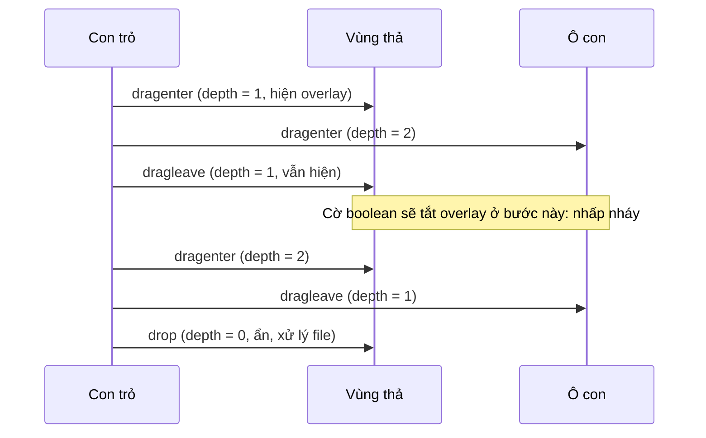

Kéo-thả bằng HTML5 Drag and Drop API trông đơn giản: `draggable`, vài sự kiện `dragstart`, `dragover`, `drop`. Làm thử thì gặp ngay hai kiểu "nhấp nháy" rất khó chịu:

1. **Danh sách sắp xếp lại giật qua giật lại.** Kéo một ảnh nhỏ qua một ảnh to: vừa chạm là đổi chỗ, đổi xong thì con trỏ lại nằm trên phần tử khác, đổi tiếp… danh sách rung như lên cơn.
2. **Overlay "Thả file vào đây" chớp tắt liên tục** khi rê file qua các nút, ô chữ bên trong vùng thả.

Trình đăng ảnh của Facebook (thư viện ảnh khi tạo bài) có lời giải gọn cho cả hai, trong hai hook `useCometDraggableItems` và `useFileDragEvents`. Đọc kỹ thì mỗi hook còn một bug nhỏ.

> [!TIP]
> **Tóm tắt**
> - Đổi chỗ chỉ khi **mép dẫn của phần tử đang kéo** (con trỏ cộng khoảng cách tới mép, nhớ lúc `dragstart`) vượt mép của phần tử đích, theo đúng hướng đang kéo.
> - Overlay thả file: dùng **bộ đếm** `dragenter`/`dragleave` thay cho cờ boolean, vì `dragleave` bắn mỗi khi con trỏ đi qua một phần tử con.
> - Bug bản gốc 1: thứ tự mới được lưu ở `dragend`, nên bấm Esc huỷ kéo vẫn đổi thứ tự.
> - Bug bản gốc 2: nhận diện "đang kéo file" bằng `dataTransfer.files != null`, nhưng `files` không bao giờ null, nên kéo một dòng chữ cũng bật overlay. Dùng `dataTransfer.types.includes('Files')`.

<iframe class="demo-frame" src="/demos/facebook-patterns/index.html?theme=dark#/drag-drop" title="Demo drag-drop" loading="lazy" style="height: 860px"></iframe>

<p class="demo-links">▶ <a href="/demos/facebook-patterns/index.html#/drag-drop" target="_blank" rel="noopener">Mở demo toàn màn hình ↗</a> · <a href="https://stackblitz.com/github/hunghg255/blog-hunghg/tree/master/examples/facebook-patterns?file=src/lib/dragReorder.ts" target="_blank" rel="noopener">Sửa code trên StackBlitz ↗</a> · <a href="https://github.com/hunghg255/blog-hunghg/blob/master/examples/facebook-patterns/src/lib/dragReorder.ts" target="_blank" rel="noopener">Xem source trên GitHub ↗</a></p>

Thử kéo "Video ngắn" xuống qua "Album 12 ảnh" ở hai chế độ. Trong test tự động của mình, cùng một đường kéo cho 2 lần đổi chỗ với cách của Facebook và 14 lần với cách "đổi ngay khi chạm". Ở ô bên phải, cùng một lượt rê file qua 4 phần tử con làm overlay bật/tắt 2 lần với bộ đếm, 12 lần với cờ boolean.

## Facebook làm thế nào?

### Ngưỡng theo mép phần tử (`useCometDraggableItems`)

Module nằm trong `0 00MediaLibrary/media-upload/useCometDraggableItems.js` (có thêm một bản gần giống trong `DraggableList/`). Lúc bắt đầu kéo, hook đo khoảng cách từ con trỏ tới **bốn mép** của phần tử:

```js
onDragStart(event) {
  const target = event.currentTarget;
  event.dataTransfer?.setData('text/plain', target?.textContent ?? window.location.href);
  lastPointer.current = { x: event.pageX, y: event.pageY };
  const rect = target.getBoundingClientRect();
  edges.current = {
    top: event.clientY - rect.top,
    bottom: rect.bottom - event.clientY,
    left: event.clientX - rect.left,
    right: rect.right - event.clientX,
  };
  setDragIndex(Number(target.dataset.key));
}
```

Khi con trỏ đi qua phần tử khác, chỉ đổi chỗ nếu mép **đi đầu** của phần tử đang kéo đã vượt mép tương ứng của phần tử đích:

```js
onDragOver(event) {
  event.preventDefault();
  event.dataTransfer && (event.dataTransfer.dropEffect = 'move');
  const index = Number(event.currentTarget.dataset.key);
  if (isNaN(index) || index === targetIndex) return;
  const rect = event.currentTarget.getBoundingClientRect();
  const delta = direction === 'vertical' ? event.pageY - lastPointer.current.y : event.pageX - lastPointer.current.x;
  const { top, bottom, left, right } = edges.current;
  if (direction === 'vertical') {
    if (delta < 0) event.clientY - top < rect.top && setTargetIndex(index);          // kéo lên: mép trên vượt mép trên
    else if (delta > 0) event.clientY + bottom > rect.bottom && setTargetIndex(index); // kéo xuống: mép dưới vượt mép dưới
  } else { /* tương tự với left/right */ }
  lastPointer.current = { x: event.pageX, y: event.pageY };
}
```

Hướng kéo lấy từ chênh lệch toạ độ giữa hai lần `dragover`. Không dùng điểm giữa, không dùng "con trỏ đã vào phần tử". Hệ quả: một ảnh cao 44px kéo qua một album cao 96px chỉ đổi chỗ khi **cả ảnh** đã trượt qua mép dưới của album. Lúc đó con trỏ đã nằm chắc trên vị trí mới, không có lần đổi ngược lại.

Danh sách hiển thị trong lúc kéo là một bản **xem trước** (`splice` ra khỏi vị trí cũ, chèn vào vị trí mới). Danh sách thật chỉ được cập nhật trong `onDragEnd`: nếu vị trí đích khác vị trí ban đầu thì `splice` trên mảng gốc rồi gọi `onReorder(next, from, to)`, sau đó đặt cả hai chỉ số về `-1`.

**Bug:** `dragend` bắn cho **mọi** cách kết thúc kéo: thả vào đúng chỗ, thả ra ngoài danh sách, hoặc bấm Esc. Code không phân biệt, nên huỷ kéo bằng Esc vẫn lưu thứ tự mới. Cách sửa: đánh dấu khi `drop` thật sự xảy ra, chỉ commit nếu có cờ đó (hoặc kiểm tra `event.dataTransfer.dropEffect === 'none'` trong `dragend`). Demo có công tắc "Commit cả khi huỷ (bản gốc)": cùng một lần kéo bị huỷ cho thứ tự `bcdaef` với bản gốc và giữ nguyên `abcdef` với bản sửa.

### Bộ đếm cho overlay thả file (`useFileDragEvents`)

Module trong `Drop UPload/useFileDragEvents.js`:

```js
function useFileDragEvents(onDrop, target = document.documentElement, filter) {
  const depth = useRef(0);
  const [isDragging, setIsDragging] = useState(false);
  const handleEnter = (e) => {
    const files = e.dataTransfer?.files;
    if ((filter == null || filter(e)) && files != null) { e.preventDefault(); depth.current++; setIsDragging(true); }
  };
  const handleLeave = (e) => {
    const files = e.dataTransfer?.files;
    if (files != null && --depth.current === 0) setIsDragging(false);
  };
  const handleOver = (e) => { if (e.dataTransfer?.files != null) e.preventDefault(); };
  const handleDrop = (e) => { setIsDragging(false); /* gọi onDrop(files), depth.current = 0 */ };
  useEffect(() => {
    target.addEventListener('drop', handleDrop, true);
    target.addEventListener('dragenter', handleEnter, true);
    target.addEventListener('dragleave', handleLeave, true);
    target.addEventListener('dragover', handleOver, true);
    return () => { /* gỡ cả 4 */ };
  }, [...]);
  return isDragging;
}
```

Ba chi tiết đáng học: listener gắn ở **capture phase** trên cả trang (`document.documentElement`), `preventDefault()` trong `dragover` (thiếu dòng này thì trình duyệt không cho thả), và **bộ đếm** `depth`.

**Bug:** điều kiện `files != null` được đặt ra để chỉ phản ứng khi kéo file. Nhưng theo spec, `DataTransfer.files` luôn là một `FileList`, rỗng khi không kéo file, không bao giờ `null`. Kéo một dòng chữ, một link hay một ảnh có sẵn trong trang cũng làm bộ đếm tăng và bật overlay "Thả file vào đây". Trong demo, kéo "dòng chữ này" vào khung: bản gốc bật/tắt overlay 2 lần, bản sửa 0 lần. Ngoài ra trong lúc `dragenter`/`dragover`, trình duyệt **giấu nội dung file** (chỉ cho biết loại) để trang không đọc trộm được file người dùng mới kéo ngang qua. Cách đúng để biết đang kéo file là `dataTransfer.types.includes('Files')`.



## Bên trong trình duyệt: vì sao `dragleave` "nói dối"?

`dragenter` và `dragleave` hoạt động như `mouseover`/`mouseout`, không như `mouseenter`/`mouseleave`. Chúng bắn cho **từng phần tử** con trỏ đi vào/ra, và **nổi bọt** (bubble). Khi con trỏ đi từ vùng thả vào một nút bên trong:

1. `dragenter` bắn trên nút (nổi lên vùng thả).
2. `dragleave` bắn trên vùng thả, vì con trỏ vừa "rời" vùng thả để vào nút.

Thứ tự là **enter trước, leave sau**. Nếu dùng cờ boolean, bước 2 tắt overlay trong khi con trỏ vẫn đang ở trong vùng. Bộ đếm cân bằng mọi cặp enter/leave, chỉ về 0 khi con trỏ thật sự ra khỏi cả vùng.

Không có `dragenter`/`dragleave` phiên bản "không nổi bọt" như `mouseenter`. Hai cách khác thường gặp:

- So `event.relatedTarget` trong `dragleave`: bỏ qua nếu nó vẫn nằm trong vùng thả. Cách này phụ thuộc việc trình duyệt điền đúng `relatedTarget` cho sự kiện kéo; bộ đếm thì không cần chi tiết đó.
- Đặt `pointer-events: none` cho mọi phần tử con khi đang kéo. Hiệu quả, nhưng phải thêm class vào cả cây.

## Viết lại

Hook sắp xếp giữ nguyên ngưỡng theo mép, thêm cờ `dropped` để không commit khi huỷ:

```ts title=src/lib/dragReorder.ts
    onDragOver: (event: DragEvent<HTMLElement>) => {
      if (from < 0) return; // không phải phần tử của danh sách này
      event.preventDefault(); // cho phép thả
      event.dataTransfer.dropEffect = 'move';
      if (index === to) return;
      const rect = event.currentTarget.getBoundingClientRect();
      const vertical = direction === 'vertical';
      const delta = vertical ? event.clientY - lastPointer.current.y : event.clientX - lastPointer.current.x;
      lastPointer.current = { x: event.clientX, y: event.clientY };
      if (swapRule === 'enter') {
        setTo(index);
        return;
      }
      const e = edges.current;
      if (vertical) {
        if (delta < 0 && event.clientY - e.top < rect.top) setTo(index);
        else if (delta > 0 && event.clientY + e.bottom > rect.bottom) setTo(index);
      } else {
        if (delta < 0 && event.clientX - e.left < rect.left) setTo(index);
        else if (delta > 0 && event.clientX + e.right > rect.right) setTo(index);
      }
    },
    onDrop: (event: DragEvent<HTMLElement>) => {
      if (from < 0) return;
      event.preventDefault();
      dropped.current = true;
    },
    onDragEnd: finish,
  });
```

`onDragEnd` gọi `finish()`: chỉ khi `dropped.current` là `true` (hoặc bật chế độ giống bản gốc) mới gọi `onReorder` với danh sách xem trước.

Hook vùng thả file dùng bộ đếm và nhận diện file qua `types`:

```ts title=src/lib/dragReorder.ts
    if (!el) return;
    const isFileDrag = (event: DragEvent | globalThis.DragEvent) => {
      const dt = event.dataTransfer;
      if (!dt) return false;
      return detect === 'types' ? Array.from(dt.types).includes('Files') : dt.files != null;
    };
    const show = (value: boolean) => {
      if (visible.current === value) return;
      visible.current = value;
      setActive(value);
      latest.current.onToggle?.(value);
    };
    const onEnter = (event: globalThis.DragEvent) => {
      if (!isFileDrag(event)) return;
      event.preventDefault();
      depth.current++;
      show(true);
    };
    const onLeave = (event: globalThis.DragEvent) => {
      if (!isFileDrag(event)) return;
      if (mode === 'boolean') show(false);
      else if (--depth.current <= 0) {
        depth.current = 0;
        show(false);
      }
    };
```

::: spoiler Xem toàn bộ src/lib/dragReorder.ts

```ts title=src/lib/dragReorder.ts
import { useCallback, useEffect, useMemo, useRef, useState, type DragEvent } from 'react';

/**
 * Sắp xếp lại danh sách bằng HTML5 drag-and-drop, không nhấp nháy
 * (ý tưởng từ useCometDraggableItems của Facebook).
 *
 * Mẹo chính: lúc bắt đầu kéo, nhớ khoảng cách từ con trỏ tới 4 mép của phần tử đang kéo.
 * Khi kéo lên, chỉ đổi chỗ khi MÉP TRÊN của phần tử đang kéo (con trỏ trừ khoảng cách đó)
 * đã vượt mép trên của phần tử đích; kéo xuống thì xét mép dưới. Nhờ vậy không đổi chỗ
 * qua lại liên tục khi hai phần tử cao khác nhau.
 *
 * Khác bản gốc: chỉ commit khi thật sự thả (drop). Bản gốc commit ở dragend, nên bấm Esc
 * hoặc thả ra ngoài vẫn đổi thứ tự.
 */

export type DragDirection = 'vertical' | 'horizontal';

export interface DragReorderOptions<T> {
  items: T[];
  getKey: (item: T) => string;
  onReorder: (next: T[], from: number, to: number) => void;
  direction?: DragDirection;
  /** 'edge' = cách của Facebook, 'enter' = đổi ngay khi con trỏ chạm phần tử khác */
  swapRule?: 'edge' | 'enter';
  /** true = commit cả khi huỷ (Esc, thả ra ngoài), giống bản gốc */
  commitOnCancel?: boolean;
  /** được gọi mỗi lần thứ tự xem trước thay đổi (để đếm "nhấp nháy") */
  onPreviewChange?: () => void;
}

interface Edges {
  top: number;
  bottom: number;
  left: number;
  right: number;
}

export function useDragReorder<T>({
  items,
  getKey,
  onReorder,
  direction = 'vertical',
  swapRule = 'edge',
  commitOnCancel = false,
  onPreviewChange,
}: DragReorderOptions<T>) {
  const [from, setFrom] = useState(-1);
  const [to, setTo] = useState(-1);
  const edges = useRef<Edges>({ top: 0, bottom: 0, left: 0, right: 0 });
  const lastPointer = useRef({ x: 0, y: 0 });
  const dropped = useRef(false);

  // danh sách xem trước: phần tử đang kéo đã nằm ở vị trí `to`
  const preview = useMemo(() => {
    const next = items.slice();
    if (from >= 0 && to >= 0 && from !== to) next.splice(to, 0, next.splice(from, 1)[0]);
    return next;
  }, [items, from, to]);

  const onPreviewChangeRef = useRef(onPreviewChange);
  onPreviewChangeRef.current = onPreviewChange;
  useEffect(() => {
    if (from >= 0) onPreviewChangeRef.current?.();
  }, [to, from]);

  const finish = useCallback(() => {
    if ((dropped.current || commitOnCancel) && from >= 0 && to >= 0 && from !== to) {
      onReorder(preview, from, to);
    }
    dropped.current = false;
    setFrom(-1);
    setTo(-1);
  }, [commitOnCancel, from, to, preview, onReorder]);

  const getItemProps = (index: number) => ({
    draggable: true,
    'data-index': index,
    onDragStart: (event: DragEvent<HTMLElement>) => {
      const rect = event.currentTarget.getBoundingClientRect();
      edges.current = {
        top: event.clientY - rect.top,
        bottom: rect.bottom - event.clientY,
        left: event.clientX - rect.left,
        right: rect.right - event.clientX,
      };
      lastPointer.current = { x: event.clientX, y: event.clientY };
      event.dataTransfer.effectAllowed = 'move';
      // Firefox chỉ bắt đầu kéo khi có dữ liệu
      event.dataTransfer.setData('text/plain', getKey(items[index]));
      dropped.current = false;
      setFrom(index);
      setTo(index);
    },
    onDragOver: (event: DragEvent<HTMLElement>) => {
      if (from < 0) return; // không phải phần tử của danh sách này
      event.preventDefault(); // cho phép thả
      event.dataTransfer.dropEffect = 'move';
      if (index === to) return;
      const rect = event.currentTarget.getBoundingClientRect();
      const vertical = direction === 'vertical';
      const delta = vertical ? event.clientY - lastPointer.current.y : event.clientX - lastPointer.current.x;
      lastPointer.current = { x: event.clientX, y: event.clientY };
      if (swapRule === 'enter') {
        setTo(index);
        return;
      }
      const e = edges.current;
      if (vertical) {
        if (delta < 0 && event.clientY - e.top < rect.top) setTo(index);
        else if (delta > 0 && event.clientY + e.bottom > rect.bottom) setTo(index);
      } else {
        if (delta < 0 && event.clientX - e.left < rect.left) setTo(index);
        else if (delta > 0 && event.clientX + e.right > rect.right) setTo(index);
      }
    },
    onDrop: (event: DragEvent<HTMLElement>) => {
      if (from < 0) return;
      event.preventDefault();
      dropped.current = true;
    },
    onDragEnd: finish,
  });

  return { preview, draggingIndex: to, isDragging: from >= 0, getItemProps };
}

/**
 * Overlay "thả file vào đây" không nhấp nháy (ý tưởng từ useFileDragEvents).
 *
 * dragleave bắn mỗi khi con trỏ đi qua MỘT PHẦN TỬ CON, nên dùng bộ đếm enter/leave
 * thay vì một cờ boolean. Khác bản gốc:
 * - nhận diện kéo file bằng dataTransfer.types.includes('Files'). Bản gốc kiểm
 *   `dataTransfer.files != null`, mà `files` luôn là một FileList (có thể rỗng),
 *   nên kéo một dòng chữ hay một ảnh trong trang cũng hiện overlay;
 * - reset bộ đếm cả khi thả ở nơi khác hoặc khi kéo kết thúc ngoài cửa sổ.
 */
export interface FileDropOptions {
  onFiles: (files: File[]) => void;
  /** 'counter' (mặc định) hoặc 'boolean' (cách ngây thơ, để so sánh) */
  mode?: 'counter' | 'boolean';
  /** 'types' (mặc định) hoặc 'files-not-null' như bản gốc */
  detect?: 'types' | 'files-not-null';
  onToggle?: (visible: boolean) => void;
}

export function useFileDropZone<E extends HTMLElement>({ onFiles, mode = 'counter', detect = 'types', onToggle }: FileDropOptions) {
  const ref = useRef<E>(null);
  const [active, setActive] = useState(false);
  const depth = useRef(0);
  const visible = useRef(false);
  const latest = useRef({ onFiles, onToggle });
  latest.current = { onFiles, onToggle };

  useEffect(() => {
    const el = ref.current;
    if (!el) return;
    const isFileDrag = (event: DragEvent | globalThis.DragEvent) => {
      const dt = event.dataTransfer;
      if (!dt) return false;
      return detect === 'types' ? Array.from(dt.types).includes('Files') : dt.files != null;
    };
    const show = (value: boolean) => {
      if (visible.current === value) return;
      visible.current = value;
      setActive(value);
      latest.current.onToggle?.(value);
    };
    const onEnter = (event: globalThis.DragEvent) => {
      if (!isFileDrag(event)) return;
      event.preventDefault();
      depth.current++;
      show(true);
    };
    const onLeave = (event: globalThis.DragEvent) => {
      if (!isFileDrag(event)) return;
      if (mode === 'boolean') show(false);
      else if (--depth.current <= 0) {
        depth.current = 0;
        show(false);
      }
    };
    const onOver = (event: globalThis.DragEvent) => {
      if (isFileDrag(event)) event.preventDefault();
    };
    const onDrop = (event: globalThis.DragEvent) => {
      if (!isFileDrag(event)) return;
      event.preventDefault();
      depth.current = 0;
      show(false);
      const files = Array.from(event.dataTransfer?.files ?? []);
      if (files.length) latest.current.onFiles(files);
    };
    // kéo kết thúc ở chỗ khác (thả ngoài vùng, Esc): đưa bộ đếm về 0
    const reset = () => {
      depth.current = 0;
      show(false);
    };
    el.addEventListener('dragenter', onEnter);
    el.addEventListener('dragleave', onLeave);
    el.addEventListener('dragover', onOver);
    el.addEventListener('drop', onDrop);
    window.addEventListener('drop', reset);
    window.addEventListener('dragend', reset);
    return () => {
      el.removeEventListener('dragenter', onEnter);
      el.removeEventListener('dragleave', onLeave);
      el.removeEventListener('dragover', onOver);
      el.removeEventListener('drop', onDrop);
      window.removeEventListener('drop', reset);
      window.removeEventListener('dragend', reset);
    };
  }, [mode, detect]);

  return { ref, active };
}
```

:::

## Đi qua code

- **`setData('text/plain', …)` trong `dragstart`.** Firefox không bắt đầu kéo nếu `DataTransfer` rỗng. Facebook cũng làm đúng điều này.
- **`if (from < 0) return` trong `dragover`.** Chỉ phản ứng với phần tử của chính danh sách này. Kéo file từ máy vào danh sách thì bỏ qua.
- **Bản xem trước bằng `useMemo`.** Phần tử đang kéo đã nằm ở vị trí mới trong `preview`, nên `data-index` của từng phần tử trong lúc kéo là vị trí *sau khi* đổi. Đó là lý do `to` vừa là vị trí đích vừa là chỉ số của phần tử đang kéo trong bản xem trước.
- **`key` ổn định** theo `getKey(item)`, để React không tháo/lắp lại phần tử khi đổi chỗ (mất trạng thái `:hover`, ảnh nháy lại).
- **`show()` chỉ gọi `setActive` khi giá trị đổi** và gọi `onToggle` ngoài hàm updater của `setState` (updater có thể chạy hai lần trong StrictMode).
- **`window` nghe `drop` và `dragend` để reset.** Trường hợp kéo bắt đầu trong trang (kéo ảnh của chính trang ra rồi vào) và kết thúc ở nơi khác, bộ đếm có thể lệch; reset ở đây giữ nó về 0.

**Khác bản gốc:** commit chỉ khi `drop`; nhận diện file bằng `types`; reset bộ đếm khi kéo kết thúc ở nơi khác; listener gắn trên phần tử thay vì cả trang (bản gốc phủ cả trang để thả file vào đâu cũng được: tuỳ thiết kế).

## Tại sao không làm cách khác?

**Sao không dùng điểm giữa phần tử làm ngưỡng?** Ngưỡng điểm giữa chạy ổn khi các phần tử cao bằng nhau. Khi một phần tử nhỏ đổi chỗ với phần tử to, sau khi đổi, điểm giữa của phần tử vừa bị đẩy đi có thể lại nằm dưới con trỏ, gây đổi ngược. Ngưỡng theo mép phụ thuộc kích thước **phần tử đang kéo**, nên ổn định với phần tử khác cỡ.

**Sao không dùng Pointer Events thay cho HTML5 DnD?** HTML5 DnD có sẵn ảnh "bóng ma" khi kéo, kéo được sang cửa sổ/ứng dụng khác, nhưng **không chạy trên màn hình cảm ứng** ở nhiều trình duyệt di động. Thư viện như dnd-kit dùng Pointer Events để chạy được ở mọi nơi và hỗ trợ bàn phím. Với chức năng thả file từ máy, HTML5 DnD là cách duy nhất.

**Sao không commit ngay mỗi lần đổi chỗ?** Gọi API lưu thứ tự trong lúc đang kéo sinh ra hàng chục request vô ích và không huỷ được.

## Edge case và cạm bẫy

- **Kéo nhanh.** `dragover` bắn lặp lại theo chu kỳ (cả khi con trỏ đứng yên), không phải mỗi lần chuột nhích. Kéo rất nhanh có thể "nhảy" qua một phần tử; vì so sánh mép theo toạ độ thật nên lần `dragover` tiếp theo trên phần tử mới vẫn bắt kịp.
- **Danh sách cuộn được.** Trình duyệt tự cuộn khi kéo gần mép phần tử cuộn được, nhưng mức hỗ trợ khác nhau. Danh sách dài nên tự viết auto-scroll (xem bài [kéo-thả lịch của Pipedrive](/blogs/web-calendar-drag-drop)).
- **Khả năng truy cập.** Kéo-thả không dùng được bằng bàn phím. Thêm nút "Lên/Xuống" hoặc phím tắt Alt+↑/↓ cho mỗi phần tử.
- **Thả file ra ngoài vùng.** Trình duyệt mặc định **mở file** đó, thay trang hiện tại. Nếu cả trang có thể nhận file, hãy `preventDefault()` cho `dragover`/`drop` ở cấp `window` như Facebook (gắn trên `documentElement`).
- **Kéo thư mục.** `dataTransfer.files` chỉ chứa mục cấp đầu; muốn duyệt thư mục phải dùng `dataTransfer.items[i].webkitGetAsEntry()`.

## Dùng trong dự án

```tsx
function PhotoOrder({ photos, onSave }: { photos: Photo[]; onSave: (p: Photo[]) => void }) {
  const { preview, getItemProps, draggingIndex, isDragging } = useDragReorder({
    items: photos,
    getKey: (p) => p.id,
    direction: 'horizontal',
    onReorder: (next) => onSave(next),
  });
  const drop = useFileDropZone<HTMLDivElement>({ onFiles: (files) => upload(files) });
  return (
    <div ref={drop.ref} className={drop.active ? 'drop-active' : ''}>
      {preview.map((photo, i) => (
        
      ))}
    </div>
  );
}
```

## Kiểm thử

Kéo-thả khó unit test vì phụ thuộc toạ độ thật. Cách đơn giản là bắn `DragEvent` tổng hợp với một `DataTransfer` thật trong trình duyệt (Playwright), đúng như cách demo được kiểm tra.

::: spoiler Ví dụ test (bản phác, không có trong repo)

```ts
import { expect, test } from '@playwright/test';

test('rê file qua phần tử con: overlay chỉ bật/tắt một lần', async ({ page }) => {
  await page.goto('/#/drag-drop');
  const toggles = await page.evaluate(async () => {
    const zone = document.querySelector('[data-testid=zone]')!;
    const children = zone.querySelectorAll('.dd-chip');
    const dt = new DataTransfer();
    dt.items.add(new File(['x'], 'anh.jpg', { type: 'image/jpeg' }));
    const fire = (el: Element, type: string) => el.dispatchEvent(new DragEvent(type, { bubbles: true, cancelable: true, dataTransfer: dt }));
    fire(zone, 'dragenter');
    let prev: Element = zone;
    for (const c of children) {
      fire(c, 'dragenter'); // enter con trước
      fire(prev, 'dragleave'); // rồi mới leave cha
      prev = c;
    }
    fire(zone, 'drop');
    return document.querySelector('[data-testid=toggles]')!.textContent;
  });
  expect(toggles).toBe('2'); // bật 1 lần, tắt 1 lần khi thả
});

test('kéo chữ không bật overlay', async ({ page }) => {
  await page.goto('/#/drag-drop');
  await page.evaluate(() => {
    const zone = document.querySelector('[data-testid=zone]')!;
    const dt = new DataTransfer();
    dt.setData('text/plain', 'xin chào');
    zone.dispatchEvent(new DragEvent('dragenter', { bubbles: true, cancelable: true, dataTransfer: dt }));
  });
  await expect(page.getByTestId('toggles')).toHaveText('0');
});
```

:::

## So với thư viện

- **[dnd-kit](https://dndkit.com/)** dùng Pointer Events, có "collision detection" cấu hình được (closestCenter, rectIntersection…), hỗ trợ bàn phím và cảm ứng.
- **[react-dropzone](https://react-dropzone.js.org/)** xử lý vùng thả file, cũng dùng bộ đếm `dragenter`/`dragleave` bên trong.
- **SortableJS** có tuỳ chọn `swapThreshold` và `invertSwap`, cùng ý tưởng "chỉ đổi chỗ khi vượt ngưỡng" như Facebook.

---

Bài này thuộc series **[Học từ mã nguồn Facebook](/series/facebook)** (83 bài, đọc theo thứ tự).

::: spoiler Xem nhanh danh sách bài trong series

*Phần 1*

- [Mở đầu: cách đọc code minify của Facebook](/blogs/learn-from-facebook-source-code)
- [#1 Dùng chung IntersectionObserver + infinite scroll](/blogs/facebook-shared-intersection-observer)
- [#2 useViewportDuration: đo thời gian thực sự được xem](/blogs/facebook-use-viewport-duration)
- [#3 Preload code + data khi hover](/blogs/facebook-preload-on-hover)
- [#4 Toast manager với external store](/blogs/facebook-toast-manager)
- [#5 Network status + heartbeat backoff](/blogs/facebook-network-status-heartbeat)
- [#6 ErrorGuard: bắt lỗi theo ngữ cảnh](/blogs/facebook-error-guard)
- [#7 Banzai: gom log theo lô + sendBeacon](/blogs/facebook-batch-logger)
- [#8 Focus trap + Esc theo layer](/blogs/facebook-focus-trap)

*Phần 2*

- [#9 Mẹo calc(… * 9999): container query, line-clamp, mũi tên carousel bằng CSS](/blogs/facebook-css-9999-trick)
- [#10 Thanh cuộn tuỳ biến bằng CSS 3D](/blogs/facebook-css-3d-scrollbar)
- [#11 Modal cuộn bằng window, giữ vị trí trang nền](/blogs/facebook-document-scroll-modal)
- [#12 Popover, tooltip group và hovercard](/blogs/facebook-popover-tooltip)
- [#13 Primitive Pressable + focus-visible](/blogs/facebook-pressable)
- [#14 Tab "Xem thêm" + sticky header bằng IntersectionObserver](/blogs/facebook-priority-tabs-sticky-header)
- [#15 Avatar khoét mask, gradient Messenger, skeleton steps()](/blogs/facebook-visual-tricks)
- [#16 Khung chat không giật](/blogs/facebook-chat-scroller)
- [#17 Thuật toán chọn bố cục collage ảnh](/blogs/facebook-photo-collage-layout)
- [#18 Keep-alive tab trong SPA](/blogs/facebook-keep-alive-tabs)
- [#19 Tự đo Visual Completion & interaction tracing](/blogs/facebook-visual-completion)
- [#20 Router SPA bền bỉ & tải chunk có retry](/blogs/facebook-spa-router-resilient-loading)

*Phần 3*

- [#21 Smart Compose: gợi ý chữ mờ khi gõ](/blogs/facebook-smart-compose-ghost-text)
- [#22 MQTT ngay trong trình duyệt, tự chuyển sang long-poll](/blogs/facebook-mqtt-in-browser)
- [#23 Đo thời gian dùng bằng bitmap 64 giây](/blogs/facebook-time-spent-bitmap)
- [#24 Bảng reaction nhấn giữ rồi trượt](/blogs/facebook-reaction-press-slide)
- [#25 Tìm kiếm gấp dấu, phiên âm và highlight đầu từ](/blogs/facebook-search-diacritics-tokenize)
- [#26 Ring buffer biết trace nào đã mất log](/blogs/facebook-trace-ring-buffer)
- [#27 Engine animation JS: một vòng rAF và solver cubic-bezier](/blogs/facebook-keyframes-loop-cubic-bezier)
- [#28 Bootloader: bitmap tài nguyên đã tải, chỉ reload khi cần](/blogs/facebook-bootloader-bitmap-consistency)
- [#29 Nhận biết click do screen reader tạo ra](/blogs/facebook-virtual-cursor-detection)
- [#30 Tải trước feed theo chất lượng mạng, đoán hạng thiết bị](/blogs/facebook-network-aware-prefetch)
- [#31 Hàng đợi gửi tin chat giữ đúng thứ tự](/blogs/facebook-ordered-send-queue)
- [#32 Gộp lời gọi API trong cùng một tick](/blogs/facebook-api-batcher)
- [#33 Resize ảnh trong pool Web Worker](/blogs/facebook-jpeg-resize-worker-pool)
- [#34 Crop ảnh theo nhiều khuôn mặt](/blogs/facebook-face-aware-crop)
- **#35 Kéo-thả sắp xếp và vùng thả file không nhấp nháy** (bài này)
- [#36 Tiện ích UI: fade-out, sticky event, hàm huỷ được](/blogs/facebook-ui-utility-hooks)
- [#37 Hạ tầng nhỏ: cookie, hash lỗi, prefetch khi chuột dừng](/blogs/facebook-small-infra-cookie-hash-idle)

*Phần 4–6*

- [#38 Đồng bộ tin nhắn: phát hiện lỗ seqID và fetch bù theo tầng](/blogs/facebook-messenger-sync-seqid-gaps)
- [#39 OTID: ID tin nhắn kiểu Snowflake sinh ở client](/blogs/facebook-otid-client-snowflake)
- [#40 QPL: lấy mẫu từ lúc bắt đầu, đo RTT gửi tin đầu-cuối](/blogs/facebook-qpl-send-rtt)
- [#41 Bộ điều phối request bảy chế độ gộp và chống trùng](/blogs/facebook-request-dispatcher-modes)
- [#42 Thread list theo mốc thời gian, cookie presence có version](/blogs/facebook-threadlist-ranged-presence)
- [#43 Composer dạng plugin: reducer, dirty checker, chuỗi kiểm tra](/blogs/facebook-plugin-composer)
- [#44 Thanh toán bất đồng bộ: subscribe trước, poll dự phòng](/blogs/facebook-async-checkout)
- [#45 Validate số thẻ: sửa lỗi gõ, dải BIN, Luhn](/blogs/facebook-card-validation)
- [#46 Lịch chọn khoảng ngày: bo góc dải chọn, phím đủ bộ, RTL](/blogs/facebook-range-calendar-a11y)
- [#47 Giờ mở cửa theo tuần: qua đêm, gộp khoảng, phần bù](/blogs/facebook-weekly-hours-intervals)
- [#48 Tiến độ đăng realtime: giữ event chờ snapshot, watchdog](/blogs/facebook-realtime-publish-snapshot)
- [#49 Tiền tệ theo đơn vị nhỏ nhất và ô nhập tiền](/blogs/facebook-currency-minor-units)
- [#50 Sửa hàng loạt Empty/Uniform/Mixed, seen/read bằng 2 bit](/blogs/facebook-bulk-edit-seen-bits)
- [#51 Phát hiện script lạ hook vào hàm native](/blogs/facebook-native-hook-detection)
- [#52 localStorage tự dọn khi đầy quota](/blogs/facebook-quota-aware-storage)
- [#53 Cache tuyến do server phân giải, chờ sẵn promise](/blogs/facebook-route-cache-prefetch)
- [#54 Lưới phím mũi tên 2D và focus không làm cuộn trang](/blogs/facebook-focus-table-grid)
- [#55 Tách emoji bằng máy trạng thái](/blogs/facebook-emoji-segmentation)
- [#56 Đọc trước ghi sau trong một frame, con tự biết vị trí](/blogs/facebook-read-then-write-dom)
- [#57 Hàng đợi lệnh cho video và stream sắp lại chunk](/blogs/facebook-video-command-queue)

*Phần 7–10*

- [#58 Ước lượng băng thông EWMA: loại outlier, nhớ qua phiên](/blogs/facebook-bandwidth-ewma-estimator)
- [#59 ABR theo độ tự tin phát và cắt bậc bitrate theo MOS](/blogs/facebook-abr-playback-confidence)
- [#60 Prefetch segment dự đoán từ manifest, parse hộp sidx](/blogs/facebook-dash-predicted-segments)
- [#61 Đọc metadata MP4/MOV ngay trên client](/blogs/facebook-mp4-metadata-client)
- [#62 Upload tiếp tục được: offset, hash dedupe, phát hiện treo](/blogs/facebook-resumable-upload)
- [#63 Fenwick tree: chọn ngẫu nhiên có trọng số và offset dòng](/blogs/facebook-fenwick-weighted-random)
- [#64 Vạch trục số và trục thời gian "đẹp"](/blogs/facebook-nice-axis-ticks)
- [#65 Damerau-Levenshtein theo dải chéo và tự sửa tên gõ sai](/blogs/facebook-damerau-levenshtein)
- [#66 PRNG có seed, shuffle tái lập và lấy mẫu trace](/blogs/facebook-seeded-prng-sampling)
- [#67 Cặp min/max-heap tái dùng vị trí trong danh sách ảo](/blogs/facebook-dual-heap-buffer-set)
- [#68 Memo nhiều đối số bằng Map/WeakMap và interning object](/blogs/facebook-multikey-memo-interning)
- [#69 Thống kê cửa sổ trượt và đại số khoảng thời gian](/blogs/facebook-moving-stat-intervals)
- [#70 Int64 từ hai số 32-bit, decode UTF, offset theo code point](/blogs/facebook-int64-utf-codepoints)
- [#71 Engine múi giờ IANA trên client, phát hiện lệch giờ](/blogs/facebook-client-iana-timezone)
- [#72 Tự cài semver range](/blogs/facebook-semver-range)
- [#73 Auto-link URL, cắt chữ an toàn, giới hạn LaTeX](/blogs/facebook-autolink-safe-truncate)
- [#74 Parser query kiểu PHP chống prototype pollution](/blogs/facebook-php-query-serializer)
- [#75 Popover tự lật theo phần tràn nhỏ nhất](/blogs/facebook-popover-auto-flip)
- [#76 Tiền tố for(;;) chống JSON hijacking, đọc stream](/blogs/facebook-csrf-prefix-streaming)
- [#77 Chống lộ Referer, linkshim, xoá token trên URL](/blogs/facebook-referrer-linkshim-url-scrub)
- [#78 setImmediate bằng postMessage, gom delta chuột theo frame](/blogs/facebook-setimmediate-mouse-batching)
- [#79 Phát hiện crash qua heartbeat, dò proxy cache hỏng](/blogs/facebook-crash-heartbeat-proxy-check)
- [#80 DPR vào cookie cho ảnh @2x, che khoá trong log](/blogs/facebook-dpr-cookie-secret-redaction)
- [#81 Flux waitFor tự viết và proxy có đệm](/blogs/facebook-flux-dispatch-buffered-proxy)
- [#82 Crop đúng tỉ lệ, xoay sticker bằng ma trận](/blogs/facebook-image-crop-rotation-geometry)

:::

Code + demo: [`examples/facebook-patterns`](https://github.com/hunghg255/blog-hunghg/tree/master/examples/facebook-patterns) · [Mở trên StackBlitz](https://stackblitz.com/github/hunghg255/blog-hunghg/tree/master/examples/facebook-patterns)
