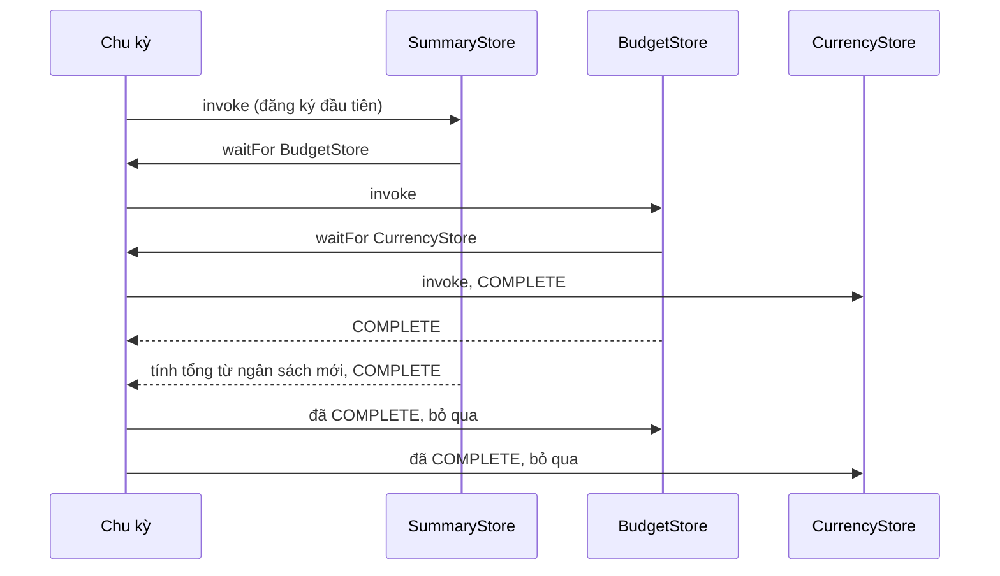

Ads Manager có hàng chục store: chiến dịch, ngân sách, tiền tệ, bảng tổng hợp. Người dùng sửa ngân sách của chiến dịch A. Store "tổng hợp" phải tính lại tổng, nhưng nó chỉ tính đúng nếu store "ngân sách" đã cập nhật **trước**. Thứ tự đăng ký callback không phải thứ tự phụ thuộc.

Flux giải bài này bằng `waitFor`: trong callback của mình, store tổng hợp nói "cho BudgetStore chạy trước đã". Facebook có `Dispatcher` của Flux công khai trên npm, nhưng Ads Manager dùng một bản riêng: `AdsDispatchCycle`.

Cùng nhóm hạ tầng là `AdsFuncChannel`: một proxy cho phép gọi một module **trước khi** nó tải xong. Lời gọi được đệm lại và chạy khi module thật có mặt.

> [!TIP]
> **Tóm tắt**
> - `AdsDispatchCycle` là một object cho **mỗi** lần dispatch. Mỗi callback có trạng thái `PENDING → STARTED → COMPLETE`; `waitFor(ids)` chạy ngay các callback còn `PENDING`. Gặp callback đang `STARTED` là phụ thuộc vòng: lỗi in ra cả chuỗi tên đang chạy dở.
> - Có đo thời gian từng callback khi bật instrumentation. Không có `try/finally`: callback ném lỗi để chu kỳ ở trạng thái dở dang.
> - `AdsFuncChannel` biến mỗi phương thức thành "tin nhắn gọi hàm" và đệm lại cho tới khi `setBackend`. Trong lúc đệm, lời gọi trả `undefined`; phương thức có lớp bọc thì lớp bọc chạy **hai lần** khi xả hàng.
> - Bản viết lại: `try/finally`, dispatch lồng nhau được xếp hàng, proxy trả `Promise` của kết quả thật.

<iframe class="demo-frame" src="/demos/facebook-patterns/index.html?theme=dark#/dispatch-cycle" title="Demo dispatch-cycle" loading="lazy" style="height: 1000px"></iframe>

<p class="demo-links">▶ <a href="/demos/facebook-patterns/index.html#/dispatch-cycle" target="_blank" rel="noopener">Mở demo toàn màn hình ↗</a> · <a href="https://stackblitz.com/github/hunghg255/blog-hunghg/tree/master/examples/facebook-patterns?file=src/lib/dispatchCycle.ts" target="_blank" rel="noopener">Sửa code trên StackBlitz ↗</a> · <a href="https://github.com/hunghg255/blog-hunghg/blob/master/examples/facebook-patterns/src/lib/dispatchCycle.ts" target="_blank" rel="noopener">Xem source trên GitHub ↗</a></p>

## Facebook làm thế nào?

### `AdsDispatchCycle` (bundle `99.js`)

Lõi là một `switch` trên trạng thái của callback (bản đầy đủ trong spoiler):

```js
invoke(id) {
  switch (this.state[id]) {
    case COMPLETE: break;
    case PENDING:  this.state[id] = STARTED; this.stack.push(id);
                   this.fns[id](this.payload);                       // có thể gọi waitFor bên trong
                   this.stack.pop(); this.state[id] = COMPLETE; break;
    case STARTED:  invariant(false, /* 15659 */ id, this.names[id], this.actionType,
                             this.stack.map((x) => this.names[x]).join(', '));
  }
}
```

::: spoiler Code gốc đã đổi tên biến: AdsDispatchCycle

```js
const State = { PENDING: 'PENDING', STARTED: 'STARTED', COMPLETE: 'COMPLETE' };

class AdsDispatchCycle {
  constructor(callbacks /* Map id → fn */, payload, actionType, names /* id → tên store */) {
    this.ids = []; this.fns = {}; this.state = {}; this.stack = [];
    this.payload = payload; this.actionType = actionType; this.names = names;
    const report = AdsDataAtomInstrumentation.onMeasureDispatchCallbacks();
    if (report) { this.report = report; this.entries = []; }
    callbacks.forEach((fn, id) => this.register(id, fn));
  }

  start() {
    for (const id of this.ids) this.invoke(id);
    if (this.entries && this.report) this.report({ entries: this.entries, actionType: this.actionType });
  }

  waitFor(ids) { for (const id of ids) this.invoke(id); }

  invoke(id) {
    switch (this.state[id]) {
      case State.COMPLETE: break;
      case State.PENDING: {
        this.state[id] = State.STARTED;
        this.stack.push(id);
        const start = this.report ? performance.now() : null;
        this.fns[id](this.payload);
        if (this.entries && start != null)
          this.entries.push({ start, end: performance.now(), name: this.names[id] ?? 'unknown' });
        this.stack.pop();
        this.state[id] = State.COMPLETE;
        break;
      }
      case State.STARTED:
        invariant(false, /* mã lỗi 15659 */ id, this.names[id], this.actionType,
                  this.stack.map((x) => this.names[x]).join(', '));
    }
  }
}
```

:::

So với `Dispatcher` của Flux:

- **Chu kỳ là object riêng.** Flux giữ trạng thái `isPending`/`isHandled` trên chính dispatcher và cấm dispatch lồng nhau ("Cannot dispatch in the middle of a dispatch"). Ở đây mỗi dispatch tạo một chu kỳ mới, trạng thái không dính sang lần sau.
- **Lỗi vòng có ngữ cảnh.** Flux báo "Circular dependency detected while waiting for X". Bản Ads báo tên store, loại action và **cả chuỗi** đang chạy dở, ví dụ `SummaryStore, BudgetStore`. Với hàng chục store, chuỗi này là thứ giúp tìm ra vòng.
- **Đo thời gian tuỳ chọn.** Chỉ khi `onMeasureDispatchCallbacks()` trả về hàm báo cáo thì mới gọi `performance.now()`. Tắt thì không tốn gì.

Chỗ thiếu: không có `try/finally`. Callback ném lỗi thì `stack` không được `pop`, trạng thái kẹt ở `STARTED`, và báo cáo thời gian của cả chu kỳ không được gửi. Vì chu kỳ là object dùng một lần, lần dispatch sau không bị ảnh hưởng (khác Flux, nơi thiếu `finally` sẽ kẹt cả dispatcher). Nhưng nếu một store bắt lỗi quanh `waitFor` rồi chạy tiếp, lần `waitFor` sau tới store vừa lỗi sẽ báo **phụ thuộc vòng giả**.



### `AdsFuncChannel` (bundle `238.js`)

Ý tưởng gói trong ba dòng (bản đầy đủ trong spoiler):

```js
buffering[name] = (...args) => this.callMessageHandler({ type: 'call', method: name, thisArg: null, argList: args });
this.messageToCall = (msg) => this.proxyMethods[msg.method].apply(msg.thisArg, msg.argList);   // xả: gọi lại proxyMethods
setBackend(b) { if (this.backend !== b) { this.backend = b; this.flushBuffer(); } }
```

::: spoiler Code gốc đã đổi tên biến: AdsFuncChannel

```js
class AdsFuncChannel {
  constructor(factory) {
    this.buffer = [];
    this.callMessageHandler = (msg) => this.buffer.push(msg);               // mặc định: đệm
    this.messageToCall = (msg) => this.proxyMethods[msg.method].apply(msg.thisArg, msg.argList);
    const forward = {};
    const methods = factory(forward);       // { tên: lớp bọc } hoặc { tên: null }
    const buffering = {};
    for (const name of Object.keys(methods)) {
      buffering[name] = (...args) =>
        this.callMessageHandler({ type: 'call', method: name, thisArg: null, argList: args });
      forward[name] = (...args) => this.backend[name](...args);
      if (methods[name] === null) methods[name] = forward[name];
    }
    this.backend = buffering;               // chưa có backend thật: mọi lời gọi thành tin nhắn
    this.proxyMethods = methods;
  }
  flushBuffer() { const b = this.buffer; this.buffer = []; b.forEach(this.messageToCall); }
  setBackend(b) { if (this.backend !== b) { this.backend = b; this.flushBuffer(); } }
  setCallMessageHandler(h) { this.callMessageHandler = h; this.flushBuffer(); }
}
```

:::

Người dùng gọi `channel.proxyMethods.track('click')`. Khi backend chưa có, lời gọi thành tin nhắn `{type: 'call', method, argList}` và nằm trong hàng đợi. `setBackend` xả hàng. `setCallMessageHandler` cho phép gửi tin nhắn đi nơi khác, ví dụ `postMessage` sang iframe hay worker: chính vì vậy nó tên là "channel".

Hai hành vi, kiểm chứng bằng cách chạy đúng module gốc trong Node:

1. **Mất giá trị trả về.** Trong lúc đệm, `track('click')` trả `undefined` (giá trị của hàm đệm, vốn không `return`). Người gọi không có cách nào biết kết quả, kể cả sau khi backend tải xong.
2. **Lớp bọc chạy hai lần.** Với `factory = (fwd) => ({ log: (msg) => fwd.log('[ads] ' + msg) })`, gọi `log('hi')` lúc đang đệm. Lớp bọc chạy, gọi `fwd.log('[ads] hi')`, tin nhắn đệm có đối số `'[ads] hi'`. Lúc xả, `messageToCall` gọi lại `proxyMethods.log('[ads] hi')`, tức **lại qua lớp bọc**, và backend nhận `'[ads] [ads] hi'`. Sau khi có backend thì không còn đệm nên không lặp. Có lẽ mọi chỗ dùng thật đều để `null` (không bọc) nên lỗi chưa lộ.

## Viết lại

Một chu kỳ dispatch, có `try/finally`:

```ts title=src/lib/dispatchCycle.ts
    const run = (name: string) => {
      const current = state.get(name);
      if (current === undefined) throw new Error(`waitFor: không có callback "${name}"`);
      if (current === 'complete') return;
      if (current === 'started') throw new CycleError([...stack.slice(stack.indexOf(name)), name]);
      state.set(name, 'started');
      stack.push(name);
      const start = now();
      try {
        callbacks.get(name)!(payload, cycle);
      } finally {
        // lỗi hay không, chu kỳ cũng phải về trạng thái nhất quán
        timings.push({ name, ms: now() - start });
        stack.pop();
        state.set(name, 'complete');
      }
    };
```

Proxy có đệm trả `Promise`:

```ts title=src/lib/bufferedProxy.ts
  const proxy = {} as BufferedProxy<T>;
  for (const method of methods) {
    (proxy as Record<PropertyKey, unknown>)[method] = (...args: unknown[]) => {
      if (backend) return invoke(method, args);
      if (buffer.length >= maxBuffer)
        return Promise.reject(new Error('bufferedProxy: hàng đợi đầy'));
      return new Promise((resolve, reject) => buffer.push({ method, args, resolve, reject }));
    };
  }

  return {
    proxy,
    get pending() {
      return buffer.length;
    },
    setBackend(next: T | null) {
      backend = next;
      if (!next) return;
      const calls = buffer;
      buffer = [];
      // theo đúng thứ tự gọi; một lời gọi lỗi không chặn các lời gọi sau
      for (const call of calls) invoke(call.method, call.args).then(call.resolve, call.reject);
    },
```

## Đi qua code

- `run` là bản `invoke` có `try/finally`. `started` gặp lại nghĩa là đang ở giữa chính nó: `stack.slice(stack.indexOf(name))` cắt đúng phần vòng, bỏ các store không liên quan ở đầu chuỗi.
- `runCycle` (trong file đầy đủ) tạo `state`, `stack`, `timings` mới cho mỗi action, giống ý "một object cho mỗi chu kỳ" của bản gốc.
- `dispatch` đẩy action vào `queue`; chỉ lời gọi ngoài cùng mới chạy vòng `while`. Action phát ra từ trong callback được chạy sau khi chu kỳ hiện tại xong. Lỗi thì `finally` đặt lại `dispatching` và bỏ hàng đợi.
- Proxy: khi chưa có backend, mỗi lời gọi tạo một `Promise` và cất `resolve`/`reject` vào hàng đợi. `setBackend` gọi lần lượt và nối kết quả vào đúng Promise đó.
- `invoke` bọc lời gọi trong `async`, nên backend ném lỗi đồng bộ cũng thành Promise bị `reject`, cùng một kiểu xử lý lỗi cho cả hai trường hợp.

**Khác bản gốc:**

- `try/finally` quanh mỗi callback: lỗi hay không, thời gian vẫn được ghi, `stack` vẫn `pop`, trạng thái về `complete`.
- Lỗi vòng là `CycleError` có `chain` dạng mảng, chỉ gồm phần vòng: `A → B → C → A`.
- Dispatch gọi trong lúc đang dispatch được xếp hàng, chạy sau chu kỳ hiện tại: mọi store thấy action theo cùng một thứ tự.
- Proxy không có lớp bọc: muốn biến đổi đối số thì làm ở chỗ gọi. Mỗi lời gọi trả `Promise` kết quả thật, lỗi của backend thành `reject`; hàng đợi có giới hạn.

::: spoiler Xem toàn bộ src/lib/dispatchCycle.ts

```ts title=src/lib/dispatchCycle.ts
/**
 * Dispatcher kiểu Flux có waitFor (ý tưởng từ AdsDispatchCycle của Facebook Ads Manager):
 * - Mỗi lần dispatch là một "chu kỳ": mọi callback ở trạng thái pending → started → complete.
 * - Callback gọi waitFor(...) để bắt callback khác chạy trước (store B cần số liệu mới của store A).
 * - Gặp lại callback đang "started" nghĩa là phụ thuộc vòng: báo lỗi kèm cả chuỗi.
 * Khác bản gốc: try/finally nên callback ném lỗi không để chu kỳ kẹt; dispatch lồng nhau được
 * xếp hàng thay vì chạy chen; luôn đo thời gian từng callback.
 */

type State = 'pending' | 'started' | 'complete';

export interface DispatchCycle<P> {
  readonly payload: P;
  /** chạy (nếu chưa) các callback theo tên, ngay bây giờ, trước khi tiếp tục */
  waitFor(...names: string[]): void;
}

export type DispatchCallback<P> = (payload: P, cycle: DispatchCycle<P>) => void;

export interface DispatchTiming {
  name: string;
  ms: number;
}

export class CycleError extends Error {
  constructor(readonly chain: string[]) {
    super(`Phụ thuộc vòng trong dispatch: ${chain.join(' → ')}`);
    this.name = 'CycleError';
  }
}

export function createDispatcher<P>(
  options: { now?: () => number; onCycle?: (t: DispatchTiming[], payload: P) => void } = {},
) {
  const now = options.now ?? (() => performance.now());
  const callbacks = new Map<string, DispatchCallback<P>>();
  const queue: P[] = [];
  let dispatching = false;

  function runCycle(payload: P) {
    const state = new Map<string, State>();
    for (const name of callbacks.keys()) state.set(name, 'pending');
    const stack: string[] = []; // các callback đang chạy dở, để in chuỗi khi gặp vòng
    const timings: DispatchTiming[] = [];

    const run = (name: string) => {
      const current = state.get(name);
      if (current === undefined) throw new Error(`waitFor: không có callback "${name}"`);
      if (current === 'complete') return;
      if (current === 'started') throw new CycleError([...stack.slice(stack.indexOf(name)), name]);
      state.set(name, 'started');
      stack.push(name);
      const start = now();
      try {
        callbacks.get(name)!(payload, cycle);
      } finally {
        // lỗi hay không, chu kỳ cũng phải về trạng thái nhất quán
        timings.push({ name, ms: now() - start });
        stack.pop();
        state.set(name, 'complete');
      }
    };

    const cycle: DispatchCycle<P> = {
      payload,
      waitFor: (...names) => names.forEach(run),
    };
    for (const name of callbacks.keys()) run(name);
    options.onCycle?.(timings, payload);
    return timings;
  }

  return {
    register(name: string, callback: DispatchCallback<P>) {
      if (callbacks.has(name)) throw new Error(`callback "${name}" đã có`);
      callbacks.set(name, callback);
      return () => void callbacks.delete(name);
    },
    /**
     * Dispatch trong lúc đang dispatch (callback phát action mới) được xếp hàng, chạy sau khi
     * chu kỳ hiện tại xong, để mọi store thấy action theo cùng một thứ tự.
     */
    dispatch(payload: P) {
      queue.push(payload);
      if (dispatching) return;
      dispatching = true;
      try {
        while (queue.length) runCycle(queue.shift()!);
      } finally {
        dispatching = false;
        queue.length = 0;
      }
    },
    get isDispatching() {
      return dispatching;
    },
  };
}
```

:::

::: spoiler Xem toàn bộ src/lib/bufferedProxy.ts

```ts title=src/lib/bufferedProxy.ts
/**
 * Proxy có đệm (ý tưởng từ AdsFuncChannel): gọi được ngay cả khi "backend" thật chưa tải xong;
 * lời gọi được xếp hàng và chạy theo đúng thứ tự khi có backend.
 * Khác bản gốc: mọi lời gọi trả Promise của kết quả thật (bản gốc trả undefined khi đang đệm),
 * và không có lớp bọc chạy lại lúc xả hàng (bản gốc chạy lớp bọc hai lần với đối số đã bọc).
 */

type AnyFn = (...args: never[]) => unknown;
type Methods<T> = { [K in keyof T]: T[K] extends AnyFn ? K : never }[keyof T];

export type BufferedProxy<T> = {
  [K in Methods<T>]: T[K] extends (...args: infer A) => infer R
    ? (...args: A) => Promise<Awaited<R>>
    : never;
};

interface Call {
  method: PropertyKey;
  args: unknown[];
  resolve: (v: unknown) => void;
  reject: (e: unknown) => void;
}

export function createBufferedProxy<T extends object>(
  methods: readonly Methods<T>[],
  options: { maxBuffer?: number } = {},
) {
  const maxBuffer = options.maxBuffer ?? 1000;
  let backend: T | null = null;
  let buffer: Call[] = [];

  const invoke = (method: PropertyKey, args: unknown[]) =>
    // async: lỗi đồng bộ của backend cũng thành Promise bị reject, như khi đang đệm
    (async () => (backend as Record<PropertyKey, (...a: unknown[]) => unknown>)[method](...args))();

  const proxy = {} as BufferedProxy<T>;
  for (const method of methods) {
    (proxy as Record<PropertyKey, unknown>)[method] = (...args: unknown[]) => {
      if (backend) return invoke(method, args);
      if (buffer.length >= maxBuffer)
        return Promise.reject(new Error('bufferedProxy: hàng đợi đầy'));
      return new Promise((resolve, reject) => buffer.push({ method, args, resolve, reject }));
    };
  }

  return {
    proxy,
    get pending() {
      return buffer.length;
    },
    setBackend(next: T | null) {
      backend = next;
      if (!next) return;
      const calls = buffer;
      buffer = [];
      // theo đúng thứ tự gọi; một lời gọi lỗi không chặn các lời gọi sau
      for (const call of calls) invoke(call.method, call.args).then(call.resolve, call.reject);
    },
  };
}
```

:::

## Tại sao không làm cách khác?

- **Sắp xếp thứ tự đăng ký cho đúng**: dễ vỡ. Thêm một store mới ở module khác là thứ tự đổi. `waitFor` khai báo phụ thuộc ngay chỗ dùng.
- **Sắp xếp topo trước khi dispatch**: cần biết phụ thuộc trước, mà phụ thuộc trong Flux có thể tuỳ theo action (chỉ action `SET_BUDGET` mới cần chờ). `waitFor` gọi lúc chạy nên linh hoạt hơn, và vẫn phát hiện vòng.
- **Store tự subscribe nhau (kiểu observable)**: không có "một thời điểm mọi store đã cập nhật xong", dễ render với state nửa cũ nửa mới. Một chu kỳ dispatch đồng bộ đảm bảo React chỉ thấy state sau khi mọi store xong.
- **Cấm dispatch lồng nhau (như Flux)**: an toàn nhưng làm người dùng phải `setTimeout` để dispatch tiếp. Xếp hàng giữ tính đồng bộ mà không chen ngang.
- **Proxy trả `undefined`**: hợp với lời gọi "bắn rồi quên" như log. Nhưng khi API có giá trị trả về (lấy ID sự kiện, kết quả xác thực), `Promise` là cách duy nhất để trả lời sau.

## Edge case và cạm bẫy

- **`waitFor` ngoài chu kỳ**: chỉ gọi được trong callback, vì nó cần `cycle`. Bản viết lại truyền `cycle` làm đối số thứ hai, không có cách nào gọi nhầm ngoài lúc dispatch.
- **Lỗi giữa chu kỳ**: các callback chưa chạy sẽ không chạy, và các action đang xếp hàng bị bỏ. Store có thể lệch nhau. Đây là hành vi của Flux; nếu muốn "chạy tiếp các store khác", phải bắt lỗi trong từng callback.
- **Callback chậm**: một dispatch đồng bộ chặn luồng chính. Timing cho biết store nào chậm; demo vẽ thanh thời gian từng store.
- **Đệm vô hạn**: backend không bao giờ tải (mạng lỗi) thì hàng đợi lớn mãi. Có `maxBuffer`; thêm timeout để `reject` các lời gọi đang chờ nếu cần.
- **Thứ tự sau khi có backend**: hàng đợi được xả **đồng bộ** trong `setBackend`, trước bất kỳ lời gọi mới nào, nên thứ tự được giữ. Nếu xả bất đồng bộ, một lời gọi mới có thể chen lên trước.

## Dùng trong dự án

```ts
import { createDispatcher } from './dispatchCycle';
import { createBufferedProxy } from './bufferedProxy';

type Action = { type: 'SET_BUDGET'; id: string; amount: number } | { type: 'RESET' };

const dispatcher = createDispatcher<Action>();

dispatcher.register('BudgetStore', (action) => {
  if (action.type === 'SET_BUDGET') budgets.set(action.id, action.amount);
});
dispatcher.register('SummaryStore', (action, cycle) => {
  cycle.waitFor('BudgetStore');
  summary.total = [...budgets.values()].reduce((a, b) => a + b, 0);
});

// analytics tải lười; code ở mọi nơi gọi ngay được
interface Analytics { track(name: string, data?: object): string }
const analytics = createBufferedProxy<Analytics>(['track']);
export const track = analytics.proxy.track;
import('./analytics-impl').then((m) => analytics.setBackend(m.createAnalytics()));

const eventId = await track('budget_changed', { id: 'A' }); // có ID thật dù gọi trước khi tải
```

Muốn bắt store chậm, truyền `onCycle: (timings, action) => …` khi tạo dispatcher và log những lần có callback quá 8ms.

## Kiểm thử

::: spoiler Ví dụ test (bản phác, không có trong repo)

```ts
import { describe, expect, it } from 'vitest';
import { createDispatcher, CycleError } from './dispatchCycle';
import { createBufferedProxy } from './bufferedProxy';

describe('createDispatcher', () => {
  it('waitFor chạy phụ thuộc trước, mỗi callback một lần', () => {
    const order: string[] = [];
    const d = createDispatcher<string>();
    d.register('summary', (_, c) => { c.waitFor('campaign', 'budget'); order.push('summary'); });
    d.register('campaign', () => order.push('campaign'));
    d.register('budget', (_, c) => { c.waitFor('campaign'); order.push('budget'); });
    d.dispatch('x');
    expect(order).toEqual(['campaign', 'budget', 'summary']);
  });

  it('báo vòng kèm chuỗi', () => {
    const d = createDispatcher<number>();
    d.register('A', (_, c) => c.waitFor('B'));
    d.register('B', (_, c) => c.waitFor('C'));
    d.register('C', (_, c) => c.waitFor('A'));
    expect(() => d.dispatch(1)).toThrow(CycleError);
    try { d.dispatch(1); } catch (e) { expect((e as CycleError).chain).toEqual(['A', 'B', 'C', 'A']); }
  });

  it('dispatch lồng nhau chạy sau chu kỳ hiện tại', () => {
    const seen: string[] = [];
    const d = createDispatcher<string>();
    d.register('a', (p) => { seen.push(`a:${p}`); if (p === 'first') d.dispatch('second'); });
    d.register('b', (p) => seen.push(`b:${p}`));
    d.dispatch('first');
    expect(seen).toEqual(['a:first', 'b:first', 'a:second', 'b:second']);
  });

  it('callback lỗi không làm kẹt dispatcher', () => {
    const d = createDispatcher<number>();
    let ok = 0;
    d.register('x', (p) => { if (p === 1) throw new Error('boom'); ok++; });
    expect(() => d.dispatch(1)).toThrow('boom');
    expect(d.isDispatching).toBe(false);
    d.dispatch(2);
    expect(ok).toBe(1);
  });
});

describe('createBufferedProxy', () => {
  it('đệm theo thứ tự, trả kết quả thật, lỗi thành reject', async () => {
    const p = createBufferedProxy<{ track(e: string): string; fail(): void }>(['track', 'fail']);
    const a = p.proxy.track('click');
    const b = p.proxy.fail();
    expect(p.pending).toBe(2);
    p.setBackend({ track: (e) => `ok-${e}`, fail: () => { throw new Error('x'); } });
    await expect(a).resolves.toBe('ok-click');
    await expect(b).rejects.toThrow('x');
    await expect(p.proxy.track('now')).resolves.toBe('ok-now');
  });
});
```

:::

## So với thư viện và chuẩn web

- **`flux` (npm, Facebook)**: `Dispatcher` với `register`, `waitFor(tokens)`, `isDispatching`; cấm dispatch lồng nhau. Gói đã ngừng phát triển; README khuyên dùng thư viện khác.
- **Redux**: một store, reducer gộp lại bằng `combineReducers`; phụ thuộc giữa các phần state được giải bằng selector (tính lúc đọc) thay vì `waitFor`. Không có vấn đề thứ tự, nhưng mỗi selector phải được memo (xem [bài #68](/blogs/facebook-multikey-memo-interning)).
- **Zustand, Jotai, MobX**: phụ thuộc giữa các store biểu diễn bằng derived state/computed, thư viện tự tính thứ tự.
- **Comlink**: proxy cho worker; mọi lời gọi trả `Promise`, giống `createBufferedProxy` nhưng qua `postMessage`. Đó cũng là ý tưởng của `setCallMessageHandler` trong bản gốc.
- **Hàng đợi lệnh của snippet analytics** (Google Analytics `gtag`, Segment `analytics.js`): đặt một mảng `dataLayer`/`analytics` tạm, đẩy lời gọi vào, script thật tải xong thì xả. Cùng mẫu, cũng mất giá trị trả về.

---

Bài này thuộc series **[Học từ mã nguồn Facebook](/series/facebook)** (106 bài, đọc theo thứ tự).

::: spoiler Xem nhanh danh sách bài trong series

*Phần 1*

- [Mở đầu: cách đọc code minify của Facebook](/blogs/learn-from-facebook-source-code)
- [#1 Dùng chung IntersectionObserver + infinite scroll](/blogs/facebook-shared-intersection-observer)
- [#2 useViewportDuration: đo thời gian thực sự được xem](/blogs/facebook-use-viewport-duration)
- [#3 Preload code + data khi hover](/blogs/facebook-preload-on-hover)
- [#4 Toast manager với external store](/blogs/facebook-toast-manager)
- [#5 Network status + heartbeat backoff](/blogs/facebook-network-status-heartbeat)
- [#6 ErrorGuard: bắt lỗi theo ngữ cảnh](/blogs/facebook-error-guard)
- [#7 Banzai: gom log theo lô + sendBeacon](/blogs/facebook-batch-logger)
- [#8 Focus trap + Esc theo layer](/blogs/facebook-focus-trap)

*Phần 2*

- [#9 Mẹo calc(… * 9999): container query, line-clamp, mũi tên carousel bằng CSS](/blogs/facebook-css-9999-trick)
- [#10 Thanh cuộn tuỳ biến bằng CSS 3D](/blogs/facebook-css-3d-scrollbar)
- [#11 Modal cuộn bằng window, giữ vị trí trang nền](/blogs/facebook-document-scroll-modal)
- [#12 Popover, tooltip group và hovercard](/blogs/facebook-popover-tooltip)
- [#13 Primitive Pressable + focus-visible](/blogs/facebook-pressable)
- [#14 Tab "Xem thêm" + sticky header bằng IntersectionObserver](/blogs/facebook-priority-tabs-sticky-header)
- [#15 Avatar khoét mask, gradient Messenger, skeleton steps()](/blogs/facebook-visual-tricks)
- [#16 Khung chat không giật](/blogs/facebook-chat-scroller)
- [#17 Thuật toán chọn bố cục collage ảnh](/blogs/facebook-photo-collage-layout)
- [#18 Keep-alive tab trong SPA](/blogs/facebook-keep-alive-tabs)
- [#19 Tự đo Visual Completion & interaction tracing](/blogs/facebook-visual-completion)
- [#20 Router SPA bền bỉ & tải chunk có retry](/blogs/facebook-spa-router-resilient-loading)

*Phần 3*

- [#21 Smart Compose: gợi ý chữ mờ khi gõ](/blogs/facebook-smart-compose-ghost-text)
- [#22 MQTT ngay trong trình duyệt, tự chuyển sang long-poll](/blogs/facebook-mqtt-in-browser)
- [#23 Đo thời gian dùng bằng bitmap 64 giây](/blogs/facebook-time-spent-bitmap)
- [#24 Bảng reaction nhấn giữ rồi trượt](/blogs/facebook-reaction-press-slide)
- [#25 Tìm kiếm gấp dấu, phiên âm và highlight đầu từ](/blogs/facebook-search-diacritics-tokenize)
- [#26 Ring buffer biết trace nào đã mất log](/blogs/facebook-trace-ring-buffer)
- [#27 Engine animation JS: một vòng rAF và solver cubic-bezier](/blogs/facebook-keyframes-loop-cubic-bezier)
- [#28 Bootloader: bitmap tài nguyên đã tải, chỉ reload khi cần](/blogs/facebook-bootloader-bitmap-consistency)
- [#29 Nhận biết click do screen reader tạo ra](/blogs/facebook-virtual-cursor-detection)
- [#30 Tải trước feed theo chất lượng mạng, đoán hạng thiết bị](/blogs/facebook-network-aware-prefetch)
- [#31 Hàng đợi gửi tin chat giữ đúng thứ tự](/blogs/facebook-ordered-send-queue)
- [#32 Gộp lời gọi API trong cùng một tick](/blogs/facebook-api-batcher)
- [#33 Resize ảnh trong pool Web Worker](/blogs/facebook-jpeg-resize-worker-pool)
- [#34 Crop ảnh theo nhiều khuôn mặt](/blogs/facebook-face-aware-crop)
- [#35 Kéo-thả sắp xếp và vùng thả file không nhấp nháy](/blogs/facebook-flicker-free-drag-drop)
- [#36 Tiện ích UI: fade-out, sticky event, hàm huỷ được](/blogs/facebook-ui-utility-hooks)
- [#37 Hạ tầng nhỏ: cookie, hash lỗi, prefetch khi chuột dừng](/blogs/facebook-small-infra-cookie-hash-idle)

*Phần 4–6*

- [#38 Đồng bộ tin nhắn: phát hiện lỗ seqID và fetch bù theo tầng](/blogs/facebook-messenger-sync-seqid-gaps)
- [#39 OTID: ID tin nhắn kiểu Snowflake sinh ở client](/blogs/facebook-otid-client-snowflake)
- [#40 QPL: lấy mẫu từ lúc bắt đầu, đo RTT gửi tin đầu-cuối](/blogs/facebook-qpl-send-rtt)
- [#41 Bộ điều phối request bảy chế độ gộp và chống trùng](/blogs/facebook-request-dispatcher-modes)
- [#42 Thread list theo mốc thời gian, cookie presence có version](/blogs/facebook-threadlist-ranged-presence)
- [#43 Composer dạng plugin: reducer, dirty checker, chuỗi kiểm tra](/blogs/facebook-plugin-composer)
- [#44 Thanh toán bất đồng bộ: subscribe trước, poll dự phòng](/blogs/facebook-async-checkout)
- [#45 Validate số thẻ: sửa lỗi gõ, dải BIN, Luhn](/blogs/facebook-card-validation)
- [#46 Lịch chọn khoảng ngày: bo góc dải chọn, phím đủ bộ, RTL](/blogs/facebook-range-calendar-a11y)
- [#47 Giờ mở cửa theo tuần: qua đêm, gộp khoảng, phần bù](/blogs/facebook-weekly-hours-intervals)
- [#48 Tiến độ đăng realtime: giữ event chờ snapshot, watchdog](/blogs/facebook-realtime-publish-snapshot)
- [#49 Tiền tệ theo đơn vị nhỏ nhất và ô nhập tiền](/blogs/facebook-currency-minor-units)
- [#50 Sửa hàng loạt Empty/Uniform/Mixed, seen/read bằng 2 bit](/blogs/facebook-bulk-edit-seen-bits)
- [#51 Phát hiện script lạ hook vào hàm native](/blogs/facebook-native-hook-detection)
- [#52 localStorage tự dọn khi đầy quota](/blogs/facebook-quota-aware-storage)
- [#53 Cache tuyến do server phân giải, chờ sẵn promise](/blogs/facebook-route-cache-prefetch)
- [#54 Lưới phím mũi tên 2D và focus không làm cuộn trang](/blogs/facebook-focus-table-grid)
- [#55 Tách emoji bằng máy trạng thái](/blogs/facebook-emoji-segmentation)
- [#56 Đọc trước ghi sau trong một frame, con tự biết vị trí](/blogs/facebook-read-then-write-dom)
- [#57 Hàng đợi lệnh cho video và stream sắp lại chunk](/blogs/facebook-video-command-queue)

*Phần 7–10*

- [#58 Ước lượng băng thông EWMA: loại outlier, nhớ qua phiên](/blogs/facebook-bandwidth-ewma-estimator)
- [#59 ABR theo độ tự tin phát và cắt bậc bitrate theo MOS](/blogs/facebook-abr-playback-confidence)
- [#60 Prefetch segment dự đoán từ manifest, parse hộp sidx](/blogs/facebook-dash-predicted-segments)
- [#61 Đọc metadata MP4/MOV ngay trên client](/blogs/facebook-mp4-metadata-client)
- [#62 Upload tiếp tục được: offset, hash dedupe, phát hiện treo](/blogs/facebook-resumable-upload)
- [#63 Fenwick tree: chọn ngẫu nhiên có trọng số và offset dòng](/blogs/facebook-fenwick-weighted-random)
- [#64 Vạch trục số và trục thời gian "đẹp"](/blogs/facebook-nice-axis-ticks)
- [#65 Damerau-Levenshtein theo dải chéo và tự sửa tên gõ sai](/blogs/facebook-damerau-levenshtein)
- [#66 PRNG có seed, shuffle tái lập và lấy mẫu trace](/blogs/facebook-seeded-prng-sampling)
- [#67 Cặp min/max-heap tái dùng vị trí trong danh sách ảo](/blogs/facebook-dual-heap-buffer-set)
- [#68 Memo nhiều đối số bằng Map/WeakMap và interning object](/blogs/facebook-multikey-memo-interning)
- [#69 Thống kê cửa sổ trượt và đại số khoảng thời gian](/blogs/facebook-moving-stat-intervals)
- [#70 Int64 từ hai số 32-bit, decode UTF, offset theo code point](/blogs/facebook-int64-utf-codepoints)
- [#71 Engine múi giờ IANA trên client, phát hiện lệch giờ](/blogs/facebook-client-iana-timezone)
- [#72 Tự cài semver range](/blogs/facebook-semver-range)
- [#73 Auto-link URL, cắt chữ an toàn, giới hạn LaTeX](/blogs/facebook-autolink-safe-truncate)
- [#74 Parser query kiểu PHP chống prototype pollution](/blogs/facebook-php-query-serializer)
- [#75 Popover tự lật theo phần tràn nhỏ nhất](/blogs/facebook-popover-auto-flip)
- [#76 Tiền tố for(;;) chống JSON hijacking, đọc stream](/blogs/facebook-csrf-prefix-streaming)
- [#77 Chống lộ Referer, linkshim, xoá token trên URL](/blogs/facebook-referrer-linkshim-url-scrub)
- [#78 setImmediate bằng postMessage, gom delta chuột theo frame](/blogs/facebook-setimmediate-mouse-batching)
- [#79 Phát hiện crash qua heartbeat, dò proxy cache hỏng](/blogs/facebook-crash-heartbeat-proxy-check)
- [#80 DPR vào cookie cho ảnh @2x, che khoá trong log](/blogs/facebook-dpr-cookie-secret-redaction)
- **#81 Flux waitFor tự viết và proxy có đệm** (bài này)
- [#82 Crop đúng tỉ lệ, xoay sticker bằng ma trận](/blogs/facebook-image-crop-rotation-geometry)

*Phần 11–15*

- [#83 Chia subdomain giữa các tab bằng lease, long-poll theo bảng trạng thái](/blogs/facebook-tab-subdomain-lease-longpoll)
- [#84 MQTT QoS1: giữ publish chờ ack, gửi lại khi kết nối lại](/blogs/facebook-mqtt-qos1-republish)
- [#85 Cache Promise gộp request, cache lỗi ngắn, đua dữ liệu nhúng sẵn](/blogs/facebook-promise-cache-preload-race)
- [#86 Lịch retry: backoff có trần, Fibonacci, báo lỗi CDN mỗi N ngày](/blogs/facebook-retry-backoff-schedules)
- [#87 Giữ nguyên tham chiếu nhánh dữ liệu không đổi](/blogs/facebook-relay-recycle-nodes)
- [#88 Store optimistic: copy-on-write, rollback rồi áp lại](/blogs/facebook-relay-optimistic-store)
- [#89 Chỉ mục subscription theo record, hàng đợi task theo chiều sâu](/blogs/facebook-relay-subscription-index)
- [#90 Phân trang connection: cursor khớp đầu, edge không trùng](/blogs/facebook-relay-connection-pagination)
- [#91 Profiler kiểu middleware và memo selector có lấy mẫu kiểm tra](/blogs/facebook-profiler-middleware-memo-check)
- [#92 Đọc EBML/WebM Cues để tìm byte range của segment](/blogs/facebook-webm-ebml-cues)
- [#93 Stream HTTP Range tạm dừng được, tải tiếp đúng byte](/blogs/facebook-pausable-range-stream)
- [#94 Bảng khoảng thời gian gắn nhãn và nhảy qua lỗ buffer](/blogs/facebook-tagged-time-ranges-gaps)
- [#95 Gom chunk cho SourceBuffer, đồng bộ video bằng playbackRate](/blogs/facebook-sourcebuffer-video-sync)
- [#96 Gom tin nhắn thành cụm, vạch ngày và avatar đã xem](/blogs/facebook-message-grouping)
- [#97 Bao nhiêu tab chat vừa màn hình, chuỗi luật mở tab](/blogs/facebook-chat-tab-policy)
- [#98 Phím tắt Markdown trong editor, Backspace để hoàn tác](/blogs/facebook-markdown-shortcuts-editor)
- [#99 Offset theo code point hay UTF-16: bốn bug cùng một gốc](/blogs/facebook-codepoint-offset-bugs)
- [#100 Typeahead không nhảy: cache tiền tố, chặn reflow, khoá hover](/blogs/facebook-typeahead-stable-results)
- [#101 Hit-test trên canvas bằng phát lại path, nét đứt và cung Bézier](/blogs/facebook-canvas-hit-regions)
- [#102 Vòng tròn theo mét trên bản đồ Mercator](/blogs/facebook-mercator-meter-circles)
- [#103 Dò tính năng trình duyệt: ảnh EXIF 2×1, getter bẫy, scrollbar](/blogs/facebook-feature-probe-tricks)
- [#104 Bug định dạng số và kiểm tra dữ liệu theo locale](/blogs/facebook-locale-validation-bugs)
- [#105 Dispose cho đúng: idle callback, splice(-1), xoá nhầm key](/blogs/facebook-dispose-leak-bugs)

:::

Code + demo: [`examples/facebook-patterns`](https://github.com/hunghg255/blog-hunghg/tree/master/examples/facebook-patterns) · [Mở trên StackBlitz](https://stackblitz.com/github/hunghg255/blog-hunghg/tree/master/examples/facebook-patterns)
