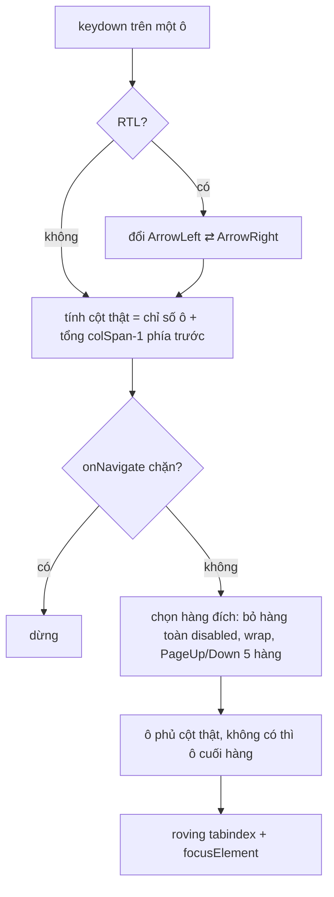

Lịch tháng, bảng emoji, danh sách kênh dạng lưới: người dùng bàn phím mong bấm mũi tên là đi sang ô bên cạnh, bấm Tab là thoát khỏi cả lưới chứ không phải Tab qua 42 ô. Khó hơn khi lưới có ô **gộp cột** (sự kiện kéo dài 3 ngày), có hàng **bị khoá**, và trang chạy ở chế độ **phải-sang-trái** (tiếng Ả Rập, Do Thái).

Việc thứ hai hay gặp: focus một phần tử **bằng code** (trả focus sau khi đóng dialog, focus ô đầu khi mở menu) mà trang không bị cuộn giật, và các nút chỉ hiện khi người dùng tự focus thì không bật lên.

> [!TIP]
> **Tóm tắt**
> - Lưới 2D: tính **cột thật** của ô bằng cách cộng `colSpan` các ô đứng trước; đi lên/xuống giữ cột thật đó, hàng ngắn hơn thì về ô cuối.
> - Roving tabindex: chỉ một ô có `tabIndex=0`, mũi tên đổi ô, Tab đi thẳng ra khỏi lưới. RTL thì đổi vai trò mũi tên trái/phải.
> - Focus không cuộn: phát hiện `focus({ preventScroll })` bằng **getter**; trình duyệt cũ thì lưu `scrollTop` mọi tổ tiên đang tràn rồi trả lại.
> - Cờ "focus do code" (`isFocusingWithoutUserIntent`) để UI phân biệt focus của người dùng với focus của chương trình.

<iframe class="demo-frame" src="/demos/facebook-patterns/index.html?theme=dark#/focus-table" title="Demo focus-table" loading="lazy" style="height: 1020px"></iframe>

<p class="demo-links">▶ <a href="/demos/facebook-patterns/index.html#/focus-table" target="_blank" rel="noopener">Mở demo toàn màn hình ↗</a> · <a href="https://stackblitz.com/github/hunghg255/blog-hunghg/tree/master/examples/facebook-patterns?file=src/lib/focusTable.ts" target="_blank" rel="noopener">Sửa code trên StackBlitz ↗</a> · <a href="https://github.com/hunghg255/blog-hunghg/blob/master/examples/facebook-patterns/src/lib/focusTable.ts" target="_blank" rel="noopener">Xem source trên GitHub ↗</a></p>

## Facebook làm thế nào?

### FocusTable: bảng → hàng → ô

`FocusTable.react` (trong bundle `262.js`) là một factory: `createFocusTable(scopeQuery)` trả về ba component `[Table, Row, Cell]`. Mỗi tầng là một `React.unstable_Scope` (API nội bộ của React cho phép truy vấn các node DOM bên trong một vùng) cộng một context. Ô (`Cell`) đăng ký `{ scopeRef, disabled, colSpan, tag }` vào context của hàng; hàng đăng ký vào bảng. Khi một ô nhận `keydown`, nó hỏi bảng để biết mình đang ở đâu.

Phần quan trọng nhất là **cột thật**. Giải mã hàm `r()` (đổi tên biến):

```js
// trả về [chỉ số ô trong hàng, cột bắt đầu thật]
function indexAndColumn(cells, scope) {
  let extra = 0;
  for (let i = 0; i < cells.length; i++) {
    if (cells[i].scopeRef.current === scope) return [i, i + extra];
    extra += (cells[i].colSpan ?? 1) - 1; // ô trước chiếm thêm bao nhiêu cột
  }
  return [-1, -1];
}
```

Đi xuống hàng dưới, Facebook tìm ô **phủ** cột đó: cộng dồn `colSpan` cho tới khi vượt quá cột cần tìm (`o()`), không có thì về ô cuối hàng (`p()`):

```js
function cellAtColumn(row, col) {
  let end = 0;
  for (const cell of enabledCells(row)) {
    end += cell.colSpan || 1;
    if (end > col) return cell;
  }
  return null; // nơi gọi sẽ focus ô cuối hàng
}
```

Các phím được xử lý trong một `switch` lớn: Home/End (có Ctrl thì đi đầu/cuối **bảng**), `PageUp`/`PageDown` nhảy `pageJumpSize` hàng (mặc định `j = 5`), `wrapX`, `wrapY`, `wrapXToNextLine`. Khi `Locale.isRTL()`, `ArrowLeft` và `ArrowRight` được đổi chỗ trước khi vào `switch`. Hàng có tất cả ô `disabled` bị lọc khỏi danh sách hàng (`u()`), nên mũi tên nhảy qua.

Với Tab, mỗi lần bấm, FocusTable chỉ để **đúng phần tử đang focus** là tabbable (`setElementCanTab(el, true)`), mọi phần tử khác trong bảng bị đặt không tabbable. Đó là **roving tabindex** (tabindex luân chuyển): cả lưới chỉ chiếm một điểm dừng Tab.

Có thêm một lối thoát tinh tế: prop `onNavigate` nhận `{ type, currentRowIndex, currentCellIndex, getCellByTag, focusCell, preventDefault }`. Component bên ngoài có thể chặn một hướng hoặc tự focus ô khác. `getCellByTag(tag)` tìm ô có nhãn cho trước, **xoè dần** từ cột hiện tại sang hai bên (`b-f`, `b+f`), rồi tìm ở các hàng sau, quay vòng.

### FocusManager: focus mà không cuộn

`FocusManager.react` (bundle `26.js`) bọc mọi lời gọi focus của Comet. Khi cần focus mà không cuộn, nó phải biết trình duyệt có hiểu `focus({ preventScroll: true })` không. Cách phát hiện:

```js
function detect() {
  try {
    const div = document.createElement('div');
    div.addEventListener('focus', (e) => { e.preventDefault(); e.stopPropagation(); }, true);
    div.focus(Object.defineProperty({}, 'preventScroll', {
      get() { supported = true; },
    }));
  } catch {}
}
```

Trình duyệt nào hỗ trợ option thì phải **đọc** thuộc tính `preventScroll` khi chuyển object sang `FocusOptions` (bước chuyển kiểu theo WebIDL chạy trước cả việc kiểm tra phần tử có focus được không), getter chạy và cờ bật. Trình duyệt cũ bỏ qua đối số, getter không bao giờ chạy. Đây là cùng mẹo với cách phát hiện `{ passive: true }` của addEventListener.

Không hỗ trợ thì Facebook làm thủ công: đi ngược lên cây, tổ tiên nào có `offsetHeight < scrollHeight` hoặc `offsetWidth < scrollWidth` thì lưu `[node, scrollTop, scrollLeft]`, cộng thêm `document.scrollingElement`; focus; rồi gán lại các giá trị đã lưu.

Hàm `focusElement` còn làm hai việc nữa:
- Đặt tạm `tabIndex = -1` trong lúc focus rồi trả lại giá trị cũ; phần tử có `_tabIndexState.canTab === false` thì không focus.
- Bật cờ `g` trong lúc gọi focus, đọc qua `isFocusingWithoutUserIntent()`. `useMenuButtonVisibilityState` (bundle `87.js`) dùng cờ này: nút "…" của một dòng chỉ hiện khi hover hoặc **người dùng** focus vào dòng; focus do code (trả focus sau khi đóng dialog) thì không làm nút bật lên.



## Viết lại

Bản viết lại tách phần **tính toán** ra khỏi React: lưới là mảng 2 chiều `GridCell[][]` (`{ el, colSpan, disabled, tag }`), hàm `nextPosition` nhận vị trí hiện tại và phím, trả về vị trí mới. Cách này test được không cần DOM, và gắn được vào bất kỳ framework nào.

Hai hàm nền: cột bắt đầu của một ô, và ô phủ một cột.

```ts title=src/lib/focusTable.ts
  let col = 0;
  for (let i = 0; i < index; i++) col += row[i].colSpan ?? 1;
  return col;
}

/** Ô phủ cột `col`. Hàng ngắn hơn thì trả ô cuối (giống Facebook). */
export function cellIndexAtColumn(row: GridCell[], col: number, tag?: string) {
  let end = 0;
  for (let i = 0; i < row.length; i++) {
    end += row[i].colSpan ?? 1;
    if (end > col && (tag === undefined || row[i].tag === tag)) return i;
  }
  return tag === undefined && row.length > 0 ? row.length - 1 : -1;
}
```

Bảng chuyển phím (sau khi đã đổi trái/phải cho RTL và tính `col`):

```ts title=src/lib/focusTable.ts
  switch (k) {
    case 'ArrowRight':
      if (cellIdx < row.length - 1) return at(rowIdx, cellIdx + 1);
      if (wrapX) return at(rowIdx, 0);
      if (wrapXToNextLine && rowIdx < last) return at(rowIdx + 1, 0);
      return null;
    case 'ArrowLeft':
      if (cellIdx > 0) return at(rowIdx, cellIdx - 1);
      if (wrapX) return at(rowIdx, row.length - 1);
      if (wrapXToNextLine && rowIdx > 0) return at(rowIdx - 1, rows[rowIdx - 1].row.length - 1);
      return null;
    case 'ArrowDown':
      if (ctrl) return rowIdx === last ? null : sameColumn(last);
      if (rowIdx < last) return sameColumn(rowIdx + 1);
      return wrapY ? sameColumn(0) : null;
    case 'ArrowUp':
      if (ctrl) return rowIdx === 0 ? null : sameColumn(0);
      if (rowIdx > 0) return sameColumn(rowIdx - 1);
      return wrapY ? sameColumn(last) : null;
    case 'PageDown':
      return rowIdx === last ? null : sameColumn(Math.min(last, rowIdx + pageJumpSize));
    case 'PageUp':
      return rowIdx === 0 ? null : sameColumn(Math.max(0, rowIdx - pageJumpSize));
    case 'Home':
      if (ctrl) return rowIdx === 0 && cellIdx === 0 ? null : at(0, 0);
      return cellIdx === 0 ? null : at(rowIdx, 0);
    case 'End':
      if (ctrl) {
        const lastRow = rows[last].row;
        return rowIdx === last && cellIdx === row.length - 1 ? null : at(last, lastRow.length - 1);
      }
      // Bản gốc so chỉ số với chính object ô (luôn khác) nên End luôn focus lại; ở đây so chỉ số.
      return cellIdx === row.length - 1 ? null : at(rowIdx, row.length - 1);
  }
}
```

Phần focus không cuộn, với `supportsPreventScroll()` và `snapshotScroll()` như mô tả ở trên:

```ts title=src/lib/focusTable.ts
export function focusElement(el: HTMLElement, { preventScroll = false, strategy = 'auto' }: FocusOptionsEx = {}) {
  const prev = programmaticFocus;
  programmaticFocus = true;
  try {
    if (!preventScroll) el.focus();
    else if (strategy !== 'fallback-only' && supportsPreventScroll()) el.focus({ preventScroll: true });
    else if (strategy === 'native-only') el.focus();
    else {
      const restore = snapshotScroll(el);
      el.focus();
      restore();
    }
  } finally {
    programmaticFocus = prev;
  }
}
```

::: spoiler Xem toàn bộ src/lib/focusTable.ts

```ts title=src/lib/focusTable.ts
/**
 * Lưới điều hướng bằng phím mũi tên 2D (ý tưởng từ FocusTable.react của Facebook)
 * và focus không làm cuộn trang (ý tưởng từ FocusManager.react).
 *
 * - Ô có colSpan: đi lên/xuống giữ đúng CỘT thật, không phải chỉ số trong hàng.
 * - RTL: ArrowLeft/ArrowRight đổi vai trò cho nhau.
 * - Home/End trong hàng, Ctrl+Home/End về đầu/cuối bảng, PageUp/PageDown nhảy 5 hàng.
 * - Hàng toàn ô disabled bị bỏ qua.
 * - Roving tabindex: chỉ một ô có tabIndex=0, Tab đi thẳng ra khỏi lưới.
 */

export interface GridCell {
  el: HTMLElement;
  /** số cột ô chiếm, mặc định 1 */
  colSpan?: number;
  disabled?: boolean;
  /** nhãn để tìm ô theo loại (vd 'action'), giống getCellByTag */
  tag?: string;
}

export interface GridPosition {
  row: number;
  /** chỉ số ô trong hàng (không phải cột) */
  index: number;
}

export interface GridOptions {
  rtl?: boolean;
  /** ArrowLeft ở ô đầu → ô cuối cùng hàng (và ngược lại) */
  wrapX?: boolean;
  /** ArrowUp ở hàng đầu → hàng cuối (và ngược lại) */
  wrapY?: boolean;
  /** ArrowRight ở ô cuối → ô đầu của hàng sau */
  wrapXToNextLine?: boolean;
  /** số hàng PageUp/PageDown nhảy, mặc định 5 như Facebook */
  pageJumpSize?: number;
}

export type GridKey = 'ArrowUp' | 'ArrowDown' | 'ArrowLeft' | 'ArrowRight' | 'Home' | 'End' | 'PageUp' | 'PageDown';

const enabled = (row: GridCell[]) => row.filter((cell) => !cell.disabled);

/** Hàng có ít nhất một ô dùng được. Facebook bỏ hẳn hàng toàn ô disabled khỏi việc điều hướng. */
function usableRows(grid: GridCell[][]) {
  return grid.map((row, i) => ({ row: enabled(row), original: i })).filter((r) => r.row.length > 0);
}

/** Cột bắt đầu của ô thứ `index`: cộng colSpan của các ô đứng trước. */
export function startColumn(row: GridCell[], index: number) {
  let col = 0;
  for (let i = 0; i < index; i++) col += row[i].colSpan ?? 1;
  return col;
}

/** Ô phủ cột `col`. Hàng ngắn hơn thì trả ô cuối (giống Facebook). */
export function cellIndexAtColumn(row: GridCell[], col: number, tag?: string) {
  let end = 0;
  for (let i = 0; i < row.length; i++) {
    end += row[i].colSpan ?? 1;
    if (end > col && (tag === undefined || row[i].tag === tag)) return i;
  }
  return tag === undefined && row.length > 0 ? row.length - 1 : -1;
}

/**
 * Tính ô kế tiếp cho một phím. Làm việc trên ô "dùng được" (đã lọc disabled),
 * trả về vị trí theo chỉ số GỐC trong `grid` để gọi focus.
 */
export function nextPosition(
  grid: GridCell[][],
  current: GridPosition,
  key: GridKey,
  { ctrl = false }: { ctrl?: boolean } = {},
  options: GridOptions = {},
): GridPosition | null {
  const { rtl = false, wrapX = false, wrapY = false, wrapXToNextLine = false, pageJumpSize = 5 } = options;
  const rows = usableRows(grid);
  const rowIdx = rows.findIndex((r) => r.original === current.row);
  if (rowIdx === -1) return null;
  const row = rows[rowIdx].row;
  const cellIdx = row.indexOf(grid[current.row][current.index]);
  if (cellIdx === -1) return null;
  const col = startColumn(row, cellIdx);

  // Trong giao diện phải-sang-trái, mũi tên trái đi tới ô "kế tiếp"
  let k: GridKey = key;
  if (rtl && key === 'ArrowLeft') k = 'ArrowRight';
  else if (rtl && key === 'ArrowRight') k = 'ArrowLeft';

  const at = (r: number, i: number): GridPosition => {
    const target = rows[r].row[i];
    return { row: rows[r].original, index: grid[rows[r].original].indexOf(target) };
  };
  const sameColumn = (r: number) => at(r, cellIndexAtColumn(rows[r].row, col));
  const last = rows.length - 1;

  switch (k) {
    case 'ArrowRight':
      if (cellIdx < row.length - 1) return at(rowIdx, cellIdx + 1);
      if (wrapX) return at(rowIdx, 0);
      if (wrapXToNextLine && rowIdx < last) return at(rowIdx + 1, 0);
      return null;
    case 'ArrowLeft':
      if (cellIdx > 0) return at(rowIdx, cellIdx - 1);
      if (wrapX) return at(rowIdx, row.length - 1);
      if (wrapXToNextLine && rowIdx > 0) return at(rowIdx - 1, rows[rowIdx - 1].row.length - 1);
      return null;
    case 'ArrowDown':
      if (ctrl) return rowIdx === last ? null : sameColumn(last);
      if (rowIdx < last) return sameColumn(rowIdx + 1);
      return wrapY ? sameColumn(0) : null;
    case 'ArrowUp':
      if (ctrl) return rowIdx === 0 ? null : sameColumn(0);
      if (rowIdx > 0) return sameColumn(rowIdx - 1);
      return wrapY ? sameColumn(last) : null;
    case 'PageDown':
      return rowIdx === last ? null : sameColumn(Math.min(last, rowIdx + pageJumpSize));
    case 'PageUp':
      return rowIdx === 0 ? null : sameColumn(Math.max(0, rowIdx - pageJumpSize));
    case 'Home':
      if (ctrl) return rowIdx === 0 && cellIdx === 0 ? null : at(0, 0);
      return cellIdx === 0 ? null : at(rowIdx, 0);
    case 'End':
      if (ctrl) {
        const lastRow = rows[last].row;
        return rowIdx === last && cellIdx === row.length - 1 ? null : at(last, lastRow.length - 1);
      }
      // Bản gốc so chỉ số với chính object ô (luôn khác) nên End luôn focus lại; ở đây so chỉ số.
      return cellIdx === row.length - 1 ? null : at(rowIdx, row.length - 1);
  }
}

/**
 * Tìm ô có `tag`, ưu tiên gần cột hiện tại: xoè dần sang trái/phải trong hàng hiện tại,
 * rồi các hàng phía sau (quay vòng). Giống getCellByTag của Facebook.
 */
export function findCellByTag(grid: GridCell[][], current: GridPosition, tag: string): GridPosition | null {
  const rows = usableRows(grid);
  const start = Math.max(0, rows.findIndex((r) => r.original === current.row));
  const cur = grid[current.row][current.index];
  const col = startColumn(enabled(grid[current.row]), enabled(grid[current.row]).indexOf(cur));
  for (let step = 0; step < rows.length; step++) {
    const { row, original } = rows[(start + step) % rows.length];
    // cột cần xét lần lượt: col, col-1, col+1, col-2, col+2…
    const width = startColumn(row, row.length);
    for (let d = 0; d <= width; d++) {
      for (const c of d === 0 ? [col] : [col - d, col + d]) {
        if (c < 0 || c >= width) continue;
        const i = cellIndexAtColumn(row, c, undefined);
        if (row[i]?.tag === tag) return { row: original, index: grid[original].indexOf(row[i]) };
      }
    }
  }
  return null;
}

/** Roving tabindex: chỉ ô đang active nhận Tab, các ô khác tabIndex = -1. */
export function applyRovingTabIndex(grid: GridCell[][], active: GridPosition) {
  grid.forEach((row, r) =>
    row.forEach((cell, i) => {
      cell.el.tabIndex = r === active.row && i === active.index && !cell.disabled ? 0 : -1;
    }),
  );
}

// ---- Focus không làm cuộn trang ----

let preventScrollSupported: boolean | null = null;

/**
 * Phát hiện `focus({ preventScroll })` bằng getter: trình duyệt nào hiểu option
 * thì phải ĐỌC thuộc tính, getter chạy và ta biết. Chạy lười, một lần.
 */
export function supportsPreventScroll() {
  if (preventScrollSupported !== null) return preventScrollSupported;
  preventScrollSupported = false;
  try {
    const probe = document.createElement('div');
    probe.focus(
      Object.defineProperty({}, 'preventScroll', {
        get() {
          preventScrollSupported = true;
          return true;
        },
      }) as FocusOptions,
    );
  } catch {
    // trình duyệt rất cũ ném lỗi khi nhận object lạ: coi như không hỗ trợ
  }
  return preventScrollSupported;
}

/** Ghi lại vị trí cuộn của mọi tổ tiên đang tràn + document, để trả lại sau khi focus. */
function snapshotScroll(el: HTMLElement) {
  const saved: Array<[Element, number, number]> = [];
  const root = document.scrollingElement ?? document.documentElement;
  for (let node = el.parentElement; node && node !== root; node = node.parentElement) {
    if (node.scrollHeight > node.clientHeight || node.scrollWidth > node.clientWidth) {
      saved.push([node, node.scrollTop, node.scrollLeft]);
    }
  }
  saved.push([root, root.scrollTop, root.scrollLeft]);
  return () => {
    for (const [node, top, left] of saved) {
      node.scrollTop = top;
      node.scrollLeft = left;
    }
  };
}

let programmaticFocus = false;

/** true khi focus hiện tại do code gọi (không phải người dùng bấm/Tab). */
export function isProgrammaticFocus() {
  return programmaticFocus;
}

export interface FocusOptionsEx {
  preventScroll?: boolean;
  /** 'auto': dùng preventScroll nếu được, không thì lưu/khôi phục; 'native-only'; 'fallback-only' (để demo) */
  strategy?: 'auto' | 'native-only' | 'fallback-only';
}

export function focusElement(el: HTMLElement, { preventScroll = false, strategy = 'auto' }: FocusOptionsEx = {}) {
  const prev = programmaticFocus;
  programmaticFocus = true;
  try {
    if (!preventScroll) el.focus();
    else if (strategy !== 'fallback-only' && supportsPreventScroll()) el.focus({ preventScroll: true });
    else if (strategy === 'native-only') el.focus();
    else {
      const restore = snapshotScroll(el);
      el.focus();
      restore();
    }
  } finally {
    programmaticFocus = prev;
  }
}
```

:::

## Đi qua code

- `usableRows` lọc ô disabled, rồi bỏ hàng rỗng. Mọi phép tính đi trên danh sách đã lọc; hàm `at()` đổi ngược về chỉ số **gốc** để gọi focus đúng phần tử.
- `startColumn` cộng `colSpan` các ô đứng trước. Ô "Hội thảo (T2–T4)" có `colSpan: 3`, nên ô "T5 trống" sau nó bắt đầu ở cột 3 chứ không phải cột 1.
- `cellIndexAtColumn` tìm ô **phủ** cột: đi xuống từ "T5 trống" (cột 3) tới hàng dưới ra đúng "T5 13". Từ "Hội thảo" (cột 0) đi xuống ra "T2 10".
- RTL được xử lý bằng cách đổi tên phím trước `switch`, đúng như bản gốc. Phần hiển thị thì để CSS lo: `dir="rtl"` lật lưới grid.
- `supportsPreventScroll` chạy lười một lần, cache kết quả. `focusElement` bật cờ `programmaticFocus` trong lúc gọi `el.focus()`: handler `onFocus` chạy **đồng bộ** bên trong lời gọi focus, nên đọc cờ lúc đó là chính xác.

**Khác bản gốc:**
- Bản gốc dựa vào `React.unstable_Scope` (API thử nghiệm, không có trong bản React phát hành). Bản viết lại nhận mảng phần tử, framework nào cũng dùng được.
- Nhánh `End` (không Ctrl) của bản gốc so **chỉ số ô** với **object ô cuối** (`j!==x[x.length-1]`): một số so với một object thì luôn khác, nên đang ở ô cuối mà bấm End vẫn gọi focus lại. Vô hại nhưng thừa; bản viết lại so chỉ số.
- Bản gốc tạm đặt `tabIndex = -1` rồi gán lại `a.tabIndex = d`. Với `<button>` không có thuộc tính `tabindex`, phép gán này **thêm** thuộc tính `tabindex="0"` vào DOM. Không sai, nhưng là tác dụng phụ; bản viết lại để roving tabindex lo phần tabIndex.

## Tại sao không làm cách khác?

**Để mỗi ô `tabIndex=0`?** Người dùng bàn phím phải Tab qua 42 ô của lịch mới tới nút "Lưu". WAI-ARIA khuyên lưới (`role="grid"`) chỉ chiếm một điểm dừng Tab, điều hướng bên trong bằng mũi tên.

**Dùng `aria-activedescendant` thay roving tabindex?** Đó là cách thứ hai trong hướng dẫn ARIA: focus nằm yên trên container, chỉ đổi thuộc tính trỏ tới ô "đang chọn". Hợp với combobox/listbox có ô nhập. Với lưới mà mỗi ô là nút bấm thật, roving tabindex đơn giản hơn: focus nằm đúng trên nút, trình đọc màn hình đọc đúng nút, `:focus-visible` hoạt động bình thường.

**Tính cột bằng `getBoundingClientRect` (đo vị trí x)?** Chạy được, nhưng mỗi phím bấm là một lần đọc layout, và gặp ô nửa cột, RTL, cuộn ngang thì phải xử lý thêm. Cộng `colSpan` là phép tính thuần, ra đúng "cột logic" mà người dùng hiểu.

**`scrollIntoView({ block: 'nearest' })` sau khi focus?** Giải quyết chiều ngược lại (muốn cuộn tới). Ở đây ta muốn focus mà **không** cuộn, ví dụ trả focus về nút ở đầu một danh sách dài mà người dùng đang đọc dở ở giữa.

## Edge case và cạm bẫy

- **Hàng ngắn hơn cột hiện tại.** Đi xuống từ cột 6 tới hàng "T2 31 | Nghỉ lễ (T3–CN)" ra ô "Nghỉ lễ" vì nó phủ cột 1–6. Nếu hàng thật sự ngắn (thiếu cột), về ô cuối, giống bản gốc.
- **Ô disabled giữa hàng.** Bản gốc (và bản viết lại) tính cột trên danh sách đã **lọc** disabled. Hệ quả: ô disabled không chiếm cột trong phép tính, nên đi xuống qua hàng có ô disabled ở giữa có thể lệch một cột so với mắt nhìn. Cần chính xác tuyệt đối thì giữ ô disabled trong phép tính cột, chỉ bỏ qua nó khi chọn ô đích.
- **IME và phím ký tự.** Bản gốc gửi phím in được (`PRINT_CHAR`) qua `onNavigate` để component ngoài làm "gõ để nhảy" (type-ahead). Đừng chặn phím ký tự khi focus đang ở ô nhập liệu bên trong lưới.
- **`preventScroll` không chặn cuộn do bàn phím ảo hay do `scroll-snap`.** Nó chỉ chặn bước "cuộn tới phần tử được focus" của chính lời gọi focus.
- **Fallback lưu/khôi phục** có thể chớp một frame trên máy yếu nếu trình duyệt kịp vẽ giữa focus và gán lại. Trong thực tế cả hai chạy đồng bộ trong cùng một task nên trình duyệt không vẽ ở giữa.
- **Cờ "focus do code" phải đọc đồng bộ.** Nếu handler `onFocus` của bạn `await` hay `setTimeout` rồi mới đọc cờ, cờ đã tắt.

## Dùng trong dự án

```tsx
const grid = () => rows.map((row, r) =>
  row.map((c, i) => ({ el: refs[r][i]!, colSpan: c.span, disabled: c.disabled })));

function onKeyDown(e: React.KeyboardEvent) {
  const key = e.key as GridKey;
  if (!['ArrowUp','ArrowDown','ArrowLeft','ArrowRight','Home','End','PageUp','PageDown'].includes(key)) return;
  e.preventDefault(); // đừng để trang cuộn theo mũi tên
  const pos = nextPosition(grid(), active, key, { ctrl: e.ctrlKey || e.metaKey }, { rtl: dir === 'rtl' });
  if (pos) {
    setActive(pos);
    focusElement(refs[pos.row][pos.index]!);
  }
}
useEffect(() => applyRovingTabIndex(grid(), active), [active]);

// Đóng dialog: trả focus về nút mở mà không cuộn trang
focusElement(openerRef.current!, { preventScroll: true });
```

Nhớ đặt `role="grid"`, `role="row"`, `role="gridcell"` (hoặc dùng `<table>`) để trình đọc màn hình biết đây là lưới.

## Kiểm thử

::: spoiler Ví dụ test (bản phác, không có trong repo)

```ts
import { describe, expect, it } from 'vitest';
import { nextPosition, findCellByTag, type GridCell } from './focusTable';

const cell = (name: string, extra: Partial<GridCell> = {}) => ({ el: { name } as unknown as HTMLElement, ...extra });
const grid: GridCell[][] = [
  [cell('a0'), cell('a1'), cell('a2'), cell('a3')],
  [cell('b0', { colSpan: 3 }), cell('b3', { tag: 'x' })],
  [cell('c0', { disabled: true }), cell('c1', { disabled: true })],
  [cell('d0'), cell('d1'), cell('d2'), cell('d3')],
];
const name = (p: { row: number; index: number } | null) => p && (grid[p.row][p.index].el as any).name;

describe('nextPosition', () => {
  it('đi xuống giữ cột thật qua ô gộp cột', () => {
    expect(name(nextPosition(grid, { row: 0, index: 2 }, 'ArrowDown'))).toBe('b0');
    expect(name(nextPosition(grid, { row: 3, index: 2 }, 'ArrowUp'))).toBe('b0');
  });
  it('bỏ qua hàng toàn ô disabled', () => {
    expect(name(nextPosition(grid, { row: 1, index: 0 }, 'ArrowDown'))).toBe('d0');
  });
  it('RTL đổi mũi tên trái/phải', () => {
    expect(name(nextPosition(grid, { row: 0, index: 1 }, 'ArrowLeft', {}, { rtl: true }))).toBe('a2');
  });
  it('End ở ô cuối thì đứng yên, Ctrl+End về cuối bảng', () => {
    expect(nextPosition(grid, { row: 0, index: 3 }, 'End')).toBeNull();
    expect(name(nextPosition(grid, { row: 0, index: 0 }, 'End', { ctrl: true }))).toBe('d3');
  });
  it('tìm ô theo tag', () => {
    expect(name(findCellByTag(grid, { row: 0, index: 0 }, 'x'))).toBe('b3');
  });
});
```

:::

## So với thư viện và chuẩn web

- **React Aria** (`useGridList`, `useTable`) và **Reach UI** có điều hướng lưới đầy đủ kèm ARIA. Nếu đã dùng một thư viện component, dùng sẵn của nó.
- `focus({ preventScroll: true })` có trong mọi trình duyệt chính hiện nay (tính tới 10/2026, xem [MDN](https://developer.mozilla.org/en-US/docs/Web/API/HTMLElement/focus)); đoạn fallback chỉ cần nếu bạn còn hỗ trợ trình duyệt rất cũ. Mẹo phát hiện bằng getter thì vẫn đáng biết cho mọi API nhận "options object".
- Thuộc tính HTML `focusgroup` (điều hướng bằng mũi tên do trình duyệt lo) mới ở dạng đề xuất/thử nghiệm, chưa dùng được rộng rãi (tính tới 10/2026).

Bài liên quan: [Học từ Facebook #8: focus trap và Esc theo layer](/blogs/facebook-focus-trap).

---

Bài này thuộc series **[Học từ mã nguồn Facebook](/series/facebook)** (106 bài, đọc theo thứ tự).

::: spoiler Xem nhanh danh sách bài trong series

*Phần 1*

- [Mở đầu: cách đọc code minify của Facebook](/blogs/learn-from-facebook-source-code)
- [#1 Dùng chung IntersectionObserver + infinite scroll](/blogs/facebook-shared-intersection-observer)
- [#2 useViewportDuration: đo thời gian thực sự được xem](/blogs/facebook-use-viewport-duration)
- [#3 Preload code + data khi hover](/blogs/facebook-preload-on-hover)
- [#4 Toast manager với external store](/blogs/facebook-toast-manager)
- [#5 Network status + heartbeat backoff](/blogs/facebook-network-status-heartbeat)
- [#6 ErrorGuard: bắt lỗi theo ngữ cảnh](/blogs/facebook-error-guard)
- [#7 Banzai: gom log theo lô + sendBeacon](/blogs/facebook-batch-logger)
- [#8 Focus trap + Esc theo layer](/blogs/facebook-focus-trap)

*Phần 2*

- [#9 Mẹo calc(… * 9999): container query, line-clamp, mũi tên carousel bằng CSS](/blogs/facebook-css-9999-trick)
- [#10 Thanh cuộn tuỳ biến bằng CSS 3D](/blogs/facebook-css-3d-scrollbar)
- [#11 Modal cuộn bằng window, giữ vị trí trang nền](/blogs/facebook-document-scroll-modal)
- [#12 Popover, tooltip group và hovercard](/blogs/facebook-popover-tooltip)
- [#13 Primitive Pressable + focus-visible](/blogs/facebook-pressable)
- [#14 Tab "Xem thêm" + sticky header bằng IntersectionObserver](/blogs/facebook-priority-tabs-sticky-header)
- [#15 Avatar khoét mask, gradient Messenger, skeleton steps()](/blogs/facebook-visual-tricks)
- [#16 Khung chat không giật](/blogs/facebook-chat-scroller)
- [#17 Thuật toán chọn bố cục collage ảnh](/blogs/facebook-photo-collage-layout)
- [#18 Keep-alive tab trong SPA](/blogs/facebook-keep-alive-tabs)
- [#19 Tự đo Visual Completion & interaction tracing](/blogs/facebook-visual-completion)
- [#20 Router SPA bền bỉ & tải chunk có retry](/blogs/facebook-spa-router-resilient-loading)

*Phần 3*

- [#21 Smart Compose: gợi ý chữ mờ khi gõ](/blogs/facebook-smart-compose-ghost-text)
- [#22 MQTT ngay trong trình duyệt, tự chuyển sang long-poll](/blogs/facebook-mqtt-in-browser)
- [#23 Đo thời gian dùng bằng bitmap 64 giây](/blogs/facebook-time-spent-bitmap)
- [#24 Bảng reaction nhấn giữ rồi trượt](/blogs/facebook-reaction-press-slide)
- [#25 Tìm kiếm gấp dấu, phiên âm và highlight đầu từ](/blogs/facebook-search-diacritics-tokenize)
- [#26 Ring buffer biết trace nào đã mất log](/blogs/facebook-trace-ring-buffer)
- [#27 Engine animation JS: một vòng rAF và solver cubic-bezier](/blogs/facebook-keyframes-loop-cubic-bezier)
- [#28 Bootloader: bitmap tài nguyên đã tải, chỉ reload khi cần](/blogs/facebook-bootloader-bitmap-consistency)
- [#29 Nhận biết click do screen reader tạo ra](/blogs/facebook-virtual-cursor-detection)
- [#30 Tải trước feed theo chất lượng mạng, đoán hạng thiết bị](/blogs/facebook-network-aware-prefetch)
- [#31 Hàng đợi gửi tin chat giữ đúng thứ tự](/blogs/facebook-ordered-send-queue)
- [#32 Gộp lời gọi API trong cùng một tick](/blogs/facebook-api-batcher)
- [#33 Resize ảnh trong pool Web Worker](/blogs/facebook-jpeg-resize-worker-pool)
- [#34 Crop ảnh theo nhiều khuôn mặt](/blogs/facebook-face-aware-crop)
- [#35 Kéo-thả sắp xếp và vùng thả file không nhấp nháy](/blogs/facebook-flicker-free-drag-drop)
- [#36 Tiện ích UI: fade-out, sticky event, hàm huỷ được](/blogs/facebook-ui-utility-hooks)
- [#37 Hạ tầng nhỏ: cookie, hash lỗi, prefetch khi chuột dừng](/blogs/facebook-small-infra-cookie-hash-idle)

*Phần 4–6*

- [#38 Đồng bộ tin nhắn: phát hiện lỗ seqID và fetch bù theo tầng](/blogs/facebook-messenger-sync-seqid-gaps)
- [#39 OTID: ID tin nhắn kiểu Snowflake sinh ở client](/blogs/facebook-otid-client-snowflake)
- [#40 QPL: lấy mẫu từ lúc bắt đầu, đo RTT gửi tin đầu-cuối](/blogs/facebook-qpl-send-rtt)
- [#41 Bộ điều phối request bảy chế độ gộp và chống trùng](/blogs/facebook-request-dispatcher-modes)
- [#42 Thread list theo mốc thời gian, cookie presence có version](/blogs/facebook-threadlist-ranged-presence)
- [#43 Composer dạng plugin: reducer, dirty checker, chuỗi kiểm tra](/blogs/facebook-plugin-composer)
- [#44 Thanh toán bất đồng bộ: subscribe trước, poll dự phòng](/blogs/facebook-async-checkout)
- [#45 Validate số thẻ: sửa lỗi gõ, dải BIN, Luhn](/blogs/facebook-card-validation)
- [#46 Lịch chọn khoảng ngày: bo góc dải chọn, phím đủ bộ, RTL](/blogs/facebook-range-calendar-a11y)
- [#47 Giờ mở cửa theo tuần: qua đêm, gộp khoảng, phần bù](/blogs/facebook-weekly-hours-intervals)
- [#48 Tiến độ đăng realtime: giữ event chờ snapshot, watchdog](/blogs/facebook-realtime-publish-snapshot)
- [#49 Tiền tệ theo đơn vị nhỏ nhất và ô nhập tiền](/blogs/facebook-currency-minor-units)
- [#50 Sửa hàng loạt Empty/Uniform/Mixed, seen/read bằng 2 bit](/blogs/facebook-bulk-edit-seen-bits)
- [#51 Phát hiện script lạ hook vào hàm native](/blogs/facebook-native-hook-detection)
- [#52 localStorage tự dọn khi đầy quota](/blogs/facebook-quota-aware-storage)
- [#53 Cache tuyến do server phân giải, chờ sẵn promise](/blogs/facebook-route-cache-prefetch)
- **#54 Lưới phím mũi tên 2D và focus không làm cuộn trang** (bài này)
- [#55 Tách emoji bằng máy trạng thái](/blogs/facebook-emoji-segmentation)
- [#56 Đọc trước ghi sau trong một frame, con tự biết vị trí](/blogs/facebook-read-then-write-dom)
- [#57 Hàng đợi lệnh cho video và stream sắp lại chunk](/blogs/facebook-video-command-queue)

*Phần 7–10*

- [#58 Ước lượng băng thông EWMA: loại outlier, nhớ qua phiên](/blogs/facebook-bandwidth-ewma-estimator)
- [#59 ABR theo độ tự tin phát và cắt bậc bitrate theo MOS](/blogs/facebook-abr-playback-confidence)
- [#60 Prefetch segment dự đoán từ manifest, parse hộp sidx](/blogs/facebook-dash-predicted-segments)
- [#61 Đọc metadata MP4/MOV ngay trên client](/blogs/facebook-mp4-metadata-client)
- [#62 Upload tiếp tục được: offset, hash dedupe, phát hiện treo](/blogs/facebook-resumable-upload)
- [#63 Fenwick tree: chọn ngẫu nhiên có trọng số và offset dòng](/blogs/facebook-fenwick-weighted-random)
- [#64 Vạch trục số và trục thời gian "đẹp"](/blogs/facebook-nice-axis-ticks)
- [#65 Damerau-Levenshtein theo dải chéo và tự sửa tên gõ sai](/blogs/facebook-damerau-levenshtein)
- [#66 PRNG có seed, shuffle tái lập và lấy mẫu trace](/blogs/facebook-seeded-prng-sampling)
- [#67 Cặp min/max-heap tái dùng vị trí trong danh sách ảo](/blogs/facebook-dual-heap-buffer-set)
- [#68 Memo nhiều đối số bằng Map/WeakMap và interning object](/blogs/facebook-multikey-memo-interning)
- [#69 Thống kê cửa sổ trượt và đại số khoảng thời gian](/blogs/facebook-moving-stat-intervals)
- [#70 Int64 từ hai số 32-bit, decode UTF, offset theo code point](/blogs/facebook-int64-utf-codepoints)
- [#71 Engine múi giờ IANA trên client, phát hiện lệch giờ](/blogs/facebook-client-iana-timezone)
- [#72 Tự cài semver range](/blogs/facebook-semver-range)
- [#73 Auto-link URL, cắt chữ an toàn, giới hạn LaTeX](/blogs/facebook-autolink-safe-truncate)
- [#74 Parser query kiểu PHP chống prototype pollution](/blogs/facebook-php-query-serializer)
- [#75 Popover tự lật theo phần tràn nhỏ nhất](/blogs/facebook-popover-auto-flip)
- [#76 Tiền tố for(;;) chống JSON hijacking, đọc stream](/blogs/facebook-csrf-prefix-streaming)
- [#77 Chống lộ Referer, linkshim, xoá token trên URL](/blogs/facebook-referrer-linkshim-url-scrub)
- [#78 setImmediate bằng postMessage, gom delta chuột theo frame](/blogs/facebook-setimmediate-mouse-batching)
- [#79 Phát hiện crash qua heartbeat, dò proxy cache hỏng](/blogs/facebook-crash-heartbeat-proxy-check)
- [#80 DPR vào cookie cho ảnh @2x, che khoá trong log](/blogs/facebook-dpr-cookie-secret-redaction)
- [#81 Flux waitFor tự viết và proxy có đệm](/blogs/facebook-flux-dispatch-buffered-proxy)
- [#82 Crop đúng tỉ lệ, xoay sticker bằng ma trận](/blogs/facebook-image-crop-rotation-geometry)

*Phần 11–15*

- [#83 Chia subdomain giữa các tab bằng lease, long-poll theo bảng trạng thái](/blogs/facebook-tab-subdomain-lease-longpoll)
- [#84 MQTT QoS1: giữ publish chờ ack, gửi lại khi kết nối lại](/blogs/facebook-mqtt-qos1-republish)
- [#85 Cache Promise gộp request, cache lỗi ngắn, đua dữ liệu nhúng sẵn](/blogs/facebook-promise-cache-preload-race)
- [#86 Lịch retry: backoff có trần, Fibonacci, báo lỗi CDN mỗi N ngày](/blogs/facebook-retry-backoff-schedules)
- [#87 Giữ nguyên tham chiếu nhánh dữ liệu không đổi](/blogs/facebook-relay-recycle-nodes)
- [#88 Store optimistic: copy-on-write, rollback rồi áp lại](/blogs/facebook-relay-optimistic-store)
- [#89 Chỉ mục subscription theo record, hàng đợi task theo chiều sâu](/blogs/facebook-relay-subscription-index)
- [#90 Phân trang connection: cursor khớp đầu, edge không trùng](/blogs/facebook-relay-connection-pagination)
- [#91 Profiler kiểu middleware và memo selector có lấy mẫu kiểm tra](/blogs/facebook-profiler-middleware-memo-check)
- [#92 Đọc EBML/WebM Cues để tìm byte range của segment](/blogs/facebook-webm-ebml-cues)
- [#93 Stream HTTP Range tạm dừng được, tải tiếp đúng byte](/blogs/facebook-pausable-range-stream)
- [#94 Bảng khoảng thời gian gắn nhãn và nhảy qua lỗ buffer](/blogs/facebook-tagged-time-ranges-gaps)
- [#95 Gom chunk cho SourceBuffer, đồng bộ video bằng playbackRate](/blogs/facebook-sourcebuffer-video-sync)
- [#96 Gom tin nhắn thành cụm, vạch ngày và avatar đã xem](/blogs/facebook-message-grouping)
- [#97 Bao nhiêu tab chat vừa màn hình, chuỗi luật mở tab](/blogs/facebook-chat-tab-policy)
- [#98 Phím tắt Markdown trong editor, Backspace để hoàn tác](/blogs/facebook-markdown-shortcuts-editor)
- [#99 Offset theo code point hay UTF-16: bốn bug cùng một gốc](/blogs/facebook-codepoint-offset-bugs)
- [#100 Typeahead không nhảy: cache tiền tố, chặn reflow, khoá hover](/blogs/facebook-typeahead-stable-results)
- [#101 Hit-test trên canvas bằng phát lại path, nét đứt và cung Bézier](/blogs/facebook-canvas-hit-regions)
- [#102 Vòng tròn theo mét trên bản đồ Mercator](/blogs/facebook-mercator-meter-circles)
- [#103 Dò tính năng trình duyệt: ảnh EXIF 2×1, getter bẫy, scrollbar](/blogs/facebook-feature-probe-tricks)
- [#104 Bug định dạng số và kiểm tra dữ liệu theo locale](/blogs/facebook-locale-validation-bugs)
- [#105 Dispose cho đúng: idle callback, splice(-1), xoá nhầm key](/blogs/facebook-dispose-leak-bugs)

:::

Code + demo: [`examples/facebook-patterns`](https://github.com/hunghg255/blog-hunghg/tree/master/examples/facebook-patterns) · [Mở trên StackBlitz](https://stackblitz.com/github/hunghg255/blog-hunghg/tree/master/examples/facebook-patterns)
