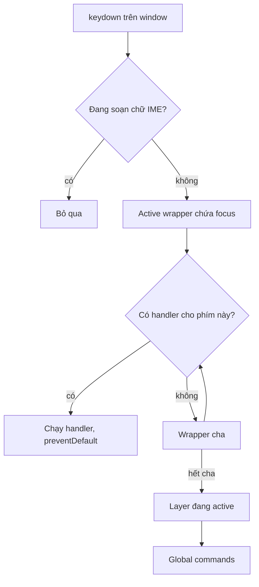
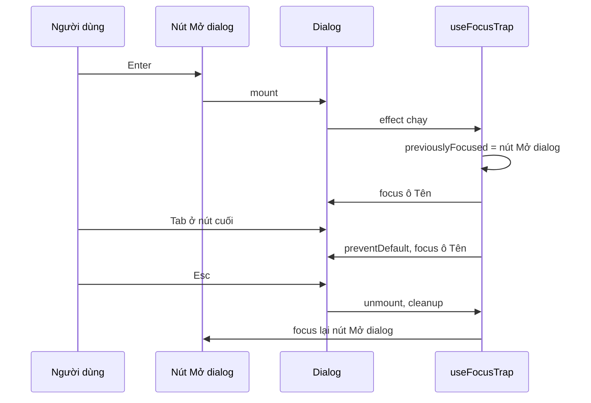

Dialog tự viết thường làm đúng phần nhìn thấy (nền mờ, nút đóng) nhưng sai phần **bàn phím**:

- Bấm Tab, focus **chạy ra các nút phía sau** lớp nền mờ. Người dùng bàn phím "lạc" vào một trang họ không nhìn thấy.
- Đóng dialog, focus **rơi về `<body>`**. Người dùng bàn phím và trình đọc màn hình phải Tab lại từ đầu trang.
- Dialog lồng nhau (dialog xác nhận mở trên dialog sửa), bấm Esc thì **cả hai cùng đóng**.
- Đang gõ tiếng Nhật, tiếng Trung (hoặc tiếng Việt bằng bộ gõ có gạch chân chữ đang soạn, như bộ gõ mặc định của macOS) trong ô input của dialog, bấm Esc để huỷ chữ đang soạn thì **dialog đóng mất**, kèm theo nội dung vừa gõ.

> [!TIP]
> **Tóm tắt**
> - Nếu được, dùng `<dialog>` + `showModal()`: trình duyệt tự làm nền thành `inert`, đóng bằng Esc và trả focus. Bài này dành cho popover, menu, dialog tự viết, hoặc khi cần Esc theo layer.
> - Focus trap gồm 3 phần: lưu nơi focus cũ (ngay lúc render), giữ Tab vòng trong dialog, trả focus khi đóng.
> - Esc chỉ đóng **layer trên cùng**, và phải nhường khi đang gõ IME hoặc khi component con đã tự xử lý Esc.
> - Focus trap chỉ chặn Tab; muốn trình đọc màn hình không "lọt" ra ngoài thì cần `aria-modal` và tốt nhất là `inert` cho phần nền.


## Bên trong trình duyệt: focus được quản lý thế nào?

**Sequential focus navigation.** Khi bấm Tab, trình duyệt đi theo một danh sách gọi là *sequential focus navigation order*:

| `tabindex` | Ý nghĩa |
| --- | --- |
| không có | theo mặc định của thẻ: `button`, `input`, `a[href]`… nằm trong danh sách; `div`, `span` thì không |
| `0` | đưa vào danh sách theo **thứ tự DOM** |
| `-1` | focus được bằng code (`el.focus()`) nhưng **Tab bỏ qua** |
| số dương (`1`, `2`…) | được Tab tới **trước** mọi phần tử khác, theo thứ tự số. Gần như luôn là ý tưởng tồi |

Ngoài ra còn những trường hợp ngầm: element `disabled`, `display: none`, `visibility: hidden` hay nằm trong vùng `inert` đều không focus được. Nhóm radio chỉ có **một** radio trong danh sách (cái đang được chọn), mũi tên mới chuyển giữa các radio.

**`focus` không bubble, `focusin` thì có.** Muốn nghe "focus đi đâu" ở cấp document thì phải dùng `focusin`/`focusout`, hoặc dùng `focus` với `capture: true`.

**Trình đọc màn hình không chỉ dùng Tab.** VoiceOver, NVDA, JAWS có **virtual cursor**: người dùng di chuyển qua từng đoạn văn, heading, link bằng phím mũi tên hoặc vuốt, **mà không cần focus**. Focus trap chỉ chặn Tab. Nó **không** ngăn trình đọc màn hình đọc nội dung phía sau dialog. Phần đó cần:

- `role="dialog"` + **`aria-modal="true"`**: báo cho trình đọc màn hình rằng ngoài dialog là "không tồn tại". Trình đọc màn hình hiện đại hỗ trợ khá tốt nhưng không hoàn hảo.
- **`inert`** trên phần nội dung phía sau: trình duyệt loại hẳn vùng đó khỏi focus, click **và** cây accessibility. Đây là cách chắc chắn nhất.
- `<dialog>` mở bằng `showModal()`: trình duyệt tự làm tất cả những việc trên.

## Facebook làm thế nào?

### 1. `getTabbableNodes`

Hàm nhận một "query" và một scope, trả về `[nodes, first, last, currentIndex, current]`. Bộ lọc của nó:

- `offsetWidth > 0 && offsetHeight > 0` (loại element không hiển thị),
- `tabIndex !== -1`,
- `getComputedStyle(el).visibility !== "hidden"`,
- **luôn giữ lại element đang focus**, kể cả khi nó không thoả các điều kiện trên. Nếu không, `currentIndex` sẽ là `-1` và không tính được "Tab tiếp theo đi đâu".

Điểm đáng chú ý: Facebook không dùng CSS selector mà dùng **`unstable_Scope`**, một API thử nghiệm của React cho phép truy vấn các node con của một component (`DO_NOT_USE_queryAllNodes(fn)`) bằng hàm. Các query (`focusScopeQueries`) quyết định node nào "có thể tab tới", "là header", v.v.

### 2. `FocusRegion`

Component bao một vùng với các tuỳ chọn:

- **`containFocusQuery`**: giữ focus trong vùng. Ở **mỗi** lần bấm Tab, FocusRegion tự tính danh sách node rồi **tự focus node kế tiếp** và `preventDefault()`. Cách này tốn hơn nhưng không phụ thuộc vào thứ tự Tab của trình duyệt (tabindex dương, radio group, shadow DOM…). Nó cũng bỏ qua nếu `event.isDefaultPrevented()`, để component con có thể tự xử lý Tab.
- **`autoFocusQuery`**: khi mount, nếu focus chưa nằm trong vùng thì focus vào **element được focus lần cuối trong vùng** (nếu còn hiển thị), không thì vào node đầu tiên thoả query. Mở lại một panel, bạn quay về đúng chỗ đang đứng.
- **`autoRestoreFocus`**: lưu `document.activeElement` **ngay lúc render đầu tiên** (trong `useRef`), không phải trong effect. Khi unmount, trong `requestAnimationFrame`, nó trả focus về element đó, nhưng **chỉ khi** focus hiện đang nằm trong vùng sắp bị huỷ hoặc đã rơi về `body`. Nếu người dùng đã tự click sang chỗ khác thì không giành lại focus.
- **`recoverFocusQuery`** (chiến lược mặc định `Nearest`): khi **element đang được focus bị xoá khỏi DOM** (ví dụ xoá một comment trong danh sách), FocusRegion tìm node **gần nhất** còn lại (node kế tiếp sau vị trí cũ, hoặc node trước đó) và focus vào đó. Không có cơ chế này, xoá một item bằng bàn phím sẽ làm focus rơi về `body`.
- Vùng lồng nhau được nối với nhau qua `ActiveFocusRegionUtilsContext`. Mỗi vùng nhớ "vùng nào đã mở mình" để trả focus đúng chuỗi khi đóng nhiều lớp.

### 3. Phím tắt theo lớp

`CometHideLayerOnEscape` chỉ đăng ký một command: phím `ESCAPE`, handler là `onHide`, kèm `triggerFromInputs: true` (Esc vẫn hoạt động khi đang gõ trong input). Phần thú vị nằm ở hạ tầng phía dưới:

- **Một listener duy nhất** cho `keydown` và `keyup` trên `window` (`BaseKeyCommandListener`).
- **Bỏ qua khi đang soạn chữ bằng IME**: `useGetComposingState` trả về `event.isComposing || đang trong khoảng compositionstart…compositionend`. Cờ thứ hai cần thiết vì một số trình duyệt bắn `keydown` của phím Esc **sau** `compositionend`, lúc đó `isComposing` đã là `false`.
- **Tìm handler theo vị trí focus.** Mỗi `KeyCommandWrapper` là một node trong cây. Wrapper chứa element đang focus là "active wrapper". `applyKeyCommand` thử từ active wrapper, lên dần các wrapper cha (`getParent()`), rồi tới **layer** đang active, cuối cùng là **global**. Handler đầu tiên nhận lệnh thắng, và mặc định nó `preventDefault()` + dừng lan truyền.
- Command một ký tự (như `j`/`k` để lướt feed) **không chạy khi đang gõ trong input**. Lần đầu dùng, Facebook còn hiện dialog hỏi người dùng có muốn bật phím tắt một ký tự không. Đây chính là yêu cầu **WCAG 2.1.4 Character Key Shortcuts**: người dùng nhập liệu bằng giọng nói có thể vô tình "gõ" ra các ký tự đó.
- Đăng ký trùng phím trong cùng wrapper thì log cảnh báo `Conflicting key command registered`.



Nguồn trong [facebook-codebase](https://github.com/hunghg255/facebook-codebase): `FocusRegion`, `FocusManager`, `getTabbableNodes`, `focusScopeQueries` (thư mục `FocusRegion/`), `CometHideLayerOnEscape`, `createKeyCommandWrapper`, `CometKeyCommandContext` (thư mục `CommetKeyCommands/`); `BaseKeyCommandListener`, `applyKeyCommand`, `useGetComposingState` nằm trong các file bundle lớn như `26.js`.

## Viết lại

Bản viết lại gồm hai hook độc lập: `useFocusTrap` (Tab + trả focus) và `useEscapeLayer` (Esc theo lớp).

**Khác bản gốc**, nói trước để dễ theo dõi:

- Chỉ can thiệp Tab ở **hai đầu** danh sách (Facebook tự focus node kế tiếp ở mọi lần Tab). Rẻ hơn, đổi lại phụ thuộc thứ tự Tab của trình duyệt.
- Esc dùng **stack theo thứ tự mount**. Facebook chính xác hơn: layer nào đang chứa focus thì layer đó nhận phím, bất kể mở trước hay sau.
- Không có `recoverFocusQuery` (focus lại khi element đang focus bị xoá).

### Tìm node có thể Tab tới

```ts title=src/lib/focusTrap.ts
export function getTabbableNodes(container: HTMLElement): HTMLElement[] {
  return Array.from(container.querySelectorAll<HTMLElement>(TABBABLE_SELECTOR)).filter((el) => {
    if (el.tabIndex < 0) return false;
    // nằm trong vùng `inert`, `fieldset` bị disable hay `<details>` đang đóng: trình duyệt
    // không cho focus, nên cũng không được tính vào vòng Tab
    if (el.closest('[inert]')) return false;
    if (el.matches(':disabled')) return false;
    const closedDetails = el.closest('details:not([open])');
    if (closedDetails && !(el.tagName === 'SUMMARY' && el.parentElement === closedDetails)) {
      return false;
    }
    // bị ẩn bằng display:none / kích thước 0 / visibility:hidden thì không focus được
    if (el.offsetWidth === 0 && el.offsetHeight === 0 && el.getClientRects().length === 0) {
      return false;
    }
    return getComputedStyle(el).visibility !== 'hidden';
  });
}
```

Vì không có `unstable_Scope` (API thử nghiệm, không có trong bản React ổn định), ta dùng CSS selector (`TABBABLE_SELECTOR` trong file đầy đủ) và lọc thêm bằng JavaScript:

- Loại element nằm trong vùng `inert`, element `:disabled` (kể cả nằm trong `fieldset` bị disable) và element trong `<details>` đang đóng (trừ chính thẻ `summary` của nó).
- Kiểm tra `offsetWidth/offsetHeight/getClientRects()` để loại `display: none` (element có `display: none` hoặc nằm trong cha `display: none` có kích thước 0 và không có client rect nào).
- `visibility: hidden` phải kiểm tra riêng vì element ẩn kiểu này **vẫn chiếm chỗ**.

### `useFocusTrap` từng bước

```ts title=src/lib/focusTrap.ts
export function useFocusTrap(
  containerRef: RefObject<HTMLElement | null>,
  active: boolean,
  { autoFocus = true, restoreFocus = true }: UseFocusTrapOptions = {},
) {
  // Ghi lại element đang focus NGAY LÚC RENDER lần đầu active (giống autoRestoreFocus của FB).
  // Nếu đợi tới useEffect thì quá muộn: input con có `autoFocus` đã được React focus trong
  // giai đoạn commit, và ta sẽ "nhớ nhầm" chính input đó.
  // Lưu ý: đọc DOM và đọc/ghi ref trong lúc render là phá quy tắc của React (lint / React
  // Compiler có thể cảnh báo). Ở đây chấp nhận được vì thao tác idempotent: render lại bao
  // nhiêu lần thì kết quả vẫn như nhau.
  const previouslyFocusedRef = useRef<HTMLElement | null>(null);
  const wasActiveRef = useRef(false);
  if (active && !wasActiveRef.current && typeof document !== 'undefined') {
    previouslyFocusedRef.current = document.activeElement as HTMLElement | null;
  }
  wasActiveRef.current = active;

  useEffect(() => {
    const container = containerRef.current;
    if (!active || !container) return;

    const previouslyFocused = previouslyFocusedRef.current;

    if (autoFocus && !container.contains(document.activeElement)) {
      // không có gì focus được thì focus chính container (cần tabIndex=-1)
      (getTabbableNodes(container)[0] ?? container).focus();
    }

    const onKeyDown = (event: KeyboardEvent) => {
      if (event.key !== 'Tab') return;
      // dialog lồng nhau: chỉ dialog chứa element đang focus mới xử lý
      if (!container.contains(document.activeElement)) return;
      const nodes = getTabbableNodes(container);
      if (nodes.length === 0) {
        event.preventDefault();
        return;
      }
      const first = nodes[0];
      const last = nodes[nodes.length - 1];
      const current = document.activeElement;
      if (event.shiftKey && (current === first || current === container)) {
        event.preventDefault();
        last.focus();
      } else if (!event.shiftKey && current === last) {
        event.preventDefault();
        first.focus();
      }
    };

    // Focus lọt ra ngoài (click ra nền, công cụ trợ năng…) thì kéo lại vào trong.
    // Bỏ qua nếu focus đi vào một dialog khác mở chồng lên trên.
    const onFocusIn = (event: FocusEvent) => {
      const target = event.target as Node;
      if (container.contains(target)) return;
      if (target instanceof Element && target.closest('[data-focus-trap]')) return;
      (getTabbableNodes(container)[0] ?? container).focus();
    };

    document.addEventListener('keydown', onKeyDown);
    document.addEventListener('focusin', onFocusIn);
    return () => {
      document.removeEventListener('keydown', onKeyDown);
      document.removeEventListener('focusin', onFocusIn);
      // chỉ trả focus nếu element cũ vẫn còn trên trang
      if (restoreFocus && previouslyFocused?.isConnected) previouslyFocused.focus();
    };
  }, [active, autoFocus, restoreFocus, containerRef]);
}
```

1. **Lưu nơi focus cũ** ngay **lúc render** đầu tiên `active` chuyển thành `true` (`previouslyFocusedRef`), trước khi bất cứ thứ gì kịp động vào focus. Lý do ở mục "Tại sao không…" bên dưới.
2. **Auto focus**: nếu focus chưa ở trong dialog, focus node đầu tiên. Không có node nào thì focus chính container. Đó là lý do container có `tabIndex={-1}`: focus được bằng code nhưng không lọt vào vòng Tab.
3. **Tab ở hai đầu**: chỉ can thiệp khi đang ở node cuối mà bấm Tab, hoặc ở node đầu (hay container) mà bấm Shift+Tab. Ở giữa thì để trình duyệt tự xử lý. Cách này rẻ hơn FocusRegion (không tính lại danh sách ở mỗi lần Tab), đổi lại phụ thuộc vào thứ tự Tab của trình duyệt.
4. **Dialog lồng nhau**: listener nằm trên `document`, nên mọi dialog đang mở đều nhận được phím Tab. Dòng `if (!container.contains(document.activeElement)) return` đảm bảo chỉ dialog **đang chứa focus** xử lý.
5. **Lưới an toàn `focusin`**: nếu focus vẫn lọt ra ngoài (click vào nền, radio group làm sai phép tính "node cuối", công cụ trợ năng tự di chuyển focus), kéo nó trở lại. Bỏ qua khi focus đi vào một vùng có `data-focus-trap` khác, tức một dialog mở chồng lên.
6. **Trả focus khi đóng**, chỉ khi element cũ vẫn còn trong DOM (`isConnected`). Nút mở dialog có thể đã bị xoá (ví dụ dialog "Xoá bài viết" xoá luôn cái nút).



### Esc theo lớp

```ts title=src/lib/focusTrap.ts
// ---- Esc chỉ đóng layer trên cùng ----

const escapeStack: Array<{ current: () => void }> = [];
let escapeListenerInstalled = false;

function onEscapeKeyDown(event: KeyboardEvent) {
  if (event.key !== 'Escape' || escapeStack.length === 0) return;
  // Đang gõ bằng bộ gõ IME (tiếng Nhật, tiếng Việt kiểu VNI/Telex trên một số bộ gõ…):
  // Esc dùng để huỷ chữ đang soạn, không phải để đóng dialog.
  if (event.isComposing) return;
  // Một component bên trong (combobox, date picker…) đã tự xử lý Esc, vd: đóng dropdown
  // của nó. Không đóng luôn cả dialog.
  if (event.defaultPrevented) return;
  event.preventDefault();
  escapeStack[escapeStack.length - 1].current();
}

export function useEscapeLayer(onEscape: () => void, active = true) {
  const handlerRef = useRef(onEscape);
  useLayoutEffect(() => {
    handlerRef.current = onEscape;
  });

  useEffect(() => {
    if (!active) return;
    if (!escapeListenerInstalled) {
      document.addEventListener('keydown', onEscapeKeyDown);
      escapeListenerInstalled = true;
    }
    // layer mở sau nằm trên cùng stack (giới hạn: xem bài viết)
    escapeStack.push(handlerRef);
    return () => {
      const index = escapeStack.indexOf(handlerRef);
      if (index !== -1) escapeStack.splice(index, 1);
    };
  }, [active]);
}
```

- Một listener `keydown` duy nhất cho mọi layer, gắn **lười** ở lần đầu cần dùng.
- `escapeStack` chứa **ref** chứ không chứa hàm, nên handler luôn là bản mới nhất mà không phải đăng ký lại.
- **`event.isComposing`**: Esc trong lúc soạn chữ IME là để huỷ chữ đang soạn. Đóng dialog lúc đó vừa sai vừa làm mất nội dung. (Facebook kiểm tra thêm cờ `compositionstart`/`compositionend` cho các trình duyệt bắn Esc sau `compositionend`. Nếu bạn nhắm tới nhiều người dùng IME, nên thêm cờ đó.)
- **`event.defaultPrevented`**: một combobox hoặc date picker trong dialog đã dùng Esc để đóng dropdown của nó và gọi `preventDefault()`. Dialog phải nhường. Cơ chế này hoạt động vì listener của ta nằm trên `document` ở pha bubble: React gắn listener ở **root container** (nằm bên trong `document`), nên `onKeyDown` của component chạy **trước** và kịp `preventDefault()`. Với portal render vào `document.body`, React cũng gắn listener lên container của portal, nên thứ tự vẫn đúng.
- Giới hạn của cách dùng stack theo thứ tự mount: dialog cha và dialog con mount **cùng một lần render** thì effect của con chạy trước, con nằm **dưới** cha trong stack, và Esc đóng nhầm dialog cha. Thực tế dialog con hầu như luôn được mở sau (do người dùng bấm), nhưng nếu gặp trường hợp này thì cách của Facebook (tìm layer theo vị trí focus) mới là lời giải đúng.

Component dialog dùng 2 hook trên:

```tsx title=src/demos/FocusTrapDemo.tsx
import { useEffect, useId, useRef, useState, type ReactNode } from 'react';
import { createPortal } from 'react-dom';
import { useEscapeLayer, useFocusTrap } from '../lib/focusTrap';

function Dialog({ title, onClose, children }: { title: string; onClose: () => void; children: ReactNode }) {
  const ref = useRef<HTMLDivElement>(null);
  const titleId = useId();
  useFocusTrap(ref, true);
  useEscapeLayer(onClose);

  return createPortal(
    <div className='backdrop' onClick={onClose}>
      <div
        ref={ref}
        className='dialog'
        role='dialog'
        aria-modal='true'
        aria-labelledby={titleId}
        tabIndex={-1}
        data-focus-trap
        onClick={(e) => e.stopPropagation()}
      >
        <h2 id={titleId}>{title}</h2>
        {children}
      </div>
    </div>,
    document.body,
  );
}
```

Dialog được render vào `document.body` bằng portal. Nhờ vậy nó nằm ngoài vùng nội dung chính, và có thể đặt `inert` cho vùng đó mà không "đóng băng" luôn dialog (xem phần bên dưới).

::: spoiler Xem toàn bộ src/lib/focusTrap.ts

```ts title=src/lib/focusTrap.ts
import { useEffect, useLayoutEffect, useRef, type RefObject } from 'react';

/**
 * Giữ focus trong dialog + khôi phục focus khi đóng (ý tưởng từ FocusRegion / getTabbableNodes)
 * và đóng đúng layer trên cùng khi bấm Esc (ý tưởng từ CometHideLayerOnEscape).
 */

const TABBABLE_SELECTOR = [
  'a[href]',
  'area[href]',
  'button:not([disabled])',
  'input:not([disabled]):not([type="hidden"])',
  'select:not([disabled])',
  'textarea:not([disabled])',
  'iframe',
  'audio[controls]',
  'video[controls]',
  'summary',
  '[contenteditable]:not([contenteditable="false"])',
  '[tabindex]',
].join(',');

/** Các element Tab tới được, theo đúng thứ tự trong DOM. */
export function getTabbableNodes(container: HTMLElement): HTMLElement[] {
  return Array.from(container.querySelectorAll<HTMLElement>(TABBABLE_SELECTOR)).filter((el) => {
    if (el.tabIndex < 0) return false;
    // nằm trong vùng `inert`, `fieldset` bị disable hay `<details>` đang đóng: trình duyệt
    // không cho focus, nên cũng không được tính vào vòng Tab
    if (el.closest('[inert]')) return false;
    if (el.matches(':disabled')) return false;
    const closedDetails = el.closest('details:not([open])');
    if (closedDetails && !(el.tagName === 'SUMMARY' && el.parentElement === closedDetails)) {
      return false;
    }
    // bị ẩn bằng display:none / kích thước 0 / visibility:hidden thì không focus được
    if (el.offsetWidth === 0 && el.offsetHeight === 0 && el.getClientRects().length === 0) {
      return false;
    }
    return getComputedStyle(el).visibility !== 'hidden';
  });
}

export interface UseFocusTrapOptions {
  /** focus vào phần tử đầu tiên khi mở, mặc định true */
  autoFocus?: boolean;
  /** trả focus về nơi mở dialog khi đóng, mặc định true */
  restoreFocus?: boolean;
}

export function useFocusTrap(
  containerRef: RefObject<HTMLElement | null>,
  active: boolean,
  { autoFocus = true, restoreFocus = true }: UseFocusTrapOptions = {},
) {
  // Ghi lại element đang focus NGAY LÚC RENDER lần đầu active (giống autoRestoreFocus của FB).
  // Nếu đợi tới useEffect thì quá muộn: input con có `autoFocus` đã được React focus trong
  // giai đoạn commit, và ta sẽ "nhớ nhầm" chính input đó.
  // Lưu ý: đọc DOM và đọc/ghi ref trong lúc render là phá quy tắc của React (lint / React
  // Compiler có thể cảnh báo). Ở đây chấp nhận được vì thao tác idempotent: render lại bao
  // nhiêu lần thì kết quả vẫn như nhau.
  const previouslyFocusedRef = useRef<HTMLElement | null>(null);
  const wasActiveRef = useRef(false);
  if (active && !wasActiveRef.current && typeof document !== 'undefined') {
    previouslyFocusedRef.current = document.activeElement as HTMLElement | null;
  }
  wasActiveRef.current = active;

  useEffect(() => {
    const container = containerRef.current;
    if (!active || !container) return;

    const previouslyFocused = previouslyFocusedRef.current;

    if (autoFocus && !container.contains(document.activeElement)) {
      // không có gì focus được thì focus chính container (cần tabIndex=-1)
      (getTabbableNodes(container)[0] ?? container).focus();
    }

    const onKeyDown = (event: KeyboardEvent) => {
      if (event.key !== 'Tab') return;
      // dialog lồng nhau: chỉ dialog chứa element đang focus mới xử lý
      if (!container.contains(document.activeElement)) return;
      const nodes = getTabbableNodes(container);
      if (nodes.length === 0) {
        event.preventDefault();
        return;
      }
      const first = nodes[0];
      const last = nodes[nodes.length - 1];
      const current = document.activeElement;
      if (event.shiftKey && (current === first || current === container)) {
        event.preventDefault();
        last.focus();
      } else if (!event.shiftKey && current === last) {
        event.preventDefault();
        first.focus();
      }
    };

    // Focus lọt ra ngoài (click ra nền, công cụ trợ năng…) thì kéo lại vào trong.
    // Bỏ qua nếu focus đi vào một dialog khác mở chồng lên trên.
    const onFocusIn = (event: FocusEvent) => {
      const target = event.target as Node;
      if (container.contains(target)) return;
      if (target instanceof Element && target.closest('[data-focus-trap]')) return;
      (getTabbableNodes(container)[0] ?? container).focus();
    };

    document.addEventListener('keydown', onKeyDown);
    document.addEventListener('focusin', onFocusIn);
    return () => {
      document.removeEventListener('keydown', onKeyDown);
      document.removeEventListener('focusin', onFocusIn);
      // chỉ trả focus nếu element cũ vẫn còn trên trang
      if (restoreFocus && previouslyFocused?.isConnected) previouslyFocused.focus();
    };
  }, [active, autoFocus, restoreFocus, containerRef]);
}

// ---- Esc chỉ đóng layer trên cùng ----

const escapeStack: Array<{ current: () => void }> = [];
let escapeListenerInstalled = false;

function onEscapeKeyDown(event: KeyboardEvent) {
  if (event.key !== 'Escape' || escapeStack.length === 0) return;
  // Đang gõ bằng bộ gõ IME (tiếng Nhật, tiếng Việt kiểu VNI/Telex trên một số bộ gõ…):
  // Esc dùng để huỷ chữ đang soạn, không phải để đóng dialog.
  if (event.isComposing) return;
  // Một component bên trong (combobox, date picker…) đã tự xử lý Esc, vd: đóng dropdown
  // của nó. Không đóng luôn cả dialog.
  if (event.defaultPrevented) return;
  event.preventDefault();
  escapeStack[escapeStack.length - 1].current();
}

export function useEscapeLayer(onEscape: () => void, active = true) {
  const handlerRef = useRef(onEscape);
  useLayoutEffect(() => {
    handlerRef.current = onEscape;
  });

  useEffect(() => {
    if (!active) return;
    if (!escapeListenerInstalled) {
      document.addEventListener('keydown', onEscapeKeyDown);
      escapeListenerInstalled = true;
    }
    // layer mở sau nằm trên cùng stack (giới hạn: xem bài viết)
    escapeStack.push(handlerRef);
    return () => {
      const index = escapeStack.indexOf(handlerRef);
      if (index !== -1) escapeStack.splice(index, 1);
    };
  }, [active]);
}
```

:::

## Demo

Mở dialog, bấm **Tab / Shift+Tab** nhiều lần (nút disabled và nút ẩn được bỏ qua). Mở dialog xác nhận rồi bấm **Esc** hai lần, xem focus quay về đâu ở ô "Đang focus".

<iframe class="demo-frame" src="/demos/facebook-patterns/index.html?theme=dark#/focus-trap" title="Demo focus-trap" loading="lazy" style="height: 520px"></iframe>

<p class="demo-links">▶ <a href="/demos/facebook-patterns/index.html#/focus-trap" target="_blank" rel="noopener">Mở demo toàn màn hình ↗</a> · <a href="https://stackblitz.com/github/hunghg255/blog-hunghg/tree/master/examples/facebook-patterns?file=src/lib/focusTrap.ts" target="_blank" rel="noopener">Sửa code trên StackBlitz ↗</a> · <a href="https://github.com/hunghg255/blog-hunghg/blob/master/examples/facebook-patterns/src/lib/focusTrap.ts" target="_blank" rel="noopener">Xem source trên GitHub ↗</a></p>

## Tại sao không làm cách khác?

**"Thêm hai `div tabindex=0` ở hai đầu dialog (focus sentinel), focus vào đó thì vòng lại?"** Đây là cách của nhiều thư viện, và nó tốt vì không cần nghe keydown. Điểm yếu thật của nó nằm ở chỗ khác: trình đọc màn hình di chuyển bằng virtual cursor có thể "đứng" lên sentinel (một phần tử rỗng, khó hiểu), và nếu chỉ có sentinel ở một đầu thì Tab từ phần tử cuối sẽ thoát ra thanh địa chỉ của trình duyệt. Dù dùng cách nào, vẫn nên có lưới an toàn `focusin`.

**"Chỉ cần `aria-modal="true"` là đủ?"** Không. `aria-modal` chỉ là **gợi ý** cho trình đọc màn hình, nó không chặn Tab và không chặn click.

**"Sao không dùng `inert` cho toàn bộ trang rồi khỏi cần focus trap?"** Đây là hướng đúng cho modal hiện đại. `inert` trên phần nội dung chính chặn Tab, click **và** virtual cursor của trình đọc màn hình. Khi có `inert`, phần logic Tab trong hook gần như không còn cần thiết. Khác biệt duy nhất: Tab từ phần tử cuối của dialog sẽ đi ra thanh địa chỉ/giao diện trình duyệt thay vì vòng về đầu. Điều đó chấp nhận được (`<dialog>` gốc cũng vậy). Bạn **vẫn cần** auto focus, trả focus khi đóng và Esc theo lớp. `inert` đã có trong mọi trình duyệt hiện đại (tính tới 10/2026).

**"Sao không lưu `document.activeElement` trong effect cho gọn?"** Vì không đủ sớm. Nếu một input trong dialog dùng prop `autoFocus` của React, React gọi `focus()` **trong lúc commit**, trước khi effect chạy. Lúc effect chạy, `activeElement` đã nằm **trong** dialog, nên bị lưu nhầm, và khi đóng thì focus không về được nút mở. Facebook tránh chuyện này bằng cách lưu `activeElement` ngay **lúc render** (`useRef(document.activeElement)`), và bản viết lại làm theo: đọc `activeElement` trong thân hook ở lần render đầu tiên `active` chuyển thành `true`. Thẳng thắn mà nói, cách này **phá quy tắc của React**: đọc DOM và đọc/ghi ref (`wasActiveRef.current = active`) ngay trong lúc render, lint hoặc React Compiler có thể cảnh báo. Ta chấp nhận vì thao tác idempotent: React render lại bao nhiêu lần thì kết quả vẫn như nhau.

## Edge case và cạm bẫy

**Shadow DOM.** `querySelectorAll` không đi xuyên shadow root, và `document.activeElement` chỉ trả về **shadow host**. Nếu dialog chứa web component (ví dụ một date picker viết bằng Lit), node bên trong không có trong danh sách tabbable. Cần đi xuống `el.shadowRoot` và dùng `activeElement` của shadow root.

**Iframe.** Khi focus đang ở **trong** iframe, sự kiện `keydown` thuộc về document của iframe, document cha không nhận được. Nếu iframe là node cuối của dialog, Tab từ trong iframe có thể thoát ra. Lưới `focusin` sẽ kéo focus lại, nhưng có một lần nhảy thấy được.

**Portal và vùng `inert`.** Đặt `inert` lên `#root` trong khi dialog được portal vào `#root` thì dialog cũng bị inert theo. Hãy portal dialog ra **ngoài** vùng bị inert (vào `document.body`, như demo), hoặc chỉ đặt `inert` cho phần nội dung chính chứ không đặt cho container chung.

**Toast và live region bên ngoài dialog.** Một toast có nút "Hoàn tác" ([bài #4](/blogs/facebook-toast-manager)) nằm ngoài dialog thì không Tab tới được khi dialog mở. Đây thường là hành vi đúng. Nếu cần tương tác được, đánh dấu vùng toast bằng `data-focus-trap` để trap bỏ qua.

**`tabindex` dương.** Trap tính "node đầu/cuối" theo thứ tự DOM, trong khi trình duyệt đưa element có `tabindex="1"` lên trước. Đừng dùng tabindex dương. Nếu bắt buộc phải dùng, hãy chuyển sang cách của FocusRegion: tự tính và focus node kế tiếp ở mọi lần Tab.

**StrictMode ở dev.** React chạy effect, dọn dẹp rồi chạy lại một lần khi mount. Lần dọn dẹp trả focus về nút mở rồi lần chạy lại kéo focus vào dialog, nên trình đọc màn hình có thể đọc hai lần ở môi trường dev. Production không bị.

**Element bị xoá khi đang focus.** Xoá item đang focus (như comment) thì focus rơi về `body`. Học `recoverFocusQuery` của Facebook: trước khi xoá, ghi nhớ vị trí, xoá xong thì focus node gần nhất.

## So với thư viện

- **[focus-trap](https://github.com/focus-trap/focus-trap)** (dùng bởi `focus-trap-react`): thư viện vanilla JS, dùng [tabbable](https://github.com/focus-trap/tabbable) để tính danh sách node, có hỗ trợ nhiều trap lồng nhau (tự tạm dừng trap cũ khi trap mới kích hoạt), tuỳ chọn trả focus, click ra ngoài.
- **[react-focus-lock](https://github.com/theKashey/react-focus-lock)**: dùng sentinel và theo dõi focus, xử lý tốt portal và nhiều lock.
- **Radix UI / React Aria**: component dialog hoàn chỉnh. Ngoài focus trap còn làm phần ngoài dialog thành ẩn với trình đọc màn hình, khoá scroll trang và quản lý layer cho Esc.
- **`<dialog>` + `showModal()`**: trình duyệt tự làm nền thành inert, đóng bằng Esc, có pseudo-element `::backdrop`. Nếu dự án cho phép, đây là lựa chọn mặc định nên cân nhắc trước tiên.

Bạn vẫn cần hiểu kỹ thuật trong bài khi làm **popover, menu, combobox** không phải modal (không dùng `showModal` được) nhưng vẫn cần quản lý focus và Esc theo lớp, hoặc khi phải debug các thư viện kể trên.

> [!TIP]
> Để chặn tương tác với phần nền khi mở modal tự viết, đặt thuộc tính [`inert`](https://developer.mozilla.org/en-US/docs/Web/HTML/Global_attributes/inert) lên vùng nội dung chính. Nó chặn cả click, focus lẫn trình đọc màn hình, đơn giản hơn nhiều so với tự lọc từng event.

## Kiểm thử

Logic focus phụ thuộc layout thật (`offsetWidth`, `getComputedStyle`), nên jsdom không đáng tin: trong jsdom mọi element đều có kích thước 0. Hãy test bằng trình duyệt thật, ví dụ Playwright chạy với demo ở trên.

::: spoiler Ví dụ test (bản phác, không có trong repo)

```ts title=focus-trap.spec.ts
import { expect, test } from '@playwright/test';

test('Tab vòng trong dialog, Esc đóng từng lớp và trả focus', async ({ page }) => {
  await page.goto('/demos/facebook-patterns/index.html#/focus-trap');
  const opener = page.getByRole('button', { name: 'Mở dialog', exact: true });
  await opener.click();

  const dialog = page.getByRole('dialog', { name: 'Chỉnh sửa trang cá nhân' });
  await expect(dialog.getByLabel('Tên')).toBeFocused();

  // Tab qua hết các node rồi phải quay về ô đầu tiên
  for (let i = 0; i < 4; i++) await page.keyboard.press('Tab');
  await expect(dialog.getByLabel('Tên')).toBeFocused();

  await dialog.getByRole('button', { name: 'Mở dialog xác nhận' }).click();
  await page.keyboard.press('Escape');
  await expect(page.getByRole('dialog')).toHaveCount(1); // chỉ dialog trên cùng đóng
  await expect(dialog.getByRole('button', { name: 'Mở dialog xác nhận' })).toBeFocused();

  await page.keyboard.press('Escape');
  await expect(page.getByRole('dialog')).toHaveCount(0);
  await expect(opener).toBeFocused();
});
```

:::

Nên chạy thêm bằng trình đọc màn hình thật (VoiceOver trên macOS: `Cmd + F5`) ít nhất một lần: mở dialog, dùng `VO + mũi tên` để xem có "lọt" ra nội dung phía sau không. Đây là thứ không test tự động nào bắt được.

---

Bài này thuộc series **[Học từ mã nguồn Facebook](/series/facebook)** (83 bài, đọc theo thứ tự).

::: spoiler Xem nhanh danh sách bài trong series

*Phần 1*

- [Mở đầu: cách đọc code minify của Facebook](/blogs/learn-from-facebook-source-code)
- [#1 Dùng chung IntersectionObserver + infinite scroll](/blogs/facebook-shared-intersection-observer)
- [#2 useViewportDuration: đo thời gian thực sự được xem](/blogs/facebook-use-viewport-duration)
- [#3 Preload code + data khi hover](/blogs/facebook-preload-on-hover)
- [#4 Toast manager với external store](/blogs/facebook-toast-manager)
- [#5 Network status + heartbeat backoff](/blogs/facebook-network-status-heartbeat)
- [#6 ErrorGuard: bắt lỗi theo ngữ cảnh](/blogs/facebook-error-guard)
- [#7 Banzai: gom log theo lô + sendBeacon](/blogs/facebook-batch-logger)
- **#8 Focus trap + Esc theo layer** (bài này)

*Phần 2*

- [#9 Mẹo calc(… * 9999): container query, line-clamp, mũi tên carousel bằng CSS](/blogs/facebook-css-9999-trick)
- [#10 Thanh cuộn tuỳ biến bằng CSS 3D](/blogs/facebook-css-3d-scrollbar)
- [#11 Modal cuộn bằng window, giữ vị trí trang nền](/blogs/facebook-document-scroll-modal)
- [#12 Popover, tooltip group và hovercard](/blogs/facebook-popover-tooltip)
- [#13 Primitive Pressable + focus-visible](/blogs/facebook-pressable)
- [#14 Tab "Xem thêm" + sticky header bằng IntersectionObserver](/blogs/facebook-priority-tabs-sticky-header)
- [#15 Avatar khoét mask, gradient Messenger, skeleton steps()](/blogs/facebook-visual-tricks)
- [#16 Khung chat không giật](/blogs/facebook-chat-scroller)
- [#17 Thuật toán chọn bố cục collage ảnh](/blogs/facebook-photo-collage-layout)
- [#18 Keep-alive tab trong SPA](/blogs/facebook-keep-alive-tabs)
- [#19 Tự đo Visual Completion & interaction tracing](/blogs/facebook-visual-completion)
- [#20 Router SPA bền bỉ & tải chunk có retry](/blogs/facebook-spa-router-resilient-loading)

*Phần 3*

- [#21 Smart Compose: gợi ý chữ mờ khi gõ](/blogs/facebook-smart-compose-ghost-text)
- [#22 MQTT ngay trong trình duyệt, tự chuyển sang long-poll](/blogs/facebook-mqtt-in-browser)
- [#23 Đo thời gian dùng bằng bitmap 64 giây](/blogs/facebook-time-spent-bitmap)
- [#24 Bảng reaction nhấn giữ rồi trượt](/blogs/facebook-reaction-press-slide)
- [#25 Tìm kiếm gấp dấu, phiên âm và highlight đầu từ](/blogs/facebook-search-diacritics-tokenize)
- [#26 Ring buffer biết trace nào đã mất log](/blogs/facebook-trace-ring-buffer)
- [#27 Engine animation JS: một vòng rAF và solver cubic-bezier](/blogs/facebook-keyframes-loop-cubic-bezier)
- [#28 Bootloader: bitmap tài nguyên đã tải, chỉ reload khi cần](/blogs/facebook-bootloader-bitmap-consistency)
- [#29 Nhận biết click do screen reader tạo ra](/blogs/facebook-virtual-cursor-detection)
- [#30 Tải trước feed theo chất lượng mạng, đoán hạng thiết bị](/blogs/facebook-network-aware-prefetch)
- [#31 Hàng đợi gửi tin chat giữ đúng thứ tự](/blogs/facebook-ordered-send-queue)
- [#32 Gộp lời gọi API trong cùng một tick](/blogs/facebook-api-batcher)
- [#33 Resize ảnh trong pool Web Worker](/blogs/facebook-jpeg-resize-worker-pool)
- [#34 Crop ảnh theo nhiều khuôn mặt](/blogs/facebook-face-aware-crop)
- [#35 Kéo-thả sắp xếp và vùng thả file không nhấp nháy](/blogs/facebook-flicker-free-drag-drop)
- [#36 Tiện ích UI: fade-out, sticky event, hàm huỷ được](/blogs/facebook-ui-utility-hooks)
- [#37 Hạ tầng nhỏ: cookie, hash lỗi, prefetch khi chuột dừng](/blogs/facebook-small-infra-cookie-hash-idle)

*Phần 4–6*

- [#38 Đồng bộ tin nhắn: phát hiện lỗ seqID và fetch bù theo tầng](/blogs/facebook-messenger-sync-seqid-gaps)
- [#39 OTID: ID tin nhắn kiểu Snowflake sinh ở client](/blogs/facebook-otid-client-snowflake)
- [#40 QPL: lấy mẫu từ lúc bắt đầu, đo RTT gửi tin đầu-cuối](/blogs/facebook-qpl-send-rtt)
- [#41 Bộ điều phối request bảy chế độ gộp và chống trùng](/blogs/facebook-request-dispatcher-modes)
- [#42 Thread list theo mốc thời gian, cookie presence có version](/blogs/facebook-threadlist-ranged-presence)
- [#43 Composer dạng plugin: reducer, dirty checker, chuỗi kiểm tra](/blogs/facebook-plugin-composer)
- [#44 Thanh toán bất đồng bộ: subscribe trước, poll dự phòng](/blogs/facebook-async-checkout)
- [#45 Validate số thẻ: sửa lỗi gõ, dải BIN, Luhn](/blogs/facebook-card-validation)
- [#46 Lịch chọn khoảng ngày: bo góc dải chọn, phím đủ bộ, RTL](/blogs/facebook-range-calendar-a11y)
- [#47 Giờ mở cửa theo tuần: qua đêm, gộp khoảng, phần bù](/blogs/facebook-weekly-hours-intervals)
- [#48 Tiến độ đăng realtime: giữ event chờ snapshot, watchdog](/blogs/facebook-realtime-publish-snapshot)
- [#49 Tiền tệ theo đơn vị nhỏ nhất và ô nhập tiền](/blogs/facebook-currency-minor-units)
- [#50 Sửa hàng loạt Empty/Uniform/Mixed, seen/read bằng 2 bit](/blogs/facebook-bulk-edit-seen-bits)
- [#51 Phát hiện script lạ hook vào hàm native](/blogs/facebook-native-hook-detection)
- [#52 localStorage tự dọn khi đầy quota](/blogs/facebook-quota-aware-storage)
- [#53 Cache tuyến do server phân giải, chờ sẵn promise](/blogs/facebook-route-cache-prefetch)
- [#54 Lưới phím mũi tên 2D và focus không làm cuộn trang](/blogs/facebook-focus-table-grid)
- [#55 Tách emoji bằng máy trạng thái](/blogs/facebook-emoji-segmentation)
- [#56 Đọc trước ghi sau trong một frame, con tự biết vị trí](/blogs/facebook-read-then-write-dom)
- [#57 Hàng đợi lệnh cho video và stream sắp lại chunk](/blogs/facebook-video-command-queue)

*Phần 7–10*

- [#58 Ước lượng băng thông EWMA: loại outlier, nhớ qua phiên](/blogs/facebook-bandwidth-ewma-estimator)
- [#59 ABR theo độ tự tin phát và cắt bậc bitrate theo MOS](/blogs/facebook-abr-playback-confidence)
- [#60 Prefetch segment dự đoán từ manifest, parse hộp sidx](/blogs/facebook-dash-predicted-segments)
- [#61 Đọc metadata MP4/MOV ngay trên client](/blogs/facebook-mp4-metadata-client)
- [#62 Upload tiếp tục được: offset, hash dedupe, phát hiện treo](/blogs/facebook-resumable-upload)
- [#63 Fenwick tree: chọn ngẫu nhiên có trọng số và offset dòng](/blogs/facebook-fenwick-weighted-random)
- [#64 Vạch trục số và trục thời gian "đẹp"](/blogs/facebook-nice-axis-ticks)
- [#65 Damerau-Levenshtein theo dải chéo và tự sửa tên gõ sai](/blogs/facebook-damerau-levenshtein)
- [#66 PRNG có seed, shuffle tái lập và lấy mẫu trace](/blogs/facebook-seeded-prng-sampling)
- [#67 Cặp min/max-heap tái dùng vị trí trong danh sách ảo](/blogs/facebook-dual-heap-buffer-set)
- [#68 Memo nhiều đối số bằng Map/WeakMap và interning object](/blogs/facebook-multikey-memo-interning)
- [#69 Thống kê cửa sổ trượt và đại số khoảng thời gian](/blogs/facebook-moving-stat-intervals)
- [#70 Int64 từ hai số 32-bit, decode UTF, offset theo code point](/blogs/facebook-int64-utf-codepoints)
- [#71 Engine múi giờ IANA trên client, phát hiện lệch giờ](/blogs/facebook-client-iana-timezone)
- [#72 Tự cài semver range](/blogs/facebook-semver-range)
- [#73 Auto-link URL, cắt chữ an toàn, giới hạn LaTeX](/blogs/facebook-autolink-safe-truncate)
- [#74 Parser query kiểu PHP chống prototype pollution](/blogs/facebook-php-query-serializer)
- [#75 Popover tự lật theo phần tràn nhỏ nhất](/blogs/facebook-popover-auto-flip)
- [#76 Tiền tố for(;;) chống JSON hijacking, đọc stream](/blogs/facebook-csrf-prefix-streaming)
- [#77 Chống lộ Referer, linkshim, xoá token trên URL](/blogs/facebook-referrer-linkshim-url-scrub)
- [#78 setImmediate bằng postMessage, gom delta chuột theo frame](/blogs/facebook-setimmediate-mouse-batching)
- [#79 Phát hiện crash qua heartbeat, dò proxy cache hỏng](/blogs/facebook-crash-heartbeat-proxy-check)
- [#80 DPR vào cookie cho ảnh @2x, che khoá trong log](/blogs/facebook-dpr-cookie-secret-redaction)
- [#81 Flux waitFor tự viết và proxy có đệm](/blogs/facebook-flux-dispatch-buffered-proxy)
- [#82 Crop đúng tỉ lệ, xoay sticker bằng ma trận](/blogs/facebook-image-crop-rotation-geometry)

:::

Code + demo: [`examples/facebook-patterns`](https://github.com/hunghg255/blog-hunghg/tree/master/examples/facebook-patterns) · [Mở trên StackBlitz](https://stackblitz.com/github/hunghg255/blog-hunghg/tree/master/examples/facebook-patterns)
