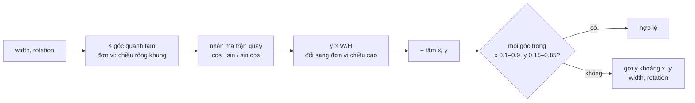

Một quảng cáo Facebook chạy ở nhiều chỗ: News Feed (1.91:1 hoặc 1:1), Instagram feed (4:5), Story và Reels (9:16). Người làm quảng cáo tải lên **một** ảnh. Ads Manager phải tự đề xuất một vùng crop cho mỗi chỗ, kiểm tra crop người dùng tự kéo có đúng tỉ lệ không, và đổi crop giữa ảnh gốc và ảnh xem trước thu nhỏ.

Story còn có sticker: một ô bình chọn (poll) đặt trên ảnh, xoay được, kéo được, đổi cỡ được. Sticker không được tràn ra ngoài vùng an toàn, nơi giao diện Instagram vẽ tên người đăng và ô trả lời. Khi sticker đã xoay 20°, "tràn ra ngoài" nghĩa là gì?

Đây là ba module hình học nhỏ của Ads Manager, và những chỗ dễ sai trong mỗi cái.

> [!TIP]
> **Tóm tắt**
> - `AdsImageCoordinatesUtils.calculateDefaultCoordinates`: ảnh "bè" hơn tỉ lệ thì giữ trọn chiều cao, cắt hai bên; ngược lại giữ trọn chiều rộng. Đặt giữa, làm tròn xuống ở góc trái trên, phần dư lẻ dồn về phải dưới.
> - `AdsImageAspectRatioUtils` khớp tỉ lệ với 16 khoá (`191x100`, `90x160`…) bằng `|r − k| ≤ 0.01`. Dung sai tuyệt đối: với 9:16 là 1,8%, với 320×50 chỉ 0,16%; và 1.91 khớp **bốn** khoá.
> - `AdsInteractiveComponentPositionUtils` xoay bốn góc sticker bằng ma trận quay, đổi trục y theo tỉ lệ khung, rồi kiểm từng góc nằm trong vùng an toàn. Dung sai nhân 1% nên hai đầu khoảng không đều nhau (0,001 ở 0.1, 0,009 ở 0.9).
> - Bản viết lại: dung sai tương đối và sắp theo độ gần, dung sai vị trí tuyệt đối, quét khoảng hợp lệ quanh giá trị hiện tại.

<iframe class="demo-frame" src="/demos/facebook-patterns/index.html?theme=dark#/crop-geometry" title="Demo crop-geometry" loading="lazy" style="height: 1100px"></iframe>

<p class="demo-links">▶ <a href="/demos/facebook-patterns/index.html#/crop-geometry" target="_blank" rel="noopener">Mở demo toàn màn hình ↗</a> · <a href="https://stackblitz.com/github/hunghg255/blog-hunghg/tree/master/examples/facebook-patterns?file=src/lib/cropGeometry.ts" target="_blank" rel="noopener">Sửa code trên StackBlitz ↗</a> · <a href="https://github.com/hunghg255/blog-hunghg/blob/master/examples/facebook-patterns/src/lib/cropGeometry.ts" target="_blank" rel="noopener">Xem source trên GitHub ↗</a></p>

## Facebook làm thế nào?

### Crop giữa ảnh: `AdsImageCoordinatesUtils` (bundle `120.js`)

Toàn bộ module là một hàm:

```js
function calculateDefaultCoordinates(width, height, ratio) {
  if (ratio == null || ratio <= 0) return [[0, 0], [width, height]];
  let cropW, cropH;
  if (width / ratio > height) { cropH = height; cropW = height * ratio; }   // ảnh bè hơn: cắt hai bên
  else                        { cropW = width;  cropH = width / ratio; }    // ảnh cao hơn: cắt trên dưới
  const left = (width - cropW) / 2, top = (height - cropH) / 2;
  const dx = Math.floor(left) - left, dy = Math.floor(top) - top;          // lùi về pixel nguyên
  return [[left + dx, top + dy], [Math.round(left + cropW + dx), Math.round(top + cropH + dy)]];
}
```

Crop là cặp điểm `[[x0, y0], [x1, y1]]`. `width / ratio > height` là cách viết khác của "tỉ lệ ảnh lớn hơn tỉ lệ crop". Góc trái trên được làm tròn **xuống**, góc phải dưới làm tròn thường, nên crop luôn là pixel nguyên và không bao giờ vượt ra ngoài ảnh. Ảnh 1000×1001 với tỉ lệ 1:1 cho `[[0, 0], [1000, 1000]]`: hàng dư nằm ở dưới. Với pixel nguyên thì không làm được tốt hơn.

### Khớp tỉ lệ: `AdsImageAspectRatioUtils` (bundle `120.js`)

Khớp tỉ lệ chỉ là một phép lọc:

```js
function getCropKeysFromAspectRatio(ratio, tolerance = 0.01) {
  return RATIOS.filter((k) => Math.abs(ratio - k) <= tolerance).keySeq().toSet();
}
```

`isAspectRatioTypeCropValid` dùng chính hàm này cho tỉ lệ của crop, cộng thêm ngưỡng `minWarningWidth`/`minWarningHeight` của từng loại.

::: spoiler Code gốc đã đổi tên biến: khớp tỉ lệ, kiểm crop, kích thước theo khoá

```js
const RATIOS = Map(CROP_KEYS.map((key) => [key, ratioFromKey(key) ?? Infinity]));
// ratioFromKey('191x100') = 191 / 100, …, ratioFromKey('90x160') = 90 / 160

function getCropKeysFromAspectRatio(ratio, tolerance = 0.01) {
  return RATIOS.filter((k) => Math.abs(ratio - k) <= tolerance).keySeq().toSet();
}

function isAspectRatioTypeCropValid(type, [[x0, y0], [x1, y1]]) {
  const w = x1 - x0, h = y1 - y0, key = cropKeyFromType(type), spec = specs[type];
  return getCropKeysFromAspectRatio(w / h).has(key)
    && w >= (spec?.minWarningWidth ?? 0) && h >= (spec?.minWarningHeight ?? 0);
}

function getDimensionsFromCropKey(key, size) {   // vừa khít một ô vuông size × size
  const r = ratioFromKey(key);
  return r == null ? { width: size, height: size }
                   : { width: Math.round(size * Math.min(r, 1)), height: Math.round(size / Math.max(r, 1)) };
}
```

:::

16 khoá là các kích thước lịch sử của từng vị trí quảng cáo: `191x100`, `100x72`, `110x80`, `400x150`, `600x360`, `254x94`, `254x133`, `254x143`, `284x149`, `398x208`, `125x90`, `320x50`, `100x100`, `600x600`, `400x500`, `90x160`. Chạy lại phép khớp:

| Tỉ lệ ảnh | Khoá khớp (±0.01 tuyệt đối) |
| --- | --- |
| 1.91 | `191x100`, `254x133`, `284x149`, `398x208` |
| 1.39 | `100x72`, `125x90` |
| 1.0 | `100x100`, `600x600` |

Nhiều khoá khớp không sai: chúng thật sự là "cùng một tỉ lệ" ở các vị trí khác nhau. Nhưng kết quả là một `Set` không thứ tự, và `getAspectRatioTypeFromImage` lấy phần tử **đầu tiên** sau khi đổi sang loại tỉ lệ, tức phụ thuộc thứ tự chèn của danh sách khoá. Vấn đề lớn hơn là dung sai tuyệt đối: 0,01 với 9:16 (0,5625) là 1,8%, với 320×50 (6,4) chỉ 0,16%. Ảnh banner 2560×400 (đúng 6.4) cộng một pixel chiều cao thành 6,384, lệch 0,25%, và không còn khớp.

Có thêm một chỗ khít: crop giữa ảnh của chính `calculateDefaultCoordinates` có thể lệch tỉ lệ tới **đúng** 0,01. Ảnh 4000×50 với 1.91: crop rộng 95,5 làm tròn thành 96, tỉ lệ 1,92. Vừa chạm ngưỡng, nên vẫn hợp lệ. Ảnh nhỏ như vậy dù sao cũng bị `minWarningWidth` chặn.

### Sticker xoay: `AdsInteractiveComponentPositionUtils` (bundle `128.js`)

Hai dòng quan trọng nhất (bản đầy đủ trong spoiler):

```js
const height = (stickerHeight / stickerWidth) * width;   // cùng đơn vị "chiều rộng khung"
return corners.map(([x, y]) => [cos * x - sin * y, (sin * x + cos * y) * FRAME_WIDTH / FRAME_HEIGHT]);
```

Góc tính bằng **số vòng** (`2π · rotation`), khoảng hợp lệ −0,25 tới 0,25 vòng (±90°). Tâm x trong 0,1–0,9, y trong 0,15–0,85, độ rộng 0,2–0,9, `EPS = 0.01`.

::: spoiler Code gốc đã đổi tên biến: xoay góc, dung sai, kiểm vị trí, quét khoảng

```js
const X = [0.1, 0.9], Y = [0.15, 0.85], WIDTH = [0.2, 0.9], ROTATION = [-0.25, 0.25], EPS = 0.01;

getRotatedStickerCoordinates(rotation /* số vòng */, width /* phần của khung */) {
  const height = (stickerHeight / stickerWidth) * width;     // cùng đơn vị "chiều rộng khung"
  const corners = [[-width / 2, -height / 2], [width / 2, -height / 2], [-width / 2, height / 2], [width / 2, height / 2]];
  const t = 2 * Math.PI * rotation, cos = Math.cos(t), sin = Math.sin(t);
  return corners.map(([x, y]) => [cos * x - sin * y, (sin * x + cos * y) * FRAME_WIDTH / FRAME_HEIGHT]);
}

isValueInRangeError(lo, hi, v) {                             // nới hai đầu thêm 1% (nhân)
  if (lo > hi) return false;
  return lo * (lo < 0 ? 1 + EPS : 1 - EPS) <= v && v <= hi * (hi < 0 ? 1 - EPS : 1 + EPS);
}

validateXPosition(rotation, width, x) {
  const xs = this.getRotatedStickerCoordinates(rotation, width).map((p) => p[0]);
  const lo = X[0] - Math.min(...xs) + EPS, hi = X[1] - Math.max(...xs) - EPS;
  return this.isValueInRangeError(lo, hi, x) ? { isValid: true }
    : { isValid: false, suggestion: lo <= hi ? { lowerBound: round2(lo), upperBound: round2(hi) } : null };
}
// validateYPosition giống hệt, nhưng gợi ý KHÔNG làm tròn 2 chữ số

getValidRange(lo, hi, scale, isValid) {                      // quét theo bước 1/scale
  let first = Math.floor(hi * scale), last = Math.ceil(lo * scale);
  for (let i = Math.ceil(lo * scale); i <= Math.floor(hi * scale); i++)
    if (isValid(+(i / scale).toFixed(2))) { first = Math.min(first, i); last = Math.max(last, i); }
    else if (first != Math.floor(hi * scale)) break;          // hết đoạn hợp lệ đầu tiên thì dừng
  return first > last ? null : { lowerBound: first / scale, upperBound: last / scale };
}
```

:::

Toạ độ được chuẩn hoá: x theo chiều rộng khung, y theo chiều cao khung. Khung story không vuông (9:16), nên **không thể xoay thẳng trên toạ độ chuẩn hoá**: một hình vuông xoay 45° sẽ thành hình thoi méo. Bản gốc làm đúng: tính chiều cao sticker theo đơn vị chiều rộng khung, xoay trong hệ đó (tương đương hệ pixel), rồi mới nhân y với `FRAME_WIDTH / FRAME_HEIGHT` để đổi sang đơn vị chiều cao.

`validateXPosition` không cần quét: tâm hợp lệ khi `X[0] ≤ x + min(góc) ` và `x + max(góc) ≤ X[1]`, giải ra một khoảng. Độ rộng và góc xoay thì không giải gọn được (hộp bao của hình chữ nhật xoay là hàm của cả hai), nên `validateWidth` và `validateRotation` quét: độ rộng theo bước 0,01, góc theo bước 1°.



### Những chỗ đáng chú ý

Chạy lại các hàm trong Node:

- **Dung sai nhân không đều.** Khoảng `[0.1, 0.9]` được nới thành `[0.099, 0.909]`: đầu dưới nới 0,001, đầu trên nới 0,009, gấp chín lần. Ở 0 thì không nới chút nào (`0 × 0.99 = 0`). Dung sai cho sai số dấu phẩy động nên là một hằng số tuyệt đối.
- **Hai lớp epsilon chồng nhau.** `validateXPosition` đã co khoảng vào 0,01 mỗi đầu (`+ EPS`, `− EPS`), rồi `isValueInRangeError` lại nới ra 1%. Kết quả là khoảng chấp nhận được và khoảng gợi ý cho người dùng không khớp nhau.
- **X làm tròn, Y không.** Gợi ý của `validateXPosition` làm tròn 2 chữ số, của `validateYPosition` thì không. Giao diện có thể hiện "0.37" cho x nhưng một số 17 chữ số thập phân cho y; có lẽ là chép code rồi quên một dòng.
- **Góc bị làm tròn thành 3,6°.** `getValidRange` đưa vào hàm kiểm `parseFloat((i / scale).toFixed(2))`. Với độ rộng (`scale = 100`) thì vô hại. Với góc (`scale = 360`, đơn vị là vòng), 2 chữ số thập phân của số vòng là bước 0,01 vòng = 3,6°: 45° (0,125 vòng) được kiểm như 46,8° (0,13). Biên của khoảng gợi ý có thể lệch tới 1,8°.
- **`getValidRange` khi `lo = hi`.** Không giá trị nào hợp lệ mà `lo = hi = 0.5` vẫn trả `{0.5, 0.5}`, vì biến khởi tạo `first = hi`, `last = lo` đã thoả `first ≤ last`. Với các hằng số hiện có (`lo < hi`) thì không xảy ra.
- **Chỉ trả đoạn hợp lệ đầu tiên.** Tập góc xoay hợp lệ có thể không liền: sticker rộng 0,75 ở tâm khung hợp lệ ở 0° và 45°, nhưng không hợp lệ quanh 26,6° (góc làm hộp bao rộng nhất với sticker tỉ lệ 2:1). Chạy `validateRotation` của bản gốc với sticker đó ở 45°: gợi ý "−90° … −45°", đoạn đầu tiên trong ba đoạn (−90…−45, −8…8, 45…90), không phải đoạn chứa 45°.

## Viết lại

Crop giữa ảnh:

```ts title=src/lib/cropGeometry.ts

/** Vùng lớn nhất có tỉ lệ `ratio` (rộng/cao) đặt giữa ảnh, toạ độ pixel nguyên. */
export function centerCrop(image: Size, ratio: number): Rect {
  if (!(ratio > 0)) return { x: 0, y: 0, ...image };
  let width: number;
  let height: number;
  if (image.width / image.height > ratio) {
    height = image.height; // ảnh "bè" hơn tỉ lệ: giữ trọn chiều cao, cắt hai bên
    width = Math.min(image.width, Math.round(height * ratio));
  } else {
    width = image.width;
    height = Math.min(image.height, Math.round(width / ratio));
  }
  // phần dư lẻ 1px dồn về phải/dưới, giống bản gốc
  return {
    x: Math.floor((image.width - width) / 2),
    y: Math.floor((image.height - height) / 2),
    width,
    height,
  };
}
```

Xoay trong không gian pixel rồi mới chuẩn hoá:

```ts title=src/lib/cropGeometry.ts

/**
 * Bốn góc của sticker xoay quanh tâm của nó, toạ độ chuẩn hoá theo khung (x theo chiều rộng,
 * y theo chiều cao). `width` là tỉ lệ so với chiều rộng khung, `turns` là số vòng (0.25 = 90°).
 * Xoay phải làm trong không gian pixel: khung 9:16 không vuông, xoay thẳng trên toạ độ chuẩn
 * hoá sẽ làm méo hình.
 */
export function rotatedCorners(turns: number, width: number, aspect: number, frame: Size): Point[] {
  const w = width * frame.width;
  const h = w * aspect; // aspect = cao/rộng của sticker
  const angle = 2 * Math.PI * turns;
  const cos = Math.cos(angle);
  const sin = Math.sin(angle);
  const corners: Point[] = [
    [-w / 2, -h / 2],
    [w / 2, -h / 2],
    [w / 2, h / 2],
    [-w / 2, h / 2],
  ];
  return corners.map(([x, y]) => [
    (cos * x - sin * y) / frame.width,
    (sin * x + cos * y) / frame.height,
  ]);
}
```

## Đi qua code

- `centerCrop` làm tròn **kích thước** trước (`Math.round(height * ratio)`), rồi mới đặt giữa bằng `Math.floor`. Tỉ lệ sai lệch chỉ đến từ một lần làm tròn, và `Math.min` giữ crop không vượt ảnh.
- `matchCropKeys` (trong file đầy đủ) đọc tỉ lệ thẳng từ tên khoá `'191x100'`, tính sai số tương đối `|r / k − 1|`, lọc rồi sắp tăng dần.
- `rotatedCorners` nhân chiều rộng với `frame.width` để có pixel, xoay, rồi chia lại cho `frame.width` và `frame.height`. Góc trả theo thứ tự vòng quanh (trên trái, trên phải, dưới phải, dưới trái) để vẽ thẳng thành `<polygon>`; bản gốc trả theo thứ tự hàng, chỉ dùng được để lấy min/max.
- `centerRange` là `validateXPosition` không có epsilon chồng: khoảng an toàn trừ đi hộp bao của các góc.
- `scanRange` gom mọi đoạn hợp lệ trong một lượt quét, rồi chọn đoạn có khoảng cách tới `current` nhỏ nhất (bằng 0 nếu `current` nằm trong đoạn).

**Khác bản gốc:**

- Crop trả `{x, y, width, height}` nguyên, kích thước làm tròn trước rồi mới đặt giữa, nên tỉ lệ sai lệch nhỏ nhất có thể.
- Khớp khoá bằng dung sai tương đối (mặc định 0,5%), sắp theo độ gần: `191x100` luôn đứng trước `284x149` khi ảnh đúng 1.91.
- Xoay trong pixel rồi chuẩn hoá (cùng kết quả với bản gốc, dễ đọc hơn); góc theo thứ tự vòng quanh để vẽ thẳng thành `<polygon>`.
- Dung sai vị trí là hằng số tuyệt đối, như nhau ở mọi đầu khoảng.
- `scanRange` gom mọi đoạn hợp lệ rồi trả đoạn gần giá trị hiện tại nhất; không có đoạn nào thì `null`, kể cả khi `lo = hi`.

::: spoiler Xem toàn bộ src/lib/cropGeometry.ts

```ts title=src/lib/cropGeometry.ts
/**
 * Hình học cho trình soạn ảnh quảng cáo (ý tưởng từ AdsImageCoordinatesUtils,
 * AdsImageAspectRatioUtils, AdsInteractiveComponentPositionUtils của Facebook Ads Manager):
 * crop giữa ảnh theo tỉ lệ, khớp tỉ lệ với danh sách kích thước chuẩn, và giữ sticker đã xoay
 * nằm trong vùng an toàn của khung.
 * Khác bản gốc: dung sai tỉ lệ tương đối và sắp theo độ gần (bản gốc ±0.01 tuyệt đối, trả tập không thứ tự),
 * dung sai vị trí tuyệt đối và đối xứng, quét khoảng hợp lệ quanh giá trị hiện tại.
 */

export interface Size {
  width: number;
  height: number;
}
export interface Rect extends Size {
  x: number;
  y: number;
}
export type Point = [number, number];

/** Vùng lớn nhất có tỉ lệ `ratio` (rộng/cao) đặt giữa ảnh, toạ độ pixel nguyên. */
export function centerCrop(image: Size, ratio: number): Rect {
  if (!(ratio > 0)) return { x: 0, y: 0, ...image };
  let width: number;
  let height: number;
  if (image.width / image.height > ratio) {
    height = image.height; // ảnh "bè" hơn tỉ lệ: giữ trọn chiều cao, cắt hai bên
    width = Math.min(image.width, Math.round(height * ratio));
  } else {
    width = image.width;
    height = Math.min(image.height, Math.round(width / ratio));
  }
  // phần dư lẻ 1px dồn về phải/dưới, giống bản gốc
  return {
    x: Math.floor((image.width - width) / 2),
    y: Math.floor((image.height - height) / 2),
    width,
    height,
  };
}

/**
 * Khớp tỉ lệ với các khoá chuẩn ('191x100' → 1.91), dung sai TƯƠNG ĐỐI.
 * Trả theo độ gần, khoá gần nhất đứng đầu.
 */
export function matchCropKeys(ratio: number, keys: readonly string[], tolerance = 0.005) {
  return keys
    .map((key) => {
      const [w, h] = key.split('x').map(Number);
      return { key, error: Math.abs(ratio / (w / h) - 1) };
    })
    .filter((m) => m.error <= tolerance)
    .sort((a, b) => a.error - b.error)
    .map((m) => m.key);
}

/** Đổi crop từ hệ toạ độ ảnh này sang ảnh khác (ảnh gốc ↔ ảnh xem trước thu nhỏ). */
export function scaleCrop(crop: Rect, from: Size, to: Size): Rect | null {
  const sx = to.width / from.width;
  const sy = to.height / from.height;
  if (!(sx > 0 && sy > 0)) return null;
  return { x: crop.x * sx, y: crop.y * sy, width: crop.width * sx, height: crop.height * sy };
}

/**
 * Bốn góc của sticker xoay quanh tâm của nó, toạ độ chuẩn hoá theo khung (x theo chiều rộng,
 * y theo chiều cao). `width` là tỉ lệ so với chiều rộng khung, `turns` là số vòng (0.25 = 90°).
 * Xoay phải làm trong không gian pixel: khung 9:16 không vuông, xoay thẳng trên toạ độ chuẩn
 * hoá sẽ làm méo hình.
 */
export function rotatedCorners(turns: number, width: number, aspect: number, frame: Size): Point[] {
  const w = width * frame.width;
  const h = w * aspect; // aspect = cao/rộng của sticker
  const angle = 2 * Math.PI * turns;
  const cos = Math.cos(angle);
  const sin = Math.sin(angle);
  const corners: Point[] = [
    [-w / 2, -h / 2],
    [w / 2, -h / 2],
    [w / 2, h / 2],
    [-w / 2, h / 2],
  ];
  return corners.map(([x, y]) => [
    (cos * x - sin * y) / frame.width,
    (sin * x + cos * y) / frame.height,
  ]);
}

export interface Placement {
  /** tâm sticker, chuẩn hoá 0..1 */
  x: number;
  y: number;
  width: number;
  turns: number;
}

export interface PlacementRules {
  frame: Size;
  aspect: number;
  safeX: [number, number];
  safeY: [number, number];
  widthRange: [number, number];
  turnsRange: [number, number];
  /** dung sai tuyệt đối, cùng một giá trị ở hai đầu khoảng */
  epsilon?: number;
}

const within = (v: number, [lo, hi]: [number, number], eps: number) =>
  v >= lo - eps && v <= hi + eps;

export function isValidPlacement(p: Placement, rules: PlacementRules) {
  const eps = rules.epsilon ?? 0.001;
  if (!within(p.width, rules.widthRange, eps) || !within(p.turns, rules.turnsRange, eps))
    return false;
  const corners = rotatedCorners(p.turns, p.width, rules.aspect, rules.frame);
  return corners.every(
    ([cx, cy]) => within(p.x + cx, rules.safeX, eps) && within(p.y + cy, rules.safeY, eps),
  );
}

/** Khoảng tâm hợp lệ theo một trục: tính thẳng từ hộp bao của các góc, không cần quét. */
export function centerRange(
  p: Placement,
  rules: PlacementRules,
  axis: 0 | 1,
): [number, number] | null {
  const values = rotatedCorners(p.turns, p.width, rules.aspect, rules.frame).map((c) => c[axis]);
  const [lo, hi] = axis === 0 ? rules.safeX : rules.safeY;
  const range: [number, number] = [lo - Math.min(...values), hi - Math.max(...values)];
  return range[0] <= range[1] ? range : null;
}

/**
 * Quét [lo, hi] theo bước `step`, trả đoạn hợp lệ liền mạch GẦN `current` nhất
 * (bản gốc trả đoạn đầu tiên, và trả cả khoảng [lo, lo] khi lo = hi dù không hợp lệ).
 */
export function scanRange(
  lo: number,
  hi: number,
  step: number,
  current: number,
  valid: (v: number) => boolean,
) {
  const runs: [number, number][] = [];
  let start: number | null = null;
  const n = Math.round((hi - lo) / step);
  for (let i = 0; i <= n; i++) {
    const v = +(lo + i * step).toFixed(6);
    if (valid(v)) start ??= v;
    else if (start !== null) {
      runs.push([start, +(v - step).toFixed(6)]);
      start = null;
    }
  }
  if (start !== null) runs.push([start, hi]);
  if (!runs.length) return null;
  const distance = ([a, b]: [number, number]) =>
    current < a ? a - current : current > b ? current - b : 0;
  return runs.reduce((best, run) => (distance(run) < distance(best) ? run : best));
}
```

:::

## Tại sao không làm cách khác?

- **Để CSS `object-fit: cover` lo crop**: được cho hiển thị, nhưng quảng cáo cần toạ độ crop thật để gửi lên server cắt ảnh, và để người dùng chỉnh tay.
- **Smart crop (nhận diện khuôn mặt, vùng nổi bật)**: Ads Manager có (`getValidSmartCropsForAspectRatioType`), nhưng vẫn cần crop giữa làm mặc định khi không có gợi ý, và vẫn phải kiểm crop gợi ý có đúng tỉ lệ (xem [bài #34 về crop theo khuôn mặt](/blogs/facebook-face-aware-crop)).
- **Kiểm hộp bao không xoay**: rẻ hơn, nhưng sticker xoay 20° có góc lòi ra ngoài trong khi hộp bao ban đầu vẫn nằm trong. Phải xoay góc thật.
- **Giải tích thay vì quét cho độ rộng và góc**: được, nhưng là bất phương trình lượng giác theo từng góc của từng cạnh. Quét 70 giá trị độ rộng hay 181 góc tốn không tới 1ms; đơn giản thắng.
- **Lưu góc bằng độ**: bản gốc lưu bằng số vòng (`0.25 = 90°`), có lẽ vì backend dùng đơn vị đó. Bản viết lại giữ số vòng ở API, giao diện đổi sang độ.

## Edge case và cạm bẫy

- **Ảnh có EXIF orientation**: ảnh chụp dọc từ điện thoại có thể lưu 4000×3000 kèm cờ "xoay 90°". Tính crop trên kích thước **sau khi** áp orientation (`createImageBitmap(file, { imageOrientation: 'from-image' })` hoặc đọc `naturalWidth` của ``, trình duyệt hiện đại đã tự xoay).
- **Đổi crop giữa ảnh gốc và ảnh xem trước**: tỉ lệ thu nhỏ theo hai trục phải bằng nhau. Ảnh xem trước bị làm tròn kích thước (4000×2093 → 600×314) làm `sx ≠ sy` một chút; `scaleCrop` nhân riêng hai trục nên vẫn đúng, nhưng tỉ lệ của crop sau khi đổi có thể lệch vài phần nghìn. Khớp tỉ lệ cần dung sai.
- **`Math.round` của số âm**: `Math.round(-0.5) === -0`, `Math.round(-1.5) === -1`. Góc xoay âm làm tròn khác góc dương. Bản viết lại dùng `toFixed` khi quét để tránh tích luỹ sai số `0.1 + 0.2`.
- **Hệ toạ độ SVG**: y hướng xuống, nên ma trận quay chuẩn cho góc dương **theo chiều kim đồng hồ** trên màn hình. Bản gốc và bản viết lại cùng quy ước; nếu backend hiểu ngược chiều, sticker hiển thị lệch đối xứng.
- **Vùng an toàn theo nền tảng**: hai bộ hằng số (Instagram và Facebook) dùng chung một lớp với kích thước sticker khác nhau. Đừng chép số; lấy từ cấu hình của từng vị trí.

## Dùng trong dự án

```ts
import { centerCrop, isValidPlacement, matchCropKeys, scanRange, type PlacementRules } from './cropGeometry';

const img = await createImageBitmap(file, { imageOrientation: 'from-image' });
const placements = { feed: 1.91, square: 1, portrait: 0.8, story: 9 / 16 };
const crops = Object.fromEntries(
  Object.entries(placements).map(([name, ratio]) => [name, centerCrop(img, ratio)]),
);

// ảnh đã đúng một tỉ lệ chuẩn thì khỏi crop
const [nativeKey] = matchCropKeys(img.width / img.height, ['191x100', '100x100', '400x500', '90x160']);

const rules: PlacementRules = {
  frame: { width: 1080, height: 1920 }, aspect: 0.42,
  safeX: [0.1, 0.9], safeY: [0.15, 0.85], widthRange: [0.2, 0.9], turnsRange: [-0.25, 0.25],
};
function onStickerChange(next: { x: number; y: number; width: number; turns: number }) {
  if (isValidPlacement(next, rules)) return commit(next);
  const turns = scanRange(-0.25, 0.25, 1 / 360, next.turns, (t) => isValidPlacement({ ...next, turns: t }, rules));
  showHint(turns ? `Xoay trong khoảng ${Math.round(turns[0] * 360)}° … ${Math.round(turns[1] * 360)}°` : 'Thu nhỏ sticker');
}
```

## Kiểm thử

::: spoiler Ví dụ test (bản phác, không có trong repo)

```ts
import { describe, expect, it } from 'vitest';
import { centerCrop, centerRange, isValidPlacement, matchCropKeys, rotatedCorners, scanRange } from './cropGeometry';

const KEYS = ['191x100', '254x133', '284x149', '398x208', '100x100', '90x160', '320x50'];

describe('crop', () => {
  it('ảnh bè hơn: giữ chiều cao, đặt giữa', () => {
    expect(centerCrop({ width: 4000, height: 1000 }, 1.91)).toEqual({ x: 1045, y: 0, width: 1910, height: 1000 });
  });
  it('ảnh cao hơn: giữ chiều rộng', () => {
    expect(centerCrop({ width: 1080, height: 1920 }, 1)).toEqual({ x: 0, y: 420, width: 1080, height: 1080 });
  });
  it('khớp khoá gần nhất trước, dung sai tương đối', () => {
    expect(matchCropKeys(1.91, KEYS)[0]).toBe('191x100');
    expect(matchCropKeys(2560 / 401, KEYS)).toEqual(['320x50']); // bản gốc: không khớp
  });
});

describe('sticker', () => {
  const frame = { width: 1080, height: 1920 };
  const rules = { frame, aspect: 0.5, safeX: [0.1, 0.9], safeY: [0.15, 0.85], widthRange: [0.2, 0.9], turnsRange: [-0.25, 0.25] } as const;

  it('xoay giữ nguyên độ dài cạnh trong pixel', () => {
    const px = rotatedCorners(0.125, 0.5, 0.5, frame).map(([x, y]) => [x * frame.width, y * frame.height]);
    expect(Math.hypot(px[0][0] - px[1][0], px[0][1] - px[1][1])).toBeCloseTo(540);
    expect(Math.hypot(px[1][0] - px[2][0], px[1][1] - px[2][1])).toBeCloseTo(270);
  });

  it('khoảng tâm x đúng bằng vùng an toàn trừ nửa hộp bao', () => {
    const p = { x: 0.5, y: 0.5, width: 0.5, turns: 0 };
    expect(centerRange(p, { ...rules, safeX: [0.1, 0.9], safeY: [0.15, 0.85] }, 0)).toEqual([0.35, 0.65]);
  });

  it('góc xoay: trả đoạn hợp lệ gần nhất, không phải đoạn đầu tiên', () => {
    const p = { x: 0.5, y: 0.5, width: 0.75, turns: 0.125 };
    const r = scanRange(-0.25, 0.25, 1 / 360, p.turns, (t) => isValidPlacement({ ...p, turns: t }, { ...rules }));
    expect(r![0]).toBeLessThanOrEqual(0.125);
    expect(r![1]).toBeGreaterThanOrEqual(0.125);
  });

  it('không có giá trị hợp lệ thì null, kể cả lo = hi', () => {
    expect(scanRange(0.5, 0.5, 0.01, 0.5, () => false)).toBeNull();
  });
});
```

:::

## So với thư viện và chuẩn web

- **Cropper.js, react-easy-crop**: crop tương tác có `aspectRatio`, trả toạ độ theo ảnh gốc; tự xử lý EXIF. Không có khái niệm "khớp khoá kích thước chuẩn"; phần đó vẫn là logic nghiệp vụ.
- **`DOMMatrix`**: ma trận 2D/3D có sẵn trong trình duyệt (`new DOMMatrix().rotate(20).transformPoint(...)`), mọi trình duyệt chính đều hỗ trợ. Thay được phép nhân cos/sin tự viết, nhưng nhận góc bằng độ.
- **CSS `transform: rotate(0.05turn)`**: CSS cũng có đơn vị `turn`, cùng quy ước với bản gốc; vẽ sticker bằng CSS có thể dùng thẳng giá trị lưu.
- **`aspect-ratio`** (CSS): giữ tỉ lệ khung xem trước, không liên quan tới crop dữ liệu.
- **Thư viện hình học** (`@flatten-js/core`, `turf` cho bản đồ): kiểm đa giác trong đa giác tổng quát; với hình chữ nhật xoay trong hình chữ nhật thẳng thì kiểm bốn góc là đủ.

---

Bài này thuộc series **[Học từ mã nguồn Facebook](/series/facebook)** (83 bài, đọc theo thứ tự).

::: spoiler Xem nhanh danh sách bài trong series

*Phần 1*

- [Mở đầu: cách đọc code minify của Facebook](/blogs/learn-from-facebook-source-code)
- [#1 Dùng chung IntersectionObserver + infinite scroll](/blogs/facebook-shared-intersection-observer)
- [#2 useViewportDuration: đo thời gian thực sự được xem](/blogs/facebook-use-viewport-duration)
- [#3 Preload code + data khi hover](/blogs/facebook-preload-on-hover)
- [#4 Toast manager với external store](/blogs/facebook-toast-manager)
- [#5 Network status + heartbeat backoff](/blogs/facebook-network-status-heartbeat)
- [#6 ErrorGuard: bắt lỗi theo ngữ cảnh](/blogs/facebook-error-guard)
- [#7 Banzai: gom log theo lô + sendBeacon](/blogs/facebook-batch-logger)
- [#8 Focus trap + Esc theo layer](/blogs/facebook-focus-trap)

*Phần 2*

- [#9 Mẹo calc(… * 9999): container query, line-clamp, mũi tên carousel bằng CSS](/blogs/facebook-css-9999-trick)
- [#10 Thanh cuộn tuỳ biến bằng CSS 3D](/blogs/facebook-css-3d-scrollbar)
- [#11 Modal cuộn bằng window, giữ vị trí trang nền](/blogs/facebook-document-scroll-modal)
- [#12 Popover, tooltip group và hovercard](/blogs/facebook-popover-tooltip)
- [#13 Primitive Pressable + focus-visible](/blogs/facebook-pressable)
- [#14 Tab "Xem thêm" + sticky header bằng IntersectionObserver](/blogs/facebook-priority-tabs-sticky-header)
- [#15 Avatar khoét mask, gradient Messenger, skeleton steps()](/blogs/facebook-visual-tricks)
- [#16 Khung chat không giật](/blogs/facebook-chat-scroller)
- [#17 Thuật toán chọn bố cục collage ảnh](/blogs/facebook-photo-collage-layout)
- [#18 Keep-alive tab trong SPA](/blogs/facebook-keep-alive-tabs)
- [#19 Tự đo Visual Completion & interaction tracing](/blogs/facebook-visual-completion)
- [#20 Router SPA bền bỉ & tải chunk có retry](/blogs/facebook-spa-router-resilient-loading)

*Phần 3*

- [#21 Smart Compose: gợi ý chữ mờ khi gõ](/blogs/facebook-smart-compose-ghost-text)
- [#22 MQTT ngay trong trình duyệt, tự chuyển sang long-poll](/blogs/facebook-mqtt-in-browser)
- [#23 Đo thời gian dùng bằng bitmap 64 giây](/blogs/facebook-time-spent-bitmap)
- [#24 Bảng reaction nhấn giữ rồi trượt](/blogs/facebook-reaction-press-slide)
- [#25 Tìm kiếm gấp dấu, phiên âm và highlight đầu từ](/blogs/facebook-search-diacritics-tokenize)
- [#26 Ring buffer biết trace nào đã mất log](/blogs/facebook-trace-ring-buffer)
- [#27 Engine animation JS: một vòng rAF và solver cubic-bezier](/blogs/facebook-keyframes-loop-cubic-bezier)
- [#28 Bootloader: bitmap tài nguyên đã tải, chỉ reload khi cần](/blogs/facebook-bootloader-bitmap-consistency)
- [#29 Nhận biết click do screen reader tạo ra](/blogs/facebook-virtual-cursor-detection)
- [#30 Tải trước feed theo chất lượng mạng, đoán hạng thiết bị](/blogs/facebook-network-aware-prefetch)
- [#31 Hàng đợi gửi tin chat giữ đúng thứ tự](/blogs/facebook-ordered-send-queue)
- [#32 Gộp lời gọi API trong cùng một tick](/blogs/facebook-api-batcher)
- [#33 Resize ảnh trong pool Web Worker](/blogs/facebook-jpeg-resize-worker-pool)
- [#34 Crop ảnh theo nhiều khuôn mặt](/blogs/facebook-face-aware-crop)
- [#35 Kéo-thả sắp xếp và vùng thả file không nhấp nháy](/blogs/facebook-flicker-free-drag-drop)
- [#36 Tiện ích UI: fade-out, sticky event, hàm huỷ được](/blogs/facebook-ui-utility-hooks)
- [#37 Hạ tầng nhỏ: cookie, hash lỗi, prefetch khi chuột dừng](/blogs/facebook-small-infra-cookie-hash-idle)

*Phần 4–6*

- [#38 Đồng bộ tin nhắn: phát hiện lỗ seqID và fetch bù theo tầng](/blogs/facebook-messenger-sync-seqid-gaps)
- [#39 OTID: ID tin nhắn kiểu Snowflake sinh ở client](/blogs/facebook-otid-client-snowflake)
- [#40 QPL: lấy mẫu từ lúc bắt đầu, đo RTT gửi tin đầu-cuối](/blogs/facebook-qpl-send-rtt)
- [#41 Bộ điều phối request bảy chế độ gộp và chống trùng](/blogs/facebook-request-dispatcher-modes)
- [#42 Thread list theo mốc thời gian, cookie presence có version](/blogs/facebook-threadlist-ranged-presence)
- [#43 Composer dạng plugin: reducer, dirty checker, chuỗi kiểm tra](/blogs/facebook-plugin-composer)
- [#44 Thanh toán bất đồng bộ: subscribe trước, poll dự phòng](/blogs/facebook-async-checkout)
- [#45 Validate số thẻ: sửa lỗi gõ, dải BIN, Luhn](/blogs/facebook-card-validation)
- [#46 Lịch chọn khoảng ngày: bo góc dải chọn, phím đủ bộ, RTL](/blogs/facebook-range-calendar-a11y)
- [#47 Giờ mở cửa theo tuần: qua đêm, gộp khoảng, phần bù](/blogs/facebook-weekly-hours-intervals)
- [#48 Tiến độ đăng realtime: giữ event chờ snapshot, watchdog](/blogs/facebook-realtime-publish-snapshot)
- [#49 Tiền tệ theo đơn vị nhỏ nhất và ô nhập tiền](/blogs/facebook-currency-minor-units)
- [#50 Sửa hàng loạt Empty/Uniform/Mixed, seen/read bằng 2 bit](/blogs/facebook-bulk-edit-seen-bits)
- [#51 Phát hiện script lạ hook vào hàm native](/blogs/facebook-native-hook-detection)
- [#52 localStorage tự dọn khi đầy quota](/blogs/facebook-quota-aware-storage)
- [#53 Cache tuyến do server phân giải, chờ sẵn promise](/blogs/facebook-route-cache-prefetch)
- [#54 Lưới phím mũi tên 2D và focus không làm cuộn trang](/blogs/facebook-focus-table-grid)
- [#55 Tách emoji bằng máy trạng thái](/blogs/facebook-emoji-segmentation)
- [#56 Đọc trước ghi sau trong một frame, con tự biết vị trí](/blogs/facebook-read-then-write-dom)
- [#57 Hàng đợi lệnh cho video và stream sắp lại chunk](/blogs/facebook-video-command-queue)

*Phần 7–10*

- [#58 Ước lượng băng thông EWMA: loại outlier, nhớ qua phiên](/blogs/facebook-bandwidth-ewma-estimator)
- [#59 ABR theo độ tự tin phát và cắt bậc bitrate theo MOS](/blogs/facebook-abr-playback-confidence)
- [#60 Prefetch segment dự đoán từ manifest, parse hộp sidx](/blogs/facebook-dash-predicted-segments)
- [#61 Đọc metadata MP4/MOV ngay trên client](/blogs/facebook-mp4-metadata-client)
- [#62 Upload tiếp tục được: offset, hash dedupe, phát hiện treo](/blogs/facebook-resumable-upload)
- [#63 Fenwick tree: chọn ngẫu nhiên có trọng số và offset dòng](/blogs/facebook-fenwick-weighted-random)
- [#64 Vạch trục số và trục thời gian "đẹp"](/blogs/facebook-nice-axis-ticks)
- [#65 Damerau-Levenshtein theo dải chéo và tự sửa tên gõ sai](/blogs/facebook-damerau-levenshtein)
- [#66 PRNG có seed, shuffle tái lập và lấy mẫu trace](/blogs/facebook-seeded-prng-sampling)
- [#67 Cặp min/max-heap tái dùng vị trí trong danh sách ảo](/blogs/facebook-dual-heap-buffer-set)
- [#68 Memo nhiều đối số bằng Map/WeakMap và interning object](/blogs/facebook-multikey-memo-interning)
- [#69 Thống kê cửa sổ trượt và đại số khoảng thời gian](/blogs/facebook-moving-stat-intervals)
- [#70 Int64 từ hai số 32-bit, decode UTF, offset theo code point](/blogs/facebook-int64-utf-codepoints)
- [#71 Engine múi giờ IANA trên client, phát hiện lệch giờ](/blogs/facebook-client-iana-timezone)
- [#72 Tự cài semver range](/blogs/facebook-semver-range)
- [#73 Auto-link URL, cắt chữ an toàn, giới hạn LaTeX](/blogs/facebook-autolink-safe-truncate)
- [#74 Parser query kiểu PHP chống prototype pollution](/blogs/facebook-php-query-serializer)
- [#75 Popover tự lật theo phần tràn nhỏ nhất](/blogs/facebook-popover-auto-flip)
- [#76 Tiền tố for(;;) chống JSON hijacking, đọc stream](/blogs/facebook-csrf-prefix-streaming)
- [#77 Chống lộ Referer, linkshim, xoá token trên URL](/blogs/facebook-referrer-linkshim-url-scrub)
- [#78 setImmediate bằng postMessage, gom delta chuột theo frame](/blogs/facebook-setimmediate-mouse-batching)
- [#79 Phát hiện crash qua heartbeat, dò proxy cache hỏng](/blogs/facebook-crash-heartbeat-proxy-check)
- [#80 DPR vào cookie cho ảnh @2x, che khoá trong log](/blogs/facebook-dpr-cookie-secret-redaction)
- [#81 Flux waitFor tự viết và proxy có đệm](/blogs/facebook-flux-dispatch-buffered-proxy)
- **#82 Crop đúng tỉ lệ, xoay sticker bằng ma trận** (bài này)

:::

Code + demo: [`examples/facebook-patterns`](https://github.com/hunghg255/blog-hunghg/tree/master/examples/facebook-patterns) · [Mở trên StackBlitz](https://stackblitz.com/github/hunghg255/blog-hunghg/tree/master/examples/facebook-patterns)
