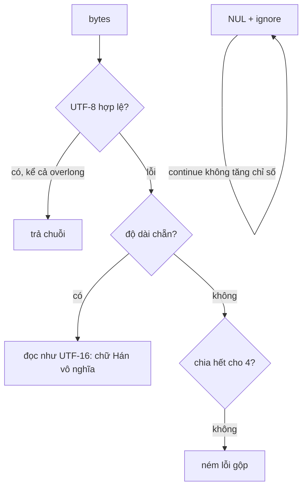

ID bài viết trên Facebook có 17 chữ số, vượt `Number.MAX_SAFE_INTEGER` (2^53 − 1, 16 chữ số). Đưa thẳng vào `Number` thì chữ số cuối bị làm tròn: `10158012345678901` thành `10158012345678900`, và bạn vừa mở nhầm bài.

Chữ cũng có chuyện tương tự. Server đếm vị trí theo **code point**, JavaScript đếm theo **đơn vị UTF-16**. Mỗi emoji trong câu làm hai cách đếm lệch nhau thêm một hoặc nhiều đơn vị, và link "@Lan" được tô đậm thành "t L".

Bài này đọc ba module nhỏ trong bundle Facebook xử lý ba chuyện đó, tìm thấy vài lỗi thật (một trong số đó là vòng lặp vô hạn), rồi viết lại bằng BigInt và thuật toán decode chuẩn WHATWG.

> [!TIP]
> **Tóm tắt**
> - `Int64` là bản port của `goog.math.Long`: hai số 32-bit `low_`/`high_`, `fromString` cắt chuỗi thành khúc 8 chữ số. Nó **không báo lỗi** khi tràn (`9223372036854775808` thành số âm) hay gặp ký tự lạ (`"12a45"` thành `12`). Ngày nay dùng `BigInt` và kiểm tra chặt.
> - `StringEncoding.Decoder` thử UTF-8, hỏng thì thử UTF-16 rồi UTF-32. Nó nhận dạng **overlong** (`C0 AF` thành `/`, nên `..%C0%AFetc` thành `../etc`), nhận surrogate lẻ, và chính sách `"ignore"` với ký tự NUL **kẹt vòng lặp vô hạn**.
> - `decodeEntityRanges` đổi range theo code point sang chỉ số UTF-16 bằng `UnicodeUtils.substr`. Mỗi range duyệt lại chuỗi từ đầu. Bản viết lại đổi tất cả trong một lượt.

<iframe class="demo-frame" src="/demos/facebook-patterns/index.html?theme=dark#/int64-text" title="Demo int64-text" loading="lazy" style="height: 1150px"></iframe>

<p class="demo-links">▶ <a href="/demos/facebook-patterns/index.html#/int64-text" target="_blank" rel="noopener">Mở demo toàn màn hình ↗</a> · <a href="https://stackblitz.com/github/hunghg255/blog-hunghg/tree/master/examples/facebook-patterns?file=src/lib/int64Text.ts" target="_blank" rel="noopener">Sửa code trên StackBlitz ↗</a> · <a href="https://github.com/hunghg255/blog-hunghg/blob/master/examples/facebook-patterns/src/lib/int64Text.ts" target="_blank" rel="noopener">Xem source trên GitHub ↗</a></p>

## Facebook làm thế nào?

### Int64: goog.math.Long đổi tên

Module `Int64` có hai bản (`1004.js` và `17.js`). Đọc là nhận ra ngay goog.math.Long của Closure Library: `low_`, `high_`, `IntCache_` cho các số từ −128 tới 127, các hằng `TWO_PWR_32_DBL_`, phép nhân chia nhỏ thành bốn khúc 16-bit để không vượt độ chính xác của `double`. Có một chi tiết lạ là module gán vào biến toàn cục (`Int64 = function (a, b) {...}`) thay vì biến cục bộ.

Phần đáng đọc là `fromString`:

```js
var c = Int64.fromNumber(Math.pow(b, 8)), d = Int64.ZERO;
for (var e = 0; e < a.length; e += 8) {
  var f = Math.min(8, a.length - e), g = parseInt(a.substring(e, e + f), b);
  if (f < 8) d = d.multiply(Int64.fromNumber(Math.pow(b, f))).add(Int64.fromNumber(g));
  else d = d.multiply(c).add(Int64.fromNumber(g));
}
```

Mỗi khúc 8 chữ số (tối đa 99.999.999) vừa vặn trong `double`, nhân dồn bằng phép nhân 64-bit. Nhưng `parseInt` dừng ở ký tự đầu tiên không phải số và **không báo lỗi**, còn phép nhân 64-bit thì quấn vòng khi tràn. Chạy chính module này trong Node:

| Đầu vào | `Int64.fromString(…).toString()` |
| --- | --- |
| `9223372036854775807` | `9223372036854775807` (đúng, giá trị lớn nhất) |
| `9223372036854775808` | `-9223372036854775808` (tràn, thành số âm) |
| `18446744073709551615` | `-1` |
| `12a45` | `12` (`parseInt("12a45") = 12`, khúc ngắn nên nhân 10^5 rồi cộng 12) |
| `1e3` | `1` |

### StringEncoding: thử lần lượt ba bảng mã

Module `StringEncoding` (trong `177.js`) có ba hàm decode và một lớp `Decoder` thử chúng theo thứ tự `["utf-8", "utf-16", "utf-32"]`. Hàm nào chạy không ném lỗi thì kết quả của nó được trả về ngay; cả ba đều lỗi thì các lỗi được nối lại bằng dấu phẩy thành một `Error`.

Hàm UTF-8 đọc byte đầu để biết độ dài chuỗi byte, chấp nhận tới **6 byte** theo RFC 2279 cũ:

```js
if (e >> 7 === 0) f = 1;
else if (e >> 5 === 6) e &= 31, f = 2;
else if (e >> 4 === 14) e &= 15, f = 3;
else if (e >> 3 === 30) e &= 7, f = 4;
else if (e >> 2 === 62) e &= 3, f = 5;
else if (e >> 1 === 126) e &= 1, f = 6;
```

Sau đó ghép bit, kiểm tra `> 0x10FFFF`, và xử lý ký tự NUL theo chính sách `error` / `ignore` / `truncate` / `include`.

### Bên trong: bốn lỗi



1. **Overlong.** `C0 AF` là cách mã hoá `/` bằng hai byte, bị cấm từ Unicode 3.1 vì cho phép lách bộ lọc: chuỗi `..\xC0\xAFetc` qua bộ lọc tìm `../` mà không bị bắt, sau khi decode lại thành `../etc`. Decoder này trả `"../etc"`. Dạng 5 byte `F8 80 80 80 AF` cũng ra `/`.
2. **Surrogate lẻ.** `ED A0 80` ra `"\ud800"`, một chuỗi JavaScript không hợp lệ. Gửi chuỗi đó qua `encodeURIComponent` sẽ ném `URIError`.
3. **Rơi sang UTF-16.** Bốn byte Latin-1 `63 61 66 E9` ("café") không phải UTF-8 hợp lệ, nhưng có độ dài chẵn nên bản UTF-16 đọc được: kết quả là `"慣"` cộng một ký tự vùng riêng (U+E966). Không có lỗi nào được báo.
4. **`"ignore"` kẹt.** Nhánh xử lý NUL viết `case "ignore": continue;`, nhưng lệnh tăng chỉ số `c += f` nằm ở cuối thân vòng lặp nên bị bỏ qua. Vòng `while` đọc lại đúng byte NUL đó mãi mãi. Chạy `new Decoder(["utf-8"], "ignore").decode(...)` với một byte `00` trong Node thì tiến trình treo tới khi bị `timeout` giết. Bản UTF-16 và UTF-32 có cùng lỗi.

Thêm một lỗi về kích thước: kết quả được tạo bằng `String.fromCodePoint.apply(String, d)`. Mảng vài trăm nghìn phần tử vượt giới hạn số đối số, ném `RangeError: Maximum call stack size exceeded`. Với 300 KB chữ ASCII thì cả ba bảng mã đều thất bại.

### decodeEntityRanges: đếm theo code point

Range (mention, link, hashtag) từ server có `offset` và `length` tính theo code point. Module `decodeEntityRanges` (trong `232.js`) đánh dấu từng đơn vị UTF-16:

```js
function a(text, ranges) {
  var c = Array(text.length).fill(null);
  ranges && ranges.forEach(function (r) {
    var start = substr(text, 0, r.offset).length,
        end = start + substr(text, r.offset, r.length).length;
    for (var i = start; i < end; i++) c[i] = r.key;
  });
  return c;
}
```

`UnicodeUtils.substr` cắt theo code point, `.length` của kết quả là số đơn vị UTF-16. Đúng, nhưng mỗi range duyệt lại chuỗi từ đầu: một bình luận dài có 50 mention là 50 lượt duyệt. Chiều ngược lại, `encodeImplicitURLRanges` dùng `UnicodeUtils.strlen(text.slice(0, start))` để đổi vị trí URL tìm được bằng regex (UTF-16) sang code point trước khi gửi lên, bỏ các URL chồng lên range có sẵn, và thêm `http` khi URL thiếu giao thức.

## Viết lại

Tất cả trong `src/lib/int64Text.ts`. Phần Int64 chỉ vài dòng vì có `BigInt`: kiểm tra định dạng bằng regex, so với `-(2n ** 63n)` và `2n ** 63n - 1n`, tách hi/lo bằng `BigInt.asIntN(32, …)`.

Decoder UTF-8 theo đặc tả WHATWG Encoding. Điểm chính là cặp `lower`/`upper`: byte đầu `E0`, `ED`, `F0`, `F4` thu hẹp khoảng hợp lệ của byte tiếp theo, nên overlong, surrogate và > U+10FFFF bị chặn ngay ở byte thứ hai:

```ts title=src/lib/int64Text.ts
  for (let i = 0; i < bytes.length; i++) {
    const b = bytes[i];
    if (needed === 0) {
      if (b <= 0x7f) {
        if (b === 0) {
          if (nulls === 'error') throw new TypeError(`Có ký tự NUL tại byte ${i}`);
          if (nulls === 'truncate') break;
          if (nulls === 'ignore') continue; // vòng for vẫn tăng i, không kẹt như bản gốc
        }
        emit(b);
      } else if (b >= 0xc2 && b <= 0xdf) {
        needed = 1;
        cp = b & 0x1f;
      } else if (b >= 0xe0 && b <= 0xef) {
        if (b === 0xe0) lower = 0xa0; // chặn overlong 3 byte
        if (b === 0xed) upper = 0x9f; // chặn surrogate D800–DFFF
        needed = 2;
        cp = b & 0x0f;
      } else if (b >= 0xf0 && b <= 0xf4) {
        if (b === 0xf0) lower = 0x90; // chặn overlong 4 byte
        if (b === 0xf4) upper = 0x8f; // chặn > U+10FFFF
        needed = 3;
        cp = b & 0x07;
      } else {
        bad(i); // 80–C1, F5–FF: không bao giờ là byte đầu hợp lệ
      }
      continue;
    }
    if (b < lower || b > upper) {
      // chuỗi đang dở bị cắt: báo lỗi một lần rồi xử lý lại byte này như byte đầu
      needed = seen = cp = 0;
      lower = 0x80;
      upper = 0xbf;
      bad(i);
      i--;
      continue;
    }
    lower = 0x80;
    upper = 0xbf;
    cp = (cp << 6) | (b & 0x3f);
    if (++seen === needed) {
      emit(cp);
      needed = seen = cp = 0;
    }
  }
```

Phần đổi range (`toUtf16Ranges`, `utf16ToCodePoint`, `segment`) nằm cuối file:

::: spoiler Xem toàn bộ src/lib/int64Text.ts

```ts title=src/lib/int64Text.ts
/**
 * Ba việc nhỏ quanh "số và chữ" mà client Facebook tự làm:
 * 1. Số nguyên 64-bit (ID, timestamp micro giây) không mất chính xác: Facebook mang theo bản port
 *    của goog.math.Long (hai nửa 32-bit). Ở đây dùng BigInt, chỉ giữ phần chuyển đổi hi/lo.
 * 2. Decode UTF-8 từ bytes: Facebook tự viết StringEncoding. Bản này làm đúng thuật toán
 *    WHATWG (giống TextDecoder) và thêm các chính sách xử lý ký tự NUL.
 * 3. Đổi offset tính theo code point (server gửi) sang offset UTF-16 (JavaScript dùng),
 *    ý tưởng từ decodeEntityRanges.
 */

// ---------------- 1. Int64 ----------------

const MIN = -(1n << 63n);
const MAX = (1n << 63n) - 1n;

/** Parse chặt: sai định dạng hay tràn 64-bit thì ném lỗi, không âm thầm quấn vòng. */
export function parseInt64(text: string): bigint {
  if (!/^-?\d+$/.test(text)) throw new SyntaxError(`Không phải số nguyên: "${text}"`);
  const n = BigInt(text);
  if (n < MIN || n > MAX) throw new RangeError(`Tràn int64: ${text}`);
  return n;
}

/** Tách thành hai nửa 32-bit có dấu, đúng như low_/high_ của Long. */
export function toHiLo(n: bigint): { high: number; low: number } {
  const u = BigInt.asUintN(64, n);
  return { high: Number(BigInt.asIntN(32, u >> 32n)), low: Number(BigInt.asIntN(32, u)) };
}

export function fromHiLo(high: number, low: number): bigint {
  return BigInt.asIntN(64, (BigInt(high) << 32n) | BigInt(low >>> 0));
}

/** ID dạng chuỗi có đi qua Number an toàn không? (2^53 trở lên thì không chắc) */
export function survivesNumber(text: string): boolean {
  return String(Number(text)) === text;
}

/** JSON.parse giữ số lớn ở dạng chuỗi: bọc các số nguyên dài >= 16 chữ số trong ngoặc kép. */
export function parseJsonKeepBigInts(json: string): unknown {
  return JSON.parse(json.replace(/("(?:[^"\\]|\\.)*")|(?<![\d.eE+-])(-?\d{16,})(?=\s*[,}\]])/g, (m, str, num) => (str ? m : `"${num}"`)));
}

// ---------------- 2. UTF-8 ----------------

export type NullPolicy = 'error' | 'ignore' | 'truncate' | 'include';

export interface Utf8Options {
  /** true: gặp byte sai thì ném lỗi; false: thay bằng U+FFFD như TextDecoder */
  fatal?: boolean;
  nulls?: NullPolicy;
}

/**
 * Decoder UTF-8 theo đặc tả WHATWG Encoding. Chặn được: dạng overlong (C0 AF), surrogate
 * mã hoá trong UTF-8 (ED A0 80), code point > U+10FFFF, dạng 5-6 byte, chuỗi cụt.
 */
export function decodeUtf8(bytes: Uint8Array, { fatal = false, nulls = 'include' }: Utf8Options = {}): string {
  const out: string[] = [];
  let chunk: number[] = [];
  const emit = (cp: number) => {
    chunk.push(cp);
    // String.fromCodePoint(...arr) với mảng rất lớn sẽ tràn stack, nên đẩy theo từng khúc
    if (chunk.length === 8192) {
      out.push(String.fromCodePoint(...chunk));
      chunk = [];
    }
  };
  const bad = (i: number) => {
    if (fatal) throw new TypeError(`UTF-8 không hợp lệ tại byte ${i}`);
    emit(0xfffd);
  };

  let needed = 0;
  let seen = 0;
  let cp = 0;
  let lower = 0x80;
  let upper = 0xbf;

  for (let i = 0; i < bytes.length; i++) {
    const b = bytes[i];
    if (needed === 0) {
      if (b <= 0x7f) {
        if (b === 0) {
          if (nulls === 'error') throw new TypeError(`Có ký tự NUL tại byte ${i}`);
          if (nulls === 'truncate') break;
          if (nulls === 'ignore') continue; // vòng for vẫn tăng i, không kẹt như bản gốc
        }
        emit(b);
      } else if (b >= 0xc2 && b <= 0xdf) {
        needed = 1;
        cp = b & 0x1f;
      } else if (b >= 0xe0 && b <= 0xef) {
        if (b === 0xe0) lower = 0xa0; // chặn overlong 3 byte
        if (b === 0xed) upper = 0x9f; // chặn surrogate D800–DFFF
        needed = 2;
        cp = b & 0x0f;
      } else if (b >= 0xf0 && b <= 0xf4) {
        if (b === 0xf0) lower = 0x90; // chặn overlong 4 byte
        if (b === 0xf4) upper = 0x8f; // chặn > U+10FFFF
        needed = 3;
        cp = b & 0x07;
      } else {
        bad(i); // 80–C1, F5–FF: không bao giờ là byte đầu hợp lệ
      }
      continue;
    }
    if (b < lower || b > upper) {
      // chuỗi đang dở bị cắt: báo lỗi một lần rồi xử lý lại byte này như byte đầu
      needed = seen = cp = 0;
      lower = 0x80;
      upper = 0xbf;
      bad(i);
      i--;
      continue;
    }
    lower = 0x80;
    upper = 0xbf;
    cp = (cp << 6) | (b & 0x3f);
    if (++seen === needed) {
      emit(cp);
      needed = seen = cp = 0;
    }
  }
  if (needed) bad(bytes.length);
  out.push(String.fromCodePoint(...chunk));
  return out.join('');
}

// ---------------- 3. Offset code point ↔ UTF-16 ----------------

export interface CodePointRange<K = string> {
  offset: number; // tính theo code point
  length: number;
  key: K;
}

/**
 * Đổi một lượt cho nhiều range: duyệt chuỗi một lần, O(độ dài + số range).
 * Bản gốc gọi substr theo code point cho từng range, mỗi lần duyệt lại từ đầu chuỗi.
 */
export function toUtf16Ranges<K>(text: string, ranges: CodePointRange<K>[]) {
  const marks = new Set<number>();
  for (const r of ranges) marks.add(r.offset).add(r.offset + r.length);
  const at = new Map<number, number>();
  let cpIndex = 0;
  let u16 = 0;
  for (const ch of text) {
    if (marks.has(cpIndex)) at.set(cpIndex, u16);
    cpIndex++;
    u16 += ch.length; // 2 với emoji/ký tự ngoài BMP
  }
  at.set(cpIndex, u16); // cho range kết thúc đúng cuối chuỗi
  const clamp = (cp: number) => at.get(Math.min(cp, cpIndex)) ?? u16;
  return ranges.map((r) => ({ key: r.key, start: clamp(r.offset), end: clamp(r.offset + r.length) }));
}

/** Ngược lại: offset UTF-16 (ví dụ từ selectionStart) sang offset code point để gửi lên server. */
export function utf16ToCodePoint(text: string, u16Offset: number): number {
  let cp = 0;
  for (let i = 0; i < u16Offset && i < text.length; cp++) {
    const c = text.charCodeAt(i);
    i += c >= 0xd800 && c <= 0xdbff ? 2 : 1;
  }
  return cp;
}

/** Cắt chuỗi thành các đoạn để render (đậm, link…), range chồng nhau thì range sau bị bỏ. */
export function segment<K>(text: string, ranges: CodePointRange<K>[]) {
  const spans = toUtf16Ranges(text, ranges).sort((a, b) => a.start - b.start);
  const parts: { text: string; key: K | null }[] = [];
  let pos = 0;
  for (const s of spans) {
    if (s.start < pos) continue;
    if (s.start > pos) parts.push({ text: text.slice(pos, s.start), key: null });
    parts.push({ text: text.slice(s.start, s.end), key: s.key });
    pos = s.end;
  }
  if (pos < text.length) parts.push({ text: text.slice(pos), key: null });
  return parts;
}
```

:::

**Khác bản gốc:**

- `parseInt64` dùng `BigInt` và **ném lỗi** khi chuỗi không phải số nguyên hoặc vượt khoảng int64, thay vì quấn vòng. `toHiLo`/`fromHiLo` giữ lại để nói chuyện với giao thức nhị phân dùng hai nửa 32-bit.
- Decoder chỉ làm UTF-8, đúng thuật toán của `TextDecoder`: chặn overlong, surrogate, dạng 5–6 byte, > U+10FFFF. Không âm thầm thử bảng mã khác.
- Byte lỗi thì thay bằng U+FFFD (mặc định) hoặc ném lỗi (`fatal: true`), giống `TextDecoder`.
- `nulls: 'ignore'` dùng `continue` trong vòng `for`, nên chỉ số vẫn tăng.
- Kết quả được ghép theo khúc 8.192 code point nên không tràn stack với dữ liệu lớn.
- `toUtf16Ranges` đổi mọi range trong một lượt duyệt; `segment` cắt chuỗi thành các đoạn để render.

## Đi qua code

- `survivesNumber(text)` kiểm tra `String(Number(text)) === text`. Nhanh, đủ để cảnh báo trong dev mode khi ai đó vô tình `Number(id)`.
- `parseJsonKeepBigInts` bọc số nguyên từ 16 chữ số trở lên trong ngoặc kép **trước** khi `JSON.parse`. Regex khớp chuỗi JSON trước (nhánh `"(?:[^"\\]|\\.)*"`) để không đụng vào số nằm trong chuỗi, và có lookbehind để không bắt nhầm phần thập phân.
- Trong `decodeUtf8`, `needed` là số byte tiếp theo còn thiếu. Byte đầu đặt `needed` và thu hẹp `lower`/`upper` nếu cần. Byte tiếp theo nằm ngoài khoảng thì phát một U+FFFD rồi **xử lý lại chính byte đó** như byte đầu (`i--`). Nhờ vậy `E0 41` ra `"�" + "A"`, không nuốt mất chữ `A`.
- Fuzz 20.000 chuỗi byte ngẫu nhiên, so với `new TextDecoder().decode(...)`: không lệch chuỗi nào.
- `toUtf16Ranges` gom mọi vị trí cần đổi vào một `Set`, duyệt chuỗi bằng `for…of` (mỗi bước là một code point), ghi lại chỉ số UTF-16 tại các vị trí đó.

## Tại sao không làm cách khác?

- **`TextDecoder` có sẵn** là lựa chọn đúng cho hầu hết trường hợp, và từ 2020 mọi trình duyệt đều có. Bản tự viết chỉ đáng khi cần chính sách NUL riêng hoặc chạy ở môi trường không có `TextDecoder` (một số worklet, JS engine nhúng). Code của Facebook có lẽ được viết trước khi `TextDecoder` phổ biến.
- **Thử nhiều bảng mã** nghe tiện nhưng nguy hiểm: dữ liệu hỏng thành chữ vô nghĩa mà không ai biết. Nên biết trước bảng mã (header `Content-Type`, BOM) và báo lỗi rõ ràng.
- **`Number` cho ID**: chỉ an toàn tới 2^53. Facebook, Twitter/X, Discord đều gửi ID dạng chuỗi trong JSON vì lý do này.
- **Đếm theo grapheme** (`Intl.Segmenter`) thay vì code point: đúng hơn về mặt hiển thị (👩🏽‍💻 là một ký tự, bốn code point), nhưng server và client phải cùng phiên bản Unicode mới đếm giống nhau. Code point ổn định hơn để làm offset.

## Edge case và cạm bẫy

- **`JSON.stringify` không nhận BigInt**: `JSON.stringify({ id: 1n })` ném `TypeError`. Gửi đi thì đổi về chuỗi.
- **Số 16 chữ số vẫn có thể an toàn** (`1000000000000000` < 2^53). `parseJsonKeepBigInts` đổi hết sang chuỗi cho nhất quán, kiểu dữ liệu không phụ thuộc vào độ lớn của giá trị.
- **BOM.** `TextDecoder` mặc định bỏ BOM `EF BB BF` ở đầu, bản tự viết thì giữ. Muốn giống hẳn thì bỏ 3 byte đầu khi gặp BOM.
- **Range chồng nhau.** `segment` bỏ range bắt đầu bên trong range trước. Muốn lồng (link trong đoạn in đậm) thì cần cây, không phải danh sách phẳng.
- **Offset vượt độ dài chuỗi** (server và client lệch dữ liệu) được kẹp về cuối chuỗi thay vì ném lỗi.

## Dùng trong dự án

Nhận ID từ API cũ trả số:

```ts
const res = await fetch('/api/posts').then((r) => r.text());
const posts = parseJsonKeepBigInts(res) as { id: string; title: string }[];
navigate(`/posts/${posts[0].id}`); // ID còn nguyên 17 chữ số
```

Render bình luận có mention:

```tsx
function Comment({ text, ranges }: { text: string; ranges: CodePointRange<'mention' | 'link'>[] }) {
  return (
    <p>
      {segment(text, ranges).map((s, i) => (s.key === 'mention' ? <b key={i}>{s.text}</b> : <span key={i}>{s.text}</span>))}
    </p>
  );
}
```

Gửi vị trí con trỏ lên server: `utf16ToCodePoint(textarea.value, textarea.selectionStart)`.

## Kiểm thử

::: spoiler Ví dụ test (bản phác, không có trong repo)

```ts
import { describe, expect, it } from 'vitest';
import {
  decodeUtf8,
  fromHiLo,
  parseInt64,
  parseJsonKeepBigInts,
  segment,
  toHiLo,
  toUtf16Ranges,
  utf16ToCodePoint,
} from '../src/lib/int64Text';

describe('Int64', () => {
  it('parse chặt, không quấn vòng', () => {
    expect(parseInt64('9223372036854775807')).toBe(2n ** 63n - 1n);
    expect(() => parseInt64('9223372036854775808')).toThrow(RangeError);
    expect(() => parseInt64('12a45')).toThrow(SyntaxError);
  });

  it('hi/lo đi một vòng không mất gì', () => {
    for (const n of [0n, -1n, 2n ** 63n - 1n, -(2n ** 63n), 10158012345678901n]) {
      const { high, low } = toHiLo(n);
      expect(fromHiLo(high, low)).toBe(n);
    }
  });

  it('giữ số lớn trong JSON ở dạng chuỗi', () => {
    expect(parseJsonKeepBigInts('{"id":10158012345678901,"s":"10158012345678901","x":1.5}')).toEqual({
      id: '10158012345678901',
      s: '10158012345678901',
      x: 1.5,
    });
  });
});

describe('decodeUtf8', () => {
  const b = (...x: number[]) => Uint8Array.from(x);
  it('chặn overlong, surrogate, dạng 5 byte', () => {
    expect(decodeUtf8(b(0x2e, 0x2e, 0xc0, 0xaf))).toBe('..��');
    expect(() => decodeUtf8(b(0xed, 0xa0, 0x80), { fatal: true })).toThrow();
    expect(() => decodeUtf8(b(0xf8, 0x80, 0x80, 0x80, 0xaf), { fatal: true })).toThrow();
  });

  it('khớp TextDecoder với byte ngẫu nhiên', () => {
    const td = new TextDecoder();
    for (let k = 0; k < 2000; k++) {
      const bytes = Uint8Array.from({ length: 8 }, () => Math.floor(Math.random() * 256));
      expect(decodeUtf8(bytes)).toBe(td.decode(bytes));
    }
  });

  it('chính sách NUL, ignore không kẹt', () => {
    expect(decodeUtf8(b(0x61, 0, 0x62), { nulls: 'ignore' })).toBe('ab');
    expect(decodeUtf8(b(0x61, 0, 0x62), { nulls: 'truncate' })).toBe('a');
    expect(() => decodeUtf8(b(0x61, 0), { nulls: 'error' })).toThrow();
  });

  it('dữ liệu lớn không tràn stack', () => {
    expect(decodeUtf8(new Uint8Array(1_000_000).fill(0x41))).toHaveLength(1_000_000);
  });
});

describe('offset code point', () => {
  const text = 'Hi 👋🏽 Lan';
  it('đổi sang UTF-16 và ngược lại', () => {
    const [r] = toUtf16Ranges(text, [{ offset: 6, length: 3, key: 'm' }]);
    expect(text.slice(r.start, r.end)).toBe('Lan');
    expect(utf16ToCodePoint(text, r.start)).toBe(6);
    expect(segment(text, [{ offset: 6, length: 3, key: 'm' }]).at(-1)).toEqual({ text: 'Lan', key: 'm' });
  });
});
```

:::

## So với thư viện và chuẩn web

- **`TextDecoder` / `TextEncoder`**: chuẩn WHATWG Encoding, có trên mọi trình duyệt và Node. `fatal: true` để ném lỗi thay vì thay U+FFFD, `ignoreBOM: true` để giữ BOM. Đây là thứ nên dùng mặc định.
- **`String.prototype.isWellFormed()` / `toWellFormed()`**: kiểm tra và sửa surrogate lẻ trong chuỗi JavaScript, có trên các trình duyệt chính (tính tới 10/2026).
- **JSON.parse source text access**: callback reviver nhận thêm `context.source` (chuỗi gốc của số), nên đọc ID lớn thành `BigInt` mà không cần regex. Đã có trên Chromium và Firefox, các trình duyệt khác chưa đồng đều (tính tới 10/2026); kiểm tra trước khi dùng. Thư viện `json-bigint` và `lossless-json` làm việc này từ lâu.
- **`Intl.Segmenter`**: tách theo grapheme cluster để đếm "ký tự người đọc thấy", dùng cho bộ đếm ký tự trong ô nhập, không dùng cho offset.

---

Bài này thuộc series **[Học từ mã nguồn Facebook](/series/facebook)** (106 bài, đọc theo thứ tự).

::: spoiler Xem nhanh danh sách bài trong series

*Phần 1*

- [Mở đầu: cách đọc code minify của Facebook](/blogs/learn-from-facebook-source-code)
- [#1 Dùng chung IntersectionObserver + infinite scroll](/blogs/facebook-shared-intersection-observer)
- [#2 useViewportDuration: đo thời gian thực sự được xem](/blogs/facebook-use-viewport-duration)
- [#3 Preload code + data khi hover](/blogs/facebook-preload-on-hover)
- [#4 Toast manager với external store](/blogs/facebook-toast-manager)
- [#5 Network status + heartbeat backoff](/blogs/facebook-network-status-heartbeat)
- [#6 ErrorGuard: bắt lỗi theo ngữ cảnh](/blogs/facebook-error-guard)
- [#7 Banzai: gom log theo lô + sendBeacon](/blogs/facebook-batch-logger)
- [#8 Focus trap + Esc theo layer](/blogs/facebook-focus-trap)

*Phần 2*

- [#9 Mẹo calc(… * 9999): container query, line-clamp, mũi tên carousel bằng CSS](/blogs/facebook-css-9999-trick)
- [#10 Thanh cuộn tuỳ biến bằng CSS 3D](/blogs/facebook-css-3d-scrollbar)
- [#11 Modal cuộn bằng window, giữ vị trí trang nền](/blogs/facebook-document-scroll-modal)
- [#12 Popover, tooltip group và hovercard](/blogs/facebook-popover-tooltip)
- [#13 Primitive Pressable + focus-visible](/blogs/facebook-pressable)
- [#14 Tab "Xem thêm" + sticky header bằng IntersectionObserver](/blogs/facebook-priority-tabs-sticky-header)
- [#15 Avatar khoét mask, gradient Messenger, skeleton steps()](/blogs/facebook-visual-tricks)
- [#16 Khung chat không giật](/blogs/facebook-chat-scroller)
- [#17 Thuật toán chọn bố cục collage ảnh](/blogs/facebook-photo-collage-layout)
- [#18 Keep-alive tab trong SPA](/blogs/facebook-keep-alive-tabs)
- [#19 Tự đo Visual Completion & interaction tracing](/blogs/facebook-visual-completion)
- [#20 Router SPA bền bỉ & tải chunk có retry](/blogs/facebook-spa-router-resilient-loading)

*Phần 3*

- [#21 Smart Compose: gợi ý chữ mờ khi gõ](/blogs/facebook-smart-compose-ghost-text)
- [#22 MQTT ngay trong trình duyệt, tự chuyển sang long-poll](/blogs/facebook-mqtt-in-browser)
- [#23 Đo thời gian dùng bằng bitmap 64 giây](/blogs/facebook-time-spent-bitmap)
- [#24 Bảng reaction nhấn giữ rồi trượt](/blogs/facebook-reaction-press-slide)
- [#25 Tìm kiếm gấp dấu, phiên âm và highlight đầu từ](/blogs/facebook-search-diacritics-tokenize)
- [#26 Ring buffer biết trace nào đã mất log](/blogs/facebook-trace-ring-buffer)
- [#27 Engine animation JS: một vòng rAF và solver cubic-bezier](/blogs/facebook-keyframes-loop-cubic-bezier)
- [#28 Bootloader: bitmap tài nguyên đã tải, chỉ reload khi cần](/blogs/facebook-bootloader-bitmap-consistency)
- [#29 Nhận biết click do screen reader tạo ra](/blogs/facebook-virtual-cursor-detection)
- [#30 Tải trước feed theo chất lượng mạng, đoán hạng thiết bị](/blogs/facebook-network-aware-prefetch)
- [#31 Hàng đợi gửi tin chat giữ đúng thứ tự](/blogs/facebook-ordered-send-queue)
- [#32 Gộp lời gọi API trong cùng một tick](/blogs/facebook-api-batcher)
- [#33 Resize ảnh trong pool Web Worker](/blogs/facebook-jpeg-resize-worker-pool)
- [#34 Crop ảnh theo nhiều khuôn mặt](/blogs/facebook-face-aware-crop)
- [#35 Kéo-thả sắp xếp và vùng thả file không nhấp nháy](/blogs/facebook-flicker-free-drag-drop)
- [#36 Tiện ích UI: fade-out, sticky event, hàm huỷ được](/blogs/facebook-ui-utility-hooks)
- [#37 Hạ tầng nhỏ: cookie, hash lỗi, prefetch khi chuột dừng](/blogs/facebook-small-infra-cookie-hash-idle)

*Phần 4–6*

- [#38 Đồng bộ tin nhắn: phát hiện lỗ seqID và fetch bù theo tầng](/blogs/facebook-messenger-sync-seqid-gaps)
- [#39 OTID: ID tin nhắn kiểu Snowflake sinh ở client](/blogs/facebook-otid-client-snowflake)
- [#40 QPL: lấy mẫu từ lúc bắt đầu, đo RTT gửi tin đầu-cuối](/blogs/facebook-qpl-send-rtt)
- [#41 Bộ điều phối request bảy chế độ gộp và chống trùng](/blogs/facebook-request-dispatcher-modes)
- [#42 Thread list theo mốc thời gian, cookie presence có version](/blogs/facebook-threadlist-ranged-presence)
- [#43 Composer dạng plugin: reducer, dirty checker, chuỗi kiểm tra](/blogs/facebook-plugin-composer)
- [#44 Thanh toán bất đồng bộ: subscribe trước, poll dự phòng](/blogs/facebook-async-checkout)
- [#45 Validate số thẻ: sửa lỗi gõ, dải BIN, Luhn](/blogs/facebook-card-validation)
- [#46 Lịch chọn khoảng ngày: bo góc dải chọn, phím đủ bộ, RTL](/blogs/facebook-range-calendar-a11y)
- [#47 Giờ mở cửa theo tuần: qua đêm, gộp khoảng, phần bù](/blogs/facebook-weekly-hours-intervals)
- [#48 Tiến độ đăng realtime: giữ event chờ snapshot, watchdog](/blogs/facebook-realtime-publish-snapshot)
- [#49 Tiền tệ theo đơn vị nhỏ nhất và ô nhập tiền](/blogs/facebook-currency-minor-units)
- [#50 Sửa hàng loạt Empty/Uniform/Mixed, seen/read bằng 2 bit](/blogs/facebook-bulk-edit-seen-bits)
- [#51 Phát hiện script lạ hook vào hàm native](/blogs/facebook-native-hook-detection)
- [#52 localStorage tự dọn khi đầy quota](/blogs/facebook-quota-aware-storage)
- [#53 Cache tuyến do server phân giải, chờ sẵn promise](/blogs/facebook-route-cache-prefetch)
- [#54 Lưới phím mũi tên 2D và focus không làm cuộn trang](/blogs/facebook-focus-table-grid)
- [#55 Tách emoji bằng máy trạng thái](/blogs/facebook-emoji-segmentation)
- [#56 Đọc trước ghi sau trong một frame, con tự biết vị trí](/blogs/facebook-read-then-write-dom)
- [#57 Hàng đợi lệnh cho video và stream sắp lại chunk](/blogs/facebook-video-command-queue)

*Phần 7–10*

- [#58 Ước lượng băng thông EWMA: loại outlier, nhớ qua phiên](/blogs/facebook-bandwidth-ewma-estimator)
- [#59 ABR theo độ tự tin phát và cắt bậc bitrate theo MOS](/blogs/facebook-abr-playback-confidence)
- [#60 Prefetch segment dự đoán từ manifest, parse hộp sidx](/blogs/facebook-dash-predicted-segments)
- [#61 Đọc metadata MP4/MOV ngay trên client](/blogs/facebook-mp4-metadata-client)
- [#62 Upload tiếp tục được: offset, hash dedupe, phát hiện treo](/blogs/facebook-resumable-upload)
- [#63 Fenwick tree: chọn ngẫu nhiên có trọng số và offset dòng](/blogs/facebook-fenwick-weighted-random)
- [#64 Vạch trục số và trục thời gian "đẹp"](/blogs/facebook-nice-axis-ticks)
- [#65 Damerau-Levenshtein theo dải chéo và tự sửa tên gõ sai](/blogs/facebook-damerau-levenshtein)
- [#66 PRNG có seed, shuffle tái lập và lấy mẫu trace](/blogs/facebook-seeded-prng-sampling)
- [#67 Cặp min/max-heap tái dùng vị trí trong danh sách ảo](/blogs/facebook-dual-heap-buffer-set)
- [#68 Memo nhiều đối số bằng Map/WeakMap và interning object](/blogs/facebook-multikey-memo-interning)
- [#69 Thống kê cửa sổ trượt và đại số khoảng thời gian](/blogs/facebook-moving-stat-intervals)
- **#70 Int64 từ hai số 32-bit, decode UTF, offset theo code point** (bài này)
- [#71 Engine múi giờ IANA trên client, phát hiện lệch giờ](/blogs/facebook-client-iana-timezone)
- [#72 Tự cài semver range](/blogs/facebook-semver-range)
- [#73 Auto-link URL, cắt chữ an toàn, giới hạn LaTeX](/blogs/facebook-autolink-safe-truncate)
- [#74 Parser query kiểu PHP chống prototype pollution](/blogs/facebook-php-query-serializer)
- [#75 Popover tự lật theo phần tràn nhỏ nhất](/blogs/facebook-popover-auto-flip)
- [#76 Tiền tố for(;;) chống JSON hijacking, đọc stream](/blogs/facebook-csrf-prefix-streaming)
- [#77 Chống lộ Referer, linkshim, xoá token trên URL](/blogs/facebook-referrer-linkshim-url-scrub)
- [#78 setImmediate bằng postMessage, gom delta chuột theo frame](/blogs/facebook-setimmediate-mouse-batching)
- [#79 Phát hiện crash qua heartbeat, dò proxy cache hỏng](/blogs/facebook-crash-heartbeat-proxy-check)
- [#80 DPR vào cookie cho ảnh @2x, che khoá trong log](/blogs/facebook-dpr-cookie-secret-redaction)
- [#81 Flux waitFor tự viết và proxy có đệm](/blogs/facebook-flux-dispatch-buffered-proxy)
- [#82 Crop đúng tỉ lệ, xoay sticker bằng ma trận](/blogs/facebook-image-crop-rotation-geometry)

*Phần 11–15*

- [#83 Chia subdomain giữa các tab bằng lease, long-poll theo bảng trạng thái](/blogs/facebook-tab-subdomain-lease-longpoll)
- [#84 MQTT QoS1: giữ publish chờ ack, gửi lại khi kết nối lại](/blogs/facebook-mqtt-qos1-republish)
- [#85 Cache Promise gộp request, cache lỗi ngắn, đua dữ liệu nhúng sẵn](/blogs/facebook-promise-cache-preload-race)
- [#86 Lịch retry: backoff có trần, Fibonacci, báo lỗi CDN mỗi N ngày](/blogs/facebook-retry-backoff-schedules)
- [#87 Giữ nguyên tham chiếu nhánh dữ liệu không đổi](/blogs/facebook-relay-recycle-nodes)
- [#88 Store optimistic: copy-on-write, rollback rồi áp lại](/blogs/facebook-relay-optimistic-store)
- [#89 Chỉ mục subscription theo record, hàng đợi task theo chiều sâu](/blogs/facebook-relay-subscription-index)
- [#90 Phân trang connection: cursor khớp đầu, edge không trùng](/blogs/facebook-relay-connection-pagination)
- [#91 Profiler kiểu middleware và memo selector có lấy mẫu kiểm tra](/blogs/facebook-profiler-middleware-memo-check)
- [#92 Đọc EBML/WebM Cues để tìm byte range của segment](/blogs/facebook-webm-ebml-cues)
- [#93 Stream HTTP Range tạm dừng được, tải tiếp đúng byte](/blogs/facebook-pausable-range-stream)
- [#94 Bảng khoảng thời gian gắn nhãn và nhảy qua lỗ buffer](/blogs/facebook-tagged-time-ranges-gaps)
- [#95 Gom chunk cho SourceBuffer, đồng bộ video bằng playbackRate](/blogs/facebook-sourcebuffer-video-sync)
- [#96 Gom tin nhắn thành cụm, vạch ngày và avatar đã xem](/blogs/facebook-message-grouping)
- [#97 Bao nhiêu tab chat vừa màn hình, chuỗi luật mở tab](/blogs/facebook-chat-tab-policy)
- [#98 Phím tắt Markdown trong editor, Backspace để hoàn tác](/blogs/facebook-markdown-shortcuts-editor)
- [#99 Offset theo code point hay UTF-16: bốn bug cùng một gốc](/blogs/facebook-codepoint-offset-bugs)
- [#100 Typeahead không nhảy: cache tiền tố, chặn reflow, khoá hover](/blogs/facebook-typeahead-stable-results)
- [#101 Hit-test trên canvas bằng phát lại path, nét đứt và cung Bézier](/blogs/facebook-canvas-hit-regions)
- [#102 Vòng tròn theo mét trên bản đồ Mercator](/blogs/facebook-mercator-meter-circles)
- [#103 Dò tính năng trình duyệt: ảnh EXIF 2×1, getter bẫy, scrollbar](/blogs/facebook-feature-probe-tricks)
- [#104 Bug định dạng số và kiểm tra dữ liệu theo locale](/blogs/facebook-locale-validation-bugs)
- [#105 Dispose cho đúng: idle callback, splice(-1), xoá nhầm key](/blogs/facebook-dispose-leak-bugs)

:::

Code + demo: [`examples/facebook-patterns`](https://github.com/hunghg255/blog-hunghg/tree/master/examples/facebook-patterns) · [Mở trên StackBlitz](https://stackblitz.com/github/hunghg255/blog-hunghg/tree/master/examples/facebook-patterns)
