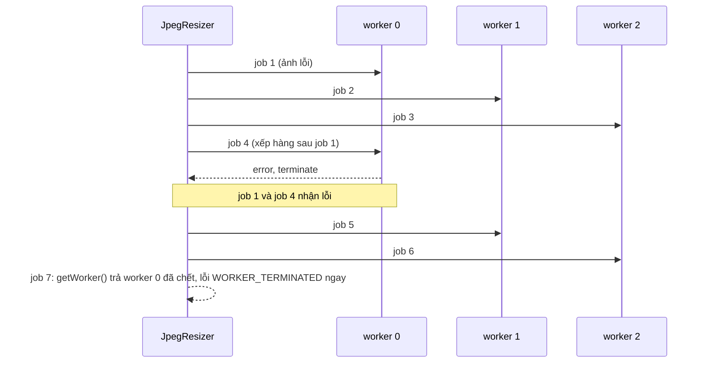

Ảnh chụp từ điện thoại bây giờ dễ dàng 4000×3000, 3–6MB. Upload nguyên file thì tốn băng thông của người dùng, chậm trên mạng 3G, và server cũng chỉ giữ lại bản 2048px. Cách hợp lý là **thu nhỏ ngay trên máy người dùng** trước khi gửi.

Nhưng giải mã một JPEG 24 megapixel rồi mã hoá lại là việc nặng. Làm trên main thread thì trang đứng hình vài trăm ms mỗi ảnh. Chọn 10 ảnh cùng lúc là cả giây không bấm được gì. Facebook đẩy việc này sang một **pool Web Worker**, và cách họ chia việc trong pool có một điểm yếu đáng học.

> [!TIP]
> **Tóm tắt**
> - Facebook resize ảnh trước khi upload trong pool 3 worker (`JpegResizer` + `WebWorkerPool`), khung tối đa 2048×2048, JPEG chất lượng 85.
> - Pool chia việc xoay vòng (round-robin). Worker lỗi bị terminate nhưng **vẫn nằm trong vòng xoay**: từ đó cứ 3 job thì 1 job hỏng ngay.
> - Bản viết lại: mỗi job có id, chọn worker theo round-robin hoặc "ít việc nhất", worker chết thì tạo worker mới thế chỗ.
> - Trình duyệt hiện đại có sẵn `createImageBitmap` + `OffscreenCanvas` trong worker, không cần biên dịch codec sang WASM như Facebook.

<iframe class="demo-frame" src="/demos/facebook-patterns/index.html?theme=dark#/jpeg-resize" title="Demo jpeg-resize" loading="lazy" style="height: 780px"></iframe>

<p class="demo-links">▶ <a href="/demos/facebook-patterns/index.html#/jpeg-resize" target="_blank" rel="noopener">Mở demo toàn màn hình ↗</a> · <a href="https://stackblitz.com/github/hunghg255/blog-hunghg/tree/master/examples/facebook-patterns?file=src/lib/workerPool.ts" target="_blank" rel="noopener">Sửa code trên StackBlitz ↗</a> · <a href="https://github.com/hunghg255/blog-hunghg/blob/master/examples/facebook-patterns/src/lib/workerPool.ts" target="_blank" rel="noopener">Xem source trên GitHub ↗</a></p>

Bấm "Tạo 9 ảnh mẫu", rồi chạy ở chế độ Main thread và Pool worker. Trên máy mình, main thread mất khoảng 3,7 giây với một frame dài gần 470ms (chấm cam khựng hẳn). Pool 3 worker xong trong khoảng 0,6–0,8 giây, frame dài nhất khoảng 80ms.

## Facebook làm thế nào?

Ba module nằm cùng nhau trong bundle `177.js` của [facebook-codebase](https://github.com/hunghg255/facebook-codebase): `JpegResizer`, `WebWorkerPool` và `PooledWebWorker`.

### JpegResizer: một singleton bọc pool

```js
// JpegResizer (đã đổi tên biến)
JpegResizer.isSupported = () =>
  WebWorkerPool.isSupported() && Emscripten.isSupported() && !JpegResizerConfig.isGKBlacklisted;

JpegResizer.getSingleton = (size) =>
  instance ||= new JpegResizer(size || JpegResizer.DEFAULT_POOL_SIZE).setAllowCrossPageTransition(true);

JpegResizer.DEFAULT_POOL_SIZE = 3;
JpegResizer.DEFAULT_RESIZE_HEIGHT = 2048;
JpegResizer.DEFAULT_RESIZE_WIDTH = 2048;
JpegResizer.LOW_QUALITY_RESIZE_HEIGHT = 960;
JpegResizer.LOW_QUALITY_RESIZE_WIDTH = 960;
// constructor: this.quality = 85
```

Vài điều đọc được từ đây:

- **Codec là WASM.** `Emscripten.isSupported()` cho thấy worker chạy một thư viện JPEG biên dịch bằng Emscripten (có lẽ libjpeg). Lỗi trả về được phân loại theo chuỗi `"Not a JPEG file"` (lỗi của libjpeg) và `"abort()"` (lỗi của runtime Emscripten).
- **Có gatekeeper chặn.** `isGKBlacklisted` cho phép tắt tính năng cho một nhóm người dùng/thiết bị mà không cần deploy.
- **Pool sống qua chuyển trang.** `setAllowCrossPageTransition(true)` giữ worker khi người dùng điều hướng trong SPA, khỏi phải tải và khởi tạo lại module WASM.
- **Hai mức chất lượng.** 2048×2048 cho bản thường, 960×960 cho bản "thấp"; `resize360Blob` nhân khung lên 3 lần cho ảnh 360°.

### WebWorkerPool: xoay vòng

Constructor tạo `size` đối tượng `PooledWebWorker` (mỗi cái nhớ chỉ số của mình trong pool), rồi chọn worker như sau:

```js
getWorker() {
  const worker = this.workers[this.cursor];
  this.cursor = (this.cursor + 1) % this.workers.length;
  return worker;
}
```

Round-robin thuần: job thứ 1 vào worker 0, job 2 vào worker 1, job 4 lại về worker 0. Không nhìn worker nào đang rảnh.

### Khớp kết quả với job: một hàng đợi theo worker

`JpegResizer` không gắn id cho job. Nó giữ một mảng callback cho **mỗi worker** và dựa vào thứ tự:

```js
// gửi job
const worker = this.pool.getWorker();
const index = worker.postMessage({ blob, width, height, quality: this.quality, undershoot }).getIndex();
this.queueOf(index).unshift({ done: callback, progress });

// nhận kết quả
onMessage(worker, data) {
  if (data.done) this.queueOf(worker.getIndex()).pop().done(data.error, data.blob, data.skipped, ...);
  else {
    const queue = this.queueOf(worker.getIndex());
    queue[queue.length - 1].progress?.({ written: data.written, total: data.total });
  }
}
```

`unshift` vào đầu, `pop` ở cuối: đây là hàng đợi FIFO. Cách này đúng **với điều kiện** mỗi worker xử lý job tuần tự và trả kết quả đúng thứ tự nhận. Worker chạy một codec đồng bộ thì điều kiện đó giữ được.

### Khi worker lỗi

```js
onError(worker, error) {
  worker.terminate();
  const queue = this.queueOf(worker.getIndex());
  this.classify(error);            // BAD_JPEG / WORKER_ABORT / UNKNOWN_RESIZE_ERROR
  queue.forEach((job) => job.done(error));
  queue.length = 0;
}

resize(blob, ...) {
  const worker = this.pool.getWorker();
  if (worker.isCurrentState('terminated')) {
    const error = new Error('Worker terminated');
    error.code = PUWErrorCodes.WORKER_TERMINATED;
    callback(error);
    return this;
  }
  ...
}
```

Worker hỏng (WASM `abort()`, hết bộ nhớ với ảnh quá to…) thì bị terminate và mọi job đang chờ trên nó nhận lỗi. Đến đây vẫn hợp lý. Vấn đề là **worker đã chết vẫn nằm trong mảng `workers`**, và `getWorker()` vẫn xoay vòng tới nó. Từ đó trở đi, cứ 3 job thì có 1 job nhận ngay lỗi `WORKER_TERMINATED` dù 2 worker kia vẫn khoẻ. Pool không bao giờ tự hồi phục cho tới khi tải lại trang (singleton giữ mãi).

Demo tái hiện đúng hành vi này: bỏ tick "Tạo lại worker khi lỗi", bấm "Resize, job đầu làm worker crash". Lượt đó hỏng 4/10 job (job crash và 3 job khác đã xếp hàng trên cùng worker). Lượt resize **tiếp theo**, không còn job crash nào, vẫn hỏng 3/9 job.



## Bên trong trình duyệt: vì sao resize lại chặn trang?

Thu nhỏ một ảnh gồm ba bước:

1. **Giải mã** JPEG thành bitmap. Ảnh 6000×4000 là 24 triệu pixel × 4 byte = 96MB RAM.
2. **Vẽ thu nhỏ** lên canvas nhỏ hơn.
3. **Mã hoá** canvas thành JPEG mới.

Cách hay gặp trên main thread là `` + `canvas.drawImage` + `canvas.toDataURL('image/jpeg')`. `toDataURL` mã hoá **đồng bộ**: trang đứng cho tới khi xong. `toBlob` thì bất đồng bộ, nhưng việc giải mã ảnh cho `drawImage` và việc vẽ vẫn có thể rơi vào main thread.

Trong worker, cả ba bước đều có API dùng được (tính tới 10/2026, mọi trình duyệt lớn đều hỗ trợ):

- `createImageBitmap(blob)` giải mã ngoài main thread.
- `new OffscreenCanvas(w, h)` là canvas không gắn DOM, dùng được trong worker.
- `offscreen.convertToBlob({ type: 'image/jpeg', quality })` mã hoá ra Blob.

Năm Facebook viết `JpegResizer`, `OffscreenCanvas` chưa có ở Safari, nên họ mang cả codec vào worker dưới dạng WASM. Ngày nay ta không cần làm vậy, trừ khi muốn kiểm soát chất lượng nén chi tiết (MozJPEG, chroma subsampling…).

## Viết lại

Hai file: một hàm resize chạy được ở bất kỳ đâu, và một pool tổng quát.

```ts title=src/lib/imageResize.ts
export async function resizeImage(job: ResizeJob): Promise<ResizeResult> {
  const start = performance.now();
  if (job.crash) throw new Error('Worker crash (giả lập)');
  // createImageBitmap giải mã ảnh; trong worker việc này không chặn main thread
  const bitmap = await createImageBitmap(job.blob);
  const { width: ow, height: oh } = bitmap;
  const target = fitWithin(ow, oh, job.maxWidth, job.maxHeight);
  if (target.scale === 1) {
    bitmap.close();
    return { blob: job.blob, skipped: true, originalWidth: ow, originalHeight: oh, outputWidth: ow, outputHeight: oh, ms: performance.now() - start };
  }
  const canvas = new OffscreenCanvas(target.width, target.height);
  const ctx = canvas.getContext('2d')!;
  ctx.imageSmoothingQuality = 'high';
  ctx.drawImage(bitmap, 0, 0, target.width, target.height);
  bitmap.close();
  const blob = await canvas.convertToBlob({ type: 'image/jpeg', quality: job.quality });
  return {
    blob,
    skipped: false,
    originalWidth: ow,
    originalHeight: oh,
    outputWidth: target.width,
    outputHeight: target.height,
    ms: performance.now() - start,
  };
}
```

`fitWithin` (ở đầu file) giữ tỉ lệ và **không phóng to**: `scale = Math.min(1, maxWidth / width, maxHeight / height)`. Ảnh đã nhỏ hơn khung thì trả nguyên file, `skipped: true`. Facebook cũng có cờ `skipped` y hệt trong kết quả: nén lại một ảnh 800×600 chỉ làm nó xấu đi.

Worker chỉ là lớp vỏ mỏng quanh hàm đó: nhận `{ id, payload }`, gọi `resizeImage`, gửi lại `{ id, ok, result }` (xem trong spoiler bên dưới).

Phần đáng chú ý là pool. Thay vì hàng đợi theo thứ tự, mỗi job có **id**, và kết quả được khớp theo id:

```ts title=src/lib/workerPool.ts
  run(payload: TIn, { signal, transfer = [] }: { signal?: AbortSignal; transfer?: Transferable[] } = {}) {
    const id = this.nextId++;
    const workerIndex = this.pick();
    this.lastWorkerIndex = workerIndex;
    const slot = this.slots[workerIndex];
    return new Promise<TOut>((resolve, reject) => {
      if (!slot.worker) {
        reject(new WorkerTerminatedError(workerIndex));
        return;
      }
      if (signal?.aborted) {
        reject(signal.reason);
        return;
      }
      this.pending.set(id, { resolve, reject, workerIndex });
      slot.running++;
      this.options.onDispatch?.(id, workerIndex);
      slot.worker.postMessage({ id, payload } satisfies PoolRequest<TIn>, transfer);
      signal?.addEventListener(
        'abort',
        () => {
          if (!this.pending.delete(id)) return;
          slot.running--;
          reject(signal.reason);
        },
        { once: true },
      );
    });
  }
```

Khi worker lỗi, ta báo lỗi cho các job của nó rồi **tạo worker mới thế chỗ**:

```ts title=src/lib/workerPool.ts
  private handleCrash(index: number, slot: Slot, message: string) {
    if (this.slots[index] !== slot) return; // slot này đã được thay rồi
    slot.worker?.terminate();
    this.options.onWorkerError?.(index, message);
    // mọi job đang nằm trên worker này đều hỏng
    for (const [id, job] of this.pending) {
      if (job.workerIndex === index) {
        this.pending.delete(id);
        job.reject(new WorkerTerminatedError(index));
      }
    }
    this.slots[index] =
      this.options.respawn === false
        ? { worker: null, running: 0, generation: slot.generation }
        : this.spawn(index, slot.generation + 1);
  }
```

Hàm `pick()` có thêm chiến lược "ít việc nhất": duyệt các worker còn sống, chọn worker có `running` nhỏ nhất.

::: spoiler Xem toàn bộ src/lib/workerPool.ts

```ts title=src/lib/workerPool.ts
/**
 * Pool Web Worker có hàng đợi theo job id (ý tưởng từ WebWorkerPool + JpegResizer của Facebook).
 *
 * Bản gốc: N worker, chia việc xoay vòng (round-robin), mỗi worker giữ một mảng callback,
 * worker lỗi thì terminate và báo lỗi cho mọi job đang chờ, NHƯNG vẫn nằm trong vòng xoay:
 * từ đó cứ 1/N job lại nhận ngay lỗi "Worker terminated".
 *
 * Bản viết lại:
 * - mỗi job có id riêng, kết quả trả về khớp theo id (không phụ thuộc thứ tự),
 * - chọn worker theo round-robin hoặc theo số job đang chạy (least-busy),
 * - worker chết thì tạo worker mới thế chỗ (respawn), không để "lỗ" trong pool,
 * - huỷ được job bằng AbortSignal.
 */

export type DispatchStrategy = 'round-robin' | 'least-busy';

export interface PoolRequest<TIn> {
  id: number;
  payload: TIn;
}

export type PoolResponse<TOut> =
  | { id: number; ok: true; result: TOut }
  | { id: number; ok: false; error: string };

export interface WorkerPoolOptions {
  size: number;
  /** tạo một worker mới, vd () => new Worker(new URL('./x.worker.ts', import.meta.url), { type: 'module' }) */
  create: () => Worker;
  strategy?: DispatchStrategy;
  /** worker chết thì tạo lại (mặc định true). false = giống bản gốc của Facebook. */
  respawn?: boolean;
  /** được gọi mỗi khi một job được giao cho worker (để demo/ghi log) */
  onDispatch?: (jobId: number, workerIndex: number) => void;
  onWorkerError?: (workerIndex: number, message: string) => void;
}

interface Pending<TOut> {
  resolve: (value: TOut) => void;
  reject: (reason: Error) => void;
  workerIndex: number;
}

interface Slot {
  worker: Worker | null; // null = đã chết và không respawn
  running: number;
  generation: number;
}

export class WorkerTerminatedError extends Error {
  constructor(workerIndex: number) {
    super(`Worker #${workerIndex} đã bị terminate`);
    this.name = 'WorkerTerminatedError';
  }
}

export class WorkerPool<TIn, TOut> {
  private slots: Slot[] = [];
  private pending = new Map<number, Pending<TOut>>();
  private nextId = 1;
  private cursor = 0;
  /** worker nhận job gần nhất (để UI hiển thị) */
  lastWorkerIndex = -1;

  constructor(private options: WorkerPoolOptions) {
    for (let i = 0; i < options.size; i++) this.slots.push(this.spawn(i, 0));
  }

  private spawn(index: number, generation: number): Slot {
    const worker = this.options.create();
    const slot: Slot = { worker, running: 0, generation };
    worker.onmessage = (event: MessageEvent<PoolResponse<TOut>>) => {
      const data = event.data;
      const job = this.pending.get(data.id);
      if (!job) return; // job đã bị huỷ
      this.pending.delete(data.id);
      slot.running--;
      if (data.ok) job.resolve(data.result);
      else job.reject(new Error(data.error));
    };
    worker.onerror = (event) => {
      event.preventDefault();
      this.handleCrash(index, slot, event.message || 'lỗi không rõ trong worker');
    };
    return slot;
  }

  private handleCrash(index: number, slot: Slot, message: string) {
    if (this.slots[index] !== slot) return; // slot này đã được thay rồi
    slot.worker?.terminate();
    this.options.onWorkerError?.(index, message);
    // mọi job đang nằm trên worker này đều hỏng
    for (const [id, job] of this.pending) {
      if (job.workerIndex === index) {
        this.pending.delete(id);
        job.reject(new WorkerTerminatedError(index));
      }
    }
    this.slots[index] =
      this.options.respawn === false
        ? { worker: null, running: 0, generation: slot.generation }
        : this.spawn(index, slot.generation + 1);
  }

  private pick(): number {
    const { strategy = 'round-robin' } = this.options;
    if (strategy === 'least-busy') {
      let best = -1;
      this.slots.forEach((slot, i) => {
        if (slot.worker && (best === -1 || slot.running < this.slots[best].running)) best = i;
      });
      return best === -1 ? 0 : best;
    }
    // round-robin như bản gốc: không nhìn tải, không bỏ qua worker chết
    const index = this.cursor;
    this.cursor = (this.cursor + 1) % this.slots.length;
    return index;
  }

  run(payload: TIn, { signal, transfer = [] }: { signal?: AbortSignal; transfer?: Transferable[] } = {}) {
    const id = this.nextId++;
    const workerIndex = this.pick();
    this.lastWorkerIndex = workerIndex;
    const slot = this.slots[workerIndex];
    return new Promise<TOut>((resolve, reject) => {
      if (!slot.worker) {
        reject(new WorkerTerminatedError(workerIndex));
        return;
      }
      if (signal?.aborted) {
        reject(signal.reason);
        return;
      }
      this.pending.set(id, { resolve, reject, workerIndex });
      slot.running++;
      this.options.onDispatch?.(id, workerIndex);
      slot.worker.postMessage({ id, payload } satisfies PoolRequest<TIn>, transfer);
      signal?.addEventListener(
        'abort',
        () => {
          if (!this.pending.delete(id)) return;
          slot.running--;
          reject(signal.reason);
        },
        { once: true },
      );
    });
  }

  /** số job đang chạy trên từng worker (null = worker đã chết) */
  load(): Array<number | null> {
    return this.slots.map((slot) => (slot.worker ? slot.running : null));
  }

  terminate() {
    this.slots.forEach((slot) => slot.worker?.terminate());
    for (const job of this.pending.values()) job.reject(new Error('Pool đã đóng'));
    this.pending.clear();
  }
}
```

:::

::: spoiler Xem src/lib/imageResize.worker.ts

```ts title=src/lib/imageResize.worker.ts
/// <reference lib="webworker" />
import { resizeImage, type ResizeJob, type ResizeResult } from './imageResize';
import type { PoolRequest, PoolResponse } from './workerPool';

self.onmessage = async (event: MessageEvent<PoolRequest<ResizeJob>>) => {
  const { id, payload } = event.data;
  if (payload.crash) {
    // lỗi không bắt -> sự kiện 'error' trên đối tượng Worker ở main thread (giống worker WASM bị abort)
    setTimeout(() => {
      throw new Error('Worker crash (giả lập)');
    });
    return;
  }
  try {
    const result = await resizeImage(payload);
    self.postMessage({ id, ok: true, result } satisfies PoolResponse<ResizeResult>);
  } catch (error) {
    self.postMessage({ id, ok: false, error: String(error) } satisfies PoolResponse<ResizeResult>);
  }
};
```

:::

## Đi qua code

- **`pending: Map<id, …>`.** Kết quả về theo thứ tự nào cũng khớp đúng job. Điều này quan trọng khi worker xử lý bất đồng bộ (`await createImageBitmap`): hai job trên cùng worker có thể xong lệch thứ tự, cách `unshift`/`pop` của bản gốc sẽ trả nhầm ảnh.
- **`job.workerIndex`.** Biết job nằm trên worker nào để khi worker chết chỉ huỷ đúng những job đó.
- **`this.slots[index] !== slot`.** Một worker có thể bắn nhiều sự kiện `error`. Kiểm tra này tránh tạo worker mới hai lần cho cùng một sự cố.
- **`event.preventDefault()`** trong `onerror`: không để lỗi của worker nổi lên thành lỗi không bắt được ở trang.
- **`respawn: false`** giữ lại hành vi của bản gốc để so sánh trong demo.
- **AbortSignal.** Huỷ job thì promise bị reject ngay và kết quả về sau bị bỏ qua (`if (!job) return`). Worker vẫn làm nốt job đó, vì không có cách nào ngắt một hàm đồng bộ đang chạy trong worker ngoài `terminate()`.

**Khác bản gốc:** id cho từng job thay vì hàng đợi theo thứ tự; tự tạo lại worker khi lỗi; thêm chiến lược "ít việc nhất"; dùng `createImageBitmap` + `OffscreenCanvas` thay cho codec WASM; không có progress (`written`/`total`) vì `convertToBlob` không báo tiến độ.

## Tại sao không làm cách khác?

**Sao không tạo một worker mới cho mỗi ảnh?** Khởi động worker tốn vài chục ms (tải script, khởi tạo module). Với codec WASM thì còn phải tải và compile vài trăm KB. Pool cố định giữ chi phí đó ở mức một lần.

**Sao chỉ 3 worker, không phải `navigator.hardwareConcurrency`?** Mỗi worker đang giải mã một ảnh 24MP giữ ~96MB bitmap. 8 worker song song là gần 800MB, đủ để tab trên điện thoại bị kill. Con số nhỏ cố định là lựa chọn an toàn; muốn linh hoạt thì lấy `Math.min(3, hardwareConcurrency - 1)`.

**Round-robin hay ít việc nhất?** Round-robin đơn giản và đủ tốt khi các job nặng ngang nhau. Khi ảnh lẫn to lẫn nhỏ, round-robin có thể dồn hai ảnh 6000×4000 vào một worker trong khi worker khác rảnh. "Ít việc nhất" chỉ thêm một vòng lặp qua 3 phần tử.

## Edge case và cạm bẫy

- **Worker chết khi đang có job xếp hàng.** Các job đó hỏng theo (demo: lượt crash vẫn hỏng 4/10 cả khi bật tạo lại worker). Có thể gửi lại các job này sang worker mới, nhưng phải loại job gây crash ra, nếu không sẽ crash vòng tròn. Bản viết lại chọn đơn giản: báo lỗi, để nơi gọi quyết định thử lại.
- **EXIF orientation.** `createImageBitmap` mặc định áp dụng hướng xoay EXIF (`imageOrientation: 'from-image'`), nên ảnh dọc chụp từ điện thoại ra đúng chiều. Ảnh JPEG mới tạo **không còn EXIF**: mất luôn ngày chụp, GPS (thường là điều tốt cho quyền riêng tư).
- **Bộ nhớ.** Gọi `bitmap.close()` ngay sau khi vẽ để giải phóng bitmap, đừng đợi GC.
- **Ảnh đã nhỏ.** Trả nguyên file. Mã hoá lại JPEG làm giảm chất lượng mà gần như không giảm dung lượng.
- **HEIC, PNG có nền trong suốt.** Mã hoá sang JPEG sẽ làm nền trong suốt thành đen. Kiểm tra `blob.type` trước khi chọn định dạng đầu ra.
- **Vite và worker.** Viết `new Worker(new URL('./x.worker.ts', import.meta.url), { type: 'module' })` để bundler nhận ra file worker và build riêng nó.

## Dùng trong dự án

```ts
const pool = new WorkerPool<ResizeJob, ResizeResult>({
  size: 3,
  strategy: 'least-busy',
  create: () => new Worker(new URL('./imageResize.worker.ts', import.meta.url), { type: 'module' }),
});

async function prepareUpload(files: File[]) {
  return Promise.all(
    files.map(async (file) => {
      if (!file.type.startsWith('image/jpeg')) return file; // định dạng khác: gửi nguyên
      try {
        const result = await pool.run({ blob: file, ...RESIZE_PRESETS.high });
        return result.skipped ? file : new File([result.blob], file.name, { type: 'image/jpeg' });
      } catch {
        return file; // resize lỗi thì vẫn upload bản gốc, đừng chặn người dùng
      }
    }),
  );
}
```

Giống Facebook, luôn có đường lui: trình duyệt không hỗ trợ hoặc resize lỗi thì upload file gốc.

## Kiểm thử

::: spoiler Ví dụ test (bản phác, không có trong repo)

```ts
import { describe, expect, it, vi } from 'vitest';
import { WorkerPool, WorkerTerminatedError } from './workerPool';
import { fitWithin } from './imageResize';

/** Worker giả: trả kết quả sau `delay` ms, payload 'crash' thì bắn sự kiện error. */
class FakeWorker {
  onmessage: ((e: MessageEvent) => void) | null = null;
  onerror: ((e: ErrorEvent) => void) | null = null;
  terminated = false;
  postMessage({ id, payload }: { id: number; payload: string }) {
    setTimeout(() => {
      if (this.terminated) return;
      if (payload === 'crash') this.onerror?.({ message: 'boom', preventDefault() {} } as ErrorEvent);
      else this.onmessage?.({ data: { id, ok: true, result: payload.toUpperCase() } } as MessageEvent);
    }, payload === 'slow' ? 50 : 5);
  }
  terminate() {
    this.terminated = true;
  }
}

const make = (respawn: boolean) =>
  new WorkerPool<string, string>({ size: 3, respawn, create: () => new FakeWorker() as unknown as Worker });

describe('fitWithin', () => {
  it('giữ tỉ lệ, không phóng to', () => {
    expect(fitWithin(6000, 4000, 2048, 2048)).toMatchObject({ width: 2048, height: 1365 });
    expect(fitWithin(800, 600, 2048, 2048)).toMatchObject({ width: 800, height: 600, scale: 1 });
  });
});

describe('WorkerPool', () => {
  it('khớp kết quả theo id dù về lệch thứ tự', async () => {
    const pool = make(true);
    await expect(Promise.all([pool.run('slow'), pool.run('a'), pool.run('b')])).resolves.toEqual(['SLOW', 'A', 'B']);
  });

  it('không respawn: worker chết vẫn nhận việc (như bản gốc)', async () => {
    const pool = make(false);
    await expect(pool.run('crash')).rejects.toBeInstanceOf(WorkerTerminatedError);
    const results = await Promise.allSettled(['a', 'b', 'c'].map((x) => pool.run(x)));
    expect(results.filter((r) => r.status === 'rejected')).toHaveLength(1);
  });

  it('respawn: lượt sau không còn lỗi', async () => {
    const pool = make(true);
    await expect(pool.run('crash')).rejects.toThrow();
    const results = await Promise.allSettled(['a', 'b', 'c'].map((x) => pool.run(x)));
    expect(results.every((r) => r.status === 'fulfilled')).toBe(true);
  });
});
```

:::

## So với thư viện

- **[Comlink](https://github.com/GoogleChromeLabs/comlink)** biến worker thành object gọi được như hàm async, nhưng không có sẵn pool hay tự tạo lại worker.
- **[workerpool](https://github.com/josdejong/workerpool)** (npm) có pool, hàng đợi, timeout và tự thay worker hỏng; đáng dùng nếu không muốn tự viết.
- **[browser-image-compression](https://github.com/Donaldcwl/browser-image-compression)** gói sẵn việc resize trong worker cho upload.
- Bài [#12 trong series web](/blogs/web-worker-promise-rpc) đi sâu cách Telegram gọi worker như hàm async, có progress và huỷ.

---

Bài này thuộc series **[Học từ mã nguồn Facebook](/series/facebook)** (58 bài, đọc theo thứ tự).

::: spoiler Xem nhanh danh sách bài trong series

*Phần 1*

- [Mở đầu: cách đọc code minify của Facebook](/blogs/learn-from-facebook-source-code)
- [#1 Dùng chung IntersectionObserver + infinite scroll](/blogs/facebook-shared-intersection-observer)
- [#2 useViewportDuration: đo thời gian thực sự được xem](/blogs/facebook-use-viewport-duration)
- [#3 Preload code + data khi hover](/blogs/facebook-preload-on-hover)
- [#4 Toast manager với external store](/blogs/facebook-toast-manager)
- [#5 Network status + heartbeat backoff](/blogs/facebook-network-status-heartbeat)
- [#6 ErrorGuard: bắt lỗi theo ngữ cảnh](/blogs/facebook-error-guard)
- [#7 Banzai: gom log theo lô + sendBeacon](/blogs/facebook-batch-logger)
- [#8 Focus trap + Esc theo layer](/blogs/facebook-focus-trap)

*Phần 2*

- [#9 Mẹo calc(… * 9999): container query, line-clamp, mũi tên carousel bằng CSS](/blogs/facebook-css-9999-trick)
- [#10 Thanh cuộn tuỳ biến bằng CSS 3D](/blogs/facebook-css-3d-scrollbar)
- [#11 Modal cuộn bằng window, giữ vị trí trang nền](/blogs/facebook-document-scroll-modal)
- [#12 Popover, tooltip group và hovercard](/blogs/facebook-popover-tooltip)
- [#13 Primitive Pressable + focus-visible](/blogs/facebook-pressable)
- [#14 Tab "Xem thêm" + sticky header bằng IntersectionObserver](/blogs/facebook-priority-tabs-sticky-header)
- [#15 Avatar khoét mask, gradient Messenger, skeleton steps()](/blogs/facebook-visual-tricks)
- [#16 Khung chat không giật](/blogs/facebook-chat-scroller)
- [#17 Thuật toán chọn bố cục collage ảnh](/blogs/facebook-photo-collage-layout)
- [#18 Keep-alive tab trong SPA](/blogs/facebook-keep-alive-tabs)
- [#19 Tự đo Visual Completion & interaction tracing](/blogs/facebook-visual-completion)
- [#20 Router SPA bền bỉ & tải chunk có retry](/blogs/facebook-spa-router-resilient-loading)

*Phần 3*

- [#21 Smart Compose: gợi ý chữ mờ khi gõ](/blogs/facebook-smart-compose-ghost-text)
- [#22 MQTT ngay trong trình duyệt, tự chuyển sang long-poll](/blogs/facebook-mqtt-in-browser)
- [#23 Đo thời gian dùng bằng bitmap 64 giây](/blogs/facebook-time-spent-bitmap)
- [#24 Bảng reaction nhấn giữ rồi trượt](/blogs/facebook-reaction-press-slide)
- [#25 Tìm kiếm gấp dấu, phiên âm và highlight đầu từ](/blogs/facebook-search-diacritics-tokenize)
- [#26 Ring buffer biết trace nào đã mất log](/blogs/facebook-trace-ring-buffer)
- [#27 Engine animation JS: một vòng rAF và solver cubic-bezier](/blogs/facebook-keyframes-loop-cubic-bezier)
- [#28 Bootloader: bitmap tài nguyên đã tải, chỉ reload khi cần](/blogs/facebook-bootloader-bitmap-consistency)
- [#29 Nhận biết click do screen reader tạo ra](/blogs/facebook-virtual-cursor-detection)
- [#30 Tải trước feed theo chất lượng mạng, đoán hạng thiết bị](/blogs/facebook-network-aware-prefetch)
- [#31 Hàng đợi gửi tin chat giữ đúng thứ tự](/blogs/facebook-ordered-send-queue)
- [#32 Gộp lời gọi API trong cùng một tick](/blogs/facebook-api-batcher)
- **#33 Resize ảnh trong pool Web Worker** (bài này)
- [#34 Crop ảnh theo nhiều khuôn mặt](/blogs/facebook-face-aware-crop)
- [#35 Kéo-thả sắp xếp và vùng thả file không nhấp nháy](/blogs/facebook-flicker-free-drag-drop)
- [#36 Tiện ích UI: fade-out, sticky event, hàm huỷ được](/blogs/facebook-ui-utility-hooks)
- [#37 Hạ tầng nhỏ: cookie, hash lỗi, prefetch khi chuột dừng](/blogs/facebook-small-infra-cookie-hash-idle)

*Phần 4–6*

- [#38 Đồng bộ tin nhắn: phát hiện lỗ seqID và fetch bù theo tầng](/blogs/facebook-messenger-sync-seqid-gaps)
- [#39 OTID: ID tin nhắn kiểu Snowflake sinh ở client](/blogs/facebook-otid-client-snowflake)
- [#40 QPL: lấy mẫu từ lúc bắt đầu, đo RTT gửi tin đầu-cuối](/blogs/facebook-qpl-send-rtt)
- [#41 Bộ điều phối request bảy chế độ gộp và chống trùng](/blogs/facebook-request-dispatcher-modes)
- [#42 Thread list theo mốc thời gian, cookie presence có version](/blogs/facebook-threadlist-ranged-presence)
- [#43 Composer dạng plugin: reducer, dirty checker, chuỗi kiểm tra](/blogs/facebook-plugin-composer)
- [#44 Thanh toán bất đồng bộ: subscribe trước, poll dự phòng](/blogs/facebook-async-checkout)
- [#45 Validate số thẻ: sửa lỗi gõ, dải BIN, Luhn](/blogs/facebook-card-validation)
- [#46 Lịch chọn khoảng ngày: bo góc dải chọn, phím đủ bộ, RTL](/blogs/facebook-range-calendar-a11y)
- [#47 Giờ mở cửa theo tuần: qua đêm, gộp khoảng, phần bù](/blogs/facebook-weekly-hours-intervals)
- [#48 Tiến độ đăng realtime: giữ event chờ snapshot, watchdog](/blogs/facebook-realtime-publish-snapshot)
- [#49 Tiền tệ theo đơn vị nhỏ nhất và ô nhập tiền](/blogs/facebook-currency-minor-units)
- [#50 Sửa hàng loạt Empty/Uniform/Mixed, seen/read bằng 2 bit](/blogs/facebook-bulk-edit-seen-bits)
- [#51 Phát hiện script lạ hook vào hàm native](/blogs/facebook-native-hook-detection)
- [#52 localStorage tự dọn khi đầy quota](/blogs/facebook-quota-aware-storage)
- [#53 Cache tuyến do server phân giải, chờ sẵn promise](/blogs/facebook-route-cache-prefetch)
- [#54 Lưới phím mũi tên 2D và focus không làm cuộn trang](/blogs/facebook-focus-table-grid)
- [#55 Tách emoji bằng máy trạng thái](/blogs/facebook-emoji-segmentation)
- [#56 Đọc trước ghi sau trong một frame, con tự biết vị trí](/blogs/facebook-read-then-write-dom)
- [#57 Hàng đợi lệnh cho video và stream sắp lại chunk](/blogs/facebook-video-command-queue)

:::

Code + demo: [`examples/facebook-patterns`](https://github.com/hunghg255/blog-hunghg/tree/master/examples/facebook-patterns) · [Mở trên StackBlitz](https://stackblitz.com/github/hunghg255/blog-hunghg/tree/master/examples/facebook-patterns)
