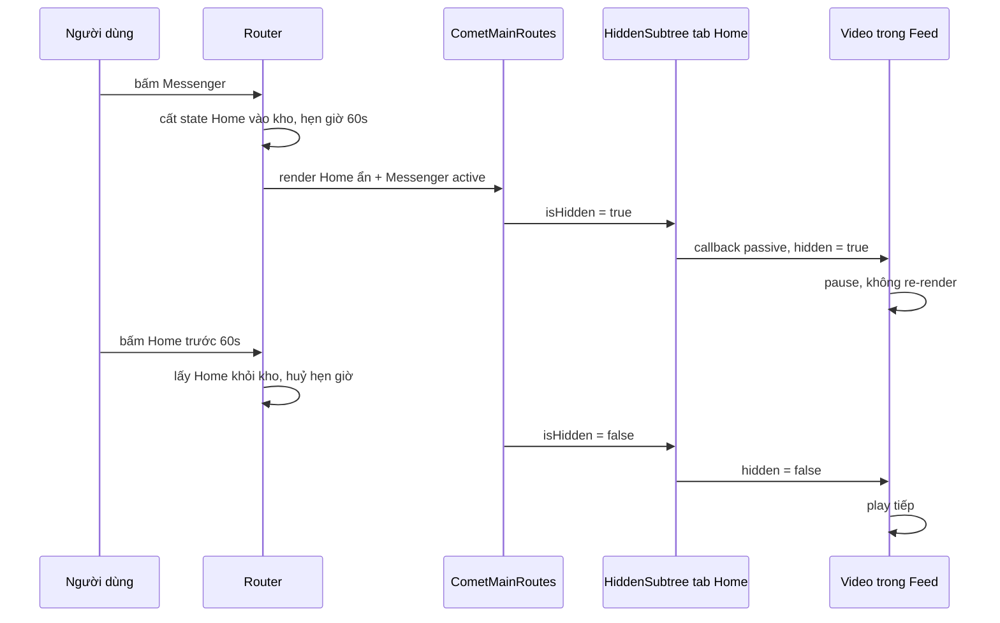
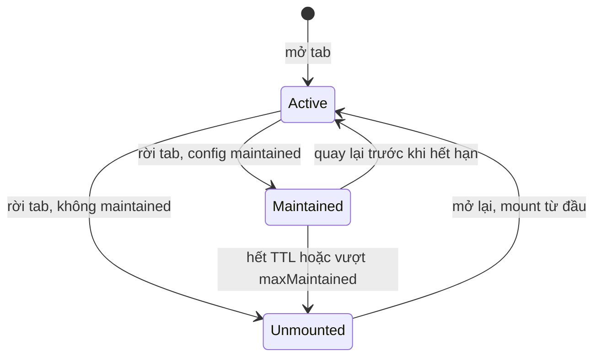

Mở facebook.com, cuộn News Feed xuống bài thứ 30, bấm sang Messenger, rồi bấm lại Home **trong vòng khoảng một phút**. Feed hiện ra **ngay lập tức**, đúng bài thứ 30. Không spinner, không cuộn lại từ đầu, không gọi lại API.

Trong một SPA thông thường dùng React Router, đổi route nghĩa là **unmount** cây component của trang cũ: mất state, mất vị trí cuộn, mất dữ liệu đã tải (trừ khi cache ở đâu đó). Quay lại thì mount lại từ đầu. Facebook không làm vậy với một vài tab quan trọng: họ **giữ tab cũ còn sống** (keep-alive) trong một khoảng thời gian, chỉ ẩn nó đi.

Nghe đơn giản ("đừng unmount là được"), nhưng làm đúng có 3 bài toán:

1. **Giữ cái gì, giữ bao lâu?** Giữ mọi tab mãi mãi thì bộ nhớ tăng không ngừng.
2. **Tab bị ẩn phải "ngủ".** Video phải pause, timer phải dừng, log impression ([bài #2](/blogs/facebook-use-viewport-duration)) không được đếm tiếp. Nhưng tab đó vẫn đang mount, effect của nó vẫn sống. Làm sao nó biết mình đang bị ẩn?
3. **Ẩn thế nào?** `display: none`, `visibility: hidden`, hay `content-visibility: hidden`? Mỗi cách giữ lại những thứ khác nhau.

Bài này đọc cách Facebook giải 3 bài toán đó trong router của họ, rồi viết lại thành hai mảnh dùng được ở bất kỳ app React nào.

> [!TIP]
> **Tóm tắt**
> - Keep-alive = **không unmount** route cũ, chỉ ẩn nó, kèm **TTL** để trả bộ nhớ. Facebook cấu hình theo từng tab (Home khoảng 60 giây, Messenger giữ mãi).
> - Mọi thứ bên trong tab ẩn phải biết mình đang ẩn: **HiddenSubtree** gộp trạng thái theo cây (phép OR), có bản **store passive** để dừng video/timer mà không gây re-render.
> - Ẩn bằng `content-visibility: hidden` + `inert`: gần rẻ như `display: none`, giữ được vị trí cuộn bên trong, không lọt focus.
> - React 19.2 có `<Activity>`: an toàn hơn mặc định vì huỷ effect khi ẩn; cách của Facebook giữ mọi thứ "nóng" nhưng phải tự cho từng thứ "ngủ".

## Facebook làm thế nào?

Code nằm rải rác ở 3 nơi trong [facebook-codebase](https://github.com/hunghg255/facebook-codebase): `20.Router/buildCometRouter.js`, `2.js` (các module `MaintainedRouteConfig`, `CometMainRoutes.react`) và thư mục `HiddenSubtreeContextProvider/`.

### 1. Cấu hình theo từng tab: `MaintainedRouteConfig`

Mỗi "tab" lớn của facebook.com có một `tabKey` (`home`, `messenger`…). Module `MaintainedRouteConfig` quy định tab nào được giữ và giữ bao lâu. Đọc bản minify thì thấy:

```js
c = b("gkx")("1217157") ? 6e4 : (a = b("qex")._("1158889")) != null ? a : 0;
...
home: { maintainRouteForMs: c, maintained: c > 0 },
messenger: { maintained: !0, visibilityHidden: !0 },
health_communities_discovery: { maintainRouteForMs: f /* 3 phút */, maintained: !0 },
global_serp: { maintainRouteForMs: d ? 2 * 60 * 1e3 : 0, maintained: d },
```

Vài điều đáng chú ý:

- **Home được giữ 60 giây** nếu gatekeeper `1217157` bật, nếu không thì lấy giá trị từ một **thí nghiệm A/B** (`qex`), có thể là 0 (không giữ). Có lẽ chính Facebook cũng chưa chắc giữ bao lâu là tối ưu nên đo bằng thí nghiệm (suy đoán).
- **Messenger không có `maintainRouteForMs`**: giữ mãi trong phiên. Hợp lý, vì người ta qua lại Messenger liên tục và trạng thái chat (đang gõ dở, cuộn tới đâu) rất quan trọng.
- **Trang kết quả tìm kiếm (`global_serp`)** giữ 2 phút, có gate. Người dùng thường bấm vào một kết quả rồi quay lại danh sách.
- `visibilityHidden: true` của Messenger là cờ để phần render chọn cách ẩn riêng (xem mục 3).

### 2. Router chuyển tab cũ vào "kho giữ"

Trong `buildCometRouter.js`, hàm cập nhật state của router (tên minify là `L`) xử lý lúc `tabKey` đổi. Viết lại cho dễ đọc:

```js
// prevTab: tab vừa rời, nextTab: tab sắp mở, maintained: map tabKey -> route state
if (nextTab !== prevTab) {
  // tab sắp mở đang nằm trong kho -> lấy ra, huỷ hẹn giờ
  if (maintained[nextTab]) { maintained = withoutKey(maintained, nextTab); clearTimeout(timers[nextTab]); }
  // tab vừa rời được phép giữ -> cất vào kho + hẹn giờ huỷ
  const config = MaintainedRouteConfig[prevTab];
  if (config?.maintained && !maintained[prevTab]) {
    maintained = { ...maintained, [prevTab]: prevState.main };
    if (config.maintainRouteForMs != null)
      timers[prevTab] = setTimeout(() => { maintained = withoutKey(maintained, prevTab); notify(); },
                                   config.maintainRouteForMs);
  }
}
```

Kho này (`CometRouterMaintainedRoutesStateContext`) chỉ chứa **route state** (URL, entry point, scroll key…), không chứa DOM. Chính React giữ DOM, vì cây component của tab cũ vẫn được render.

### 3. `CometMainRoutes` render TẤT CẢ tab còn sống

Component `CometMainRoutes.react` gộp kho với tab hiện tại rồi render từng cái:

```js
var j = babelHelpers["extends"]({}, e /* kho */, (a = {}, a[f /* tab hiện tại */] = d.main, a));
return Object.keys(j).map(function (a) {
  var l = a === f; // tab này có đang active không
  return jsx(HiddenSubtreeContextProvider, {
    isBackgrounded: !l, isHidden: !l,
    children: jsx(CometHeroInteractionWithDiv, { hidden: !l, xstyle: c({ isHidden: !l, tabVisibilityHidden: e }), … })
  }, key);
});
```

Ba chi tiết:

- Mỗi tab được bọc trong **`HiddenSubtreeContextProvider`** với `isHidden = !active`. Đây là cách mọi thứ bên trong biết mình đang bị ẩn.
- Việc ẩn bằng CSS do một `xstyle` provider bên ngoài quyết định, nhận `isHidden` và `tabVisibilityHidden` (cờ `visibilityHidden` ở trên). Nhờ cờ này Messenger có thể được ẩn theo cách khác các tab còn lại; tên cờ gợi ý `visibility: hidden`, nhưng style cụ thể nằm ở module khác, không có trong repo.
- `key` của từng tab ổn định (theo `tabKey` hoặc entity key), nên React **không unmount** khi tab đổi vai trò từ active sang ẩn.

### 4. `HiddenSubtreeContextProvider`: hai context cho hai nhu cầu

Đây là phần hay nhất. Provider cung cấp **hai** context:

| Context | Giá trị | Khi trạng thái đổi |
| --- | --- | --- |
| `HiddenSubtreeContext` | `{ hidden, backgrounded, hiddenOrBackgrounded }` | component đọc nó **re-render** |
| `HiddenSubtreePassiveContext` | `{ getCurrentState(), subscribeToChanges(cb) }` | **không ai re-render**; chỉ callback đã đăng ký được gọi |

Và hai quy tắc:

- **OR với tổ tiên.** Trạng thái của một provider = `own OR parent`. Một video nằm trong dialog nằm trong tab Home bị ẩn → video bị ẩn, dù dialog không biết gì về tab. (Có prop `ignoreParent` cho layer nổi luôn hiển thị.)
- **Chỉ báo khi thật sự đổi.** Hàm notify so sánh trạng thái gộp mới với lần báo trước (`h(a, n.current)`), giống thì im lặng. Cha đổi `backgrounded` trong khi con đã `hidden` sẵn → con không bị làm phiền.

Thuật ngữ trong bài: **context reactive** là context thường (đổi giá trị thì component đọc nó re-render); **store passive** là object có `getCurrentState()` + `subscribe()`, đọc và nghe mà không re-render.

Tại sao cần bản passive? Một tab Feed có hàng trăm component: video, ảnh, bộ đếm impression, animation. Nếu tất cả đọc context reactive, mỗi lần đổi tab là **hàng trăm component re-render** chỉ để biết "mình đang bị ẩn", đúng lúc người dùng đang chờ tab mới hiện ra. Với store passive, đổi tab chỉ chạy vài callback `pause()` / `clearInterval()`, không đụng tới cây React. Các hook hạ tầng của Facebook như `useViewportDuration` dùng `HiddenSubtreePassiveContext` đúng theo cách đó.



## Bên trong trình duyệt: ẩn bằng cách nào?

Giữ cây React mount mới là một nửa. Nửa còn lại là **cách ẩn DOM**, vì mỗi cách giữ lại những thứ khác nhau:

| Cách ẩn | Còn tốn layout/paint? | Giữ vị trí cuộn của phần tử con? | Ghi chú |
| --- | --- | --- | --- |
| `display: none` | Không | Phụ thuộc trình duyệt, không nên tin | Box bị huỷ hoàn toàn; khi hiện lại phải layout lại từ đầu |
| `visibility: hidden` | **Có**: vẫn layout, vẫn chiếm chỗ | Có | Rẻ khi hiện lại, nhưng tab ẩn vẫn tốn layout mỗi lần trang thay đổi |
| `content-visibility: hidden` | Không (bỏ qua render nội dung) | **Có**: trình duyệt giữ "rendering state" | Phần tử áp dụng size containment, như thể rỗng; cần tự định vị |

`content-visibility: hidden` là lựa chọn mặc định trong bản viết lại: trình duyệt **bỏ qua layout và paint** của nội dung (gần rẻ như `display: none`), nhưng **giữ lại trạng thái render**, trong đó có `scrollTop` của các vùng cuộn bên trong. Vì phần tử bị áp size containment nên tab ẩn được đặt `position: absolute; inset: 0`, và `KeepAliveOutlet` tự bọc mọi tab trong một `div` có `position: relative` để tab ẩn không đè lên phần khác của trang.

Ngoài ra tab ẩn nhận thêm:

- `inert`: không Tab vào được, không click được, trình đọc màn hình bỏ qua. Nếu thiếu, người dùng bàn phím có thể Tab vào một ô input của tab đang ẩn.
- `aria-hidden`: thừa khi đã có `inert`, nhưng giữ cho trình duyệt cũ.

## Viết lại

### `HiddenSubtreeProvider`

Phần lõi: trạng thái riêng trong ref, gộp với cha, chỉ báo khi trạng thái gộp đổi:

```tsx title=src/lib/hiddenSubtree.tsx
  const parent = useContext(HiddenSubtreeContext);
  const parentStore = useContext(HiddenSubtreePassiveContext);

  const ownRef = useRef<HiddenState>({ hidden, backgrounded });
  const lastNotifiedRef = useRef<HiddenState | null>(null);
  const listenersRef = useRef(new Set<(state: HiddenState) => void>());

  const getCurrentState = useCallback(
    () => (ignoreParent ? ownRef.current : merge(ownRef.current, parentStore.getCurrentState())),
    [ignoreParent, parentStore],
  );

  // Gọi khi props của mình đổi HOẶC khi cha báo đổi. Chỉ phát cho listener nếu trạng thái
  // gộp khác lần phát trước: cha đổi backgrounded mà mình đang hidden sẵn thì con không cần biết.
  const notifyIfChanged = useCallback(() => {
    const next = getCurrentState();
    if (lastNotifiedRef.current && same(next, lastNotifiedRef.current)) return;
    lastNotifiedRef.current = next;
    Array.from(listenersRef.current).forEach((listener) => listener(next));
  }, [getCurrentState]);

  // layout effect: listener (vd: pause video) chạy cùng commit với lúc màn hình bị ẩn,
  // trước khi trình duyệt vẽ frame tiếp theo.
  useLayoutEffect(() => {
    ownRef.current = { hidden, backgrounded };
    notifyIfChanged();
  }, [hidden, backgrounded, notifyIfChanged]);

  useEffect(() => {
    if (ignoreParent) return;
    return parentStore.subscribe(notifyIfChanged);
  }, [ignoreParent, parentStore, notifyIfChanged]);
```

::: spoiler Xem toàn bộ src/lib/hiddenSubtree.tsx (context reactive, các hook useIsHidden, useVisibleInterval, useDocumentHidden)

```tsx title=src/lib/hiddenSubtree.tsx
import {
  createContext,
  useCallback,
  useContext,
  useEffect,
  useLayoutEffect,
  useMemo,
  useRef,
  useState,
  type ReactNode,
} from 'react';

/**
 * "Cây con đang bị ẩn" (ý tưởng từ HiddenSubtreeContextProvider của Facebook).
 *
 * Khi một màn hình vẫn được giữ mount nhưng không hiển thị (keep-alive tab, dialog bị che…),
 * mọi thứ bên trong cần biết để tự dừng: video, timer, animation, log impression.
 *
 * Có 2 context:
 * - Reactive: đổi giá trị -> component dùng nó re-render. Tiện, nhưng đắt nếu cây lớn.
 * - Passive: chỉ có getCurrentState() + subscribe(). Đổi trạng thái KHÔNG làm re-render;
 *   ai quan tâm thì tự subscribe (dừng timer, pause video…). Facebook dùng loại này cho
 *   hầu hết các hook hạ tầng.
 */

export interface HiddenState {
  /** bị ẩn hẳn (vd: tab không active) */
  hidden: boolean;
  /** vẫn thấy nhưng ở "nền" (vd: browser tab ẩn, bị dialog che) */
  backgrounded: boolean;
}

export interface HiddenSubtreeStore {
  getCurrentState(): HiddenState;
  /** chỉ được gọi khi trạng thái gộp THỰC SỰ đổi */
  subscribe(listener: (state: HiddenState) => void): () => void;
}

const VISIBLE: HiddenState = { hidden: false, backgrounded: false };

const HiddenSubtreeContext = createContext<HiddenState>(VISIBLE);
const HiddenSubtreePassiveContext = createContext<HiddenSubtreeStore>({
  getCurrentState: () => VISIBLE,
  subscribe: () => () => {},
});

// Con bị ẩn nếu chính nó HOẶC bất kỳ tổ tiên nào bị ẩn (phép OR).
const merge = (a: HiddenState, b: HiddenState): HiddenState => ({
  hidden: a.hidden || b.hidden,
  backgrounded: a.backgrounded || b.backgrounded,
});
const same = (a: HiddenState, b: HiddenState) =>
  a.hidden === b.hidden && a.backgrounded === b.backgrounded;

export function HiddenSubtreeProvider({
  hidden,
  backgrounded = false,
  ignoreParent = false,
  children,
}: {
  hidden: boolean;
  backgrounded?: boolean;
  /** không gộp với tổ tiên (vd: một layer nổi lên trên cùng luôn hiển thị) */
  ignoreParent?: boolean;
  children: ReactNode;
}) {
  const parent = useContext(HiddenSubtreeContext);
  const parentStore = useContext(HiddenSubtreePassiveContext);

  const ownRef = useRef<HiddenState>({ hidden, backgrounded });
  const lastNotifiedRef = useRef<HiddenState | null>(null);
  const listenersRef = useRef(new Set<(state: HiddenState) => void>());

  const getCurrentState = useCallback(
    () => (ignoreParent ? ownRef.current : merge(ownRef.current, parentStore.getCurrentState())),
    [ignoreParent, parentStore],
  );

  // Gọi khi props của mình đổi HOẶC khi cha báo đổi. Chỉ phát cho listener nếu trạng thái
  // gộp khác lần phát trước: cha đổi backgrounded mà mình đang hidden sẵn thì con không cần biết.
  const notifyIfChanged = useCallback(() => {
    const next = getCurrentState();
    if (lastNotifiedRef.current && same(next, lastNotifiedRef.current)) return;
    lastNotifiedRef.current = next;
    Array.from(listenersRef.current).forEach((listener) => listener(next));
  }, [getCurrentState]);

  // layout effect: listener (vd: pause video) chạy cùng commit với lúc màn hình bị ẩn,
  // trước khi trình duyệt vẽ frame tiếp theo.
  useLayoutEffect(() => {
    ownRef.current = { hidden, backgrounded };
    notifyIfChanged();
  }, [hidden, backgrounded, notifyIfChanged]);

  useEffect(() => {
    if (ignoreParent) return;
    return parentStore.subscribe(notifyIfChanged);
  }, [ignoreParent, parentStore, notifyIfChanged]);

  const store = useMemo<HiddenSubtreeStore>(
    () => ({
      getCurrentState,
      subscribe(listener) {
        listenersRef.current.add(listener);
        return () => {
          listenersRef.current.delete(listener);
        };
      },
    }),
    [getCurrentState],
  );

  const merged = ignoreParent ? { hidden, backgrounded } : merge({ hidden, backgrounded }, parent);
  // useMemo theo 2 boolean: giá trị context chỉ đổi tham chiếu khi thực sự đổi
  const value = useMemo(
    () => ({ hidden: merged.hidden, backgrounded: merged.backgrounded }),
    [merged.hidden, merged.backgrounded],
  );

  return (
    <HiddenSubtreeContext.Provider value={value}>
      <HiddenSubtreePassiveContext.Provider value={store}>{children}</HiddenSubtreePassiveContext.Provider>
    </HiddenSubtreeContext.Provider>
  );
}

/** Reactive: component re-render mỗi khi trạng thái đổi. */
export function useHiddenSubtree(): HiddenState {
  return useContext(HiddenSubtreeContext);
}

/** true nếu bị ẩn hoặc đang ở nền. */
export function useIsHidden(): boolean {
  const { hidden, backgrounded } = useContext(HiddenSubtreeContext);
  return hidden || backgrounded;
}

/** Passive: lấy store để tự subscribe, không gây re-render. */
export function useHiddenSubtreePassive(): HiddenSubtreeStore {
  return useContext(HiddenSubtreePassiveContext);
}

/**
 * setInterval tự dừng khi cây con bị ẩn/ở nền và chạy lại khi hiện ra.
 * Dùng store passive nên việc ẩn/hiện không làm component re-render.
 */
export function useVisibleInterval(callback: () => void, ms: number) {
  const store = useHiddenSubtreePassive();
  const callbackRef = useRef(callback);
  useLayoutEffect(() => {
    callbackRef.current = callback;
  });

  useEffect(() => {
    let timer: ReturnType<typeof setInterval> | undefined;
    const sync = (state: HiddenState) => {
      const shouldRun = !state.hidden && !state.backgrounded;
      if (shouldRun && timer === undefined) {
        timer = setInterval(() => callbackRef.current(), ms);
      } else if (!shouldRun && timer !== undefined) {
        clearInterval(timer);
        timer = undefined;
      }
    };
    sync(store.getCurrentState());
    const unsubscribe = store.subscribe(sync);
    return () => {
      unsubscribe();
      clearInterval(timer);
    };
  }, [store, ms]);
}

/** Tab trình duyệt có đang bị ẩn không (Page Visibility API). */
export function useDocumentHidden(): boolean {
  const [hiddenDoc, setHiddenDoc] = useState(
    () => typeof document !== 'undefined' && document.visibilityState === 'hidden',
  );
  useEffect(() => {
    const onChange = () => setHiddenDoc(document.visibilityState === 'hidden');
    document.addEventListener('visibilitychange', onChange);
    return () => document.removeEventListener('visibilitychange', onChange);
  }, []);
  return hiddenDoc;
}
```

:::

### Đi qua code

1. **`ownRef` + `getCurrentState`.** Trạng thái riêng được lưu trong ref, cập nhật trong `useLayoutEffect`. `getCurrentState()` luôn đọc giá trị mới nhất của mình và của cha (`parentStore.getCurrentState()`), nên một component con gọi nó bất cứ lúc nào cũng thấy đúng, kể cả khi chưa re-render.
2. **`notifyIfChanged`.** Được gọi từ hai nơi: khi props của mình đổi (layout effect), và khi cha báo đổi (subscribe vào store của cha). Nó tính trạng thái gộp, so với `lastNotifiedRef`, giống thì bỏ qua. Đây chính là `h(a, n.current)` trong bản gốc.
3. **Tại sao `useLayoutEffect`?** Để callback `pause()` chạy **trong cùng commit** với lúc tab bị ẩn, trước khi trình duyệt vẽ frame tiếp theo. Dùng `useEffect` thì video có thể chạy thêm một frame (và phát thêm vài chục ms âm thanh) sau khi tab đã biến mất.
4. **`Array.from(listenersRef.current)`** trước khi lặp: một listener có thể tự huỷ đăng ký trong lúc được gọi.
5. **Context reactive** được `useMemo` theo hai boolean, nên giá trị chỉ đổi tham chiếu khi thật sự đổi. Không có `useMemo`, mọi consumer sẽ re-render mỗi lần provider render.
6. **`useVisibleInterval`** là ví dụ một hook "hạ tầng" dùng store passive: tự dừng/chạy `setInterval`, không gây re-render khi ẩn/hiện.
7. **`useDocumentHidden`** để bọc cả app: `<HiddenSubtreeProvider hidden={false} backgrounded={useDocumentHidden()}>`. Khi người dùng chuyển sang tab trình duyệt khác, mọi thứ cũng "ngủ" qua cùng một cơ chế.

### `KeepAliveOutlet`

Tính danh sách tab được giữ ngay trong lúc render:

```tsx title=src/lib/keepAlive.tsx
  // Tính danh sách giữ lại NGAY TRONG LÚC RENDER khi tab đổi ("adjust state when a prop
  // changes"). Nếu đợi tới effect, commit đổi tab sẽ không còn tab cũ trong cây -> React
  // unmount nó -> mất hết state, đúng điều keep-alive muốn tránh.
  let maintained = state.maintained;
  if (state.activeKey !== activeKey) {
    maintained = nextMaintained(state.maintained, state.activeKey, activeKey, config, maxMaintained);
    setState({ activeKey, maintained });
  }

  // Cấu hình đổi (vd: tắt keep-alive) thì bỏ các tab không còn được phép giữ.
  const allowed = maintained.filter((entry) => config[entry.key]?.maintained);
  if (allowed.length !== maintained.length) {
    maintained = allowed;
    setState({ activeKey, maintained });
  }
```

Render mọi tab còn sống, tab ẩn bọc HiddenSubtree và `inert`:

```tsx title=src/lib/keepAlive.tsx
  const orderRef = useRef<string[]>([]);
  if (!orderRef.current.includes(activeKey)) orderRef.current = [...orderRef.current, activeKey];

  const liveKeys = new Set([activeKey, ...maintained.map((entry) => entry.key)]);
  const keys = orderRef.current.filter((key) => liveKeys.has(key));

  // Container position:relative: tab ẩn (content-visibility) được đặt absolute, cần một khung
  // để không đè lên phần khác của trang.
  return (
    <div data-keepalive-outlet style={{ position: 'relative' }}>
      {keys.map((key) => {
        const active = key === activeKey;
        return (
          <div
            key={key}
            data-keepalive-key={key}
            aria-hidden={!active || undefined}
            // inert: tab ẩn không nhận focus/click và trình đọc màn hình bỏ qua
            inert={!active}
            style={
              active
                ? undefined
                : hideMode === 'display'
                  ? { display: 'none' }
                  : { contentVisibility: 'hidden', position: 'absolute', inset: 0, overflow: 'hidden' }
            }
          >
            <HiddenSubtreeProvider hidden={!active} backgrounded={!active}>
              <KeepAliveContext.Provider value={{ routeKey: key, active }}>{render(key)}</KeepAliveContext.Provider>
            </HiddenSubtreeProvider>
          </div>
        );
      })}
    </div>
  );
}
```

::: spoiler Xem toàn bộ src/lib/keepAlive.tsx

```tsx title=src/lib/keepAlive.tsx
import { createContext, useContext, useEffect, useRef, useState, type ReactNode } from 'react';
import { HiddenSubtreeProvider } from './hiddenSubtree';

/**
 * Keep-alive cho các "tab" của SPA (ý tưởng từ CometRouter + MaintainedRouteConfig + CometMainRoutes).
 *
 * Khi rời một tab được cấu hình `maintained`, cây React của nó KHÔNG bị unmount mà được giữ lại
 * (ẩn đi) trong một thời gian `maintainForMs`. Quay lại trong thời gian đó: hiện ra tức thì,
 * nguyên state, nguyên vị trí cuộn. Hết hạn: unmount để trả lại bộ nhớ.
 * Mỗi tab được bọc HiddenSubtreeProvider để code bên trong biết mình đang bị ẩn mà tự dừng.
 */

export interface KeepAliveRouteConfig {
  maintained: boolean;
  /** giữ bao lâu sau khi rời tab; null/undefined = giữ mãi (như Messenger của Facebook) */
  maintainForMs?: number | null;
}

export interface MaintainedEntry {
  key: string;
  /** thời điểm (Date.now()) sẽ bị huỷ, null = không hết hạn */
  expiresAt: number | null;
}

export interface KeepAliveOutletProps {
  activeKey: string;
  render: (key: string) => ReactNode;
  config: Record<string, KeepAliveRouteConfig | undefined>;
  /** giữ tối đa bao nhiêu tab ẩn cùng lúc; vượt quá thì huỷ tab rời đi lâu nhất */
  maxMaintained?: number;
  /**
   * Cách ẩn tab không active:
   * - 'display': display:none (rẻ nhất, nhưng phần tử cuộn bên trong có thể mất scrollTop)
   * - 'content-visibility': content-visibility:hidden, trình duyệt bỏ qua render nhưng giữ
   *   nguyên trạng thái render (kể cả vị trí cuộn của phần tử con).
   */
  hideMode?: 'display' | 'content-visibility';
  onMaintainedChange?: (entries: MaintainedEntry[]) => void;
}

interface KeepAliveInfo {
  routeKey: string;
  active: boolean;
}

const KeepAliveContext = createContext<KeepAliveInfo | null>(null);

/** Cho component bên trong biết nó thuộc tab nào và tab đó có đang active không. */
export function useKeepAliveInfo() {
  return useContext(KeepAliveContext);
}

function nextMaintained(
  list: MaintainedEntry[],
  prevKey: string,
  activeKey: string,
  config: KeepAliveOutletProps['config'],
  maxMaintained: number,
): MaintainedEntry[] {
  // 1. Tab vừa được mở lại: bỏ khỏi danh sách giữ (FB: `withoutKey(A, tabKey)` + clearTimeout).
  let next = list.filter((entry) => entry.key !== activeKey);
  // 2. Tab vừa rời đi: nếu được cấu hình maintained thì giữ lại kèm hạn huỷ.
  const prevConfig = config[prevKey];
  if (prevConfig?.maintained && !next.some((entry) => entry.key === prevKey)) {
    const ttl = prevConfig.maintainForMs;
    next = [...next, { key: prevKey, expiresAt: ttl != null ? Date.now() + ttl : null }];
  }
  // 3. Giới hạn số tab giữ lại: huỷ tab rời đi lâu nhất.
  if (next.length > maxMaintained) next = next.slice(next.length - maxMaintained);
  return next;
}

export function KeepAliveOutlet({
  activeKey,
  render,
  config,
  maxMaintained = Infinity,
  hideMode = 'content-visibility',
  onMaintainedChange,
}: KeepAliveOutletProps) {
  const [state, setState] = useState<{ activeKey: string; maintained: MaintainedEntry[] }>({
    activeKey,
    maintained: [],
  });

  // Tính danh sách giữ lại NGAY TRONG LÚC RENDER khi tab đổi ("adjust state when a prop
  // changes"). Nếu đợi tới effect, commit đổi tab sẽ không còn tab cũ trong cây -> React
  // unmount nó -> mất hết state, đúng điều keep-alive muốn tránh.
  let maintained = state.maintained;
  if (state.activeKey !== activeKey) {
    maintained = nextMaintained(state.maintained, state.activeKey, activeKey, config, maxMaintained);
    setState({ activeKey, maintained });
  }

  // Cấu hình đổi (vd: tắt keep-alive) thì bỏ các tab không còn được phép giữ.
  const allowed = maintained.filter((entry) => config[entry.key]?.maintained);
  if (allowed.length !== maintained.length) {
    maintained = allowed;
    setState({ activeKey, maintained });
  }

  // Hẹn giờ huỷ: đồng bộ timer với danh sách hiện tại. Effect chỉ lo side effect,
  // danh sách là nguồn sự thật duy nhất.
  const timersRef = useRef(new Map<string, ReturnType<typeof setTimeout>>());
  useEffect(() => {
    const timers = timersRef.current;
    const live = new Set(maintained.map((entry) => entry.key));
    timers.forEach((timer, key) => {
      if (!live.has(key)) {
        clearTimeout(timer);
        timers.delete(key);
      }
    });
    maintained.forEach(({ key, expiresAt }) => {
      if (expiresAt == null || timers.has(key)) return;
      timers.set(
        key,
        setTimeout(
          () => {
            timers.delete(key);
            setState((current) => ({
              ...current,
              maintained: current.maintained.filter((entry) => entry.key !== key),
            }));
          },
          Math.max(0, expiresAt - Date.now()),
        ),
      );
    });
  }, [maintained]);

  useEffect(() => {
    const timers = timersRef.current;
    return () => {
      timers.forEach((timer) => clearTimeout(timer));
      timers.clear();
    };
  }, []);

  useEffect(() => {
    onMaintainedChange?.(maintained);
  }, [maintained, onMaintainedChange]);

  // Thứ tự render ổn định theo lần đầu xuất hiện: đổi tab không làm React di chuyển node DOM
  // (gỡ ra chèn lại node chứa <iframe> làm nó tải lại, <video> bị gỡ khỏi document thì dừng phát).
  const orderRef = useRef<string[]>([]);
  if (!orderRef.current.includes(activeKey)) orderRef.current = [...orderRef.current, activeKey];

  const liveKeys = new Set([activeKey, ...maintained.map((entry) => entry.key)]);
  const keys = orderRef.current.filter((key) => liveKeys.has(key));

  // Container position:relative: tab ẩn (content-visibility) được đặt absolute, cần một khung
  // để không đè lên phần khác của trang.
  return (
    <div data-keepalive-outlet style={{ position: 'relative' }}>
      {keys.map((key) => {
        const active = key === activeKey;
        return (
          <div
            key={key}
            data-keepalive-key={key}
            aria-hidden={!active || undefined}
            // inert: tab ẩn không nhận focus/click và trình đọc màn hình bỏ qua
            inert={!active}
            style={
              active
                ? undefined
                : hideMode === 'display'
                  ? { display: 'none' }
                  : { contentVisibility: 'hidden', position: 'absolute', inset: 0, overflow: 'hidden' }
            }
          >
            <HiddenSubtreeProvider hidden={!active} backgrounded={!active}>
              <KeepAliveContext.Provider value={{ routeKey: key, active }}>{render(key)}</KeepAliveContext.Provider>
            </HiddenSubtreeProvider>
          </div>
        );
      })}
    </div>
  );
}
```

:::

Những quyết định quan trọng:

**Tính danh sách giữ lại ngay trong lúc render.** Bản đầu tiên của mình cập nhật danh sách trong `useLayoutEffect` sau khi `activeKey` đổi, và nó **không hoạt động**: ở lần commit đổi tab, tab cũ chưa có trong danh sách, nên React unmount nó; effect chạy xong mới thêm lại thì đã là một instance mới, sạch trơn. Cách đúng là pattern ["adjust state when a prop changes"](https://react.dev/learn/you-might-not-need-an-effect#adjusting-some-state-when-a-prop-changes): so `state.activeKey` với prop, khác thì tính danh sách mới và `setState` **ngay trong render**. React render lại component đó trước khi commit, nên không có frame nào tab cũ bị gỡ ra.

**Timer là side effect, danh sách là nguồn sự thật.** Effect chỉ đồng bộ `setTimeout` theo `expiresAt` của từng entry: entry mới thì hẹn giờ, entry biến mất thì huỷ giờ. Logic này chịu được StrictMode (effect chạy 2 lần) và không bao giờ có timer "mồ côi".

**Thứ tự render ổn định.** Các tab được render theo thứ tự xuất hiện lần đầu (`orderRef`), không theo thứ tự "active cuối cùng". React không phải di chuyển node DOM giữa các anh em. Di chuyển (gỡ ra rồi chèn lại) một node chứa `<iframe>` làm iframe **tải lại từ đầu**; `<video>` bị gỡ khỏi document thì **dừng phát**. Cả hai đều phá ý nghĩa của keep-alive. API mới `Element.moveBefore()` (có trong Chromium từ bản 133; trình duyệt khác: xem caniuse) di chuyển node mà giữ nguyên trạng thái, nhưng React chưa dùng nó, nên giữ thứ tự ổn định vẫn là cách chắc chắn.

**`maxMaintained`** bổ sung thứ Facebook không cần (họ chỉ giữ vài tab cố định): app có route động (mỗi profile, mỗi group là một "tab") nên cần giới hạn, huỷ tab rời đi lâu nhất trước, giống LRU.



## Demo

Home giữ 15 giây, Feed 30 giây, Messages giữ mãi, Settings không giữ. Thử: bấm Like và gõ chữ ở Home, cuộn Feed xuống giữa, mở Messages chờ vài giây rồi chuyển đi. Quay lại trước khi hết hạn: mọi thứ còn nguyên ("Mount lúc" không đổi). Bộ đếm thời gian và chấm cam trong Messages **dừng hẳn** khi tab bị ẩn. Tắt "Bật keep-alive" để so sánh: mỗi lần đổi tab là mount lại từ đầu.

<iframe class="demo-frame" src="/demos/facebook-patterns/index.html?theme=dark#/keep-alive" title="Demo keep-alive" loading="lazy" style="height: 640px"></iframe>

<p class="demo-links">▶ <a href="/demos/facebook-patterns/index.html#/keep-alive" target="_blank" rel="noopener">Mở demo toàn màn hình ↗</a> · <a href="https://stackblitz.com/github/hunghg255/blog-hunghg/tree/master/examples/facebook-patterns?file=src/lib/keepAlive.tsx" target="_blank" rel="noopener">Sửa code trên StackBlitz ↗</a> · <a href="https://github.com/hunghg255/blog-hunghg/blob/master/examples/facebook-patterns/src/lib/keepAlive.tsx" target="_blank" rel="noopener">Xem source trên GitHub ↗</a></p>

## Tại sao không làm cách khác?

**"Cache dữ liệu (React Query, SWR) là đủ rồi?"** Cache dữ liệu giúp quay lại không phải gọi API, nhưng vẫn phải **render lại cả cây**, mất state UI (input đang gõ, tab con đang chọn, accordion đang mở), mất vị trí cuộn của vùng cuộn bên trong, video phải tải lại. Với trang nặng như Feed, render lại vài trăm component cũng tốn cả trăm ms trên điện thoại tầm trung. Keep-alive và cache dữ liệu bổ sung cho nhau chứ không thay thế nhau.

**"Sao không giữ mọi tab mãi mãi?"** Mỗi tab giữ lại là một cây DOM, ảnh đã decode, video buffer, listener… Facebook chọn từng tab và đặt TTL, và chính giá trị TTL của Home được quyết định bằng thí nghiệm A/B. Bài học: keep-alive là **đánh đổi bộ nhớ lấy tốc độ**, phải đo chứ không đoán.

**"Sao không để mỗi component tự nghe `document.visibilityState`?"** Vì "bị ẩn" có nhiều nguồn: tab trình duyệt ẩn, tab của app không active, bị dialog che, nằm trong carousel trượt khỏi màn hình. HiddenSubtree gom mọi nguồn về **một** câu hỏi duy nhất, và phép OR theo cây tự lo việc lồng nhau.

**"Context reactive là đủ, cần gì passive?"** Đã nói ở trên: đổi tab mà kéo theo hàng trăm re-render thì keep-alive mất một nửa ý nghĩa. Quy tắc nhỏ: UI cần **hiển thị** khác đi khi ẩn → reactive; side effect cần **dừng/chạy** → passive.

## Edge case và cạm bẫy

- **Effect vẫn chạy trong tab ẩn.** Đây là điểm khác lớn nhất so với `<Activity>` (bên dưới). Một `setInterval` gọi API mỗi 5 giây trong tab ẩn vẫn tiếp tục gọi, trừ khi bạn dùng `useVisibleInterval` hoặc tự subscribe. Khi áp dụng keep-alive, hãy rà mọi polling, websocket subscription, animation.
- **Phím tắt toàn cục.** Tab ẩn vẫn có listener `keydown` đăng ký lên `document`. Facebook bọc mỗi tab trong `CometLayerKeyCommandWrapper` để phím tắt chỉ áp dụng cho tab active ([bài #8](/blogs/facebook-focus-trap) có nói về key command theo layer).
- **ID trùng lặp.** Hai tab cùng render một form có `id="email"` → hai phần tử trùng id trong DOM. Dùng `useId()` thay vì id cố định.
- **`document.title`, meta tag.** Tab ẩn nào cũng có thể ghi đè title nếu nó set trong effect. Chỉ tab active mới được đụng vào `document.title` (đọc `useKeepAliveInfo()` hoặc `useIsHidden()`).
- **Vị trí cuộn của `window`.** `content-visibility` giữ scroll của vùng cuộn **bên trong** tab. Nếu app cuộn bằng `window` (phổ biến nhất, và cũng là cách của Facebook), phải tự lưu và khôi phục `scrollY` theo tab, xem đoạn code ở mục "Dùng trong dự án". Facebook lưu `mainScrollKey` cho từng route và có hẳn hook `useCometScrollAnchor` để cuộn lại đúng chỗ khi tab hiện lại.
- **Thông báo trung gian khi cha và con đổi cùng lúc.** Layout effect của con chạy **trước** của cha. Nếu cùng một commit đổi props của cả hai provider, con tính trạng thái gộp với `ownRef` **cũ** của cha, báo cho listener, rồi bị báo lại khi cha cập nhật. Listener có thể thấy một trạng thái trung gian trong chớp mắt. Với pause/play thì vô hại; nếu listener của bạn tốn kém, hãy làm nó idempotent hoặc gộp bằng `queueMicrotask`.
- **Dữ liệu cũ.** Quay lại sau 50 giây, Feed vẫn là dữ liệu của 50 giây trước. Thường đó là điều người dùng muốn (không bị nhảy), nhưng các con số như "3 thông báo mới" có thể cần làm mới khi tab hiện lại: subscribe store passive, khi `hidden` chuyển từ `true` sang `false` thì refetch nhẹ.
- **Bộ nhớ.** Đo bằng `performance.measureUserAgentSpecificMemory()` (chỉ có ở Chromium, cần cross-origin isolation) hoặc tab Memory của DevTools, trước và sau khi bật keep-alive cho một route.

## So với `<Activity>` của React, Vue `<KeepAlive>`

React 19.2 có component `<Activity mode="visible" | "hidden">` (bản React trong repo ví dụ, 19.3, có export `Activity`). Khi `mode="hidden"`, React ẩn children bằng `display: none`, **giữ state**, nhưng **huỷ effect** (chạy cleanup) và hạ độ ưu tiên render của phần bị ẩn. Hiện lại thì effect chạy lại.

| | Keep-alive kiểu Facebook | React `<Activity>` | Vue `<KeepAlive>` |
| --- | --- | --- | --- |
| Giữ state | Có | Có | Có |
| Effect khi ẩn | **Vẫn chạy**, tự dừng qua HiddenSubtree | Bị cleanup, chạy lại khi hiện | Vẫn sống, có hook `onDeactivated`/`onActivated` |
| Giới hạn số lượng | TTL theo tab (bản viết lại thêm `maxMaintained`) | Tự quản lý | `max` (LRU) |
| Cách ẩn DOM | Tuỳ chọn | `display: none` | Gỡ khỏi DOM, giữ instance |

`<Activity>` an toàn hơn mặc định (không lo effect chạy ngầm), nhưng đánh đổi: video bị huỷ effect thì phải tự lưu `currentTime`, subscription phải kết nối lại. Cách của Facebook giữ mọi thứ "nóng" và cho từng component tự quyết định ngủ thế nào.

Kết hợp hai cách được, nhưng phải đúng chiều: **không** thể đặt HiddenSubtree *bên trong* một `<Activity>` đang ẩn để giữ thứ gì đó chạy tiếp, vì effect bên trong đã bị cleanup. Cách hợp lý là dùng `<Activity>` cho route thường, còn route cần "nóng" (trình phát nhạc, cuộc gọi, chat đang mở) thì dùng `KeepAliveOutlet`.

Còn `content-visibility: auto` (không phải `hidden`) là chuyện khác: nó bỏ qua render phần nằm ngoài màn hình của một trang dài, không liên quan tới việc giữ trang cũ.

## Dùng trong dự án

Với React Router, đặt `KeepAliveOutlet` ở layout chung, `activeKey` lấy từ "tab" của route hiện tại.

Có một cái bẫy lớn: nếu chỉ lưu lại element của `useOutlet()` cho từng tab, các hook bên trong tab ẩn (`useLocation`, `useSearchParams`, `useParams`, đường dẫn tương đối của `useNavigate`) vẫn đọc **location hiện tại**. Feed đang ẩn sẽ "thấy" URL của Messages và có thể fetch lại hoặc redirect lung tung. Cách sửa: lưu **location** của từng tab và render tab đó bằng `useRoutes(routes, location)` với location đã lưu. React Router cung cấp location đó cho mọi hook bên dưới.

```tsx
type TabHandle = { tab?: string };

const TAB_CONFIG = {
  home: { maintained: true, maintainForMs: 60_000 },
  messages: { maintained: true, maintainForMs: null },
};

/** Render cây route của một tab với location "đóng băng" của tab đó. */
function TabRoutes({ location }: { location: Location }) {
  return useRoutes(tabRoutes, location);
}

function AppLayout() {
  const location = useLocation();
  const tab = (useMatches().at(-1)?.handle as TabHandle | undefined)?.tab ?? 'other';
  // location gần nhất của từng tab
  const locations = useRef(new Map<string, Location>());
  locations.current.set(tab, location);

  // Tab bị huỷ (hết TTL, vượt giới hạn) thì xoá location của nó, tránh Map phình mãi.
  const prune = useCallback(
    (entries: MaintainedEntry[]) => {
      const live = new Set([tab, ...entries.map((e) => e.key)]);
      for (const key of locations.current.keys()) if (!live.has(key)) locations.current.delete(key);
    },
    [tab],
  );

  return (
    <HiddenSubtreeProvider hidden={false} backgrounded={useDocumentHidden()}>
      <KeepAliveOutlet
        activeKey={tab}
        config={TAB_CONFIG}
        onMaintainedChange={prune}
        render={(key) => <TabRoutes location={locations.current.get(key)!} />}
      />
    </HiddenSubtreeProvider>
  );
}
```

App cuộn bằng `window` thì lưu `scrollY` theo tab. Lưu ở sự kiện `scroll` (không lưu lúc đổi tab, vì khi đó trang có thể đã ngắn lại và `scrollY` đã bị kẹp), khôi phục trong layout effect:

::: spoiler Xem code lưu/khôi phục scrollY theo tab

```tsx
const scrollByTab = useRef(new Map<string, number>());

useEffect(() => {
  const save = () => scrollByTab.current.set(tab, window.scrollY);
  window.addEventListener('scroll', save, { passive: true });
  return () => window.removeEventListener('scroll', save);
}, [tab]);

useLayoutEffect(() => {
  window.scrollTo(0, scrollByTab.current.get(tab) ?? 0); // trước khi vẽ: không nháy
}, [tab]);
```

:::

Trong component bên trong, dừng những gì tốn tài nguyên:

```tsx
function FeedVideo({ src }: { src: string }) {
  const ref = useRef<HTMLVideoElement>(null);
  const store = useHiddenSubtreePassive();
  useEffect(
    () => store.subscribe(({ hidden, backgrounded }) => {
      if (hidden || backgrounded) ref.current?.pause();
    }),
    [store],
  );
  return <video ref={ref} src={src} controls />;
}
```

## Kiểm thử

::: spoiler Ví dụ test Vitest + Testing Library (bản phác, không có trong repo)

```tsx
it('giữ state khi chuyển tab và huỷ sau TTL', () => {
  vi.useFakeTimers();
  const config = { a: { maintained: true, maintainForMs: 1000 }, b: { maintained: false } };
  const render = (key: string) => (key === 'a' ? <Counter /> : <p>B</p>);
  const { rerender } = renderTL(<KeepAliveOutlet activeKey='a' config={config} render={render} />);

  fireEvent.click(screen.getByRole('button', { name: /\+1/ })); // count = 1
  rerender(<KeepAliveOutlet activeKey='b' config={config} render={render} />);
  rerender(<KeepAliveOutlet activeKey='a' config={config} render={render} />);
  expect(screen.getByText('count: 1')).toBeInTheDocument(); // còn nguyên

  rerender(<KeepAliveOutlet activeKey='b' config={config} render={render} />);
  act(() => vi.advanceTimersByTime(1001));
  rerender(<KeepAliveOutlet activeKey='a' config={config} render={render} />);
  expect(screen.getByText('count: 0')).toBeInTheDocument(); // đã mount lại
});

it('store passive chỉ báo khi trạng thái gộp đổi', () => {
  const calls: HiddenState[] = [];
  function Spy() {
    const store = useHiddenSubtreePassive();
    useEffect(() => store.subscribe((s) => calls.push(s)), [store]);
    return null;
  }
  const tree = (outer: boolean, inner: boolean) => (
    <HiddenSubtreeProvider hidden={outer}>
      <HiddenSubtreeProvider hidden={inner}><Spy /></HiddenSubtreeProvider>
    </HiddenSubtreeProvider>
  );
  const { rerender } = renderTL(tree(false, true));
  rerender(tree(true, true)); // con đã hidden sẵn -> không báo
  expect(calls).toHaveLength(0);
});
```

:::

---

**Series "Học từ mã nguồn Facebook"**

← [#17 Thuật toán chọn bố cục collage ảnh](/blogs/facebook-photo-collage-layout) · [#19 Tự đo Visual Completion & interaction tracing](/blogs/facebook-visual-completion) →

::: spoiler Xem cả series (20 kỹ thuật + bài mở đầu)

*Phần 1*

- [Mở đầu: cách đọc code minify của Facebook](/blogs/learn-from-facebook-source-code)
- [#1 Dùng chung IntersectionObserver + infinite scroll](/blogs/facebook-shared-intersection-observer)
- [#2 useViewportDuration: đo thời gian thực sự được xem](/blogs/facebook-use-viewport-duration)
- [#3 Preload code + data khi hover](/blogs/facebook-preload-on-hover)
- [#4 Toast manager với external store](/blogs/facebook-toast-manager)
- [#5 Network status + heartbeat backoff](/blogs/facebook-network-status-heartbeat)
- [#6 ErrorGuard: bắt lỗi theo ngữ cảnh](/blogs/facebook-error-guard)
- [#7 Banzai: gom log theo lô + sendBeacon](/blogs/facebook-batch-logger)
- [#8 Focus trap + Esc theo layer](/blogs/facebook-focus-trap)

*Phần 2*

- [#9 Mẹo calc(… * 9999): container query, line-clamp, mũi tên carousel bằng CSS](/blogs/facebook-css-9999-trick)
- [#10 Thanh cuộn tuỳ biến bằng CSS 3D](/blogs/facebook-css-3d-scrollbar)
- [#11 Modal cuộn bằng window, giữ vị trí trang nền](/blogs/facebook-document-scroll-modal)
- [#12 Popover, tooltip group và hovercard](/blogs/facebook-popover-tooltip)
- [#13 Primitive Pressable + focus-visible](/blogs/facebook-pressable)
- [#14 Tab "Xem thêm" + sticky header bằng IntersectionObserver](/blogs/facebook-priority-tabs-sticky-header)
- [#15 Avatar khoét mask, gradient Messenger, skeleton steps()](/blogs/facebook-visual-tricks)
- [#16 Khung chat không giật](/blogs/facebook-chat-scroller)
- [#17 Thuật toán chọn bố cục collage ảnh](/blogs/facebook-photo-collage-layout)
- **#18 Keep-alive tab trong SPA** (bài này)
- [#19 Tự đo Visual Completion & interaction tracing](/blogs/facebook-visual-completion)
- [#20 Router SPA bền bỉ & tải chunk có retry](/blogs/facebook-spa-router-resilient-loading)

:::

Code + demo: [`examples/facebook-patterns`](https://github.com/hunghg255/blog-hunghg/tree/master/examples/facebook-patterns) · [Mở trên StackBlitz](https://stackblitz.com/github/hunghg255/blog-hunghg/tree/master/examples/facebook-patterns)
