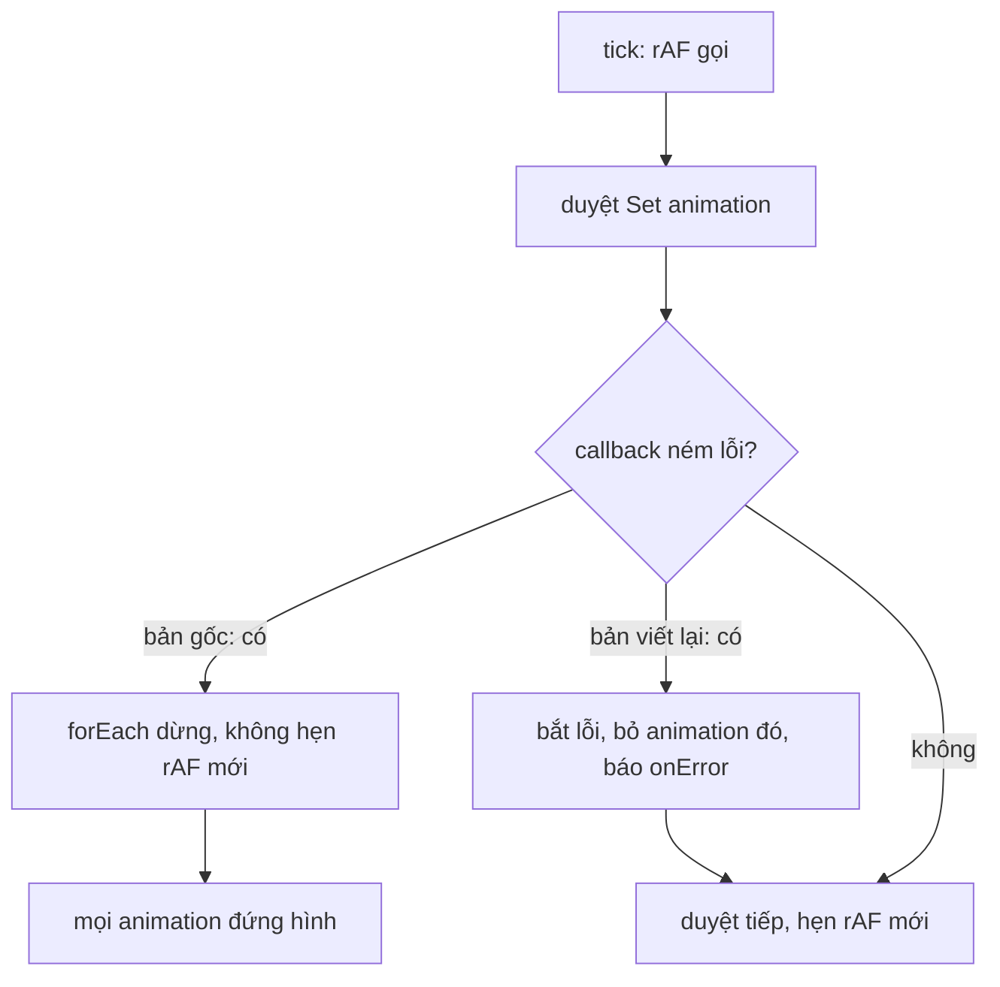

Phần lớn animation trên web nên để CSS lo. Nhưng có những thứ CSS không làm được: animation vẽ trên `<canvas>` (sticker, reaction động), tiến trình phụ thuộc dữ liệu, hay animation phải dừng/tua theo logic JS. Khi đó ta tự gọi `requestAnimationFrame` (rAF), và rất dễ gặp:

1. Mỗi animation một vòng rAF riêng: 50 sticker là 50 callback mỗi frame, mỗi cái tự đọc thời gian, tự lên lịch.
2. Tab nằm nền vài phút rồi quay lại: frame đầu tiên có delta hàng trăm nghìn mili giây, animation "nhảy" thẳng về cuối.
3. Muốn dùng easing `cubic-bezier(.25,.1,.25,1)` như CSS thì phải tự giải đường cong Bézier.

Engine **Keyframes** của Facebook (định dạng animation vector riêng, chạy trên canvas) giải cả ba trong hai module nhỏ: `KeyframesLoop` và `CubicBezier`.

> [!TIP]
> **Tóm tắt**
> - Mọi animation đăng ký vào một `Set`, chỉ **một** vòng rAF lặp qua tất cả; set rỗng thì dừng rAF.
> - Delta mỗi frame bị kẹp tối đa 1000ms; khi `window` nhận `focus`, mọi animation coi như frame trước cách đây đúng 16,67ms.
> - `CubicBezier` giải `x(t) = x` bằng Newton-Raphson 8 vòng, không hội tụ thì chuyển sang chia đôi (bisection).
> - Bản gốc có hai chỗ yếu: một callback ném lỗi làm **cả vòng lặp** dừng, và sai số 0.005 làm đường cong dốc lệch tới 0.15. Bản viết lại sửa cả hai.

<iframe class="demo-frame" src="/demos/facebook-patterns/index.html?theme=dark#/keyframes-loop" title="Demo keyframes-loop" loading="lazy" style="height: 1080px"></iframe>

<p class="demo-links">▶ <a href="/demos/facebook-patterns/index.html#/keyframes-loop" target="_blank" rel="noopener">Mở demo toàn màn hình ↗</a> · <a href="https://stackblitz.com/github/hunghg255/blog-hunghg/tree/master/examples/facebook-patterns?file=src/lib/keyframes.ts" target="_blank" rel="noopener">Sửa code trên StackBlitz ↗</a> · <a href="https://github.com/hunghg255/blog-hunghg/blob/master/examples/facebook-patterns/src/lib/keyframes.ts" target="_blank" rel="noopener">Xem source trên GitHub ↗</a></p>

## Facebook làm thế nào?

Hai module nằm trong thư mục `AAA Keyframes/` của [facebook-codebase](https://github.com/hunghg255/codebase/tree/main/facebook-codebase) (bản trùng ở `Keyframes/`).

### KeyframesLoop

Gần như nguyên văn, chỉ đổi tên biến:

```js
var MAX_DELTA = 1e3, running = new Set();

function step(anim) {
  var now = performanceNow();
  anim.callback(Math.min(now - (anim.previousTime || now), MAX_DELTA)); // kẹp delta
  anim.previousTime = now;
  anim.framesRemaining -= 1;
  anim.framesRemaining <= 0 && anim.cancel();
}

function tick() {
  running.size > 0 && (running.forEach(step), requestAnimationFrame(tick));
}

window.addEventListener("focus", function () {
  running.forEach(anim => anim.previousTime = performanceNow() - 16.67);
});

KeyframesLoop.prototype.start = function (frames = Infinity) {
  this.framesRemaining = frames;
  if (!this.$1) {
    running.size === 0 && requestAnimationFrame(tick);  // animation đầu tiên mới khởi động vòng
    running.add(this);
    this.previousTime = performanceNow();
    this.$1 = TimeSlice.getGuardedContinuation("KeyframesLoop"); // để profiler nối ngữ cảnh
  }
};
```

Ba ý đáng học:

- **Một vòng duy nhất.** Thêm animation đầu tiên thì gọi rAF; set rỗng thì `tick` không hẹn frame mới nữa, vòng tự tắt.
- **Kẹp delta 1000ms.** Trình duyệt hoãn rAF khi tab ẩn. Không kẹp thì frame đầu sau khi quay lại có delta bằng cả thời gian tab nằm nền.
- **Reset khi `focus`.** Thêm một lớp nữa: khi cửa sổ được focus lại, mọi animation coi như frame trước vừa xảy ra cách đây đúng một frame 60Hz, nên frame kế tiếp tiến đúng 16,67ms chứ không phải 1000ms.

Ngoài ra, khi người dùng rời trang (`Run.onLeave`), mọi animation bị huỷ, trừ khi một cờ gatekeeper (`gkx("708253")`) tắt hành vi này.

### CubicBezier

```js
var EPSILON = .005;
function CubicBezier(p1, p2) {
  this.cx = 3 * p1[0]; this.bx = 3 * (p2[0] - p1[0]) - this.cx; this.ax = 1 - this.cx - this.bx;
  this.cy = 3 * p1[1]; this.by = 3 * (p2[1] - p1[1]) - this.cy; this.ay = 1 - this.cy - this.by;
}
CubicBezier.prototype.solveCurveX = function (x) {
  for (var t = x, i = 0; i < 8; i++) {           // Newton-Raphson
    var err = this.sampleCurveX(t) - x;
    if (Math.abs(err) < EPSILON) return t;
    var d = (3 * this.ax * t + 2 * this.bx) * t + this.cx;
    if (Math.abs(d) < 1e-6) break;
    t -= err / d;
  }
  // chia đôi trên [0, 1]
  var lo = 0, hi = 1; t = x;
  while (lo < hi) { /* ... */ }
};
```

Đây là cùng cấu trúc với `UnitBezier` mà các engine trình duyệt dùng cho `cubic-bezier()` của CSS: khai triển đa thức một lần trong constructor, Newton trước, chia đôi sau. `KeyframesTween` gọi nó cho mỗi đoạn tween kiểu Bezier. Có một chi tiết nhỏ: `KeyframesTween` tạo `new CubicBezier(...)` **mỗi lần** tính giá trị, nên phần khai triển hệ số chạy lại ở mỗi frame; tốn không nhiều nhưng cache lại thì miễn phí.

Facebook còn một solver thứ hai trong `CometProgressRingUtils.getCubicBezierPercentageFunc` (vòng tiến trình): chỉ Newton **4 vòng**, không có chia đôi. Mình không tìm thấy chỗ gọi hàm này trong bản dump.

### Hai chỗ yếu

**1. Một animation lỗi làm cả vòng lặp dừng.** Trong `tick`, lệnh `requestAnimationFrame(tick)` nằm **sau** `running.forEach(step)` trong cùng một biểu thức. Nếu một callback ném lỗi, `forEach` dừng giữa chừng, rAF kế tiếp không bao giờ được hẹn, và **mọi** animation khác đứng hình theo. Demo phần 1: bấm "Cho spinner #5 ném lỗi" ở chế độ "Vòng chung kiểu bản gốc", cả 24 spinner dừng.

Còn một trường hợp hiếm hơn, mình chỉ suy ra từ code: nếu trong lúc `forEach`, animation cuối cùng tự `cancel` (set rỗng) rồi một animation khác `start` (thấy set rỗng nên gọi rAF), thì sau `forEach`, `tick` lại hẹn thêm một rAF nữa. Hai vòng chạy song song, mỗi frame mọi callback bị gọi hai lần.

**2. Sai số 0.005 theo trục x.** `EPSILON` là sai số cho phép của **x** (thời gian), nhưng thứ người dùng thấy là **y**. Ở đoạn đường cong dốc, sai một chút theo x thành sai nhiều theo y. Mình đo trên 1001 điểm so với nghiệm chính xác (bảng trong demo):

| Đường cong | Sai số y lớn nhất, ε = 0.005 | ε = 1e-4 |
|---|---|---|
| `ease` | 0.0108 | 0.0002 |
| `ease-in-out` | 0.0084 | 0.0001 |
| `(0.9, 0, 0.1, 1)` | 0.0413 | 0.0006 |
| `(1, 0, 0, 1)` | 0.1516 | 0.0007 |

Với `ease`, lệch 1% không thấy được. Với đường cong dựng đứng ở giữa, lệch 15% là một bước nhảy thấy rõ.

Solver 4 vòng của vòng tiến trình còn tệ hơn với đường cong `(1, 0, 0, 1)`: Newton bị đạo hàm gần 0 kéo văng ra xa, kết quả y lên tới khoảng 30 nghìn (mình chạy lại bằng Node). Không có bước chia đôi để chặn lại.



## Bên trong trình duyệt: rAF khi tab ẩn

`requestAnimationFrame` chạy theo nhịp vẽ màn hình (thường 60Hz hoặc 120Hz). Khi tab bị ẩn, các trình duyệt chính tạm dừng rAF hẳn; khi tab hiện lại, callback đầu tiên nhận `timestamp` hiện tại. Không kẹp delta thì animation tính theo thời gian sẽ tua thẳng tới cuối. Kẹp ở 1000ms nghĩa là sau khi quay lại, animation tiến tối đa một giây rồi chạy tiếp bình thường.

Một vòng rAF chung còn có lợi về thứ tự: mọi animation đọc **cùng một** `performance.now()` trong frame đó và cập nhật DOM liền nhau, nên không có chuyện animation này đã sang frame mới còn animation kia chưa.

## Viết lại

Solver giữ thuật toán, thêm sai số tuỳ chỉnh (mặc định 1e-4) và giới hạn số vòng chia đôi:

```ts title=src/lib/keyframes.ts
  /** Tìm tham số t sao cho x(t) = x. */
  solveCurveX(x: number, epsilon = 1e-4) {
    // 1) Newton-Raphson: hội tụ rất nhanh khi đạo hàm không quá nhỏ
    let t = x;
    for (let i = 0; i < 8; i++) {
      const error = this.sampleX(t) - x;
      if (Math.abs(error) < epsilon) return t;
      const slope = this.slopeX(t);
      if (Math.abs(slope) < 1e-6) break; // gần chỗ đường cong "dựng đứng": Newton sẽ văng xa
      t -= error / slope;
    }
    // 2) Phân đôi trên [0, 1]: chậm hơn nhưng chắc chắn hội tụ (x(t) đơn điệu khi x1, x2 ∈ [0, 1])
    let lo = 0;
    let hi = 1;
    t = x;
    if (t <= lo) return lo;
    if (t >= hi) return hi;
    for (let i = 0; i < 60 && lo < hi; i++) {
      const value = this.sampleX(t);
      if (Math.abs(value - x) < epsilon) return t;
      if (x > value) lo = t;
      else hi = t;
      t = (hi - lo) / 2 + lo;
    }
    return t;
  }
```

Vòng lặp chung: chụp danh sách trước khi duyệt, bắt lỗi từng callback, và chỉ hẹn rAF khi chưa có cái nào đang chờ (`rafId == null`):

```ts title=src/lib/keyframes.ts
function tick() {
  rafId = null;
  loopStats.rafCallbacks++;
  const now = performance.now();
  // chụp danh sách: animation cancel/start trong lúc lặp không làm hỏng vòng lặp này
  for (const entry of [...running]) {
    if (!running.has(entry)) continue;
    const delta = Math.min(now - (entry.previousTime || now), MAX_DELTA);
    entry.previousTime = now;
    try {
      entry.callback(delta);
    } catch (error) {
      // cô lập lỗi: báo ra ngoài nhưng các animation khác vẫn chạy tiếp
      loopStats.errors++;
      running.delete(entry);
      loopConfig.onError(error);
      continue;
    }
    entry.framesRemaining -= 1;
    if (entry.framesRemaining <= 0) running.delete(entry);
  }
  schedule();
}

function schedule() {
  if (running.size > 0 && rafId == null) rafId = requestAnimationFrame(tick);
}
```

`createLoop` chỉ thêm/bớt phần tử trong `running` rồi gọi `schedule()`; xem toàn bộ trong spoiler bên dưới.

**Khác bản gốc:**

- `try/catch` quanh từng callback; animation lỗi bị gỡ khỏi vòng, lỗi chuyển cho `loopConfig.onError`.
- Biến `rafId` chặn chuyện hai vòng chạy song song.
- Không có phần nối ngữ cảnh profiler (`TimeSlice.getGuardedContinuation`) và huỷ khi rời trang; dự án của bạn có router thì gọi `cancel` ở chỗ tương ứng.

::: spoiler Xem toàn bộ src/lib/keyframes.ts

```ts title=src/lib/keyframes.ts
/**
 * Engine animation bằng JS kiểu Keyframes của Facebook:
 * - Một vòng requestAnimationFrame DÙNG CHUNG cho mọi animation (KeyframesLoop).
 * - Kẹp delta tối đa 1000ms, và khi tab được focus lại thì coi như vừa qua đúng một frame,
 *   để animation không "nhảy cóc" sau khi tab nằm nền.
 * - Easing cubic-bezier giải bằng Newton-Raphson + phân đôi (CubicBezier).
 *
 * Khác bản gốc:
 * - Một callback ném lỗi không làm chết cả vòng lặp (bản gốc gọi rAF tiếp SAU forEach, lỗi
 *   giữa chừng làm mọi animation đứng hình).
 * - Không thể có hai vòng rAF song song khi animation tự cancel rồi start trong callback.
 * - Sai số mặc định 1e-4 thay vì 0.005 (với đường cong dốc, 0.005 theo trục x có thể lệch
 *   tới 0.15 theo trục y).
 */

// ---- Cubic bezier ----

export class CubicBezier {
  private ax: number;
  private bx: number;
  private cx: number;
  private ay: number;
  private by: number;
  private cy: number;

  constructor(p1: [number, number], p2: [number, number]) {
    // Khai triển đa thức Bézier B(t) = ((a t + b) t + c) t cho từng trục, tính MỘT lần.
    this.cx = 3 * p1[0];
    this.bx = 3 * (p2[0] - p1[0]) - this.cx;
    this.ax = 1 - this.cx - this.bx;
    this.cy = 3 * p1[1];
    this.by = 3 * (p2[1] - p1[1]) - this.cy;
    this.ay = 1 - this.cy - this.by;
  }

  private sampleX(t: number) {
    return ((this.ax * t + this.bx) * t + this.cx) * t;
  }

  private sampleY(t: number) {
    return ((this.ay * t + this.by) * t + this.cy) * t;
  }

  private slopeX(t: number) {
    return (3 * this.ax * t + 2 * this.bx) * t + this.cx;
  }

  /** Tìm tham số t sao cho x(t) = x. */
  solveCurveX(x: number, epsilon = 1e-4) {
    // 1) Newton-Raphson: hội tụ rất nhanh khi đạo hàm không quá nhỏ
    let t = x;
    for (let i = 0; i < 8; i++) {
      const error = this.sampleX(t) - x;
      if (Math.abs(error) < epsilon) return t;
      const slope = this.slopeX(t);
      if (Math.abs(slope) < 1e-6) break; // gần chỗ đường cong "dựng đứng": Newton sẽ văng xa
      t -= error / slope;
    }
    // 2) Phân đôi trên [0, 1]: chậm hơn nhưng chắc chắn hội tụ (x(t) đơn điệu khi x1, x2 ∈ [0, 1])
    let lo = 0;
    let hi = 1;
    t = x;
    if (t <= lo) return lo;
    if (t >= hi) return hi;
    for (let i = 0; i < 60 && lo < hi; i++) {
      const value = this.sampleX(t);
      if (Math.abs(value - x) < epsilon) return t;
      if (x > value) lo = t;
      else hi = t;
      t = (hi - lo) / 2 + lo;
    }
    return t;
  }

  /** Tiến độ thời gian x ∈ [0, 1] -> tiến độ animation y. */
  solve(x: number, epsilon?: number) {
    return this.sampleY(this.solveCurveX(x, epsilon));
  }
}

export const cubicBezier = (x1: number, y1: number, x2: number, y2: number) => {
  const curve = new CubicBezier([x1, y1], [x2, y2]);
  return (x: number) => curve.solve(x);
};

// ---- Vòng rAF dùng chung ----

const MAX_DELTA = 1000;
const ONE_FRAME = 1000 / 60;

export interface LoopHandle {
  /** chạy tối đa `frames` frame rồi tự dừng (mặc định chạy mãi) */
  start(frames?: number): void;
  cancel(): void;
  isRunning(): boolean;
}

interface Entry {
  callback: (deltaMs: number) => void;
  previousTime: number;
  framesRemaining: number;
}

const running = new Set<Entry>();
let rafId: number | null = null;
let focusListenerInstalled = false;

/** số lần callback rAF thật sự được gọi, để demo đếm */
export const loopStats = { rafCallbacks: 0, errors: 0 };

/** Nơi nhận lỗi của animation; production có thể nối vào error logger. */
export const loopConfig = {
  onError: (error: unknown) => console.error(error),
};

function tick() {
  rafId = null;
  loopStats.rafCallbacks++;
  const now = performance.now();
  // chụp danh sách: animation cancel/start trong lúc lặp không làm hỏng vòng lặp này
  for (const entry of [...running]) {
    if (!running.has(entry)) continue;
    const delta = Math.min(now - (entry.previousTime || now), MAX_DELTA);
    entry.previousTime = now;
    try {
      entry.callback(delta);
    } catch (error) {
      // cô lập lỗi: báo ra ngoài nhưng các animation khác vẫn chạy tiếp
      loopStats.errors++;
      running.delete(entry);
      loopConfig.onError(error);
      continue;
    }
    entry.framesRemaining -= 1;
    if (entry.framesRemaining <= 0) running.delete(entry);
  }
  schedule();
}

function schedule() {
  if (running.size > 0 && rafId == null) rafId = requestAnimationFrame(tick);
}

function installFocusListener() {
  if (focusListenerInstalled || typeof window === 'undefined') return;
  focusListenerInstalled = true;
  // Tab vừa quay lại: coi như frame trước cách đây đúng 1 frame, tránh delta khổng lồ
  window.addEventListener('focus', () => {
    const now = performance.now();
    running.forEach((entry) => (entry.previousTime = now - ONE_FRAME));
  });
}

export function createLoop(callback: (deltaMs: number) => void): LoopHandle {
  const entry: Entry = { callback, previousTime: 0, framesRemaining: Infinity };
  installFocusListener();
  return {
    start(frames = Infinity) {
      entry.framesRemaining = frames;
      if (running.has(entry)) return;
      entry.previousTime = performance.now();
      running.add(entry);
      schedule();
    },
    cancel() {
      running.delete(entry);
    },
    isRunning: () => running.has(entry),
  };
}

/** Chỉ để demo/test: giả lập tab vừa nằm nền `ms` mili giây (frame kế tiếp có delta lớn). */
export function simulateBackground(ms: number) {
  running.forEach((entry) => (entry.previousTime -= ms));
}

/** Tiện ích: tween một giá trị 0 -> 1 trong `duration` ms với easing cho trước. */
export function tween(
  duration: number,
  easing: (x: number) => number,
  onUpdate: (value: number) => void,
  onDone?: () => void,
): LoopHandle {
  let elapsed = 0;
  const handle = createLoop((delta) => {
    elapsed = Math.min(elapsed + delta, duration);
    onUpdate(easing(elapsed / duration));
    if (elapsed >= duration) {
      handle.cancel();
      onDone?.();
    }
  });
  handle.start();
  return handle;
}
```

:::

## Tại sao không làm cách khác?

**Dùng Web Animations API (`element.animate`)?** Nếu animation chỉ là thuộc tính CSS của một element thì nên dùng: trình duyệt tự lo easing, tự dừng khi tab ẩn, có thể chạy trên compositor. Vòng rAF tự viết dành cho thứ WAAPI không làm được: vẽ canvas, cập nhật state JS, animation điều khiển bởi dữ liệu.

**Mỗi component tự gọi rAF?** Đơn giản, nhưng N animation là N callback, mỗi cái tự đọc thời gian, và không có chỗ chung để kẹp delta hay bắt lỗi. Demo đếm: 24 spinner tự gọi rAF là 1440 callback mỗi giây; vòng chung là 60.

**Dùng thư viện easing có sẵn?** Hoàn toàn được (ví dụ gói `bezier-easing` trên npm cũng là Newton + chia đôi). Đoạn code chỉ khoảng 50 dòng nên tự viết cũng không tốn mấy.

## Edge case và cạm bẫy

- **Màn hình 120Hz.** Hằng số 16,67ms khi `focus` giả định 60Hz. Trên màn 120Hz, frame đầu sau focus tiến gấp đôi một frame thật; không đáng kể, nhưng nếu cần chính xác thì đo khoảng cách frame trung bình.
- **`focus` không phải `visibilitychange`.** Chuyển tab rồi quay lại thì có cả hai sự kiện; nhưng cửa sổ khác che lên rồi bỏ ra (tab vẫn hiển thị) thì có `focus` mà không có `visibilitychange`. Kẹp delta 1000ms là lưới an toàn cho mọi trường hợp còn lại.
- **Animation hữu hạn frame.** `start(frames)` chạy đúng N frame bất kể thời gian thực. Dùng cho hiệu ứng tính theo frame; animation tính theo thời gian thì dùng `tween`.
- **Đường cong có y ngoài [0, 1]** (kiểu "back", vượt quá đích) vẫn giải đúng, vì chỉ x phải nằm trong [0, 1].

## Dùng trong dự án

```ts
import { cubicBezier, tween } from './keyframes';

const ease = cubicBezier(0.25, 0.1, 0.25, 1);
const handle = tween(600, ease, (v) => {
  ctx.clearRect(0, 0, w, h);
  drawSticker(ctx, v);           // vẽ canvas theo tiến độ v
});
// huỷ khi component unmount
return () => handle.cancel();
```

## Kiểm thử

::: spoiler Ví dụ test (bản phác, không có trong repo)

```ts
import { describe, expect, it, vi } from 'vitest';
import { CubicBezier, createLoop, loopConfig } from './keyframes';

describe('CubicBezier', () => {
  it('khớp các điểm đầu cuối và đối xứng của ease-in-out', () => {
    const c = new CubicBezier([0.42, 0], [0.58, 1]);
    expect(c.solve(0)).toBeCloseTo(0, 6);
    expect(c.solve(1)).toBeCloseTo(1, 6);
    expect(c.solve(0.5)).toBeCloseTo(0.5, 3);
  });

  it('sai số nhỏ với đường cong dựng đứng', () => {
    const c = new CubicBezier([1, 0], [0, 1]);
    for (let x = 0; x <= 1; x += 0.01) {
      expect(Math.abs(c.solve(x) - c.solve(x, 1e-12))).toBeLessThan(0.002);
    }
  });
});

describe('createLoop', () => {
  it('một callback lỗi không làm dừng các animation khác', async () => {
    let raf: FrameRequestCallback | null = null;
    vi.stubGlobal('requestAnimationFrame', (cb: FrameRequestCallback) => ((raf = cb), 1));
    const onError = vi.fn();
    loopConfig.onError = onError;
    const good = vi.fn();
    createLoop(() => { throw new Error('hỏng'); }).start();
    createLoop(good).start();
    raf!(0);
    raf!(16);
    expect(onError).toHaveBeenCalledTimes(1);
    expect(good).toHaveBeenCalledTimes(2);
  });
});
```

:::

## So với chuẩn web và thư viện

- **Web Animations API** và CSS `transition`/`animation` nên là lựa chọn đầu tiên cho animation thuộc tính CSS; chúng hỗ trợ sẵn mọi hàm `cubic-bezier()` và `linear()`.
- Các thư viện animation JS phổ biến (GSAP, Motion, anime.js…) đều dùng một vòng `requestAnimationFrame` trung tâm (GSAP gọi là "ticker") thay vì mỗi animation một vòng, cùng ý tưởng với `KeyframesLoop`.

---

Bài này thuộc series **[Học từ mã nguồn Facebook](/series/facebook)** (58 bài, đọc theo thứ tự).

::: spoiler Xem nhanh danh sách bài trong series

*Phần 1*

- [Mở đầu: cách đọc code minify của Facebook](/blogs/learn-from-facebook-source-code)
- [#1 Dùng chung IntersectionObserver + infinite scroll](/blogs/facebook-shared-intersection-observer)
- [#2 useViewportDuration: đo thời gian thực sự được xem](/blogs/facebook-use-viewport-duration)
- [#3 Preload code + data khi hover](/blogs/facebook-preload-on-hover)
- [#4 Toast manager với external store](/blogs/facebook-toast-manager)
- [#5 Network status + heartbeat backoff](/blogs/facebook-network-status-heartbeat)
- [#6 ErrorGuard: bắt lỗi theo ngữ cảnh](/blogs/facebook-error-guard)
- [#7 Banzai: gom log theo lô + sendBeacon](/blogs/facebook-batch-logger)
- [#8 Focus trap + Esc theo layer](/blogs/facebook-focus-trap)

*Phần 2*

- [#9 Mẹo calc(… * 9999): container query, line-clamp, mũi tên carousel bằng CSS](/blogs/facebook-css-9999-trick)
- [#10 Thanh cuộn tuỳ biến bằng CSS 3D](/blogs/facebook-css-3d-scrollbar)
- [#11 Modal cuộn bằng window, giữ vị trí trang nền](/blogs/facebook-document-scroll-modal)
- [#12 Popover, tooltip group và hovercard](/blogs/facebook-popover-tooltip)
- [#13 Primitive Pressable + focus-visible](/blogs/facebook-pressable)
- [#14 Tab "Xem thêm" + sticky header bằng IntersectionObserver](/blogs/facebook-priority-tabs-sticky-header)
- [#15 Avatar khoét mask, gradient Messenger, skeleton steps()](/blogs/facebook-visual-tricks)
- [#16 Khung chat không giật](/blogs/facebook-chat-scroller)
- [#17 Thuật toán chọn bố cục collage ảnh](/blogs/facebook-photo-collage-layout)
- [#18 Keep-alive tab trong SPA](/blogs/facebook-keep-alive-tabs)
- [#19 Tự đo Visual Completion & interaction tracing](/blogs/facebook-visual-completion)
- [#20 Router SPA bền bỉ & tải chunk có retry](/blogs/facebook-spa-router-resilient-loading)

*Phần 3*

- [#21 Smart Compose: gợi ý chữ mờ khi gõ](/blogs/facebook-smart-compose-ghost-text)
- [#22 MQTT ngay trong trình duyệt, tự chuyển sang long-poll](/blogs/facebook-mqtt-in-browser)
- [#23 Đo thời gian dùng bằng bitmap 64 giây](/blogs/facebook-time-spent-bitmap)
- [#24 Bảng reaction nhấn giữ rồi trượt](/blogs/facebook-reaction-press-slide)
- [#25 Tìm kiếm gấp dấu, phiên âm và highlight đầu từ](/blogs/facebook-search-diacritics-tokenize)
- [#26 Ring buffer biết trace nào đã mất log](/blogs/facebook-trace-ring-buffer)
- **#27 Engine animation JS: một vòng rAF và solver cubic-bezier** (bài này)
- [#28 Bootloader: bitmap tài nguyên đã tải, chỉ reload khi cần](/blogs/facebook-bootloader-bitmap-consistency)
- [#29 Nhận biết click do screen reader tạo ra](/blogs/facebook-virtual-cursor-detection)
- [#30 Tải trước feed theo chất lượng mạng, đoán hạng thiết bị](/blogs/facebook-network-aware-prefetch)
- [#31 Hàng đợi gửi tin chat giữ đúng thứ tự](/blogs/facebook-ordered-send-queue)
- [#32 Gộp lời gọi API trong cùng một tick](/blogs/facebook-api-batcher)
- [#33 Resize ảnh trong pool Web Worker](/blogs/facebook-jpeg-resize-worker-pool)
- [#34 Crop ảnh theo nhiều khuôn mặt](/blogs/facebook-face-aware-crop)
- [#35 Kéo-thả sắp xếp và vùng thả file không nhấp nháy](/blogs/facebook-flicker-free-drag-drop)
- [#36 Tiện ích UI: fade-out, sticky event, hàm huỷ được](/blogs/facebook-ui-utility-hooks)
- [#37 Hạ tầng nhỏ: cookie, hash lỗi, prefetch khi chuột dừng](/blogs/facebook-small-infra-cookie-hash-idle)

*Phần 4–6*

- [#38 Đồng bộ tin nhắn: phát hiện lỗ seqID và fetch bù theo tầng](/blogs/facebook-messenger-sync-seqid-gaps)
- [#39 OTID: ID tin nhắn kiểu Snowflake sinh ở client](/blogs/facebook-otid-client-snowflake)
- [#40 QPL: lấy mẫu từ lúc bắt đầu, đo RTT gửi tin đầu-cuối](/blogs/facebook-qpl-send-rtt)
- [#41 Bộ điều phối request bảy chế độ gộp và chống trùng](/blogs/facebook-request-dispatcher-modes)
- [#42 Thread list theo mốc thời gian, cookie presence có version](/blogs/facebook-threadlist-ranged-presence)
- [#43 Composer dạng plugin: reducer, dirty checker, chuỗi kiểm tra](/blogs/facebook-plugin-composer)
- [#44 Thanh toán bất đồng bộ: subscribe trước, poll dự phòng](/blogs/facebook-async-checkout)
- [#45 Validate số thẻ: sửa lỗi gõ, dải BIN, Luhn](/blogs/facebook-card-validation)
- [#46 Lịch chọn khoảng ngày: bo góc dải chọn, phím đủ bộ, RTL](/blogs/facebook-range-calendar-a11y)
- [#47 Giờ mở cửa theo tuần: qua đêm, gộp khoảng, phần bù](/blogs/facebook-weekly-hours-intervals)
- [#48 Tiến độ đăng realtime: giữ event chờ snapshot, watchdog](/blogs/facebook-realtime-publish-snapshot)
- [#49 Tiền tệ theo đơn vị nhỏ nhất và ô nhập tiền](/blogs/facebook-currency-minor-units)
- [#50 Sửa hàng loạt Empty/Uniform/Mixed, seen/read bằng 2 bit](/blogs/facebook-bulk-edit-seen-bits)
- [#51 Phát hiện script lạ hook vào hàm native](/blogs/facebook-native-hook-detection)
- [#52 localStorage tự dọn khi đầy quota](/blogs/facebook-quota-aware-storage)
- [#53 Cache tuyến do server phân giải, chờ sẵn promise](/blogs/facebook-route-cache-prefetch)
- [#54 Lưới phím mũi tên 2D và focus không làm cuộn trang](/blogs/facebook-focus-table-grid)
- [#55 Tách emoji bằng máy trạng thái](/blogs/facebook-emoji-segmentation)
- [#56 Đọc trước ghi sau trong một frame, con tự biết vị trí](/blogs/facebook-read-then-write-dom)
- [#57 Hàng đợi lệnh cho video và stream sắp lại chunk](/blogs/facebook-video-command-queue)

:::

Code + demo: [`examples/facebook-patterns`](https://github.com/hunghg255/blog-hunghg/tree/master/examples/facebook-patterns) · [Mở trên StackBlitz](https://stackblitz.com/github/hunghg255/blog-hunghg/tree/master/examples/facebook-patterns)
