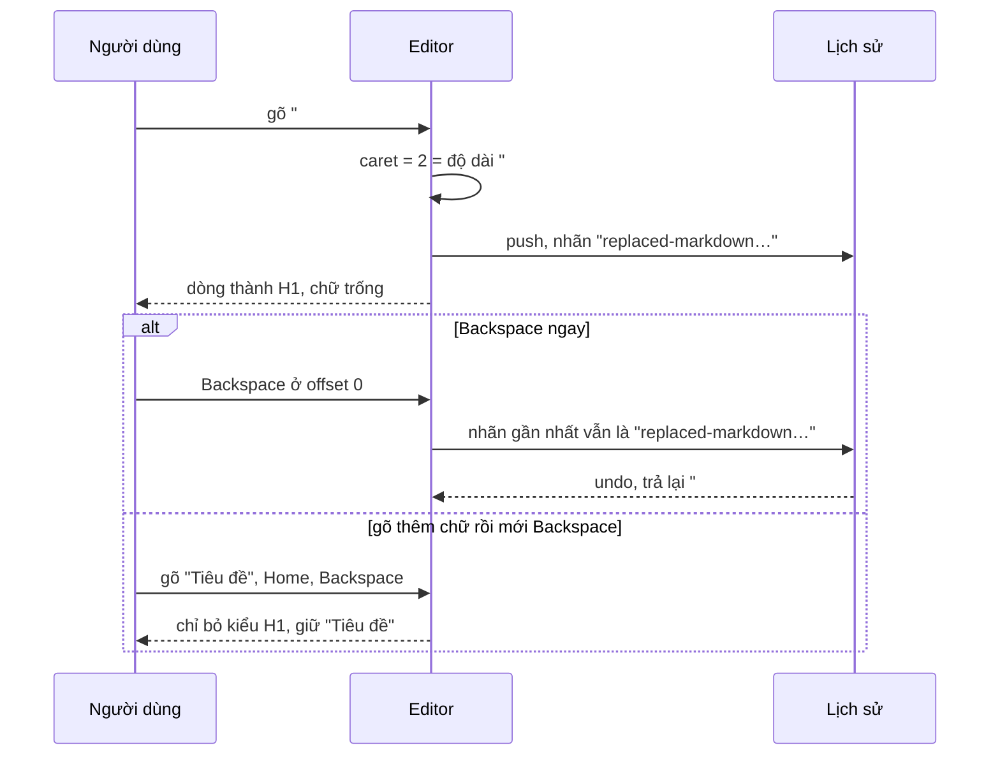

Notion, Slack, Google Docs, ô soạn bài của Facebook Workplace: gõ `# ` ở đầu dòng là dòng đó thành tiêu đề, gõ `- ` là thành danh sách. Rất tiện, cho tới khi bạn thật sự muốn viết "# hashtag" hay "- 5 độ" và editor cứ tự đổi kiểu. Editor tốt cho một lối thoát: bấm **Backspace ngay sau đó** là chữ `# ` quay lại nguyên vẹn, dòng trở về văn bản thường.

Nghe đơn giản, nhưng có ba câu hỏi: khi nào thì coi là "vừa gõ tiền tố" (không phải dán, không phải sửa giữa dòng)? Backspace nào là "hoàn tác", Backspace nào là "xoá kiểu"? Và khi dán cả đoạn Markdown nhiều dòng thì sao? Bài này đọc `RichTextEditorMarkdownUtil` của Facebook, một tiện ích trên Draft.js, để trả lời.

> [!TIP]
> **Tóm tắt**
> - Một bảng tiền tố (`# `, `## `, `> `, ` ``` `, 4 dấu cách, `[ ] `, `[x] `, `- `, `* `, `+ `, `1. `, `1) `) ánh xạ sang kiểu block. Chỉ đổi khi lần thay đổi gần nhất là **gõ ký tự**, selection thu gọn, caret đứng **đúng ở cuối tiền tố** và không quá 4 ký tự từ đầu dòng.
> - Lần đổi kiểu được ghi vào lịch sử với một nhãn riêng (`replaced-markdown-text-with-block-style`). Backspace ở đầu dòng mà thay đổi gần nhất còn mang nhãn đó thì gọi `undo`, trả lại chữ đã gõ.
> - Dán Markdown nhiều dòng dùng regex sinh từ cùng bảng tiền tố. Hai lỗi: "2019. Một năm" thành danh sách số và **mất chữ 2019**; dòng thụt vào sau một đoạn văn vẫn thành danh sách con.
> - Bản viết lại không cần Draft.js: model block thuần, ảnh chụp "trước khi đổi kiểu" thay cho undo stack, và luật dán theo CommonMark.

<iframe class="demo-frame" src="/demos/facebook-patterns/index.html?theme=dark#/markdown-shortcuts-editor" title="Demo markdown-shortcuts-editor" loading="lazy" style="height: 1180px"></iframe>

<p class="demo-links">▶ <a href="/demos/facebook-patterns/index.html#/markdown-shortcuts-editor" target="_blank" rel="noopener">Mở demo toàn màn hình ↗</a> · <a href="https://stackblitz.com/github/hunghg255/blog-hunghg/tree/master/examples/facebook-patterns?file=src/lib/mdShortcuts.ts" target="_blank" rel="noopener">Sửa code trên StackBlitz ↗</a> · <a href="https://github.com/hunghg255/blog-hunghg/blob/master/examples/facebook-patterns/src/lib/mdShortcuts.ts" target="_blank" rel="noopener">Xem source trên GitHub ↗</a></p>

## Facebook làm thế nào?

Module `RichTextEditorMarkdownUtil` nằm trong bundle `294.js`, dùng `EditorState`, `DraftModifier`, `ContentBlock` của Draft.js (thư viện editor mã nguồn mở của Facebook, nay đã ngừng phát triển và được thay bằng Lexical).

### Bảng tiền tố

```js
const lists = [
  { text: '* ', type: 'unordered-list-item', isListStart: true },
  { text: '- ', type: 'unordered-list-item', isListStart: true },
  { text: '+ ', type: 'unordered-list-item', isListStart: true },
  { text: '1. ', type: 'ordered-list-item', isListStart: true },
  { text: '1) ', type: 'ordered-list-item', isListStart: true },
];
const shortcuts = [
  { text: '# ', type: 'header-one' }, { text: '## ', type: 'header-two' }, { text: '> ', type: 'blockquote' },
  ...codeBlocks,  // '```', '``` ' (isMultilineCodeBlockMarker), '    ' (4 dấu cách)
  { text: '[] ', type: 'checkbox-list-item', data: { isChecked: false } }, { text: '[ ] ', … }, { text: '[x] ', … }, { text: '[X] ', … },
  ...lists,
];
```

Bảng được lọc theo cấu hình của editor: checkbox chỉ bật khi có `enableCheckboxes` (mặc định **tắt**), code block bật trừ khi `enableCodeBlock: false`, và người dùng module có thể thêm `markdownReplacementOverrides` (khử trùng theo `text`, bản ghi đè đứng trước). Nhóm code block còn phụ thuộc hai cờ gatekeeper (`gkx`), tức tính năng đang được thử dần.

### Khi nào đổi kiểu

```js
function textToBlockStyle(editorState, config) {
  return editorState.getLastChangeType() === 'insert-characters' ? tryReplace(editorState, config) : null;
}

function tryReplace(editorState, config) {
  const sel = editorState.getSelection();
  const block = currentBlock(editorState);
  if (!sel.isCollapsed() || sel.getStartOffset() > 4) return null;
  for (const s of candidatesFor(block.getType(), config)) {
    if (sel.getStartOffset() === s.text.length && block.getText().startsWith(s.text)) {
      return EditorState.forceSelection(
        EditorState.push(editorState, replaceWithStyle(editorState, s), 'replaced-markdown-text-with-block-style'),
        selectionAt(editorState, 0),
      );
    }
  }
  return null;
}
```

Bốn điều kiện cùng lúc: vừa **gõ** (dán thì `lastChangeType` là `insert-fragment`), không có vùng chọn, caret ở vị trí ≤ 4, và caret nằm đúng cuối tiền tố. Điều kiện cuối là mấu chốt: gõ `#` rồi dấu cách ở đầu dòng "hello" (caret ở 2) thì đổi; nhưng sửa chữ ở giữa một dòng đã bắt đầu bằng `# ` thì không, vì caret không đứng ở vị trí 2.

`candidatesFor(type)` chỉ trả bảng tiền tố khi block đang là `unstyled`. Block đã là danh sách thì mặc định không có tiền tố nào; chỉ khi editor bật `enableNestingListsInline`, danh sách mới nhận thêm các tiền tố danh sách và một tiền tố là **một dấu cách**. Khi đó gõ `- ` trong một mục gạch đầu dòng sẽ thụt vào một mức (`depth + 1`, tối đa `RichComposedTextEditorMaxNestingLevels`) thay vì đổi kiểu.

`replaceWithStyle` làm hai việc trong một `ContentState`: `setBlockType` rồi `replaceText(…, '')` xoá tiền tố, kèm `setBlockData` cho checkbox (`isChecked`).

### Backspace để hoàn tác

```js
function blockStyleToText(command, editorState) {
  if (!['backspace', 'backspace-word', 'backspace-to-start-of-line'].includes(command)) return null;
  if (editorState.getLastChangeType() !== 'replaced-markdown-text-with-block-style') return null;
  const sel = editorState.getSelection();
  if (!(sel.isCollapsed() && sel.getStartOffset() === 0)) return null;
  const undo = editorState.getUndoStack();
  if (!(undo.size && sel.getStartKey() === undo.first().getSelectionAfter().getStartKey())) return null;
  return EditorState.undo(editorState);
}
```

Đây là chỗ khéo nhất. Draft.js lưu lịch sử theo "change type": mỗi lần `push` với một loại thay đổi khác loại trước sẽ tạo một mục undo mới. Đặt cho thao tác đổi kiểu một loại riêng thì:

1. Mục undo trên cùng chính là trạng thái ngay trước khi đổi kiểu, tức dòng còn chữ `# `.
2. `getLastChangeType()` cho biết thao tác gần nhất **có phải** là đổi kiểu không. Gõ thêm một chữ là loại thay đổi thành `insert-characters`, Backspace không còn là hoàn tác nữa mà chỉ là xoá kiểu block (Draft.js mặc định).
3. Kiểm tra key của block ở đỉnh undo stack để chắc chắn Backspace đang ở **đúng dòng** vừa đổi.

Không cần biến trạng thái riêng nào. Cái giá là phụ thuộc chặt vào mô hình lịch sử của Draft.js.

### Dán Markdown nhiều dòng

`formatWithStyles` duyệt từng block sau khi dán. Regex danh sách được **sinh từ bảng**: escape ký tự đặc biệt, rồi đổi chữ `1` thành `\d+`:

```js
const listRegex = (type) => '(?:' + shortcuts
  .filter((s) => s.isListStart && s.type === type)
  .map((s) => s.text.replace(/[.*+?^${}()|[\]\\]/g, '\\$&').replace(/1/g, '\\d+'))
  .join('|') + ')';
// ordered: ^((?:\d+\. |\d+\) ))   lồng: ^((?:\t| {4})+(?:\d+\. |\d+\) ))
```

Mức lồng là số đoạn khi `split(/(?:\t| {4})/)` phần thụt đầu dòng. Dòng ` ``` ` bật/tắt chế độ code nhiều dòng; trong chế độ đó mọi dòng đều là `code-block`.

Hai lỗi, kiểm bằng cách chạy lại đúng logic trên node:

- `\d+` nhận **mọi** số. Dán "2019. Một năm tốt" ra một mục danh sách số với chữ "Một năm tốt": con số 2019 bị xoá khỏi văn bản và danh sách tự đánh lại từ 1.
- Biến lưu "đang trong danh sách" (`e`) chỉ được đặt lại khi gặp một tiền tố không phải danh sách. Dòng văn bản thường **không** đặt lại nó. Dán "- a / Đoạn văn / &nbsp;&nbsp;&nbsp;&nbsp;- b" thì "b" thành mục con mức 1, dù phía trên nó là một đoạn văn chứ không phải danh sách.



## Bên trong trình duyệt

`contenteditable` thuần không có khái niệm "block có kiểu" hay lịch sử theo loại thay đổi: undo của trình duyệt (`execCommand('undo')`) gom các thao tác theo heuristic riêng và bị xoá ngay khi JavaScript sửa DOM. Vì vậy mọi editor nghiêm túc (Draft.js, Lexical, ProseMirror, Slate) đều giữ **model riêng** và tự quản lý undo.

Thông tin "đây là gõ phím hay dán" đến từ `InputEvent.inputType`: `insertText` khi gõ, `insertFromPaste` khi dán, `insertCompositionText` khi đang gõ bằng bộ gõ (IME, như Telex trên một số hệ điều hành hay gõ tiếng Nhật). Phím tắt Markdown chỉ nên chạy với `insertText`. Đặc biệt với bộ gõ: trong lúc composition, chữ chưa "chốt", đổi kiểu block lúc đó làm hỏng chuỗi đang gõ.

## Viết lại

Model: mảng block `{ key, type, text, depth, checked }`, caret `{ key, offset }`, loại thay đổi gần nhất và **ảnh chụp block trước khi đổi kiểu**. Ảnh chụp đó thay cho undo stack của Draft.js.

```ts title=src/lib/mdShortcuts.ts
/** Tiền tố nào khớp với block tại vị trí caret, hoặc null. */
export function matchShortcut(b: Block, offset: number, shortcuts = SHORTCUTS): Shortcut | null {
  if (offset > MAX_PREFIX) return null;
  for (const s of shortcuts) {
    if (offset !== s.prefix.length || !b.text.startsWith(s.prefix)) continue;
    if (b.type === 'unstyled') return s;
    if (s.list && s.type === b.type) return s; // "- " trong danh sách gạch đầu dòng: thụt vào
  }
  return null;
}

/**
 * Người dùng sửa chữ trong một block. `inserted` = lần sửa này là gõ thêm ký tự
 * (InputEvent.inputType === 'insertText'); dán, xoá, IME thì không đổi kiểu block.
 */
export function editText(ed: Editor, key: string, text: string, offset: number, inserted: boolean): Editor {
  const i = indexOf(ed, key);
  const b = { ...ed.blocks[i], text };
  const s = inserted ? matchShortcut(b, offset) : null;
  if (!s) {
    return { blocks: replaceAt(ed.blocks, i, b), caret: { key, offset }, last: inserted ? 'insert' : 'other', undo: ed.undo };
  }
  const nested = b.type === s.type;
  const styled: Block = {
    ...b,
    type: s.type,
    text: text.slice(s.prefix.length),
    depth: nested ? Math.min(MAX_DEPTH, b.depth + 1) : b.depth,
    ...(s.type === 'checkbox-list-item' ? { checked: !!s.checked } : {}),
  };
  return {
    blocks: replaceAt(ed.blocks, i, styled),
    caret: { key, offset: 0 },
    last: 'markdown',
    undo: { before: b, offset },
  };
}
```

Backspace ở đầu block: hoàn tác nếu vừa đổi kiểu, bỏ một mức thụt hoặc bỏ kiểu nếu block có kiểu, nối vào block trước nếu là văn bản thường:

```ts title=src/lib/mdShortcuts.ts
/**
 * Backspace khi caret ở đầu block. Trả null nếu để trình duyệt tự xử lý
 * (caret không ở đầu, hoặc là block đầu tiên không có kiểu).
 */
export function backspaceAtStart(ed: Editor): Editor | null {
  const { key, offset } = ed.caret;
  if (offset !== 0) return null;
  const i = indexOf(ed, key);
  const b = ed.blocks[i];
  // 1. vừa đổi kiểu bằng tiền tố: trả lại đúng chữ đã gõ
  if (ed.last === 'markdown' && ed.undo?.before.key === key) {
    return {
      blocks: replaceAt(ed.blocks, i, ed.undo.before),
      caret: { key, offset: ed.undo.offset },
      last: 'other',
      undo: null,
    };
  }
  // 2. block có kiểu: bỏ một mức thụt, rồi bỏ kiểu
  if (b.type !== 'unstyled') {
    const next: Block =
      isList(b.type) && b.depth > 0 ? { ...b, depth: b.depth - 1 } : { key: b.key, type: 'unstyled', text: b.text, depth: 0 };
    return { blocks: replaceAt(ed.blocks, i, next), caret: { key, offset: 0 }, last: 'other', undo: null };
  }
  // 3. block thường: nối vào block trước
  if (i === 0) return null;
  const prev = ed.blocks[i - 1];
  const merged = { ...prev, text: prev.text + b.text };
  return {
    blocks: [...ed.blocks.slice(0, i - 1), merged, ...ed.blocks.slice(i + 1)],
    caret: { key: prev.key, offset: prev.text.length },
    last: 'other',
    undo: null,
  };
}
```

Dán Markdown: danh sách số khác 1 chỉ được nhận khi dòng trước đã là danh sách số; mức lồng chỉ có nghĩa khi dòng trước là mục danh sách:

```ts title=src/lib/mdShortcuts.ts
export function markdownToBlocks(text: string, o: PasteOptions = {}): Block[] {
  const out: Block[] = [];
  let inFence = false;
  let listOpen = false; // dòng trước có phải mục danh sách không
  let prevOrdered = false;

  for (const line of text.replace(/\r\n?/g, '\n').split('\n')) {
    if (line.startsWith('```')) {
      inFence = !inFence;
      continue;
    }
    if (inFence) {
      out.push(block(line, 'code-block'));
      continue;
    }
    const { depth, rest } = leadingIndent(line);
    const canNest = listOpen && depth > 0;
    const body = depth > 0 && canNest ? rest : line;
    const lineDepth = canNest ? Math.min(depth, MAX_DEPTH) : 0;

    const bullet = BULLET.exec(body);
    const ordered = ORDERED.exec(body);
    if (bullet && (depth === 0 || canNest)) {
      out.push(block(body.slice(bullet[0].length), 'unordered-list-item', lineDepth));
      listOpen = true;
      prevOrdered = false;
      continue;
    }
    if (ordered && (depth === 0 || canNest) && (o.anyOrderedStart || ordered[1] === '1' || prevOrdered)) {
      out.push(block(body.slice(ordered[0].length), 'ordered-list-item', lineDepth));
      listOpen = true;
      prevOrdered = true;
      continue;
    }
    const s = depth === 0 ? SHORTCUTS.find((x) => !x.list && !x.fence && line.startsWith(x.prefix)) : undefined;
    if (s) {
      out.push(block(line.slice(s.prefix.length), s.type, 0, s.checked));
      listOpen = false;
    } else if (depth > 0 && !canNest) {
      out.push(block(rest, 'code-block')); // 4 dấu cách đầu dòng ngoài danh sách: code
      listOpen = false;
    } else {
      out.push(block(line));
      listOpen = o.keepNestingAcrossParagraphs ? listOpen : false;
    }
    prevOrdered = false;
  }
  return out.length ? out : [block()];
}
```

::: spoiler Xem toàn bộ src/lib/mdShortcuts.ts

```ts title=src/lib/mdShortcuts.ts
/**
 * Phím tắt Markdown trong editor dạng block: gõ "# " thành tiêu đề, "- " thành danh sách...
 * Backspace ngay sau đó để hoàn tác. Kèm bộ chuyển Markdown nhiều dòng khi dán.
 * Ý tưởng học từ RichTextEditorMarkdownUtil (Draft.js) của Facebook, viết lại từ đầu,
 * không phụ thuộc Draft.js.
 */

export type BlockType =
  | 'unstyled'
  | 'header-one'
  | 'header-two'
  | 'blockquote'
  | 'code-block'
  | 'unordered-list-item'
  | 'ordered-list-item'
  | 'checkbox-list-item';

export interface Block {
  key: string;
  type: BlockType;
  text: string;
  depth: number;
  checked?: boolean;
}

export interface Shortcut {
  prefix: string;
  type: BlockType;
  checked?: boolean;
  /** bắt đầu danh sách: gõ lại trong danh sách cùng loại thì thụt vào một mức */
  list?: boolean;
  /** ``` bật/tắt khối code nhiều dòng khi dán */
  fence?: boolean;
}

export const SHORTCUTS: readonly Shortcut[] = [
  { prefix: '# ', type: 'header-one' },
  { prefix: '## ', type: 'header-two' },
  { prefix: '> ', type: 'blockquote' },
  { prefix: '```', type: 'code-block', fence: true },
  { prefix: '    ', type: 'code-block' },
  { prefix: '[] ', type: 'checkbox-list-item', checked: false },
  { prefix: '[ ] ', type: 'checkbox-list-item', checked: false },
  { prefix: '[x] ', type: 'checkbox-list-item', checked: true },
  { prefix: '[X] ', type: 'checkbox-list-item', checked: true },
  { prefix: '* ', type: 'unordered-list-item', list: true },
  { prefix: '- ', type: 'unordered-list-item', list: true },
  { prefix: '+ ', type: 'unordered-list-item', list: true },
  { prefix: '1. ', type: 'ordered-list-item', list: true },
  { prefix: '1) ', type: 'ordered-list-item', list: true },
];

/** tiền tố dài nhất; caret xa hơn thì khỏi kiểm tra */
const MAX_PREFIX = Math.max(...SHORTCUTS.map((s) => s.prefix.length));
export const MAX_DEPTH = 4;
const LISTS: BlockType[] = ['unordered-list-item', 'ordered-list-item', 'checkbox-list-item'];
export const isList = (t: BlockType) => LISTS.includes(t);

let seq = 0;
export const newKey = () => `b${++seq}`;
export const block = (text = '', type: BlockType = 'unstyled', depth = 0, checked?: boolean): Block => ({
  key: newKey(),
  type,
  text,
  depth,
  ...(type === 'checkbox-list-item' ? { checked: !!checked } : {}),
});

// ---------------------------------------------------------------- editor

export type LastChange = 'insert' | 'markdown' | 'other';

export interface Editor {
  blocks: Block[];
  caret: { key: string; offset: number };
  last: LastChange;
  /** trạng thái ngay trước lần đổi kiểu block gần nhất, để Backspace hoàn tác */
  undo: { before: Block; offset: number } | null;
}

export function createEditor(blocks: Block[] = [block()]): Editor {
  return { blocks, caret: { key: blocks[0].key, offset: 0 }, last: 'other', undo: null };
}

const indexOf = (ed: Editor, key: string) => ed.blocks.findIndex((b) => b.key === key);
const replaceAt = (blocks: Block[], i: number, ...items: Block[]) => [
  ...blocks.slice(0, i),
  ...items,
  ...blocks.slice(i + 1),
];

/** Tiền tố nào khớp với block tại vị trí caret, hoặc null. */
export function matchShortcut(b: Block, offset: number, shortcuts = SHORTCUTS): Shortcut | null {
  if (offset > MAX_PREFIX) return null;
  for (const s of shortcuts) {
    if (offset !== s.prefix.length || !b.text.startsWith(s.prefix)) continue;
    if (b.type === 'unstyled') return s;
    if (s.list && s.type === b.type) return s; // "- " trong danh sách gạch đầu dòng: thụt vào
  }
  return null;
}

/**
 * Người dùng sửa chữ trong một block. `inserted` = lần sửa này là gõ thêm ký tự
 * (InputEvent.inputType === 'insertText'); dán, xoá, IME thì không đổi kiểu block.
 */
export function editText(ed: Editor, key: string, text: string, offset: number, inserted: boolean): Editor {
  const i = indexOf(ed, key);
  const b = { ...ed.blocks[i], text };
  const s = inserted ? matchShortcut(b, offset) : null;
  if (!s) {
    return { blocks: replaceAt(ed.blocks, i, b), caret: { key, offset }, last: inserted ? 'insert' : 'other', undo: ed.undo };
  }
  const nested = b.type === s.type;
  const styled: Block = {
    ...b,
    type: s.type,
    text: text.slice(s.prefix.length),
    depth: nested ? Math.min(MAX_DEPTH, b.depth + 1) : b.depth,
    ...(s.type === 'checkbox-list-item' ? { checked: !!s.checked } : {}),
  };
  return {
    blocks: replaceAt(ed.blocks, i, styled),
    caret: { key, offset: 0 },
    last: 'markdown',
    undo: { before: b, offset },
  };
}

/**
 * Backspace khi caret ở đầu block. Trả null nếu để trình duyệt tự xử lý
 * (caret không ở đầu, hoặc là block đầu tiên không có kiểu).
 */
export function backspaceAtStart(ed: Editor): Editor | null {
  const { key, offset } = ed.caret;
  if (offset !== 0) return null;
  const i = indexOf(ed, key);
  const b = ed.blocks[i];
  // 1. vừa đổi kiểu bằng tiền tố: trả lại đúng chữ đã gõ
  if (ed.last === 'markdown' && ed.undo?.before.key === key) {
    return {
      blocks: replaceAt(ed.blocks, i, ed.undo.before),
      caret: { key, offset: ed.undo.offset },
      last: 'other',
      undo: null,
    };
  }
  // 2. block có kiểu: bỏ một mức thụt, rồi bỏ kiểu
  if (b.type !== 'unstyled') {
    const next: Block =
      isList(b.type) && b.depth > 0 ? { ...b, depth: b.depth - 1 } : { key: b.key, type: 'unstyled', text: b.text, depth: 0 };
    return { blocks: replaceAt(ed.blocks, i, next), caret: { key, offset: 0 }, last: 'other', undo: null };
  }
  // 3. block thường: nối vào block trước
  if (i === 0) return null;
  const prev = ed.blocks[i - 1];
  const merged = { ...prev, text: prev.text + b.text };
  return {
    blocks: [...ed.blocks.slice(0, i - 1), merged, ...ed.blocks.slice(i + 1)],
    caret: { key: prev.key, offset: prev.text.length },
    last: 'other',
    undo: null,
  };
}

/** Enter: tách block. Mục danh sách rỗng thì thoát danh sách thay vì tạo mục mới. */
export function splitBlock(ed: Editor): Editor {
  const { key, offset } = ed.caret;
  const i = indexOf(ed, key);
  const b = ed.blocks[i];
  if (b.text === '' && b.type !== 'unstyled') {
    const plain: Block = { key: b.key, type: 'unstyled', text: '', depth: 0 };
    return { blocks: replaceAt(ed.blocks, i, plain), caret: { key, offset: 0 }, last: 'other', undo: null };
  }
  const keepType = isList(b.type) || b.type === 'code-block';
  const tail = block(b.text.slice(offset), keepType ? b.type : 'unstyled', keepType ? b.depth : 0, false);
  return {
    blocks: replaceAt(ed.blocks, i, { ...b, text: b.text.slice(0, offset) }, tail),
    caret: { key: tail.key, offset: 0 },
    last: 'other',
    undo: null,
  };
}

// ---------------------------------------------------------------- dán Markdown

export interface PasteOptions {
  /**
   * Bản gốc: "2019. Một năm" luôn thành danh sách số và mất chữ "2019".
   * Mặc định ở đây theo CommonMark: danh sách số chỉ được ngắt đoạn văn khi bắt đầu bằng 1,
   * và số khác 1 chỉ được nhận nếu dòng trước đã là danh sách số.
   */
  anyOrderedStart?: boolean;
  /** Bản gốc: không đặt lại mức lồng khi gặp dòng thường, dòng thụt sau đoạn văn vẫn thành danh sách con. */
  keepNestingAcrossParagraphs?: boolean;
}

const BULLET = /^([*+-]) /;
const ORDERED = /^(\d{1,9})[.)] /;

/** Đếm số mức thụt đầu dòng: mỗi tab hoặc 4 dấu cách là một mức. */
function leadingIndent(line: string): { depth: number; rest: string } {
  let pos = 0;
  let depth = 0;
  for (;;) {
    if (line[pos] === '\t') pos += 1;
    else if (line.startsWith('    ', pos)) pos += 4;
    else break;
    depth++;
  }
  return { depth, rest: line.slice(pos) };
}

export function markdownToBlocks(text: string, o: PasteOptions = {}): Block[] {
  const out: Block[] = [];
  let inFence = false;
  let listOpen = false; // dòng trước có phải mục danh sách không
  let prevOrdered = false;

  for (const line of text.replace(/\r\n?/g, '\n').split('\n')) {
    if (line.startsWith('```')) {
      inFence = !inFence;
      continue;
    }
    if (inFence) {
      out.push(block(line, 'code-block'));
      continue;
    }
    const { depth, rest } = leadingIndent(line);
    const canNest = listOpen && depth > 0;
    const body = depth > 0 && canNest ? rest : line;
    const lineDepth = canNest ? Math.min(depth, MAX_DEPTH) : 0;

    const bullet = BULLET.exec(body);
    const ordered = ORDERED.exec(body);
    if (bullet && (depth === 0 || canNest)) {
      out.push(block(body.slice(bullet[0].length), 'unordered-list-item', lineDepth));
      listOpen = true;
      prevOrdered = false;
      continue;
    }
    if (ordered && (depth === 0 || canNest) && (o.anyOrderedStart || ordered[1] === '1' || prevOrdered)) {
      out.push(block(body.slice(ordered[0].length), 'ordered-list-item', lineDepth));
      listOpen = true;
      prevOrdered = true;
      continue;
    }
    const s = depth === 0 ? SHORTCUTS.find((x) => !x.list && !x.fence && line.startsWith(x.prefix)) : undefined;
    if (s) {
      out.push(block(line.slice(s.prefix.length), s.type, 0, s.checked));
      listOpen = false;
    } else if (depth > 0 && !canNest) {
      out.push(block(rest, 'code-block')); // 4 dấu cách đầu dòng ngoài danh sách: code
      listOpen = false;
    } else {
      out.push(block(line));
      listOpen = o.keepNestingAcrossParagraphs ? listOpen : false;
    }
    prevOrdered = false;
  }
  return out.length ? out : [block()];
}

/** Bản mô phỏng hành vi gốc khi dán, để so sánh trong demo. */
export const legacyPaste = (text: string) =>
  markdownToBlocks(text, { anyOrderedStart: true, keepNestingAcrossParagraphs: true });
```

:::

## Đi qua code

- `matchShortcut` lặp bảng theo thứ tự, giống bản gốc. `## ` không bị `# ` bắt nhầm vì điều kiện `offset === prefix.length`: khi gõ xong `## `, caret ở 3, chỉ `## ` có độ dài 3.
- `editText` nhận cờ `inserted` từ lớp giao diện (`inputType === 'insertText'`). Dán hay xoá chữ không bao giờ đổi kiểu block.
- Khi đổi kiểu, `undo` lưu block **trước** khi đổi (còn nguyên tiền tố) và vị trí caret. `last = 'markdown'` đóng vai trò `lastChangeType`.
- `backspaceAtStart` kiểm tra cả `last` lẫn key của block trong ảnh chụp, tương đương việc so key ở đỉnh undo stack của bản gốc.
- `splitBlock` giữ kiểu danh sách và code khi Enter; mục danh sách rỗng mà Enter thì thoát danh sách (giống `richTextTryToInsertNewlineAndReset`).
- `markdownToBlocks` đọc phần thụt bằng `leadingIndent` (tab hoặc 4 dấu cách mỗi mức), dùng `listOpen` để biết dòng trước có phải mục danh sách không, và `prevOrdered` cho luật số bắt đầu.

**Khác bản gốc:**

- Không phụ thuộc Draft.js; hoàn tác bằng ảnh chụp một block thay vì undo stack chung.
- Checkbox và thụt danh sách bằng `- ` luôn bật (bản gốc cần `enableCheckboxes` và `enableNestingListsInline`).
- Backspace ở đầu mục danh sách có thụt sẽ bỏ một mức trước, rồi mới bỏ kiểu.
- Dán: số khác 1 không mở danh sách mới sau đoạn văn (luật CommonMark), và dòng văn bản thường đặt lại trạng thái danh sách. `legacyPaste` giữ hành vi cũ để so sánh.

## Tại sao không làm cách khác?

- **Đổi kiểu khi gõ chữ đầu tiên sau tiền tố** (`# T`): người dùng thấy `# ` hiện rồi mới biến mất, giật. Đổi ngay khi gõ dấu cách cho phản hồi tức thì, và Backspace là đường lui rẻ.
- **Hỏi lại người dùng** ("Đổi thành tiêu đề?"): quá nặng cho một thao tác gõ.
- **Ctrl+Z thay cho Backspace**: vẫn nên hỗ trợ, nhưng người dùng thấy dòng vừa đổi kiểu thì phản xạ tự nhiên là xoá lùi, không phải undo.
- **Dùng parser Markdown đầy đủ khi dán** (markdown-it, remark): đúng chuẩn hơn hẳn, nhưng nặng và sinh cả những kiểu block editor không hỗ trợ (bảng, HTML). Bảng tiền tố nhỏ đủ cho ô soạn tin, chỉ cần sửa hai luật dễ gây mất dữ liệu.

## Edge case và cạm bẫy

- **Bộ gõ tiếng Việt**: một số bộ gõ gửi chữ qua composition, một số gửi `deleteContentBackward` rồi `insertText` để thay dấu. Với chuỗi "# " không có dấu, không ảnh hưởng; nhưng đừng để phím tắt chạy giữa composition.
- **Tiền tố 4 dấu cách**: rất dễ kích hoạt nhầm khi người dùng căn lề bằng dấu cách. Nhiều editor bỏ hẳn tiền tố này; bản gốc cũng để nó sau cờ gatekeeper.
- **Số thứ tự**: dán "3. Ba" đứng một mình thì nên giữ số 3. Bản viết lại giữ nguyên chữ (không thành danh sách); nếu muốn danh sách bắt đầu từ 3 thì cần lưu thêm thuộc tính `start`.
- **Undo sau khi dán**: hoàn tác bằng ảnh chụp chỉ áp cho thao tác đổi kiểu vừa xong. Undo đa bước (Ctrl+Z) vẫn cần một lịch sử thật.
- **Đọc màn hình**: block đổi kiểu thì vai trò của nó đổi (đoạn văn thành tiêu đề, mục danh sách). Ở editor thật, dùng phần tử đúng nghĩa (`h1`, `li`) để trình đọc màn hình đọc đúng.

## Dùng trong dự án

```tsx
import { backspaceAtStart, editText, splitBlock, type Editor } from './mdShortcuts';

function onBeforeInput(e: InputEvent, ed: Editor, caretKey: string, newText: string, offset: number) {
  // gọi sau khi lấy được text mới của block và vị trí caret
  return editText(ed, caretKey, newText, offset, e.inputType === 'insertText');
}

function onKeyDown(e: KeyboardEvent, ed: Editor): Editor | null {
  if (e.key === 'Backspace') return backspaceAtStart(ed); // null: để trình duyệt xoá như thường
  if (e.key === 'Enter' && !e.shiftKey) return (e.preventDefault(), splitBlock(ed));
  return null;
}
```

Nếu dùng Lexical, plugin `MarkdownShortcutPlugin` có sẵn các transformer cho tiêu đề, danh sách, trích dẫn, code; bản viết lại ở đây hữu ích khi cần hiểu cơ chế hoặc làm editor nhỏ không muốn thêm phụ thuộc.

## Kiểm thử

::: spoiler Ví dụ test (bản phác, không có trong repo)

```ts
import { describe, expect, it } from 'vitest';
import { backspaceAtStart, block, createEditor, editText, legacyPaste, markdownToBlocks } from './mdShortcuts';

const type = (ed: ReturnType<typeof createEditor>, s: string) => {
  const key = ed.caret.key;
  for (let i = 1; i <= s.length; i++) {
    const cur = ed.blocks.find((b) => b.key === key)!;
    ed = editText(ed, key, cur.text + s[i - 1], cur.text.length + 1, true);
  }
  return ed;
};

describe('phím tắt', () => {
  it('"# " thành H1, Backspace trả lại "# "', () => {
    let ed = type(createEditor(), '# ');
    expect(ed.blocks[0]).toMatchObject({ type: 'header-one', text: '' });
    ed = backspaceAtStart(ed)!;
    expect(ed.blocks[0]).toMatchObject({ type: 'unstyled', text: '# ' });
    expect(ed.caret.offset).toBe(2);
  });

  it('gõ thêm chữ thì Backspace chỉ bỏ kiểu', () => {
    let ed = type(createEditor(), '# A');
    ed = backspaceAtStart({ ...ed, caret: { ...ed.caret, offset: 0 } })!;
    expect(ed.blocks[0]).toMatchObject({ type: 'unstyled', text: 'A' });
  });

  it('dán không đổi kiểu', () => {
    const ed = createEditor();
    const next = editText(ed, ed.caret.key, '# ', 2, false);
    expect(next.blocks[0].type).toBe('unstyled');
  });

  it('"- " trong danh sách thì thụt vào', () => {
    const ed = createEditor([block('- ', 'unordered-list-item')]);
    expect(editText(ed, ed.caret.key, '- ', 2, true).blocks[0].depth).toBe(1);
  });
});

describe('dán Markdown', () => {
  it('giữ "2019." là văn bản', () => {
    expect(markdownToBlocks('2019. Một năm')[0]).toMatchObject({ type: 'unstyled', text: '2019. Một năm' });
    expect(legacyPaste('2019. Một năm')[0]).toMatchObject({ type: 'ordered-list-item', text: 'Một năm' });
  });
  it('dòng thụt sau đoạn văn không thành mục con', () => {
    const out = markdownToBlocks('- a\nĐoạn\n    - b');
    expect(out[2].type).not.toBe('unordered-list-item');
    expect(legacyPaste('- a\nĐoạn\n    - b')[2]).toMatchObject({ type: 'unordered-list-item', depth: 1 });
  });
  it('danh sách lồng và code', () => {
    const out = markdownToBlocks('1. a\n2. b\n    - c\n```\n# x\n```');
    expect(out.map((b) => `${b.type}@${b.depth}`)).toEqual([
      'ordered-list-item@0', 'ordered-list-item@0', 'unordered-list-item@1', 'code-block@0',
    ]);
  });
});
```

:::

## So với thư viện và chuẩn web

- **Lexical** (`@lexical/markdown`): `MarkdownShortcutPlugin` với các "transformer" theo regex, kể cả định dạng inline (`**đậm**`). Hoàn tác qua lịch sử của Lexical (Ctrl+Z), không có luật Backspace riêng như Draft.js của Facebook.
- **ProseMirror** (`prosemirror-inputrules`): `textblockTypeInputRule`, `wrappingInputRule`, và lệnh `undoInputRule` gắn vào Backspace: đúng cơ chế "Backspace ngay sau đó để hoàn tác".
- **Tiptap**: input rules dựa trên ProseMirror, có sẵn cho heading, list, blockquote, code block.
- **CommonMark**: đặc tả nói danh sách số chỉ được ngắt một đoạn văn khi bắt đầu bằng 1, và số bắt đầu tối đa 9 chữ số; bản viết lại dựa vào luật này để không ăn mất "2019.".
- Bài liên quan: [#21 Smart Compose](/blogs/facebook-smart-compose-ghost-text), [#43 Composer dạng plugin](/blogs/facebook-plugin-composer).

---

Bài này thuộc series **[Học từ mã nguồn Facebook](/series/facebook)** (106 bài, đọc theo thứ tự).

::: spoiler Xem nhanh danh sách bài trong series

*Phần 1*

- [Mở đầu: cách đọc code minify của Facebook](/blogs/learn-from-facebook-source-code)
- [#1 Dùng chung IntersectionObserver + infinite scroll](/blogs/facebook-shared-intersection-observer)
- [#2 useViewportDuration: đo thời gian thực sự được xem](/blogs/facebook-use-viewport-duration)
- [#3 Preload code + data khi hover](/blogs/facebook-preload-on-hover)
- [#4 Toast manager với external store](/blogs/facebook-toast-manager)
- [#5 Network status + heartbeat backoff](/blogs/facebook-network-status-heartbeat)
- [#6 ErrorGuard: bắt lỗi theo ngữ cảnh](/blogs/facebook-error-guard)
- [#7 Banzai: gom log theo lô + sendBeacon](/blogs/facebook-batch-logger)
- [#8 Focus trap + Esc theo layer](/blogs/facebook-focus-trap)

*Phần 2*

- [#9 Mẹo calc(… * 9999): container query, line-clamp, mũi tên carousel bằng CSS](/blogs/facebook-css-9999-trick)
- [#10 Thanh cuộn tuỳ biến bằng CSS 3D](/blogs/facebook-css-3d-scrollbar)
- [#11 Modal cuộn bằng window, giữ vị trí trang nền](/blogs/facebook-document-scroll-modal)
- [#12 Popover, tooltip group và hovercard](/blogs/facebook-popover-tooltip)
- [#13 Primitive Pressable + focus-visible](/blogs/facebook-pressable)
- [#14 Tab "Xem thêm" + sticky header bằng IntersectionObserver](/blogs/facebook-priority-tabs-sticky-header)
- [#15 Avatar khoét mask, gradient Messenger, skeleton steps()](/blogs/facebook-visual-tricks)
- [#16 Khung chat không giật](/blogs/facebook-chat-scroller)
- [#17 Thuật toán chọn bố cục collage ảnh](/blogs/facebook-photo-collage-layout)
- [#18 Keep-alive tab trong SPA](/blogs/facebook-keep-alive-tabs)
- [#19 Tự đo Visual Completion & interaction tracing](/blogs/facebook-visual-completion)
- [#20 Router SPA bền bỉ & tải chunk có retry](/blogs/facebook-spa-router-resilient-loading)

*Phần 3*

- [#21 Smart Compose: gợi ý chữ mờ khi gõ](/blogs/facebook-smart-compose-ghost-text)
- [#22 MQTT ngay trong trình duyệt, tự chuyển sang long-poll](/blogs/facebook-mqtt-in-browser)
- [#23 Đo thời gian dùng bằng bitmap 64 giây](/blogs/facebook-time-spent-bitmap)
- [#24 Bảng reaction nhấn giữ rồi trượt](/blogs/facebook-reaction-press-slide)
- [#25 Tìm kiếm gấp dấu, phiên âm và highlight đầu từ](/blogs/facebook-search-diacritics-tokenize)
- [#26 Ring buffer biết trace nào đã mất log](/blogs/facebook-trace-ring-buffer)
- [#27 Engine animation JS: một vòng rAF và solver cubic-bezier](/blogs/facebook-keyframes-loop-cubic-bezier)
- [#28 Bootloader: bitmap tài nguyên đã tải, chỉ reload khi cần](/blogs/facebook-bootloader-bitmap-consistency)
- [#29 Nhận biết click do screen reader tạo ra](/blogs/facebook-virtual-cursor-detection)
- [#30 Tải trước feed theo chất lượng mạng, đoán hạng thiết bị](/blogs/facebook-network-aware-prefetch)
- [#31 Hàng đợi gửi tin chat giữ đúng thứ tự](/blogs/facebook-ordered-send-queue)
- [#32 Gộp lời gọi API trong cùng một tick](/blogs/facebook-api-batcher)
- [#33 Resize ảnh trong pool Web Worker](/blogs/facebook-jpeg-resize-worker-pool)
- [#34 Crop ảnh theo nhiều khuôn mặt](/blogs/facebook-face-aware-crop)
- [#35 Kéo-thả sắp xếp và vùng thả file không nhấp nháy](/blogs/facebook-flicker-free-drag-drop)
- [#36 Tiện ích UI: fade-out, sticky event, hàm huỷ được](/blogs/facebook-ui-utility-hooks)
- [#37 Hạ tầng nhỏ: cookie, hash lỗi, prefetch khi chuột dừng](/blogs/facebook-small-infra-cookie-hash-idle)

*Phần 4–6*

- [#38 Đồng bộ tin nhắn: phát hiện lỗ seqID và fetch bù theo tầng](/blogs/facebook-messenger-sync-seqid-gaps)
- [#39 OTID: ID tin nhắn kiểu Snowflake sinh ở client](/blogs/facebook-otid-client-snowflake)
- [#40 QPL: lấy mẫu từ lúc bắt đầu, đo RTT gửi tin đầu-cuối](/blogs/facebook-qpl-send-rtt)
- [#41 Bộ điều phối request bảy chế độ gộp và chống trùng](/blogs/facebook-request-dispatcher-modes)
- [#42 Thread list theo mốc thời gian, cookie presence có version](/blogs/facebook-threadlist-ranged-presence)
- [#43 Composer dạng plugin: reducer, dirty checker, chuỗi kiểm tra](/blogs/facebook-plugin-composer)
- [#44 Thanh toán bất đồng bộ: subscribe trước, poll dự phòng](/blogs/facebook-async-checkout)
- [#45 Validate số thẻ: sửa lỗi gõ, dải BIN, Luhn](/blogs/facebook-card-validation)
- [#46 Lịch chọn khoảng ngày: bo góc dải chọn, phím đủ bộ, RTL](/blogs/facebook-range-calendar-a11y)
- [#47 Giờ mở cửa theo tuần: qua đêm, gộp khoảng, phần bù](/blogs/facebook-weekly-hours-intervals)
- [#48 Tiến độ đăng realtime: giữ event chờ snapshot, watchdog](/blogs/facebook-realtime-publish-snapshot)
- [#49 Tiền tệ theo đơn vị nhỏ nhất và ô nhập tiền](/blogs/facebook-currency-minor-units)
- [#50 Sửa hàng loạt Empty/Uniform/Mixed, seen/read bằng 2 bit](/blogs/facebook-bulk-edit-seen-bits)
- [#51 Phát hiện script lạ hook vào hàm native](/blogs/facebook-native-hook-detection)
- [#52 localStorage tự dọn khi đầy quota](/blogs/facebook-quota-aware-storage)
- [#53 Cache tuyến do server phân giải, chờ sẵn promise](/blogs/facebook-route-cache-prefetch)
- [#54 Lưới phím mũi tên 2D và focus không làm cuộn trang](/blogs/facebook-focus-table-grid)
- [#55 Tách emoji bằng máy trạng thái](/blogs/facebook-emoji-segmentation)
- [#56 Đọc trước ghi sau trong một frame, con tự biết vị trí](/blogs/facebook-read-then-write-dom)
- [#57 Hàng đợi lệnh cho video và stream sắp lại chunk](/blogs/facebook-video-command-queue)

*Phần 7–10*

- [#58 Ước lượng băng thông EWMA: loại outlier, nhớ qua phiên](/blogs/facebook-bandwidth-ewma-estimator)
- [#59 ABR theo độ tự tin phát và cắt bậc bitrate theo MOS](/blogs/facebook-abr-playback-confidence)
- [#60 Prefetch segment dự đoán từ manifest, parse hộp sidx](/blogs/facebook-dash-predicted-segments)
- [#61 Đọc metadata MP4/MOV ngay trên client](/blogs/facebook-mp4-metadata-client)
- [#62 Upload tiếp tục được: offset, hash dedupe, phát hiện treo](/blogs/facebook-resumable-upload)
- [#63 Fenwick tree: chọn ngẫu nhiên có trọng số và offset dòng](/blogs/facebook-fenwick-weighted-random)
- [#64 Vạch trục số và trục thời gian "đẹp"](/blogs/facebook-nice-axis-ticks)
- [#65 Damerau-Levenshtein theo dải chéo và tự sửa tên gõ sai](/blogs/facebook-damerau-levenshtein)
- [#66 PRNG có seed, shuffle tái lập và lấy mẫu trace](/blogs/facebook-seeded-prng-sampling)
- [#67 Cặp min/max-heap tái dùng vị trí trong danh sách ảo](/blogs/facebook-dual-heap-buffer-set)
- [#68 Memo nhiều đối số bằng Map/WeakMap và interning object](/blogs/facebook-multikey-memo-interning)
- [#69 Thống kê cửa sổ trượt và đại số khoảng thời gian](/blogs/facebook-moving-stat-intervals)
- [#70 Int64 từ hai số 32-bit, decode UTF, offset theo code point](/blogs/facebook-int64-utf-codepoints)
- [#71 Engine múi giờ IANA trên client, phát hiện lệch giờ](/blogs/facebook-client-iana-timezone)
- [#72 Tự cài semver range](/blogs/facebook-semver-range)
- [#73 Auto-link URL, cắt chữ an toàn, giới hạn LaTeX](/blogs/facebook-autolink-safe-truncate)
- [#74 Parser query kiểu PHP chống prototype pollution](/blogs/facebook-php-query-serializer)
- [#75 Popover tự lật theo phần tràn nhỏ nhất](/blogs/facebook-popover-auto-flip)
- [#76 Tiền tố for(;;) chống JSON hijacking, đọc stream](/blogs/facebook-csrf-prefix-streaming)
- [#77 Chống lộ Referer, linkshim, xoá token trên URL](/blogs/facebook-referrer-linkshim-url-scrub)
- [#78 setImmediate bằng postMessage, gom delta chuột theo frame](/blogs/facebook-setimmediate-mouse-batching)
- [#79 Phát hiện crash qua heartbeat, dò proxy cache hỏng](/blogs/facebook-crash-heartbeat-proxy-check)
- [#80 DPR vào cookie cho ảnh @2x, che khoá trong log](/blogs/facebook-dpr-cookie-secret-redaction)
- [#81 Flux waitFor tự viết và proxy có đệm](/blogs/facebook-flux-dispatch-buffered-proxy)
- [#82 Crop đúng tỉ lệ, xoay sticker bằng ma trận](/blogs/facebook-image-crop-rotation-geometry)

*Phần 11–15*

- [#83 Chia subdomain giữa các tab bằng lease, long-poll theo bảng trạng thái](/blogs/facebook-tab-subdomain-lease-longpoll)
- [#84 MQTT QoS1: giữ publish chờ ack, gửi lại khi kết nối lại](/blogs/facebook-mqtt-qos1-republish)
- [#85 Cache Promise gộp request, cache lỗi ngắn, đua dữ liệu nhúng sẵn](/blogs/facebook-promise-cache-preload-race)
- [#86 Lịch retry: backoff có trần, Fibonacci, báo lỗi CDN mỗi N ngày](/blogs/facebook-retry-backoff-schedules)
- [#87 Giữ nguyên tham chiếu nhánh dữ liệu không đổi](/blogs/facebook-relay-recycle-nodes)
- [#88 Store optimistic: copy-on-write, rollback rồi áp lại](/blogs/facebook-relay-optimistic-store)
- [#89 Chỉ mục subscription theo record, hàng đợi task theo chiều sâu](/blogs/facebook-relay-subscription-index)
- [#90 Phân trang connection: cursor khớp đầu, edge không trùng](/blogs/facebook-relay-connection-pagination)
- [#91 Profiler kiểu middleware và memo selector có lấy mẫu kiểm tra](/blogs/facebook-profiler-middleware-memo-check)
- [#92 Đọc EBML/WebM Cues để tìm byte range của segment](/blogs/facebook-webm-ebml-cues)
- [#93 Stream HTTP Range tạm dừng được, tải tiếp đúng byte](/blogs/facebook-pausable-range-stream)
- [#94 Bảng khoảng thời gian gắn nhãn và nhảy qua lỗ buffer](/blogs/facebook-tagged-time-ranges-gaps)
- [#95 Gom chunk cho SourceBuffer, đồng bộ video bằng playbackRate](/blogs/facebook-sourcebuffer-video-sync)
- [#96 Gom tin nhắn thành cụm, vạch ngày và avatar đã xem](/blogs/facebook-message-grouping)
- [#97 Bao nhiêu tab chat vừa màn hình, chuỗi luật mở tab](/blogs/facebook-chat-tab-policy)
- **#98 Phím tắt Markdown trong editor, Backspace để hoàn tác** (bài này)
- [#99 Offset theo code point hay UTF-16: bốn bug cùng một gốc](/blogs/facebook-codepoint-offset-bugs)
- [#100 Typeahead không nhảy: cache tiền tố, chặn reflow, khoá hover](/blogs/facebook-typeahead-stable-results)
- [#101 Hit-test trên canvas bằng phát lại path, nét đứt và cung Bézier](/blogs/facebook-canvas-hit-regions)
- [#102 Vòng tròn theo mét trên bản đồ Mercator](/blogs/facebook-mercator-meter-circles)
- [#103 Dò tính năng trình duyệt: ảnh EXIF 2×1, getter bẫy, scrollbar](/blogs/facebook-feature-probe-tricks)
- [#104 Bug định dạng số và kiểm tra dữ liệu theo locale](/blogs/facebook-locale-validation-bugs)
- [#105 Dispose cho đúng: idle callback, splice(-1), xoá nhầm key](/blogs/facebook-dispose-leak-bugs)

:::

Code + demo: [`examples/facebook-patterns`](https://github.com/hunghg255/blog-hunghg/tree/master/examples/facebook-patterns) · [Mở trên StackBlitz](https://stackblitz.com/github/hunghg255/blog-hunghg/tree/master/examples/facebook-patterns)
