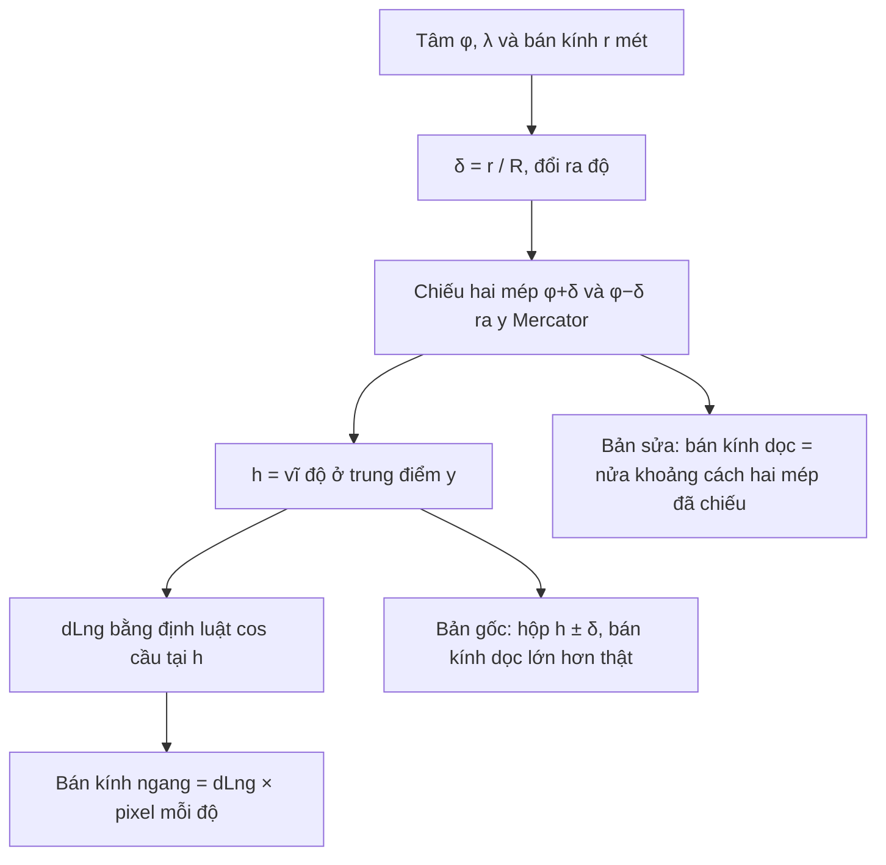

Trang quảng cáo cho bạn nhắm "mọi người trong bán kính 10 km quanh cửa hàng". Marketplace hiện "tin đăng trong 40 km". Cả hai cần vẽ một **vòng tròn bán kính r mét** lên bản đồ.

Cách đầu tiên ai cũng nghĩ: đổi mét ra pixel bằng tỉ lệ ở tâm, rồi `ctx.arc(x, y, r_px)`. Ở Hà Nội với bán kính 10 km thì ổn. Ở Oslo với 800 km thì hình tròn đó nhỏ hơn thật ở phía bắc và tâm lệch 18 px (đo ở zoom 4). Ở Svalbard với 1.000 km thì lệch gần 100 px.

Lý do là bản đồ web (Google Maps, OpenStreetMap, Leaflet, Mapbox) dùng phép chiếu **Web Mercator**, và phép chiếu này kéo giãn mọi thứ theo vĩ độ. Module `LeafletUtils` của Facebook có lời giải khá đẹp cho chuyện này, kèm một chỗ sai nhỏ ở bán kính dọc.

> [!TIP]
> **Tóm tắt**
> - Trên Web Mercator, tỉ lệ mét/pixel là `2πR·cos φ / (256·2^z)`: phụ thuộc vĩ độ. Một vòng tròn trên mặt đất thành một hình gần ellipse, phía cực to hơn phía xích đạo.
> - `LeafletUtils.circleBounds` lấy tâm ở **trung điểm theo trục y Mercator** của hai mép bắc/nam, và tính nửa bề rộng bằng định luật cos cầu. Kiểm bằng số: vĩ độ đó đúng bằng vĩ độ nơi vòng tròn rộng nhất, nên bề rộng chính xác.
> - Lỗi: sau khi có vĩ độ giữa `h`, nó dựng hộp bao `h ± δ` thay vì `φ ± δ`, nên bán kính dọc lớn hơn thật (2,5% ở 70°/500 km, 13% ở 70°/1.000 km). Vòng tròn chứa cực thì ra NaN.
> - Bản viết lại: chiếu thẳng hai mép `φ ± δ` để lấy bán kính dọc, dùng `asin(sin δ / cos φ)` cho bán kính ngang; hoặc vẽ đa giác "điểm đích" khi cần đúng hình.

<iframe class="demo-frame" src="/demos/facebook-patterns/index.html?theme=dark#/mercator-meter-circles" title="Demo mercator-meter-circles" loading="lazy" style="height: 800px"></iframe>

<p class="demo-links">▶ <a href="/demos/facebook-patterns/index.html#/mercator-meter-circles" target="_blank" rel="noopener">Mở demo toàn màn hình ↗</a> · <a href="https://stackblitz.com/github/hunghg255/blog-hunghg/tree/master/examples/facebook-patterns?file=src/lib/mercator.ts" target="_blank" rel="noopener">Sửa code trên StackBlitz ↗</a> · <a href="https://github.com/hunghg255/blog-hunghg/blob/master/examples/facebook-patterns/src/lib/mercator.ts" target="_blank" rel="noopener">Xem source trên GitHub ↗</a></p>

## Facebook làm thế nào?

### `LeafletUtils` (bundle `156.js`)

Module là một bộ tiện ích bọc thư viện **Leaflet** (bản đồ mã nguồn mở). Nó dùng hệ toạ độ `L.CRS.EPSG3857` (Web Mercator) và bán kính `R = 6378137` m (bán trục lớn WGS84).

**Đổi mét sang pixel** ở mức zoom `z`:

```js
metersToPixels(meters, view) {
  const circumference = 2 * Math.PI * R;            // chu vi xích đạo
  return meters / (circumference * Math.abs(Math.cos(view.center.latitude * DEG)) / 2 ** (view.zoom + 8));
}
```

`2^(z+8)` là `256·2^z`: số pixel của cả thế giới ở mức zoom `z` (mỗi tile 256 px). Kiểm bằng Node: 10 km ở Hà Nội, zoom 12 là khoảng 280 px.

**Vòng tròn thành hộp bao** (đổi tên biến):

```js
circleBounds(center, meters) {
  const δ = meters / R * RAD2DEG;                   // bán kính góc, độ
  const yN = project(center.lat + δ), yS = project(center.lat - δ);
  const h = unproject((yN + yS) / 2).lat;           // vĩ độ ở trung điểm y Mercator
  const φ1 = center.lat * DEG, φ2 = h * DEG;
  const dLng = Math.acos((Math.cos(δ * DEG) - Math.sin(φ1) * Math.sin(φ2)) / (Math.cos(φ1) * Math.cos(φ2))) * RAD2DEG;
  return bounds([h - δ, center.lng - dLng], [h + δ, center.lng + dLng]);
}
```

Thuật toán này giống gần như từng bước với `Circle._project` trong mã nguồn Leaflet 1.x (Leaflet không nằm trong bundle đã tải, nên đây là so sánh với bản công khai). Hai ý hay:

1. **Tâm trên bản đồ không phải tâm trên mặt đất.** Vì phía cực bị giãn nhiều hơn, tâm của hình trên bản đồ nằm lệch về phía cực. Lấy trung điểm theo trục y Mercator của hai mép bắc/nam là tâm đúng.
2. **Nửa bề rộng bằng định luật cos cầu.** Biểu thức `acos(...)` là độ chênh kinh độ giữa tâm và một điểm ở vĩ độ `h` cách tâm đúng `δ` theo vòng lớn. Khi thử bằng số, `h` trùng tới 9 chữ số thập phân với vĩ độ mà vòng tròn rộng nhất, `asin(sin φ / cos δ)`. Vậy `dLng` chính là nửa bề rộng lớn nhất. Không có chú thích nào nói điều này; có lẽ người viết biết, có lẽ là may.

`projectCircle` chiếu hộp bao ra pixel, lấy tâm là `bounds.getCenter()` và bán kính là nửa chiều rộng, nửa chiều cao của hộp:

```js
const c = latLngToPoint(b.getCenter(), zoom);
const sw = latLngToPoint(b.getSouthWest(), zoom), ne = latLngToPoint(b.getNorthEast(), zoom);
return { center: c, radius: point(Math.round((ne.x - sw.x) / 2), Math.round((sw.y - ne.y) / 2)) };
```

### Chỗ sai: hộp bao `h ± δ`

Leaflet dừng ở pixel: bán kính dọc là `p.y − top.y` (từ trung điểm tới mép bắc đã chiếu), và có nhánh dự phòng khi `acos` ra NaN. `LeafletUtils` thì đổi kết quả thành một **hộp bao lat/lng** để dùng chung cho `fitBounds`, và ở bước đó sai. Mép bắc và nam thật của vòng tròn là `φ ± δ`. Code đã chiếu đúng hai mép này để tìm `h`, nhưng rồi lại dựng hộp `h ± δ`, tức là **dịch cả hộp lên phía cực** một đoạn `h − φ`. Phía cực giãn nhiều hơn, nên chiều cao hộp trên bản đồ lớn hơn chiều cao thật. Tâm thì vẫn đúng (`getCenter()` trả về `h`).

Tính lại bằng Node theo đúng công thức, bán kính dọc ở zoom 4 (thế giới 4.096 px):

| Tâm, bán kính | Thật | `LeafletUtils` | Lệch |
| --- | --- | --- | --- |
| 21°, 500 km | 54,8 px | 54,8 px | 0% |
| 60°, 500 km | 103,0 px | 103,9 px | +1,0% |
| 70°, 500 km | 152,0 px | 155,8 px | +2,5% |
| 80°, 300 km | 181,0 px | 188,2 px | +4,0% |
| 70°, 1.000 km | 321,3 px | 364,1 px | +13,3% |

Ở vĩ độ Việt Nam, bán kính dưới vài trăm km thì không thấy gì. Ở Bắc Âu với bán kính lớn thì vòng tròn cao hơn thật vài phần trăm. Thêm hai giới hạn:

- **Vòng tròn chứa cực** (`φ + δ > 90°`): đối số của `acos` vượt 1, `dLng` thành `NaN`. Trên Mercator, một chỏm cầu chứa cực không còn là hình kín: nó là một dải chạy hết chiều ngang bản đồ.
- **Gần 85,05°**: Web Mercator cắt ở vĩ độ này (để bản đồ vuông). Leaflet kẹp vĩ độ khi chiếu, nên mép bắc bị dồn lại và `h` bị kéo lệch.

### Phần còn lại của module

- `wrapLongitude(lng) = mod(lng + 180, 360) − 180`: đưa kinh độ về `[-180, 180)`.
- `isViewInBounds` thử thêm bản dịch `+360°` của khung nhìn, để khung nhìn cắt kinh tuyến 180 (Fiji, Alaska) vẫn được coi là nằm trong vùng cho phép.
- `getBoundsZoom` duyệt zoom tăng dần, chiếu hộp ra pixel, dừng ở mức đầu tiên hộp không còn vừa khung.
- `distanceFromLatLng(from, meters, bearing)`: công thức **điểm đích** (destination point) trên mặt cầu, đúng chuẩn.



## Bên trong: Web Mercator kéo giãn theo vĩ độ

Web Mercator chiếu kinh độ thẳng ra trục x (`x = (λ + 180)/360 · W`) và vĩ độ ra trục y bằng `y = ln(tan(π/4 + φ/2))`. Phép chiếu này **bảo giác** (conformal): góc được giữ, nên ở một điểm bất kỳ, tỉ lệ theo x và theo y bằng nhau. Một vòng tròn **rất nhỏ** vẫn tròn trên bản đồ.

Nhưng tỉ lệ đó thay đổi theo vĩ độ: ở vĩ độ φ, mọi thứ bị phóng to `1 / cos φ` lần. Xích đạo ×1, Hà Nội (21°) ×1,07, Oslo (60°) ×2, Svalbard (78°) ×4,8. Greenland trông to bằng châu Phi vì lẽ đó.

Với vòng tròn lớn, phía cực của nó nằm ở vĩ độ cao hơn, bị phóng to nhiều hơn phía xích đạo. Kết quả:

- Hình trên bản đồ không còn là ellipse, mà giống quả trứng: phía cực phình hơn.
- Tâm của hình trên bản đồ lệch về phía cực so với điểm chiếu của tâm thật.
- Một hình tròn vẽ bằng tỉ lệ ở tâm (`r / metersPerPixel(φ)`) thì **nhỏ** hơn ở phía cực, **to** hơn ở phía xích đạo, và đặt sai tâm.

Ellipse có tâm ở trung điểm y, bán kính dọc bằng nửa khoảng cách hai mép, bán kính ngang bằng nửa bề rộng lớn nhất, là xấp xỉ tốt nhất bằng một ellipse: nó chạm đúng bốn điểm cực của hình thật. Muốn đúng tuyệt đối thì vẽ đa giác: tính 128 điểm đích theo 128 hướng, chiếu từng điểm. Demo vẽ cả hai: đường xanh lá là đa giác, đường cam là ellipse của bản viết lại, hai đường gần như trùng nhau.

## Viết lại

Phép chiếu và tỉ lệ:

```ts title=src/lib/mercator.ts
export const worldSize = (zoom: number) => 256 * 2 ** zoom;

export const clampLat = (lat: number) => Math.max(-MAX_LAT, Math.min(MAX_LAT, lat));

/** y Mercator không thứ nguyên: ln(tan(π/4 + φ/2)) */
export const mercY = (lat: number) => Math.log(Math.tan(Math.PI / 4 + (clampLat(lat) * D2R) / 2));
export const latFromMercY = (y: number) => (2 * Math.atan(Math.exp(y)) - Math.PI / 2) * R2D;

export function project({ lat, lng }: LatLng, zoom: number): Pixel {
  const size = worldSize(zoom);
  return { x: ((lng + 180) / 360) * size, y: (0.5 - mercY(lat) / (2 * Math.PI)) * size };
}

export function unproject({ x, y }: Pixel, zoom: number): LatLng {
  const size = worldSize(zoom);
  return { lat: latFromMercY((0.5 - y / size) * 2 * Math.PI), lng: (x / size) * 360 - 180 };
}

/** Đưa kinh độ về [-180, 180). */
export const wrapLng = (lng: number) => ((((lng + 180) % 360) + 360) % 360) - 180;

/** Mét trên một pixel tại vĩ độ lat: chu vi xích đạo × cos φ / số pixel của thế giới. */
export const metersPerPixel = (lat: number, zoom: number) => (2 * Math.PI * EARTH_RADIUS * Math.cos(lat * D2R)) / worldSize(zoom);
```

Điểm đích và đa giác vòng tròn thật. Kinh độ không wrap ở đây, mà được giữ liên tục để đa giác không bị "rách" khi cắt kinh tuyến 180:

```ts title=src/lib/mercator.ts
export function destination(from: LatLng, meters: number, bearingDeg: number): LatLng {
  const d = meters / EARTH_RADIUS;
  const θ = bearingDeg * D2R;
  const φ1 = from.lat * D2R;
  const sinφ2 = Math.sin(φ1) * Math.cos(d) + Math.cos(φ1) * Math.sin(d) * Math.cos(θ);
  const φ2 = Math.asin(Math.max(-1, Math.min(1, sinφ2)));
  const λ = Math.atan2(Math.sin(θ) * Math.sin(d) * Math.cos(φ1), Math.cos(d) - Math.sin(φ1) * sinφ2);
  // không wrap ở đây để đa giác liền mạch khi cắt kinh tuyến 180; người vẽ tự dời ±360
  return { lat: φ2 * R2D, lng: from.lng + λ * R2D };
}

/** Đa giác n đỉnh của vòng tròn trên mặt cầu (đường cong thật trên bản đồ). */
export function geodesicCircle(center: LatLng, meters: number, n = 128): LatLng[] {
  const out: LatLng[] = [];
  for (let i = 0; i < n; i++) out.push(destination(center, meters, (360 * i) / n));
  // kinh độ liên tục: mỗi đỉnh lệch đỉnh trước không quá 180°
  for (let i = 1; i < n; i++) {
    while (out[i].lng - out[i - 1].lng > 180) out[i].lng -= 360;
    while (out[i].lng - out[i - 1].lng < -180) out[i].lng += 360;
  }
  return out;
}
```

Ellipse xấp xỉ:

```ts title=src/lib/mercator.ts
export function circleEllipse(center: LatLng, meters: number, zoom: number): Ellipse {
  const δ = (meters / EARTH_RADIUS) * R2D;
  const north = center.lat + δ, south = center.lat - δ;
  const coversPole = north >= 90 || south <= -90;
  const yN = project({ lat: north, lng: center.lng }, zoom).y;
  const yS = project({ lat: south, lng: center.lng }, zoom).y;
  const s = Math.sin(δ * D2R) / Math.cos(center.lat * D2R);
  const dLng = coversPole || s >= 1 ? 180 : Math.asin(s) * R2D;
  const c = project(center, zoom);
  const px = worldSize(zoom) / 360;
  return { cx: c.x, cy: (yN + yS) / 2, rx: dLng * px, ry: Math.abs(yS - yN) / 2, coversPole };
}

/** Bán kính "tròn" ngây thơ: lấy tỉ lệ mét/pixel ở tâm rồi vẽ hình tròn. */
export function naiveCircle(center: LatLng, meters: number, zoom: number): Ellipse {
  const c = project(center, zoom);
  const r = meters / metersPerPixel(center.lat, zoom);
  return { cx: c.x, cy: c.y, rx: r, ry: r, coversPole: false };
}
```

::: spoiler Xem toàn bộ src/lib/mercator.ts

```ts title=src/lib/mercator.ts
/**
 * Hình học Web Mercator cho bản đồ ô vuông (tile 256 px, EPSG:3857):
 * đổi lat/lng sang pixel, mét sang pixel theo vĩ độ, điểm đích theo hướng,
 * và vẽ "vòng tròn bán kính r mét" cho đúng (nó không tròn trên bản đồ).
 * Ý tưởng từ LeafletUtils (Facebook), viết lại từ đầu.
 */

export interface LatLng {
  lat: number;
  lng: number;
}

export interface Pixel {
  x: number;
  y: number;
}

/** Bán kính Trái Đất dùng cho Web Mercator (bán trục lớn WGS84). */
export const EARTH_RADIUS = 6378137;
/** Vĩ độ lớn nhất để bản đồ thành hình vuông: atan(sinh(π)). */
export const MAX_LAT = 85.0511287798066;
const D2R = Math.PI / 180;
const R2D = 180 / Math.PI;

export const worldSize = (zoom: number) => 256 * 2 ** zoom;

export const clampLat = (lat: number) => Math.max(-MAX_LAT, Math.min(MAX_LAT, lat));

/** y Mercator không thứ nguyên: ln(tan(π/4 + φ/2)) */
export const mercY = (lat: number) => Math.log(Math.tan(Math.PI / 4 + (clampLat(lat) * D2R) / 2));
export const latFromMercY = (y: number) => (2 * Math.atan(Math.exp(y)) - Math.PI / 2) * R2D;

export function project({ lat, lng }: LatLng, zoom: number): Pixel {
  const size = worldSize(zoom);
  return { x: ((lng + 180) / 360) * size, y: (0.5 - mercY(lat) / (2 * Math.PI)) * size };
}

export function unproject({ x, y }: Pixel, zoom: number): LatLng {
  const size = worldSize(zoom);
  return { lat: latFromMercY((0.5 - y / size) * 2 * Math.PI), lng: (x / size) * 360 - 180 };
}

/** Đưa kinh độ về [-180, 180). */
export const wrapLng = (lng: number) => ((((lng + 180) % 360) + 360) % 360) - 180;

/** Mét trên một pixel tại vĩ độ lat: chu vi xích đạo × cos φ / số pixel của thế giới. */
export const metersPerPixel = (lat: number, zoom: number) => (2 * Math.PI * EARTH_RADIUS * Math.cos(lat * D2R)) / worldSize(zoom);

/** Khoảng cách vòng lớn (haversine), mét. */
export function distance(a: LatLng, b: LatLng) {
  const dLat = (b.lat - a.lat) * D2R;
  const dLng = (b.lng - a.lng) * D2R;
  const h = Math.sin(dLat / 2) ** 2 + Math.cos(a.lat * D2R) * Math.cos(b.lat * D2R) * Math.sin(dLng / 2) ** 2;
  return 2 * EARTH_RADIUS * Math.asin(Math.min(1, Math.sqrt(h)));
}

/** Điểm đích: đi `meters` theo hướng `bearingDeg` (0 = bắc, 90 = đông) trên mặt cầu. */
export function destination(from: LatLng, meters: number, bearingDeg: number): LatLng {
  const d = meters / EARTH_RADIUS;
  const θ = bearingDeg * D2R;
  const φ1 = from.lat * D2R;
  const sinφ2 = Math.sin(φ1) * Math.cos(d) + Math.cos(φ1) * Math.sin(d) * Math.cos(θ);
  const φ2 = Math.asin(Math.max(-1, Math.min(1, sinφ2)));
  const λ = Math.atan2(Math.sin(θ) * Math.sin(d) * Math.cos(φ1), Math.cos(d) - Math.sin(φ1) * sinφ2);
  // không wrap ở đây để đa giác liền mạch khi cắt kinh tuyến 180; người vẽ tự dời ±360
  return { lat: φ2 * R2D, lng: from.lng + λ * R2D };
}

/** Đa giác n đỉnh của vòng tròn trên mặt cầu (đường cong thật trên bản đồ). */
export function geodesicCircle(center: LatLng, meters: number, n = 128): LatLng[] {
  const out: LatLng[] = [];
  for (let i = 0; i < n; i++) out.push(destination(center, meters, (360 * i) / n));
  // kinh độ liên tục: mỗi đỉnh lệch đỉnh trước không quá 180°
  for (let i = 1; i < n; i++) {
    while (out[i].lng - out[i - 1].lng > 180) out[i].lng -= 360;
    while (out[i].lng - out[i - 1].lng < -180) out[i].lng += 360;
  }
  return out;
}

export interface Ellipse {
  cx: number;
  cy: number;
  rx: number;
  ry: number;
  /** vòng tròn chứa cực: không còn là hình kín trên Mercator */
  coversPole: boolean;
}

/**
 * Ellipse xấp xỉ vòng tròn r mét, tính bằng pixel ở mức zoom.
 * - Theo trục y: lấy đúng hai mép bắc/nam (φ ± δ) rồi chiếu, tâm là trung điểm y.
 * - Theo trục x: độ rộng kinh độ lớn nhất của chỏm cầu, asin(sin δ / cos φ).
 */
export function circleEllipse(center: LatLng, meters: number, zoom: number): Ellipse {
  const δ = (meters / EARTH_RADIUS) * R2D;
  const north = center.lat + δ, south = center.lat - δ;
  const coversPole = north >= 90 || south <= -90;
  const yN = project({ lat: north, lng: center.lng }, zoom).y;
  const yS = project({ lat: south, lng: center.lng }, zoom).y;
  const s = Math.sin(δ * D2R) / Math.cos(center.lat * D2R);
  const dLng = coversPole || s >= 1 ? 180 : Math.asin(s) * R2D;
  const c = project(center, zoom);
  const px = worldSize(zoom) / 360;
  return { cx: c.x, cy: (yN + yS) / 2, rx: dLng * px, ry: Math.abs(yS - yN) / 2, coversPole };
}

/** Bán kính "tròn" ngây thơ: lấy tỉ lệ mét/pixel ở tâm rồi vẽ hình tròn. */
export function naiveCircle(center: LatLng, meters: number, zoom: number): Ellipse {
  const c = project(center, zoom);
  const r = meters / metersPerPixel(center.lat, zoom);
  return { cx: c.x, cy: c.y, rx: r, ry: r, coversPole: false };
}

/**
 * Cách của LeafletUtils.circleBounds + projectCircle (viết lại để so sánh):
 * tìm vĩ độ h ở trung điểm y Mercator, nhưng rồi dựng hộp bao h ± δ (thay vì φ ± δ)
 * và lấy nửa chiều cao của hộp đó làm bán kính y.
 */
export function boundsShiftEllipse(center: LatLng, meters: number, zoom: number): Ellipse & { midLat: number } {
  const δ = (meters / EARTH_RADIUS) * R2D;
  const midLat = latFromMercY((mercY(center.lat + δ) + mercY(center.lat - δ)) / 2);
  const φ1 = center.lat * D2R, φ2 = midLat * D2R;
  const dLng = Math.acos((Math.cos(δ * D2R) - Math.sin(φ1) * Math.sin(φ2)) / (Math.cos(φ1) * Math.cos(φ2))) * R2D;
  const sw = project({ lat: midLat - δ, lng: center.lng - dLng }, zoom);
  const ne = project({ lat: midLat + δ, lng: center.lng + dLng }, zoom);
  const c = project({ lat: midLat, lng: center.lng }, zoom);
  return { cx: c.x, cy: c.y, rx: Math.round((ne.x - sw.x) / 2), ry: Math.round((sw.y - ne.y) / 2), coversPole: Number.isNaN(dLng), midLat };
}

/** Mức zoom lớn nhất mà hộp [sw, ne] vẫn vừa khung w×h (duyệt tăng dần như getBoundsZoom). */
export function fitZoom(sw: LatLng, ne: LatLng, w: number, h: number, minZoom = 0, maxZoom = 20) {
  let z = minZoom;
  for (; z <= maxZoom; z++) {
    const a = project(sw, z), b = project(ne, z);
    let dx = b.x - a.x;
    if (dx < 0) dx += worldSize(z); // hộp cắt kinh tuyến 180
    if (dx > w || a.y - b.y > h) break;
  }
  return Math.max(minZoom, z - 1);
}
```

:::

## Đi qua code

- **`mercY` kẹp vĩ độ** về ±85,0511° (bằng `atan(sinh π)`), giống Leaflet và Google Maps. Không kẹp thì `tan(π/2)` ra vô cực.
- **`project` trả pixel thế giới** ở mức zoom `z`: góc trên trái là (0, 0), xích đạo ở giữa. Muốn toạ độ trên màn hình thì trừ pixel của góc trên trái khung nhìn.
- **`destination`** là công thức điểm đích chuẩn: `φ2 = asin(sin φ1 cos d + cos φ1 sin d cos θ)`. `Math.max(-1, Math.min(1, …))` chặn sai số làm tròn vượt miền của `asin`.
- **`geodesicCircle`** sửa kinh độ để hai đỉnh liền nhau không lệch quá 180°. Người vẽ tự vẽ thêm bản sao dời ±1 thế giới (demo làm vậy với Fiji).
- **`circleEllipse`**: `ry` là nửa khoảng cách y của **hai mép thật** `φ ± δ`; `cy` là trung điểm của chúng. `rx` dùng `asin(sin δ / cos φ)`, công thức bề rộng lớn nhất của chỏm cầu. Khi vòng tròn chứa cực (`sin δ / cos φ ≥ 1`) thì trả `coversPole: true` và bề rộng 180° để người gọi biết đây là một dải.
- **`naiveCircle`** giữ lại để so sánh trong demo.

**Khác bản gốc:**

- Bán kính dọc lấy từ hai mép `φ ± δ` đã chiếu, không dựng lại hộp `h ± δ`.
- Bán kính ngang dùng `asin(sin δ / cos φ)`: cùng kết quả với `acos(...)` của bản gốc, nhưng không cần `h` và không ra NaN khi chạm cực (trả về cờ thay vì NaN).
- Không làm tròn bán kính ra số nguyên (bản gốc `Math.round`), để vẽ trên canvas có khử răng cưa không bị nhảy 1 px khi kéo.

## Tại sao không làm cách khác?

- **Hình tròn theo tỉ lệ ở tâm**: đủ tốt khi bán kính nhỏ (dưới vài chục km) hoặc ở gần xích đạo. Bảng sai số trong demo cho thấy lúc nào không đủ.
- **Đa giác điểm đích**: đúng nhất, cũng là cách Turf.js (`turf.circle`) làm. Đổi lại phải chiếu 64 đến 128 điểm mỗi lần vẽ và phải tự xử lý kinh tuyến 180. Facebook chọn ellipse có lẽ vì vẽ bằng `L.Circle`/SVG ellipse rẻ và dễ chỉnh khi kéo.
- **Dùng thẳng `L.Circle` của Leaflet**: nếu chỉ cần vẽ thì đây là lựa chọn tốt, nó làm đúng như bản viết lại (tâm ở trung điểm y, bán kính dọc từ mép đã chiếu). Facebook cần thêm hộp bao lat/lng để tính zoom vừa khung, nên tự viết lại.
- **Tính khoảng cách trên mặt phẳng Mercator**: sai nhanh khi đi xa xích đạo. Đo khoảng cách luôn dùng haversine hoặc Vincenty.

## Edge case và cạm bẫy

- **Kinh tuyến 180**: tâm ở Fiji (178°E) với bán kính 500 km thì nửa vòng tròn nằm ở 180°W. Phải vẽ hai lần (dời ±1 thế giới) hoặc dùng kinh độ "không wrap" và để bản đồ tự lặp.
- **Cực và vĩ độ trên 85°**: Mercator không hiển thị được. Nhắm quanh Svalbard với bán kính lớn thì hình bị cắt ở mép trên.
- **Tỉ lệ lấy theo tâm khung nhìn**: `metersToPixels` của bản gốc lấy vĩ độ của **tâm khung nhìn**, không phải của vòng tròn. Vòng tròn ở mép trên của một khung nhìn rộng sẽ bị tính sai tỉ lệ. Luôn dùng vĩ độ của chính đối tượng.
- **Trái Đất không tròn**: WGS84 là ellipsoid, bán kính xích đạo và bán kính cực lệch nhau 21 km. Dùng hình cầu bán kính 6.378.137 m sai tới khoảng 0,5% khoảng cách: đủ cho hiển thị, không đủ cho đo đạc.
- **Ngưỡng pháp lý**: nếu bán kính dùng để kiểm luật (như ngưỡng 15 dặm cho quảng cáo nhà ở trong [bài #104](/blogs/facebook-locale-validation-bugs)), hãy kiểm trên số mét, đừng trên pixel.

## Dùng trong dự án

```ts
import { circleEllipse, project, worldSize } from './mercator';

/** Vẽ vòng tròn r mét lên canvas khớp với tile bản đồ đang hiện. */
function drawRadius(ctx: CanvasRenderingContext2D, view: { center: LatLng; zoom: number; width: number; height: number }, c: LatLng, meters: number) {
  const origin = project(view.center, view.zoom);
  const left = origin.x - view.width / 2, top = origin.y - view.height / 2;
  const e = circleEllipse(c, meters, view.zoom);
  for (const shift of [-worldSize(view.zoom), 0, worldSize(view.zoom)]) {
    ctx.beginPath();
    ctx.ellipse(e.cx - left + shift, e.cy - top, e.rx, e.ry, 0, 0, Math.PI * 2);
    ctx.stroke();
  }
}
```

Cần đúng hình (vòng tròn rất lớn, gần cực) thì thay ellipse bằng `geodesicCircle(c, meters).map((p) => project(p, zoom))`.

## Kiểm thử

::: spoiler Ví dụ test (bản phác, không có trong repo)

```ts
import { describe, expect, it } from 'vitest';
import { boundsShiftEllipse, circleEllipse, destination, distance, geodesicCircle, metersPerPixel, project, wrapLng } from './mercator';

const truth = (c: { lat: number; lng: number }, m: number, z: number) => {
  const pts = geodesicCircle(c, m, 720).map((p) => project(p, z));
  const xs = pts.map((p) => p.x), ys = pts.map((p) => p.y);
  return { rx: (Math.max(...xs) - Math.min(...xs)) / 2, ry: (Math.max(...ys) - Math.min(...ys)) / 2 };
};

describe('mercator', () => {
  it('10 km ở Hà Nội, zoom 12 ≈ 280 px', () => {
    expect(10000 / metersPerPixel(21.03, 12)).toBeCloseTo(280, 0);
  });

  it('điểm đích đi đúng khoảng cách', () => {
    const a = { lat: 59.9, lng: 10.7 };
    expect(distance(a, destination(a, 500_000, 37))).toBeCloseTo(500_000, -1);
  });

  it('ellipse khớp đa giác thật, bản gốc lệch ở vĩ độ cao', () => {
    const c = { lat: 70, lng: 0 };
    const t = truth(c, 1_000_000, 4);
    const e = circleEllipse(c, 1_000_000, 4);
    expect(e.rx).toBeCloseTo(t.rx, 0);
    expect(e.ry).toBeCloseTo(t.ry, 0);
    expect(boundsShiftEllipse(c, 1_000_000, 4).ry / t.ry).toBeGreaterThan(1.1);
  });

  it('chứa cực: bản gốc NaN, bản sửa báo cờ', () => {
    expect(circleEllipse({ lat: 88, lng: 0 }, 300_000, 3).coversPole).toBe(true);
    expect(Number.isNaN(boundsShiftEllipse({ lat: 88, lng: 0 }, 300_000, 3).rx)).toBe(true);
  });

  it('wrap kinh độ', () => {
    expect(wrapLng(190)).toBe(-170);
    expect(wrapLng(-180)).toBe(-180);
  });
});
```

:::

## So với thư viện và chuẩn web

- **Leaflet `L.Circle`**: bán kính theo mét, Leaflet 1.x tự đổi ra ellipse pixel bằng chính thuật toán trung điểm y + định luật cos cầu, có dự phòng khi NaN.
- **Turf.js `circle(center, radius, { steps })`**: trả về đa giác GeoJSON bằng điểm đích, đúng hình nhưng phải tự xử lý kinh tuyến 180.
- **Mapbox GL / MapLibre**: không có "circle theo mét" sẵn; layer `circle` có bán kính theo pixel. Cách phổ biến là dùng đa giác Turf.
- **Google Maps `google.maps.Circle`**: vẽ đúng hình trên mặt cầu (bản đồ tự chia đa giác).
- **Geolocation API** trả về `accuracy` theo mét: vòng tròn "vị trí của bạn" chính là bài toán này, thường nhỏ nên hình tròn ngây thơ là đủ.

---

Bài này thuộc series **[Học từ mã nguồn Facebook](/series/facebook)** (106 bài, đọc theo thứ tự).

::: spoiler Xem nhanh danh sách bài trong series

*Phần 1*

- [Mở đầu: cách đọc code minify của Facebook](/blogs/learn-from-facebook-source-code)
- [#1 Dùng chung IntersectionObserver + infinite scroll](/blogs/facebook-shared-intersection-observer)
- [#2 useViewportDuration: đo thời gian thực sự được xem](/blogs/facebook-use-viewport-duration)
- [#3 Preload code + data khi hover](/blogs/facebook-preload-on-hover)
- [#4 Toast manager với external store](/blogs/facebook-toast-manager)
- [#5 Network status + heartbeat backoff](/blogs/facebook-network-status-heartbeat)
- [#6 ErrorGuard: bắt lỗi theo ngữ cảnh](/blogs/facebook-error-guard)
- [#7 Banzai: gom log theo lô + sendBeacon](/blogs/facebook-batch-logger)
- [#8 Focus trap + Esc theo layer](/blogs/facebook-focus-trap)

*Phần 2*

- [#9 Mẹo calc(… * 9999): container query, line-clamp, mũi tên carousel bằng CSS](/blogs/facebook-css-9999-trick)
- [#10 Thanh cuộn tuỳ biến bằng CSS 3D](/blogs/facebook-css-3d-scrollbar)
- [#11 Modal cuộn bằng window, giữ vị trí trang nền](/blogs/facebook-document-scroll-modal)
- [#12 Popover, tooltip group và hovercard](/blogs/facebook-popover-tooltip)
- [#13 Primitive Pressable + focus-visible](/blogs/facebook-pressable)
- [#14 Tab "Xem thêm" + sticky header bằng IntersectionObserver](/blogs/facebook-priority-tabs-sticky-header)
- [#15 Avatar khoét mask, gradient Messenger, skeleton steps()](/blogs/facebook-visual-tricks)
- [#16 Khung chat không giật](/blogs/facebook-chat-scroller)
- [#17 Thuật toán chọn bố cục collage ảnh](/blogs/facebook-photo-collage-layout)
- [#18 Keep-alive tab trong SPA](/blogs/facebook-keep-alive-tabs)
- [#19 Tự đo Visual Completion & interaction tracing](/blogs/facebook-visual-completion)
- [#20 Router SPA bền bỉ & tải chunk có retry](/blogs/facebook-spa-router-resilient-loading)

*Phần 3*

- [#21 Smart Compose: gợi ý chữ mờ khi gõ](/blogs/facebook-smart-compose-ghost-text)
- [#22 MQTT ngay trong trình duyệt, tự chuyển sang long-poll](/blogs/facebook-mqtt-in-browser)
- [#23 Đo thời gian dùng bằng bitmap 64 giây](/blogs/facebook-time-spent-bitmap)
- [#24 Bảng reaction nhấn giữ rồi trượt](/blogs/facebook-reaction-press-slide)
- [#25 Tìm kiếm gấp dấu, phiên âm và highlight đầu từ](/blogs/facebook-search-diacritics-tokenize)
- [#26 Ring buffer biết trace nào đã mất log](/blogs/facebook-trace-ring-buffer)
- [#27 Engine animation JS: một vòng rAF và solver cubic-bezier](/blogs/facebook-keyframes-loop-cubic-bezier)
- [#28 Bootloader: bitmap tài nguyên đã tải, chỉ reload khi cần](/blogs/facebook-bootloader-bitmap-consistency)
- [#29 Nhận biết click do screen reader tạo ra](/blogs/facebook-virtual-cursor-detection)
- [#30 Tải trước feed theo chất lượng mạng, đoán hạng thiết bị](/blogs/facebook-network-aware-prefetch)
- [#31 Hàng đợi gửi tin chat giữ đúng thứ tự](/blogs/facebook-ordered-send-queue)
- [#32 Gộp lời gọi API trong cùng một tick](/blogs/facebook-api-batcher)
- [#33 Resize ảnh trong pool Web Worker](/blogs/facebook-jpeg-resize-worker-pool)
- [#34 Crop ảnh theo nhiều khuôn mặt](/blogs/facebook-face-aware-crop)
- [#35 Kéo-thả sắp xếp và vùng thả file không nhấp nháy](/blogs/facebook-flicker-free-drag-drop)
- [#36 Tiện ích UI: fade-out, sticky event, hàm huỷ được](/blogs/facebook-ui-utility-hooks)
- [#37 Hạ tầng nhỏ: cookie, hash lỗi, prefetch khi chuột dừng](/blogs/facebook-small-infra-cookie-hash-idle)

*Phần 4–6*

- [#38 Đồng bộ tin nhắn: phát hiện lỗ seqID và fetch bù theo tầng](/blogs/facebook-messenger-sync-seqid-gaps)
- [#39 OTID: ID tin nhắn kiểu Snowflake sinh ở client](/blogs/facebook-otid-client-snowflake)
- [#40 QPL: lấy mẫu từ lúc bắt đầu, đo RTT gửi tin đầu-cuối](/blogs/facebook-qpl-send-rtt)
- [#41 Bộ điều phối request bảy chế độ gộp và chống trùng](/blogs/facebook-request-dispatcher-modes)
- [#42 Thread list theo mốc thời gian, cookie presence có version](/blogs/facebook-threadlist-ranged-presence)
- [#43 Composer dạng plugin: reducer, dirty checker, chuỗi kiểm tra](/blogs/facebook-plugin-composer)
- [#44 Thanh toán bất đồng bộ: subscribe trước, poll dự phòng](/blogs/facebook-async-checkout)
- [#45 Validate số thẻ: sửa lỗi gõ, dải BIN, Luhn](/blogs/facebook-card-validation)
- [#46 Lịch chọn khoảng ngày: bo góc dải chọn, phím đủ bộ, RTL](/blogs/facebook-range-calendar-a11y)
- [#47 Giờ mở cửa theo tuần: qua đêm, gộp khoảng, phần bù](/blogs/facebook-weekly-hours-intervals)
- [#48 Tiến độ đăng realtime: giữ event chờ snapshot, watchdog](/blogs/facebook-realtime-publish-snapshot)
- [#49 Tiền tệ theo đơn vị nhỏ nhất và ô nhập tiền](/blogs/facebook-currency-minor-units)
- [#50 Sửa hàng loạt Empty/Uniform/Mixed, seen/read bằng 2 bit](/blogs/facebook-bulk-edit-seen-bits)
- [#51 Phát hiện script lạ hook vào hàm native](/blogs/facebook-native-hook-detection)
- [#52 localStorage tự dọn khi đầy quota](/blogs/facebook-quota-aware-storage)
- [#53 Cache tuyến do server phân giải, chờ sẵn promise](/blogs/facebook-route-cache-prefetch)
- [#54 Lưới phím mũi tên 2D và focus không làm cuộn trang](/blogs/facebook-focus-table-grid)
- [#55 Tách emoji bằng máy trạng thái](/blogs/facebook-emoji-segmentation)
- [#56 Đọc trước ghi sau trong một frame, con tự biết vị trí](/blogs/facebook-read-then-write-dom)
- [#57 Hàng đợi lệnh cho video và stream sắp lại chunk](/blogs/facebook-video-command-queue)

*Phần 7–10*

- [#58 Ước lượng băng thông EWMA: loại outlier, nhớ qua phiên](/blogs/facebook-bandwidth-ewma-estimator)
- [#59 ABR theo độ tự tin phát và cắt bậc bitrate theo MOS](/blogs/facebook-abr-playback-confidence)
- [#60 Prefetch segment dự đoán từ manifest, parse hộp sidx](/blogs/facebook-dash-predicted-segments)
- [#61 Đọc metadata MP4/MOV ngay trên client](/blogs/facebook-mp4-metadata-client)
- [#62 Upload tiếp tục được: offset, hash dedupe, phát hiện treo](/blogs/facebook-resumable-upload)
- [#63 Fenwick tree: chọn ngẫu nhiên có trọng số và offset dòng](/blogs/facebook-fenwick-weighted-random)
- [#64 Vạch trục số và trục thời gian "đẹp"](/blogs/facebook-nice-axis-ticks)
- [#65 Damerau-Levenshtein theo dải chéo và tự sửa tên gõ sai](/blogs/facebook-damerau-levenshtein)
- [#66 PRNG có seed, shuffle tái lập và lấy mẫu trace](/blogs/facebook-seeded-prng-sampling)
- [#67 Cặp min/max-heap tái dùng vị trí trong danh sách ảo](/blogs/facebook-dual-heap-buffer-set)
- [#68 Memo nhiều đối số bằng Map/WeakMap và interning object](/blogs/facebook-multikey-memo-interning)
- [#69 Thống kê cửa sổ trượt và đại số khoảng thời gian](/blogs/facebook-moving-stat-intervals)
- [#70 Int64 từ hai số 32-bit, decode UTF, offset theo code point](/blogs/facebook-int64-utf-codepoints)
- [#71 Engine múi giờ IANA trên client, phát hiện lệch giờ](/blogs/facebook-client-iana-timezone)
- [#72 Tự cài semver range](/blogs/facebook-semver-range)
- [#73 Auto-link URL, cắt chữ an toàn, giới hạn LaTeX](/blogs/facebook-autolink-safe-truncate)
- [#74 Parser query kiểu PHP chống prototype pollution](/blogs/facebook-php-query-serializer)
- [#75 Popover tự lật theo phần tràn nhỏ nhất](/blogs/facebook-popover-auto-flip)
- [#76 Tiền tố for(;;) chống JSON hijacking, đọc stream](/blogs/facebook-csrf-prefix-streaming)
- [#77 Chống lộ Referer, linkshim, xoá token trên URL](/blogs/facebook-referrer-linkshim-url-scrub)
- [#78 setImmediate bằng postMessage, gom delta chuột theo frame](/blogs/facebook-setimmediate-mouse-batching)
- [#79 Phát hiện crash qua heartbeat, dò proxy cache hỏng](/blogs/facebook-crash-heartbeat-proxy-check)
- [#80 DPR vào cookie cho ảnh @2x, che khoá trong log](/blogs/facebook-dpr-cookie-secret-redaction)
- [#81 Flux waitFor tự viết và proxy có đệm](/blogs/facebook-flux-dispatch-buffered-proxy)
- [#82 Crop đúng tỉ lệ, xoay sticker bằng ma trận](/blogs/facebook-image-crop-rotation-geometry)

*Phần 11–15*

- [#83 Chia subdomain giữa các tab bằng lease, long-poll theo bảng trạng thái](/blogs/facebook-tab-subdomain-lease-longpoll)
- [#84 MQTT QoS1: giữ publish chờ ack, gửi lại khi kết nối lại](/blogs/facebook-mqtt-qos1-republish)
- [#85 Cache Promise gộp request, cache lỗi ngắn, đua dữ liệu nhúng sẵn](/blogs/facebook-promise-cache-preload-race)
- [#86 Lịch retry: backoff có trần, Fibonacci, báo lỗi CDN mỗi N ngày](/blogs/facebook-retry-backoff-schedules)
- [#87 Giữ nguyên tham chiếu nhánh dữ liệu không đổi](/blogs/facebook-relay-recycle-nodes)
- [#88 Store optimistic: copy-on-write, rollback rồi áp lại](/blogs/facebook-relay-optimistic-store)
- [#89 Chỉ mục subscription theo record, hàng đợi task theo chiều sâu](/blogs/facebook-relay-subscription-index)
- [#90 Phân trang connection: cursor khớp đầu, edge không trùng](/blogs/facebook-relay-connection-pagination)
- [#91 Profiler kiểu middleware và memo selector có lấy mẫu kiểm tra](/blogs/facebook-profiler-middleware-memo-check)
- [#92 Đọc EBML/WebM Cues để tìm byte range của segment](/blogs/facebook-webm-ebml-cues)
- [#93 Stream HTTP Range tạm dừng được, tải tiếp đúng byte](/blogs/facebook-pausable-range-stream)
- [#94 Bảng khoảng thời gian gắn nhãn và nhảy qua lỗ buffer](/blogs/facebook-tagged-time-ranges-gaps)
- [#95 Gom chunk cho SourceBuffer, đồng bộ video bằng playbackRate](/blogs/facebook-sourcebuffer-video-sync)
- [#96 Gom tin nhắn thành cụm, vạch ngày và avatar đã xem](/blogs/facebook-message-grouping)
- [#97 Bao nhiêu tab chat vừa màn hình, chuỗi luật mở tab](/blogs/facebook-chat-tab-policy)
- [#98 Phím tắt Markdown trong editor, Backspace để hoàn tác](/blogs/facebook-markdown-shortcuts-editor)
- [#99 Offset theo code point hay UTF-16: bốn bug cùng một gốc](/blogs/facebook-codepoint-offset-bugs)
- [#100 Typeahead không nhảy: cache tiền tố, chặn reflow, khoá hover](/blogs/facebook-typeahead-stable-results)
- [#101 Hit-test trên canvas bằng phát lại path, nét đứt và cung Bézier](/blogs/facebook-canvas-hit-regions)
- **#102 Vòng tròn theo mét trên bản đồ Mercator** (bài này)
- [#103 Dò tính năng trình duyệt: ảnh EXIF 2×1, getter bẫy, scrollbar](/blogs/facebook-feature-probe-tricks)
- [#104 Bug định dạng số và kiểm tra dữ liệu theo locale](/blogs/facebook-locale-validation-bugs)
- [#105 Dispose cho đúng: idle callback, splice(-1), xoá nhầm key](/blogs/facebook-dispose-leak-bugs)

:::

Code + demo: [`examples/facebook-patterns`](https://github.com/hunghg255/blog-hunghg/tree/master/examples/facebook-patterns) · [Mở trên StackBlitz](https://stackblitz.com/github/hunghg255/blog-hunghg/tree/master/examples/facebook-patterns)
