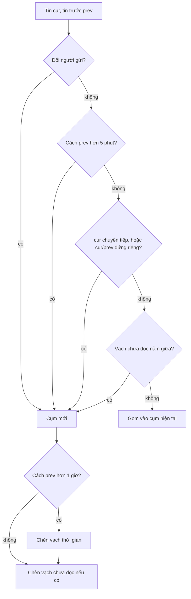

Mở một nhóm chat bất kỳ trên Messenger. An gửi ba tin liền nhau: bạn chỉ thấy **một** tên "An" ở trên và **một** avatar ở tin cuối, ba bong bóng dính vào nhau với góc bo nhỏ ở phía người gửi. Hai tiếng sau Bình nhắn lại: một dòng "23:55" mờ hiện ra ở giữa. Dưới tin cuối cùng có mấy avatar bé xíu: ai đã đọc tới đâu.

Nếu mỗi tin là một bong bóng có đủ tên và avatar, khung chat dài gấp rưỡi và rất khó đọc. Nhưng "gom" theo luật nào? Tin trả lời có gom không? Tin kèm ảnh? Một đoạn văn 300 chữ? Bài này đọc bộ phân tích của Messenger web để lấy đúng các luật đó, rồi viết lại thành vài hàm thuần.

> [!TIP]
> **Tóm tắt**
> - Một lượt `reduce` theo thời gian: tin mới mở **cụm mới** khi đổi người gửi, cách tin trước quá **5 phút**, là tin chuyển tiếp, hoặc một trong hai tin là tin "đứng riêng" (trả lời, có tệp đính kèm, dài hơn **280** ký tự, tin hệ thống).
> - Vạch "chưa đọc" của người xem cũng là một ranh giới cụm. Cách tin trước hơn **1 giờ** thì chèn vạch thời gian.
> - Avatar "đã xem" của mỗi người nằm ở **tin mới nhất** họ đã thấy: tin họ tự gửi, hoặc tin cũ hơn mốc đã đọc (read watermark) của họ.
> - Bản viết lại tách luật ra hàm `startsNewGroup`, tìm avatar đã xem bằng một lượt đi ngược O(n) mỗi người, và thêm tuỳ chọn vạch khi sang ngày mới.

<iframe class="demo-frame" src="/demos/facebook-patterns/index.html?theme=dark#/message-grouping" title="Demo message-grouping" loading="lazy" style="height: 900px"></iframe>

<p class="demo-links">▶ <a href="/demos/facebook-patterns/index.html#/message-grouping" target="_blank" rel="noopener">Mở demo toàn màn hình ↗</a> · <a href="https://stackblitz.com/github/hunghg255/blog-hunghg/tree/master/examples/facebook-patterns?file=src/lib/messageGroups.ts" target="_blank" rel="noopener">Sửa code trên StackBlitz ↗</a> · <a href="https://github.com/hunghg255/blog-hunghg/blob/master/examples/facebook-patterns/src/lib/messageGroups.ts" target="_blank" rel="noopener">Xem source trên GitHub ↗</a></p>

## Facebook làm thế nào?

Module `MWLSMessageGroupsParser.bs` nằm trong bundle `99 ChatComposer/all.js`. Đuôi `.bs` nghĩa là code viết bằng ReasonML rồi dịch qua BuckleScript, nên số nguyên 64 bit đi qua `bs_caml_int64` và kết quả là các biến thể `{TAG: n, _0: …}`. Trường dữ liệu bị rút gọn thành chữ cái: `message.b` là timestamp, `message.h` là người gửi, `message.g` là nội dung chữ, `message.e` là id tin, `message.j` là cờ tin hệ thống.

### Luật tách cụm

Giải mã hàm `isInDifferentGroup(cur, prev, unreadMark)` (đã đổi tên biến):

```js
function isInDifferentGroup(cur, prev, unreadMark) {
  if (prev === undefined) return true;
  const tooFar   = ts(cur) - ts(prev) > MercuryThreadlistConstants.GROUPING_THRESHOLD; // 300000
  const fwd      = MWLSParserUtils.isForwarded(cur);
  const sameUser = int64.compare(cur.message.h, prev.message.h) === 0;
  const unread   = unreadMark !== undefined && ts(cur) > unreadMark && ts(prev) <= unreadMark;
  return !sameUser || tooFar || fwd || shouldBeStandalone(cur) || shouldBeStandalone(prev) || unread;
}

function shouldBeStandalone(m) {
  return isReplyToSomething(m) || m.has_attachment || isLongText(m) || m.message.j; // j: tin hệ thống
}
const isLongText = (m) => (m.message.g ?? '').length > MercuryThreadlistConstants.MAX_CHARS_BEFORE_BREAK; // 280
```

Hai hằng số nằm ở `MercuryThreadlistConstants`: `GROUPING_THRESHOLD: 300000` (5 phút) và `MAX_CHARS_BEFORE_BREAK: 280`. Con số 280 trùng giới hạn tweet; có lẽ đội Messenger chọn nó như một mốc "đoạn văn dài" quen thuộc.

Vì sao tin "đứng riêng" lại tách cả cụm **phía trước lẫn phía sau**? Một tin trả lời có khung trích dẫn ở trên, một tin có ảnh thì to và bo góc theo ảnh. Dính chúng vào bong bóng chữ bên cạnh sẽ làm hỏng hình dạng "chuỗi bong bóng liền mạch" mà việc gom cụm muốn tạo ra.

### Một lượt reduce

Hàm `parse` duyệt danh sách tin đã sắp theo thời gian, giữ ba thứ: tin trước, cụm đang gom và danh sách item đầu ra:

```js
messages.reduce((acc, cur, i) => {
  const split = isInDifferentGroup(cur, acc.prev, unreadMark);
  if (i === 0) acc.items = maybeAddDateBreak(cur, acc.prev, acc.items);
  if (acc.group.length > 0 && split) {
    acc.items.push(makeGroup(acc.group));
    acc.group = [];
    acc.items = maybeAddDateBreak(cur, acc.prev, acc.items);          // cách hơn 1 giờ
    acc.items = maybeAddUnreadIndicator(cur, acc.prev, acc.items, unreadMark);
  }
  acc.group.push(cur);
  if (i === messages.length - 1) acc.items.push(makeGroup(acc.group));
  return { prev: cur, group: acc.group, items: acc.items };
}, { prev: undefined, group: [], items: [] });
```

Ngưỡng vạch thời gian là `dateBreakThresholdSec = 1e3 * 60 * 60`. Tên biến ghi "Sec" nhưng giá trị là **mili giây** (một giờ). Code chạy đúng vì nó so với hiệu hai timestamp mili giây; chỉ có cái tên là sai, đủ để người sửa sau nhân thêm 1000 lần nữa.

Hai điểm đáng để ý:

- Vạch thời gian chỉ được kiểm tra ở tin đầu tiên và **ở ranh giới cụm**. Code dựa vào việc 1 giờ lớn hơn 5 phút: hai tin cách nhau hơn 1 giờ chắc chắn đã bị tách cụm vì luật 5 phút. Nếu ai đó tăng `GROUPING_THRESHOLD` lên quá 1 giờ, vạch thời gian sẽ biến mất mà không có lỗi nào.
- Vạch "chưa đọc" nằm **sau** vạch thời gian, và chỉ được chèn khi đã có tin trước (`prev !== undefined`). Mở một thread mà mọi tin đều chưa đọc thì không có vạch: hợp lý, vì vạch ở trên cùng không giúp gì.

### Avatar "đã xem"

`getSeenHeads(participants, messages, viewerId)` trả `Map<messageId, avatar[]>`:

```js
const others = participants.filter((p) => p.contact_id !== viewerId);
const best = new Map();                       // contactId -> tin mới nhất đã thấy
messages.forEach((m) => {
  if (MWLSMessageParser.isBlocked(m)) return;
  others.forEach((p) => {
    const saw = m.message.h === p.contact_id || m.message.b <= p.read_watermark_timestamp_ms;
    const cur = best.get(p.id);
    if (saw && (cur === undefined || m.message.b > cur.message.b)) best.set(p.id, m);
  });
});
```

Quy tắc "tin họ tự gửi cũng tính là đã thấy" quan trọng hơn vẻ ngoài. Mốc đã đọc do server cập nhật khi người kia mở thread; nhưng nếu họ vừa nhắn trả lời thì rõ ràng họ đã thấy mọi tin trước đó, kể cả khi sự kiện "đã đọc" chưa về tới. Không có luật này, avatar của An sẽ nằm lơ lửng phía trên tin An vừa gửi.

Độ phức tạp là O(số tin × số người). Với nhóm 250 người và 200 tin đã tải thì là 50.000 phép so sánh mỗi lần render, chưa đáng lo, nhưng có cách rẻ hơn (xem phần viết lại).



## Bên trong khung chat

Gom cụm là việc **trình bày**, không đổi dữ liệu. Từ một danh sách phẳng, ta sinh danh sách item hỗn hợp: vạch thời gian, vạch chưa đọc, tin hệ thống, cụm. Lớp hiển thị chỉ cần biết vị trí của tin trong cụm (đầu, giữa, cuối, hoặc một mình) để bo góc, và hiện avatar ở tin cuối cụm. Đây cũng là lý do hàm nên là hàm thuần: cùng đầu vào cho cùng đầu ra, dễ memo bằng `useMemo` theo danh sách tin và mốc đã đọc.

Một chi tiết hay bị bỏ qua: khi danh sách item thay đổi (tin mới gom vào cụm cũ), key của cụm phải **ổn định**. Dùng id tin đầu cụm làm key thì thêm tin vào cuối cụm không làm React dựng lại cả cụm. Nếu cần giữ vị trí cuộn khi tin cũ được tải thêm phía trên, xem [#16 Khung chat không giật](/blogs/facebook-chat-scroller).

## Viết lại

Luật tách cụm tách riêng ra hàm, có thêm vạch khi sang ngày mới, và nói thẳng điều kiện "vạch thời gian thì cũng tách cụm" thay vì dựa vào việc 1 giờ > 5 phút:

```ts title=src/lib/messageGroups.ts
/** Có cần chèn vạch thời gian phía trên `m` không. */
export function needsTimeBreak(m: ChatMessage, prev: ChatMessage | undefined, o: GroupOptions = {}) {
  if (!prev) return true;
  const gap = m.timestamp - prev.timestamp;
  return gap > (o.timeBreakMs ?? DEFAULTS.timeBreakMs) || (!!o.breakOnNewDay && !sameDay(prev.timestamp, m.timestamp));
}

/** `m` có bắt đầu cụm mới so với `prev` không. Thứ tự luật giống bản gốc. */
export function startsNewGroup(m: ChatMessage, prev: ChatMessage | undefined, o: GroupOptions = {}) {
  if (!prev) return true;
  const max = o.maxCharsInGroup ?? DEFAULTS.maxCharsInGroup;
  return (
    m.senderId !== prev.senderId ||
    m.timestamp - prev.timestamp > (o.groupGapMs ?? DEFAULTS.groupGapMs) ||
    !!m.forwarded ||
    isStandalone(m, max) ||
    isStandalone(prev, max) ||
    crosses(o.viewerReadAt, prev, m) ||
    needsTimeBreak(m, prev, o) // bản gốc dựa vào việc 1 giờ > 5 phút; ở đây nói thẳng ra
  );
}

/** Duyệt một lượt theo thời gian, trả danh sách item để render. */
export function groupMessages(messages: readonly ChatMessage[], o: GroupOptions = {}): ChatItem[] {
  const items: ChatItem[] = [];
  let current: ChatMessage[] = [];
  let prev: ChatMessage | undefined;

  const flush = () => {
    if (current.length === 0) return;
    const first = current[0];
    items.push(
      first.admin
        ? { kind: 'admin', message: first }
        : { kind: 'group', senderId: first.senderId, messages: current },
    );
    current = [];
  };

  for (const m of messages) {
    if (m.blocked) continue;
    if (startsNewGroup(m, prev, o)) {
      flush();
      if (needsTimeBreak(m, prev, o)) items.push({ kind: 'time', timestamp: m.timestamp });
      if (prev && crosses(o.viewerReadAt, prev, m)) items.push({ kind: 'unread' });
    }
    current.push(m);
    prev = m;
  }
  flush();
  return items;
}
```

Avatar đã xem: đi ngược từ tin mới nhất, gặp tin thoả điều kiện đầu tiên là dừng. Mỗi người tốn O(khoảng cách tới tin họ đã thấy), thường chỉ vài bước:

```ts title=src/lib/messageGroups.ts
/**
 * Mỗi người (trừ người đang xem) gắn vào tin MỚI NHẤT họ đã thấy:
 * tin do chính họ gửi, hoặc tin có timestamp <= readWatermark.
 * Trả Map messageId -> danh sách người.
 */
export function seenHeads(
  messages: readonly ChatMessage[],
  readers: readonly Reader[],
  viewerId: string,
): Map<string, Reader[]> {
  const heads = new Map<string, Reader[]>();
  for (const r of readers) {
    if (r.id === viewerId) continue;
    // đi ngược từ cuối: gặp tin thoả điều kiện đầu tiên là xong, O(n) mỗi người
    for (let i = messages.length - 1; i >= 0; i--) {
      const m = messages[i];
      if (m.blocked) continue;
      if (m.senderId === r.id || m.timestamp <= r.readWatermark) {
        const list = heads.get(m.id) ?? [];
        list.push(r);
        heads.set(m.id, list);
        break;
      }
    }
  }
  return heads;
}
```

::: spoiler Xem toàn bộ src/lib/messageGroups.ts

```ts title=src/lib/messageGroups.ts
/**
 * Gom tin nhắn thành cụm, chèn vạch thời gian / vạch "chưa đọc",
 * và tính avatar "đã xem" của từng người.
 * Ý tưởng học từ MWLSMessageGroupsParser.bs của Messenger web, viết lại từ đầu.
 */

export interface ChatMessage {
  id: string;
  senderId: string;
  /** epoch ms */
  timestamp: number;
  text?: string;
  hasAttachment?: boolean;
  /** id tin được trả lời */
  replyTo?: string;
  forwarded?: boolean;
  /** tin hệ thống: "An đã đổi tên nhóm" */
  admin?: boolean;
  /** tin của người bị chặn: không hiện, không nhận avatar đã xem */
  blocked?: boolean;
}

export interface Reader {
  id: string;
  name: string;
  /** tin có timestamp <= mốc này coi như người đó đã đọc */
  readWatermark: number;
}

export type ChatItem =
  | { kind: 'time'; timestamp: number }
  | { kind: 'unread' }
  | { kind: 'admin'; message: ChatMessage }
  | { kind: 'group'; senderId: string; messages: ChatMessage[] };

export interface GroupOptions {
  /** hai tin cùng người gửi cách nhau quá ngưỡng này thì tách cụm. Messenger: 5 phút */
  groupGapMs?: number;
  /** cách tin trước quá ngưỡng này thì chèn vạch thời gian. Messenger: 1 giờ */
  timeBreakMs?: number;
  /** chữ dài hơn ngưỡng này thì đứng riêng một cụm. Messenger: 280 */
  maxCharsInGroup?: number;
  /** mốc đã đọc của người đang xem; tin đầu tiên mới hơn mốc này có vạch "chưa đọc" phía trên */
  viewerReadAt?: number;
  /** thêm vạch khi sang ngày mới (giờ địa phương) dù chưa đủ timeBreakMs. Bản gốc không có */
  breakOnNewDay?: boolean;
}

const DEFAULTS = { groupGapMs: 5 * 60_000, timeBreakMs: 60 * 60_000, maxCharsInGroup: 280 };

/** Tin "đứng riêng": không dính vào cụm trước hay sau. */
export function isStandalone(m: ChatMessage, maxChars = DEFAULTS.maxCharsInGroup): boolean {
  return Boolean(
    m.admin || m.replyTo || m.hasAttachment || (m.text && [...m.text].length > maxChars),
  );
}

function crosses(mark: number | undefined, prev: ChatMessage, next: ChatMessage) {
  return mark !== undefined && prev.timestamp <= mark && next.timestamp > mark;
}

function sameDay(a: number, b: number) {
  return new Date(a).toDateString() === new Date(b).toDateString();
}

/** Có cần chèn vạch thời gian phía trên `m` không. */
export function needsTimeBreak(m: ChatMessage, prev: ChatMessage | undefined, o: GroupOptions = {}) {
  if (!prev) return true;
  const gap = m.timestamp - prev.timestamp;
  return gap > (o.timeBreakMs ?? DEFAULTS.timeBreakMs) || (!!o.breakOnNewDay && !sameDay(prev.timestamp, m.timestamp));
}

/** `m` có bắt đầu cụm mới so với `prev` không. Thứ tự luật giống bản gốc. */
export function startsNewGroup(m: ChatMessage, prev: ChatMessage | undefined, o: GroupOptions = {}) {
  if (!prev) return true;
  const max = o.maxCharsInGroup ?? DEFAULTS.maxCharsInGroup;
  return (
    m.senderId !== prev.senderId ||
    m.timestamp - prev.timestamp > (o.groupGapMs ?? DEFAULTS.groupGapMs) ||
    !!m.forwarded ||
    isStandalone(m, max) ||
    isStandalone(prev, max) ||
    crosses(o.viewerReadAt, prev, m) ||
    needsTimeBreak(m, prev, o) // bản gốc dựa vào việc 1 giờ > 5 phút; ở đây nói thẳng ra
  );
}

/** Duyệt một lượt theo thời gian, trả danh sách item để render. */
export function groupMessages(messages: readonly ChatMessage[], o: GroupOptions = {}): ChatItem[] {
  const items: ChatItem[] = [];
  let current: ChatMessage[] = [];
  let prev: ChatMessage | undefined;

  const flush = () => {
    if (current.length === 0) return;
    const first = current[0];
    items.push(
      first.admin
        ? { kind: 'admin', message: first }
        : { kind: 'group', senderId: first.senderId, messages: current },
    );
    current = [];
  };

  for (const m of messages) {
    if (m.blocked) continue;
    if (startsNewGroup(m, prev, o)) {
      flush();
      if (needsTimeBreak(m, prev, o)) items.push({ kind: 'time', timestamp: m.timestamp });
      if (prev && crosses(o.viewerReadAt, prev, m)) items.push({ kind: 'unread' });
    }
    current.push(m);
    prev = m;
  }
  flush();
  return items;
}

/**
 * Mỗi người (trừ người đang xem) gắn vào tin MỚI NHẤT họ đã thấy:
 * tin do chính họ gửi, hoặc tin có timestamp <= readWatermark.
 * Trả Map messageId -> danh sách người.
 */
export function seenHeads(
  messages: readonly ChatMessage[],
  readers: readonly Reader[],
  viewerId: string,
): Map<string, Reader[]> {
  const heads = new Map<string, Reader[]>();
  for (const r of readers) {
    if (r.id === viewerId) continue;
    // đi ngược từ cuối: gặp tin thoả điều kiện đầu tiên là xong, O(n) mỗi người
    for (let i = messages.length - 1; i >= 0; i--) {
      const m = messages[i];
      if (m.blocked) continue;
      if (m.senderId === r.id || m.timestamp <= r.readWatermark) {
        const list = heads.get(m.id) ?? [];
        list.push(r);
        heads.set(m.id, list);
        break;
      }
    }
  }
  return heads;
}

/** Vị trí của tin trong cụm, để bo góc bong bóng: chỉ có một tin, đầu, giữa, cuối. */
export function bubblePosition(index: number, size: number): 'single' | 'first' | 'middle' | 'last' {
  if (size === 1) return 'single';
  if (index === 0) return 'first';
  return index === size - 1 ? 'last' : 'middle';
}
```

:::

## Đi qua code

- `isStandalone` gom bốn loại tin không dính với ai: tin hệ thống, tin trả lời, tin có tệp, tin dài. Độ dài đếm theo code point (`[...text].length`) để 280 emoji không bị tính thành 560.
- `crosses(mark, prev, m)` là một hàm dùng cho cả luật tách cụm lẫn việc chèn vạch chưa đọc, nên hai chỗ không thể lệch nhau.
- `groupMessages` chỉ đẩy cụm ra khi gặp ranh giới (`flush`), rồi mới chèn vạch thời gian và vạch chưa đọc. Thứ tự vạch giống bản gốc.
- Tin hệ thống luôn đứng riêng, nên cụm của nó chỉ có một tin; `flush` đổi nó thành item `admin` để hiển thị ở giữa khung.
- Tin bị chặn (`blocked`) bị bỏ qua ở cả hai hàm: không hiện, không giữ avatar đã xem.
- `bubblePosition` trả `single | first | middle | last` cho CSS bo góc.

**Khác bản gốc:**

- Vạch thời gian là điều kiện tách cụm tường minh, không phụ thuộc quan hệ giữa hai ngưỡng.
- Có `breakOnNewDay`: hai tin 23:57 và 00:05 chỉ cách nhau 8 phút, bản gốc không chèn vạch, người đọc không biết đã sang ngày khác.
- Tìm avatar đã xem bằng một lượt đi ngược cho mỗi người, thay vì so mọi tin với mọi người.
- Độ dài tin đếm theo code point; bản gốc dùng `.length` của chuỗi (đơn vị UTF-16).
- Không có tiêu đề cụm (tên người gửi trong nhóm, "Bạn đã trả lời An"); bản gốc tính nó trong `getGroupTitle`. Demo tự hiện tên ở lớp giao diện.

## Tại sao không làm cách khác?

- **Gom theo người gửi thôi**: hai tin của An cách nhau ba tiếng sẽ dính vào nhau, mất mạch hội thoại. Ngưỡng thời gian là bắt buộc.
- **Gom bằng CSS** (`:has()` hoặc selector anh em để ẩn avatar khi tin sau cùng người gửi): làm được phần hình, nhưng không biết khoảng thời gian, tin trả lời hay vạch chưa đọc. Dữ liệu cần để quyết định nằm trong JavaScript.
- **Lưu cụm ở server**: cụm phụ thuộc mốc đã đọc của từng người xem, nên mỗi người một kết quả. Tính ở client từ dữ liệu thô là đúng chỗ.
- **Avatar đã xem cho mọi tin đã đọc**: nhóm 20 người sẽ có 20 avatar lặp lại dưới mọi tin. Chỉ đặt ở tin **mới nhất** mỗi người đã thấy là đủ thông tin và gọn.

## Edge case và cạm bẫy

- **Thứ tự tin**: thuật toán giả định danh sách đã sắp theo timestamp. Tin gửi đi từ máy mình có timestamp tạm ở client, sau đó server trả timestamp thật; nếu đồng hồ máy lệch, tin có thể nhảy chỗ và cụm thay đổi. Sắp xếp lại sau khi nhận timestamp server.
- **Mốc đã đọc nằm giữa hai tin cùng timestamp**: điều kiện `prev <= mark < cur` không bao giờ đúng khi `prev.timestamp === cur.timestamp`. Hiếm, nhưng tin gửi theo lô có thể trùng mili giây.
- **Người vừa rời nhóm**: vẫn có trong danh sách participants cũ thì vẫn có avatar đã xem. Bản gốc lọc theo danh sách hiện tại do caller truyền vào; bản viết lại cũng vậy.
- **Múi giờ**: `breakOnNewDay` dùng giờ địa phương của trình duyệt. Hai người ở hai múi giờ thấy vạch ở chỗ khác nhau, đúng như mong đợi.
- **Tin dài nhưng chỉ có link**: một URL 300 ký tự cũng thành tin đứng riêng. Có thể muốn đếm độ dài sau khi rút gọn link.

## Dùng trong dự án

```tsx
import { useMemo } from 'react';
import { bubblePosition, groupMessages, seenHeads } from './messageGroups';

function Thread({ messages, members, me, myReadAt }) {
  const items = useMemo(
    () => groupMessages(messages, { viewerReadAt: myReadAt, breakOnNewDay: true }),
    [messages, myReadAt],
  );
  const heads = useMemo(() => seenHeads(messages, members, me), [messages, members, me]);

  return items.map((item, idx) =>
    item.kind === 'group' ? (
      <Group key={item.messages[0].id} mine={item.senderId === me}>
        {item.messages.map((m, i) => (
          <Bubble key={m.id} pos={bubblePosition(i, item.messages.length)} seen={heads.get(m.id)} {...m} />
        ))}
      </Group>
    ) : (
      <Divider key={`${item.kind}-${idx}`} item={item} />
    ),
  );
}
```

## Kiểm thử

::: spoiler Ví dụ test (bản phác, không có trong repo)

```ts
import { describe, expect, it } from 'vitest';
import { groupMessages, seenHeads, type ChatMessage } from './messageGroups';

const at = (min: number) => Date.UTC(2026, 0, 1, 10, 0) + min * 60_000;
const msg = (id: string, senderId: string, min: number, extra: Partial<ChatMessage> = {}): ChatMessage => ({
  id, senderId, timestamp: at(min), text: id, ...extra,
});
const shape = (items: ReturnType<typeof groupMessages>) =>
  items.map((i) => (i.kind === 'group' ? i.messages.map((m) => m.id).join('+') : i.kind));

describe('groupMessages', () => {
  it('gom cùng người gửi trong 5 phút, tách khi đổi người', () => {
    const items = groupMessages([msg('a1', 'a', 0), msg('a2', 'a', 4), msg('b1', 'b', 5)]);
    expect(shape(items)).toEqual(['time', 'a1+a2', 'b1']);
  });

  it('cách quá 5 phút thì tách, quá 1 giờ thì có vạch thời gian', () => {
    const items = groupMessages([msg('a1', 'a', 0), msg('a2', 'a', 6), msg('a3', 'a', 70)]);
    expect(shape(items)).toEqual(['time', 'a1', 'a2', 'time', 'a3']);
  });

  it('tin trả lời và tin có ảnh đứng riêng', () => {
    const items = groupMessages([
      msg('a1', 'a', 0), msg('a2', 'a', 1, { replyTo: 'x' }), msg('a3', 'a', 2), msg('a4', 'a', 3, { hasAttachment: true }),
    ]);
    expect(shape(items)).toEqual(['time', 'a1', 'a2', 'a3', 'a4']);
  });

  it('vạch chưa đọc tách cụm và nằm đúng chỗ', () => {
    const items = groupMessages([msg('a1', 'a', 0), msg('a2', 'a', 1), msg('a3', 'a', 2)], { viewerReadAt: at(1) });
    expect(shape(items)).toEqual(['time', 'a1+a2', 'unread', 'a3']);
  });

  it('280 emoji vẫn là tin ngắn (đếm code point)', () => {
    const items = groupMessages([msg('a1', 'a', 0), msg('a2', 'a', 1, { text: '😀'.repeat(280) })]);
    expect(shape(items)).toEqual(['time', 'a1+a2']);
  });
});

describe('seenHeads', () => {
  const list = [msg('a1', 'a', 0), msg('b1', 'b', 1), msg('a2', 'a', 2)];
  it('đặt ở tin mới nhất đã đọc', () => {
    const h = seenHeads(list, [{ id: 'b', name: 'B', readWatermark: at(0) }], 'me');
    expect([...h.keys()]).toEqual(['b1']); // b1 do chính B gửi, mới hơn a1
  });
  it('bỏ qua người đang xem', () => {
    expect(seenHeads(list, [{ id: 'me', name: 'Me', readWatermark: at(9) }], 'me').size).toBe(0);
  });
});
```

:::

## So với thư viện và chuẩn web

- **Stream Chat React, CometChat, Sendbird UI Kit**: đều có gom tin theo người gửi và khoảng thời gian (Stream dùng prop kiểu `groupStyles` để đánh dấu `top/middle/bottom/single`, cùng ý tưởng với `bubblePosition`). Ngưỡng và luật "đứng riêng" khác nhau giữa các thư viện; đọc tài liệu của bản đang dùng.
- **`Intl.DateTimeFormat` và `Intl.RelativeTimeFormat`**: dùng để in vạch thời gian theo ngôn ngữ người dùng ("Thứ Ba 22:00", "hôm qua"), có ở mọi trình duyệt chính.
- **CSS `:has()`**: có thể ẩn avatar ở tin không phải cuối cụm nếu DOM đã gom sẵn theo cụm, nhưng không thay được logic quyết định cụm.
- Bài liên quan: [#42 Thread list theo mốc thời gian](/blogs/facebook-threadlist-ranged-presence) (mốc đã đọc, presence), [#16 Khung chat không giật](/blogs/facebook-chat-scroller).

---

Bài này thuộc series **[Học từ mã nguồn Facebook](/series/facebook)** (106 bài, đọc theo thứ tự).

::: spoiler Xem nhanh danh sách bài trong series

*Phần 1*

- [Mở đầu: cách đọc code minify của Facebook](/blogs/learn-from-facebook-source-code)
- [#1 Dùng chung IntersectionObserver + infinite scroll](/blogs/facebook-shared-intersection-observer)
- [#2 useViewportDuration: đo thời gian thực sự được xem](/blogs/facebook-use-viewport-duration)
- [#3 Preload code + data khi hover](/blogs/facebook-preload-on-hover)
- [#4 Toast manager với external store](/blogs/facebook-toast-manager)
- [#5 Network status + heartbeat backoff](/blogs/facebook-network-status-heartbeat)
- [#6 ErrorGuard: bắt lỗi theo ngữ cảnh](/blogs/facebook-error-guard)
- [#7 Banzai: gom log theo lô + sendBeacon](/blogs/facebook-batch-logger)
- [#8 Focus trap + Esc theo layer](/blogs/facebook-focus-trap)

*Phần 2*

- [#9 Mẹo calc(… * 9999): container query, line-clamp, mũi tên carousel bằng CSS](/blogs/facebook-css-9999-trick)
- [#10 Thanh cuộn tuỳ biến bằng CSS 3D](/blogs/facebook-css-3d-scrollbar)
- [#11 Modal cuộn bằng window, giữ vị trí trang nền](/blogs/facebook-document-scroll-modal)
- [#12 Popover, tooltip group và hovercard](/blogs/facebook-popover-tooltip)
- [#13 Primitive Pressable + focus-visible](/blogs/facebook-pressable)
- [#14 Tab "Xem thêm" + sticky header bằng IntersectionObserver](/blogs/facebook-priority-tabs-sticky-header)
- [#15 Avatar khoét mask, gradient Messenger, skeleton steps()](/blogs/facebook-visual-tricks)
- [#16 Khung chat không giật](/blogs/facebook-chat-scroller)
- [#17 Thuật toán chọn bố cục collage ảnh](/blogs/facebook-photo-collage-layout)
- [#18 Keep-alive tab trong SPA](/blogs/facebook-keep-alive-tabs)
- [#19 Tự đo Visual Completion & interaction tracing](/blogs/facebook-visual-completion)
- [#20 Router SPA bền bỉ & tải chunk có retry](/blogs/facebook-spa-router-resilient-loading)

*Phần 3*

- [#21 Smart Compose: gợi ý chữ mờ khi gõ](/blogs/facebook-smart-compose-ghost-text)
- [#22 MQTT ngay trong trình duyệt, tự chuyển sang long-poll](/blogs/facebook-mqtt-in-browser)
- [#23 Đo thời gian dùng bằng bitmap 64 giây](/blogs/facebook-time-spent-bitmap)
- [#24 Bảng reaction nhấn giữ rồi trượt](/blogs/facebook-reaction-press-slide)
- [#25 Tìm kiếm gấp dấu, phiên âm và highlight đầu từ](/blogs/facebook-search-diacritics-tokenize)
- [#26 Ring buffer biết trace nào đã mất log](/blogs/facebook-trace-ring-buffer)
- [#27 Engine animation JS: một vòng rAF và solver cubic-bezier](/blogs/facebook-keyframes-loop-cubic-bezier)
- [#28 Bootloader: bitmap tài nguyên đã tải, chỉ reload khi cần](/blogs/facebook-bootloader-bitmap-consistency)
- [#29 Nhận biết click do screen reader tạo ra](/blogs/facebook-virtual-cursor-detection)
- [#30 Tải trước feed theo chất lượng mạng, đoán hạng thiết bị](/blogs/facebook-network-aware-prefetch)
- [#31 Hàng đợi gửi tin chat giữ đúng thứ tự](/blogs/facebook-ordered-send-queue)
- [#32 Gộp lời gọi API trong cùng một tick](/blogs/facebook-api-batcher)
- [#33 Resize ảnh trong pool Web Worker](/blogs/facebook-jpeg-resize-worker-pool)
- [#34 Crop ảnh theo nhiều khuôn mặt](/blogs/facebook-face-aware-crop)
- [#35 Kéo-thả sắp xếp và vùng thả file không nhấp nháy](/blogs/facebook-flicker-free-drag-drop)
- [#36 Tiện ích UI: fade-out, sticky event, hàm huỷ được](/blogs/facebook-ui-utility-hooks)
- [#37 Hạ tầng nhỏ: cookie, hash lỗi, prefetch khi chuột dừng](/blogs/facebook-small-infra-cookie-hash-idle)

*Phần 4–6*

- [#38 Đồng bộ tin nhắn: phát hiện lỗ seqID và fetch bù theo tầng](/blogs/facebook-messenger-sync-seqid-gaps)
- [#39 OTID: ID tin nhắn kiểu Snowflake sinh ở client](/blogs/facebook-otid-client-snowflake)
- [#40 QPL: lấy mẫu từ lúc bắt đầu, đo RTT gửi tin đầu-cuối](/blogs/facebook-qpl-send-rtt)
- [#41 Bộ điều phối request bảy chế độ gộp và chống trùng](/blogs/facebook-request-dispatcher-modes)
- [#42 Thread list theo mốc thời gian, cookie presence có version](/blogs/facebook-threadlist-ranged-presence)
- [#43 Composer dạng plugin: reducer, dirty checker, chuỗi kiểm tra](/blogs/facebook-plugin-composer)
- [#44 Thanh toán bất đồng bộ: subscribe trước, poll dự phòng](/blogs/facebook-async-checkout)
- [#45 Validate số thẻ: sửa lỗi gõ, dải BIN, Luhn](/blogs/facebook-card-validation)
- [#46 Lịch chọn khoảng ngày: bo góc dải chọn, phím đủ bộ, RTL](/blogs/facebook-range-calendar-a11y)
- [#47 Giờ mở cửa theo tuần: qua đêm, gộp khoảng, phần bù](/blogs/facebook-weekly-hours-intervals)
- [#48 Tiến độ đăng realtime: giữ event chờ snapshot, watchdog](/blogs/facebook-realtime-publish-snapshot)
- [#49 Tiền tệ theo đơn vị nhỏ nhất và ô nhập tiền](/blogs/facebook-currency-minor-units)
- [#50 Sửa hàng loạt Empty/Uniform/Mixed, seen/read bằng 2 bit](/blogs/facebook-bulk-edit-seen-bits)
- [#51 Phát hiện script lạ hook vào hàm native](/blogs/facebook-native-hook-detection)
- [#52 localStorage tự dọn khi đầy quota](/blogs/facebook-quota-aware-storage)
- [#53 Cache tuyến do server phân giải, chờ sẵn promise](/blogs/facebook-route-cache-prefetch)
- [#54 Lưới phím mũi tên 2D và focus không làm cuộn trang](/blogs/facebook-focus-table-grid)
- [#55 Tách emoji bằng máy trạng thái](/blogs/facebook-emoji-segmentation)
- [#56 Đọc trước ghi sau trong một frame, con tự biết vị trí](/blogs/facebook-read-then-write-dom)
- [#57 Hàng đợi lệnh cho video và stream sắp lại chunk](/blogs/facebook-video-command-queue)

*Phần 7–10*

- [#58 Ước lượng băng thông EWMA: loại outlier, nhớ qua phiên](/blogs/facebook-bandwidth-ewma-estimator)
- [#59 ABR theo độ tự tin phát và cắt bậc bitrate theo MOS](/blogs/facebook-abr-playback-confidence)
- [#60 Prefetch segment dự đoán từ manifest, parse hộp sidx](/blogs/facebook-dash-predicted-segments)
- [#61 Đọc metadata MP4/MOV ngay trên client](/blogs/facebook-mp4-metadata-client)
- [#62 Upload tiếp tục được: offset, hash dedupe, phát hiện treo](/blogs/facebook-resumable-upload)
- [#63 Fenwick tree: chọn ngẫu nhiên có trọng số và offset dòng](/blogs/facebook-fenwick-weighted-random)
- [#64 Vạch trục số và trục thời gian "đẹp"](/blogs/facebook-nice-axis-ticks)
- [#65 Damerau-Levenshtein theo dải chéo và tự sửa tên gõ sai](/blogs/facebook-damerau-levenshtein)
- [#66 PRNG có seed, shuffle tái lập và lấy mẫu trace](/blogs/facebook-seeded-prng-sampling)
- [#67 Cặp min/max-heap tái dùng vị trí trong danh sách ảo](/blogs/facebook-dual-heap-buffer-set)
- [#68 Memo nhiều đối số bằng Map/WeakMap và interning object](/blogs/facebook-multikey-memo-interning)
- [#69 Thống kê cửa sổ trượt và đại số khoảng thời gian](/blogs/facebook-moving-stat-intervals)
- [#70 Int64 từ hai số 32-bit, decode UTF, offset theo code point](/blogs/facebook-int64-utf-codepoints)
- [#71 Engine múi giờ IANA trên client, phát hiện lệch giờ](/blogs/facebook-client-iana-timezone)
- [#72 Tự cài semver range](/blogs/facebook-semver-range)
- [#73 Auto-link URL, cắt chữ an toàn, giới hạn LaTeX](/blogs/facebook-autolink-safe-truncate)
- [#74 Parser query kiểu PHP chống prototype pollution](/blogs/facebook-php-query-serializer)
- [#75 Popover tự lật theo phần tràn nhỏ nhất](/blogs/facebook-popover-auto-flip)
- [#76 Tiền tố for(;;) chống JSON hijacking, đọc stream](/blogs/facebook-csrf-prefix-streaming)
- [#77 Chống lộ Referer, linkshim, xoá token trên URL](/blogs/facebook-referrer-linkshim-url-scrub)
- [#78 setImmediate bằng postMessage, gom delta chuột theo frame](/blogs/facebook-setimmediate-mouse-batching)
- [#79 Phát hiện crash qua heartbeat, dò proxy cache hỏng](/blogs/facebook-crash-heartbeat-proxy-check)
- [#80 DPR vào cookie cho ảnh @2x, che khoá trong log](/blogs/facebook-dpr-cookie-secret-redaction)
- [#81 Flux waitFor tự viết và proxy có đệm](/blogs/facebook-flux-dispatch-buffered-proxy)
- [#82 Crop đúng tỉ lệ, xoay sticker bằng ma trận](/blogs/facebook-image-crop-rotation-geometry)

*Phần 11–15*

- [#83 Chia subdomain giữa các tab bằng lease, long-poll theo bảng trạng thái](/blogs/facebook-tab-subdomain-lease-longpoll)
- [#84 MQTT QoS1: giữ publish chờ ack, gửi lại khi kết nối lại](/blogs/facebook-mqtt-qos1-republish)
- [#85 Cache Promise gộp request, cache lỗi ngắn, đua dữ liệu nhúng sẵn](/blogs/facebook-promise-cache-preload-race)
- [#86 Lịch retry: backoff có trần, Fibonacci, báo lỗi CDN mỗi N ngày](/blogs/facebook-retry-backoff-schedules)
- [#87 Giữ nguyên tham chiếu nhánh dữ liệu không đổi](/blogs/facebook-relay-recycle-nodes)
- [#88 Store optimistic: copy-on-write, rollback rồi áp lại](/blogs/facebook-relay-optimistic-store)
- [#89 Chỉ mục subscription theo record, hàng đợi task theo chiều sâu](/blogs/facebook-relay-subscription-index)
- [#90 Phân trang connection: cursor khớp đầu, edge không trùng](/blogs/facebook-relay-connection-pagination)
- [#91 Profiler kiểu middleware và memo selector có lấy mẫu kiểm tra](/blogs/facebook-profiler-middleware-memo-check)
- [#92 Đọc EBML/WebM Cues để tìm byte range của segment](/blogs/facebook-webm-ebml-cues)
- [#93 Stream HTTP Range tạm dừng được, tải tiếp đúng byte](/blogs/facebook-pausable-range-stream)
- [#94 Bảng khoảng thời gian gắn nhãn và nhảy qua lỗ buffer](/blogs/facebook-tagged-time-ranges-gaps)
- [#95 Gom chunk cho SourceBuffer, đồng bộ video bằng playbackRate](/blogs/facebook-sourcebuffer-video-sync)
- **#96 Gom tin nhắn thành cụm, vạch ngày và avatar đã xem** (bài này)
- [#97 Bao nhiêu tab chat vừa màn hình, chuỗi luật mở tab](/blogs/facebook-chat-tab-policy)
- [#98 Phím tắt Markdown trong editor, Backspace để hoàn tác](/blogs/facebook-markdown-shortcuts-editor)
- [#99 Offset theo code point hay UTF-16: bốn bug cùng một gốc](/blogs/facebook-codepoint-offset-bugs)
- [#100 Typeahead không nhảy: cache tiền tố, chặn reflow, khoá hover](/blogs/facebook-typeahead-stable-results)
- [#101 Hit-test trên canvas bằng phát lại path, nét đứt và cung Bézier](/blogs/facebook-canvas-hit-regions)
- [#102 Vòng tròn theo mét trên bản đồ Mercator](/blogs/facebook-mercator-meter-circles)
- [#103 Dò tính năng trình duyệt: ảnh EXIF 2×1, getter bẫy, scrollbar](/blogs/facebook-feature-probe-tricks)
- [#104 Bug định dạng số và kiểm tra dữ liệu theo locale](/blogs/facebook-locale-validation-bugs)
- [#105 Dispose cho đúng: idle callback, splice(-1), xoá nhầm key](/blogs/facebook-dispose-leak-bugs)

:::

Code + demo: [`examples/facebook-patterns`](https://github.com/hunghg255/blog-hunghg/tree/master/examples/facebook-patterns) · [Mở trên StackBlitz](https://stackblitz.com/github/hunghg255/blog-hunghg/tree/master/examples/facebook-patterns)
