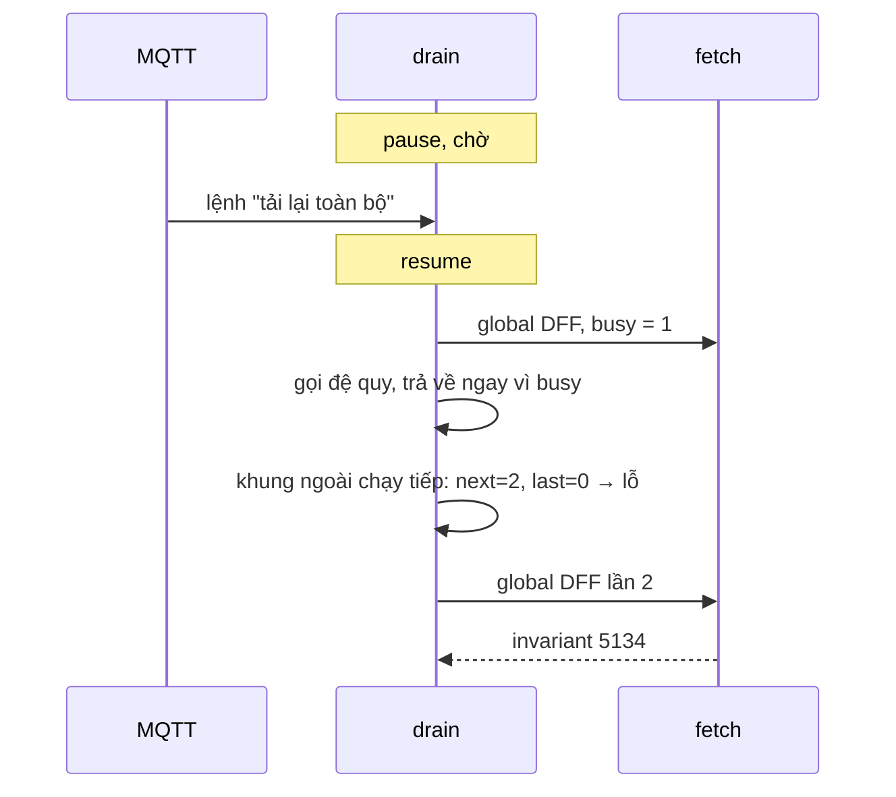

Một ứng dụng chat nhận thay đổi từ server qua một kênh realtime (MQTT, WebSocket…): tin mới, đã đọc, đã nhận, đổi tên nhóm, tắt thông báo. Mỗi thay đổi gọi là một **delta**. Nếu client áp dụng delta theo thứ tự tới, sẽ có ngày gặp:

- Delta #4 tới trước #3 (mạng đổi đường, server có nhiều luồng gửi). Áp dụng #4 trước có thể làm "đã đọc" xuất hiện trước "tin mới".
- Delta #3 mất hẳn (rớt kết nối vài giây, tab ngủ). Client không biết mình đang thiếu gì, giao diện lệch với server mãi mãi.
- Delta trùng (server gửi lại sau khi kết nối lại). Áp dụng hai lần thành hai tin giống nhau.

Messenger trên facebook.com giải bằng một con số: **seqID**.

> [!TIP]
> **Tóm tắt**
> - Mỗi delta mang seqID tăng đều. Client giữ `lastSeqID` và chỉ áp dụng khi `next − last = 1`; nhỏ hơn hoặc bằng thì bỏ (trùng), lớn hơn thì có **lỗ**.
> - Facebook gặp lỗ là tải lại toàn bộ ngay ("global DFF"). Server cũng có thể ép client tải lại một tin, một thread, hoặc toàn bộ; lấy hẹp thất bại thì rơi xuống tầng rộng hơn.
> - Bản gốc có hai chỗ đáng sửa: tải lại toàn bộ cả khi delta chỉ tới trễ vài chục ms, và một nhánh đệ quy thiếu `return` khiến có thể bắt đầu fetch thứ hai (đụng invariant).
> - Mang về: hàng chờ theo seqID + một vòng `while` duy nhất + "chờ lỗ" ngắn trước khi đồng bộ lại.

<iframe class="demo-frame" src="/demos/facebook-patterns/index.html?theme=dark#/sync-seqid" title="Demo sync-seqid" loading="lazy" style="height: 860px"></iframe>

<p class="demo-links">▶ <a href="/demos/facebook-patterns/index.html#/sync-seqid" target="_blank" rel="noopener">Mở demo toàn màn hình ↗</a> · <a href="https://stackblitz.com/github/hunghg255/blog-hunghg/tree/master/examples/facebook-patterns?file=src/lib/syncSeqId.ts" target="_blank" rel="noopener">Sửa code trên StackBlitz ↗</a> · <a href="https://github.com/hunghg255/blog-hunghg/blob/master/examples/facebook-patterns/src/lib/syncSeqId.ts" target="_blank" rel="noopener">Xem source trên GitHub ↗</a></p>

## Facebook làm thế nào?

Code nằm trong bundle `55.js` (và bản sao ở `19.js`), hai module chính:

- `MercurySyncDeltaHolder`: hàng chờ delta, khoá theo seqID.
- `MercurySyncDeltaHandler`: nhận delta từ MQTT, quyết định áp dụng, bỏ hay đi đồng bộ bù.

"Mercury" là tên nội bộ của lớp chat cũ; phần áp dụng delta vào state nằm ở `MessengerDeltaTransformer.bs`, viết bằng ReasonML.

### Hàng chờ theo seqID

`MercurySyncDeltaHolder` chỉ có một `Map` seqID → delta, một mảng seqID và `lastSeqID`. Đổi tên biến cho dễ đọc:

`push` bỏ seqID đã có (trùng thì bỏ ngay từ cửa), `peek`/`pop` sort mảng rồi lấy phần tử nhỏ nhất. Mỗi lần `peek`/`pop` lại sort cả mảng. Với vài delta đang chờ thì không đáng kể, nhưng là chỗ dễ cải thiện.

### Vòng drain

Mỗi delta tới từ MQTT: lọc đúng user (`queue`), log, `push`, rồi gọi vòng drain (`$15` trong bản minify):

```js
drain() {
  if (this.busy > 0) return;              // đang fetch, hoặc đang pause vì gửi tin
  if (this.fakeDffQueue.length > 0) {     // lệnh "tải lại" server đẩy riêng
    const cmd = this.fakeDffQueue.shift();
    this.process(this.holder.getLastSeqID(), cmd);
    this.drain();
  }                                       // ← không có return
  const next = this.holder.peek();
  if (!next) return;
  const diff = next - this.holder.getLastSeqID();
  if (diff === 1) { const { seqID, delta } = this.holder.pop(); this.process(seqID, delta); this.drain(); }
  else if (diff > 1) this.onHole();       // có lỗ
  else { this.holder.pop(); this.drain(); } // cũ hoặc trùng: bỏ
}
```

`process` cập nhật `lastSeqID` trước. Một delta có thể "nuốt" nhiều seqID rỗng (`numNoOps`), khi đó `lastSeqID = seqID + numNoOps − 1` để không bị coi là lỗ. Sau đó: delta loại `ForcedFetch` thì đi fetch, còn lại đưa cho `MessengerDeltaTransformer.bs`.

### Gặp lỗ: tải lại toàn bộ ngay

Hàm xử lý lỗ (`$19`) chỉ ghi log `hole`, gọi `ChatReliabilityInstrumentation.logDFF_HOLE_INIT` rồi gọi thẳng `globalDFF`. "DFF" là *Delta Forced Fetch*. `globalDFF` gọi `processGlobalDFFForGraphQL()`: lấy lại state chat qua GraphQL, kèm `sequence_id` mới. Thành công thì `updateLastSeqID(sequence_id)` (có gatekeeper để xoá luôn lịch sử hàng chờ) và báo `INVALID_STATE_RECOVER`. Nhánh lỗi chỉ phân biệt theo việc promise có kèm lý do hay không: reject kèm một đối tượng lỗi thì gỡ hết subscription và báo `INVALID_STATE` cho lớp trên; reject không kèm lý do thì báo `INVALID_STATE_RETRY` và gọi lại **ngay**, không có backoff.

Ở đây không có bước chờ: chỉ cần #4 tới trước #3 vài mili-giây là tải lại toàn bộ.

### Server ép fetch: rơi dần từ hẹp tới rộng

Ngoài lỗ, server có thể gửi một delta loại `ForcedFetch` (vẫn mang seqID) khi chính nó biết client thiếu dữ liệu. Delta có `threadKey` + `messageId` thì lấy lại đúng một tin, chỉ có `threadKey` thì lấy lại cả thread, không có gì thì toàn bộ. Mẹo hay nằm ở nhánh lỗi:

```js
messageDFF(seqID, delta) {
  this.scheduleFetch(seqID, () => forcedFetch.processMessageDFF(seqID, delta.threadKey, delta.messageId),
    onSuccess,
    () => {                              // lấy 1 tin thất bại
      const wider = { ...delta };
      delete wider.messageId;            // → thành lệnh lấy cả thread
      this.holder.updateLastSeqID(seqID - 1);
      this.holder.push(seqID, wider);    // đặt lại ở đúng seqID cũ
    });
}
```

Không cần code retry riêng: lệnh hẹp thất bại thì được đặt lại vào hàng chờ, ở cùng seqID, nhưng rộng hơn một bậc. Vòng drain tự nhặt lại. Thread lỗi thì `delete threadKey`, thành lệnh toàn cục.

`scheduleFetch` (`$24`) giữ một bất biến: **mỗi lúc chỉ một fetch**. Nó tăng bộ đếm `busy`, và nếu bộ đếm đã khác 0 thì `invariant(0, 5134)` ném lỗi. Bộ đếm này cũng được `pause()`/`resume()` dùng khi đang gửi tin, để delta không chen vào giữa ([bài #31](/blogs/facebook-ordered-send-queue) có hàng đợi gửi tin gọi tới hai hàm này).

### Đo tỷ lệ lỗ

Trước khi `push`, handler tính `seqID − lastSeqID`; khác 0 và 1 thì ghi log `MercurySyncHolesTypedLogger` (chỉ với tài khoản nhân viên). Đây là cách Facebook biết lỗ xảy ra thường tới mức nào, trước khi tối ưu.

## Hai chỗ đáng sửa

**1. Tải lại toàn bộ cả khi chỉ là tới trễ.** Delta tới sai thứ tự vài chục ms là chuyện thường với kênh realtime có nhiều đường đi. Mỗi lần như vậy bản gốc kéo lại state qua GraphQL. Trong demo, kịch bản "Sai thứ tự" với chờ 0ms tải lại 1 lần và chỉ áp dụng được 2 delta (các delta sau bị bỏ vì cũ hơn snapshot); chờ 150ms thì áp dụng đủ 8, không tải lại lần nào.

**2. Nhánh lệnh "tải lại" thiếu `return`.** Nhìn lại vòng drain: sau khi xử lý một lệnh từ `fakeDffQueue` (lệnh tải lại toàn bộ do server đẩy, không có seqID), hàm gọi đệ quy rồi **chạy tiếp xuống dưới**. Lệnh vừa xử lý đã bắt đầu fetch (`busy = 1`); lời gọi đệ quy thấy `busy > 0` nên trả về ngay, nhưng khung ngoài thì không kiểm tra lại `busy`:

- Delta kế tiếp vừa khớp (`diff === 1`): bị áp dụng **trong lúc** đang tải lại toàn bộ.
- Delta kế tiếp tạo lỗ (`diff > 1`): `onHole` → `globalDFF` → `scheduleFetch` thấy `busy` đang là 1 → `invariant 5134` ném lỗi ngay trong lời gọi đang xử lý (callback realtime hoặc `resume()`), các delta còn lại nằm chờ tới lần drain sau.

Tình huống cần: client đang `pause` (đang gửi tin), trong hàng chờ có delta, và server đẩy lệnh tải lại. Hiếm, nhưng là đúng lúc mạng chập chờn. Nút "So sánh" trong demo dựng lại chính chuỗi này bằng bản mô phỏng logic gốc (file `syncSeqIdFbStyle.ts`, viết lại theo logic đã giải mã, không phải mã của Meta).



## Viết lại

Bản viết lại giữ nguyên ý tưởng, đổi ba chỗ: hàng chờ chèn đúng vị trí thay vì sort mỗi lần, vòng drain là một vòng `while` (không có khung ngoài nào chạy tiếp), và lỗ được "chờ" một khoảng ngắn trước khi tải lại.

```ts title=src/lib/syncSeqId.ts
  function drain() {
    // vòng lặp thay vì đệ quy: không có "khung ngoài" chạy tiếp sau khi một fetch đã bắt đầu
    while (!disposed && blocked === 0) {
      if (forceGlobalPending) {
        forceGlobalPending = false;
        requestGlobal();
        continue; // requestGlobal đã tăng blocked: vòng lặp tự dừng, không chạy tiếp như bản gốc
      }
      const next = holder.peek();
      if (next === undefined) return;
      const diff = next - holder.lastSeqId;
      if (diff === 1) {
        if (waitingHole) {
          onEvent({ type: 'hole-filled', seqId: next });
          clearTimeout(holeTimer);
          waitingHole = null;
        }
        const item = holder.pop()!;
        applyOne(item.seqId, item.delta);
      } else if (diff <= 0) {
        holder.pop();
        onEvent({ type: 'drop', seqId: next });
      } else {
        onHole(holder.lastSeqId, next);
        return;
      }
    }
  }
```

`onHole` ghi nhận lỗ một lần, hẹn `holeGraceMs`; hết giờ mà lỗ vẫn còn thì gọi `requestGlobal`.

Phần fetch theo tầng, giống hệt cách của Facebook: lệnh lỗi được đặt lại ở cùng seqID với phạm vi rộng hơn.

```ts title=src/lib/syncSeqId.ts
  function handleForcedFetch(seqId: number, delta: Extract<Delta<T>, { kind: 'forcedFetch' }>) {
    const { threadKey, messageId } = delta;
    if (threadKey !== undefined && messageId !== undefined) {
      runFetch('message', seqId, () =>
        fetchMessage(threadKey, messageId).catch((error) => {
          // lấy 1 tin thất bại: đặt lại lệnh ở cùng seqID nhưng hẹp hơn một bậc (cả thread)
          holder.lastSeqId = seqId - 1;
          holder.push(seqId, { kind: 'forcedFetch', threadKey });
          throw error;
        }),
      );
    } else if (threadKey !== undefined) {
      runFetch('thread', seqId, () =>
        fetchThread(threadKey).catch((error) => {
          holder.lastSeqId = seqId - 1;
          holder.push(seqId, { kind: 'forcedFetch' });
          throw error;
        }),
      );
    } else {
      requestGlobal();
    }
  }
```

::: spoiler Xem toàn bộ src/lib/syncSeqId.ts

```ts title=src/lib/syncSeqId.ts
/**
 * Áp dụng delta realtime theo đúng thứ tự seqID, phát hiện "lỗ" và tự đồng bộ bù
 * (ý tưởng từ MercurySyncDeltaHandler + MercurySyncDeltaHolder của Messenger web).
 *
 * - Mỗi delta có seqID tăng đều 1 đơn vị. Client nhớ lastSeqID.
 * - next − last = 1 → áp dụng; > 1 → có lỗ (mất gói hoặc tới sai thứ tự); ≤ 0 → trùng, bỏ.
 * - Gặp lỗ thì đồng bộ lại (bản gốc gọi ngay "global DFF": lấy lại toàn bộ state).
 * - Server có thể gửi lệnh "forced fetch" (DFF) cho một tin / một thread / toàn bộ.
 *   Lấy hẹp thất bại thì rơi xuống tầng rộng hơn: message → thread → global.
 * - Mỗi lúc chỉ một lần fetch; trong lúc fetch, delta mới chỉ được xếp hàng.
 */

export type Delta<T> =
  | { kind: 'data'; payload: T; numNoOps?: number }
  | { kind: 'forcedFetch'; threadKey?: string; messageId?: string };

export type FetchLevel = 'message' | 'thread' | 'global';

export interface GlobalSnapshot {
  /** seqID mà snapshot đã bao gồm */
  seqId: number;
}

export interface SyncHandlerOptions<T> {
  apply: (seqId: number, payload: T) => void;
  fetchMessage: (threadKey: string, messageId: string) => Promise<void>;
  fetchThread: (threadKey: string) => Promise<void>;
  fetchGlobal: () => Promise<GlobalSnapshot>;
  /**
   * Chờ bao lâu trước khi coi một khoảng trống là "lỗ" thật. 0 = như bản gốc (fetch ngay).
   * Delta tới sai thứ tự vài chục ms là chuyện thường; chờ một chút tránh đồng bộ toàn bộ oan.
   */
  holeGraceMs?: number;
  /** số lần thử lại global fetch trước khi bỏ cuộc */
  maxGlobalRetries?: number;
  onEvent?: (event: SyncEvent) => void;
}

export type SyncEvent =
  | { type: 'apply'; seqId: number }
  | { type: 'drop'; seqId: number }
  | { type: 'hole'; last: number; next: number }
  | { type: 'hole-filled'; seqId: number }
  | { type: 'fetch-start'; level: FetchLevel; seqId?: number }
  | { type: 'fetch-ok'; level: FetchLevel; seqId?: number }
  | { type: 'fetch-fail'; level: FetchLevel; seqId?: number }
  | { type: 'gave-up' };

/** Hàng chờ delta theo seqID: tự sắp, bỏ seqID trùng. */
export class DeltaHolder<T> {
  private readonly byId = new Map<number, Delta<T>>();
  private ids: number[] = [];
  private last = 0;

  push(seqId: number, delta: Delta<T>) {
    if (this.byId.has(seqId)) return;
    this.byId.set(seqId, delta);
    // giữ mảng luôn sắp tăng: chèn đúng chỗ thay vì sort lại mỗi lần peek như bản gốc
    let i = this.ids.length;
    while (i > 0 && this.ids[i - 1] > seqId) i--;
    this.ids.splice(i, 0, seqId);
  }

  peek(): number | undefined {
    return this.ids[0];
  }

  pop(): { seqId: number; delta: Delta<T> } | undefined {
    const seqId = this.ids.shift();
    if (seqId === undefined) return undefined;
    const delta = this.byId.get(seqId)!;
    this.byId.delete(seqId);
    return { seqId, delta };
  }

  get lastSeqId() {
    return this.last;
  }

  set lastSeqId(value: number) {
    this.last = value;
  }

  /** sau global fetch: snapshot đã gồm mọi thứ tới seqId, bỏ hết delta cũ hơn */
  resetTo(seqId: number) {
    this.last = seqId;
    while (this.ids.length > 0 && this.ids[0] <= seqId) this.pop();
  }

  get size() {
    return this.ids.length;
  }
}

export function createSyncHandler<T>(options: SyncHandlerOptions<T>) {
  const {
    apply,
    fetchMessage,
    fetchThread,
    fetchGlobal,
    holeGraceMs = 0,
    maxGlobalRetries = 3,
    onEvent = () => {},
  } = options;
  const holder = new DeltaHolder<T>();
  // > 0: đang fetch hoặc đang bị pause (bản gốc dùng chung một bộ đếm cho cả hai việc)
  let blocked = 0;
  let fetching = false;
  let holeTimer: ReturnType<typeof setTimeout> | undefined;
  let waitingHole: { last: number; next: number } | null = null;
  let disposed = false;
  // lệnh "đồng bộ toàn bộ" server đẩy riêng, không đi kèm seqID (FAKE_DFF ở bản gốc)
  let forceGlobalPending = false;

  function runFetch(level: FetchLevel, seqId: number | undefined, task: () => Promise<void>) {
    // bất biến: chỉ một fetch bay cùng lúc
    if (fetching) throw new Error('đã có một fetch đang chạy');
    fetching = true;
    blocked++;
    onEvent({ type: 'fetch-start', level, seqId });
    task()
      .then(
        () => onEvent({ type: 'fetch-ok', level, seqId }),
        () => onEvent({ type: 'fetch-fail', level, seqId }),
      )
      .finally(() => {
        fetching = false;
        blocked--;
        drain();
      });
  }

  let globalFailures = 0;
  let retryTimer: ReturnType<typeof setTimeout> | undefined;

  /** Đồng bộ toàn bộ. Gọi trùng (đang fetch hoặc đang chờ thử lại) thì bỏ qua. */
  function requestGlobal() {
    if (fetching || retryTimer !== undefined || disposed) return;
    runFetch('global', undefined, async () => {
      try {
        const snapshot = await fetchGlobal();
        globalFailures = 0;
        holder.resetTo(snapshot.seqId);
      } catch (error) {
        globalFailures++;
        if (globalFailures >= maxGlobalRetries) {
          disposed = true;
          onEvent({ type: 'gave-up' });
        } else {
          // backoff 200ms, 400ms, 800ms… thay vì thử lại ngay như bản gốc
          retryTimer = setTimeout(() => {
            retryTimer = undefined;
            requestGlobal();
          }, 200 * 2 ** (globalFailures - 1));
        }
        throw error;
      }
    });
  }

  function handleForcedFetch(seqId: number, delta: Extract<Delta<T>, { kind: 'forcedFetch' }>) {
    const { threadKey, messageId } = delta;
    if (threadKey !== undefined && messageId !== undefined) {
      runFetch('message', seqId, () =>
        fetchMessage(threadKey, messageId).catch((error) => {
          // lấy 1 tin thất bại: đặt lại lệnh ở cùng seqID nhưng hẹp hơn một bậc (cả thread)
          holder.lastSeqId = seqId - 1;
          holder.push(seqId, { kind: 'forcedFetch', threadKey });
          throw error;
        }),
      );
    } else if (threadKey !== undefined) {
      runFetch('thread', seqId, () =>
        fetchThread(threadKey).catch((error) => {
          holder.lastSeqId = seqId - 1;
          holder.push(seqId, { kind: 'forcedFetch' });
          throw error;
        }),
      );
    } else {
      requestGlobal();
    }
  }

  function applyOne(seqId: number, delta: Delta<T>) {
    // một delta có thể "nuốt" nhiều seqID trống phía sau (numNoOps)
    holder.lastSeqId = delta.kind === 'data' && delta.numNoOps && delta.numNoOps > 1 ? seqId + delta.numNoOps - 1 : seqId;
    if (delta.kind === 'forcedFetch') {
      handleForcedFetch(seqId, delta);
    } else {
      apply(seqId, delta.payload);
      onEvent({ type: 'apply', seqId });
    }
  }

  function drain() {
    // vòng lặp thay vì đệ quy: không có "khung ngoài" chạy tiếp sau khi một fetch đã bắt đầu
    while (!disposed && blocked === 0) {
      if (forceGlobalPending) {
        forceGlobalPending = false;
        requestGlobal();
        continue; // requestGlobal đã tăng blocked: vòng lặp tự dừng, không chạy tiếp như bản gốc
      }
      const next = holder.peek();
      if (next === undefined) return;
      const diff = next - holder.lastSeqId;
      if (diff === 1) {
        if (waitingHole) {
          onEvent({ type: 'hole-filled', seqId: next });
          clearTimeout(holeTimer);
          waitingHole = null;
        }
        const item = holder.pop()!;
        applyOne(item.seqId, item.delta);
      } else if (diff <= 0) {
        holder.pop();
        onEvent({ type: 'drop', seqId: next });
      } else {
        onHole(holder.lastSeqId, next);
        return;
      }
    }
  }

  function onHole(last: number, next: number) {
    if (waitingHole && waitingHole.last === last) return; // đang chờ đúng lỗ này
    waitingHole = { last, next };
    onEvent({ type: 'hole', last, next });
    const fire = () => {
      waitingHole = null;
      if (disposed || fetching) return;
      // vẫn còn lỗ sau thời gian chờ: đồng bộ toàn bộ
      if ((holder.peek() ?? 0) - holder.lastSeqId > 1) requestGlobal();
    };
    if (holeGraceMs <= 0) fire();
    else holeTimer = setTimeout(fire, holeGraceMs);
  }

  return {
    /** nhận một delta từ realtime (MQTT/WebSocket) */
    receive(seqId: number, delta: Delta<T>) {
      if (disposed) return;
      holder.push(seqId, delta);
      drain();
    },
    /** khởi tạo lastSeqID từ lần tải đầu */
    init(seqId: number) {
      holder.lastSeqId = seqId;
      drain();
    },
    /** server yêu cầu đồng bộ toàn bộ (không kèm seqID) */
    forceGlobalSync() {
      forceGlobalPending = true;
      drain();
    },
    /** chặn áp dụng delta, ví dụ trong lúc đang gửi tin (bản gốc dùng khi gửi) */
    pause() {
      blocked++;
    },
    resume() {
      blocked--;
      drain();
    },
    get lastSeqId() {
      return holder.lastSeqId;
    },
    get pending() {
      return holder.size;
    },
    get isFetching() {
      return fetching;
    },
    dispose() {
      disposed = true;
      clearTimeout(holeTimer);
      clearTimeout(retryTimer);
    },
  };
}

export type SyncHandler<T> = ReturnType<typeof createSyncHandler<T>>;
```

:::

## Đi qua code

- **`DeltaHolder.push`** bỏ seqID trùng, chèn vào đúng chỗ để mảng luôn tăng dần; `peek` chỉ là `ids[0]`.
- **`blocked`** là bộ đếm chung cho "đang fetch" và "đang pause", giống `$4` của bản gốc. `fetching` là cờ riêng để giữ bất biến một fetch, và để `requestGlobal` gọi trùng thì bỏ qua thay vì ném lỗi.
- **`drain`** chạy trong `while (blocked === 0)`. Mỗi nhánh bắt đầu fetch đều làm `blocked` tăng, nên vòng lặp tự dừng. Không có đệ quy, nên không có khung ngoài nào chạy tiếp như bản gốc.
- **`onHole`** ghi nhận lỗ một lần (`waitingHole`), hẹn `holeGraceMs`. Hết giờ mà lỗ vẫn còn thì `requestGlobal`. Delta còn thiếu tới kịp thì nhánh `diff === 1` huỷ hẹn giờ (`hole-filled`).
- **`requestGlobal`** gọi `fetchGlobal`, thành công thì `resetTo(seqId)`: đặt `lastSeqID` và bỏ mọi delta cũ hơn snapshot. Lỗi thì thử lại sau 200, 400, 800ms…, quá `maxGlobalRetries` thì `gave-up`.
- **`forceGlobalSync`** là kênh "server bảo tải lại" không kèm seqID. Nó chỉ bật cờ; vòng drain xử lý cờ ở đầu vòng rồi `continue`, và vì `blocked` đã tăng nên dừng ngay.

**Khác bản gốc:**

- Có `holeGraceMs`.
- Lỗi tải lại toàn bộ có backoff và giới hạn số lần.
- Lệnh tải lại lúc đang pause không làm bắt đầu fetch thứ hai.
- Không có tầng log và gatekeeper.

## Tại sao không làm cách khác?

- **Áp dụng theo thứ tự tới, không cần seqID?** Không phát hiện được mất gói. Với chat, thiếu một delta "đã đọc" thì sai ít; thiếu một tin nhắn thì là lỗi người dùng thấy ngay.
- **Đợi đủ hết rồi mới áp dụng, không giới hạn thời gian?** Một gói mất hẳn làm cả hàng chờ đứng mãi. Phải có ngưỡng chuyển sang tải lại.
- **Mỗi lần thấy lỗ thì xin server gửi lại đúng khoảng thiếu (`#3..#3`)?** Cách này tốt hơn tải lại toàn bộ, nhưng cần server giữ log delta theo user đủ lâu. Messenger web chọn đường đơn giản: tải lại state qua GraphQL. Server vẫn có kênh ép fetch hẹp (một tin, một thread) khi chính nó biết thiếu gì.
- **Timestamp thay cho seqID?** Hai delta cùng mili-giây, đồng hồ lệch giữa các máy chủ, và quan trọng nhất là không biết có thiếu gì ở giữa hay không. seqID liên tục mới cho biết "giữa 2 và 4 phải có 3".

## Edge case và cạm bẫy

- **`numNoOps`**: server có thể bỏ qua seqID (delta bị lọc vì không liên quan tới client này). Nếu không có trường này, mọi lần lọc đều thành lỗ giả.
- **Delta tới trong lúc đang fetch**: vẫn `push` vào hàng chờ. Sau khi fetch xong, những delta có seqID ≤ snapshot bị bỏ, phần còn lại áp dụng tiếp. Snapshot phải trả về đúng seqID mà nó đã bao gồm.
- **Pause khi gửi tin**: nếu không pause, delta "tin mới" của chính tin vừa gửi có thể tới trước response HTTP và tạo tin trùng. Đừng quên `resume` trong cả nhánh lỗi.
- **Tab ngủ lâu**: khi tỉnh, hàng chờ có thể nhận một loạt delta, hoặc kết nối mới bắt đầu ở seqID xa hơn nhiều. Cả hai đều thành lỗ, rồi tải lại toàn bộ. Đó là hành vi đúng.
- **Nhiều tài khoản trong một tab** (Facebook cho phép quản lý Page): mỗi FBID có một handler riêng (`getForFBID`). Lọc delta theo `queue` trước khi `push`.

## Dùng trong dự án

```ts
const sync = createSyncHandler<ChatDelta>({
  holeGraceMs: 150,
  apply: (seq, delta) => store.dispatch(applyDelta(delta)),
  fetchMessage: (thread, id) => api.getMessage(thread, id).then(store.upsertMessage),
  fetchThread: (thread) => api.getThread(thread).then(store.replaceThread),
  fetchGlobal: async () => {
    const snapshot = await api.getInbox(); // phải kèm seqId mà snapshot đã bao gồm
    store.dispatch(replaceInbox(snapshot));
    return { seqId: snapshot.seqId };
  },
});

socket.on('ready', ({ seqId }) => sync.init(seqId));
socket.on('delta', ({ seq, delta }) => sync.receive(seq, delta));
socket.on('resync', () => sync.forceGlobalSync());
```

Khi gửi tin: `sync.pause()` trước request, `sync.resume()` trong `finally`.

## Kiểm thử

::: spoiler Ví dụ test (bản phác, không có trong repo)

```ts
import { afterEach, beforeEach, describe, expect, it, vi } from 'vitest';
import { createSyncHandler, type Delta } from './syncSeqId';

const data = (payload: string): Delta<string> => ({ kind: 'data', payload });

function setup(overrides: Partial<Parameters<typeof createSyncHandler<string>>[0]> = {}) {
  const applied: number[] = [];
  const fetchGlobal = vi.fn(async () => ({ seqId: 10 }));
  const h = createSyncHandler<string>({
    apply: (seq) => applied.push(seq),
    fetchMessage: vi.fn(async () => {}),
    fetchThread: vi.fn(async () => {}),
    fetchGlobal,
    ...overrides,
  });
  h.init(0);
  return { h, applied, fetchGlobal };
}

describe('createSyncHandler', () => {
  beforeEach(() => vi.useFakeTimers());
  afterEach(() => vi.useRealTimers());

  it('chờ lỗ trong holeGraceMs: delta tới trễ thì không cần tải lại', async () => {
    const { h, applied, fetchGlobal } = setup({ holeGraceMs: 150 });
    h.receive(1, data('a'));
    h.receive(3, data('c'));
    await vi.advanceTimersByTimeAsync(100);
    h.receive(2, data('b'));
    await vi.advanceTimersByTimeAsync(200);
    expect(applied).toEqual([1, 2, 3]);
    expect(fetchGlobal).not.toHaveBeenCalled();
  });

  it('hết thời gian chờ mà lỗ vẫn còn thì đồng bộ toàn bộ, bỏ delta cũ hơn snapshot', async () => {
    const { h, applied, fetchGlobal } = setup({ holeGraceMs: 150 });
    h.receive(1, data('a'));
    h.receive(3, data('c'));
    h.receive(11, data('k'));
    await vi.advanceTimersByTimeAsync(200);
    expect(fetchGlobal).toHaveBeenCalledTimes(1);
    expect(applied).toEqual([1, 11]);
  });

  it('forced fetch rơi dần message → thread → global khi lỗi', async () => {
    const levels: string[] = [];
    const { h } = setup({
      fetchMessage: vi.fn(async () => Promise.reject(new Error('m'))),
      fetchThread: vi.fn(async () => Promise.reject(new Error('t'))),
      onEvent: (e) => e.type === 'fetch-start' && levels.push(e.level),
    });
    h.receive(1, { kind: 'forcedFetch', threadKey: 't1', messageId: 'm1' });
    await vi.runAllTimersAsync();
    expect(levels).toEqual(['message', 'thread', 'global']);
  });

  it('lệnh đồng bộ toàn bộ lúc đang pause: chỉ một fetch', async () => {
    const { h, applied, fetchGlobal } = setup();
    h.pause();
    h.receive(2, data('b'));
    h.receive(3, data('c'));
    h.forceGlobalSync();
    expect(() => h.resume()).not.toThrow();
    expect(applied).toEqual([]);
    await vi.runAllTimersAsync();
    expect(fetchGlobal).toHaveBeenCalledTimes(1);
    expect(h.lastSeqId).toBe(10);
  });
});
```

:::

## So với thư viện và chuẩn web

- **Kafka, Postgres logical replication, Raft log** đều dùng cùng ý tưởng offset/sequence liên tục để biết "đã xử lý tới đâu" và phát hiện thiếu. Client chat chỉ là một consumer nhỏ của log đó.
- **Firebase Realtime Database, Firestore, Replicache** che giấu việc này: client nhận snapshot + diff, thư viện tự đồng bộ lại khi kết nối lại. Nếu tự xây kênh realtime trên WebSocket thì phải tự làm phần seqID.
- **Server-Sent Events** có sẵn `Last-Event-ID`: trình duyệt tự gửi lại id cuối cùng khi kết nối lại, server phát lại từ đó. Đây là "xin gửi lại đúng khoảng thiếu" ở mức giao thức; WebSocket không có cơ chế tương đương.

---

Bài này thuộc series **[Học từ mã nguồn Facebook](/series/facebook)** (106 bài, đọc theo thứ tự).

::: spoiler Xem nhanh danh sách bài trong series

*Phần 1*

- [Mở đầu: cách đọc code minify của Facebook](/blogs/learn-from-facebook-source-code)
- [#1 Dùng chung IntersectionObserver + infinite scroll](/blogs/facebook-shared-intersection-observer)
- [#2 useViewportDuration: đo thời gian thực sự được xem](/blogs/facebook-use-viewport-duration)
- [#3 Preload code + data khi hover](/blogs/facebook-preload-on-hover)
- [#4 Toast manager với external store](/blogs/facebook-toast-manager)
- [#5 Network status + heartbeat backoff](/blogs/facebook-network-status-heartbeat)
- [#6 ErrorGuard: bắt lỗi theo ngữ cảnh](/blogs/facebook-error-guard)
- [#7 Banzai: gom log theo lô + sendBeacon](/blogs/facebook-batch-logger)
- [#8 Focus trap + Esc theo layer](/blogs/facebook-focus-trap)

*Phần 2*

- [#9 Mẹo calc(… * 9999): container query, line-clamp, mũi tên carousel bằng CSS](/blogs/facebook-css-9999-trick)
- [#10 Thanh cuộn tuỳ biến bằng CSS 3D](/blogs/facebook-css-3d-scrollbar)
- [#11 Modal cuộn bằng window, giữ vị trí trang nền](/blogs/facebook-document-scroll-modal)
- [#12 Popover, tooltip group và hovercard](/blogs/facebook-popover-tooltip)
- [#13 Primitive Pressable + focus-visible](/blogs/facebook-pressable)
- [#14 Tab "Xem thêm" + sticky header bằng IntersectionObserver](/blogs/facebook-priority-tabs-sticky-header)
- [#15 Avatar khoét mask, gradient Messenger, skeleton steps()](/blogs/facebook-visual-tricks)
- [#16 Khung chat không giật](/blogs/facebook-chat-scroller)
- [#17 Thuật toán chọn bố cục collage ảnh](/blogs/facebook-photo-collage-layout)
- [#18 Keep-alive tab trong SPA](/blogs/facebook-keep-alive-tabs)
- [#19 Tự đo Visual Completion & interaction tracing](/blogs/facebook-visual-completion)
- [#20 Router SPA bền bỉ & tải chunk có retry](/blogs/facebook-spa-router-resilient-loading)

*Phần 3*

- [#21 Smart Compose: gợi ý chữ mờ khi gõ](/blogs/facebook-smart-compose-ghost-text)
- [#22 MQTT ngay trong trình duyệt, tự chuyển sang long-poll](/blogs/facebook-mqtt-in-browser)
- [#23 Đo thời gian dùng bằng bitmap 64 giây](/blogs/facebook-time-spent-bitmap)
- [#24 Bảng reaction nhấn giữ rồi trượt](/blogs/facebook-reaction-press-slide)
- [#25 Tìm kiếm gấp dấu, phiên âm và highlight đầu từ](/blogs/facebook-search-diacritics-tokenize)
- [#26 Ring buffer biết trace nào đã mất log](/blogs/facebook-trace-ring-buffer)
- [#27 Engine animation JS: một vòng rAF và solver cubic-bezier](/blogs/facebook-keyframes-loop-cubic-bezier)
- [#28 Bootloader: bitmap tài nguyên đã tải, chỉ reload khi cần](/blogs/facebook-bootloader-bitmap-consistency)
- [#29 Nhận biết click do screen reader tạo ra](/blogs/facebook-virtual-cursor-detection)
- [#30 Tải trước feed theo chất lượng mạng, đoán hạng thiết bị](/blogs/facebook-network-aware-prefetch)
- [#31 Hàng đợi gửi tin chat giữ đúng thứ tự](/blogs/facebook-ordered-send-queue)
- [#32 Gộp lời gọi API trong cùng một tick](/blogs/facebook-api-batcher)
- [#33 Resize ảnh trong pool Web Worker](/blogs/facebook-jpeg-resize-worker-pool)
- [#34 Crop ảnh theo nhiều khuôn mặt](/blogs/facebook-face-aware-crop)
- [#35 Kéo-thả sắp xếp và vùng thả file không nhấp nháy](/blogs/facebook-flicker-free-drag-drop)
- [#36 Tiện ích UI: fade-out, sticky event, hàm huỷ được](/blogs/facebook-ui-utility-hooks)
- [#37 Hạ tầng nhỏ: cookie, hash lỗi, prefetch khi chuột dừng](/blogs/facebook-small-infra-cookie-hash-idle)

*Phần 4–6*

- **#38 Đồng bộ tin nhắn: phát hiện lỗ seqID và fetch bù theo tầng** (bài này)
- [#39 OTID: ID tin nhắn kiểu Snowflake sinh ở client](/blogs/facebook-otid-client-snowflake)
- [#40 QPL: lấy mẫu từ lúc bắt đầu, đo RTT gửi tin đầu-cuối](/blogs/facebook-qpl-send-rtt)
- [#41 Bộ điều phối request bảy chế độ gộp và chống trùng](/blogs/facebook-request-dispatcher-modes)
- [#42 Thread list theo mốc thời gian, cookie presence có version](/blogs/facebook-threadlist-ranged-presence)
- [#43 Composer dạng plugin: reducer, dirty checker, chuỗi kiểm tra](/blogs/facebook-plugin-composer)
- [#44 Thanh toán bất đồng bộ: subscribe trước, poll dự phòng](/blogs/facebook-async-checkout)
- [#45 Validate số thẻ: sửa lỗi gõ, dải BIN, Luhn](/blogs/facebook-card-validation)
- [#46 Lịch chọn khoảng ngày: bo góc dải chọn, phím đủ bộ, RTL](/blogs/facebook-range-calendar-a11y)
- [#47 Giờ mở cửa theo tuần: qua đêm, gộp khoảng, phần bù](/blogs/facebook-weekly-hours-intervals)
- [#48 Tiến độ đăng realtime: giữ event chờ snapshot, watchdog](/blogs/facebook-realtime-publish-snapshot)
- [#49 Tiền tệ theo đơn vị nhỏ nhất và ô nhập tiền](/blogs/facebook-currency-minor-units)
- [#50 Sửa hàng loạt Empty/Uniform/Mixed, seen/read bằng 2 bit](/blogs/facebook-bulk-edit-seen-bits)
- [#51 Phát hiện script lạ hook vào hàm native](/blogs/facebook-native-hook-detection)
- [#52 localStorage tự dọn khi đầy quota](/blogs/facebook-quota-aware-storage)
- [#53 Cache tuyến do server phân giải, chờ sẵn promise](/blogs/facebook-route-cache-prefetch)
- [#54 Lưới phím mũi tên 2D và focus không làm cuộn trang](/blogs/facebook-focus-table-grid)
- [#55 Tách emoji bằng máy trạng thái](/blogs/facebook-emoji-segmentation)
- [#56 Đọc trước ghi sau trong một frame, con tự biết vị trí](/blogs/facebook-read-then-write-dom)
- [#57 Hàng đợi lệnh cho video và stream sắp lại chunk](/blogs/facebook-video-command-queue)

*Phần 7–10*

- [#58 Ước lượng băng thông EWMA: loại outlier, nhớ qua phiên](/blogs/facebook-bandwidth-ewma-estimator)
- [#59 ABR theo độ tự tin phát và cắt bậc bitrate theo MOS](/blogs/facebook-abr-playback-confidence)
- [#60 Prefetch segment dự đoán từ manifest, parse hộp sidx](/blogs/facebook-dash-predicted-segments)
- [#61 Đọc metadata MP4/MOV ngay trên client](/blogs/facebook-mp4-metadata-client)
- [#62 Upload tiếp tục được: offset, hash dedupe, phát hiện treo](/blogs/facebook-resumable-upload)
- [#63 Fenwick tree: chọn ngẫu nhiên có trọng số và offset dòng](/blogs/facebook-fenwick-weighted-random)
- [#64 Vạch trục số và trục thời gian "đẹp"](/blogs/facebook-nice-axis-ticks)
- [#65 Damerau-Levenshtein theo dải chéo và tự sửa tên gõ sai](/blogs/facebook-damerau-levenshtein)
- [#66 PRNG có seed, shuffle tái lập và lấy mẫu trace](/blogs/facebook-seeded-prng-sampling)
- [#67 Cặp min/max-heap tái dùng vị trí trong danh sách ảo](/blogs/facebook-dual-heap-buffer-set)
- [#68 Memo nhiều đối số bằng Map/WeakMap và interning object](/blogs/facebook-multikey-memo-interning)
- [#69 Thống kê cửa sổ trượt và đại số khoảng thời gian](/blogs/facebook-moving-stat-intervals)
- [#70 Int64 từ hai số 32-bit, decode UTF, offset theo code point](/blogs/facebook-int64-utf-codepoints)
- [#71 Engine múi giờ IANA trên client, phát hiện lệch giờ](/blogs/facebook-client-iana-timezone)
- [#72 Tự cài semver range](/blogs/facebook-semver-range)
- [#73 Auto-link URL, cắt chữ an toàn, giới hạn LaTeX](/blogs/facebook-autolink-safe-truncate)
- [#74 Parser query kiểu PHP chống prototype pollution](/blogs/facebook-php-query-serializer)
- [#75 Popover tự lật theo phần tràn nhỏ nhất](/blogs/facebook-popover-auto-flip)
- [#76 Tiền tố for(;;) chống JSON hijacking, đọc stream](/blogs/facebook-csrf-prefix-streaming)
- [#77 Chống lộ Referer, linkshim, xoá token trên URL](/blogs/facebook-referrer-linkshim-url-scrub)
- [#78 setImmediate bằng postMessage, gom delta chuột theo frame](/blogs/facebook-setimmediate-mouse-batching)
- [#79 Phát hiện crash qua heartbeat, dò proxy cache hỏng](/blogs/facebook-crash-heartbeat-proxy-check)
- [#80 DPR vào cookie cho ảnh @2x, che khoá trong log](/blogs/facebook-dpr-cookie-secret-redaction)
- [#81 Flux waitFor tự viết và proxy có đệm](/blogs/facebook-flux-dispatch-buffered-proxy)
- [#82 Crop đúng tỉ lệ, xoay sticker bằng ma trận](/blogs/facebook-image-crop-rotation-geometry)

*Phần 11–15*

- [#83 Chia subdomain giữa các tab bằng lease, long-poll theo bảng trạng thái](/blogs/facebook-tab-subdomain-lease-longpoll)
- [#84 MQTT QoS1: giữ publish chờ ack, gửi lại khi kết nối lại](/blogs/facebook-mqtt-qos1-republish)
- [#85 Cache Promise gộp request, cache lỗi ngắn, đua dữ liệu nhúng sẵn](/blogs/facebook-promise-cache-preload-race)
- [#86 Lịch retry: backoff có trần, Fibonacci, báo lỗi CDN mỗi N ngày](/blogs/facebook-retry-backoff-schedules)
- [#87 Giữ nguyên tham chiếu nhánh dữ liệu không đổi](/blogs/facebook-relay-recycle-nodes)
- [#88 Store optimistic: copy-on-write, rollback rồi áp lại](/blogs/facebook-relay-optimistic-store)
- [#89 Chỉ mục subscription theo record, hàng đợi task theo chiều sâu](/blogs/facebook-relay-subscription-index)
- [#90 Phân trang connection: cursor khớp đầu, edge không trùng](/blogs/facebook-relay-connection-pagination)
- [#91 Profiler kiểu middleware và memo selector có lấy mẫu kiểm tra](/blogs/facebook-profiler-middleware-memo-check)
- [#92 Đọc EBML/WebM Cues để tìm byte range của segment](/blogs/facebook-webm-ebml-cues)
- [#93 Stream HTTP Range tạm dừng được, tải tiếp đúng byte](/blogs/facebook-pausable-range-stream)
- [#94 Bảng khoảng thời gian gắn nhãn và nhảy qua lỗ buffer](/blogs/facebook-tagged-time-ranges-gaps)
- [#95 Gom chunk cho SourceBuffer, đồng bộ video bằng playbackRate](/blogs/facebook-sourcebuffer-video-sync)
- [#96 Gom tin nhắn thành cụm, vạch ngày và avatar đã xem](/blogs/facebook-message-grouping)
- [#97 Bao nhiêu tab chat vừa màn hình, chuỗi luật mở tab](/blogs/facebook-chat-tab-policy)
- [#98 Phím tắt Markdown trong editor, Backspace để hoàn tác](/blogs/facebook-markdown-shortcuts-editor)
- [#99 Offset theo code point hay UTF-16: bốn bug cùng một gốc](/blogs/facebook-codepoint-offset-bugs)
- [#100 Typeahead không nhảy: cache tiền tố, chặn reflow, khoá hover](/blogs/facebook-typeahead-stable-results)
- [#101 Hit-test trên canvas bằng phát lại path, nét đứt và cung Bézier](/blogs/facebook-canvas-hit-regions)
- [#102 Vòng tròn theo mét trên bản đồ Mercator](/blogs/facebook-mercator-meter-circles)
- [#103 Dò tính năng trình duyệt: ảnh EXIF 2×1, getter bẫy, scrollbar](/blogs/facebook-feature-probe-tricks)
- [#104 Bug định dạng số và kiểm tra dữ liệu theo locale](/blogs/facebook-locale-validation-bugs)
- [#105 Dispose cho đúng: idle callback, splice(-1), xoá nhầm key](/blogs/facebook-dispose-leak-bugs)

:::

Code + demo: [`examples/facebook-patterns`](https://github.com/hunghg255/blog-hunghg/tree/master/examples/facebook-patterns) · [Mở trên StackBlitz](https://stackblitz.com/github/hunghg255/blog-hunghg/tree/master/examples/facebook-patterns)
