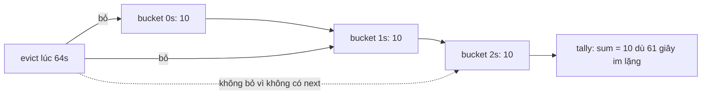

Hai câu hỏi hay gặp khi làm client: "trong 30 giây vừa rồi có bao nhiêu sự kiện?" và "từ ngày A tới ngày B là bao nhiêu tháng?". Câu đầu dùng để chặn vòng lặp kết nối lại, giới hạn log, đo tốc độ. Câu sau dùng cho "Đã tham gia 3 năm 2 tháng", hạn dùng thử, tuổi.

Cả hai nghe đơn giản nhưng dễ sai ở mép. Bài này đọc hai module nhỏ của Facebook là `MovingStat` và `TimeInterval`, chỉ ra chỗ chúng sai, rồi viết lại.

> [!TIP]
> **Tóm tắt**
> - `MovingStat` gộp sự kiện vào bucket 1 giây trong một danh sách liên kết, bỏ bucket cũ khi đọc. Facebook dùng nó trong `ChannelManager`: hơn 1 lần đổi trạng thái kênh mỗi giây (trung bình 30 giây) thì tự hãm lại.
> - Hai lỗi: **bucket cuối không bao giờ bị bỏ** nên sau một lúc im lặng tổng vẫn khác 0, và trung bình **luôn chia cho cả cửa sổ** kể cả khi mới chạy được 3 giây, nên lúc đầu tốc độ bị đánh giá thấp đi 10 lần.
> - `TimeInterval` là khoảng nửa mở `[start, end)` với `abuts`, `overlaps`, `gap`, `union`. Đo tháng bằng cách ước lượng theo hiệu năm/tháng, rồi lùi tối đa 2 bước tới khi `start + n tháng ≤ end`.
> - Chia số ngày cho 30 để ra tháng thì 31/1 → 1/3 thành "0 tháng 29 ngày", còn 26 năm thì lệch gần 5 tháng.

<iframe class="demo-frame" src="/demos/facebook-patterns/index.html?theme=dark#/moving-stat" title="Demo moving-stat" loading="lazy" style="height: 1020px"></iframe>

<p class="demo-links">▶ <a href="/demos/facebook-patterns/index.html#/moving-stat" target="_blank" rel="noopener">Mở demo toàn màn hình ↗</a> · <a href="https://stackblitz.com/github/hunghg255/blog-hunghg/tree/master/examples/facebook-patterns?file=src/lib/movingStat.ts" target="_blank" rel="noopener">Sửa code trên StackBlitz ↗</a> · <a href="https://github.com/hunghg255/blog-hunghg/blob/master/examples/facebook-patterns/src/lib/movingStat.ts" target="_blank" rel="noopener">Xem source trên GitHub ↗</a></p>

## Facebook làm thế nào?

### MovingStat: danh sách liên kết các bucket

Module `MovingStat` nằm trong `225.js`, ngắn tới mức đọc hết được trong một màn hình. Bỏ tên biến rút gọn đi thì nó như sau:

```js
add(v) {
  this.sum += v; this.count++;
  if (new Date() - this.tail.t < 1e3) { this.tail.v += v; this.tail.count++; return; }
  this.tail = this.tail.next = { t: new Date(), v, count: 1 };
  this.evict();
}
tally(per = 1e3) { this.evict(); return { sum: this.sum, count: this.count, timeAverage: this.sum * per / this.window }; }
evict() {
  const cutoff = new Date() - this.window;
  while (this.head && this.head.next && this.head.t < cutoff) { /* trừ sum, count rồi */ this.head = this.head.next; }
}
```

Constructor nhận độ dài cửa sổ (mặc định `6e4`, tức 60 giây) và tạo sẵn một bucket rỗng tại thời điểm khởi tạo làm cả `head` lẫn `tail`.

Ý tưởng tốt: không lưu từng sự kiện mà gộp theo giây, nên bộ nhớ tối đa khoảng 60 bucket dù có hàng nghìn sự kiện. `sum` và `count` được cộng/trừ dần, `tally()` là O(số bucket hết hạn).

Người dùng chính trong bundle là `ChannelManager`, lớp quản lý kênh long-polling cũ của chat:

```js
this._transportRate = new (b("MovingStat"))(3e4);
// mỗi lần đổi trạng thái kênh
this._transportRate && this._transportRate.add(1);
// khi vào trạng thái lỗi
var e = this._transportRate.tally().timeAverage, f = this.getConfig("MAX_CHANNEL_STATES_PER_SEC", 1);
e >= f && (this._throttled || (this._throttled = !0, /* … hãm lại */));
```

Kênh đổi trạng thái liên tục (pull → lỗi → pull → lỗi…) là dấu hiệu vòng lặp kết nối lại. Trung bình trên 30 giây vượt 1 lần/giây thì client tự hãm để không dội request lên server.

### Hai chỗ sai



1. **Điều kiện `this.head.next`** khiến bucket cuối cùng luôn ở lại. Ở phần 1 của demo: bắn 30 sự kiện trong 3 giây, tua 61 giây, bản kiểu Facebook vẫn báo tổng 10. Với `ChannelManager` điều này ít khi gây hại vì ngưỡng là 30 sự kiện, nhưng với một bộ đếm lỗi để hiện cảnh báo thì cảnh báo sẽ không bao giờ tắt.
2. **`timeAverage = sum * per / window`** luôn chia cho 30 giây. Ba giây đầu có 30 lần đổi trạng thái (10 lần/giây, rõ ràng là vòng lặp) thì `timeAverage` chỉ là 1. Ngưỡng `>= 1` vừa chạm nên trường hợp này vẫn bị chặn, nhưng 20 lần trong 3 giây thì không: client phải đợi thêm vài chục lần lặp nữa mới tự hãm.

Ngoài ra bucket được bỏ khi **thời điểm bắt đầu** của nó đã quá cửa sổ, trong khi các sự kiện cuối bucket có thể vẫn còn trong cửa sổ. Sai số tối đa một bucket, chấp nhận được, nhưng nên biết đó là xấp xỉ.

### TimeInterval: khoảng nửa mở và đo theo lịch

Module `TimeInterval` (trong `233.js`) giữ `start`, `end` (giây Unix) và `timezoneID`. Các phép so sánh đều quy về hai số `max(start)` và `min(end)`:

```js
c.abuts    = a => Math.max(this.start, a.start) === Math.min(this.end, a.end);
c.overlaps = a => Math.max(this.start, a.start) <  Math.min(this.end, a.end);
c.intersects = a => Math.max(this.start, a.start) <= Math.min(this.end, a.end);
c.union = b => this.intersects(b) ? a.create(Math.min(...), Math.max(...), tz) : null;
```

Phân biệt `overlaps` (chồng thật) và `intersects` (chồng hoặc dính mép) là điểm hay: 9:00–10:00 và 10:00–11:00 không chồng nhau (không trùng lịch) nhưng vẫn gộp được thành 9:00–11:00.

Đo theo tháng thì không chia cho 30:

```js
case PeriodUnit.month:
  e = 12 * (d.getYear() - c.getYear()) + (d.getMonth() - c.getMonth());
  for (var f = e; Math.max(0, e - 2) < f; f -= 1)
    if (c.addMonths(f).instant <= d.instant) break;
  return f;
```

Ước lượng bằng hiệu năm/tháng, rồi lùi tối đa hai bước tới khi cộng `f` tháng vào ngày đầu không vượt ngày cuối. `toPeriodIn(["year", "month", "week", "day"])` đo đơn vị lớn nhất, cộng phần đó vào `start`, rồi đệ quy cho phần còn lại.

## Viết lại

`src/lib/movingStat.ts` cho bộ đếm, `src/lib/timeInterval.ts` cho khoảng thời gian.

Bộ đếm dùng mảng thay vì danh sách liên kết, đồng hồ truyền vào được. `evict` so **thời điểm kết thúc** của bucket với mốc cắt và không đòi bucket phải có phần tử sau nó:

::: spoiler Xem toàn bộ src/lib/movingStat.ts

```ts title=src/lib/movingStat.ts
/**
 * Thống kê trên cửa sổ thời gian trượt, gộp mẫu vào bucket (ý tưởng từ MovingStat của Facebook).
 *
 * Không lưu từng mẫu: mẫu rơi vào cùng một bucket (mặc định 1 giây) thì cộng dồn.
 * Hỏi `tally()` thì bỏ các bucket đã ra khỏi cửa sổ rồi trả sum/count/trung bình.
 *
 * Khác bản gốc:
 * - Bản gốc không bao giờ bỏ bucket cuối cùng (điều kiện vòng lặp đòi bucket phải có `next`),
 *   nên sau một lúc im lặng `tally()` vẫn trả số liệu cũ. Bản này bỏ cả bucket cuối.
 * - Bucket được bỏ theo thời điểm KẾT THÚC (start + bucketMs), không theo lúc bắt đầu.
 * - Trung bình chia cho phần cửa sổ đã thực sự trôi qua, không chia cả cửa sổ khi vừa khởi tạo.
 * - Đồng hồ truyền vào được, để test và demo tua thời gian.
 */

interface Bucket {
  start: number;
  sum: number;
  count: number;
}

export interface MovingStatOptions {
  windowMs?: number;
  bucketMs?: number;
  now?: () => number;
}

export class MovingStat {
  private buckets: Bucket[] = [];
  private sum = 0;
  private count = 0;
  private readonly createdAt: number;
  readonly windowMs: number;
  private readonly bucketMs: number;
  private readonly now: () => number;

  constructor({ windowMs = 60_000, bucketMs = 1_000, now = Date.now }: MovingStatOptions = {}) {
    this.windowMs = windowMs > 0 ? windowMs : 60_000;
    this.bucketMs = bucketMs;
    this.now = now;
    this.createdAt = now();
  }

  add(value: number) {
    const t = this.now();
    this.evict(t);
    this.sum += value;
    this.count++;
    const last = this.buckets[this.buckets.length - 1];
    if (last && t - last.start < this.bucketMs) {
      last.sum += value;
      last.count++;
    } else {
      this.buckets.push({ start: t, sum: value, count: 1 });
    }
  }

  /** `per`: trung bình trên mỗi `per` ms, mặc định "mỗi giây". */
  tally(per = 1_000) {
    const t = this.now();
    this.evict(t);
    const elapsed = Math.min(this.windowMs, Math.max(t - this.createdAt, this.bucketMs));
    return { sum: this.sum, count: this.count, ratePer: (this.sum * per) / elapsed, buckets: this.buckets.length };
  }

  private evict(t: number) {
    const cutoff = t - this.windowMs;
    let drop = 0;
    while (drop < this.buckets.length && this.buckets[drop].start + this.bucketMs <= cutoff) {
      this.sum -= this.buckets[drop].sum;
      this.count -= this.buckets[drop].count;
      drop++;
    }
    if (drop > 0) this.buckets.splice(0, drop);
  }
}
```

:::

Đếm tháng trọn và quy ra năm/tháng/ngày:

```ts title=src/lib/timeInterval.ts
/**
 * Số tháng TRỌN giữa start và end. Ước lượng bằng hiệu năm/tháng, rồi lùi tối đa 2 bước
 * cho tới khi start + n tháng không vượt end (cùng cách bản gốc làm).
 */
export function wholeMonths(iv: Interval): number {
  const a = new Date(iv.start);
  const b = new Date(iv.end);
  const guess = (b.getUTCFullYear() - a.getUTCFullYear()) * 12 + (b.getUTCMonth() - a.getUTCMonth());
  for (let n = guess; n > Math.max(0, guess - 2); n--) {
    if (addMonthsUTC(iv.start, n) <= iv.end) return n;
  }
  return Math.max(0, guess - 2);
}

export interface Period {
  years: number;
  months: number;
  days: number;
}

/**
 * "Bao lâu" theo lịch. Luôn cộng từ mốc start (không cộng dồn từng tháng một),
 * vì 31/1 +1 tháng +1 tháng = 28/3 còn 31/1 + 2 tháng = 31/3.
 */
export function toPeriod(iv: Interval): Period {
  const total = wholeMonths(iv);
  const anchor = addMonthsUTC(iv.start, total);
  return { years: Math.floor(total / 12), months: total % 12, days: Math.floor((iv.end - anchor) / DAY) };
}
```

::: spoiler Xem toàn bộ src/lib/timeInterval.ts

```ts title=src/lib/timeInterval.ts
/**
 * Khoảng thời gian nửa mở [start, end) và phép đo theo lịch (ý tưởng từ TimeInterval của Facebook).
 *
 * Đơn vị là mili giây UTC để ví dụ gọn; bản gốc dùng giây Unix + timezoneID và đo ngày/tháng
 * theo lịch của múi giờ đó. Muốn đo theo múi giờ khác thì đổi `addMonthsUTC` sang hàm cộng tháng
 * theo múi giờ (ví dụ Temporal.ZonedDateTime.add).
 */

export class Interval {
  constructor(
    readonly start: number,
    readonly end: number,
  ) {
    if (!(start <= end)) throw new RangeError(`Interval: start (${start}) phải <= end (${end})`);
  }

  static of(a: Date | number, b: Date | number) {
    return new Interval(+a, +b);
  }

  get length() {
    return this.end - this.start;
  }

  contains(t: number) {
    return this.start <= t && t < this.end;
  }

  /** dính mép: [0,5) và [5,9) */
  abuts(o: Interval) {
    return Math.max(this.start, o.start) === Math.min(this.end, o.end);
  }

  /** chồng lên nhau thật sự (dính mép không tính) */
  overlaps(o: Interval) {
    return Math.max(this.start, o.start) < Math.min(this.end, o.end);
  }

  /** phần chung; dính mép trả về khoảng rỗng [5,5), rời nhau trả về null */
  intersect(o: Interval): Interval | null {
    const s = Math.max(this.start, o.start);
    const e = Math.min(this.end, o.end);
    return s <= e ? new Interval(s, e) : null;
  }

  /** khoảng trống giữa hai khoảng rời nhau, null nếu chúng chạm hoặc chồng nhau */
  gap(o: Interval): Interval | null {
    const s = Math.min(this.end, o.end);
    const e = Math.max(this.start, o.start);
    return s < e ? new Interval(s, e) : null;
  }

  /** hợp, chỉ khi kết quả vẫn liền một khúc (chồng hoặc dính mép) */
  union(o: Interval): Interval | null {
    return this.intersect(o) ? new Interval(Math.min(this.start, o.start), Math.max(this.end, o.end)) : null;
  }
}

/** Gộp danh sách khoảng: sắp theo start rồi quét một lượt. */
export function mergeIntervals(list: Interval[]): Interval[] {
  const sorted = [...list].sort((a, b) => a.start - b.start);
  const out: Interval[] = [];
  for (const cur of sorted) {
    const last = out[out.length - 1];
    const merged = last?.union(cur);
    if (merged) out[out.length - 1] = merged;
    else out.push(cur);
  }
  return out;
}

const DAY = 86_400_000;

/** Cộng tháng, kẹp về ngày cuối tháng: 31/1 + 1 tháng = 28/2 (hoặc 29/2). */
export function addMonthsUTC(t: number, months: number): number {
  const d = new Date(t);
  const y = d.getUTCFullYear();
  const m = d.getUTCMonth() + months;
  const lastDay = new Date(Date.UTC(y, m + 1, 0)).getUTCDate();
  const day = Math.min(d.getUTCDate(), lastDay);
  return Date.UTC(y, m, day, d.getUTCHours(), d.getUTCMinutes(), d.getUTCSeconds(), d.getUTCMilliseconds());
}

/**
 * Số tháng TRỌN giữa start và end. Ước lượng bằng hiệu năm/tháng, rồi lùi tối đa 2 bước
 * cho tới khi start + n tháng không vượt end (cùng cách bản gốc làm).
 */
export function wholeMonths(iv: Interval): number {
  const a = new Date(iv.start);
  const b = new Date(iv.end);
  const guess = (b.getUTCFullYear() - a.getUTCFullYear()) * 12 + (b.getUTCMonth() - a.getUTCMonth());
  for (let n = guess; n > Math.max(0, guess - 2); n--) {
    if (addMonthsUTC(iv.start, n) <= iv.end) return n;
  }
  return Math.max(0, guess - 2);
}

export interface Period {
  years: number;
  months: number;
  days: number;
}

/**
 * "Bao lâu" theo lịch. Luôn cộng từ mốc start (không cộng dồn từng tháng một),
 * vì 31/1 +1 tháng +1 tháng = 28/3 còn 31/1 + 2 tháng = 31/3.
 */
export function toPeriod(iv: Interval): Period {
  const total = wholeMonths(iv);
  const anchor = addMonthsUTC(iv.start, total);
  return { years: Math.floor(total / 12), months: total % 12, days: Math.floor((iv.end - anchor) / DAY) };
}

/** Cách hay gặp mà sai: coi mọi tháng dài 30 ngày. */
export function naivePeriod(iv: Interval): Period {
  const days = Math.floor(iv.length / DAY);
  const months = Math.floor(days / 30);
  return { years: Math.floor(months / 12), months: months % 12, days: days - months * 30 };
}
```

:::

**Khác bản gốc:**

- Bucket được bỏ khi **thời điểm kết thúc** (`start + bucketMs`) đã ra khỏi cửa sổ, kể cả bucket cuối. Im lặng đủ lâu thì tổng về 0.
- Tốc độ chia cho **thời gian đã trôi qua** (`min(window, now - createdAt)`, tối thiểu một bucket), nên ba giây đầu cho số đúng.
- Đồng hồ là tham số `now`, test và demo tua thời gian được mà không cần fake timer.
- `Interval` dùng mili giây UTC thay vì giây + múi giờ. Đo theo múi giờ khác thì thay `addMonthsUTC` bằng phép cộng tháng có múi giờ.
- `toPeriod` đếm tổng số tháng một lần từ mốc đầu rồi tách năm/tháng, thay vì đệ quy từng đơn vị.

## Đi qua code

- `add()` gọi `evict()` trước rồi mới cộng. Nếu bucket cuối vẫn trong khoảng `bucketMs` thì cộng dồn, không thì đẩy bucket mới.
- `evict()` duyệt từ đầu mảng, gặp bucket còn hạn thì dừng, rồi `splice` một lần. Mảng tối đa `windowMs / bucketMs` phần tử nên chi phí nhỏ.
- `tally(per)` trả `ratePer`: số sự kiện trên mỗi `per` ms. Mặc định là "mỗi giây".
- `addMonthsUTC` kẹp ngày về cuối tháng: 31/1 + 1 tháng = 28/2 (29/2 năm nhuận). Đây là quy ước của hầu hết thư viện ngày tháng.
- `wholeMonths` lấy hiệu năm×12 + hiệu tháng làm dự đoán. Dự đoán chỉ có thể **dư**, không thiếu, vì ngày trong tháng của mốc cuối có thể nhỏ hơn mốc đầu. Vì vậy chỉ cần lùi.
- `toPeriod` lấy `anchor = start + tổng số tháng`, phần còn lại chia cho 86.400.000 để ra số ngày.

## Tại sao không làm cách khác?

- **Lưu mọi timestamp rồi lọc**: chính xác tuyệt đối nhưng bộ nhớ tăng theo số sự kiện. Một vòng lặp lỗi bắn 1.000 lần/giây sẽ giữ 60.000 số.
- **EWMA** (trung bình trượt hàm mũ, xem bài #58): chỉ cần một số, nhưng không trả lời được "đúng 30 giây qua có bao nhiêu lần", và chậm về 0 sau khi im lặng.
- **Token bucket**: hợp để *cho phép/từ chối* từng request, nhưng không cho số liệu để log. `MovingStat` đo trước, quyết định sau.
- **Chia 30 ngày, 365 ngày**: sai dần theo thời gian. Ở phần 2 của demo, 15/5/2000 → 28/10/2026 theo lịch là 26 năm 5 tháng 13 ngày, chia 30 ngày ra 26 năm 10 tháng 2 ngày.

## Edge case và cạm bẫy

- **Cộng tháng không có tính kết hợp.** 31/1 + 1 tháng + 1 tháng = 28/3, còn 31/1 + 2 tháng = 31/3. Luôn cộng từ mốc gốc, đừng cộng dồn từng tháng một trong vòng lặp.
- **29/2.** 29/2/2024 → 28/2/2025 là tròn 1 năm theo cách kẹp cuối tháng. Có hệ thống (luật một số nước về tuổi) coi sinh nhật 29/2 năm không nhuận là 1/3. Chọn quy ước và ghi rõ.
- **Giờ mùa hè.** Đo "số ngày" bằng hiệu mili giây chia 86.400.000 sẽ lệch khi khoảng thời gian vắt qua lúc đổi giờ. Bản gốc làm tròn hiệu hai `startOfDay` rồi kiểm tra lại bằng `addDays`, đúng cách.
- **Đồng hồ máy nhảy lùi.** `Date.now()` có thể lùi khi người dùng chỉnh giờ hoặc NTP đồng bộ. Đo khoảng thời gian ngắn thì nên dùng `performance.now()`, nó luôn tăng.
- **Khoảng nửa mở.** `contains(end)` là `false`. Lịch 9:00–10:00 và sự kiện lúc 10:00 không trùng.

## Dùng trong dự án

Tự hãm vòng lặp kết nối lại WebSocket:

```ts
const reconnects = new MovingStat({ windowMs: 30_000 });
socket.addEventListener('close', () => {
  reconnects.add(1);
  const { ratePer } = reconnects.tally();
  const delay = ratePer >= 1 ? 30_000 : 1_000; // hơn 1 lần/giây thì nghỉ hẳn 30 giây
  setTimeout(connect, delay);
});
```

Hiển thị "Đã tham gia":

```ts
const p = toPeriod(Interval.of(Date.parse(user.joinedAt), Date.now()));
const label = p.years ? `${p.years} năm ${p.months} tháng` : p.months ? `${p.months} tháng` : `${p.days} ngày`;
```

## Kiểm thử

::: spoiler Ví dụ test (bản phác, không có trong repo)

```ts
import { describe, expect, it } from 'vitest';
import { MovingStat } from '../src/lib/movingStat';
import { Interval, mergeIntervals, naivePeriod, toPeriod } from '../src/lib/timeInterval';

describe('MovingStat', () => {
  it('tốc độ lúc đầu chia cho thời gian đã trôi, im lặng thì về 0', () => {
    let t = 0;
    const s = new MovingStat({ now: () => t });
    for (let i = 0; i < 30; i++) {
      s.add(1);
      t += 100;
    }
    expect(s.tally()).toMatchObject({ sum: 30, ratePer: 10 });
    t += 61_000;
    expect(s.tally()).toMatchObject({ sum: 0, count: 0, buckets: 0 });
  });

  it('chỉ bỏ bucket đã hết hạn', () => {
    let t = 0;
    const s = new MovingStat({ windowMs: 10_000, now: () => t });
    s.add(5);
    t = 5_000;
    s.add(7);
    t = 11_500; // bucket đầu (0–1s) đã ra khỏi cửa sổ 1,5–11,5s
    expect(s.tally().sum).toBe(7);
  });
});

describe('Interval', () => {
  const d = (s: string) => Date.parse(s);
  it('dính mép thì không chồng nhưng vẫn gộp được', () => {
    const a = Interval.of(0, 10);
    const b = Interval.of(10, 20);
    expect(a.overlaps(b)).toBe(false);
    expect(a.abuts(b)).toBe(true);
    expect(a.union(b)).toEqual(Interval.of(0, 20));
    expect(a.gap(Interval.of(15, 20))).toEqual(Interval.of(10, 15));
  });

  it('mergeIntervals gộp theo thứ tự bất kỳ', () => {
    const r = mergeIntervals([Interval.of(5, 8), Interval.of(0, 2), Interval.of(2, 4), Interval.of(7, 9)]);
    expect(r).toEqual([Interval.of(0, 4), Interval.of(5, 9)]);
  });

  it('đếm tháng theo lịch', () => {
    expect(toPeriod(Interval.of(d('2026-01-31'), d('2026-03-01')))).toEqual({ years: 0, months: 1, days: 1 });
    expect(toPeriod(Interval.of(d('2024-02-29'), d('2025-02-28')))).toEqual({ years: 1, months: 0, days: 0 });
    expect(naivePeriod(Interval.of(d('2026-01-31'), d('2026-03-01')))).toEqual({ years: 0, months: 0, days: 29 });
  });

  it('start > end thì ném lỗi', () => {
    expect(() => Interval.of(2, 1)).toThrow(RangeError);
  });
});
```

:::

## So với thư viện và chuẩn web

- **Temporal**: `Temporal.PlainDate.prototype.until(other, { largestUnit: 'year' })` trả `Duration` theo lịch, cùng quy ước kẹp cuối tháng. Temporal đã có trên Firefox và Chrome, Safari vẫn đang triển khai (tính tới 10/2026), nên cần polyfill `@js-temporal/polyfill` nếu phải chạy mọi nơi.
- **date-fns**: `differenceInMonths`, `intervalToDuration`, `areIntervalsOverlapping` (có tuỳ chọn `inclusive` để coi dính mép là chồng). Luxon có `Interval` gần giống `TimeInterval`: `abutsStart`, `overlaps`, `union`, `Interval.merge`.
- **Bộ đếm cửa sổ trượt** ở phía server thường là Redis sorted set (chính xác) hoặc "sliding window counter" hai bucket (xấp xỉ). `MovingStat` là bản nhiều bucket nằm giữa hai cách đó.

---

Bài này thuộc series **[Học từ mã nguồn Facebook](/series/facebook)** (106 bài, đọc theo thứ tự).

::: spoiler Xem nhanh danh sách bài trong series

*Phần 1*

- [Mở đầu: cách đọc code minify của Facebook](/blogs/learn-from-facebook-source-code)
- [#1 Dùng chung IntersectionObserver + infinite scroll](/blogs/facebook-shared-intersection-observer)
- [#2 useViewportDuration: đo thời gian thực sự được xem](/blogs/facebook-use-viewport-duration)
- [#3 Preload code + data khi hover](/blogs/facebook-preload-on-hover)
- [#4 Toast manager với external store](/blogs/facebook-toast-manager)
- [#5 Network status + heartbeat backoff](/blogs/facebook-network-status-heartbeat)
- [#6 ErrorGuard: bắt lỗi theo ngữ cảnh](/blogs/facebook-error-guard)
- [#7 Banzai: gom log theo lô + sendBeacon](/blogs/facebook-batch-logger)
- [#8 Focus trap + Esc theo layer](/blogs/facebook-focus-trap)

*Phần 2*

- [#9 Mẹo calc(… * 9999): container query, line-clamp, mũi tên carousel bằng CSS](/blogs/facebook-css-9999-trick)
- [#10 Thanh cuộn tuỳ biến bằng CSS 3D](/blogs/facebook-css-3d-scrollbar)
- [#11 Modal cuộn bằng window, giữ vị trí trang nền](/blogs/facebook-document-scroll-modal)
- [#12 Popover, tooltip group và hovercard](/blogs/facebook-popover-tooltip)
- [#13 Primitive Pressable + focus-visible](/blogs/facebook-pressable)
- [#14 Tab "Xem thêm" + sticky header bằng IntersectionObserver](/blogs/facebook-priority-tabs-sticky-header)
- [#15 Avatar khoét mask, gradient Messenger, skeleton steps()](/blogs/facebook-visual-tricks)
- [#16 Khung chat không giật](/blogs/facebook-chat-scroller)
- [#17 Thuật toán chọn bố cục collage ảnh](/blogs/facebook-photo-collage-layout)
- [#18 Keep-alive tab trong SPA](/blogs/facebook-keep-alive-tabs)
- [#19 Tự đo Visual Completion & interaction tracing](/blogs/facebook-visual-completion)
- [#20 Router SPA bền bỉ & tải chunk có retry](/blogs/facebook-spa-router-resilient-loading)

*Phần 3*

- [#21 Smart Compose: gợi ý chữ mờ khi gõ](/blogs/facebook-smart-compose-ghost-text)
- [#22 MQTT ngay trong trình duyệt, tự chuyển sang long-poll](/blogs/facebook-mqtt-in-browser)
- [#23 Đo thời gian dùng bằng bitmap 64 giây](/blogs/facebook-time-spent-bitmap)
- [#24 Bảng reaction nhấn giữ rồi trượt](/blogs/facebook-reaction-press-slide)
- [#25 Tìm kiếm gấp dấu, phiên âm và highlight đầu từ](/blogs/facebook-search-diacritics-tokenize)
- [#26 Ring buffer biết trace nào đã mất log](/blogs/facebook-trace-ring-buffer)
- [#27 Engine animation JS: một vòng rAF và solver cubic-bezier](/blogs/facebook-keyframes-loop-cubic-bezier)
- [#28 Bootloader: bitmap tài nguyên đã tải, chỉ reload khi cần](/blogs/facebook-bootloader-bitmap-consistency)
- [#29 Nhận biết click do screen reader tạo ra](/blogs/facebook-virtual-cursor-detection)
- [#30 Tải trước feed theo chất lượng mạng, đoán hạng thiết bị](/blogs/facebook-network-aware-prefetch)
- [#31 Hàng đợi gửi tin chat giữ đúng thứ tự](/blogs/facebook-ordered-send-queue)
- [#32 Gộp lời gọi API trong cùng một tick](/blogs/facebook-api-batcher)
- [#33 Resize ảnh trong pool Web Worker](/blogs/facebook-jpeg-resize-worker-pool)
- [#34 Crop ảnh theo nhiều khuôn mặt](/blogs/facebook-face-aware-crop)
- [#35 Kéo-thả sắp xếp và vùng thả file không nhấp nháy](/blogs/facebook-flicker-free-drag-drop)
- [#36 Tiện ích UI: fade-out, sticky event, hàm huỷ được](/blogs/facebook-ui-utility-hooks)
- [#37 Hạ tầng nhỏ: cookie, hash lỗi, prefetch khi chuột dừng](/blogs/facebook-small-infra-cookie-hash-idle)

*Phần 4–6*

- [#38 Đồng bộ tin nhắn: phát hiện lỗ seqID và fetch bù theo tầng](/blogs/facebook-messenger-sync-seqid-gaps)
- [#39 OTID: ID tin nhắn kiểu Snowflake sinh ở client](/blogs/facebook-otid-client-snowflake)
- [#40 QPL: lấy mẫu từ lúc bắt đầu, đo RTT gửi tin đầu-cuối](/blogs/facebook-qpl-send-rtt)
- [#41 Bộ điều phối request bảy chế độ gộp và chống trùng](/blogs/facebook-request-dispatcher-modes)
- [#42 Thread list theo mốc thời gian, cookie presence có version](/blogs/facebook-threadlist-ranged-presence)
- [#43 Composer dạng plugin: reducer, dirty checker, chuỗi kiểm tra](/blogs/facebook-plugin-composer)
- [#44 Thanh toán bất đồng bộ: subscribe trước, poll dự phòng](/blogs/facebook-async-checkout)
- [#45 Validate số thẻ: sửa lỗi gõ, dải BIN, Luhn](/blogs/facebook-card-validation)
- [#46 Lịch chọn khoảng ngày: bo góc dải chọn, phím đủ bộ, RTL](/blogs/facebook-range-calendar-a11y)
- [#47 Giờ mở cửa theo tuần: qua đêm, gộp khoảng, phần bù](/blogs/facebook-weekly-hours-intervals)
- [#48 Tiến độ đăng realtime: giữ event chờ snapshot, watchdog](/blogs/facebook-realtime-publish-snapshot)
- [#49 Tiền tệ theo đơn vị nhỏ nhất và ô nhập tiền](/blogs/facebook-currency-minor-units)
- [#50 Sửa hàng loạt Empty/Uniform/Mixed, seen/read bằng 2 bit](/blogs/facebook-bulk-edit-seen-bits)
- [#51 Phát hiện script lạ hook vào hàm native](/blogs/facebook-native-hook-detection)
- [#52 localStorage tự dọn khi đầy quota](/blogs/facebook-quota-aware-storage)
- [#53 Cache tuyến do server phân giải, chờ sẵn promise](/blogs/facebook-route-cache-prefetch)
- [#54 Lưới phím mũi tên 2D và focus không làm cuộn trang](/blogs/facebook-focus-table-grid)
- [#55 Tách emoji bằng máy trạng thái](/blogs/facebook-emoji-segmentation)
- [#56 Đọc trước ghi sau trong một frame, con tự biết vị trí](/blogs/facebook-read-then-write-dom)
- [#57 Hàng đợi lệnh cho video và stream sắp lại chunk](/blogs/facebook-video-command-queue)

*Phần 7–10*

- [#58 Ước lượng băng thông EWMA: loại outlier, nhớ qua phiên](/blogs/facebook-bandwidth-ewma-estimator)
- [#59 ABR theo độ tự tin phát và cắt bậc bitrate theo MOS](/blogs/facebook-abr-playback-confidence)
- [#60 Prefetch segment dự đoán từ manifest, parse hộp sidx](/blogs/facebook-dash-predicted-segments)
- [#61 Đọc metadata MP4/MOV ngay trên client](/blogs/facebook-mp4-metadata-client)
- [#62 Upload tiếp tục được: offset, hash dedupe, phát hiện treo](/blogs/facebook-resumable-upload)
- [#63 Fenwick tree: chọn ngẫu nhiên có trọng số và offset dòng](/blogs/facebook-fenwick-weighted-random)
- [#64 Vạch trục số và trục thời gian "đẹp"](/blogs/facebook-nice-axis-ticks)
- [#65 Damerau-Levenshtein theo dải chéo và tự sửa tên gõ sai](/blogs/facebook-damerau-levenshtein)
- [#66 PRNG có seed, shuffle tái lập và lấy mẫu trace](/blogs/facebook-seeded-prng-sampling)
- [#67 Cặp min/max-heap tái dùng vị trí trong danh sách ảo](/blogs/facebook-dual-heap-buffer-set)
- [#68 Memo nhiều đối số bằng Map/WeakMap và interning object](/blogs/facebook-multikey-memo-interning)
- **#69 Thống kê cửa sổ trượt và đại số khoảng thời gian** (bài này)
- [#70 Int64 từ hai số 32-bit, decode UTF, offset theo code point](/blogs/facebook-int64-utf-codepoints)
- [#71 Engine múi giờ IANA trên client, phát hiện lệch giờ](/blogs/facebook-client-iana-timezone)
- [#72 Tự cài semver range](/blogs/facebook-semver-range)
- [#73 Auto-link URL, cắt chữ an toàn, giới hạn LaTeX](/blogs/facebook-autolink-safe-truncate)
- [#74 Parser query kiểu PHP chống prototype pollution](/blogs/facebook-php-query-serializer)
- [#75 Popover tự lật theo phần tràn nhỏ nhất](/blogs/facebook-popover-auto-flip)
- [#76 Tiền tố for(;;) chống JSON hijacking, đọc stream](/blogs/facebook-csrf-prefix-streaming)
- [#77 Chống lộ Referer, linkshim, xoá token trên URL](/blogs/facebook-referrer-linkshim-url-scrub)
- [#78 setImmediate bằng postMessage, gom delta chuột theo frame](/blogs/facebook-setimmediate-mouse-batching)
- [#79 Phát hiện crash qua heartbeat, dò proxy cache hỏng](/blogs/facebook-crash-heartbeat-proxy-check)
- [#80 DPR vào cookie cho ảnh @2x, che khoá trong log](/blogs/facebook-dpr-cookie-secret-redaction)
- [#81 Flux waitFor tự viết và proxy có đệm](/blogs/facebook-flux-dispatch-buffered-proxy)
- [#82 Crop đúng tỉ lệ, xoay sticker bằng ma trận](/blogs/facebook-image-crop-rotation-geometry)

*Phần 11–15*

- [#83 Chia subdomain giữa các tab bằng lease, long-poll theo bảng trạng thái](/blogs/facebook-tab-subdomain-lease-longpoll)
- [#84 MQTT QoS1: giữ publish chờ ack, gửi lại khi kết nối lại](/blogs/facebook-mqtt-qos1-republish)
- [#85 Cache Promise gộp request, cache lỗi ngắn, đua dữ liệu nhúng sẵn](/blogs/facebook-promise-cache-preload-race)
- [#86 Lịch retry: backoff có trần, Fibonacci, báo lỗi CDN mỗi N ngày](/blogs/facebook-retry-backoff-schedules)
- [#87 Giữ nguyên tham chiếu nhánh dữ liệu không đổi](/blogs/facebook-relay-recycle-nodes)
- [#88 Store optimistic: copy-on-write, rollback rồi áp lại](/blogs/facebook-relay-optimistic-store)
- [#89 Chỉ mục subscription theo record, hàng đợi task theo chiều sâu](/blogs/facebook-relay-subscription-index)
- [#90 Phân trang connection: cursor khớp đầu, edge không trùng](/blogs/facebook-relay-connection-pagination)
- [#91 Profiler kiểu middleware và memo selector có lấy mẫu kiểm tra](/blogs/facebook-profiler-middleware-memo-check)
- [#92 Đọc EBML/WebM Cues để tìm byte range của segment](/blogs/facebook-webm-ebml-cues)
- [#93 Stream HTTP Range tạm dừng được, tải tiếp đúng byte](/blogs/facebook-pausable-range-stream)
- [#94 Bảng khoảng thời gian gắn nhãn và nhảy qua lỗ buffer](/blogs/facebook-tagged-time-ranges-gaps)
- [#95 Gom chunk cho SourceBuffer, đồng bộ video bằng playbackRate](/blogs/facebook-sourcebuffer-video-sync)
- [#96 Gom tin nhắn thành cụm, vạch ngày và avatar đã xem](/blogs/facebook-message-grouping)
- [#97 Bao nhiêu tab chat vừa màn hình, chuỗi luật mở tab](/blogs/facebook-chat-tab-policy)
- [#98 Phím tắt Markdown trong editor, Backspace để hoàn tác](/blogs/facebook-markdown-shortcuts-editor)
- [#99 Offset theo code point hay UTF-16: bốn bug cùng một gốc](/blogs/facebook-codepoint-offset-bugs)
- [#100 Typeahead không nhảy: cache tiền tố, chặn reflow, khoá hover](/blogs/facebook-typeahead-stable-results)
- [#101 Hit-test trên canvas bằng phát lại path, nét đứt và cung Bézier](/blogs/facebook-canvas-hit-regions)
- [#102 Vòng tròn theo mét trên bản đồ Mercator](/blogs/facebook-mercator-meter-circles)
- [#103 Dò tính năng trình duyệt: ảnh EXIF 2×1, getter bẫy, scrollbar](/blogs/facebook-feature-probe-tricks)
- [#104 Bug định dạng số và kiểm tra dữ liệu theo locale](/blogs/facebook-locale-validation-bugs)
- [#105 Dispose cho đúng: idle callback, splice(-1), xoá nhầm key](/blogs/facebook-dispose-leak-bugs)

:::

Code + demo: [`examples/facebook-patterns`](https://github.com/hunghg255/blog-hunghg/tree/master/examples/facebook-patterns) · [Mở trên StackBlitz](https://stackblitz.com/github/hunghg255/blog-hunghg/tree/master/examples/facebook-patterns)
