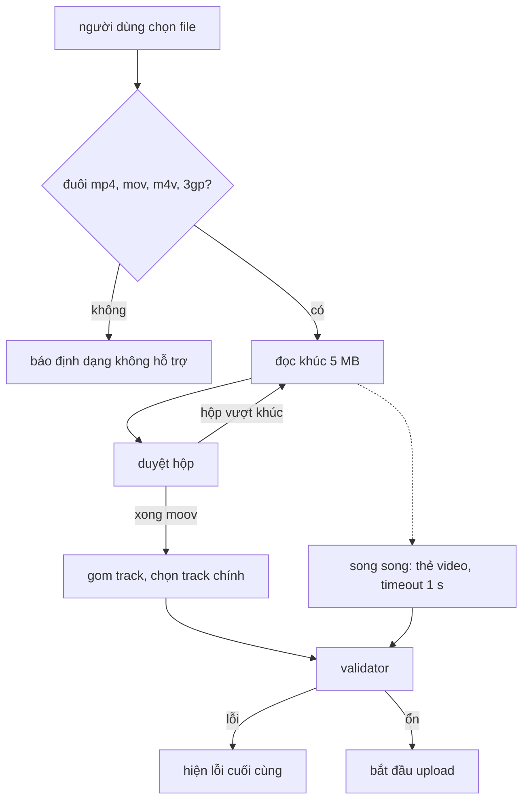

Người dùng chọn một video 2 GB để đăng. Nếu video dài hơn giới hạn, hoặc là file chỉ có tiếng, hoặc độ phân giải quá thấp, thì tốt nhất là báo **ngay lúc chọn file**, chứ không phải sau 10 phút upload. Muốn vậy, trình duyệt phải tự đọc được thời lượng và kích thước của video mà không tải nó lên đâu cả.

Cách đầu tiên ai cũng nghĩ tới là tạo một thẻ `<video>` với `URL.createObjectURL(file)` rồi chờ `loadedmetadata`. Cách này dùng được, nhưng chỉ cho biết kích thước và thời lượng, không cho biết số track, codec hay metadata video 360 độ, và nó phụ thuộc vào việc trình duyệt có giải mã được codec đó không (một file HEVC từ iPhone có thể không mở được trên Chrome Windows). Facebook làm thêm một bước: đọc thẳng cấu trúc nhị phân của file.

> [!TIP]
> **Tóm tắt**
> - `VideoUploadMetadataParser` đọc file theo từng khúc 5 MB bằng `FileReader` và duyệt **cây hộp ISO-BMFF** (`ftyp`, `moov`, `trak`, `mvhd`, `tkhd`, `hdlr`, …). Hộp `mdat` chứa dữ liệu hình và tiếng được nhảy qua.
> - Từ đó lấy thời lượng, kích thước từng track, loại track, số mẫu, và metadata video 360 độ trong hộp `uuid` (Spherical Video V1 của Google, hoặc định dạng riêng của Facebook).
> - Bản gốc đọc `mvhd`/`tkhd` bằng offset của version 0, nên file dùng version 1 cho ra thời lượng `Infinity`. Danh sách tag 360 độ gõ sai `GSphercal`, nên tag crop đúng chuẩn bị coi là "không hỗ trợ".
> - Validator ghi đè biến lỗi nên chỉ báo lỗi cuối cùng, và nhánh "file chỉ có âm thanh" không bao giờ chạy tới.

<iframe class="demo-frame" src="/demos/facebook-patterns/index.html?theme=dark#/mp4-metadata" title="Demo mp4-metadata" loading="lazy" style="height: 880px"></iframe>

<p class="demo-links">▶ <a href="/demos/facebook-patterns/index.html#/mp4-metadata" target="_blank" rel="noopener">Mở demo toàn màn hình ↗</a> · <a href="https://stackblitz.com/github/hunghg255/blog-hunghg/tree/master/examples/facebook-patterns?file=src/lib/mp4Metadata.ts" target="_blank" rel="noopener">Sửa code trên StackBlitz ↗</a> · <a href="https://github.com/hunghg255/blog-hunghg/blob/master/examples/facebook-patterns/src/lib/mp4Metadata.ts" target="_blank" rel="noopener">Xem source trên GitHub ↗</a></p>

## Facebook làm thế nào?

Ba module chính nằm ở bundle `177.js` (bản trùng ở `26.VideoPlayer/all.js`): `VideoUploadMetadataParser`, `VideoUploadFileValidator` và `VideoSphericalMetadataUtil`.

### Cấu trúc file MP4 trong một đoạn

File MP4 (và MOV, 3GP, M4V, cùng họ ISO Base Media File Format) là một chuỗi **hộp (box, hay atom)**. Mỗi hộp bắt đầu bằng 4 byte kích thước và 4 byte tên (fourcc). Kích thước bằng 1 nghĩa là 8 byte tiếp theo chứa kích thước 64-bit. Một số hộp là "container", chỉ chứa các hộp con:

```text
ftyp                      loại file, brand (isom, qt  , mp42…)
moov                      metadata của cả phim
  mvhd                    timescale, thời lượng
  trak                    một track
    tkhd                  id, kích thước, ma trận biến đổi (xoay)
    mdia
      mdhd                timescale, thời lượng của track
      hdlr                loại track: vide, soun, subt…
      minf
        stbl
          stsd            codec: avc1, hvc1, mp4a…
          stsz            số mẫu (frame)
  uuid                    hộp mở rộng, ví dụ metadata 360 độ
mdat                      dữ liệu hình và tiếng, chiếm gần hết file
```

### Đọc theo khúc, nhảy qua mdat

```js
// đổi tên biến; CHUNK = 5242880 (5 MB)
readChunk(start, end, state) {
  const reader = new FileReader();
  return new Promise((resolve, reject) => {
    reader.onload = async () => {
      const r = this.walk(new DataView(reader.result), 0, end - start, start, state);
      if (r.completed) return resolve(this.summarize(r));
      resolve(await this.readChunk(start + r.nextOffset, Math.min(file.size, start + r.nextOffset + CHUNK), r));
    };
    reader.readAsArrayBuffer(fileSlice.call(file, start, end));
  });
}

walk(view, pos, end, fileOffset, state) {
  while (pos < end) {
    let len = view.getUint32(pos);
    const type = readString(view, pos + 4, 4);
    if (len === 1) len = getVideo64BitAtomLength(view, pos, 4, 4);
    if (pos + len > end) {                  // hộp vượt quá khúc đang có
      state.completed = false;
      state.nextOffset = pos;
      if (len > end) state.nextOffset += len;  // hộp to hơn cả khúc: nhảy qua luôn
      return state;
    }
    if (pos + fileOffset === 0 && type !== 'ftyp') throw new Error('No ftyp atom');
    if (len === 0) throw new Error('len is 0');
    switch (type) {
      case 'moov': case 'trak': case 'mdia': case 'stbl': pos += 8; break;   // đi vào trong
      case 'mvhd': state.duration = view.getUint32(pos + 24) / view.getUint32(pos + 20); pos += len; break;
      case 'tkhd': state.widths.push(view.getUint16(pos + 84)); state.heights.push(view.getUint16(pos + 88)); pos += len; break;
      case 'hdlr': /* 'vide' → video, 'soun' → audio, 'subt' → subtitle */ pos += len; break;
      case 'uuid': this.readSpherical(view, pos, len, state); pos += len; break;
      default: pos += len;                  // mdat, free, … đều bị bỏ qua
    }
  }
}
```

Quy tắc "hộp vượt khúc thì đọc lại từ đầu hộp, hộp to hơn cả khúc thì nhảy qua" xử lý gọn trường hợp file chưa được "fast start": camera và điện thoại thường ghi `mdat` trước, `moov` ở cuối file (vì chỉ biết kích thước các frame sau khi quay xong). Với file 2 GB như vậy, parser đọc 5 MB đầu, thấy `mdat` dài 2 GB, nhảy thẳng tới `moov`. Tổng cộng chỉ đọc vài MB.

Nhưng chính quy tắc đó cũng áp dụng cho **`moov`**. Video vài giờ có bảng `stbl` lớn, `moov` có thể vượt 5 MB, và khi đó nó bị nhảy qua như `mdat`. Kết quả là danh sách track rỗng.

### Lỗi offset: version 0 và version 1

`mvhd`, `mdhd` và `tkhd` là **full box**: sau tên hộp có 1 byte `version` và 3 byte `flags`. Version 0 lưu thời gian tạo, thời gian sửa và thời lượng bằng số 32-bit; version 1 dùng 64-bit. Bản gốc luôn đọc ở offset của version 0:

| Trường của `mvhd` | Version 0 | Version 1 |
|---|---|---|
| `timescale` | byte 20 | byte 28 |
| `duration` | byte 24 (32-bit) | byte 32 (64-bit) |

Với file version 1, byte 20 là **nửa cao** của `modification_time`. Thời gian trong MP4 tính bằng giây từ năm 1904 và sẽ chưa vượt 2^32 cho tới năm 2040, nên nửa cao bằng 0. Thời lượng tính ra là `x / 0 = Infinity`, và validator sau đó báo "Thời lượng video quá dài". Bấm "mvhd version 1" trong demo để thấy. Version 1 ít gặp hơn nhưng hoàn toàn hợp lệ; ffmpeg chẳng hạn chuyển sang version 1 khi thời lượng tính theo timescale vượt 32-bit. `mdhd` dùng cùng hàm đọc nên dính cùng lỗi.

`tkhd` có cùng vấn đề, và bản gốc chỉ đọc phần nguyên 16-bit của kích thước 16.16. Nó cũng không đọc **ma trận biến đổi**: video quay dọc trên điện thoại thường được lưu là 1920×1080 kèm ma trận xoay 90°. Bản gốc có cờ `acceptDimensionsFromPlayer` để lấy kích thước từ thẻ `<video>` (đã xoay) thay vì từ `tkhd`, có lẽ chính vì chuyện này.

Có một chỗ bản gốc làm cẩn thận: file MOV của QuickTime có thêm một hộp `hdlr` bên trong `minf` (data handler, kiểu `alis`). Parser đặt cờ `isParsingInMediaInformationAtom` khi đi vào `minf` để không đếm nhầm `hdlr` đó thành một track.

### Gom kết quả, chọn track chính

```js
if (widths.length !== heights.length || widths.length !== streamTypes.length || /* … */)
  throw new Error('Number of parsed widths, heights, durations or sample counts for video file are mismatched.');
for (const track of tracks) {
  if (track.type === 'video') {
    const pv = result.streams.primaryVideo;
    if (!pv || pv.width * pv.height > track.width * track.height) result.streams.primaryVideo = track;
  } else if (track.type === 'audio') { /* giữ track audio dài nhất */ }
}
```

Điều kiện `pv.width * pv.height > area` thay track chính khi track hiện tại **lớn hơn** track mới, tức là giữ track hình **nhỏ nhất**. Với file có một track hình thì không sao. File có thêm track ảnh thu nhỏ hoặc track độ sâu thì track nhỏ đó được chọn để kiểm tra kích thước. Track audio thì chọn track dài nhất; có lẽ track hình cũng định chọn track lớn nhất.

Song song (khi được bật qua tham số khởi tạo), parser tạo thẻ `<video>` và chạy `Promise.race` giữa `loadedmetadata` và một timer 1 giây. Timer không bao giờ bị huỷ khi metadata về trước, object URL không bao giờ được `revokeObjectURL` (giữ tham chiếu tới file 2 GB cho tới khi đóng tab), và nếu 1 giây không đủ (file lớn có `moov` ở cuối, ổ đĩa mạng chậm) thì `Promise.all` của cả hai nhánh bị reject, cả lần đọc bị coi là `INTERNAL_FAILURE` dù phần đọc hộp đã thành công.

### Video 360 độ và VR180

Hộp `uuid` có 16 byte định danh. Hai giá trị được nhận ra (`ISOVideoBoxConstants`): `ffcc8263-f855-4a93-8814-587a02521fdd` là **Spherical Video V1** của Google, giá trị còn lại là định dạng riêng của Facebook. Sau định danh là một đoạn XML:

```xml
<rdf:SphericalVideo xmlns:GSpherical="http://ns.google.com/videos/1.0/spherical/">
  <GSpherical:Spherical>true</GSpherical:Spherical>
  <GSpherical:ProjectionType>equirectangular</GSpherical:ProjectionType>
  <GSpherical:StereoMode>left-right</GSpherical:StereoMode>
  <GSpherical:CroppedAreaImageWidthPixels>2880</GSpherical:CroppedAreaImageWidthPixels>
  <GSpherical:FullPanoWidthPixels>5760</GSpherical:FullPanoWidthPixels>
  …
</rdf:SphericalVideo>
```

`VideoSphericalMetadataUtil.isGoogleVR180` nhận diện **VR180** (video 3D chỉ phủ nửa vòng phía trước): ảnh equirectangular, stereo trái-phải hoặc trên-dưới, vùng crop rộng bằng nửa pano và cao bằng cả pano (sai lệch 1 pixel).

Lỗi gõ nằm trong `GSphericalMetadataTags`:

```js
CROPPED_AREA_IMAGE_WIDTH_PIXELS:  'GSphercal:CroppedAreaImageWidthPixels',   // thiếu chữ "i"
CROPPED_AREA_IMAGE_HEIGHT_PIXELS: 'GSphercal:CroppedAreaImageHeightPixels',
CROPPED_AREA_LEFT_PIXELS:         'GSphercal:CroppedAreaLeftPixels',
CROPPED_AREA_TOP_PIXELS:          'GSphercal:CroppedAreaTopPixels',
FULL_PANO_WIDTH_PIXELS:           'GSphercal:FullPanoWidthPixels',
FULL_PANO_HEIGHT_PIXELS:          'GSphercal:FullPanoHeightPixels',
```

Sáu tag về vùng crop đều viết `GSphercal`, trong khi bảy tag phía trên viết đúng `GSpherical`. Hàm `getUnsupportedGSphericalTagsXML` so tên thẻ trong XML với danh sách này để tách ra các tag "không hỗ trợ". File VR180 đúng chuẩn có đủ sáu tag crop, và cả sáu bị coi là không hỗ trợ. Nếu nơi gọi `isGoogleVR180` cũng đọc giá trị qua các hằng này thì nó không tìm thấy tag nào và VR180 không bao giờ được nhận ra; nơi gọi không có trong các bundle nên bài không khẳng định điều đó.

### Validator

```js
getVideoErrors(isGif, meta) {
  let error;
  const d = meta.format.duration;
  if (d) {
    if (d > rules.maxLength) error = tooLong();
    if (d < rules.minLength && !isGif) error = tooShort();
  }
  if (!meta.streams || !meta.streams.primaryVideo) return;       // ← return sớm, mất cả lỗi thời lượng
  let w = meta.streams.primaryVideo.width, h = meta.streams.primaryVideo.height;
  if (rules.acceptDimensionsFromPlayer && playerW && playerH) { w = playerW; h = playerH; }
  if (!meta.streams.primaryVideo && meta.streams.primaryAudio) error = audioOnly();   // không bao giờ đúng
  if (w < rules.minWidth) error = tooNarrow();
  if (h < rules.minHeight) error = tooLow();
  /* tỉ lệ khung hình … */
  return error;
}
```

Ba lỗi trong một hàm ngắn:

- **Lỗi sau ghi đè lỗi trước.** Video vừa quá ngắn vừa quá hẹp chỉ được báo "chiều cao quá thấp". Người dùng sửa xong một lỗi, upload lại, lại gặp lỗi khác.
- **File không có track hình thì `return` không giá trị**, kể cả khi đã tìm thấy lỗi thời lượng trước đó.
- **Nhánh "chỉ có âm thanh" là code chết**: ngay trên nó đã `return` khi không có `primaryVideo`. File `.m4v` chỉ chứa tiếng đi qua kiểm tra ở client.



## Bên trong trình duyệt

- **`Blob.slice()`** không đọc gì cả; nó chỉ tạo một Blob mới trỏ vào một khoảng byte của file gốc. Byte chỉ được đọc khi gọi `arrayBuffer()`, `text()`, `stream()` hoặc `FileReader`. Vì vậy cắt một file 2 GB thành mảnh 16 byte để đọc header hộp là rẻ.
- **`blob.arrayBuffer()`** trả Promise, gọn hơn `FileReader` với ba callback. Bản gốc dùng `FileReader` và một hàm `fileSlice` có lẽ để chạy được cả trình duyệt cũ có `webkitSlice`/`mozSlice`.
- **`DataView`** đọc số big-endian mặc định, đúng với MP4. Số 16.16 (fixed-point) chia cho 65536.
- **`URL.createObjectURL(file)`** giữ tham chiếu tới file cho tới khi `revokeObjectURL` hoặc khi tài liệu bị huỷ. Với file lớn, quên revoke là giữ bộ nhớ (hoặc ít nhất là handle file) suốt phiên.
- **`<video preload="metadata">`** chỉ tải phần đủ để biết kích thước và thời lượng. Với file local, trình duyệt có thể phải đọc tới tận `moov` ở cuối file.

## Viết lại

Bản viết lại đọc từng hộp bằng `Blob.slice` thay vì từng khúc 5 MB. Mỗi hộp tốn một lần đọc 16 byte header; hộp lá cần dữ liệu thì đọc thêm tối đa 64 KB; container thì đi vào trong, bất kể nó lớn bao nhiêu. Số lần đọc vài chục, mỗi lần rất nhỏ.

Đọc `mvhd`/`mdhd`/`tkhd` theo đúng version, và góc xoay từ ma trận:

```ts title=src/lib/mp4Metadata.ts
/** mvhd/mdhd: version 1 dùng thời gian 64-bit nên mọi offset phía sau dịch đi. */
export function readTimescaleDuration(v: DataView): number | null {
  const version = v.getUint8(8);
  const timescale = version === 1 ? v.getUint32(28) : v.getUint32(20);
  const duration = version === 1 ? u64(v, 32) : v.getUint32(24);
  return timescale ? duration / timescale : null;
}

function readTkhd(v: DataView) {
  const version = v.getUint8(8);
  const base = version === 1 ? 12 : 0; // creation/modification/duration 64-bit thay vì 32-bit
  const id = v.getUint32(version === 1 ? 28 : 20);
  const m = 48 + base; // ma trận 3×3, a b u / c d v / x y w, a b c d dạng 16.16
  const a = v.getInt32(m) / 65536;
  const b = v.getInt32(m + 4) / 65536;
  const rotation = (Math.round((Math.atan2(b, a) * 180) / Math.PI) + 360) % 360;
  return { id, rotation, width: v.getUint32(84 + base) / 65536, height: v.getUint32(88 + base) / 65536 };
}
```

Duyệt cây hộp:

```ts title=src/lib/mp4Metadata.ts
export async function parseMp4(blob: Blob, { maxPayload = 64 * 1024 } = {}): Promise<Mp4Metadata> {
  const out: Mp4Metadata = { majorBrand: null, durationSec: null, tracks: [], primaryVideo: null, primaryAudio: null, spherical: null, reads: 0 };
  const read = async (start: number, len: number) => {
    out.reads++;
    return new DataView(await blob.slice(start, start + len).arrayBuffer());
  };
  let track: TrackInfo | null = null;

  async function walk(start: number, end: number, parent: string): Promise<void> {
    let pos = start;
    while (pos + 8 <= end) {
      const h = await read(pos, 16);
      let size = h.getUint32(0);
      const type = fourcc(h, 4);
      let header = 8;
      if (size === 1) {
        if (h.byteLength < 16) throw new Error(`Hộp ${type} bị cắt cụt`);
        size = u64(h, 8);
        header = 16;
      } else if (size === 0) size = end - pos; // hộp kéo dài tới hết file, chuẩn cho phép
      if (pos === 0 && type !== 'ftyp') throw new Error('Không có hộp ftyp ở đầu: không phải MP4/MOV');
      if (size < header || pos + size > end) throw new Error(`Hộp ${type} ở byte ${pos} có kích thước sai (${size})`);

      if (CONTAINERS.has(type)) {
        if (type === 'trak') track = { id: 0, type: 'data', width: 0, height: 0, rotation: 0, durationSec: null, sampleCount: null, codec: null };
        await walk(pos + header, pos + size, type);
        if (type === 'trak' && track) out.tracks.push(track);
      } else if (type !== 'mdat' && type !== 'free' && type !== 'skip') {
        const v = await read(pos, Math.min(size, maxPayload)); // mdat không bao giờ được đọc
        leaf(type, v, parent);
      }
      pos += size;
    }
  }
```

Metadata 360 độ đọc theo tên cục bộ, không so cả chuỗi `tiền tố:tên`:

```ts title=src/lib/mp4Metadata.ts
/** Đọc XML Spherical Video V1 theo TÊN CỤC BỘ, không phụ thuộc tiền tố namespace. */
export function parseSphericalXml(xml: string, source: SphericalInfo['source']): SphericalInfo | null {
  const tags = new Map<string, string>();
  const unknownTags: string[] = [];
  for (const m of xml.matchAll(/<([\w-]+):([\w-]+)>([^<]*)<\/\1:\2>/g)) {
    const [, prefix, local, value] = m;
    tags.set(local, value.trim());
    if (prefix === 'GSpherical' && !KNOWN_GSPHERICAL.includes(local)) unknownTags.push(`${prefix}:${local}`);
  }
  if (tags.get('Spherical')?.toLowerCase() !== 'true') return null;
  const projection = tags.get('ProjectionType') ?? null;
  const stereoMode = tags.get('StereoMode') ?? null;
  const num = (k: string) => (tags.has(k) ? Number.parseInt(tags.get(k)!, 10) : null);
  return {
    source,
    projection,
    stereoMode,
    vr180: isVR180(projection, stereoMode, num('CroppedAreaImageWidthPixels'), num('CroppedAreaImageHeightPixels'), num('FullPanoWidthPixels'), num('FullPanoHeightPixels')),
    unknownTags,
    xml,
  };
}

/** VR180: ảnh equirect stereo chỉ phủ nửa vòng ngang (crop rộng = nửa pano), phủ đủ chiều dọc. */
export function isVR180(projection: string | null, stereo: string | null, cropW: number | null, cropH: number | null, fullW: number | null, fullH: number | null) {
  if (cropW == null || cropH == null || fullW == null || fullH == null) return false;
  if (projection !== 'equirectangular' || (stereo !== 'left-right' && stereo !== 'top-bottom')) return false;
  return Math.abs(cropW - fullW / 2) <= 1 && Math.abs(cropH - fullH) <= 1;
}
```

Validator trả về mọi lỗi, và thẻ `<video>` luôn được dọn dẹp:

```ts title=src/lib/mp4Metadata.ts
/** Trả về MỌI lỗi, theo thứ tự nên sửa trước (bản gốc ghi đè biến lỗi nên chỉ còn lỗi cuối). */
export function validateUpload(file: { name: string; size: number }, meta: Mp4Metadata | null, r: UploadRules): ValidationError[] {
  const errors: ValidationError[] = [];
  const push = (code: ValidationError['code'], message: string) => errors.push({ code, message });
  const ext = file.name.split('.').pop()?.toLowerCase() ?? '';
  if (!r.extensions.includes(ext)) push('extension', `Định dạng .${ext} không được hỗ trợ`);
  if (file.size < r.minSize) push('too_small', `File nhỏ hơn ${Math.round(r.minSize / 1024)} KB`);
  if (file.size > r.maxSize) push('too_large', `File lớn hơn ${Math.floor(r.maxSize / 1024 / 1024)} MB`);
  if (!meta) return errors;
  const d = meta.durationSec;
  if (d != null && d > r.maxLengthSec) push('too_long', `Dài hơn ${r.maxLengthSec} giây`);
  if (d != null && d < r.minLengthSec) push('too_short', `Ngắn hơn ${r.minLengthSec} giây`);
  if (!meta.primaryVideo) {
    push('no_video', meta.primaryAudio ? 'File chỉ có âm thanh, không có hình' : 'Không tìm thấy track hình');
    return errors;
  }
  const { width, height } = displaySize(meta.primaryVideo);
  if (width < r.minWidth) push('too_narrow', `Rộng ${width}px, tối thiểu ${r.minWidth}px`);
  if (height < r.minHeight) push('too_low', `Cao ${height}px, tối thiểu ${r.minHeight}px`);
  const ratio = height ? width / height : Infinity;
  if (r.minAspect && ratio < r.minAspect) push('too_tall', `Tỉ lệ ${ratio.toFixed(2)} nhỏ hơn ${r.minAspect}`);
  if (r.maxAspect && ratio > r.maxAspect) push('too_wide', `Tỉ lệ ${ratio.toFixed(2)} lớn hơn ${r.maxAspect}`);
  return errors;
}

/** Kích thước do trình duyệt giải mã (đã xoay), có timeout và luôn dọn object URL. */
export function probeWithVideoElement(file: Blob, timeoutMs = 5000): Promise<{ width: number; height: number; duration: number } | null> {
  return new Promise((resolve) => {
    const video = document.createElement('video');
    const url = URL.createObjectURL(file);
    const done = (value: { width: number; height: number; duration: number } | null) => {
      clearTimeout(timer);
      video.removeAttribute('src');
      video.load();
      URL.revokeObjectURL(url);
      resolve(value);
    };
    const timer = setTimeout(() => done(null), timeoutMs);
    video.preload = 'metadata';
    video.onloadedmetadata = () => done({ width: video.videoWidth, height: video.videoHeight, duration: video.duration });
    video.onerror = () => done(null);
    video.src = url;
  });
}
```

::: spoiler Xem toàn bộ src/lib/mp4Metadata.ts

```ts title=src/lib/mp4Metadata.ts
/**
 * Đọc metadata MP4/MOV ngay trên trình duyệt trước khi upload (kiểu VideoUploadMetadataParser của Facebook):
 * duyệt cây hộp ISO-BMFF bằng Blob.slice, lấy thời lượng, track, kích thước, góc xoay và metadata video 360.
 * Viết lại từ đầu.
 */

export interface TrackInfo {
  id: number;
  type: 'video' | 'audio' | 'subtitle' | 'data';
  /** Kích thước mã hoá (tkhd), chưa xoay. */
  width: number;
  height: number;
  /** Góc xoay đọc từ ma trận tkhd: 0, 90, 180, 270. */
  rotation: number;
  durationSec: number | null;
  sampleCount: number | null;
  codec: string | null;
}

export interface SphericalInfo {
  source: 'gspherical-v1' | 'fb-spherical';
  projection: string | null;
  stereoMode: string | null;
  vr180: boolean;
  /** Tag không nằm trong danh sách hỗ trợ (bản gốc gõ sai "GSphercal" nên tag crop đúng chuẩn rơi vào đây). */
  unknownTags: string[];
  xml: string;
}

export interface Mp4Metadata {
  majorBrand: string | null;
  durationSec: number | null;
  tracks: TrackInfo[];
  primaryVideo: TrackInfo | null;
  primaryAudio: TrackInfo | null;
  spherical: SphericalInfo | null;
  /** Số lần đọc Blob.slice, để thấy mdat lớn được nhảy qua chứ không đọc. */
  reads: number;
}

const CONTAINERS = new Set(['moov', 'trak', 'mdia', 'minf', 'stbl', 'edts', 'udta']);
const HANDLERS: Record<string, TrackInfo['type']> = { vide: 'video', soun: 'audio', subt: 'subtitle', text: 'subtitle' };
const GSPHERICAL_UUID = 'ffcc8263f8554a938814587a02521fdd';
const FBSPHERICAL_UUID = 'ae24b24d3c8f4f188a7be009c13835c1';
const KNOWN_GSPHERICAL = [
  'Spherical', 'Stitched', 'StitchingSoftware', 'ProjectionType', 'StereoMode', 'SourceCount',
  'InitialViewHeadingDegrees', 'InitialViewPitchDegrees', 'InitialViewRollDegrees', 'Timestamp',
  'FullPanoWidthPixels', 'FullPanoHeightPixels', 'CroppedAreaImageWidthPixels', 'CroppedAreaImageHeightPixels',
  'CroppedAreaLeftPixels', 'CroppedAreaTopPixels',
];

const fourcc = (v: DataView, o: number) => String.fromCharCode(v.getUint8(o), v.getUint8(o + 1), v.getUint8(o + 2), v.getUint8(o + 3));
const u64 = (v: DataView, o: number) => v.getUint32(o) * 2 ** 32 + v.getUint32(o + 4);
const hex = (v: DataView, o: number, n: number) =>
  Array.from({ length: n }, (_, i) => v.getUint8(o + i).toString(16).padStart(2, '0')).join('');

/** mvhd/mdhd: version 1 dùng thời gian 64-bit nên mọi offset phía sau dịch đi. */
export function readTimescaleDuration(v: DataView): number | null {
  const version = v.getUint8(8);
  const timescale = version === 1 ? v.getUint32(28) : v.getUint32(20);
  const duration = version === 1 ? u64(v, 32) : v.getUint32(24);
  return timescale ? duration / timescale : null;
}

function readTkhd(v: DataView) {
  const version = v.getUint8(8);
  const base = version === 1 ? 12 : 0; // creation/modification/duration 64-bit thay vì 32-bit
  const id = v.getUint32(version === 1 ? 28 : 20);
  const m = 48 + base; // ma trận 3×3, a b u / c d v / x y w, a b c d dạng 16.16
  const a = v.getInt32(m) / 65536;
  const b = v.getInt32(m + 4) / 65536;
  const rotation = (Math.round((Math.atan2(b, a) * 180) / Math.PI) + 360) % 360;
  return { id, rotation, width: v.getUint32(84 + base) / 65536, height: v.getUint32(88 + base) / 65536 };
}

export async function parseMp4(blob: Blob, { maxPayload = 64 * 1024 } = {}): Promise<Mp4Metadata> {
  const out: Mp4Metadata = { majorBrand: null, durationSec: null, tracks: [], primaryVideo: null, primaryAudio: null, spherical: null, reads: 0 };
  const read = async (start: number, len: number) => {
    out.reads++;
    return new DataView(await blob.slice(start, start + len).arrayBuffer());
  };
  let track: TrackInfo | null = null;

  async function walk(start: number, end: number, parent: string): Promise<void> {
    let pos = start;
    while (pos + 8 <= end) {
      const h = await read(pos, 16);
      let size = h.getUint32(0);
      const type = fourcc(h, 4);
      let header = 8;
      if (size === 1) {
        if (h.byteLength < 16) throw new Error(`Hộp ${type} bị cắt cụt`);
        size = u64(h, 8);
        header = 16;
      } else if (size === 0) size = end - pos; // hộp kéo dài tới hết file, chuẩn cho phép
      if (pos === 0 && type !== 'ftyp') throw new Error('Không có hộp ftyp ở đầu: không phải MP4/MOV');
      if (size < header || pos + size > end) throw new Error(`Hộp ${type} ở byte ${pos} có kích thước sai (${size})`);

      if (CONTAINERS.has(type)) {
        if (type === 'trak') track = { id: 0, type: 'data', width: 0, height: 0, rotation: 0, durationSec: null, sampleCount: null, codec: null };
        await walk(pos + header, pos + size, type);
        if (type === 'trak' && track) out.tracks.push(track);
      } else if (type !== 'mdat' && type !== 'free' && type !== 'skip') {
        const v = await read(pos, Math.min(size, maxPayload)); // mdat không bao giờ được đọc
        leaf(type, v, parent);
      }
      pos += size;
    }
  }

  function leaf(type: string, v: DataView, parent: string) {
    switch (type) {
      case 'ftyp':
        out.majorBrand = fourcc(v, 8);
        break;
      case 'mvhd':
        out.durationSec = readTimescaleDuration(v);
        break;
      case 'tkhd':
        if (track) Object.assign(track, readTkhd(v));
        break;
      case 'mdhd':
        if (track) track.durationSec = readTimescaleDuration(v);
        break;
      case 'hdlr':
        // MOV có thêm hdlr trong minf (data handler 'alis'): chỉ tin hdlr nằm ngay dưới mdia
        if (track && parent === 'mdia') track.type = HANDLERS[fourcc(v, 16)] ?? 'data';
        break;
      case 'stsd':
        // stsd: header 8, version/flags 4, entry_count 4, rồi entry đầu: size 4 + định dạng 4
        if (track && v.byteLength >= 24) track.codec = fourcc(v, 20).trim();
        break;
      case 'stsz':
        if (track) track.sampleCount = v.getUint32(16);
        break;
      case 'uuid':
        if (v.byteLength > 24) readSphericalUuid(v);
        break;
    }
  }

  function readSphericalUuid(v: DataView) {
    const id = hex(v, 8, 16);
    if (id !== GSPHERICAL_UUID && id !== FBSPHERICAL_UUID) return;
    const xml = new TextDecoder().decode(new Uint8Array(v.buffer, v.byteOffset + 24, v.byteLength - 24)).replace(/\0/g, '');
    const s = parseSphericalXml(xml, id === GSPHERICAL_UUID ? 'gspherical-v1' : 'fb-spherical');
    if (s && (!out.spherical || s.source === 'gspherical-v1')) out.spherical = s;
  }

  await walk(0, blob.size, '');
  for (const t of out.tracks) {
    if (t.type === 'video') {
      // Chọn track hình LỚN nhất (bản gốc giữ track nhỏ nhất)
      if (!out.primaryVideo || t.width * t.height > out.primaryVideo.width * out.primaryVideo.height) out.primaryVideo = t;
    } else if (t.type === 'audio') {
      if (!out.primaryAudio || (t.durationSec ?? 0) > (out.primaryAudio.durationSec ?? 0)) out.primaryAudio = t;
    }
  }
  return out;
}

/** Đọc XML Spherical Video V1 theo TÊN CỤC BỘ, không phụ thuộc tiền tố namespace. */
export function parseSphericalXml(xml: string, source: SphericalInfo['source']): SphericalInfo | null {
  const tags = new Map<string, string>();
  const unknownTags: string[] = [];
  for (const m of xml.matchAll(/<([\w-]+):([\w-]+)>([^<]*)<\/\1:\2>/g)) {
    const [, prefix, local, value] = m;
    tags.set(local, value.trim());
    if (prefix === 'GSpherical' && !KNOWN_GSPHERICAL.includes(local)) unknownTags.push(`${prefix}:${local}`);
  }
  if (tags.get('Spherical')?.toLowerCase() !== 'true') return null;
  const projection = tags.get('ProjectionType') ?? null;
  const stereoMode = tags.get('StereoMode') ?? null;
  const num = (k: string) => (tags.has(k) ? Number.parseInt(tags.get(k)!, 10) : null);
  return {
    source,
    projection,
    stereoMode,
    vr180: isVR180(projection, stereoMode, num('CroppedAreaImageWidthPixels'), num('CroppedAreaImageHeightPixels'), num('FullPanoWidthPixels'), num('FullPanoHeightPixels')),
    unknownTags,
    xml,
  };
}

/** VR180: ảnh equirect stereo chỉ phủ nửa vòng ngang (crop rộng = nửa pano), phủ đủ chiều dọc. */
export function isVR180(projection: string | null, stereo: string | null, cropW: number | null, cropH: number | null, fullW: number | null, fullH: number | null) {
  if (cropW == null || cropH == null || fullW == null || fullH == null) return false;
  if (projection !== 'equirectangular' || (stereo !== 'left-right' && stereo !== 'top-bottom')) return false;
  return Math.abs(cropW - fullW / 2) <= 1 && Math.abs(cropH - fullH) <= 1;
}

/** Kích thước hiển thị sau khi áp góc xoay (video quay dọc trên điện thoại thường là 1920×1080 + xoay 90°). */
export const displaySize = (t: TrackInfo) =>
  t.rotation % 180 === 90 ? { width: t.height, height: t.width } : { width: t.width, height: t.height };

export interface UploadRules {
  extensions: string[];
  minSize: number;
  maxSize: number;
  minLengthSec: number;
  maxLengthSec: number;
  minWidth: number;
  minHeight: number;
  minAspect?: number;
  maxAspect?: number;
}

export interface ValidationError {
  code: 'extension' | 'too_small' | 'too_large' | 'too_short' | 'too_long' | 'no_video' | 'too_narrow' | 'too_low' | 'too_tall' | 'too_wide';
  message: string;
}

/** Trả về MỌI lỗi, theo thứ tự nên sửa trước (bản gốc ghi đè biến lỗi nên chỉ còn lỗi cuối). */
export function validateUpload(file: { name: string; size: number }, meta: Mp4Metadata | null, r: UploadRules): ValidationError[] {
  const errors: ValidationError[] = [];
  const push = (code: ValidationError['code'], message: string) => errors.push({ code, message });
  const ext = file.name.split('.').pop()?.toLowerCase() ?? '';
  if (!r.extensions.includes(ext)) push('extension', `Định dạng .${ext} không được hỗ trợ`);
  if (file.size < r.minSize) push('too_small', `File nhỏ hơn ${Math.round(r.minSize / 1024)} KB`);
  if (file.size > r.maxSize) push('too_large', `File lớn hơn ${Math.floor(r.maxSize / 1024 / 1024)} MB`);
  if (!meta) return errors;
  const d = meta.durationSec;
  if (d != null && d > r.maxLengthSec) push('too_long', `Dài hơn ${r.maxLengthSec} giây`);
  if (d != null && d < r.minLengthSec) push('too_short', `Ngắn hơn ${r.minLengthSec} giây`);
  if (!meta.primaryVideo) {
    push('no_video', meta.primaryAudio ? 'File chỉ có âm thanh, không có hình' : 'Không tìm thấy track hình');
    return errors;
  }
  const { width, height } = displaySize(meta.primaryVideo);
  if (width < r.minWidth) push('too_narrow', `Rộng ${width}px, tối thiểu ${r.minWidth}px`);
  if (height < r.minHeight) push('too_low', `Cao ${height}px, tối thiểu ${r.minHeight}px`);
  const ratio = height ? width / height : Infinity;
  if (r.minAspect && ratio < r.minAspect) push('too_tall', `Tỉ lệ ${ratio.toFixed(2)} nhỏ hơn ${r.minAspect}`);
  if (r.maxAspect && ratio > r.maxAspect) push('too_wide', `Tỉ lệ ${ratio.toFixed(2)} lớn hơn ${r.maxAspect}`);
  return errors;
}

/** Kích thước do trình duyệt giải mã (đã xoay), có timeout và luôn dọn object URL. */
export function probeWithVideoElement(file: Blob, timeoutMs = 5000): Promise<{ width: number; height: number; duration: number } | null> {
  return new Promise((resolve) => {
    const video = document.createElement('video');
    const url = URL.createObjectURL(file);
    const done = (value: { width: number; height: number; duration: number } | null) => {
      clearTimeout(timer);
      video.removeAttribute('src');
      video.load();
      URL.revokeObjectURL(url);
      resolve(value);
    };
    const timer = setTimeout(() => done(null), timeoutMs);
    video.preload = 'metadata';
    video.onloadedmetadata = () => done({ width: video.videoWidth, height: video.videoHeight, duration: video.duration });
    video.onerror = () => done(null);
    video.src = url;
  });
}
```

:::

Demo không cần file video thật: `src/lib/mp4MetadataFixtures.ts` dựng một file MP4 chỉ có các hộp metadata và một `mdat` toàn số 0.

::: spoiler Xem src/lib/mp4MetadataFixtures.ts

```ts title=src/lib/mp4MetadataFixtures.ts
/** Dựng file MP4/MOV tối giản (chỉ có hộp metadata, mdat toàn số 0) cho demo và test của mp4Metadata.ts. */

const enc = new TextEncoder();

function concat(parts: Uint8Array[]): Uint8Array {
  const out = new Uint8Array(parts.reduce((n, p) => n + p.length, 0));
  let o = 0;
  for (const p of parts) {
    out.set(p, o);
    o += p.length;
  }
  return out;
}

function bytes(len: number, write: (v: DataView) => void): Uint8Array {
  const u = new Uint8Array(len);
  write(new DataView(u.buffer));
  return u;
}

export function box(type: string, ...parts: Uint8Array[]): Uint8Array {
  const body = concat(parts);
  const head = bytes(8, (v) => v.setUint32(0, 8 + body.length));
  head.set(enc.encode(type), 4);
  return concat([head, body]);
}

const fullHeader = (version: number) => bytes(4, (v) => v.setUint8(0, version));

function matrix(rotation: number): Uint8Array {
  const r = (rotation * Math.PI) / 180;
  const cos = Math.round(Math.cos(r));
  const sin = Math.round(Math.sin(r));
  return bytes(36, (v) => {
    [cos, sin, 0, -sin, cos, 0, 0, 0].forEach((x, i) => v.setInt32(i * 4, x * 65536));
    v.setInt32(32, 0x40000000); // w = 1.0 (2.30)
  });
}

/** Giây tính từ 1904-01-01 (mốc thời gian của QuickTime/MP4), khoảng năm 2024. */
const CREATED = 3_800_000_000;

export function mvhd(version: 0 | 1, timescale: number, duration: number): Uint8Array {
  const times =
    version === 1
      ? bytes(28, (v) => {
          v.setUint32(4, CREATED); // creation_time 64-bit: nửa cao = 0 tới năm 2040
          v.setUint32(12, CREATED); // modification_time
          v.setUint32(16, timescale);
          v.setUint32(20, Math.floor(duration / 2 ** 32));
          v.setUint32(24, duration >>> 0);
        })
      : bytes(16, (v) => {
          v.setUint32(0, CREATED);
          v.setUint32(4, CREATED);
          v.setUint32(8, timescale);
          v.setUint32(12, duration);
        });
  return box('mvhd', fullHeader(version), times, bytes(80, (v) => v.setUint32(76, 3)));
}

function tkhd(id: number, w: number, h: number, rotation: number) {
  return box(
    'tkhd',
    fullHeader(0),
    bytes(28, (v) => v.setUint32(8, id)),
    bytes(8, () => {}),
    matrix(rotation),
    bytes(8, (v) => {
      v.setUint32(0, w * 65536);
      v.setUint32(4, h * 65536);
    }),
  );
}

const mdhd = (timescale: number, duration: number) =>
  box('mdhd', fullHeader(0), bytes(20, (v) => (v.setUint32(8, timescale), v.setUint32(12, duration))));

function hdlr(handler: string) {
  const b = bytes(21, () => {});
  b.set(enc.encode(handler), 4);
  return box('hdlr', fullHeader(0), b);
}

const stsd = (codec: string) => box('stsd', fullHeader(0), bytes(4, (v) => v.setUint32(0, 1)), box(codec, new Uint8Array(8)));
const stsz = (count: number) => box('stsz', fullHeader(0), bytes(8, (v) => v.setUint32(4, count)));

export interface FixtureTrack {
  kind: 'video' | 'audio';
  width?: number;
  height?: number;
  rotation?: number;
}

export interface FixtureOptions {
  durationSec: number;
  mvhdVersion?: 0 | 1;
  tracks: FixtureTrack[];
  /** MOV từ QuickTime: thêm hdlr 'alis' bên trong minf. */
  quicktimeDataHandler?: boolean;
  sphericalXml?: string;
  /** Đặt mdat (toàn 0) dài chừng này byte TRƯỚC moov, như file chưa "fast start". */
  mdatFirstBytes?: number;
}

export function buildMp4(o: FixtureOptions): { blob: Blob; mvhd: Uint8Array } {
  const ts = 1000;
  const movieHeader = mvhd(o.mvhdVersion ?? 0, ts, Math.round(o.durationSec * ts));
  const traks = o.tracks.map((t, i) => {
    const video = t.kind === 'video';
    const minfParts = [
      box(video ? 'vmhd' : 'smhd', fullHeader(0), new Uint8Array(video ? 8 : 4)),
      ...(o.quicktimeDataHandler ? [hdlr('alis')] : []),
      box('stbl', stsd(video ? 'avc1' : 'mp4a'), stsz(Math.round(o.durationSec * (video ? 30 : 43)))),
    ];
    return box(
      'trak',
      tkhd(i + 1, video ? t.width ?? 1920 : 0, video ? t.height ?? 1080 : 0, t.rotation ?? 0),
      box('mdia', mdhd(ts, Math.round(o.durationSec * ts)), hdlr(video ? 'vide' : 'soun'), box('minf', ...minfParts)),
    );
  });
  const extra: Uint8Array[] = [];
  if (o.sphericalXml) {
    const uuid = Uint8Array.from([0xff, 0xcc, 0x82, 0x63, 0xf8, 0x55, 0x4a, 0x93, 0x88, 0x14, 0x58, 0x7a, 0x02, 0x52, 0x1f, 0xdd]);
    extra.push(box('uuid', uuid, enc.encode(o.sphericalXml)));
  }
  const ftyp = box('ftyp', enc.encode(o.quicktimeDataHandler ? 'qt  ' : 'isom'), new Uint8Array(4), enc.encode('isomiso2avc1mp41'));
  const moov = box('moov', movieHeader, ...traks, ...extra);
  const parts: BlobPart[] = [ftyp as BlobPart];
  if (o.mdatFirstBytes) parts.push(box('mdat', new Uint8Array(o.mdatFirstBytes)) as BlobPart, moov as BlobPart);
  else parts.push(moov as BlobPart, box('mdat', new Uint8Array(1024)) as BlobPart);
  return { blob: new Blob(parts, { type: 'video/mp4' }), mvhd: movieHeader };
}

export function gsphericalXml(o: { stereo: 'mono' | 'left-right' | 'top-bottom'; crop?: [number, number, number, number] }): string {
  const tag = (k: string, v: string | number) => `<GSpherical:${k}>${v}</GSpherical:${k}>`;
  const crop = o.crop
    ? [
        tag('CroppedAreaImageWidthPixels', o.crop[0]),
        tag('CroppedAreaImageHeightPixels', o.crop[1]),
        tag('FullPanoWidthPixels', o.crop[2]),
        tag('FullPanoHeightPixels', o.crop[3]),
        tag('CroppedAreaLeftPixels', (o.crop[2] - o.crop[0]) / 2),
        tag('CroppedAreaTopPixels', 0),
      ]
    : [];
  return `<?xml version="1.0"?><rdf:SphericalVideo xmlns:rdf="http://www.w3.org/1999/02/22-rdf-syntax-ns#" xmlns:GSpherical="http://ns.google.com/videos/1.0/spherical/">${[
    tag('Spherical', 'true'),
    tag('Stitched', 'true'),
    tag('StitchingSoftware', 'demo'),
    tag('ProjectionType', 'equirectangular'),
    tag('StereoMode', o.stereo),
    ...crop,
  ].join('')}</rdf:SphericalVideo>`;
}
```

:::

**Khác bản gốc:**

- Đọc theo từng hộp, nên `moov` lớn hơn 5 MB vẫn được duyệt. `mdat`, `free`, `skip` không bao giờ được đọc.
- Đọc đúng offset cho version 0 và 1; kích thước track là số 16.16 đầy đủ; có góc xoay và `displaySize()`.
- Hộp kích thước 0 (kéo dài tới hết file, chuẩn cho phép cho hộp cuối) được chấp nhận thay vì ném `len is 0`.
- Track hình chính là track **lớn nhất**.
- Danh sách tag Spherical viết đúng chính tả, và tag được so theo tên cục bộ.
- `validateUpload` trả mảng lỗi; file chỉ có âm thanh được báo đúng.
- `probeWithVideoElement` huỷ timer, gỡ `src`, `revokeObjectURL` ở mọi nhánh, và trả `null` thay vì làm hỏng cả lần đọc.
- Không đọc metadata âm thanh không gian (hộp `SA3D` của YouTube, XML `face` của Facebook) và không hỗ trợ MKV như bản gốc (bản gốc tải riêng `VideoUploadMetadataMKVParser` khi gặp `.mkv`).

## Đi qua code

- **`readTimescaleDuration()`** dùng chung cho `mvhd` và `mdhd`: cùng bố cục, khác tên.
- **`readTkhd()`** tính góc xoay bằng `atan2(b, a)` từ hai phần tử đầu của ma trận. Ma trận xoay 90° có `a = 0, b = 1`.
- **`walk(start, end, parent)`** đệ quy vào container; `parent` cho phép bỏ qua `hdlr` nằm dưới `minf`. Mỗi `trak` tạo một `TrackInfo` mới, các hộp lá bên trong điền vào nó.
- **`leaf()`** là `switch` theo tên hộp. `stsd` lấy fourcc của mục mô tả đầu tiên làm codec.
- **`readSphericalUuid()`** so 16 byte định danh dạng hex, giải mã phần còn lại bằng `TextDecoder`, bỏ ký tự `\0` như bản gốc.
- **`parseSphericalXml()`** dùng regex thay vì `DOMParser`, để chạy được cả trong Web Worker (không có DOM).

## Tại sao không làm cách khác?

**Chỉ dùng thẻ `<video>`?** Không biết số track, codec, metadata 360 độ; không chạy được với codec trình duyệt không giải mã được; và không chạy trong Worker.

**Dùng mp4box.js?** Đầy đủ và đúng chuẩn, nhưng nặng hơn nhiều so với vài trăm dòng cho đúng những trường cần. Facebook có lẽ cũng cân nhắc kích thước bundle như vậy.

**Để server kiểm tra?** Server vẫn phải kiểm tra, vì client có thể bị qua mặt. Kiểm tra ở client là để người dùng biết sớm, không phải để bảo mật.

**WebCodecs/`MediaSource.isTypeSupported`?** Cho biết trình duyệt có giải mã được codec không, chứ không đọc metadata của file. Dùng bổ sung, sau khi đã biết codec từ `stsd`.

## Edge case và cạm bẫy

- **Fragmented MP4** (`moof` + `mdat` lặp lại, hay gặp ở file ghi từ trình duyệt bằng MediaRecorder): `mvhd` có thể có thời lượng 0, thời lượng thật nằm trong `mehd` hoặc phải cộng từ các fragment.
- **Hộp `edts`/`elst`** (edit list) có thể cắt bớt phần đầu video; thời lượng hiển thị khác thời lượng track.
- **File bị cắt cụt** (upload dở, tải dở): kích thước hộp vượt quá kích thước file. Bản viết lại ném lỗi rõ ràng kèm vị trí byte.
- **Spherical Video V2** lưu metadata trong hộp `sv3d`/`st3d` bên trong mục mô tả mẫu, không phải `uuid`. Muốn hỗ trợ thì phải đọc vào trong `avc1`/`hvc1`.
- **File không có đuôi** hoặc đuôi sai. Dựa vào `ftyp` để nhận dạng, đừng tin đuôi file.

## Dùng trong dự án

```ts
import { parseMp4, validateUpload } from './mp4Metadata';

input.addEventListener('change', async () => {
  const file = input.files?.[0];
  if (!file) return;
  let meta = null;
  try {
    meta = await parseMp4(file);
  } catch (e) {
    console.warn('Không đọc được metadata, để server kiểm tra', e);
  }
  const errors = validateUpload(file, meta, {
    extensions: ['mp4', 'mov', 'm4v'], minSize: 1024, maxSize: 4 * 1024 ** 3,
    minLengthSec: 1, maxLengthSec: 4 * 3600, minWidth: 120, minHeight: 120,
  });
  if (errors.length) showErrors(errors.map((e) => e.message));
  else startUpload(file, { durationSec: meta?.durationSec, isSpherical: !!meta?.spherical });
});
```

## Kiểm thử

::: spoiler Ví dụ test (bản phác, không có trong repo)

```ts
import { describe, expect, it } from 'vitest';
import { displaySize, parseMp4, validateUpload } from './mp4Metadata';
import { buildMp4, gsphericalXml } from './mp4MetadataFixtures';

const rules = { extensions: ['mp4'], minSize: 1, maxSize: 1e10, minLengthSec: 1, maxLengthSec: 3600, minWidth: 120, minHeight: 120 };

describe('parseMp4', () => {
  it('đọc thời lượng, track và codec', async () => {
    const { blob } = buildMp4({ durationSec: 12.5, tracks: [{ kind: 'video' }, { kind: 'audio' }] });
    const m = await parseMp4(blob);
    expect(m.durationSec).toBe(12.5);
    expect(m.tracks.map((t) => [t.type, t.codec])).toEqual([['video', 'avc1'], ['audio', 'mp4a']]);
  });

  it('mvhd version 1 và video xoay 90°', async () => {
    const { blob } = buildMp4({ durationSec: 30, mvhdVersion: 1, tracks: [{ kind: 'video', rotation: 90 }] });
    const m = await parseMp4(blob);
    expect(m.durationSec).toBe(30);
    expect(displaySize(m.primaryVideo!)).toEqual({ width: 1080, height: 1920 });
  });

  it('nhảy qua mdat lớn, không đếm hdlr của QuickTime thành track', async () => {
    const { blob } = buildMp4({ durationSec: 5, mdatFirstBytes: 8e6, quicktimeDataHandler: true, tracks: [{ kind: 'video' }] });
    const m = await parseMp4(blob);
    expect(m.tracks).toHaveLength(1);
    expect(m.tracks[0].type).toBe('video');
    expect(m.reads).toBeLessThan(40);
  });

  it('nhận ra VR180 với tag viết đúng chuẩn', async () => {
    const xml = gsphericalXml({ stereo: 'left-right', crop: [2880, 2880, 5760, 2880] });
    const { blob } = buildMp4({ durationSec: 5, tracks: [{ kind: 'video', width: 5760, height: 2880 }], sphericalXml: xml });
    const m = await parseMp4(blob);
    expect(m.spherical).toMatchObject({ vr180: true, unknownTags: [] });
  });

  it('không phải MP4 thì báo lỗi rõ', async () => {
    await expect(parseMp4(new Blob(['hello world, not a video']))).rejects.toThrow('ftyp');
  });
});

describe('validateUpload', () => {
  it('báo mọi lỗi và báo file chỉ có âm thanh', async () => {
    const tiny = await parseMp4(buildMp4({ durationSec: 0.5, tracks: [{ kind: 'video', width: 100, height: 100 }] }).blob);
    expect(validateUpload({ name: 'a.mp4', size: 10 }, tiny, rules).map((e) => e.code)).toEqual(['too_short', 'too_narrow', 'too_low']);
    const audio = await parseMp4(buildMp4({ durationSec: 20, tracks: [{ kind: 'audio' }] }).blob);
    expect(validateUpload({ name: 'a.mp4', size: 10 }, audio, rules).map((e) => e.code)).toEqual(['no_video']);
  });
});
```

:::

## So với thư viện và chuẩn web

- **ISO/IEC 14496-12** (ISO Base Media File Format) định nghĩa mọi hộp trong bài; **QuickTime File Format** của Apple là tổ tiên của nó và vẫn có vài hộp riêng (như `hdlr` trong `minf`).
- **mp4box.js** (GPAC) đọc và ghi đầy đủ ISO-BMFF trong trình duyệt, hỗ trợ fragmented MP4.
- **mediainfo.js** là MediaInfo biên dịch sang WebAssembly, đọc được gần như mọi định dạng nhưng nặng vài MB.
- **Spherical Video V1/V2 RFC** của Google (repo `google/spatial-media`) mô tả cả hai định dạng metadata 360 độ; V1 là XML trong hộp `uuid` như bài này.
- **WebCodecs** (`VideoDecoder.isConfigSupported`) cho biết trình duyệt giải mã được cấu hình codec nào, có trên các trình duyệt chính (tính tới 10/2026), xem [caniuse](https://caniuse.com/webcodecs).

---

Bài này thuộc series **[Học từ mã nguồn Facebook](/series/facebook)** (83 bài, đọc theo thứ tự).

::: spoiler Xem nhanh danh sách bài trong series

*Phần 1*

- [Mở đầu: cách đọc code minify của Facebook](/blogs/learn-from-facebook-source-code)
- [#1 Dùng chung IntersectionObserver + infinite scroll](/blogs/facebook-shared-intersection-observer)
- [#2 useViewportDuration: đo thời gian thực sự được xem](/blogs/facebook-use-viewport-duration)
- [#3 Preload code + data khi hover](/blogs/facebook-preload-on-hover)
- [#4 Toast manager với external store](/blogs/facebook-toast-manager)
- [#5 Network status + heartbeat backoff](/blogs/facebook-network-status-heartbeat)
- [#6 ErrorGuard: bắt lỗi theo ngữ cảnh](/blogs/facebook-error-guard)
- [#7 Banzai: gom log theo lô + sendBeacon](/blogs/facebook-batch-logger)
- [#8 Focus trap + Esc theo layer](/blogs/facebook-focus-trap)

*Phần 2*

- [#9 Mẹo calc(… * 9999): container query, line-clamp, mũi tên carousel bằng CSS](/blogs/facebook-css-9999-trick)
- [#10 Thanh cuộn tuỳ biến bằng CSS 3D](/blogs/facebook-css-3d-scrollbar)
- [#11 Modal cuộn bằng window, giữ vị trí trang nền](/blogs/facebook-document-scroll-modal)
- [#12 Popover, tooltip group và hovercard](/blogs/facebook-popover-tooltip)
- [#13 Primitive Pressable + focus-visible](/blogs/facebook-pressable)
- [#14 Tab "Xem thêm" + sticky header bằng IntersectionObserver](/blogs/facebook-priority-tabs-sticky-header)
- [#15 Avatar khoét mask, gradient Messenger, skeleton steps()](/blogs/facebook-visual-tricks)
- [#16 Khung chat không giật](/blogs/facebook-chat-scroller)
- [#17 Thuật toán chọn bố cục collage ảnh](/blogs/facebook-photo-collage-layout)
- [#18 Keep-alive tab trong SPA](/blogs/facebook-keep-alive-tabs)
- [#19 Tự đo Visual Completion & interaction tracing](/blogs/facebook-visual-completion)
- [#20 Router SPA bền bỉ & tải chunk có retry](/blogs/facebook-spa-router-resilient-loading)

*Phần 3*

- [#21 Smart Compose: gợi ý chữ mờ khi gõ](/blogs/facebook-smart-compose-ghost-text)
- [#22 MQTT ngay trong trình duyệt, tự chuyển sang long-poll](/blogs/facebook-mqtt-in-browser)
- [#23 Đo thời gian dùng bằng bitmap 64 giây](/blogs/facebook-time-spent-bitmap)
- [#24 Bảng reaction nhấn giữ rồi trượt](/blogs/facebook-reaction-press-slide)
- [#25 Tìm kiếm gấp dấu, phiên âm và highlight đầu từ](/blogs/facebook-search-diacritics-tokenize)
- [#26 Ring buffer biết trace nào đã mất log](/blogs/facebook-trace-ring-buffer)
- [#27 Engine animation JS: một vòng rAF và solver cubic-bezier](/blogs/facebook-keyframes-loop-cubic-bezier)
- [#28 Bootloader: bitmap tài nguyên đã tải, chỉ reload khi cần](/blogs/facebook-bootloader-bitmap-consistency)
- [#29 Nhận biết click do screen reader tạo ra](/blogs/facebook-virtual-cursor-detection)
- [#30 Tải trước feed theo chất lượng mạng, đoán hạng thiết bị](/blogs/facebook-network-aware-prefetch)
- [#31 Hàng đợi gửi tin chat giữ đúng thứ tự](/blogs/facebook-ordered-send-queue)
- [#32 Gộp lời gọi API trong cùng một tick](/blogs/facebook-api-batcher)
- [#33 Resize ảnh trong pool Web Worker](/blogs/facebook-jpeg-resize-worker-pool)
- [#34 Crop ảnh theo nhiều khuôn mặt](/blogs/facebook-face-aware-crop)
- [#35 Kéo-thả sắp xếp và vùng thả file không nhấp nháy](/blogs/facebook-flicker-free-drag-drop)
- [#36 Tiện ích UI: fade-out, sticky event, hàm huỷ được](/blogs/facebook-ui-utility-hooks)
- [#37 Hạ tầng nhỏ: cookie, hash lỗi, prefetch khi chuột dừng](/blogs/facebook-small-infra-cookie-hash-idle)

*Phần 4–6*

- [#38 Đồng bộ tin nhắn: phát hiện lỗ seqID và fetch bù theo tầng](/blogs/facebook-messenger-sync-seqid-gaps)
- [#39 OTID: ID tin nhắn kiểu Snowflake sinh ở client](/blogs/facebook-otid-client-snowflake)
- [#40 QPL: lấy mẫu từ lúc bắt đầu, đo RTT gửi tin đầu-cuối](/blogs/facebook-qpl-send-rtt)
- [#41 Bộ điều phối request bảy chế độ gộp và chống trùng](/blogs/facebook-request-dispatcher-modes)
- [#42 Thread list theo mốc thời gian, cookie presence có version](/blogs/facebook-threadlist-ranged-presence)
- [#43 Composer dạng plugin: reducer, dirty checker, chuỗi kiểm tra](/blogs/facebook-plugin-composer)
- [#44 Thanh toán bất đồng bộ: subscribe trước, poll dự phòng](/blogs/facebook-async-checkout)
- [#45 Validate số thẻ: sửa lỗi gõ, dải BIN, Luhn](/blogs/facebook-card-validation)
- [#46 Lịch chọn khoảng ngày: bo góc dải chọn, phím đủ bộ, RTL](/blogs/facebook-range-calendar-a11y)
- [#47 Giờ mở cửa theo tuần: qua đêm, gộp khoảng, phần bù](/blogs/facebook-weekly-hours-intervals)
- [#48 Tiến độ đăng realtime: giữ event chờ snapshot, watchdog](/blogs/facebook-realtime-publish-snapshot)
- [#49 Tiền tệ theo đơn vị nhỏ nhất và ô nhập tiền](/blogs/facebook-currency-minor-units)
- [#50 Sửa hàng loạt Empty/Uniform/Mixed, seen/read bằng 2 bit](/blogs/facebook-bulk-edit-seen-bits)
- [#51 Phát hiện script lạ hook vào hàm native](/blogs/facebook-native-hook-detection)
- [#52 localStorage tự dọn khi đầy quota](/blogs/facebook-quota-aware-storage)
- [#53 Cache tuyến do server phân giải, chờ sẵn promise](/blogs/facebook-route-cache-prefetch)
- [#54 Lưới phím mũi tên 2D và focus không làm cuộn trang](/blogs/facebook-focus-table-grid)
- [#55 Tách emoji bằng máy trạng thái](/blogs/facebook-emoji-segmentation)
- [#56 Đọc trước ghi sau trong một frame, con tự biết vị trí](/blogs/facebook-read-then-write-dom)
- [#57 Hàng đợi lệnh cho video và stream sắp lại chunk](/blogs/facebook-video-command-queue)

*Phần 7–10*

- [#58 Ước lượng băng thông EWMA: loại outlier, nhớ qua phiên](/blogs/facebook-bandwidth-ewma-estimator)
- [#59 ABR theo độ tự tin phát và cắt bậc bitrate theo MOS](/blogs/facebook-abr-playback-confidence)
- [#60 Prefetch segment dự đoán từ manifest, parse hộp sidx](/blogs/facebook-dash-predicted-segments)
- **#61 Đọc metadata MP4/MOV ngay trên client** (bài này)
- [#62 Upload tiếp tục được: offset, hash dedupe, phát hiện treo](/blogs/facebook-resumable-upload)
- [#63 Fenwick tree: chọn ngẫu nhiên có trọng số và offset dòng](/blogs/facebook-fenwick-weighted-random)
- [#64 Vạch trục số và trục thời gian "đẹp"](/blogs/facebook-nice-axis-ticks)
- [#65 Damerau-Levenshtein theo dải chéo và tự sửa tên gõ sai](/blogs/facebook-damerau-levenshtein)
- [#66 PRNG có seed, shuffle tái lập và lấy mẫu trace](/blogs/facebook-seeded-prng-sampling)
- [#67 Cặp min/max-heap tái dùng vị trí trong danh sách ảo](/blogs/facebook-dual-heap-buffer-set)
- [#68 Memo nhiều đối số bằng Map/WeakMap và interning object](/blogs/facebook-multikey-memo-interning)
- [#69 Thống kê cửa sổ trượt và đại số khoảng thời gian](/blogs/facebook-moving-stat-intervals)
- [#70 Int64 từ hai số 32-bit, decode UTF, offset theo code point](/blogs/facebook-int64-utf-codepoints)
- [#71 Engine múi giờ IANA trên client, phát hiện lệch giờ](/blogs/facebook-client-iana-timezone)
- [#72 Tự cài semver range](/blogs/facebook-semver-range)
- [#73 Auto-link URL, cắt chữ an toàn, giới hạn LaTeX](/blogs/facebook-autolink-safe-truncate)
- [#74 Parser query kiểu PHP chống prototype pollution](/blogs/facebook-php-query-serializer)
- [#75 Popover tự lật theo phần tràn nhỏ nhất](/blogs/facebook-popover-auto-flip)
- [#76 Tiền tố for(;;) chống JSON hijacking, đọc stream](/blogs/facebook-csrf-prefix-streaming)
- [#77 Chống lộ Referer, linkshim, xoá token trên URL](/blogs/facebook-referrer-linkshim-url-scrub)
- [#78 setImmediate bằng postMessage, gom delta chuột theo frame](/blogs/facebook-setimmediate-mouse-batching)
- [#79 Phát hiện crash qua heartbeat, dò proxy cache hỏng](/blogs/facebook-crash-heartbeat-proxy-check)
- [#80 DPR vào cookie cho ảnh @2x, che khoá trong log](/blogs/facebook-dpr-cookie-secret-redaction)
- [#81 Flux waitFor tự viết và proxy có đệm](/blogs/facebook-flux-dispatch-buffered-proxy)
- [#82 Crop đúng tỉ lệ, xoay sticker bằng ma trận](/blogs/facebook-image-crop-rotation-geometry)

:::

Code + demo: [`examples/facebook-patterns`](https://github.com/hunghg255/blog-hunghg/tree/master/examples/facebook-patterns) · [Mở trên StackBlitz](https://stackblitz.com/github/hunghg255/blog-hunghg/tree/master/examples/facebook-patterns)
