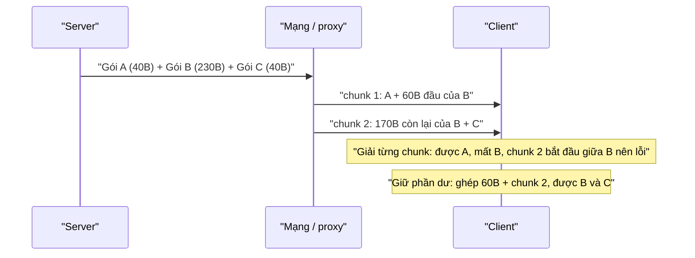

Realtime trên web thường đồng nghĩa với "mở WebSocket, gửi JSON". Messenger trên facebook.com làm khác: nó nói **MQTT**, giao thức nhị phân vốn dành cho thiết bị IoT, qua WebSocket. Khi WebSocket không chạy được (proxy công ty, firewall, mạng di động lạ), client tự lùi về long-poll bằng `fetch` streaming. Cả hai đường đều đi qua cùng một bộ mã hoá MQTT viết bằng JavaScript.

Bài này mổ xẻ ba phần: định dạng gói MQTT, cách giải một **luồng** byte (nơi bản gốc có bug làm mất tin), và quy tắc quyết định khi nào bỏ WebSocket.

> [!TIP]
> **Tóm tắt**
> - MQTT gói tin rất gọn: 1 byte header (loại gói + cờ), độ dài dạng varint 1–4 byte, rồi phần thân. Một tin chat nhỏ chỉ thêm khoảng 10 byte overhead.
> - Đọc từ một luồng thì một gói có thể bị cắt giữa hai chunk. Bộ giải phải **giữ phần dư** và ghép với chunk sau. Đường WebSocket của FB làm đúng, đường fetch streaming thì vứt phần dư.
> - Chuyển sang long-poll khi: không có WebSocket, lỗi fatal, lỗi 3 lần, hoặc chờ quá 3s. Nếu phiên trước đã phải long-poll thì chỉ chờ 1s hoặc 1 lần lỗi.
> - Thử lại theo backoff `max(0, 2^n·(1000+rand·100) − 2000)`: hai lần đầu gần như ngay lập tức, trần khoảng 1 phút.

<iframe class="demo-frame" src="/demos/facebook-patterns/index.html?theme=dark#/mqtt" title="Demo mqtt" loading="lazy" style="height: 1500px"></iframe>

<p class="demo-links">▶ <a href="/demos/facebook-patterns/index.html#/mqtt" target="_blank" rel="noopener">Mở demo toàn màn hình ↗</a> · <a href="https://stackblitz.com/github/hunghg255/blog-hunghg/tree/master/examples/facebook-patterns?file=src/lib/mqttCodec.ts" target="_blank" rel="noopener">Sửa code trên StackBlitz ↗</a> · <a href="https://github.com/hunghg255/blog-hunghg/blob/master/examples/facebook-patterns/src/lib/mqttCodec.ts" target="_blank" rel="noopener">Xem source trên GitHub ↗</a></p>

## Facebook làm thế nào?

Trong [facebook-codebase](https://github.com/hunghg255/facebook-codebase) có cả một họ module `Mqtt*` (bundle `16.js`, một bản khác ở `115.js` và `240.js`): `MqttProtocolCodec`, `MqttProtocolUtils`, `MqttProtocolClient` (đường WebSocket), `MqttLongPollingRunner`, `MqttFetchClient`, `MqttLongPollingClient`, `MqttUserName`… Tất cả là code của Facebook, không dùng thư viện MQTT có sẵn nào.

### Codec: MQTT 3.1 "cổ"

```js
p = Object.freeze({ CONNECT: 1, CONNACK: 2, PUBLISH: 3, PUBACK: 4, SUBSCRIBE: 8, SUBACK: 9,
                    UNSUBSCRIBE: 10, UNSUBACK: 11, PINGREQ: 12, PINGRESP: 13, DISCONNECT: 14 }),
q = [0, 6, 77, 81, 73, 115, 100, 112, 3];
```

`q` là phần đầu gói CONNECT: độ dài 6, chuỗi `"MQIsdp"` (77 81 73 115 100 112), protocol level 3. Đây là tên giao thức của **MQTT 3.1**, bản trước khi chuẩn hoá thành 3.1.1 (`"MQTT"`, level 4). Có lẽ để tương thích với hạ tầng MQTT sẵn có của app di động.

Gói CONNECT đặt cờ `2 | 128` (clean session + có username) và **không có password**. Mọi thông tin phiên nằm trong `userName`, là một chuỗi JSON do `MqttUserName.gen` tạo:

```js
JSON.stringify({ u: userId, s: sessionId, chat_on, fg: document.hasFocus(), d: deviceId,
                 ct: "websocket", aid: appId, st: subscribedTopics, pm: pendingPublishes, ... })
```

Nhét danh sách topic (`st`) và publish đang chờ (`pm`) vào ngay gói CONNECT giúp tiết kiệm một vòng SUBSCRIBE sau khi kết nối.

Giải mã một gói (đã đổi tên biến):

```js
function decodeOne(a, pos) {
  const header = a[pos], type = header >> 4;
  const len = decodeMultiByteInt(a, pos + 1);
  if (len == null) return { wireMessage: null, position: pos };         // varint chưa đủ byte
  const end = len.offset + len.value;
  if (end > a.length) return { wireMessage: null, position: pos };      // thân chưa đủ byte
  switch (type) {
    case PUBLISH:
      const flags = header & 15, qos = flags >> 1 & 3; ...
  }
}
function decodeByteMessages(a) {
  ... while (c < a.length) { const r = decodeOne(a, c); c = r.position; if (r.wireMessage) b.push(...); else break; }
  return { messages: b, remaining: c < a.length ? a.subarray(c) : null };
}
```

`decodeByteMessages` trả về cả `remaining`: phần đuôi chưa đủ một gói. Đây là chỗ quan trọng nhất của cả bài.

### Hai đường đọc, hai cách xử lý `remaining`

Đường WebSocket (`MqttProtocolClient`) làm đúng:

```js
a = new Uint8Array(event.data);
this.$10 != null && (a = concatBuffers(this.$10, a), bumpCounter("protocol.debug.usingMessagesBuffer"), this.$10 = null);
a = decodeByteMessages(a);
this.$10 = a.remaining;                   // giữ lại, ghép với message sau
```

Có hẳn một counter `usingMessagesBuffer` để đo xem trường hợp này xảy ra bao nhiêu. Tức là server có gửi một gói MQTT cắt qua hai message WebSocket.

Đường long-poll mới bằng fetch streaming (`MqttFetchClient`) thì không:

```js
readLoop(reader) { reader.read().then(({ done, value }) => { this.onData(value); this.readLoop(reader); }) }
onData(chunk) {
  const messages = decodeByteMessages(new Uint8Array(chunk)).messages;   // remaining bị bỏ
  ...
}
```

Mỗi chunk được giải độc lập. Một gói bị cắt ở cuối chunk thì mất. Tệ hơn, chunk tiếp theo bắt đầu **giữa** gói đó: byte đầu tiên bị đọc như header, ra loại gói vô nghĩa, codec ném `Invalid MQTT message type` và client đóng luồng (`dataDecodeException`) để poll lại. Với tin chat ngắn và chunk lớn thì hiếm gặp; với tin dài hoặc mạng cắt nhỏ thì gặp thường xuyên. Đường XHR long-poll cũ (`MqttLongPollingClient`) không bị vì nó nhận trọn response một lần.

### Khi nào bỏ WebSocket

`MqttLongPollingRunner` đánh giá lại lúc khởi động, sau 1100ms, sau 3100ms và sau mỗi lần connect lỗi:

```js
shouldPoll() {
  if (!wsPollingEnabled) return false;
  if (pollNow) return true;
  if (!hasWSSupport) return true;
  if (wsFatal) return true;
  if (hasSuccess) return false;                              // WS đã từng chạy thì không lùi
  if (fastLP) {
    const elapsed = Date.now() - startedAt;
    if (lastStatus === "yes") { if (failures >= 1) return true; if (elapsed > 1000) return true; }
    else if (elapsed > 3000) return true;
  }
  return failures >= 3;
}
```

`lastStatus` đọc từ cấu hình lưu bền `last_lp`: poll thành công thì ghi `"yes"`, WebSocket kết nối được thì xoá. Người dùng ngồi sau firewall chặn WebSocket chỉ chờ 3 giây ở lần đầu; từ lần sau chỉ còn 1 giây.

Thử lại dùng `exponentialBackoff`:

```js
const delay = Math.max(0, Math.pow(2, Math.min(n, 6)) * (1000 + random() * 100) - 2000);
```

Trừ 2000ms làm hai lần đầu gần như tức thì (0 và 0–200ms), sau đó 2s, 6s, 14s, 30s, rồi kẹp ở khoảng 62–68s. Phần `random() * 100` là jitter: hàng triệu client mất kết nối cùng lúc không đồng loạt kết nối lại.

## Bên trong trình duyệt: vì sao luồng bị cắt ở chỗ bất kỳ

TCP là luồng byte, không có khái niệm "tin". Response streaming của `fetch` đưa dữ liệu lên JavaScript theo từng chunk, kích thước tuỳ vào cách server flush, các proxy ở giữa, nén, và lúc trình duyệt đọc socket. Không có gì đảm bảo một chunk chứa trọn một gói MQTT. WebSocket thì có khung message, nhưng server vẫn có thể chia một gói MQTT ra nhiều message, như counter `usingMessagesBuffer` cho thấy.



## Viết lại

Codec viết lại gồm varint, encode các gói hay dùng, và `decodeOne` giải một gói theo đúng cách của FB ở trên (trả lại vị trí cũ nếu gói chưa trọn). Phần đáng xem là giải nhiều gói và bộ giải cho luồng:

```ts title=src/lib/mqttCodec.ts
/**
 * Giải mọi gói trọn vẹn trong `bytes`. Phần đuôi chưa đủ một gói trả về trong `remaining`
 * (giống decodeByteMessages của FB) — NGƯỜI GỌI phải giữ lại và ghép với chunk sau.
 */
export function decodeMessages(bytes: Uint8Array): { messages: WireMessage[]; remaining: Uint8Array | null } {
  const messages: WireMessage[] = [];
  let at = 0;
  while (at < bytes.length) {
    const { message, next } = decodeOne(bytes, at);
    if (!message) break;
    messages.push(message);
    at = next;
  }
  return { messages, remaining: at < bytes.length ? bytes.slice(at) : null };
}

/**
 * Bộ giải cho luồng byte (WebSocket, fetch streaming): tự ghép phần dư giữa các chunk.
 * Đây là chỗ MqttFetchClient của FB bỏ sót: nó giải từng chunk riêng và vứt `remaining`.
 */
export class MqttStreamDecoder {
  private pending: Uint8Array | null = null;

  push(chunk: Uint8Array): WireMessage[] {
    let bytes = chunk;
    if (this.pending) {
      bytes = new Uint8Array(this.pending.length + chunk.length);
      bytes.set(this.pending);
      bytes.set(chunk, this.pending.length);
    }
    const { messages, remaining } = decodeMessages(bytes);
    this.pending = remaining;
    return messages;
  }

  /** số byte đang chờ ghép (để debug / hiển thị) */
  get pendingBytes() {
    return this.pending?.length ?? 0;
  }
}
```

Quy tắc chọn transport:

```ts title=src/lib/mqttTransport.ts
export function shouldLongPoll(s: TransportState): Decision {
  if (!s.wsSupported) return { longPoll: true, reason: 'không có WebSocket' };
  if (s.wsFatal) return { longPoll: true, reason: 'WebSocket lỗi fatal' };
  // đã chạy được WS thì không bao giờ tự lùi về long-poll
  if (s.wsConnected) return { longPoll: false, reason: 'WebSocket đã kết nối' };
  if (s.lastSessionUsedLongPoll) {
    if (s.wsFailures >= 1) return { longPoll: true, reason: 'phiên trước long-poll + WS lỗi 1 lần' };
    if (s.elapsedMs > FAST_DELAY_MS) return { longPoll: true, reason: `phiên trước long-poll + chờ WS > ${FAST_DELAY_MS}ms` };
  } else if (s.elapsedMs > REGULAR_DELAY_MS) {
    return { longPoll: true, reason: `chờ WS > ${REGULAR_DELAY_MS}ms` };
  }
  if (s.wsFailures >= MAX_WS_FAILURES) return { longPoll: true, reason: `WS lỗi ${MAX_WS_FAILURES} lần` };
  return { longPoll: false, reason: 'tiếp tục chờ WebSocket' };
}
```

::: spoiler Xem toàn bộ src/lib/mqttCodec.ts

```ts title=src/lib/mqttCodec.ts
/**
 * Codec nhị phân MQTT 3.1 tối giản chạy trong trình duyệt
 * (ý tưởng từ MqttProtocolCodec / MqttProtocolUtils của Facebook, dùng cho chat realtime).
 *
 * Một gói MQTT: [1 byte header][độ dài còn lại: varint 1–4 byte][phần thân]
 * Byte header: 4 bit cao = loại gói, 4 bit thấp = cờ (DUP, QoS 2 bit, RETAIN).
 */

export const MessageType = {
  CONNECT: 1,
  CONNACK: 2,
  PUBLISH: 3,
  PUBACK: 4,
  SUBSCRIBE: 8,
  SUBACK: 9,
  PINGREQ: 12,
  PINGRESP: 13,
  DISCONNECT: 14,
} as const;
export type MessageTypeName = keyof typeof MessageType;

const TYPE_NAME: Record<number, MessageTypeName> = Object.fromEntries(
  Object.entries(MessageType).map(([name, code]) => [code, name as MessageTypeName]),
);

/** Tên giao thức "MQIsdp" + protocol level 3 = MQTT 3.1 (FB dùng đúng mảng này). */
const PROTOCOL_HEADER = [0, 6, 77, 81, 73, 115, 100, 112, 3];

const encoder = new TextEncoder();
const decoder = new TextDecoder();

// ---- varint "độ dài còn lại": 7 bit dữ liệu mỗi byte, bit cao = còn byte nữa ----

export function encodeLength(value: number): number[] {
  if (value < 0 || value > 268_435_455) throw new RangeError(`MQTT length out of range: ${value}`);
  const out: number[] = [];
  do {
    let byte = value % 128;
    value = Math.floor(value / 128);
    if (value > 0) byte |= 0x80;
    out.push(byte);
  } while (value > 0);
  return out;
}

/** Trả null nếu mảng hết trước khi varint kết thúc: gói chưa về đủ. */
export function decodeLength(bytes: Uint8Array, offset: number): { value: number; offset: number } | null {
  let value = 0;
  let multiplier = 1;
  for (let i = 0; i < 4; i++) {
    if (offset >= bytes.length) return null;
    const byte = bytes[offset++];
    value += (byte & 0x7f) * multiplier;
    if ((byte & 0x80) === 0) return { value, offset };
    multiplier *= 128;
  }
  throw new Error('Malformed MQTT remaining length (more than 4 bytes)');
}

function u16(value: number) {
  return [(value >> 8) & 0xff, value & 0xff];
}

function str(value: string) {
  const bytes = encoder.encode(value);
  return [...u16(bytes.length), ...bytes];
}

function frame(type: number, flags: number, body: number[] | Uint8Array): Uint8Array {
  const length = encodeLength(body.length);
  const out = new Uint8Array(1 + length.length + body.length);
  out[0] = (type << 4) | (flags & 0x0f);
  out.set(length, 1);
  out.set(body, 1 + length.length);
  return out;
}

// ---- encode ----

export function encodeConnect(clientId: string, userName: string, keepAliveSeconds = 60) {
  // cờ 0x82 = username có mặt + clean session (FB: 2 | 128). FB không dùng password:
  // userName là một chuỗi JSON (MqttUserName: user id, session, topic đã subscribe, tab có focus không…)
  return frame(MessageType.CONNECT, 0, [
    ...PROTOCOL_HEADER,
    0x82,
    ...u16(keepAliveSeconds),
    ...str(clientId),
    ...str(userName),
  ]);
}

export function encodeSubscribe(messageId: number, topic: string, qos: 0 | 1 = 0) {
  return frame(MessageType.SUBSCRIBE, 0b0010, [...u16(messageId), ...str(topic), qos]);
}

export function encodePublish(topic: string, payload: string | Uint8Array, qos: 0 | 1 = 0, messageId?: number) {
  if (qos !== 0 && qos !== 1) throw new TypeError(`Unsupported QoS ${qos}`);
  if (qos === 1 && messageId == null) throw new TypeError('QoS 1 needs a messageId');
  const data = typeof payload === 'string' ? encoder.encode(payload) : payload;
  const body = [...str(topic), ...(qos === 1 ? u16(messageId!) : [])];
  const full = new Uint8Array(body.length + data.length);
  full.set(body);
  full.set(data, body.length);
  return frame(MessageType.PUBLISH, qos << 1, full);
}

export const encodePuback = (messageId: number) => frame(MessageType.PUBACK, 0, u16(messageId));
export const encodePingreq = () => frame(MessageType.PINGREQ, 0, []);
export const encodeDisconnect = () => frame(MessageType.DISCONNECT, 0, []);

// ---- decode ----

export type WireMessage =
  | { type: 'PUBLISH'; topic: string; payload: Uint8Array; qos: number; messageId: number | null; retain: boolean; dup: boolean }
  | { type: 'CONNACK'; sessionPresent: boolean; returnCode: number }
  | { type: 'PUBACK' | 'SUBACK'; messageId: number }
  | { type: 'PINGREQ' | 'PINGRESP' | 'DISCONNECT' }
  | { type: 'CONNECT' | 'SUBSCRIBE'; raw: Uint8Array };

/** Giải một gói bắt đầu ở `start`. Gói chưa đủ byte thì trả message null và vị trí cũ. */
function decodeOne(bytes: Uint8Array, start: number): { message: WireMessage | null; next: number } {
  const header = bytes[start];
  const type = header >> 4;
  const len = decodeLength(bytes, start + 1);
  if (len == null) return { message: null, next: start };
  const bodyStart = len.offset;
  const end = bodyStart + len.value;
  if (end > bytes.length) return { message: null, next: start };
  const read16 = (at: number) => (bytes[at] << 8) | bytes[at + 1];

  switch (TYPE_NAME[type]) {
    case 'PUBLISH': {
      const flags = header & 0x0f;
      const qos = (flags >> 1) & 0b11;
      let at = bodyStart;
      const topicLength = read16(at);
      at += 2;
      const topic = decoder.decode(bytes.subarray(at, at + topicLength));
      at += topicLength;
      let messageId: number | null = null;
      if (qos > 0) {
        messageId = read16(at);
        at += 2;
      }
      return {
        message: { type: 'PUBLISH', topic, payload: bytes.slice(at, end), qos, messageId, retain: (flags & 1) === 1, dup: (flags & 8) === 8 },
        next: end,
      };
    }
    case 'CONNACK':
      return { message: { type: 'CONNACK', sessionPresent: (bytes[bodyStart] & 1) === 1, returnCode: bytes[bodyStart + 1] }, next: end };
    case 'PUBACK':
    case 'SUBACK':
      return { message: { type: TYPE_NAME[type] as 'PUBACK' | 'SUBACK', messageId: read16(bodyStart) }, next: end };
    case 'PINGREQ':
    case 'PINGRESP':
    case 'DISCONNECT':
      return { message: { type: TYPE_NAME[type] as 'PINGREQ' | 'PINGRESP' | 'DISCONNECT' }, next: end };
    case 'CONNECT':
    case 'SUBSCRIBE':
      return { message: { type: TYPE_NAME[type] as 'CONNECT' | 'SUBSCRIBE', raw: bytes.slice(start, end) }, next: end };
    default:
      throw new Error(`Invalid MQTT message type ${type}`);
  }
}

/**
 * Giải mọi gói trọn vẹn trong `bytes`. Phần đuôi chưa đủ một gói trả về trong `remaining`
 * (giống decodeByteMessages của FB) — NGƯỜI GỌI phải giữ lại và ghép với chunk sau.
 */
export function decodeMessages(bytes: Uint8Array): { messages: WireMessage[]; remaining: Uint8Array | null } {
  const messages: WireMessage[] = [];
  let at = 0;
  while (at < bytes.length) {
    const { message, next } = decodeOne(bytes, at);
    if (!message) break;
    messages.push(message);
    at = next;
  }
  return { messages, remaining: at < bytes.length ? bytes.slice(at) : null };
}

/**
 * Bộ giải cho luồng byte (WebSocket, fetch streaming): tự ghép phần dư giữa các chunk.
 * Đây là chỗ MqttFetchClient của FB bỏ sót: nó giải từng chunk riêng và vứt `remaining`.
 */
export class MqttStreamDecoder {
  private pending: Uint8Array | null = null;

  push(chunk: Uint8Array): WireMessage[] {
    let bytes = chunk;
    if (this.pending) {
      bytes = new Uint8Array(this.pending.length + chunk.length);
      bytes.set(this.pending);
      bytes.set(chunk, this.pending.length);
    }
    const { messages, remaining } = decodeMessages(bytes);
    this.pending = remaining;
    return messages;
  }

  /** số byte đang chờ ghép (để debug / hiển thị) */
  get pendingBytes() {
    return this.pending?.length ?? 0;
  }
}

export const payloadText = (payload: Uint8Array) => decoder.decode(payload);
```

:::

::: spoiler Xem toàn bộ src/lib/mqttTransport.ts

```ts title=src/lib/mqttTransport.ts
/**
 * Khi nào bỏ WebSocket để chuyển sang long-poll (ý tưởng từ MqttLongPollingRunner của Facebook),
 * và lịch thử lại (exponentialBackoff).
 */

export interface TransportState {
  /** trình duyệt có WebSocket không */
  wsSupported: boolean;
  /** WebSocket lỗi không thể cứu (vd: bị proxy/firewall chặn hẳn) */
  wsFatal: boolean;
  /** WebSocket đã từng kết nối thành công trong phiên này */
  wsConnected: boolean;
  /** số lần connect WebSocket thất bại */
  wsFailures: number;
  /** ms từ lúc bắt đầu thử kết nối */
  elapsedMs: number;
  /** phiên trước có phải dùng long-poll không (FB lưu cờ `last_lp`) */
  lastSessionUsedLongPoll: boolean;
}

export const FAST_DELAY_MS = 1000; // phiên trước đã phải long-poll: chờ WS 1s là đủ
export const REGULAR_DELAY_MS = 3000; // bình thường: cho WS 3s
export const MAX_WS_FAILURES = 3;

export type Decision = { longPoll: boolean; reason: string };

export function shouldLongPoll(s: TransportState): Decision {
  if (!s.wsSupported) return { longPoll: true, reason: 'không có WebSocket' };
  if (s.wsFatal) return { longPoll: true, reason: 'WebSocket lỗi fatal' };
  // đã chạy được WS thì không bao giờ tự lùi về long-poll
  if (s.wsConnected) return { longPoll: false, reason: 'WebSocket đã kết nối' };
  if (s.lastSessionUsedLongPoll) {
    if (s.wsFailures >= 1) return { longPoll: true, reason: 'phiên trước long-poll + WS lỗi 1 lần' };
    if (s.elapsedMs > FAST_DELAY_MS) return { longPoll: true, reason: `phiên trước long-poll + chờ WS > ${FAST_DELAY_MS}ms` };
  } else if (s.elapsedMs > REGULAR_DELAY_MS) {
    return { longPoll: true, reason: `chờ WS > ${REGULAR_DELAY_MS}ms` };
  }
  if (s.wsFailures >= MAX_WS_FAILURES) return { longPoll: true, reason: `WS lỗi ${MAX_WS_FAILURES} lần` };
  return { longPoll: false, reason: 'tiếp tục chờ WebSocket' };
}

/**
 * Độ trễ lần thử thứ `attempt` (0, 1, 2…) như exponentialBackoff của FB:
 * max(0, 2^min(n,6) · (1000 + random·100) − 2000) → 0; 0–0.2s; 2–2.4s; 6–6.8s; 14–15.6s; 30–33.2s; rồi trần 62–68.4s.
 * Hai lần đầu gần như thử lại ngay: lỗi mạng thoáng qua là chuyện thường.
 */
export function backoffDelay(attempt: number, random = Math.random) {
  return Math.max(0, 2 ** Math.min(attempt, 6) * (1000 + random() * 100) - 2000);
}

/** Lưu/đọc cờ "phiên trước phải long-poll" (FB: configWrite('last_lp', 'yes'|null)). */
export const lastSessionStore = {
  read(): boolean {
    try {
      return localStorage.getItem('mqtt:last_lp') === 'yes';
    } catch {
      return false;
    }
  },
  write(usedLongPoll: boolean) {
    try {
      if (usedLongPoll) localStorage.setItem('mqtt:last_lp', 'yes');
      else localStorage.removeItem('mqtt:last_lp'); // WS chạy được thì xoá cờ
    } catch {
      /* private mode: bỏ qua */
    }
  },
};
```

:::

**Khác bản gốc:**

- `MqttStreamDecoder` gom việc "giữ phần dư rồi ghép" vào một chỗ, để mọi transport (WebSocket, fetch streaming) dùng chung và không thể quên.
- `decodeLength` dừng sau 4 byte varint (giới hạn của MQTT) và ném lỗi, thay vì đọc tiếp vô hạn với dữ liệu rác.
- Bản gốc kiểm tra QoS bằng `if (d < 0 && d > 1 || …)`: không số nào vừa nhỏ hơn 0 vừa lớn hơn 1, nên QoS 2 lọt qua mà không báo lỗi. Bản viết lại chỉ nhận 0 hoặc 1.
- Phần gate cấu hình (`mqtt_ws_polling_enabled`, `mqtt_fast_lp`…) được bỏ; ngưỡng 1s, 3s, 3 lần lỗi giữ nguyên.

## Đi qua code

- **Varint độ dài.** Mỗi byte mang 7 bit dữ liệu, bit cao báo "còn byte nữa". 0–127 tốn 1 byte, tới 16383 tốn 2 byte. `decodeLength` trả `null` khi hết mảng giữa chừng: nghĩa là "chưa đủ dữ liệu", khác với "dữ liệu sai".
- **`decodeOne`** trả về vị trí cũ nếu gói chưa trọn. `decodeMessages` dừng ở gói chưa trọn đầu tiên và trả phần còn lại.
- **`MqttStreamDecoder.push`** nối phần dư lần trước với chunk mới rồi mới giải. Test trong bài cắt một luồng 3 gói theo mọi kích thước chunk từ 1 byte trở lên: lần nào cũng ra đủ 3 gói, không còn byte thừa.
- **`shouldLongPoll`** là hàm thuần nhận một "ảnh chụp" trạng thái, dễ test. Runner chỉ cần gọi nó ở các mốc 0, 1100ms, 3100ms và sau mỗi lần connect lỗi, như FB.

## Tại sao không làm cách khác?

- **JSON qua WebSocket.** Đơn giản hơn nhiều. Facebook có lẽ dùng MQTT để client web nói cùng giao thức với app di động và cùng một hạ tầng server. Nếu bạn không có ràng buộc đó, JSON (hoặc một khung nhị phân tự đặt) là đủ.
- **Server-Sent Events** cho chiều server → client. SSE chạy trên HTTP thường nên đi qua được hầu hết proxy, có tự kết nối lại. Nhưng SSE chỉ chở text, và vẫn cần một kênh khác để gửi lên. Fetch streaming của FB chở được byte nhị phân.
- **Chờ WebSocket timeout rồi mới chuyển.** Timeout mặc định của trình duyệt có thể tới hàng chục giây. Ngưỡng 3s/1s chủ động của FB làm người dùng sau firewall có kênh realtime nhanh hơn nhiều.
- **Nhớ "dùng long-poll luôn" mãi mãi.** Nếu người dùng chuyển từ mạng công ty về mạng nhà, WebSocket lại chạy được. FB vẫn thử WebSocket trước, chỉ rút ngắn thời gian chờ.

## Edge case và cạm bẫy

- **Gói lớn bị cắt nhiều lần.** Phần dư có thể lớn dần qua vài chunk. Đặt giới hạn kích thước gói (MQTT cho phép tới 256MB) và đóng kết nối nếu vượt, tránh một server lỗi làm client giữ bộ đệm vô hạn.
- **Dữ liệu rác.** Một khi đã lệch khung, mọi gói sau đều sai. Đừng cố "đoán lại" ranh giới gói: đóng luồng và kết nối lại, như FB làm khi ném lỗi giải mã.
- **QoS 1 cần PUBACK.** Fetch client của FB gom các message id cần ACK, gửi kèm request sau hoặc sau tối đa 5 giây. Gửi ACK cho từng tin một qua HTTP thì tốn request.
- **Topic không hỗ trợ trên long-poll.** XHR long-poll cũ của FB chỉ cho một danh sách topic (`/t_ms`, `/messenger_sync_get_diffs`, `/webrtc`…). Tính năng nào cần topic khác phải biết là mình đang chạy ở chế độ hạn chế.
- **`localStorage` cho cờ `last_lp`** có thể ném lỗi ở chế độ riêng tư. Bọc `try/catch` và coi như chưa từng long-poll.

## Dùng trong dự án

```ts
const decoder = new MqttStreamDecoder();
const res = await fetch('/realtime/pull?chunked=true', { method: 'POST', body: connectBytes, credentials: 'include' });
const reader = res.body!.getReader();
for (;;) {
  const { done, value } = await reader.read();
  if (done) break;
  for (const msg of decoder.push(value)) {
    if (msg.type === 'PUBLISH') onMessage(msg.topic, payloadText(msg.payload));
  }
}
```

Với WebSocket, đặt `ws.binaryType = 'arraybuffer'` rồi gọi `decoder.push(new Uint8Array(event.data))` trong `onmessage`. Cùng một bộ giải, không phải viết lại logic ghép byte cho từng transport.

## Kiểm thử

::: spoiler Ví dụ test (bản phác, không có trong repo)

```ts
import { describe, expect, it } from 'vitest';
import { MqttStreamDecoder, decodeLength, decodeMessages, encodeLength, encodePublish, payloadText } from './mqttCodec';

describe('mqttCodec', () => {
  it('varint độ dài: 127 dùng 1 byte, 128 dùng 2 byte', () => {
    expect(encodeLength(127)).toEqual([0x7f]);
    expect(encodeLength(128)).toEqual([0x80, 0x01]);
    expect(decodeLength(Uint8Array.from([0xff, 0xff, 0x7f]), 0)).toEqual({ value: 2_097_151, offset: 3 });
    expect(decodeLength(Uint8Array.from([0x80]), 0)).toBeNull(); // chưa về đủ byte
  });

  it('PUBLISH QoS 1 mã hoá rồi giải ngược ra đúng', () => {
    const [m] = decodeMessages(encodePublish('/t_ms', 'chào', 1, 42)).messages;
    expect(m).toMatchObject({ type: 'PUBLISH', topic: '/t_ms', qos: 1, messageId: 42 });
    expect(m.type === 'PUBLISH' && payloadText(m.payload)).toBe('chào');
  });

  it('gói chưa trọn được trả về trong remaining', () => {
    const frame = encodePublish('/t', 'x'.repeat(300));
    const { messages, remaining } = decodeMessages(frame.slice(0, 100));
    expect(messages).toHaveLength(0);
    expect(remaining).toHaveLength(100);
  });

  it('MqttStreamDecoder ghép đúng mọi cách cắt chunk', () => {
    const frames = [encodePublish('/a', '1'), encodePublish('/b', 'x'.repeat(200)), encodePublish('/c', '3')];
    const all = new Uint8Array(frames.reduce((n, f) => n + f.length, 0));
    let at = 0;
    for (const f of frames) all.set(f, (at += f.length) - f.length);
    for (let size = 1; size <= all.length; size++) {
      const decoder = new MqttStreamDecoder();
      const topics: string[] = [];
      for (let i = 0; i < all.length; i += size)
        for (const m of decoder.push(all.slice(i, i + size))) if (m.type === 'PUBLISH') topics.push(m.topic);
      expect(topics).toEqual(['/a', '/b', '/c']);
      expect(decoder.pendingBytes).toBe(0);
    }
  });
});
```

:::

## So với thư viện và chuẩn web

- [MQTT.js](https://github.com/mqttjs/MQTT.js) chạy được trên trình duyệt qua WebSocket và hỗ trợ MQTT 3.1.1/5. Nếu cần MQTT thật, dùng thư viện này thay vì tự viết codec. Bản tự viết trong bài để hiểu định dạng và lỗi ghép byte.
- `fetch` với `response.body.getReader()` (đọc luồng) đã có ở mọi trình duyệt hiện đại. Gửi luồng **lên** bằng `fetch` (request body là `ReadableStream`, `duplex: 'half'`) thì chưa có ở mọi nơi (tính tới 10/2026, xem [caniuse](https://caniuse.com/mdn-api_request_duplex)); FB gửi lên bằng các POST riêng, gom tối đa 20 tin mỗi lần.
- [WebTransport](https://developer.mozilla.org/docs/Web/API/WebTransport_API) chạy trên HTTP/3 và có cả stream lẫn datagram. Nó có thể thay cả WebSocket lẫn long-poll trong tương lai, nhưng đi qua proxy doanh nghiệp còn khó hơn WebSocket.

---

Bài này thuộc series **[Học từ mã nguồn Facebook](/series/facebook)** (38 bài, đọc theo thứ tự).

::: spoiler Xem nhanh danh sách bài trong series

*Phần 1*

- [Mở đầu: cách đọc code minify của Facebook](/blogs/learn-from-facebook-source-code)
- [#1 Dùng chung IntersectionObserver + infinite scroll](/blogs/facebook-shared-intersection-observer)
- [#2 useViewportDuration: đo thời gian thực sự được xem](/blogs/facebook-use-viewport-duration)
- [#3 Preload code + data khi hover](/blogs/facebook-preload-on-hover)
- [#4 Toast manager với external store](/blogs/facebook-toast-manager)
- [#5 Network status + heartbeat backoff](/blogs/facebook-network-status-heartbeat)
- [#6 ErrorGuard: bắt lỗi theo ngữ cảnh](/blogs/facebook-error-guard)
- [#7 Banzai: gom log theo lô + sendBeacon](/blogs/facebook-batch-logger)
- [#8 Focus trap + Esc theo layer](/blogs/facebook-focus-trap)

*Phần 2*

- [#9 Mẹo calc(… * 9999): container query, line-clamp, mũi tên carousel bằng CSS](/blogs/facebook-css-9999-trick)
- [#10 Thanh cuộn tuỳ biến bằng CSS 3D](/blogs/facebook-css-3d-scrollbar)
- [#11 Modal cuộn bằng window, giữ vị trí trang nền](/blogs/facebook-document-scroll-modal)
- [#12 Popover, tooltip group và hovercard](/blogs/facebook-popover-tooltip)
- [#13 Primitive Pressable + focus-visible](/blogs/facebook-pressable)
- [#14 Tab "Xem thêm" + sticky header bằng IntersectionObserver](/blogs/facebook-priority-tabs-sticky-header)
- [#15 Avatar khoét mask, gradient Messenger, skeleton steps()](/blogs/facebook-visual-tricks)
- [#16 Khung chat không giật](/blogs/facebook-chat-scroller)
- [#17 Thuật toán chọn bố cục collage ảnh](/blogs/facebook-photo-collage-layout)
- [#18 Keep-alive tab trong SPA](/blogs/facebook-keep-alive-tabs)
- [#19 Tự đo Visual Completion & interaction tracing](/blogs/facebook-visual-completion)
- [#20 Router SPA bền bỉ & tải chunk có retry](/blogs/facebook-spa-router-resilient-loading)

*Phần 3*

- [#21 Smart Compose: gợi ý chữ mờ khi gõ](/blogs/facebook-smart-compose-ghost-text)
- **#22 MQTT ngay trong trình duyệt, tự chuyển sang long-poll** (bài này)
- [#23 Đo thời gian dùng bằng bitmap 64 giây](/blogs/facebook-time-spent-bitmap)
- [#24 Bảng reaction nhấn giữ rồi trượt](/blogs/facebook-reaction-press-slide)
- [#25 Tìm kiếm gấp dấu, phiên âm và highlight đầu từ](/blogs/facebook-search-diacritics-tokenize)
- [#26 Ring buffer biết trace nào đã mất log](/blogs/facebook-trace-ring-buffer)
- [#27 Engine animation JS: một vòng rAF và solver cubic-bezier](/blogs/facebook-keyframes-loop-cubic-bezier)
- [#28 Bootloader: bitmap tài nguyên đã tải, chỉ reload khi cần](/blogs/facebook-bootloader-bitmap-consistency)
- [#29 Nhận biết click do screen reader tạo ra](/blogs/facebook-virtual-cursor-detection)
- [#30 Tải trước feed theo chất lượng mạng, đoán hạng thiết bị](/blogs/facebook-network-aware-prefetch)
- [#31 Hàng đợi gửi tin chat giữ đúng thứ tự](/blogs/facebook-ordered-send-queue)
- [#32 Gộp lời gọi API trong cùng một tick](/blogs/facebook-api-batcher)
- [#33 Resize ảnh trong pool Web Worker](/blogs/facebook-jpeg-resize-worker-pool)
- [#34 Crop ảnh theo nhiều khuôn mặt](/blogs/facebook-face-aware-crop)
- [#35 Kéo-thả sắp xếp và vùng thả file không nhấp nháy](/blogs/facebook-flicker-free-drag-drop)
- [#36 Tiện ích UI: fade-out, sticky event, hàm huỷ được](/blogs/facebook-ui-utility-hooks)
- [#37 Hạ tầng nhỏ: cookie, hash lỗi, prefetch khi chuột dừng](/blogs/facebook-small-infra-cookie-hash-idle)

:::

Code + demo: [`examples/facebook-patterns`](https://github.com/hunghg255/blog-hunghg/tree/master/examples/facebook-patterns) · [Mở trên StackBlitz](https://stackblitz.com/github/hunghg255/blog-hunghg/tree/master/examples/facebook-patterns)
