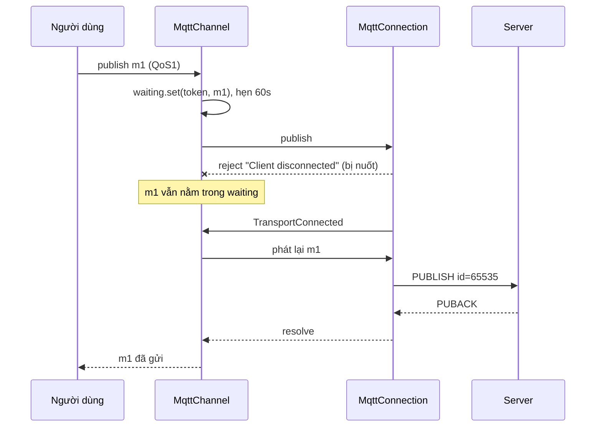
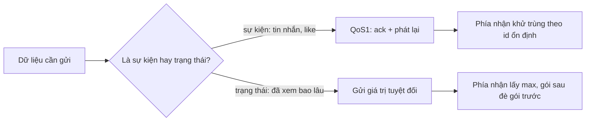

Bạn gõ tin nhắn trong Messenger web, bấm Enter, đúng lúc Wi-Fi rớt hai giây. Tin không biến mất, cũng không hiện lỗi đỏ. Mạng có lại, tin đi tiếp như chưa có chuyện gì.

[Bài #22](/blogs/facebook-mqtt-in-browser) đã nói cách Facebook chạy MQTT trên WebSocket và chuyển sang long-poll khi WebSocket không dùng được. Bài này đi vào một lớp phía trên: **làm sao để một publish không bị mất** khi kết nối bên dưới đứt, nối, đứt liên tục. Và một cách làm ngược lại, cũng trong code Facebook: heartbeat lượt xem video không cần ack, không cần retry, mà vẫn chịu được mất gói.

> [!TIP]
> **Tóm tắt**
> - `MqttChannel` (bundle `115.js`) giữ mỗi publish QoS1 trong một `Map token → {payload, resolve, reject, timer}`. Gửi lỗi thì **không** reject, chỉ để đó. Kết nối chuyển sang `TransportConnected` thì phát lại cả map. Có ack thì resolve; quá 60 giây thì reject `"Publish Timed Out"`.
> - Đó là ngữ nghĩa at-least-once (ít nhất một lần): ack mất trên đường về thì tin được gửi lại, server nhận hai lần. Phía nhận phải khử trùng theo một khoá ổn định.
> - Heartbeat lượt xem (`CVCv3SubscriptionHelper`) gửi **tổng đã xem của đoạn hiện tại** chứ không gửi phần tăng thêm, kèm trạng thái gói trước. Mất gói giữa chừng không mất dữ liệu, nên không cần ack.
> - Quy tắc mang về: dữ liệu là "sự kiện" (tin nhắn) thì cần ack + phát lại + khử trùng; dữ liệu là "trạng thái" (đã xem bao lâu) thì gửi giá trị tuyệt đối, gói sau đè gói trước.

<iframe class="demo-frame" src="/demos/facebook-patterns/index.html?theme=dark#/mqtt-qos1-republish" title="Demo mqtt-qos1-republish" loading="lazy" style="height: 1050px"></iframe>

<p class="demo-links">▶ <a href="/demos/facebook-patterns/index.html#/mqtt-qos1-republish" target="_blank" rel="noopener">Mở demo toàn màn hình ↗</a> · <a href="https://stackblitz.com/github/hunghg255/blog-hunghg/tree/master/examples/facebook-patterns?file=src/lib/qos1Channel.ts" target="_blank" rel="noopener">Sửa code trên StackBlitz ↗</a> · <a href="https://github.com/hunghg255/blog-hunghg/blob/master/examples/facebook-patterns/src/lib/qos1Channel.ts" target="_blank" rel="noopener">Xem source trên GitHub ↗</a></p>

## Mẹo 1: hàng chờ ack trong `MqttChannel`

### Facebook làm thế nào?

Có hai tầng. `MqttConnection` là tầng giao thức: mỗi publish QoS1 nhận một `messageId` (đếm lùi từ 65536), deferred được giữ trong `Map messageId → deferred`, gói `PUBACK` về thì resolve. Khi kết nối đứt và lên lịch nối lại, nó reject **tất cả** publish chưa có ack (`fail_all_unacked_publishes`).

`MqttChannel` là tầng ứng dụng nằm trên, và chính tầng này làm cho tin "không mất". Mỗi publish QoS1 nhận một `publishToken = random()`, một hẹn giờ 60 giây, rồi vào `waiting: Map<token, entry>`. Gửi xuống tầng dưới bằng:

```js
promiseDone(this.doPublish(entry.topic, entry.payload, entry.options.qos),
  () => this.onAcked(entry),
  (error) => {});            // lỗi bị nuốt: entry vẫn nằm trong waiting
```

Lỗi của tầng dưới (kể cả `"Client disconnected"` hay reject hàng loạt khi mất kết nối) bị nuốt. Entry vẫn nằm trong `waiting`. Khi trạng thái kết nối đổi:

```js
onConnectionState(state) {
  if (state === 'Connecting') this.skipBufferQueue.forEach((e) => e.ack.reject(new Error('Client Reconnecting')));
  else if (state === 'TransportConnected') this.replayAll();   // waiting.forEach(trySend)
}
```

::: spoiler Code gốc đã đổi tên biến: publish, timeout, ack, phát lại

```js
publishQos1(topic, payload, options) {
  const ack = {}; const done = new Promise((res, rej) => { ack.resolve = res; ack.reject = rej; });
  const token = Env.random();
  const entry = { topic, payload, options, ack, publishToken: token, timeoutId: null };
  entry.timeoutId = this.startTimeout(token);       // 60 giây
  this.waiting.set(token, entry);
  this.trySend(entry);
  return done;
}

trySend(entry) {
  promiseDone(this.doPublish(entry.topic, entry.payload, entry.options.qos),
    () => this.onAcked(entry),
    (error) => {});                                 // lỗi bị nuốt: entry vẫn nằm trong waiting
}

startTimeout(token) {
  return Env.setTimeout((token) => {
    const entry = this.waiting.get(token);
    if (!entry) return;
    this.logger.bumpCounter('publish_timeout.' + entry.topic);
    this.clear(token);                                 // clearTimeout + waiting.delete
    entry.ack.reject(new Error('Publish Timed Out'));
  }, MqttPublishTimeoutConfig.mqttPublishTimeoutMs || 60 * 1000, token);
}

onAcked(entry) {
  if (!this.waiting.get(entry.publishToken)) return;   // đã timeout, hoặc ack trùng
  this.clear(entry.publishToken);
  entry.ack.resolve();
  this.logger.bumpCounter('publish_success.' + entry.topic);
}

replayAll() {
  this.skipBufferQueue.forEach((e) => this.sendNoBuffer(e));
  this.skipBufferQueue = [];
  this.waiting.forEach((entry) => this.trySend(entry));
}

doPublish(topic, payload, qos) {
  // WebSocket chưa publish được mà long-poll được thì đi đường long-poll
  const viaLP = !this.ws.canPublish() && this.lp?.canPublish();
  const p = viaLP ? this.lp.publish(topic, payload, qos) : this.ws.publish(topic, payload, qos);
  // log kích thước ước lượng: payload.length * 2 (UTF-16)
  return p;
}
```

:::

### Kiểm lại bằng node

Tôi nạp nguyên văn module `MqttChannel` từ bundle, thay tầng dưới bằng một object giả (`canPublish` trả `false` khi "mất mạng" và `publish` reject):

- Mất mạng, publish `m1`, `m2`: tầng dưới được gọi hai lần và reject, `waiting` còn 2 entry, chưa promise nào xong.
- Chuyển sang `TransportConnected`: tầng dưới được gọi thêm `m1`, `m2`; cả hai promise resolve, `waiting` rỗng.
- Mất mạng, publish `m3`, cho hẹn giờ 60 giây chạy: `m3` reject `"Publish Timed Out"`.

Ba điểm đáng để ý:

- **Hạn 60 giây tính từ lúc publish**, không reset khi phát lại. Người dùng biết tin lỗi sau tối đa một phút, không bị treo mãi.
- **Khoá `publishToken` chỉ sống ở client.** Gói gửi lên server mang `messageId` của tầng giao thức, mà mỗi lần gửi lại là một `messageId` mới. Server không có cách nào nhận ra "đây là m1 gửi lại". Nếu ack của lần đầu bị mất (server đã nhận), lần phát lại tạo bản trùng. Có lẽ server của Facebook khử trùng bằng một id nằm trong payload (tin nhắn Messenger có `offline_threading_id`, xem [bài về otid](/blogs/facebook-otid-client-snowflake)), nên tầng này không cần lo.
- **Phát lại nhiều lần:** `replayAll` chạy mỗi khi WebSocket vào `TransportConnected`, và cả mỗi khi trạng thái long-poll đổi mà long-poll publish được. Kết nối chập chờn có thể làm một tin được gửi ba, bốn lần trong 60 giây.

Còn `skipBuffer` là lối riêng cho tin không muốn chờ: chỉ được xếp hàng khi đang `Connecting`, và lần `Connecting` kế tiếp (tức lần nối trước thất bại) thì bị reject với `"Client Reconnecting"`. Kiểu "thử một lần nối, không được thì thôi".



## Mẹo 2: heartbeat lượt xem không cần ack

### Facebook làm thế nào?

Khi bạn xem video, player gửi định kỳ một gói "đã xem tới đâu" về server (`UnifiedVideoCVCSubscription` dùng `CVCv3SubscriptionHelper`, bundle `15.js` và `26.VideoPlayer/all.js`). Toàn bộ helper:

```js
makeCVCv3StateUpdate(startPos, position, state, muted) {
  let ps = null;
  if (startPos != null && !isNaN(startPos) && position != null && !isNaN(position))
    ps = { m: muted, pf: Math.floor((position - startPos) * 1000), s: state, sa: Math.floor(startPos * 1000) };
  const update = { pps: this.previous, ps, si: this.sessionId, so: this.origin, vi: this.videoId };
  this.previous = ps;           // nhớ lại để gửi kèm ở gói sau
  return update;
}
```

- `sa` là vị trí bắt đầu đoạn phát liên tục (ms), `pf` là đã phát bao lâu trong đoạn đó (ms). Đây là **tổng tích luỹ** của đoạn, không phải "+10 giây".
- `pps` là `ps` của gói trước. `this.previous` được cập nhật ngay khi tạo gói, kể cả khi gói đó rồi bị mất.
- `si` là guid của phiên xem; `tk` là token server trả về, client gửi lại nguyên vẹn ở gói sau.

Phía gửi (`UnifiedVideoCVCSubscription`) cũng đáng xem:

- Gói đầu đi ngay khi video bắt đầu phát (`pf = 0`). Sau đó **server quyết định nhịp**: phản hồi có `a: { t: 'p', pi }` thì gói sau gửi sau `pi` giây (mặc định 10), `t: 's'` thì dừng hẳn.
- Request treo quá 10 giây thì bỏ, gửi gói mới ngay (gói mới mang trạng thái mới hơn, không cần gửi lại gói cũ).
- Dừng phát thì huỷ hẹn giờ và xoá `previous`. Không có gói "kết thúc": phần xem sau nhịp cuối (tối đa 10 giây) không được báo.

Vì gói mang giá trị tuyệt đối, server chỉ cần lấy `pf` lớn nhất của mỗi đoạn. Mất gói ở giữa không sao, gói sau mang tổng mới hơn. Chỉ khi gói **cuối** của một đoạn bị mất thì mất phần tăng của nhịp đó. Demo cho thấy với 20% mất gói, cách này giữ khoảng 95% thời gian xem, còn gửi "+10 giây" chỉ giữ 80%.

`pps` để làm gì, nếu không làm tăng tổng? Code client không nói. Có lẽ để server biết **có gói mất**: gói đến khai "lần trước tôi gửi `pf = 30000`", server chưa từng thấy 30000, nghĩa là có ít nhất một gói rơi ở giữa. Số liệu đó đo được chất lượng đường truyền mà không cần thêm số thứ tự. Nó cũng cho phép tính phần tăng `ps.pf − pps.pf` từ một gói duy nhất, không cần tra trạng thái phiên.

## Bên trong trình duyệt: at-least-once nghĩa là gì

- **TCP không đủ.** WebSocket chạy trên TCP, TCP đảm bảo thứ tự và không mất byte **trong một kết nối**. Kết nối đứt thì những gì đã nằm trong buffer gửi nhưng chưa tới server coi như mất, và client không biết byte nào đã tới. Ack ở tầng ứng dụng là cách duy nhất để biết.
- **`ws.send()` thành công không có nghĩa là đã gửi.** Nó chỉ xếp dữ liệu vào buffer (`bufferedAmount` tăng). Nếu kết nối đứt ngay sau đó, trình duyệt không báo dữ liệu nào bị bỏ.
- **Ba mức giao hàng:** at-most-once (QoS0: gửi rồi thôi, có thể mất), at-least-once (QoS1: phát lại tới khi có ack, có thể trùng), exactly-once (QoS2 của MQTT: bắt tay bốn bước). Trên thực tế exactly-once thường được làm bằng at-least-once cộng khử trùng ở phía nhận theo một id ổn định.
- **Ack mất cũng là mất.** Client không phân biệt được "server không nhận" và "server nhận rồi nhưng ack rơi". Cả hai đều dẫn tới phát lại.



## Viết lại

Hàng chờ QoS1. Token đi kèm gói lên server, nên phía nhận khử trùng được:

```ts title=src/lib/qos1Channel.ts
    publish(topic, payload, qos = 1) {
      const packet: OutPacket = { token: newToken(), topic, payload, qos, attempt: 1 };
      if (qos === 0) {
        // QoS0: gửi được thì xong, không được thì báo lỗi ngay, không giữ lại
        const ok = trySend(packet);
        onState?.(packet.token, ok ? 'sent' : 'failed', packet);
        return { token: packet.token, done: ok ? Promise.resolve() : Promise.reject(new Error('Not connected')) };
      }
      const done = new Promise<void>((resolve, reject) => {
        const timer = setTimer(() => {
          const entry = settle(packet.token);
          if (!entry) return;
          onState?.(packet.token, 'timeout', packet);
          entry.reject(new Error('Publish Timed Out'));
        }, timeoutMs);
        waiting.set(packet.token, { packet, timer, resolve, reject });
      });
      onState?.(packet.token, 'queued', packet);
      // gửi lỗi thì không reject: gói nằm chờ lần kết nối sau (giống bản gốc)
      if (trySend(packet)) onState?.(packet.token, 'sent', packet);
      return { token: packet.token, done };
    },
    ack(token) {
      const entry = settle(token);
      if (!entry) return; // ack trùng hoặc tới sau khi đã timeout: bỏ qua
      onState?.(token, 'acked', entry.packet);
      entry.resolve();
    },
    setConnected(next) {
      const wasConnected = connected;
      connected = next;
      if (!next || wasConnected) return;
      // vừa nối lại: phát lại một lần mọi gói chưa có ack, theo thứ tự publish
      for (const entry of waiting.values()) {
        entry.packet = { ...entry.packet, attempt: entry.packet.attempt + 1 };
        if (trySend(entry.packet)) onState?.(entry.packet.token, 'sent', entry.packet);
      }
    },
```

Phía server cho heartbeat: lấy `playedMs` lớn nhất mỗi đoạn, và đếm chỗ hổng nhờ `previous`:

```ts title=src/lib/qos1Channel.ts
export function totalWatchedMs(received: WatchUpdate[]) {
  const best = new Map<string, number>();
  const lastSeen = new Map<string, number | null>(); // session → playedMs của gói gần nhất nhận được
  let gaps = 0;
  for (const u of [...received].sort((a, b) => a.seq - b.seq)) {
    const prevSeen = lastSeen.get(u.session) ?? null;
    if (u.previous && prevSeen !== u.previous.playedMs) gaps++;
    if (u.current) {
      const key = `${u.session}:${u.current.startMs}`;
      best.set(key, Math.max(best.get(key) ?? 0, u.current.playedMs));
    }
    lastSeen.set(u.session, u.current?.playedMs ?? null);
  }
  let totalMs = 0;
  for (const v of best.values()) totalMs += v;
  return { totalMs, spans: best.size, gaps };
}
```

::: spoiler Xem toàn bộ src/lib/qos1Channel.ts

```ts title=src/lib/qos1Channel.ts
/**
 * Hai cách giữ dữ liệu không mất trên kết nối chập chờn, học từ MqttChannel và CVCv3SubscriptionHelper:
 * 1. QoS1 (at-least-once): mỗi publish có token, nằm trong hàng chờ tới khi có ack;
 *    gửi lỗi thì im lặng chờ kết nối lại rồi phát lại; quá hạn thì reject.
 * 2. Heartbeat trạng thái tuyệt đối: mỗi gói mang tổng đã xem của đoạn hiện tại (không phải phần tăng thêm)
 *    kèm trạng thái gói trước, nên mất gói không mất dữ liệu và server phát hiện được chỗ hổng.
 * Khác bản gốc: token đi kèm gói để server khử trùng, phát lại một lần cho mỗi lần kết nối,
 * báo trạng thái từng message, đồng hồ và timer tiêm vào được.
 */

// ───────────────────────── 1. QoS1 ─────────────────────────

export interface OutPacket {
  token: string;
  topic: string;
  payload: string;
  qos: 0 | 1;
  /** lần gửi thứ mấy (1 = lần đầu, >1 = phát lại) */
  attempt: number;
}

export interface Qos1Transport {
  /** gửi một gói; trả false hoặc ném lỗi nếu chưa gửi được (đang mất kết nối) */
  send(packet: OutPacket): boolean;
}

export type PublishState = 'queued' | 'sent' | 'acked' | 'timeout' | 'failed';

export interface Qos1Options {
  transport: Qos1Transport;
  /** hạn chót tính từ lúc publish, không reset khi phát lại (bản gốc: 60 giây) */
  timeoutMs?: number;
  setTimer?: (fn: () => void, ms: number) => unknown;
  clearTimer?: (handle: unknown) => void;
  newToken?: () => string;
  onState?: (token: string, state: PublishState, packet: OutPacket) => void;
}

export interface Qos1Channel {
  publish(topic: string, payload: string, qos?: 0 | 1): { token: string; done: Promise<void> };
  /** server xác nhận đã nhận gói có token này (PUBACK) */
  ack(token: string): void;
  /** đổi trạng thái kết nối; khi nối lại thì phát lại mọi gói đang chờ ack */
  setConnected(connected: boolean): void;
  readonly connected: boolean;
  /** các gói đang chờ ack */
  pending(): OutPacket[];
  /** huỷ hết, reject mọi gói đang chờ */
  dispose(reason?: string): void;
}

interface Entry {
  packet: OutPacket;
  timer: unknown;
  resolve: () => void;
  reject: (e: Error) => void;
}

let tokenSeq = 0;

export function createQos1Channel(options: Qos1Options): Qos1Channel {
  const {
    transport,
    timeoutMs = 60_000,
    setTimer = (fn, ms) => setTimeout(fn, ms),
    clearTimer = (h) => clearTimeout(h as ReturnType<typeof setTimeout>),
    newToken = () => `${Date.now().toString(36)}-${(tokenSeq++).toString(36)}-${Math.random().toString(36).slice(2, 7)}`,
    onState,
  } = options;
  const waiting = new Map<string, Entry>();
  let connected = false;

  const trySend = (packet: OutPacket) => {
    if (!connected) return false;
    try {
      return transport.send(packet) !== false;
    } catch {
      return false;
    }
  };

  const settle = (token: string) => {
    const entry = waiting.get(token);
    if (!entry) return null;
    clearTimer(entry.timer);
    waiting.delete(token);
    return entry;
  };

  const channel: Qos1Channel = {
    publish(topic, payload, qos = 1) {
      const packet: OutPacket = { token: newToken(), topic, payload, qos, attempt: 1 };
      if (qos === 0) {
        // QoS0: gửi được thì xong, không được thì báo lỗi ngay, không giữ lại
        const ok = trySend(packet);
        onState?.(packet.token, ok ? 'sent' : 'failed', packet);
        return { token: packet.token, done: ok ? Promise.resolve() : Promise.reject(new Error('Not connected')) };
      }
      const done = new Promise<void>((resolve, reject) => {
        const timer = setTimer(() => {
          const entry = settle(packet.token);
          if (!entry) return;
          onState?.(packet.token, 'timeout', packet);
          entry.reject(new Error('Publish Timed Out'));
        }, timeoutMs);
        waiting.set(packet.token, { packet, timer, resolve, reject });
      });
      onState?.(packet.token, 'queued', packet);
      // gửi lỗi thì không reject: gói nằm chờ lần kết nối sau (giống bản gốc)
      if (trySend(packet)) onState?.(packet.token, 'sent', packet);
      return { token: packet.token, done };
    },
    ack(token) {
      const entry = settle(token);
      if (!entry) return; // ack trùng hoặc tới sau khi đã timeout: bỏ qua
      onState?.(token, 'acked', entry.packet);
      entry.resolve();
    },
    setConnected(next) {
      const wasConnected = connected;
      connected = next;
      if (!next || wasConnected) return;
      // vừa nối lại: phát lại một lần mọi gói chưa có ack, theo thứ tự publish
      for (const entry of waiting.values()) {
        entry.packet = { ...entry.packet, attempt: entry.packet.attempt + 1 };
        if (trySend(entry.packet)) onState?.(entry.packet.token, 'sent', entry.packet);
      }
    },
    get connected() {
      return connected;
    },
    pending() {
      return [...waiting.values()].map((e) => e.packet);
    },
    dispose(reason = 'Channel closed') {
      for (const token of [...waiting.keys()]) settle(token)?.reject(new Error(reason));
    },
  };
  return channel;
}

/** Phía nhận: nhớ N token gần nhất để bỏ gói phát lại trùng (at-least-once → xử lý đúng một lần). */
export function createDedupe(capacity = 1000) {
  const seen = new Set<string>();
  return {
    /** true nếu token mới (cần xử lý), false nếu đã thấy */
    accept(token: string) {
      if (seen.has(token)) return false;
      seen.add(token);
      if (seen.size > capacity) seen.delete(seen.values().next().value!);
      return true;
    },
    get size() {
      return seen.size;
    },
  };
}

// ───────────────────────── 2. Heartbeat trạng thái tuyệt đối ─────────────────────────

export interface SpanState {
  /** vị trí bắt đầu đoạn phát liên tục, ms (bản gốc: sa) */
  startMs: number;
  /** đã phát bao lâu trong đoạn này, ms (bản gốc: pf) */
  playedMs: number;
  state: 'playing' | 'paused' | 'ended' | 'unknown';
  muted: boolean;
}

export interface WatchUpdate {
  videoId: string;
  /** id phiên xem (bản gốc: si = guid) */
  session: string;
  /** số thứ tự gói trong phiên, để server thấy chỗ hổng ngay cả khi không có prev */
  seq: number;
  /** trạng thái hiện tại (bản gốc: ps) */
  current: SpanState | null;
  /** trạng thái đã gửi ở gói trước (bản gốc: pps) */
  previous: SpanState | null;
  /** token server trả ở lần trước, gửi lại nguyên vẹn (bản gốc: tk) */
  token?: string;
}

export function createWatchReporter(videoId: string, session = Math.random().toString(36).slice(2)) {
  let previous: SpanState | null = null;
  let token: string | undefined;
  let seq = 0;
  return {
    /** startSec/positionSec: vị trí lúc bắt đầu đoạn và vị trí hiện tại (giây, như video.currentTime) */
    makeUpdate(startSec: number, positionSec: number, state: SpanState['state'], muted: boolean): WatchUpdate {
      const valid = Number.isFinite(startSec) && Number.isFinite(positionSec);
      const current: SpanState | null = valid
        ? { startMs: Math.floor(startSec * 1000), playedMs: Math.max(0, Math.floor((positionSec - startSec) * 1000)), state, muted }
        : null;
      const update: WatchUpdate = { videoId, session, seq: seq++, current, previous, token };
      // ghi nhớ ngay cả khi gói này rồi bị mất: gói sau vẫn khai "trước đó tôi đã gửi X"
      previous = current;
      return update;
    },
    /** server trả token mới (và có thể nhịp gửi mới) */
    handleResponse(response: { token?: string }) {
      if (response.token) token = response.token;
    },
    /** dừng phát: đoạn sau là đoạn mới, không nối với đoạn cũ */
    resetSpan() {
      previous = null;
    },
  };
}

/**
 * Phía server: cộng thời gian xem từ các gói nhận được.
 * Mỗi đoạn (session + startMs) lấy playedMs lớn nhất đã thấy: gói mất ở giữa đoạn không làm mất gì,
 * chỉ phần đuôi sau gói cuối cùng nhận được của đoạn là mất.
 * `previous` của gói sau cho biết client đã gửi gì trước đó; khác cái server thấy = có gói mất.
 */
export function totalWatchedMs(received: WatchUpdate[]) {
  const best = new Map<string, number>();
  const lastSeen = new Map<string, number | null>(); // session → playedMs của gói gần nhất nhận được
  let gaps = 0;
  for (const u of [...received].sort((a, b) => a.seq - b.seq)) {
    const prevSeen = lastSeen.get(u.session) ?? null;
    if (u.previous && prevSeen !== u.previous.playedMs) gaps++;
    if (u.current) {
      const key = `${u.session}:${u.current.startMs}`;
      best.set(key, Math.max(best.get(key) ?? 0, u.current.playedMs));
    }
    lastSeen.set(u.session, u.current?.playedMs ?? null);
  }
  let totalMs = 0;
  for (const v of best.values()) totalMs += v;
  return { totalMs, spans: best.size, gaps };
}
```

:::

## Đi qua code

- `publish` với QoS1 tạo hẹn giờ trước, rồi mới thử gửi. `trySend` trả `false` khi đang mất kết nối hoặc transport ném lỗi; gói vẫn nằm trong `waiting`.
- `settle` là chỗ duy nhất xoá entry và huỷ hẹn giờ. `ack` và timeout cùng đi qua nó, nên ai tới trước thắng, người tới sau thấy `null` và bỏ qua: ack tới sau timeout không resolve một promise đã reject.
- `setConnected(true)` chỉ phát lại khi trạng thái đổi từ mất sang có. Gọi `setConnected(true)` hai lần liền không gửi hai lần.
- `attempt` tăng mỗi lần phát lại, để log và để server biết đây là gói gửi lại (có thể ưu tiên khử trùng).
- `createDedupe` nhớ 1000 token gần nhất bằng `Set` (giữ thứ tự chèn, xoá phần tử cũ nhất khi đầy). Cửa sổ phải dài hơn khoảng thời gian một tin có thể bị phát lại, ở đây là 60 giây.
- `totalWatchedMs` sắp gói theo `seq` trước khi xử lý vì gói có thể tới không đúng thứ tự.

**Khác bản gốc:**

- Token đi trong gói (`OutPacket.token`) thay vì chỉ sống ở client.
- Phát lại một lần mỗi lần kết nối lại, không phát lại theo mọi thay đổi trạng thái của đường dự phòng.
- Có `onState` báo từng bước (`queued`, `sent`, `acked`, `timeout`, `failed`) cho UI, thay vì chỉ đếm counter.
- QoS0 gửi không được thì reject ngay thay vì đi qua cùng đường log.
- Heartbeat có thêm `seq` để server thấy chỗ hổng cả ở gói đầu của đoạn (khi `previous` là `null`).

## Tại sao không làm cách khác?

- **Reject ngay khi gửi lỗi, để UI hiện "gửi lại?":** đơn giản, nhưng mạng rớt hai giây là người dùng thấy lỗi đỏ cho mọi tin vừa gõ. Chờ tối đa 60 giây trong im lặng là trải nghiệm tốt hơn với mạng di động.
- **Retry theo hẹn giờ (mỗi 5 giây) thay vì theo sự kiện kết nối:** gửi trong lúc chưa có kết nối là vô ích. Phát lại đúng lúc `TransportConnected` thì lần gửi đầu sau khi nối lại có cơ hội thành công cao nhất.
- **Lưu hàng chờ vào IndexedDB để sống qua reload:** chắc hơn, nhưng phải xử lý tin cũ gửi lại sau nhiều giờ, nhiều tab cùng đọc một hàng chờ. Facebook có cơ chế riêng cho tin nhắn chưa gửi (hiện "Chưa gửi được"); tầng MQTT chỉ lo trong một phiên.
- **QoS2 của MQTT:** bốn bước bắt tay cho mỗi tin. Tốn round-trip, và phần lớn broker phía web không cần, vì khử trùng theo id ở ứng dụng rẻ hơn.
- **Heartbeat gửi "+10 giây" kèm ack và retry:** làm được, nhưng mỗi gói lỗi phải giữ lại, và gói gửi lại tới sau gói mới thì cộng sai thứ tự. Gửi trạng thái tuyệt đối biến bài toán khó (giao đúng một lần) thành bài toán dễ (lấy max).

## Edge case và cạm bẫy

- **Thứ tự:** phát lại theo thứ tự chèn của `Map`, nhưng tin mới gửi sau khi nối lại có thể tới trước tin cũ đang phát lại nếu đi đường khác (WebSocket và long-poll). Nếu thứ tự quan trọng, server nên sắp theo thời điểm tạo ở client.
- **Ack tới sau timeout:** client báo lỗi, nhưng server đã nhận tin. Người dùng bấm "gửi lại" là ra tin trùng nếu không khử trùng.
- **Tab bị đóng khi còn tin trong hàng chờ:** mất. Có thể cảnh báo bằng `beforeunload` khi `pending().length > 0`.
- **Kích thước gói:** bản gốc log `payload.length * 2` byte (giả định UTF-16). Thực tế MQTT gửi UTF-8, tiếng Việt có dấu 2–3 byte mỗi ký tự; muốn đo đúng dùng `new TextEncoder().encode(payload).length`.
- **Heartbeat và seek:** player gốc coi `seeking` là `playing`, và chỉ đặt lại vị trí bắt đầu đoạn khi dừng phát. Nếu tua trong lúc đang phát mà player không phát sự kiện dừng, `pf = vị trí − điểm bắt đầu` sẽ gồm cả đoạn bị tua qua. Bản viết lại để người gọi tự quyết bằng `resetSpan()`.
- **Đồng hồ:** heartbeat dùng vị trí video, không dùng `Date.now()`, nên máy đổi giờ không ảnh hưởng.

## Dùng trong dự án

```ts
import { createQos1Channel } from './qos1Channel';

const ws = new WebSocket('wss://chat.example.com');
const channel = createQos1Channel({
  transport: { send: (p) => (ws.readyState === WebSocket.OPEN ? (ws.send(JSON.stringify(p)), true) : false) },
  onState: (token, state) => updateBubble(token, state), // "đang gửi…", "đã gửi", "lỗi"
});
ws.onopen = () => channel.setConnected(true);
ws.onclose = () => channel.setConnected(false); // rồi tự nối lại với backoff
ws.onmessage = (e) => {
  const msg = JSON.parse(e.data);
  if (msg.type === 'ack') channel.ack(msg.token);
};

const { token, done } = channel.publish('/send', JSON.stringify({ text: 'xin chào' }));
done.catch(() => showRetryButton(token));
```

Server: `if (!dedupe.accept(packet.token)) return sendAck(packet.token);` trước khi xử lý, và vẫn gửi ack cho gói trùng (ack lần trước có thể đã mất).

## Kiểm thử

::: spoiler Ví dụ test (bản phác, không có trong repo)

```ts
import { describe, expect, it, vi } from 'vitest';
import { createDedupe, createQos1Channel, createWatchReporter, totalWatchedMs, type OutPacket } from './qos1Channel';

function setup() {
  vi.useFakeTimers();
  const sent: OutPacket[] = [];
  const ch = createQos1Channel({ transport: { send: (p) => (sent.push(p), true) }, timeoutMs: 60_000 });
  return { ch, sent };
}

describe('createQos1Channel', () => {
  it('mất kết nối thì giữ lại, nối lại thì phát lại, ack thì resolve', async () => {
    const { ch, sent } = setup();
    const { token, done } = ch.publish('/t', 'a');
    expect(sent).toHaveLength(0);
    ch.setConnected(true);
    expect(sent.map((p) => [p.token, p.attempt])).toEqual([[token, 2]]);
    ch.ack(token);
    await expect(done).resolves.toBeUndefined();
    expect(ch.pending()).toEqual([]);
  });

  it('quá hạn thì reject, ack tới sau bị bỏ qua', async () => {
    const { ch } = setup();
    const { token, done } = ch.publish('/t', 'a');
    vi.advanceTimersByTime(60_000);
    await expect(done).rejects.toThrow('Publish Timed Out');
    expect(() => ch.ack(token)).not.toThrow();
  });

  it('setConnected(true) hai lần không gửi hai lần', () => {
    const { ch, sent } = setup();
    ch.publish('/t', 'a');
    ch.setConnected(true);
    ch.setConnected(true);
    expect(sent).toHaveLength(1);
  });

  it('QoS0 lúc mất kết nối thì reject ngay', async () => {
    const { ch } = setup();
    await expect(ch.publish('/t', 'a', 0).done).rejects.toThrow();
    expect(ch.pending()).toEqual([]);
  });
});

it('createDedupe bỏ token đã thấy và quên token cũ khi đầy', () => {
  const d = createDedupe(2);
  expect([d.accept('a'), d.accept('a'), d.accept('b'), d.accept('c'), d.accept('a')]).toEqual([true, false, true, true, true]);
});

it('totalWatchedMs: mất gói giữa đoạn không mất thời gian, và đếm được chỗ hổng', () => {
  const r = createWatchReporter('v', 's');
  const all = [0, 10, 20, 30].map((t) => r.makeUpdate(0, t, 'playing', false));
  const received = [all[0], all[1], all[3]]; // mất gói t=20
  expect(totalWatchedMs(received)).toEqual({ totalMs: 30_000, spans: 1, gaps: 1 });
});
```

:::

## So với thư viện và chuẩn web

- **MQTT.js** (thư viện MQTT phổ biến cho trình duyệt và Node): có QoS1/QoS2 thật, hàng chờ gói chưa ack (`outgoingStore`) và tự gửi lại các gói đó sau khi nối lại. Nếu dùng broker MQTT chuẩn, nên dùng nó thay vì tự viết.
- **Socket.IO:** `emit` có callback ack và tuỳ chọn `timeout`; từ bản 4.6 có `retries` để tự gửi lại, kèm khuyến cáo phía server phải idempotent. Cùng ý tưởng, gói sẵn.
- **WebTransport:** cho datagram không tin cậy và stream tin cậy trên HTTP/3; datagram thì tự lo mất gói, stream thì vẫn cần ack ứng dụng khi kết nối đứt. Hỗ trợ trình duyệt: xem [caniuse](https://caniuse.com/webtransport).
- **`navigator.sendBeacon` / `fetch(…, { keepalive: true })`:** cho gói cuối cùng khi rời trang. Player gốc không gửi gói kết thúc; nếu bạn cần phần đuôi, gửi một gói trạng thái tuyệt đối trong `pagehide` bằng `sendBeacon`.

---

Bài này thuộc series **[Học từ mã nguồn Facebook](/series/facebook)** (106 bài, đọc theo thứ tự).

::: spoiler Xem nhanh danh sách bài trong series

*Phần 1*

- [Mở đầu: cách đọc code minify của Facebook](/blogs/learn-from-facebook-source-code)
- [#1 Dùng chung IntersectionObserver + infinite scroll](/blogs/facebook-shared-intersection-observer)
- [#2 useViewportDuration: đo thời gian thực sự được xem](/blogs/facebook-use-viewport-duration)
- [#3 Preload code + data khi hover](/blogs/facebook-preload-on-hover)
- [#4 Toast manager với external store](/blogs/facebook-toast-manager)
- [#5 Network status + heartbeat backoff](/blogs/facebook-network-status-heartbeat)
- [#6 ErrorGuard: bắt lỗi theo ngữ cảnh](/blogs/facebook-error-guard)
- [#7 Banzai: gom log theo lô + sendBeacon](/blogs/facebook-batch-logger)
- [#8 Focus trap + Esc theo layer](/blogs/facebook-focus-trap)

*Phần 2*

- [#9 Mẹo calc(… * 9999): container query, line-clamp, mũi tên carousel bằng CSS](/blogs/facebook-css-9999-trick)
- [#10 Thanh cuộn tuỳ biến bằng CSS 3D](/blogs/facebook-css-3d-scrollbar)
- [#11 Modal cuộn bằng window, giữ vị trí trang nền](/blogs/facebook-document-scroll-modal)
- [#12 Popover, tooltip group và hovercard](/blogs/facebook-popover-tooltip)
- [#13 Primitive Pressable + focus-visible](/blogs/facebook-pressable)
- [#14 Tab "Xem thêm" + sticky header bằng IntersectionObserver](/blogs/facebook-priority-tabs-sticky-header)
- [#15 Avatar khoét mask, gradient Messenger, skeleton steps()](/blogs/facebook-visual-tricks)
- [#16 Khung chat không giật](/blogs/facebook-chat-scroller)
- [#17 Thuật toán chọn bố cục collage ảnh](/blogs/facebook-photo-collage-layout)
- [#18 Keep-alive tab trong SPA](/blogs/facebook-keep-alive-tabs)
- [#19 Tự đo Visual Completion & interaction tracing](/blogs/facebook-visual-completion)
- [#20 Router SPA bền bỉ & tải chunk có retry](/blogs/facebook-spa-router-resilient-loading)

*Phần 3*

- [#21 Smart Compose: gợi ý chữ mờ khi gõ](/blogs/facebook-smart-compose-ghost-text)
- [#22 MQTT ngay trong trình duyệt, tự chuyển sang long-poll](/blogs/facebook-mqtt-in-browser)
- [#23 Đo thời gian dùng bằng bitmap 64 giây](/blogs/facebook-time-spent-bitmap)
- [#24 Bảng reaction nhấn giữ rồi trượt](/blogs/facebook-reaction-press-slide)
- [#25 Tìm kiếm gấp dấu, phiên âm và highlight đầu từ](/blogs/facebook-search-diacritics-tokenize)
- [#26 Ring buffer biết trace nào đã mất log](/blogs/facebook-trace-ring-buffer)
- [#27 Engine animation JS: một vòng rAF và solver cubic-bezier](/blogs/facebook-keyframes-loop-cubic-bezier)
- [#28 Bootloader: bitmap tài nguyên đã tải, chỉ reload khi cần](/blogs/facebook-bootloader-bitmap-consistency)
- [#29 Nhận biết click do screen reader tạo ra](/blogs/facebook-virtual-cursor-detection)
- [#30 Tải trước feed theo chất lượng mạng, đoán hạng thiết bị](/blogs/facebook-network-aware-prefetch)
- [#31 Hàng đợi gửi tin chat giữ đúng thứ tự](/blogs/facebook-ordered-send-queue)
- [#32 Gộp lời gọi API trong cùng một tick](/blogs/facebook-api-batcher)
- [#33 Resize ảnh trong pool Web Worker](/blogs/facebook-jpeg-resize-worker-pool)
- [#34 Crop ảnh theo nhiều khuôn mặt](/blogs/facebook-face-aware-crop)
- [#35 Kéo-thả sắp xếp và vùng thả file không nhấp nháy](/blogs/facebook-flicker-free-drag-drop)
- [#36 Tiện ích UI: fade-out, sticky event, hàm huỷ được](/blogs/facebook-ui-utility-hooks)
- [#37 Hạ tầng nhỏ: cookie, hash lỗi, prefetch khi chuột dừng](/blogs/facebook-small-infra-cookie-hash-idle)

*Phần 4–6*

- [#38 Đồng bộ tin nhắn: phát hiện lỗ seqID và fetch bù theo tầng](/blogs/facebook-messenger-sync-seqid-gaps)
- [#39 OTID: ID tin nhắn kiểu Snowflake sinh ở client](/blogs/facebook-otid-client-snowflake)
- [#40 QPL: lấy mẫu từ lúc bắt đầu, đo RTT gửi tin đầu-cuối](/blogs/facebook-qpl-send-rtt)
- [#41 Bộ điều phối request bảy chế độ gộp và chống trùng](/blogs/facebook-request-dispatcher-modes)
- [#42 Thread list theo mốc thời gian, cookie presence có version](/blogs/facebook-threadlist-ranged-presence)
- [#43 Composer dạng plugin: reducer, dirty checker, chuỗi kiểm tra](/blogs/facebook-plugin-composer)
- [#44 Thanh toán bất đồng bộ: subscribe trước, poll dự phòng](/blogs/facebook-async-checkout)
- [#45 Validate số thẻ: sửa lỗi gõ, dải BIN, Luhn](/blogs/facebook-card-validation)
- [#46 Lịch chọn khoảng ngày: bo góc dải chọn, phím đủ bộ, RTL](/blogs/facebook-range-calendar-a11y)
- [#47 Giờ mở cửa theo tuần: qua đêm, gộp khoảng, phần bù](/blogs/facebook-weekly-hours-intervals)
- [#48 Tiến độ đăng realtime: giữ event chờ snapshot, watchdog](/blogs/facebook-realtime-publish-snapshot)
- [#49 Tiền tệ theo đơn vị nhỏ nhất và ô nhập tiền](/blogs/facebook-currency-minor-units)
- [#50 Sửa hàng loạt Empty/Uniform/Mixed, seen/read bằng 2 bit](/blogs/facebook-bulk-edit-seen-bits)
- [#51 Phát hiện script lạ hook vào hàm native](/blogs/facebook-native-hook-detection)
- [#52 localStorage tự dọn khi đầy quota](/blogs/facebook-quota-aware-storage)
- [#53 Cache tuyến do server phân giải, chờ sẵn promise](/blogs/facebook-route-cache-prefetch)
- [#54 Lưới phím mũi tên 2D và focus không làm cuộn trang](/blogs/facebook-focus-table-grid)
- [#55 Tách emoji bằng máy trạng thái](/blogs/facebook-emoji-segmentation)
- [#56 Đọc trước ghi sau trong một frame, con tự biết vị trí](/blogs/facebook-read-then-write-dom)
- [#57 Hàng đợi lệnh cho video và stream sắp lại chunk](/blogs/facebook-video-command-queue)

*Phần 7–10*

- [#58 Ước lượng băng thông EWMA: loại outlier, nhớ qua phiên](/blogs/facebook-bandwidth-ewma-estimator)
- [#59 ABR theo độ tự tin phát và cắt bậc bitrate theo MOS](/blogs/facebook-abr-playback-confidence)
- [#60 Prefetch segment dự đoán từ manifest, parse hộp sidx](/blogs/facebook-dash-predicted-segments)
- [#61 Đọc metadata MP4/MOV ngay trên client](/blogs/facebook-mp4-metadata-client)
- [#62 Upload tiếp tục được: offset, hash dedupe, phát hiện treo](/blogs/facebook-resumable-upload)
- [#63 Fenwick tree: chọn ngẫu nhiên có trọng số và offset dòng](/blogs/facebook-fenwick-weighted-random)
- [#64 Vạch trục số và trục thời gian "đẹp"](/blogs/facebook-nice-axis-ticks)
- [#65 Damerau-Levenshtein theo dải chéo và tự sửa tên gõ sai](/blogs/facebook-damerau-levenshtein)
- [#66 PRNG có seed, shuffle tái lập và lấy mẫu trace](/blogs/facebook-seeded-prng-sampling)
- [#67 Cặp min/max-heap tái dùng vị trí trong danh sách ảo](/blogs/facebook-dual-heap-buffer-set)
- [#68 Memo nhiều đối số bằng Map/WeakMap và interning object](/blogs/facebook-multikey-memo-interning)
- [#69 Thống kê cửa sổ trượt và đại số khoảng thời gian](/blogs/facebook-moving-stat-intervals)
- [#70 Int64 từ hai số 32-bit, decode UTF, offset theo code point](/blogs/facebook-int64-utf-codepoints)
- [#71 Engine múi giờ IANA trên client, phát hiện lệch giờ](/blogs/facebook-client-iana-timezone)
- [#72 Tự cài semver range](/blogs/facebook-semver-range)
- [#73 Auto-link URL, cắt chữ an toàn, giới hạn LaTeX](/blogs/facebook-autolink-safe-truncate)
- [#74 Parser query kiểu PHP chống prototype pollution](/blogs/facebook-php-query-serializer)
- [#75 Popover tự lật theo phần tràn nhỏ nhất](/blogs/facebook-popover-auto-flip)
- [#76 Tiền tố for(;;) chống JSON hijacking, đọc stream](/blogs/facebook-csrf-prefix-streaming)
- [#77 Chống lộ Referer, linkshim, xoá token trên URL](/blogs/facebook-referrer-linkshim-url-scrub)
- [#78 setImmediate bằng postMessage, gom delta chuột theo frame](/blogs/facebook-setimmediate-mouse-batching)
- [#79 Phát hiện crash qua heartbeat, dò proxy cache hỏng](/blogs/facebook-crash-heartbeat-proxy-check)
- [#80 DPR vào cookie cho ảnh @2x, che khoá trong log](/blogs/facebook-dpr-cookie-secret-redaction)
- [#81 Flux waitFor tự viết và proxy có đệm](/blogs/facebook-flux-dispatch-buffered-proxy)
- [#82 Crop đúng tỉ lệ, xoay sticker bằng ma trận](/blogs/facebook-image-crop-rotation-geometry)

*Phần 11–15*

- [#83 Chia subdomain giữa các tab bằng lease, long-poll theo bảng trạng thái](/blogs/facebook-tab-subdomain-lease-longpoll)
- **#84 MQTT QoS1: giữ publish chờ ack, gửi lại khi kết nối lại** (bài này)
- [#85 Cache Promise gộp request, cache lỗi ngắn, đua dữ liệu nhúng sẵn](/blogs/facebook-promise-cache-preload-race)
- [#86 Lịch retry: backoff có trần, Fibonacci, báo lỗi CDN mỗi N ngày](/blogs/facebook-retry-backoff-schedules)
- [#87 Giữ nguyên tham chiếu nhánh dữ liệu không đổi](/blogs/facebook-relay-recycle-nodes)
- [#88 Store optimistic: copy-on-write, rollback rồi áp lại](/blogs/facebook-relay-optimistic-store)
- [#89 Chỉ mục subscription theo record, hàng đợi task theo chiều sâu](/blogs/facebook-relay-subscription-index)
- [#90 Phân trang connection: cursor khớp đầu, edge không trùng](/blogs/facebook-relay-connection-pagination)
- [#91 Profiler kiểu middleware và memo selector có lấy mẫu kiểm tra](/blogs/facebook-profiler-middleware-memo-check)
- [#92 Đọc EBML/WebM Cues để tìm byte range của segment](/blogs/facebook-webm-ebml-cues)
- [#93 Stream HTTP Range tạm dừng được, tải tiếp đúng byte](/blogs/facebook-pausable-range-stream)
- [#94 Bảng khoảng thời gian gắn nhãn và nhảy qua lỗ buffer](/blogs/facebook-tagged-time-ranges-gaps)
- [#95 Gom chunk cho SourceBuffer, đồng bộ video bằng playbackRate](/blogs/facebook-sourcebuffer-video-sync)
- [#96 Gom tin nhắn thành cụm, vạch ngày và avatar đã xem](/blogs/facebook-message-grouping)
- [#97 Bao nhiêu tab chat vừa màn hình, chuỗi luật mở tab](/blogs/facebook-chat-tab-policy)
- [#98 Phím tắt Markdown trong editor, Backspace để hoàn tác](/blogs/facebook-markdown-shortcuts-editor)
- [#99 Offset theo code point hay UTF-16: bốn bug cùng một gốc](/blogs/facebook-codepoint-offset-bugs)
- [#100 Typeahead không nhảy: cache tiền tố, chặn reflow, khoá hover](/blogs/facebook-typeahead-stable-results)
- [#101 Hit-test trên canvas bằng phát lại path, nét đứt và cung Bézier](/blogs/facebook-canvas-hit-regions)
- [#102 Vòng tròn theo mét trên bản đồ Mercator](/blogs/facebook-mercator-meter-circles)
- [#103 Dò tính năng trình duyệt: ảnh EXIF 2×1, getter bẫy, scrollbar](/blogs/facebook-feature-probe-tricks)
- [#104 Bug định dạng số và kiểm tra dữ liệu theo locale](/blogs/facebook-locale-validation-bugs)
- [#105 Dispose cho đúng: idle callback, splice(-1), xoá nhầm key](/blogs/facebook-dispose-leak-bugs)

:::

Code + demo: [`examples/facebook-patterns`](https://github.com/hunghg255/blog-hunghg/tree/master/examples/facebook-patterns) · [Mở trên StackBlitz](https://stackblitz.com/github/hunghg255/blog-hunghg/tree/master/examples/facebook-patterns)
