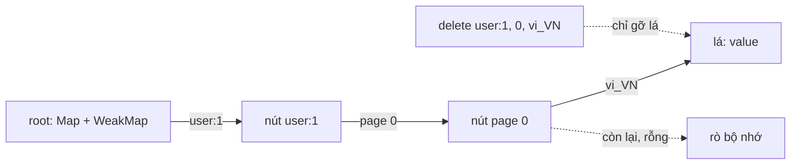

`useMemo` và `React.memo` chỉ có tác dụng khi so sánh `===` cho kết quả đúng. Hai object có cùng nội dung nhưng tạo ở hai chỗ khác nhau thì vẫn khác nhau, nên component vẫn render lại. Ngược lại, nếu cache giữ object quá lâu thì bộ nhớ cứ phình ra.

Trong bundle của Facebook có ba module nhỏ cùng xoay quanh chuyện này. `MultiKeyMap` là bảng tra theo **nhiều khoá**, nhả object khi object chết. `LoadObject` đảm bảo mọi trạng thái "đang tải" là **cùng một object**. `LoadObjectMap` gom các lần xin dữ liệu trong một tick thành **một request**.

> [!TIP]
> **Tóm tắt**
> - `MultiKeyMap` là một trie: mỗi tầng ứng với một đối số. Khoá nguyên thuỷ (string, number…) nằm trong `Map`, khoá là object nằm trong `WeakMap`. Object bị GC thì cả nhánh cache của nó rụng theo.
> - Bản gốc có hai điểm yếu: `delete` để lại các nút rỗng trong `Map` mạnh, và khoá `bigint` hay `Symbol.for(...)` bị đưa vào `WeakMap` nên ném lỗi.
> - `LoadObject` **intern** các trạng thái mà giá trị thuộc tập `undefined, null, false, true, 0, ''`. Tạo "loading" 300 lần vẫn chỉ có một object, nên `React.memo` bỏ qua render.
> - `LoadObjectMap` xếp khoá vào hàng đợi, `setTimeout(0)` rồi gọi loader theo lô có giới hạn kích thước, giống DataLoader.

<iframe class="demo-frame" src="/demos/facebook-patterns/index.html?theme=dark#/multikey-memo" title="Demo multikey-memo" loading="lazy" style="height: 1100px"></iframe>

<p class="demo-links">▶ <a href="/demos/facebook-patterns/index.html#/multikey-memo" target="_blank" rel="noopener">Mở demo toàn màn hình ↗</a> · <a href="https://stackblitz.com/github/hunghg255/blog-hunghg/tree/master/examples/facebook-patterns?file=src/lib/multiKeyMap.ts" target="_blank" rel="noopener">Sửa code trên StackBlitz ↗</a> · <a href="https://github.com/hunghg255/blog-hunghg/blob/master/examples/facebook-patterns/src/lib/multiKeyMap.ts" target="_blank" rel="noopener">Xem source trên GitHub ↗</a></p>

## Facebook làm thế nào?

### MultiKeyMap: trie lai Map và WeakMap

Module `MultiKeyMap` nằm trong `25.js` (một bản khác được đóng gói kèm StyleX). Mỗi nút trie là một object có hai bảng:

```js
c.$2 = function () {
  return { type: "map", cache: new Map(), weakCache: h ? new WeakMap() : new Map() };
};
// chọn bảng theo kiểu khoá
c.$5 = function (node, key) { return i(key) ? node.cache : node.weakCache; };
function i(a) { var b = typeof a; return b === "number" || b === "string" || b === "boolean" || a == null; }
```

`set([a, b, c], v)` đi xuống từng tầng theo `a` rồi `b`, tạo nút mới khi thiếu, và đặt lá `{type: "value", value: v}` ở tầng cuối dưới khoá `c`. Số khoá bị khoá cứng sau lần gọi đầu: gọi với số khoá khác sẽ ném `"MultiKeyMap called with different number of keys"`.

Facebook dùng nó làm nền cho `memoizeWithArgsWeak`: memo một hàm nhận `(viewer, story, options)` mà không cần tự nghĩ ra khoá chuỗi, và khi `story` không còn ai giữ thì kết quả memo của nó cũng được thu hồi.

### LoadObject: intern trạng thái rỗng

`LoadObject` (trong `89.js`) là một `immutable.Record` với bốn trường `operation`, `value`, `error`, `internalHasValue`. Constructor bị khoá bằng một chuỗi bí mật để không ai `new` trực tiếp:

```js
a = [void 0, null, !1, !0, 0, ""];
var i = "SECRET_" + Math.random(),
    j = new Map(a.map(v => [v, new Map([[!0, new Map()], [!1, new Map()]])]));
```

`j` là bảng ba tầng: giá trị → `hasValue` → `operation` → instance. Hàm `$LoadObject2(operation, value, error, hasValue)` trả về instance có sẵn trong bảng nếu không có lỗi và giá trị thuộc tập trên. Mọi phép biến đổi (`setOperation`, `setValue`, `removeError`…) đều thử tra bảng trước khi tạo object mới.

Kết quả: `LoadObject.loading()` gọi ở hai nơi khác nhau trả về **cùng một object**. Một danh sách 1.000 dòng đang tải không tạo ra 1.000 record, và `prev === next` đúng nên React bỏ qua render.

### LoadObjectMap: gom request trong một tick

`LoadObjectMap` (trong `99.js`) giữ một `immutable.Map` từ khoá tới `LoadObject`. Hàm `get(key)` trả ngay trạng thái hiện có, và nếu cần tải thì xếp khoá vào hàng đợi:

```js
c.add(a);           // OrderedSet theo tên hàng đợi
this.$8.add(f);     // đánh dấu "đã xếp hàng"
this.$9 === null && (this.$9 = window.setTimeout(function () {
  d.$7.forEach(function (queue, name) { queue.size > 0 && d.$12(queue, name); });
  /* … */
}, 0));
```

`$12` cắt hàng đợi thành từng khúc theo `__getChunkSize` rồi gọi loader. Một lớp con có thể ghi đè `__getChunkSize` để đặt kích thước lô riêng. Ngoài ra `setKeyStale(key)` trả về **một map mới** với khoá đó bị đánh dấu cũ, lần `get` sau sẽ tải lại.

### Bên trong: ba lỗi nhỏ



1. **Nút rỗng không được dọn.** `delete` chỉ gỡ lá ở tầng cuối. Các nút trung gian vẫn nằm trong `cache` (Map mạnh) của cha. Thêm rồi xoá 2.000 bộ khoá `(user, page, locale)` thì trie vẫn giữ 2.401 nút, đúng như con số ở phần 1 của demo.
2. **Khoá `bigint` và `Symbol.for` ném lỗi.** Hàm `i` chỉ coi number/string/boolean/null/undefined là nguyên thuỷ. Mọi thứ khác vào `WeakMap`, mà `new WeakMap().set(1n, 1)` ném `TypeError: Invalid value used as weak map key`. Symbol đã đăng ký (`Symbol.for`) cũng vậy.
3. **`return e` trong `forEach`** ở nhánh `$10` của `LoadObjectMap.get` chỉ thoát callback, không thoát `get`. Có lẽ không gây sai kết quả vì cuối hàm cũng `return e`, nhưng các hàng đợi khác vẫn tiếp tục được kiểm tra.

## Viết lại

Ba file trong demo: `src/lib/multiKeyMap.ts` cho trie, `src/lib/loadState.ts` cho interning và bộ gom request.

Phần chọn bảng theo kiểu khoá, có đếm số con để biết khi nào nút rỗng (`WeakMap` không có `size`):

```ts title=src/lib/multiKeyMap.ts
const isPrimitive = (key: unknown): boolean =>
  key === null || (typeof key !== 'object' && typeof key !== 'function');

const newNode = <V>(): Node<V> => ({ kind: 'node', strong: new Map(), weak: new WeakMap(), size: 0 });

function child<V>(node: Node<V>, key: unknown) {
  return isPrimitive(key) ? node.strong.get(key) : node.weak.get(key as object);
}

function setChild<V>(node: Node<V>, key: unknown, value: Node<V> | Leaf<V>) {
  const had = child(node, key) !== undefined;
  if (isPrimitive(key)) node.strong.set(key, value);
  else node.weak.set(key as object, value);
  if (!had) node.size++;
}

function deleteChild<V>(node: Node<V>, key: unknown) {
  const had = isPrimitive(key) ? node.strong.delete(key) : node.weak.delete(key as object);
  if (had) node.size--;
  return had;
}
```

Phần `delete` có tỉa nút rỗng ngược về gốc:

```ts title=src/lib/multiKeyMap.ts
  delete(keys: K): boolean {
    this.check(keys);
    const path: Node<V>[] = [];
    let node: Node<V> | Leaf<V> | undefined = this.root;
    for (let i = 0; i < keys.length - 1; i++) {
      if (node === undefined || node.kind !== 'node') return false;
      path.push(node);
      node = child(node, keys[i]);
    }
    if (node === undefined || node.kind !== 'node') return false;
    if (!deleteChild(node, keys[keys.length - 1])) return false;
    // tỉa ngược: nút nào hết con thì gỡ khỏi cha
    for (let i = path.length - 1; i >= 0 && node.size === 0; i--) {
      deleteChild(path[i], keys[i]);
      node = path[i];
    }
    return true;
  }
```

::: spoiler Xem toàn bộ src/lib/multiKeyMap.ts

```ts title=src/lib/multiKeyMap.ts
/**
 * Map nhiều khoá dạng trie, lai Map/WeakMap (ý tưởng từ module MultiKeyMap của Facebook).
 *
 * Mỗi nút trie có hai bảng con:
 * - `strong`: Map cho khoá nguyên thuỷ (string, number, boolean, null, undefined, symbol, bigint)
 * - `weak`:   WeakMap cho khoá là object/hàm, để object chết thì nhánh của nó được GC thu hồi
 *
 * Khác bản gốc: `delete` tỉa các nút rỗng trên đường về gốc (bản gốc để lại nút rỗng mãi
 * trong các Map mạnh), và symbol được coi là khoá nguyên thuỷ (WeakMap chỉ nhận một số symbol).
 */

type Leaf<V> = { kind: 'value'; value: V };
interface Node<V> {
  kind: 'node';
  strong: Map<unknown, Node<V> | Leaf<V>>;
  weak: WeakMap<object, Node<V> | Leaf<V>>;
  /** số con trong `strong` + `weak` (WeakMap không đếm được nên tự đếm) */
  size: number;
}

const isPrimitive = (key: unknown): boolean =>
  key === null || (typeof key !== 'object' && typeof key !== 'function');

const newNode = <V>(): Node<V> => ({ kind: 'node', strong: new Map(), weak: new WeakMap(), size: 0 });

function child<V>(node: Node<V>, key: unknown) {
  return isPrimitive(key) ? node.strong.get(key) : node.weak.get(key as object);
}

function setChild<V>(node: Node<V>, key: unknown, value: Node<V> | Leaf<V>) {
  const had = child(node, key) !== undefined;
  if (isPrimitive(key)) node.strong.set(key, value);
  else node.weak.set(key as object, value);
  if (!had) node.size++;
}

function deleteChild<V>(node: Node<V>, key: unknown) {
  const had = isPrimitive(key) ? node.strong.delete(key) : node.weak.delete(key as object);
  if (had) node.size--;
  return had;
}

export class MultiKeyMap<K extends readonly unknown[], V> {
  private root: Node<V> = newNode();
  private arity: number | null = null;

  private check(keys: K) {
    if (keys.length === 0) throw new Error('MultiKeyMap: cần ít nhất một khoá');
    this.arity ??= keys.length;
    if (keys.length !== this.arity) {
      throw new Error(`MultiKeyMap: luôn phải dùng ${this.arity} khoá, nhận ${keys.length}`);
    }
  }

  set(keys: K, value: V): this {
    this.check(keys);
    let node = this.root;
    for (let i = 0; i < keys.length - 1; i++) {
      let next = child(node, keys[i]);
      if (next === undefined) {
        next = newNode<V>();
        setChild(node, keys[i], next);
      }
      node = next as Node<V>;
    }
    setChild(node, keys[keys.length - 1], { kind: 'value', value });
    return this;
  }

  get(keys: K): V | undefined {
    this.check(keys);
    let node: Node<V> | Leaf<V> | undefined = this.root;
    for (const key of keys) {
      if (node === undefined || node.kind !== 'node') return undefined;
      node = child(node, key);
    }
    return node?.kind === 'value' ? node.value : undefined;
  }

  has(keys: K): boolean {
    this.check(keys);
    let node: Node<V> | Leaf<V> | undefined = this.root;
    for (const key of keys) {
      if (node === undefined || node.kind !== 'node') return false;
      node = child(node, key);
    }
    return node?.kind === 'value';
  }

  delete(keys: K): boolean {
    this.check(keys);
    const path: Node<V>[] = [];
    let node: Node<V> | Leaf<V> | undefined = this.root;
    for (let i = 0; i < keys.length - 1; i++) {
      if (node === undefined || node.kind !== 'node') return false;
      path.push(node);
      node = child(node, keys[i]);
    }
    if (node === undefined || node.kind !== 'node') return false;
    if (!deleteChild(node, keys[keys.length - 1])) return false;
    // tỉa ngược: nút nào hết con thì gỡ khỏi cha
    for (let i = path.length - 1; i >= 0 && node.size === 0; i--) {
      deleteChild(path[i], keys[i]);
      node = path[i];
    }
    return true;
  }

  /** Số nút trie đang được giữ bằng tham chiếu mạnh (để đo rò bộ nhớ trong demo). */
  countStrongNodes(): number {
    const walk = (node: Node<V>): number => {
      let n = 1;
      node.strong.forEach((c) => {
        if (c.kind === 'node') n += walk(c);
      });
      return n;
    };
    return walk(this.root);
  }
}

export interface MemoStats {
  hits: number;
  misses: number;
}

/**
 * Memo hoá hàm nhiều đối số. Đối số là object thì cache tự rụng khi object bị GC.
 * (Facebook dựng `memoizeWithArgsWeak` trên MultiKeyMap theo đúng cách này.)
 */
export function memoizeWithArgs<A extends readonly unknown[], R>(fn: (...args: A) => R) {
  const cache = new MultiKeyMap<A, R>();
  const stats: MemoStats = { hits: 0, misses: 0 };
  const memoized = (...args: A): R => {
    // hàm không đối số vẫn cần một khoá
    const keys = (args.length === 0 ? [undefined] : args) as unknown as A;
    if (cache.has(keys)) {
      stats.hits++;
      return cache.get(keys) as R;
    }
    stats.misses++;
    const result = fn(...args);
    cache.set(keys, result);
    return result;
  };
  return Object.assign(memoized, { stats, cache });
}
```

:::

Interning dùng một khoá chuỗi cho bộ `(operation, hasValue, kiểu, giá trị)` thay vì Map ba tầng như bản gốc, và bộ gom request nằm cùng file:

::: spoiler Xem toàn bộ src/lib/loadState.ts

```ts title=src/lib/loadState.ts
/**
 * Trạng thái tải bất biến có "interning", và bộ gom request kiểu DataLoader
 * (ý tưởng từ LoadObject + LoadObjectMap của Facebook).
 *
 * Interning: các trạng thái "rỗng phổ biến" (đang tải, chưa có gì, value = null/0/''…)
 * luôn trả về CÙNG một object. Nhờ vậy `prev === next` đúng, React.memo bỏ qua render,
 * và 10.000 ô đang "loading" chỉ tốn một object thay vì 10.000.
 */

export type Operation = 'loading' | 'creating' | 'updating' | 'deleting' | undefined;

export interface LoadState<T> {
  readonly operation: Operation;
  readonly value: T | undefined;
  readonly hasValue: boolean;
  readonly error: unknown;
}

// Facebook intern cho đúng tập này: undefined, null, false, true, 0, ''
const INTERNABLE = new Set<unknown>([undefined, null, false, true, 0, '']);
const pool = new Map<string, LoadState<never>>();

function make<T>(operation: Operation, value: T | undefined, hasValue: boolean, error: unknown): LoadState<T> {
  if (error === undefined && INTERNABLE.has(value)) {
    // khoá chuỗi phân biệt được 0/''/false/null/undefined nhờ typeof
    const key = `${operation}|${hasValue}|${typeof value}|${String(value)}`;
    let shared = pool.get(key);
    if (!shared) {
      shared = Object.freeze({ operation, value, hasValue, error }) as LoadState<never>;
      pool.set(key, shared);
    }
    return shared as LoadState<T>;
  }
  return Object.freeze({ operation, value, hasValue, error });
}

export const LoadState = {
  empty: <T>() => make<T>(undefined, undefined, false, undefined),
  loading: <T>() => make<T>('loading', undefined, false, undefined),
  withValue: <T>(value: T) => make<T>(undefined, value, true, undefined),
  withError: <T>(error: unknown) => make<T>(undefined, undefined, false, error),
  setOperation: <T>(s: LoadState<T>, op: Operation) => make(op, s.value, s.hasValue, s.error),
  done: <T>(s: LoadState<T>) => make(undefined, s.value, s.hasValue, s.error),
  /** số object đang nằm trong pool (để demo) */
  poolSize: () => pool.size,
};

// ---------------- bộ gom request ----------------

export interface BatchLoaderOptions<K, V> {
  /** tải một lô khoá, trả về Map khoá → giá trị (khoá thiếu = lỗi "not found") */
  loadMany: (keys: K[]) => Promise<Map<K, V>>;
  /** tối đa bao nhiêu khoá một request, mặc định không giới hạn */
  maxBatchSize?: number;
  /** 'microtask' gom trong cùng tick (DataLoader); 'timeout' dùng setTimeout(0) như Facebook */
  schedule?: 'microtask' | 'timeout';
  /** đổi khoá thành chuỗi để chống trùng, mặc định String(key) */
  cacheKey?: (key: K) => string;
}

export function createBatchLoader<K, V>({
  loadMany,
  maxBatchSize = Infinity,
  schedule = 'microtask',
  cacheKey = (k) => String(k),
}: BatchLoaderOptions<K, V>) {
  const cache = new Map<string, Promise<V>>();
  let queue: Array<{ key: K; resolve: (v: V) => void; reject: (e: unknown) => void }> = [];
  let scheduled = false;
  let requests = 0;

  const flush = () => {
    scheduled = false;
    const batch = queue;
    queue = [];
    for (let i = 0; i < batch.length; i += maxBatchSize) {
      const chunk = batch.slice(i, i + maxBatchSize);
      requests++;
      loadMany(chunk.map((item) => item.key)).then(
        (result) => {
          for (const item of chunk) {
            if (result.has(item.key)) item.resolve(result.get(item.key) as V);
            else item.reject(new Error(`not found: ${String(item.key)}`));
          }
        },
        (error) => {
          for (const item of chunk) {
            cache.delete(cacheKey(item.key)); // lỗi mạng: lần sau được thử lại
            item.reject(error);
          }
        },
      );
    }
  };

  return {
    load(key: K): Promise<V> {
      const id = cacheKey(key);
      const hit = cache.get(id);
      if (hit) return hit; // chống trùng: cùng khoá trong cùng lô (hoặc đã tải) dùng chung promise
      const promise = new Promise<V>((resolve, reject) => queue.push({ key, resolve, reject }));
      cache.set(id, promise);
      if (!scheduled) {
        scheduled = true;
        if (schedule === 'microtask') queueMicrotask(flush);
        else setTimeout(flush, 0);
      }
      return promise;
    },
    /** đánh dấu cũ: lần load sau sẽ gọi mạng lại (setKeyStale của Facebook) */
    markStale(key: K) {
      cache.delete(cacheKey(key));
    },
    get requestCount() {
      return requests;
    },
  };
}
```

:::

**Khác bản gốc:**

- `delete` nhớ đường đi rồi tỉa ngược: nút nào hết con thì gỡ khỏi cha. Mỗi nút tự đếm `size` vì `WeakMap` không đếm được.
- Mọi giá trị không phải object/hàm (kể cả `symbol`, `bigint`) đều vào `Map` mạnh, nên không bao giờ ném lỗi khoá `WeakMap`.
- Có thêm `memoizeWithArgs(fn)` trả kèm `stats` (hit/miss), và hàm không đối số vẫn có khoá `[undefined]`.
- `LoadState` là object thường bị `Object.freeze`, không phụ thuộc Immutable.js. Khoá interning có `typeof` để `0`, `''`, `false` không trùng nhau khi đổi ra chuỗi.
- Bộ gom mặc định dùng `queueMicrotask` (như DataLoader) thay vì `setTimeout(0)`, chống trùng bằng cache promise, và xoá cache khi lỗi mạng để lần sau được thử lại.

## Đi qua code

- `isPrimitive` trả `true` cho `null` và mọi thứ không phải `object`/`function`. Chỉ object/hàm mới đi vào `WeakMap`, đúng loại khoá mà `WeakMap` chắc chắn nhận.
- `setChild` chỉ tăng `size` khi khoá chưa có. Ghi đè một lá không làm sai bộ đếm.
- `delete` đi xuống tới tầng cha của lá, lưu từng nút vào `path`. Sau khi gỡ lá, vòng lặp đi ngược: nếu `node.size === 0` thì gỡ `keys[i]` khỏi `path[i]`, rồi lên một tầng. Gặp nút còn con thì dừng.
- `make` trong `loadState.ts` chỉ intern khi `error === undefined` và giá trị thuộc tập `INTERNABLE`. Giá trị là object (danh sách bạn bè, bài viết…) thì luôn tạo object mới, vì so sánh nội dung tốn hơn lợi ích.
- `createBatchLoader.load` tra cache promise trước. Lần đầu thấy khoá thì tạo promise, đẩy vào hàng đợi và lên lịch `flush` một lần. `flush` cắt hàng đợi theo `maxBatchSize`, mỗi khúc một lần `loadMany`.

## Tại sao không làm cách khác?

- **Nối khoá thành chuỗi** (`JSON.stringify(args)`): không dùng được với object không serialize được, hai object khác nhau có cùng nội dung bị trùng khoá, và cache giữ kết quả mãi vì chuỗi không bao giờ bị GC "theo" object.
- **Một `WeakMap` lồng `WeakMap`**: không nhận khoá nguyên thuỷ. Phần lớn đối số thực tế là ID chuỗi hoặc số, nên vẫn cần `Map`.
- **So sánh nông (`shallowEqual`) trong `React.memo`** thay cho interning: chạy được nhưng tốn công so sánh mỗi lần render, và không giảm số object trong bộ nhớ. Interning làm phép so sánh thành `===`, không tốn gì.
- **Gom bằng `requestAnimationFrame`**: trễ tới 16 ms và không chạy khi tab ẩn. `setTimeout(0)` hoặc microtask là đủ để gom các component mount trong cùng một lượt render.

## Edge case và cạm bẫy

- **Khoá nguyên thuỷ vẫn giữ mạnh.** Memo theo `(userId: string, ...)` thì cache không bao giờ tự rụng. Cần giới hạn kích thước hoặc chủ động `delete` khi user rời màn hình.
- **`NaN` và `-0`.** `Map` dùng SameValueZero: `NaN` khớp `NaN`, còn `0` và `-0` là một khoá. Bình thường đó là điều mong muốn, nhưng nên biết.
- **Interning chỉ cho giá trị bất biến.** Nếu ai đó sửa trực tiếp object đã intern thì mọi nơi dùng chung đều bị ảnh hưởng. Bản viết lại `Object.freeze` để chặn chuyện này.
- **Bộ gom và thứ tự.** Hai lần `load` cùng khoá trong một lô dùng chung một promise. Muốn tải lại thì phải `markStale` trước, giống `setKeyStale` của Facebook.
- **Loader trả thiếu khoá** thì promise của khoá đó bị reject với "not found", không treo mãi.

## Dùng trong dự án

Memo selector nhận nhiều đối số mà một trong số đó là object (store, viewer…):

```ts
import { memoizeWithArgs } from './lib/multiKeyMap';

const visibleComments = memoizeWithArgs((post: Post, filter: string, viewerId: string) =>
  post.comments.filter((c) => matches(c, filter) && canSee(c, viewerId)),
);
// post bị thay bằng object mới sau khi cập nhật → nhánh cache cũ rụng theo GC
```

Gom request avatar trong một danh sách:

```ts
const users = createBatchLoader<string, User>({
  loadMany: async (ids) => new Map((await api.users(ids)).map((u) => [u.id, u])),
  maxBatchSize: 50,
});
function Avatar({ id }: { id: string }) {
  const user = use(users.load(id)); // 100 Avatar mount cùng lúc → 2 request
  return ;
}
```

## Kiểm thử

::: spoiler Ví dụ test (bản phác, không có trong repo)

```ts
import { describe, expect, it, vi } from 'vitest';
import { MultiKeyMap, memoizeWithArgs } from '../src/lib/multiKeyMap';
import { LoadState, createBatchLoader } from '../src/lib/loadState';

describe('MultiKeyMap', () => {
  it('tách khoá nguyên thuỷ và object, tỉa nút rỗng khi xoá', () => {
    const m = new MultiKeyMap<[string, object, number], string>();
    const o = {};
    m.set(['a', o, 1], 'x');
    expect(m.get(['a', o, 1])).toBe('x');
    expect(m.get(['a', {}, 1])).toBeUndefined();
    m.set(['b', o, 1], 'y');
    expect(m.countStrongNodes()).toBe(3); // root + a + b
    m.delete(['a', o, 1]);
    expect(m.countStrongNodes()).toBe(2);
  });

  it('nhận bigint và Symbol.for làm khoá', () => {
    const m = new MultiKeyMap<[bigint, symbol], number>();
    m.set([1n, Symbol.for('k')], 1);
    expect(m.get([1n, Symbol.for('k')])).toBe(1);
  });

  it('báo lỗi khi số khoá thay đổi', () => {
    const m = new MultiKeyMap<unknown[], number>();
    m.set([1, 2], 3);
    expect(() => m.get([1])).toThrow();
  });

  it('memoizeWithArgs đếm hit/miss', () => {
    const f = memoizeWithArgs((a: number, b: number) => a + b);
    f(1, 2);
    f(1, 2);
    expect(f.stats).toEqual({ hits: 1, misses: 1 });
  });
});

describe('LoadState', () => {
  it('intern trạng thái rỗng, không intern giá trị object', () => {
    expect(LoadState.loading()).toBe(LoadState.loading());
    expect(LoadState.withValue(0)).not.toBe(LoadState.withValue(''));
    expect(LoadState.withValue({})).not.toBe(LoadState.withValue({}));
  });
});

describe('createBatchLoader', () => {
  it('gom theo lô và chống trùng', async () => {
    const loadMany = vi.fn(async (ids: number[]) => new Map(ids.map((i) => [i, i * 10] as const)));
    const l = createBatchLoader({ loadMany, maxBatchSize: 2 });
    const r = await Promise.all([1, 2, 1, 3].map((k) => l.load(k)));
    expect(r).toEqual([10, 20, 10, 30]);
    expect(loadMany).toHaveBeenCalledTimes(2); // [1,2] và [3]
  });

  it('khoá thiếu thì reject', async () => {
    const l = createBatchLoader<number, number>({ loadMany: async () => new Map() });
    await expect(l.load(1)).rejects.toThrow('not found');
  });
});
```

:::

## So với thư viện và chuẩn web

- **`memoize-weak`, `@emotion/weak-memoize`**: cùng ý tưởng `WeakMap` nhưng chỉ cho một đối số object. `MultiKeyMap` mở rộng ra nhiều đối số, trộn cả khoá nguyên thuỷ.
- **Reselect 5** dùng `weakMapMemoize` làm mặc định, cũng là một cây `Map`/`WeakMap` theo từng đối số (tính tới 10/2026). Đọc code của Reselect là cách nhanh để thấy một bản đã chạy thực tế lâu năm.
- **DataLoader** (GraphQL) là chuẩn thực tế cho việc gom request: gom theo microtask, cache promise, `maxBatchSize`, `clear(key)`. `LoadObjectMap` làm cùng việc nhưng giữ thêm trạng thái tải cho từng khoá để render.
- **Records & Tuples** (đề xuất TC39 cho phép `#[a, b] === #[a, b]`) đã bị rút khỏi tiến trình chuẩn hoá. Đề xuất thay thế "Composites" vẫn ở giai đoạn đầu (tính tới 10/2026), nên interning tự làm vẫn là cách thực tế.

---

Bài này thuộc series **[Học từ mã nguồn Facebook](/series/facebook)** (83 bài, đọc theo thứ tự).

::: spoiler Xem nhanh danh sách bài trong series

*Phần 1*

- [Mở đầu: cách đọc code minify của Facebook](/blogs/learn-from-facebook-source-code)
- [#1 Dùng chung IntersectionObserver + infinite scroll](/blogs/facebook-shared-intersection-observer)
- [#2 useViewportDuration: đo thời gian thực sự được xem](/blogs/facebook-use-viewport-duration)
- [#3 Preload code + data khi hover](/blogs/facebook-preload-on-hover)
- [#4 Toast manager với external store](/blogs/facebook-toast-manager)
- [#5 Network status + heartbeat backoff](/blogs/facebook-network-status-heartbeat)
- [#6 ErrorGuard: bắt lỗi theo ngữ cảnh](/blogs/facebook-error-guard)
- [#7 Banzai: gom log theo lô + sendBeacon](/blogs/facebook-batch-logger)
- [#8 Focus trap + Esc theo layer](/blogs/facebook-focus-trap)

*Phần 2*

- [#9 Mẹo calc(… * 9999): container query, line-clamp, mũi tên carousel bằng CSS](/blogs/facebook-css-9999-trick)
- [#10 Thanh cuộn tuỳ biến bằng CSS 3D](/blogs/facebook-css-3d-scrollbar)
- [#11 Modal cuộn bằng window, giữ vị trí trang nền](/blogs/facebook-document-scroll-modal)
- [#12 Popover, tooltip group và hovercard](/blogs/facebook-popover-tooltip)
- [#13 Primitive Pressable + focus-visible](/blogs/facebook-pressable)
- [#14 Tab "Xem thêm" + sticky header bằng IntersectionObserver](/blogs/facebook-priority-tabs-sticky-header)
- [#15 Avatar khoét mask, gradient Messenger, skeleton steps()](/blogs/facebook-visual-tricks)
- [#16 Khung chat không giật](/blogs/facebook-chat-scroller)
- [#17 Thuật toán chọn bố cục collage ảnh](/blogs/facebook-photo-collage-layout)
- [#18 Keep-alive tab trong SPA](/blogs/facebook-keep-alive-tabs)
- [#19 Tự đo Visual Completion & interaction tracing](/blogs/facebook-visual-completion)
- [#20 Router SPA bền bỉ & tải chunk có retry](/blogs/facebook-spa-router-resilient-loading)

*Phần 3*

- [#21 Smart Compose: gợi ý chữ mờ khi gõ](/blogs/facebook-smart-compose-ghost-text)
- [#22 MQTT ngay trong trình duyệt, tự chuyển sang long-poll](/blogs/facebook-mqtt-in-browser)
- [#23 Đo thời gian dùng bằng bitmap 64 giây](/blogs/facebook-time-spent-bitmap)
- [#24 Bảng reaction nhấn giữ rồi trượt](/blogs/facebook-reaction-press-slide)
- [#25 Tìm kiếm gấp dấu, phiên âm và highlight đầu từ](/blogs/facebook-search-diacritics-tokenize)
- [#26 Ring buffer biết trace nào đã mất log](/blogs/facebook-trace-ring-buffer)
- [#27 Engine animation JS: một vòng rAF và solver cubic-bezier](/blogs/facebook-keyframes-loop-cubic-bezier)
- [#28 Bootloader: bitmap tài nguyên đã tải, chỉ reload khi cần](/blogs/facebook-bootloader-bitmap-consistency)
- [#29 Nhận biết click do screen reader tạo ra](/blogs/facebook-virtual-cursor-detection)
- [#30 Tải trước feed theo chất lượng mạng, đoán hạng thiết bị](/blogs/facebook-network-aware-prefetch)
- [#31 Hàng đợi gửi tin chat giữ đúng thứ tự](/blogs/facebook-ordered-send-queue)
- [#32 Gộp lời gọi API trong cùng một tick](/blogs/facebook-api-batcher)
- [#33 Resize ảnh trong pool Web Worker](/blogs/facebook-jpeg-resize-worker-pool)
- [#34 Crop ảnh theo nhiều khuôn mặt](/blogs/facebook-face-aware-crop)
- [#35 Kéo-thả sắp xếp và vùng thả file không nhấp nháy](/blogs/facebook-flicker-free-drag-drop)
- [#36 Tiện ích UI: fade-out, sticky event, hàm huỷ được](/blogs/facebook-ui-utility-hooks)
- [#37 Hạ tầng nhỏ: cookie, hash lỗi, prefetch khi chuột dừng](/blogs/facebook-small-infra-cookie-hash-idle)

*Phần 4–6*

- [#38 Đồng bộ tin nhắn: phát hiện lỗ seqID và fetch bù theo tầng](/blogs/facebook-messenger-sync-seqid-gaps)
- [#39 OTID: ID tin nhắn kiểu Snowflake sinh ở client](/blogs/facebook-otid-client-snowflake)
- [#40 QPL: lấy mẫu từ lúc bắt đầu, đo RTT gửi tin đầu-cuối](/blogs/facebook-qpl-send-rtt)
- [#41 Bộ điều phối request bảy chế độ gộp và chống trùng](/blogs/facebook-request-dispatcher-modes)
- [#42 Thread list theo mốc thời gian, cookie presence có version](/blogs/facebook-threadlist-ranged-presence)
- [#43 Composer dạng plugin: reducer, dirty checker, chuỗi kiểm tra](/blogs/facebook-plugin-composer)
- [#44 Thanh toán bất đồng bộ: subscribe trước, poll dự phòng](/blogs/facebook-async-checkout)
- [#45 Validate số thẻ: sửa lỗi gõ, dải BIN, Luhn](/blogs/facebook-card-validation)
- [#46 Lịch chọn khoảng ngày: bo góc dải chọn, phím đủ bộ, RTL](/blogs/facebook-range-calendar-a11y)
- [#47 Giờ mở cửa theo tuần: qua đêm, gộp khoảng, phần bù](/blogs/facebook-weekly-hours-intervals)
- [#48 Tiến độ đăng realtime: giữ event chờ snapshot, watchdog](/blogs/facebook-realtime-publish-snapshot)
- [#49 Tiền tệ theo đơn vị nhỏ nhất và ô nhập tiền](/blogs/facebook-currency-minor-units)
- [#50 Sửa hàng loạt Empty/Uniform/Mixed, seen/read bằng 2 bit](/blogs/facebook-bulk-edit-seen-bits)
- [#51 Phát hiện script lạ hook vào hàm native](/blogs/facebook-native-hook-detection)
- [#52 localStorage tự dọn khi đầy quota](/blogs/facebook-quota-aware-storage)
- [#53 Cache tuyến do server phân giải, chờ sẵn promise](/blogs/facebook-route-cache-prefetch)
- [#54 Lưới phím mũi tên 2D và focus không làm cuộn trang](/blogs/facebook-focus-table-grid)
- [#55 Tách emoji bằng máy trạng thái](/blogs/facebook-emoji-segmentation)
- [#56 Đọc trước ghi sau trong một frame, con tự biết vị trí](/blogs/facebook-read-then-write-dom)
- [#57 Hàng đợi lệnh cho video và stream sắp lại chunk](/blogs/facebook-video-command-queue)

*Phần 7–10*

- [#58 Ước lượng băng thông EWMA: loại outlier, nhớ qua phiên](/blogs/facebook-bandwidth-ewma-estimator)
- [#59 ABR theo độ tự tin phát và cắt bậc bitrate theo MOS](/blogs/facebook-abr-playback-confidence)
- [#60 Prefetch segment dự đoán từ manifest, parse hộp sidx](/blogs/facebook-dash-predicted-segments)
- [#61 Đọc metadata MP4/MOV ngay trên client](/blogs/facebook-mp4-metadata-client)
- [#62 Upload tiếp tục được: offset, hash dedupe, phát hiện treo](/blogs/facebook-resumable-upload)
- [#63 Fenwick tree: chọn ngẫu nhiên có trọng số và offset dòng](/blogs/facebook-fenwick-weighted-random)
- [#64 Vạch trục số và trục thời gian "đẹp"](/blogs/facebook-nice-axis-ticks)
- [#65 Damerau-Levenshtein theo dải chéo và tự sửa tên gõ sai](/blogs/facebook-damerau-levenshtein)
- [#66 PRNG có seed, shuffle tái lập và lấy mẫu trace](/blogs/facebook-seeded-prng-sampling)
- [#67 Cặp min/max-heap tái dùng vị trí trong danh sách ảo](/blogs/facebook-dual-heap-buffer-set)
- **#68 Memo nhiều đối số bằng Map/WeakMap và interning object** (bài này)
- [#69 Thống kê cửa sổ trượt và đại số khoảng thời gian](/blogs/facebook-moving-stat-intervals)
- [#70 Int64 từ hai số 32-bit, decode UTF, offset theo code point](/blogs/facebook-int64-utf-codepoints)
- [#71 Engine múi giờ IANA trên client, phát hiện lệch giờ](/blogs/facebook-client-iana-timezone)
- [#72 Tự cài semver range](/blogs/facebook-semver-range)
- [#73 Auto-link URL, cắt chữ an toàn, giới hạn LaTeX](/blogs/facebook-autolink-safe-truncate)
- [#74 Parser query kiểu PHP chống prototype pollution](/blogs/facebook-php-query-serializer)
- [#75 Popover tự lật theo phần tràn nhỏ nhất](/blogs/facebook-popover-auto-flip)
- [#76 Tiền tố for(;;) chống JSON hijacking, đọc stream](/blogs/facebook-csrf-prefix-streaming)
- [#77 Chống lộ Referer, linkshim, xoá token trên URL](/blogs/facebook-referrer-linkshim-url-scrub)
- [#78 setImmediate bằng postMessage, gom delta chuột theo frame](/blogs/facebook-setimmediate-mouse-batching)
- [#79 Phát hiện crash qua heartbeat, dò proxy cache hỏng](/blogs/facebook-crash-heartbeat-proxy-check)
- [#80 DPR vào cookie cho ảnh @2x, che khoá trong log](/blogs/facebook-dpr-cookie-secret-redaction)
- [#81 Flux waitFor tự viết và proxy có đệm](/blogs/facebook-flux-dispatch-buffered-proxy)
- [#82 Crop đúng tỉ lệ, xoay sticker bằng ma trận](/blogs/facebook-image-crop-rotation-geometry)

:::

Code + demo: [`examples/facebook-patterns`](https://github.com/hunghg255/blog-hunghg/tree/master/examples/facebook-patterns) · [Mở trên StackBlitz](https://stackblitz.com/github/hunghg255/blog-hunghg/tree/master/examples/facebook-patterns)
