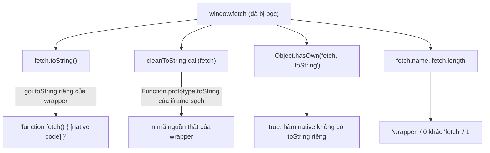

Trang thanh toán của bạn gọi `fetch('/api/pay', …)`. Bạn có chắc `fetch` đó là `fetch` của trình duyệt không? Bất kỳ script nào chạy trên cùng trang (thư viện quảng cáo, chat widget, extension của người dùng, mã độc được chèn vào qua một dependency) đều có thể gán `window.fetch = function () { … }` và đọc mọi request trước khi chuyển tiếp.

Facebook có một đoạn code làm đúng việc bọc hàm native như thế, nhưng theo hướng ngược lại: họ bọc hàm để **phát hiện** script lạ đang chạy trên trang. Bài này phân tích đoạn code đó, chỉ ra vì sao cách "giả `toString`" của nó vẫn để lại dấu vết, và viết một bộ kiểm tra giúp trang của bạn biết API native mình dựa vào có còn nguyên vẹn không.

> [!TIP]
> **Tóm tắt**
> - `ClickRefLogger` của Facebook, ngoài việc log click, còn chạy một bộ luật do server cấp. Chuỗi luật được che bằng XOR 1. Luật có thể bọc một hàm native, ghi lại tham số khớp regex, rồi gửi kết quả lên server.
> - Hàm bọc gán `wrapper.toString = original.toString.bind(original)`, nên `fetch.toString()` vẫn in `[native code]`.
> - Cách này vẫn lộ: in hàm bằng `Function.prototype.toString` **lấy từ một iframe sạch**, kiểm tra thuộc tính `toString` riêng, `name`/`length`, và descriptor của thuộc tính.
> - Quan trọng hơn kiểm tra: **chụp tham chiếu sớm** (`const nativeFetch = window.fetch` trước mọi script khác) và chỉ dùng bản đã chụp cho thao tác nhạy cảm. Mọi kiểm tra kiểu này đều chỉ là tín hiệu, không phải ranh giới bảo mật.

<iframe class="demo-frame" src="/demos/facebook-patterns/index.html?theme=dark#/native-hook" title="Demo native-hook" loading="lazy" style="height: 980px"></iframe>

<p class="demo-links">▶ <a href="/demos/facebook-patterns/index.html#/native-hook" target="_blank" rel="noopener">Mở demo toàn màn hình ↗</a> · <a href="https://stackblitz.com/github/hunghg255/blog-hunghg/tree/master/examples/facebook-patterns?file=src/lib/nativeHookCheck.ts" target="_blank" rel="noopener">Sửa code trên StackBlitz ↗</a> · <a href="https://github.com/hunghg255/blog-hunghg/blob/master/examples/facebook-patterns/src/lib/nativeHookCheck.ts" target="_blank" rel="noopener">Xem source trên GitHub ↗</a></p>

## Facebook làm thế nào?

### Một logger click bình thường…

`ClickRefLogger` (`283.js`) nghe sự kiện `ClickRefAction/new` của `Arbiter`, gom thông tin click (vị trí, phím bổ trợ mã hoá thành bitmask `ctrl=1, shift=2, alt=4, meta=8`, `data-ft`, URL hiện tại…) rồi gửi lên Banzai với route `click_ref_logger`. Phần này giống các logger khác trong bundle.

### …và một hàm chạy ẩn ở cuối module

Cuối module có một hàm được gọi ngay khi module tải, bọc trong `try {} catch {}` để không bao giờ ném lỗi ra ngoài:

```js
function c(Env) {
  const xor1 = (s) => [...s].map((ch) => String.fromCharCode(1 ^ ch.charCodeAt(0))).join('');
  const rules = Env[xor1('jiri')];          // 'jiri' → 'khsh'
  if (!rules) return;
  xor1(rules).split(',').map((rule, index) => { /* switch (rule.charAt(0)) … */ });
}
try { c(Env); } catch (e) {}
```

Mỗi luật bắt đầu bằng một chữ số chỉ loại: `1` đánh dấu khi `window[tên]` tồn tại; `2` bọc hàm tại một path trên `window` và test tham số bằng regex; `3` bọc một hàm "kích hoạt", khi nó chạy thì kiểm các luật loại 1 rồi gửi kết quả; `4` là cờ. (Vòng lặp `xor1` ở đây viết gọn lại; bản gốc dùng `for` và `fromCharCode`.)

Vài điểm đáng chú ý:

- Tên khoá cấu hình, tên hàm gửi và tên route đều được che bằng XOR 1: `xor1('jiri') = 'khsh'`, `xor1('qnru') = 'post'`, `xor1('islg') = 'hrmf'`. Kết quả gửi đi là `Banzai.post('hrmf', { m: danhSáchLuậtKhớp })`, sau 5 giây kể từ khi hàm kích hoạt chạy.
- Giá trị `Env.khsh` không có trong bundle. Nó được server cấp lúc render trang, nên không thể biết luật cụ thể là gì, cũng không biết luật có đang được bật cho ai không. Mẫu này giống cách dò extension, công cụ tự động hoá hoặc script chèn vào trang, nhưng đó là suy đoán dựa trên cấu trúc code.
- Mỗi luật chỉ được báo một lần cho mỗi lần tải trang (`if (reported[index]) return`).

### Cách bọc hàm

```js
function wrap(obj, path, i, onCall) {
  const key = path[i];
  if (!(key && obj && key in obj)) return;
  if (i + 1 < path.length) return wrap(obj[key], path, i + 1, onCall);
  const original = obj[key];
  const wrapper = function () {
    window.setTimeout(onCall.bind(null, arguments)); // ghi nhận sau, không làm chậm hàm gốc
    return original.apply(this, arguments);
  };
  wrapper.toString = original.toString.bind(original);  // in ra vẫn là [native code]
  Object.defineProperty(obj, key, { configurable: false, writable: true, value: wrapper });
}
```

Ba lựa chọn có chủ đích:

1. **Ghi nhận bất đồng bộ.** `setTimeout` đẩy việc test regex ra khỏi lời gọi, để hàm gốc không chậm đi.
2. **Giả `toString`.** Ai kiểm tra bằng `fn.toString().includes('[native code]')` sẽ thấy hàm vẫn "native".
3. **`configurable: false`.** Sau khi bọc, không script nào `defineProperty` lại được thuộc tính đó. Gán thường vẫn được vì `writable: true`.

Hai tác dụng phụ đáng biết: hàm bọc dùng `apply(this, arguments)` nên không gọi được bằng `new`. Bọc một constructor như `WebSocket` thì `new WebSocket(…)` sẽ ném `TypeError`. Và vì `configurable: false`, polyfill hay thư viện nào chạy sau mà cần `defineProperty` lại thuộc tính đó sẽ lỗi.

## Bên trong trình duyệt: vì sao giả `toString` vẫn lộ



- `fn.toString()` tra thuộc tính `toString` trên chính `fn` trước. Wrapper có thuộc tính riêng, nên câu trả lời là của hàm gốc.
- `Function.prototype.toString.call(fn)` thì đi thẳng vào hàm dựng sẵn của engine, bỏ qua thuộc tính riêng. Nhưng chính `Function.prototype.toString` của trang cũng có thể đã bị thay. Lấy nó từ một **iframe `about:blank` mới tạo** cho ta một bản mà script của trang hiện tại chưa đụng tới. Gọi chéo realm vẫn hợp lệ với iframe cùng origin.
- Hàm native có `name` và `length` cố định (`fetch` có length 1). Wrapper viết bằng `function () {}` có length 0 và name khác.
- Descriptor trên `window` của `fetch` gốc là `configurable: true`. Sau khi bọc kiểu trên, nó thành `false`.

Không kiểm tra nào trong số này là tuyệt đối. Script chạy trước bạn có thể sửa luôn cách tạo iframe. Extension có quyền chèn script vào mọi frame thì chạm được cả iframe "sạch". Mục tiêu chỉ là nâng chi phí và có tín hiệu để ghi log.

## Viết lại

### Mở realm sạch và kiểm tra một hàm

`openCleanRealm` tạo một iframe ẩn `about:blank` và trả về `contentWindow` của nó (xem bản đầy đủ trong spoiler bên dưới). Phần kiểm tra:

```ts title=src/lib/nativeHookCheck.ts
export function checkNative(path: string, pageRoot: unknown, realm: ReturnType<typeof openCleanRealm>): IntegrityResult {
  const page = resolvePath(pageRoot, path);
  const clean = resolvePath(realm.win, path);
  const checks: IntegrityResult['checks'] = [];
  const fn = page.value;

  if (typeof fn !== 'function') {
    return { path, ok: false, checks: [{ name: 'là function', pass: false, detail: typeof fn }] };
  }

  let printed = '';
  try {
    printed = realm.toString.call(fn);
  } catch (error) {
    printed = `lỗi: ${(error as Error).message}`;
  }
  checks.push({ name: 'toString của realm sạch ra [native code]', pass: NATIVE_RE.test(printed), detail: printed.slice(0, 60) });

  const ownToString = Object.prototype.hasOwnProperty.call(fn, 'toString');
  checks.push({ name: 'không có toString riêng', pass: !ownToString });

  const cleanFn = clean.value as ((...args: unknown[]) => unknown) | undefined;
  if (typeof cleanFn === 'function') {
    checks.push({
      name: 'name và length khớp bản sạch',
      pass: fn.name === cleanFn.name && fn.length === cleanFn.length,
      detail: `${fn.name}/${fn.length} vs ${cleanFn.name}/${cleanFn.length}`,
    });
  }

  if (page.holder && clean.holder) {
    const a = Object.getOwnPropertyDescriptor(page.holder, page.key);
    const b = Object.getOwnPropertyDescriptor(clean.holder, clean.key);
    if (a && b) {
      const same = a.configurable === b.configurable && a.enumerable === b.enumerable && ('value' in a) === ('value' in b);
      checks.push({
        name: 'descriptor khớp bản sạch',
        pass: same,
        detail: `configurable ${a.configurable}/${b.configurable}`,
      });
    }
  }

  return { path, ok: checks.every((c) => c.pass), checks };
}
```

### Chụp tham chiếu sớm

```ts title=src/lib/nativeHookCheck.ts
/**
 * Cách phòng thủ thực dụng nhất: chụp tham chiếu NGAY khi script của bạn chạy (càng sớm
 * càng tốt, ví dụ inline trong <head>) rồi chỉ dùng bản đã chụp cho thao tác nhạy cảm.
 */
export function snapshotNatives<T extends Record<string, string>>(paths: T, root: unknown = window) {
  const out = {} as { [K in keyof T]: (...args: never[]) => unknown };
  for (const [name, path] of Object.entries(paths)) {
    const { holder, value } = resolvePath(root, path);
    if (typeof value === 'function') {
      // giữ `this` gốc cho hàm toàn cục như fetch; hàm trên prototype gọi bằng .call(target)
      out[name as keyof T] = (holder === root ? value.bind(root) : value) as (...args: never[]) => unknown;
    }
  }
  return out;
}
```

::: spoiler Xem toàn bộ src/lib/nativeHookCheck.ts

```ts title=src/lib/nativeHookCheck.ts
/**
 * Kiểm tra tính toàn vẹn của các API native mà trang của mình phụ thuộc vào
 * (bối cảnh: ClickRefLogger của Facebook hook hàm native để dò script lạ).
 *
 * Mục đích ở đây là PHÒNG THỦ: trang thanh toán, trang đăng nhập muốn biết `fetch`,
 * `XMLHttpRequest.prototype.open`, `addEventListener`… có đang bị một script bên thứ ba
 * (extension, thư viện quảng cáo, mã độc chèn vào) bọc lại hay không, để quyết định
 * có nên dùng bản tham chiếu đã chụp sẵn, hay ghi log cảnh báo.
 *
 * Đây KHÔNG phải ranh giới bảo mật: script chạy trước bạn trên cùng trang có thể sửa
 * luôn những công cụ kiểm tra. Kết quả chỉ là tín hiệu.
 */

export interface IntegrityResult {
  path: string;
  ok: boolean;
  checks: Array<{ name: string; pass: boolean; detail?: string }>;
}

/**
 * Mở một realm sạch (iframe about:blank, không gắn src) để lấy Function.prototype.toString
 * và các hàm tham chiếu chưa bị script của trang hiện tại đụng tới.
 * Giới hạn: extension có content script `all_frames`/`match_about_blank` vẫn có thể chạm vào.
 */
export function openCleanRealm(doc: Document = document) {
  const iframe = doc.createElement('iframe');
  iframe.style.display = 'none';
  iframe.setAttribute('aria-hidden', 'true');
  doc.documentElement.appendChild(iframe);
  const win = iframe.contentWindow as (Window & typeof globalThis) | null;
  if (!win) {
    iframe.remove();
    throw new Error('Không mở được realm sạch');
  }
  return {
    win,
    toString: win.Function.prototype.toString as (this: unknown) => string,
    dispose: () => iframe.remove(),
  };
}

export function resolvePath(root: unknown, path: string): { holder: object | null; key: string; value: unknown } {
  const parts = path.split('.');
  let holder: unknown = root;
  for (const part of parts.slice(0, -1)) {
    holder = holder == null ? undefined : (holder as Record<string, unknown>)[part];
  }
  const key = parts[parts.length - 1];
  const value = holder == null ? undefined : (holder as Record<string, unknown>)[key];
  return { holder: (holder as object) ?? null, key, value };
}

const NATIVE_RE = /^function [\w$]+\(\) \{\s*\[native code\]\s*\}$/;

/**
 * So một hàm của trang với bản cùng đường dẫn trong realm sạch:
 *  1. dùng toString CỦA REALM SẠCH để in hàm (hook giả `fn.toString` không ảnh hưởng)
 *  2. hàm không được có thuộc tính `toString` riêng
 *  3. `name` và `length` khớp với bản sạch
 *  4. descriptor trên đối tượng chứa (configurable/writable/enumerable) khớp với bản sạch
 */
export function checkNative(path: string, pageRoot: unknown, realm: ReturnType<typeof openCleanRealm>): IntegrityResult {
  const page = resolvePath(pageRoot, path);
  const clean = resolvePath(realm.win, path);
  const checks: IntegrityResult['checks'] = [];
  const fn = page.value;

  if (typeof fn !== 'function') {
    return { path, ok: false, checks: [{ name: 'là function', pass: false, detail: typeof fn }] };
  }

  let printed = '';
  try {
    printed = realm.toString.call(fn);
  } catch (error) {
    printed = `lỗi: ${(error as Error).message}`;
  }
  checks.push({ name: 'toString của realm sạch ra [native code]', pass: NATIVE_RE.test(printed), detail: printed.slice(0, 60) });

  const ownToString = Object.prototype.hasOwnProperty.call(fn, 'toString');
  checks.push({ name: 'không có toString riêng', pass: !ownToString });

  const cleanFn = clean.value as ((...args: unknown[]) => unknown) | undefined;
  if (typeof cleanFn === 'function') {
    checks.push({
      name: 'name và length khớp bản sạch',
      pass: fn.name === cleanFn.name && fn.length === cleanFn.length,
      detail: `${fn.name}/${fn.length} vs ${cleanFn.name}/${cleanFn.length}`,
    });
  }

  if (page.holder && clean.holder) {
    const a = Object.getOwnPropertyDescriptor(page.holder, page.key);
    const b = Object.getOwnPropertyDescriptor(clean.holder, clean.key);
    if (a && b) {
      const same = a.configurable === b.configurable && a.enumerable === b.enumerable && ('value' in a) === ('value' in b);
      checks.push({
        name: 'descriptor khớp bản sạch',
        pass: same,
        detail: `configurable ${a.configurable}/${b.configurable}`,
      });
    }
  }

  return { path, ok: checks.every((c) => c.pass), checks };
}

export function checkAll(paths: string[], pageRoot: unknown = window): IntegrityResult[] {
  const realm = openCleanRealm();
  try {
    return paths.map((p) => checkNative(p, pageRoot, realm));
  } finally {
    realm.dispose();
  }
}

/**
 * Cách phòng thủ thực dụng nhất: chụp tham chiếu NGAY khi script của bạn chạy (càng sớm
 * càng tốt, ví dụ inline trong <head>) rồi chỉ dùng bản đã chụp cho thao tác nhạy cảm.
 */
export function snapshotNatives<T extends Record<string, string>>(paths: T, root: unknown = window) {
  const out = {} as { [K in keyof T]: (...args: never[]) => unknown };
  for (const [name, path] of Object.entries(paths)) {
    const { holder, value } = resolvePath(root, path);
    if (typeof value === 'function') {
      // giữ `this` gốc cho hàm toàn cục như fetch; hàm trên prototype gọi bằng .call(target)
      out[name as keyof T] = (holder === root ? value.bind(root) : value) as (...args: never[]) => unknown;
    }
  }
  return out;
}

/** Giải mã chuỗi kiểu ClickRefLogger: mỗi ký tự XOR 1 ("jiri" → "khsh"). Chỉ là che mắt, không phải mã hoá. */
export const xor1 = (text: string) => Array.from(text, (ch) => String.fromCharCode(ch.charCodeAt(0) ^ 1)).join('');
```

:::

## Đi qua code

- `openCleanRealm` tạo iframe không có `src`. Trình duyệt tạo sẵn một document `about:blank` đồng bộ, nên `contentWindow` dùng được ngay mà không phải chờ `load`.
- `checkNative` in hàm bằng `realm.toString`, không bằng `fn.toString()`. Regex chấp nhận cả cách in của Chrome (`{ [native code] }` trên một dòng) lẫn Firefox (xuống dòng).
- Kiểm `name`/`length` bằng cách so với **cùng đường dẫn trong realm sạch**, không cần bảng hằng số viết tay.
- `checkAll` tạo và huỷ realm cho mỗi lần kiểm, để không giữ iframe thừa trong DOM.
- `snapshotNatives` là phần nên dùng nhiều nhất: đặt nó trong script chạy đầu tiên của trang, rồi gọi `snap.fetch(…)` thay cho `fetch(…)` ở các luồng nhạy cảm như thanh toán, đổi mật khẩu.

**Khác bản gốc:** bản gốc là bộ dò do server điều khiển, gửi kết quả về server. Bản viết lại chỉ kiểm tra API mà chính trang dùng, trả kết quả cho code của trang, không gửi đi đâu.

## Tại sao không làm cách khác?

**So `fn === window.fetch` lúc khởi động?** Đó chính là chụp tham chiếu. Nó tốt nhất nếu script của bạn chạy trước mọi script khác. Kiểm tra realm sạch hữu ích khi bạn không kiểm soát được thứ tự, ví dụ code của bạn là một SDK được nhúng vào trang người khác.

**Đóng băng bằng `Object.freeze(window.fetch)`?** Không ngăn được việc gán `window.fetch = …`, vì freeze áp lên hàm chứ không phải thuộc tính trên `window`. Dùng `Object.defineProperty(window, 'fetch', { writable: false, configurable: false })` thì chặn được gán sau đó, nhưng cũng chặn luôn polyfill và công cụ giám sát hợp lệ (Sentry, OpenTelemetry cũng bọc `fetch`).

**Content Security Policy?** CSP với `script-src` chặt chẽ ngăn script lạ được tải ngay từ đầu, và đây mới là lớp bảo vệ chính. Kiểm tra integrity chỉ là lớp phát hiện cho những gì lọt qua (extension không bị CSP của trang chặn).

## Edge case và cạm bẫy

- **Công cụ hợp lệ cũng bọc hàm.** Sentry, Datadog RUM, OpenTelemetry, công cụ đo hiệu năng đều bọc `fetch`/`XMLHttpRequest`. Kiểm tra sẽ báo "bị bọc" và điều đó đúng. Đừng chặn người dùng chỉ vì kết quả này; hãy ghi log, hoặc dùng bản đã chụp.
- **Hàm bound.** `fetch.bind(window)` in ra `function () { [native code] }`, không có tên trong chuỗi (dù `.name` là `"bound fetch"`). Regex kiểm tra yêu cầu tên, nên đừng kiểm tra chính bản snapshot bằng `checkNative`.
- **Proxy.** `new Proxy(fetch, {})` giữ nguyên `name` và `length`, và `Function.prototype.toString` vẫn in `[native code]`, nhưng trên V8 chuỗi in ra không có tên hàm: `function () { [native code] }`. Regex trong bài bắt điểm này (đã thử trên Chromium và Node). Đây là chi tiết của engine, không có trong đặc tả, nên đừng dựa hẳn vào nó.
- **Không tạo được iframe.** Trang dùng sandbox chặt hoặc chính sách tuỳ biến có thể chặn thao tác DOM. `checkAll` để lỗi ném ra; hãy bọc trong `try` và coi là "không kiểm được".
- **Gọi trong lúc trang đang tải.** `document.documentElement` phải tồn tại. Script inline trong `<head>` thì đã có.

## Quyền riêng tư

Dò xem người dùng có extension nào, có biến toàn cục nào, là một dạng lấy dấu vân tay trình duyệt (fingerprinting). Ở EU, đọc thông tin từ thiết bị người dùng mà không thật sự cần cho dịch vụ thường cần sự đồng ý (ePrivacy). Cách làm của bản gốc (luật do server cấp, tên che bằng XOR, không có giao diện nào cho người dùng biết) khó kiểm toán từ bên ngoài, ngay cả khi mục đích là chống gian lận hay chống bot.

Kiểm tra trong bài có phạm vi hẹp hơn: chỉ xem API mà chính trang dùng có còn nguyên không, và chỉ dùng kết quả ở client. Nếu cần gửi về server để phân tích, hãy ghi rõ trong chính sách quyền riêng tư và chỉ gửi kết quả tổng hợp ("fetch bị bọc: có/không"), không gửi danh sách extension hay biến toàn cục.

## Dùng trong dự án

```html
<head>
  <script>
    // chạy trước mọi script khác
    window.__native = { fetch: window.fetch.bind(window) };
  </script>
  …
</head>
```

```ts
import { checkAll } from './nativeHookCheck';

export async function pay(body: PaymentRequest) {
  const report = checkAll(['fetch', 'XMLHttpRequest.prototype.open']);
  if (report.some((r) => !r.ok)) logIntegrityWarning(report.map((r) => [r.path, r.ok]));
  // luôn dùng bản đã chụp cho request nhạy cảm, bất kể kết quả kiểm tra
  return window.__native.fetch('/api/pay', { method: 'POST', body: JSON.stringify(body) });
}
```

## Kiểm thử

::: spoiler Ví dụ test (bản phác, không có trong repo)

```ts
import { describe, expect, it } from 'vitest';
import { checkAll, xor1 } from './nativeHookCheck';

describe('checkAll', () => {
  it('hàm native không bị bọc thì sạch', () => {
    expect(checkAll(['JSON.stringify'])[0].ok).toBe(true);
  });

  it('hook giả toString vẫn bị phát hiện', () => {
    const original = JSON.stringify;
    const wrapper = function (this: unknown) {
      return original.apply(this, arguments as unknown as Parameters<typeof JSON.stringify>);
    };
    wrapper.toString = original.toString.bind(original);
    JSON.stringify = wrapper as typeof JSON.stringify;
    try {
      expect(String(JSON.stringify)).toContain('[native code]'); // cách hỏi ngây thơ bị lừa
      const [result] = checkAll(['JSON.stringify']);
      expect(result.ok).toBe(false);
    } finally {
      JSON.stringify = original;
    }
  });
});

it('xor1 giải chuỗi bị che', () => {
  expect(['jiri', 'qnru', 'islg'].map(xor1)).toEqual(['khsh', 'post', 'hrmf']);
});
```

:::

## So với chuẩn web

- **CSP** (`script-src` với nonce/hash) và **Subresource Integrity** (`integrity="sha384-…"` trên thẻ `<script>`) ngăn script lạ hoặc script bị sửa được chạy. Đây là lớp nên có trước.
- **Trusted Types** chặn việc đưa chuỗi vào các sink nguy hiểm như `innerHTML`, giảm khả năng mã độc được chèn qua XSS.
- Trình duyệt chưa có API chuẩn nào để hỏi "hàm này có phải native và chưa bị sửa không" (tính tới 10/2026). Các kỹ thuật trong bài đều dựa trên hành vi hiện có của `Function.prototype.toString` và iframe cùng origin.

---

Bài này thuộc series **[Học từ mã nguồn Facebook](/series/facebook)** (83 bài, đọc theo thứ tự).

::: spoiler Xem nhanh danh sách bài trong series

*Phần 1*

- [Mở đầu: cách đọc code minify của Facebook](/blogs/learn-from-facebook-source-code)
- [#1 Dùng chung IntersectionObserver + infinite scroll](/blogs/facebook-shared-intersection-observer)
- [#2 useViewportDuration: đo thời gian thực sự được xem](/blogs/facebook-use-viewport-duration)
- [#3 Preload code + data khi hover](/blogs/facebook-preload-on-hover)
- [#4 Toast manager với external store](/blogs/facebook-toast-manager)
- [#5 Network status + heartbeat backoff](/blogs/facebook-network-status-heartbeat)
- [#6 ErrorGuard: bắt lỗi theo ngữ cảnh](/blogs/facebook-error-guard)
- [#7 Banzai: gom log theo lô + sendBeacon](/blogs/facebook-batch-logger)
- [#8 Focus trap + Esc theo layer](/blogs/facebook-focus-trap)

*Phần 2*

- [#9 Mẹo calc(… * 9999): container query, line-clamp, mũi tên carousel bằng CSS](/blogs/facebook-css-9999-trick)
- [#10 Thanh cuộn tuỳ biến bằng CSS 3D](/blogs/facebook-css-3d-scrollbar)
- [#11 Modal cuộn bằng window, giữ vị trí trang nền](/blogs/facebook-document-scroll-modal)
- [#12 Popover, tooltip group và hovercard](/blogs/facebook-popover-tooltip)
- [#13 Primitive Pressable + focus-visible](/blogs/facebook-pressable)
- [#14 Tab "Xem thêm" + sticky header bằng IntersectionObserver](/blogs/facebook-priority-tabs-sticky-header)
- [#15 Avatar khoét mask, gradient Messenger, skeleton steps()](/blogs/facebook-visual-tricks)
- [#16 Khung chat không giật](/blogs/facebook-chat-scroller)
- [#17 Thuật toán chọn bố cục collage ảnh](/blogs/facebook-photo-collage-layout)
- [#18 Keep-alive tab trong SPA](/blogs/facebook-keep-alive-tabs)
- [#19 Tự đo Visual Completion & interaction tracing](/blogs/facebook-visual-completion)
- [#20 Router SPA bền bỉ & tải chunk có retry](/blogs/facebook-spa-router-resilient-loading)

*Phần 3*

- [#21 Smart Compose: gợi ý chữ mờ khi gõ](/blogs/facebook-smart-compose-ghost-text)
- [#22 MQTT ngay trong trình duyệt, tự chuyển sang long-poll](/blogs/facebook-mqtt-in-browser)
- [#23 Đo thời gian dùng bằng bitmap 64 giây](/blogs/facebook-time-spent-bitmap)
- [#24 Bảng reaction nhấn giữ rồi trượt](/blogs/facebook-reaction-press-slide)
- [#25 Tìm kiếm gấp dấu, phiên âm và highlight đầu từ](/blogs/facebook-search-diacritics-tokenize)
- [#26 Ring buffer biết trace nào đã mất log](/blogs/facebook-trace-ring-buffer)
- [#27 Engine animation JS: một vòng rAF và solver cubic-bezier](/blogs/facebook-keyframes-loop-cubic-bezier)
- [#28 Bootloader: bitmap tài nguyên đã tải, chỉ reload khi cần](/blogs/facebook-bootloader-bitmap-consistency)
- [#29 Nhận biết click do screen reader tạo ra](/blogs/facebook-virtual-cursor-detection)
- [#30 Tải trước feed theo chất lượng mạng, đoán hạng thiết bị](/blogs/facebook-network-aware-prefetch)
- [#31 Hàng đợi gửi tin chat giữ đúng thứ tự](/blogs/facebook-ordered-send-queue)
- [#32 Gộp lời gọi API trong cùng một tick](/blogs/facebook-api-batcher)
- [#33 Resize ảnh trong pool Web Worker](/blogs/facebook-jpeg-resize-worker-pool)
- [#34 Crop ảnh theo nhiều khuôn mặt](/blogs/facebook-face-aware-crop)
- [#35 Kéo-thả sắp xếp và vùng thả file không nhấp nháy](/blogs/facebook-flicker-free-drag-drop)
- [#36 Tiện ích UI: fade-out, sticky event, hàm huỷ được](/blogs/facebook-ui-utility-hooks)
- [#37 Hạ tầng nhỏ: cookie, hash lỗi, prefetch khi chuột dừng](/blogs/facebook-small-infra-cookie-hash-idle)

*Phần 4–6*

- [#38 Đồng bộ tin nhắn: phát hiện lỗ seqID và fetch bù theo tầng](/blogs/facebook-messenger-sync-seqid-gaps)
- [#39 OTID: ID tin nhắn kiểu Snowflake sinh ở client](/blogs/facebook-otid-client-snowflake)
- [#40 QPL: lấy mẫu từ lúc bắt đầu, đo RTT gửi tin đầu-cuối](/blogs/facebook-qpl-send-rtt)
- [#41 Bộ điều phối request bảy chế độ gộp và chống trùng](/blogs/facebook-request-dispatcher-modes)
- [#42 Thread list theo mốc thời gian, cookie presence có version](/blogs/facebook-threadlist-ranged-presence)
- [#43 Composer dạng plugin: reducer, dirty checker, chuỗi kiểm tra](/blogs/facebook-plugin-composer)
- [#44 Thanh toán bất đồng bộ: subscribe trước, poll dự phòng](/blogs/facebook-async-checkout)
- [#45 Validate số thẻ: sửa lỗi gõ, dải BIN, Luhn](/blogs/facebook-card-validation)
- [#46 Lịch chọn khoảng ngày: bo góc dải chọn, phím đủ bộ, RTL](/blogs/facebook-range-calendar-a11y)
- [#47 Giờ mở cửa theo tuần: qua đêm, gộp khoảng, phần bù](/blogs/facebook-weekly-hours-intervals)
- [#48 Tiến độ đăng realtime: giữ event chờ snapshot, watchdog](/blogs/facebook-realtime-publish-snapshot)
- [#49 Tiền tệ theo đơn vị nhỏ nhất và ô nhập tiền](/blogs/facebook-currency-minor-units)
- [#50 Sửa hàng loạt Empty/Uniform/Mixed, seen/read bằng 2 bit](/blogs/facebook-bulk-edit-seen-bits)
- **#51 Phát hiện script lạ hook vào hàm native** (bài này)
- [#52 localStorage tự dọn khi đầy quota](/blogs/facebook-quota-aware-storage)
- [#53 Cache tuyến do server phân giải, chờ sẵn promise](/blogs/facebook-route-cache-prefetch)
- [#54 Lưới phím mũi tên 2D và focus không làm cuộn trang](/blogs/facebook-focus-table-grid)
- [#55 Tách emoji bằng máy trạng thái](/blogs/facebook-emoji-segmentation)
- [#56 Đọc trước ghi sau trong một frame, con tự biết vị trí](/blogs/facebook-read-then-write-dom)
- [#57 Hàng đợi lệnh cho video và stream sắp lại chunk](/blogs/facebook-video-command-queue)

*Phần 7–10*

- [#58 Ước lượng băng thông EWMA: loại outlier, nhớ qua phiên](/blogs/facebook-bandwidth-ewma-estimator)
- [#59 ABR theo độ tự tin phát và cắt bậc bitrate theo MOS](/blogs/facebook-abr-playback-confidence)
- [#60 Prefetch segment dự đoán từ manifest, parse hộp sidx](/blogs/facebook-dash-predicted-segments)
- [#61 Đọc metadata MP4/MOV ngay trên client](/blogs/facebook-mp4-metadata-client)
- [#62 Upload tiếp tục được: offset, hash dedupe, phát hiện treo](/blogs/facebook-resumable-upload)
- [#63 Fenwick tree: chọn ngẫu nhiên có trọng số và offset dòng](/blogs/facebook-fenwick-weighted-random)
- [#64 Vạch trục số và trục thời gian "đẹp"](/blogs/facebook-nice-axis-ticks)
- [#65 Damerau-Levenshtein theo dải chéo và tự sửa tên gõ sai](/blogs/facebook-damerau-levenshtein)
- [#66 PRNG có seed, shuffle tái lập và lấy mẫu trace](/blogs/facebook-seeded-prng-sampling)
- [#67 Cặp min/max-heap tái dùng vị trí trong danh sách ảo](/blogs/facebook-dual-heap-buffer-set)
- [#68 Memo nhiều đối số bằng Map/WeakMap và interning object](/blogs/facebook-multikey-memo-interning)
- [#69 Thống kê cửa sổ trượt và đại số khoảng thời gian](/blogs/facebook-moving-stat-intervals)
- [#70 Int64 từ hai số 32-bit, decode UTF, offset theo code point](/blogs/facebook-int64-utf-codepoints)
- [#71 Engine múi giờ IANA trên client, phát hiện lệch giờ](/blogs/facebook-client-iana-timezone)
- [#72 Tự cài semver range](/blogs/facebook-semver-range)
- [#73 Auto-link URL, cắt chữ an toàn, giới hạn LaTeX](/blogs/facebook-autolink-safe-truncate)
- [#74 Parser query kiểu PHP chống prototype pollution](/blogs/facebook-php-query-serializer)
- [#75 Popover tự lật theo phần tràn nhỏ nhất](/blogs/facebook-popover-auto-flip)
- [#76 Tiền tố for(;;) chống JSON hijacking, đọc stream](/blogs/facebook-csrf-prefix-streaming)
- [#77 Chống lộ Referer, linkshim, xoá token trên URL](/blogs/facebook-referrer-linkshim-url-scrub)
- [#78 setImmediate bằng postMessage, gom delta chuột theo frame](/blogs/facebook-setimmediate-mouse-batching)
- [#79 Phát hiện crash qua heartbeat, dò proxy cache hỏng](/blogs/facebook-crash-heartbeat-proxy-check)
- [#80 DPR vào cookie cho ảnh @2x, che khoá trong log](/blogs/facebook-dpr-cookie-secret-redaction)
- [#81 Flux waitFor tự viết và proxy có đệm](/blogs/facebook-flux-dispatch-buffered-proxy)
- [#82 Crop đúng tỉ lệ, xoay sticker bằng ma trận](/blogs/facebook-image-crop-rotation-geometry)

:::

Code + demo: [`examples/facebook-patterns`](https://github.com/hunghg255/blog-hunghg/tree/master/examples/facebook-patterns) · [Mở trên StackBlitz](https://stackblitz.com/github/hunghg255/blog-hunghg/tree/master/examples/facebook-patterns)
