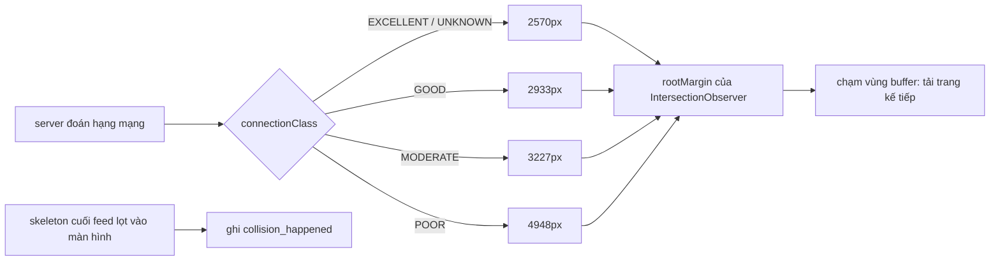

Infinite scroll nào cũng có một con số: còn cách đáy bao nhiêu pixel thì bắt đầu tải trang kế tiếp. Đa số dự án đặt đại 200px, 500px, hoặc 1 màn hình. Với mạng nhanh thì ổn. Với 3G ở quán cà phê, request mất 2–3 giây, người dùng vuốt hai cái là đã chạm đáy và nhìn skeleton quay.

Con số này lẽ ra phải phụ thuộc vào **thời gian một request mất bao lâu**. Facebook làm đúng như vậy, và giá trị họ chọn có một điểm thoạt nghe ngược: mạng càng kém thì buffer càng **lớn**.

> [!TIP]
> **Tóm tắt**
> - News Feed chọn khoảng cách tải trước theo hạng kết nối: EXCELLENT 2570px, GOOD 2933px, MODERATE 3227px, POOR 4948px. Mạng chậm thì phải bắt đầu sớm hơn.
> - Họ còn ghi lại mỗi lần skeleton cuối feed thực sự lọt vào màn hình ("collision"): đó là số đo trực tiếp của việc tải trước chưa đủ sớm.
> - Song song, `WebDevicePerfInfoLogging` thu CPU, RAM, GPU và tốc độ tải đo từ Resource Timing để server xếp hạng thiết bị. Đoạn lọc "tab bị ẩn" của nó có lẽ không bao giờ có tác dụng vì lệch trục thời gian.
> - Mang về: đo thời gian request của chính app (EWMA), chọn buffer theo đó, và đo số lần va chạm thay vì đoán.

<iframe class="demo-frame" src="/demos/facebook-patterns/index.html?theme=dark#/network-prefetch" title="Demo network-prefetch" loading="lazy" style="height: 900px"></iframe>

<p class="demo-links">▶ <a href="/demos/facebook-patterns/index.html#/network-prefetch" target="_blank" rel="noopener">Mở demo toàn màn hình ↗</a> · <a href="https://stackblitz.com/github/hunghg255/blog-hunghg/tree/master/examples/facebook-patterns?file=src/lib/networkAwarePrefetch.ts" target="_blank" rel="noopener">Sửa code trên StackBlitz ↗</a> · <a href="https://github.com/hunghg255/blog-hunghg/blob/master/examples/facebook-patterns/src/lib/networkAwarePrefetch.ts" target="_blank" rel="noopener">Xem source trên GitHub ↗</a></p>

## Facebook làm thế nào?

### Bảng buffer theo hạng mạng

Module `CometFeedTailLoadBufferHeight` chỉ là một bảng hằng số:

```js
CometFeedTailLoadBufferHeight = {
  EXCELLENT: 2570,
  GOOD: 2933,
  MODERATE: 3227,
  POOR: 4948,
};
```

Ai dùng nó? `CometFeedInfiniteScrollSuspenseList.react` (đã đổi tên biến):

```js
const rootMargin = useMemo(() => {
  if (waitOnScrollIntent === true && !hadScrollIntent) return 0;
  let buffer;
  switch (WebConnectionClassServerGuess.connectionClass) {
    case 'UNKNOWN':
    case 'EXCELLENT':
    default: buffer = CometFeedTailLoadBufferHeight.EXCELLENT; break;
    case 'GOOD': buffer = CometFeedTailLoadBufferHeight.GOOD; break;
    case 'MODERATE': buffer = CometFeedTailLoadBufferHeight.MODERATE; break;
    case 'POOR': buffer = CometFeedTailLoadBufferHeight.POOR; break;
  }
  if (buffer == null) {
    FBLogger('comet_feed').mustfix('Found no tail load buffer height … Falling back to 2500px.');
    buffer = 2500;
  }
  return { [revealOrder === 'backwards' ? 'top' : 'bottom']: buffer };
}, [revealOrder, hadScrollIntent, waitOnScrollIntent]);
```

Bốn điều đáng học trong vài chục dòng này:

1. **Hạng mạng do server đoán** (`WebConnectionClassServerGuess`), gửi kèm trang. Server thấy RTT của kết nối TCP, thông lượng các response trước, nên đoán tốt hơn client. Module này là cấu hình được server bơm vào, không có trong bản dump.
2. **`UNKNOWN` được xử lý như `EXCELLENT`.** Không biết gì thì giả định mạng tốt, dùng buffer nhỏ nhất.
3. **"Ý định cuộn" (scroll intent).** Một effect nghe sự kiện `scroll` ở pha capture, so `window.scrollY` với vị trí ban đầu. Khi bật `waitOnScrollIntent`, buffer bằng 0 cho tới khi người dùng thật sự cuộn: không tải trước cho người chỉ mở trang rồi đi.
4. **Đếm "va chạm".** Skeleton cuối feed (`CometFeedGlimmer`) được gắn `useVisibilityObserver`; khi nó lọt vào màn hình, code ghi `QuickPerformanceLogger.markEvent(…, "collision_happened")` kèm cờ `had_demonstrated_scroll_intent`. Va chạm nghĩa là người dùng đã đuổi kịp đuôi feed và phải nhìn trạng thái đang tải. Có lẽ đây chính là số liệu họ dùng để chỉnh bảng buffer.

Vì sao chọn 2570, 2933, 3227, 4948 mà không phải số tròn? Code không nói. Có lẽ đây là kết quả thử nghiệm (A/B test) trên số liệu "collision" ở trên, nên mới lẻ như vậy.

### Thu thông tin thiết bị

`WebDevicePerfInfoLogging` (file `283.js`) gom các thứ client tự đo được:

```js
function collect() {
  const info = {};
  if (navigator.hardwareConcurrency !== undefined) info.cpu_cores = navigator.hardwareConcurrency;
  if (navigator.deviceMemory !== undefined) info.ram = navigator.deviceMemory;
  if (WebDevicePerfInfoData.needsFullUpdate) readGpu(info); // WEBGL_debug_renderer_info
  return info;
}

function measureResources(info) {
  const early = new Set(getEarlyResources().map((s) => s.getAttribute('src'))); // <script> trong <head>
  performance.getEntriesByType('resource').forEach((r) => {
    if (!early.has(r.name)) return;
    const hidden = VisibilityListener.getHiddenTime(r.startTime, r.responseEnd);
    if (hidden != null && hidden > 0) return; // bỏ resource tải lúc tab bị ẩn
    const time = r.responseEnd - r.responseStart;
    if (r.transferSize === 0) {            // lấy từ cache: đo tốc độ đọc đĩa
      cachedSum += r.encodedBodySize / time; cachedCount++;
    } else if (r.transferSize >= r.encodedBodySize) { // tải qua mạng
      remoteSum += r.transferSize / time; remoteCount++;
    }
  });
}
```

Số liệu gửi qua Banzai (`web_device_perf_info_log`), hoặc gửi tới `XDeviceClassRealtimeController` để **server** trả về `devicePerfClassLevel`. Client không tự xếp hạng. Cả hai lời gọi được hẹn qua `JSScheduler.scheduleSpeculativeCallback`, tức chạy ở mức ưu tiên thấp, không tranh với việc render.

### Một lỗi có lẽ có thật: lệch trục thời gian

`VisibilityListener` lưu các mốc ẩn/hiện của tab theo **epoch** (nó cộng `Date.now() - performance.now()` vào mỗi mốc). Các chỗ khác trong bundle gọi `getHiddenTime(start + offset, end + offset)` để đổi sang epoch trước. Riêng `WebDevicePerfInfoLogging` truyền thẳng `r.startTime` và `r.responseEnd`, là thời gian **tương đối** tính từ lúc trang bắt đầu tải (vài nghìn ms).

Với đầu vào đó, `getHiddenTimings` không tìm thấy mốc nào nhỏ hơn `end` (mọi mốc đều cỡ 1,7 × 10¹² ms), trả `null`, và `getHiddenTime` trả `null`. Điều kiện `hidden != null && hidden > 0` không bao giờ đúng, nên resource tải lúc tab ẩn **vẫn được tính**. Mình suy ra từ code, chưa đối chiếu với số liệu thật của Facebook.

Thêm hai điểm nhỏ:

- `time` có thể bằng 0 (resource nhỏ, đồng hồ thô) → chia ra `Infinity`.
- Resource khác origin thiếu header `Timing-Allow-Origin` có `transferSize = encodedBodySize = 0`, bị tính là "đọc cache với tốc độ 0" và kéo trung bình xuống.



## Bên trong trình duyệt: rootMargin và giới hạn của IntersectionObserver

Cả infinite scroll của Facebook lẫn bản viết lại đều dựa vào `IntersectionObserver` với `rootMargin`. Margin dương ở cạnh dưới **phóng to** vùng root xuống dưới: sentinel nằm cách đáy viewport 2570px đã được coi là "giao nhau".

Vài điều cần biết:

- **Observer chỉ báo khi trạng thái đổi.** Tải xong một trang mà sentinel vẫn nằm trong vùng buffer (trang mới ngắn hơn buffer) thì không có callback mới, feed đứng im. Phải chủ động kiểm tra lại: tạo observer mới (callback đầu tiên luôn được gọi với trạng thái hiện tại), hoặc đo lại bằng `getBoundingClientRect`. Facebook có một lớp riêng cho chuyện này trong `CometInfiniteScrollTrigger` (dùng `useAfterPaint` để kiểm tra lại sau khi vẽ).
- **`rootMargin` của root là phần tử cuộn** hoạt động bình thường. Chỉ trong iframe khác origin với root ngầm định (viewport), margin mới bị bỏ qua.
- **Buffer tính bằng pixel, không phải số bài.** Bài trong feed cao thấp khác nhau, nên pixel phản ánh thời gian cuộn sát hơn số bài.

Một phép tính thô để thấy vì sao buffer phải lớn khi mạng chậm: người dùng vuốt nhanh khoảng 1500px mỗi lần. Request mất 2,6 giây trên mạng POOR. Nếu chỉ bắt đầu tải khi còn 600px, một lần vuốt là đã chạm đáy trong khi request mới chạy được một phần nhỏ.

## Viết lại

Phần chọn buffer giữ nguyên bảng của Facebook. Vì không có server đoán hộ, bản viết lại đoán ở client: ưu tiên thời gian request **của chính app** (trung bình trượt mũ, EWMA), rồi mới tới Network Information API.

```ts title=src/lib/networkAwarePrefetch.ts
export function tailBufferFor(connectionClass: ConnectionClass): number {
  if (connectionClass === 'UNKNOWN') return TAIL_LOAD_BUFFER.EXCELLENT; // FB coi UNKNOWN như EXCELLENT
  return TAIL_LOAD_BUFFER[connectionClass] ?? FALLBACK_BUFFER;
}

/**
 * Facebook lấy hạng kết nối do server đoán (WebConnectionClassServerGuess), gửi kèm trang.
 * Không có server thì ước lượng ở client: ưu tiên RTT đo được từ chính các request của app,
 * sau đó mới tới Network Information API (chỉ có trên trình duyệt nhân Chromium).
 * Ngưỡng dưới đây là của bản viết lại, không phải của Facebook.
 */
export function guessConnectionClass(input: {
  measuredRttMs?: number | null;
  effectiveType?: string | null;
  saveData?: boolean;
}): ConnectionClass {
  const { measuredRttMs, effectiveType, saveData } = input;
  if (measuredRttMs != null) {
    // thời gian của cả một request lấy trang feed (gồm thời gian server xử lý), không phải ping
    if (measuredRttMs < 300) return 'EXCELLENT';
    if (measuredRttMs < 800) return 'GOOD';
    if (measuredRttMs < 1600) return 'MODERATE';
    return 'POOR';
  }
  if (saveData) return 'POOR';
  switch (effectiveType) {
    case '4g':
      return 'GOOD'; // "4g" chỉ nói là ≥ ngưỡng 4g, không nói là xuất sắc
    case '3g':
      return 'MODERATE';
    case '2g':
    case 'slow-2g':
      return 'POOR';
    default:
      return 'UNKNOWN';
  }
}

/** Trung bình trượt mũ (EWMA) của thời gian request: cập nhật rẻ, quên dần số liệu cũ. */
export function createRttEstimator(alpha = 0.3) {
  let value: number | null = null;
  return {
    add(ms: number) {
      value = value == null ? ms : value + alpha * (ms - value);
      return value;
    },
    get: () => value,
    reset: () => {
      value = null;
    },
  };
```

Bộ tải đuôi feed dùng hai observer trên cùng một sentinel: một cái có margin bằng buffer để bắt đầu tải, một cái margin 0 để đếm va chạm.

```ts title=src/lib/networkAwarePrefetch.ts
export function createTailLoader(options: TailLoaderOptions) {
  const { root, sentinel, onLoadMore, onCollision } = options;
  let bufferPx = options.bufferPx;
  let hadScrollIntent = !options.waitForScrollIntent;
  let prefetchObserver: IntersectionObserver | null = null;
  const scrollTarget: HTMLElement | Window = root ?? window;
  const startScroll = root ? root.scrollTop : window.scrollY;

  const makePrefetchObserver = () => {
    prefetchObserver?.disconnect();
    // chưa có ý định cuộn thì buffer = 0: chỉ tải khi đuôi feed đã hiện ra
    const margin = hadScrollIntent ? bufferPx : 0;
    prefetchObserver = new IntersectionObserver(
      (entries) => {
        if (entries.some((e) => e.isIntersecting)) onLoadMore();
      },
      { root, rootMargin: `0px 0px ${margin}px 0px` },
    );
    prefetchObserver.observe(sentinel);
  };

  const collisionObserver = new IntersectionObserver(
    (entries) => {
      if (entries.some((e) => e.isIntersecting)) onCollision?.({ hadScrollIntent });
    },
    { root },
  );

  const onScroll = () => {
    const now = root ? root.scrollTop : window.scrollY;
    if (now !== startScroll && !hadScrollIntent) {
      hadScrollIntent = true;
      scrollTarget.removeEventListener('scroll', onScroll);
      makePrefetchObserver();
    }
  };

  if (!hadScrollIntent) scrollTarget.addEventListener('scroll', onScroll, { passive: true });
  makePrefetchObserver();
  collisionObserver.observe(sentinel);
```

Phần đo tốc độ từ Resource Timing (`measureResourceSpeed` trong `deviceClass.ts`) giữ cách chia hai nhóm cache/mạng của Facebook, và sửa các lỗi nêu ở trên: mốc ẩn/hiện ghi bằng `performance.now()` để cùng trục với Resource Timing, bỏ entry có thời gian bằng 0 hoặc `encodedBodySize = 0`.

::: spoiler Xem toàn bộ src/lib/networkAwarePrefetch.ts

```ts title=src/lib/networkAwarePrefetch.ts
/**
 * Tải trước đuôi feed sớm hay muộn tuỳ chất lượng mạng.
 *
 * Ý tưởng từ CometFeedTailLoadBufferHeight + CometFeedInfiniteScrollSuspenseList của Facebook:
 * khoảng cách (px) từ đáy viewport tới "đuôi" feed mà ở đó bắt đầu tải trang kế tiếp được
 * chọn theo hạng kết nối. Mạng càng kém thì buffer càng LỚN: request mất nhiều thời gian hơn
 * nên phải bắt đầu sớm hơn mới kịp có nội dung trước khi người dùng cuộn tới.
 */

export type ConnectionClass = 'EXCELLENT' | 'GOOD' | 'MODERATE' | 'POOR' | 'UNKNOWN';

/** Đúng bộ số Facebook dùng (px). */
export const TAIL_LOAD_BUFFER: Record<Exclude<ConnectionClass, 'UNKNOWN'>, number> = {
  EXCELLENT: 2570,
  GOOD: 2933,
  MODERATE: 3227,
  POOR: 4948,
};

/** FB log lỗi "mustfix" rồi dùng 2500px nếu không tra được bảng. */
export const FALLBACK_BUFFER = 2500;

export function tailBufferFor(connectionClass: ConnectionClass): number {
  if (connectionClass === 'UNKNOWN') return TAIL_LOAD_BUFFER.EXCELLENT; // FB coi UNKNOWN như EXCELLENT
  return TAIL_LOAD_BUFFER[connectionClass] ?? FALLBACK_BUFFER;
}

/**
 * Facebook lấy hạng kết nối do server đoán (WebConnectionClassServerGuess), gửi kèm trang.
 * Không có server thì ước lượng ở client: ưu tiên RTT đo được từ chính các request của app,
 * sau đó mới tới Network Information API (chỉ có trên trình duyệt nhân Chromium).
 * Ngưỡng dưới đây là của bản viết lại, không phải của Facebook.
 */
export function guessConnectionClass(input: {
  measuredRttMs?: number | null;
  effectiveType?: string | null;
  saveData?: boolean;
}): ConnectionClass {
  const { measuredRttMs, effectiveType, saveData } = input;
  if (measuredRttMs != null) {
    // thời gian của cả một request lấy trang feed (gồm thời gian server xử lý), không phải ping
    if (measuredRttMs < 300) return 'EXCELLENT';
    if (measuredRttMs < 800) return 'GOOD';
    if (measuredRttMs < 1600) return 'MODERATE';
    return 'POOR';
  }
  if (saveData) return 'POOR';
  switch (effectiveType) {
    case '4g':
      return 'GOOD'; // "4g" chỉ nói là ≥ ngưỡng 4g, không nói là xuất sắc
    case '3g':
      return 'MODERATE';
    case '2g':
    case 'slow-2g':
      return 'POOR';
    default:
      return 'UNKNOWN';
  }
}

/** Trung bình trượt mũ (EWMA) của thời gian request: cập nhật rẻ, quên dần số liệu cũ. */
export function createRttEstimator(alpha = 0.3) {
  let value: number | null = null;
  return {
    add(ms: number) {
      value = value == null ? ms : value + alpha * (ms - value);
      return value;
    },
    get: () => value,
    reset: () => {
      value = null;
    },
  };
}

export interface TailLoaderOptions {
  /** phần tử cuộn; null = viewport */
  root: HTMLElement | null;
  /** phần tử đặt ở đuôi danh sách (thường là skeleton "đang tải") */
  sentinel: HTMLElement;
  bufferPx: number;
  /** giống waitOnScrollIntent của FB: chưa cuộn lần nào thì không tải trước */
  waitForScrollIntent?: boolean;
  onLoadMore: () => void;
  /**
   * Gọi khi skeleton thực sự lọt vào khung nhìn: người dùng đã đuổi kịp đuôi feed và phải
   * nhìn trạng thái đang tải. FB ghi sự kiện này với tên "collision_happened".
   */
  onCollision?: (info: { hadScrollIntent: boolean }) => void;
}

/**
 * Hai IntersectionObserver trên cùng một sentinel:
 * - một cái có rootMargin = buffer: chạm vào là bắt đầu tải trang kế tiếp;
 * - một cái rootMargin = 0: chạm vào nghĩa là đã "va chạm", người dùng đang nhìn skeleton.
 */
export function createTailLoader(options: TailLoaderOptions) {
  const { root, sentinel, onLoadMore, onCollision } = options;
  let bufferPx = options.bufferPx;
  let hadScrollIntent = !options.waitForScrollIntent;
  let prefetchObserver: IntersectionObserver | null = null;
  const scrollTarget: HTMLElement | Window = root ?? window;
  const startScroll = root ? root.scrollTop : window.scrollY;

  const makePrefetchObserver = () => {
    prefetchObserver?.disconnect();
    // chưa có ý định cuộn thì buffer = 0: chỉ tải khi đuôi feed đã hiện ra
    const margin = hadScrollIntent ? bufferPx : 0;
    prefetchObserver = new IntersectionObserver(
      (entries) => {
        if (entries.some((e) => e.isIntersecting)) onLoadMore();
      },
      { root, rootMargin: `0px 0px ${margin}px 0px` },
    );
    prefetchObserver.observe(sentinel);
  };

  const collisionObserver = new IntersectionObserver(
    (entries) => {
      if (entries.some((e) => e.isIntersecting)) onCollision?.({ hadScrollIntent });
    },
    { root },
  );

  const onScroll = () => {
    const now = root ? root.scrollTop : window.scrollY;
    if (now !== startScroll && !hadScrollIntent) {
      hadScrollIntent = true;
      scrollTarget.removeEventListener('scroll', onScroll);
      makePrefetchObserver();
    }
  };

  if (!hadScrollIntent) scrollTarget.addEventListener('scroll', onScroll, { passive: true });
  makePrefetchObserver();
  collisionObserver.observe(sentinel);

  return {
    /** đổi buffer khi hạng kết nối thay đổi */
    setBuffer(px: number) {
      if (px === bufferPx) return;
      bufferPx = px;
      makePrefetchObserver();
    },
    /**
     * IntersectionObserver chỉ báo khi trạng thái giao nhau ĐỔI. Tải xong mà sentinel vẫn
     * nằm trong vùng buffer thì sẽ không có callback mới; gọi hàm này sau khi render trang
     * mới để observer kiểm tra lại từ đầu.
     */
    recheck() {
      makePrefetchObserver();
    },
    destroy() {
      prefetchObserver?.disconnect();
      collisionObserver.disconnect();
      scrollTarget.removeEventListener('scroll', onScroll);
    },
  };
}
```

:::

::: spoiler Xem toàn bộ src/lib/deviceClass.ts

```ts title=src/lib/deviceClass.ts
/**
 * Thu thông tin phần cứng + tốc độ mạng/đĩa đo được từ Resource Timing để đoán "hạng" thiết bị.
 *
 * Ý tưởng từ WebDevicePerfInfoLogging của Facebook. Ở FB client chỉ thu số liệu, còn việc
 * xếp hạng do server làm (XDeviceClassRealtimeController trả về devicePerfClassLevel).
 * Hàm classifyDevice() bên dưới là ngưỡng của bản viết lại.
 */

export interface DeviceInfo {
  cpuCores?: number;
  /** GB, đã được trình duyệt làm tròn (0.25, 0.5, 1, 2, 4, 8…) */
  ramGb?: number;
  gpuVendor?: string;
  gpuRenderer?: string;
  /** bytes/ms đọc từ cache (transferSize = 0) */
  cachedSpeed?: number;
  cachedFiles?: number;
  /** bytes/ms tải qua mạng */
  networkSpeed?: number;
  networkFiles?: number;
  skippedHidden?: number;
}

export function readHardware(): Pick<DeviceInfo, 'cpuCores' | 'ramGb'> {
  const nav = navigator as Navigator & { deviceMemory?: number };
  return {
    cpuCores: nav.hardwareConcurrency || undefined,
    ramGb: nav.deviceMemory, // chỉ có trên trình duyệt nhân Chromium
  };
}

/** Tên GPU thật qua extension WEBGL_debug_renderer_info (một số trình duyệt trả về chuỗi đã che bớt). */
export function readGpu(): Pick<DeviceInfo, 'gpuVendor' | 'gpuRenderer'> {
  try {
    const canvas = document.createElement('canvas');
    const gl = (canvas.getContext('webgl') || canvas.getContext('experimental-webgl')) as WebGLRenderingContext | null;
    if (!gl) return {};
    const ext = gl.getExtension('WEBGL_debug_renderer_info');
    if (!ext) return {};
    const result = {
      gpuVendor: String(gl.getParameter(ext.UNMASKED_VENDOR_WEBGL)),
      gpuRenderer: String(gl.getParameter(ext.UNMASKED_RENDERER_WEBGL)),
    };
    // trả context lại ngay, trình duyệt giới hạn số WebGL context sống cùng lúc
    gl.getExtension('WEBGL_lose_context')?.loseContext();
    return result;
  } catch {
    return {};
  }
}

/** Khoảng thời gian tab bị ẩn, đo trên cùng trục thời gian với performance.now(). */
export function createHiddenTimeline() {
  const changes: Array<{ at: number; hidden: boolean }> = [{ at: 0, hidden: document.hidden }];
  const onChange = () => changes.push({ at: performance.now(), hidden: document.hidden });
  document.addEventListener('visibilitychange', onChange);
  return {
    /** số ms tab bị ẩn trong khoảng [start, end] */
    hiddenTime(start: number, end: number): number {
      let total = 0;
      for (let i = 0; i < changes.length; i++) {
        if (!changes[i].hidden) continue;
        const from = Math.max(start, changes[i].at);
        const to = Math.min(end, i + 1 < changes.length ? changes[i + 1].at : Infinity);
        if (to > from) total += to - from;
      }
      return total;
    },
    destroy: () => document.removeEventListener('visibilitychange', onChange),
  };
}

export interface ResourceSample {
  name: string;
  transferSize: number;
  encodedBodySize: number;
  responseStart: number;
  responseEnd: number;
  startTime: number;
}

/**
 * Tốc độ đọc cache và tốc độ mạng từ các resource đã tải.
 * - transferSize === 0 && encodedBodySize > 0: lấy từ cache → đo tốc độ đọc đĩa.
 * - transferSize >= encodedBodySize: tải qua mạng (transferSize có cả header nên thường lớn hơn).
 * - còn lại (transferSize < encodedBodySize): bỏ, không rõ nguồn.
 * Bỏ resource tải trong lúc tab bị ẩn: trình duyệt giảm ưu tiên tab nền nên số đo sai lệch.
 *
 * Khác bản gốc: FB gọi getHiddenTime(entry.startTime, entry.responseEnd) với thời gian TƯƠNG ĐỐI,
 * trong khi các mốc ẩn/hiện của nó lưu theo epoch (Date.now), nên phép lọc có lẽ không bao giờ
 * loại được resource nào. Ở đây mọi mốc cùng trục performance.now(). Ngoài ra resource khác
 * origin không có Timing-Allow-Origin có cả transferSize lẫn encodedBodySize bằng 0, FB vẫn
 * tính là "cache" với tốc độ 0; bản này bỏ chúng.
 */
export function measureResourceSpeed(
  entries: ResourceSample[],
  hiddenTime: (start: number, end: number) => number = () => 0,
): Pick<DeviceInfo, 'cachedSpeed' | 'cachedFiles' | 'networkSpeed' | 'networkFiles' | 'skippedHidden'> {
  let cachedSum = 0;
  let cachedFiles = 0;
  let networkSum = 0;
  let networkFiles = 0;
  let skippedHidden = 0;
  for (const e of entries) {
    if (e.encodedBodySize === 0) continue; // không đo được (opaque, rỗng, hoặc thiếu Timing-Allow-Origin)
    const duration = e.responseEnd - e.responseStart;
    if (duration <= 0) continue; // tránh chia cho 0 → Infinity
    if (hiddenTime(e.startTime, e.responseEnd) > 0) {
      skippedHidden++;
      continue;
    }
    if (e.transferSize === 0) {
      cachedSum += e.encodedBodySize / duration;
      cachedFiles++;
    } else if (e.transferSize >= e.encodedBodySize) {
      networkSum += e.transferSize / duration;
      networkFiles++;
    }
  }
  return {
    cachedSpeed: cachedFiles ? cachedSum / cachedFiles : undefined,
    cachedFiles,
    networkSpeed: networkFiles ? networkSum / networkFiles : undefined,
    networkFiles,
    skippedHidden,
  };
}

export type DeviceTier = 'low' | 'mid' | 'high' | 'unknown';

/** Ngưỡng của bản viết lại: ưu tiên RAM và số nhân, không có dữ liệu thì "unknown". */
export function classifyDevice(info: DeviceInfo): DeviceTier {
  const { cpuCores, ramGb } = info;
  if (cpuCores == null && ramGb == null) return 'unknown';
  if ((ramGb != null && ramGb <= 2) || (cpuCores != null && cpuCores <= 2)) return 'low';
  if ((ramGb != null && ramGb >= 8) && (cpuCores == null || cpuCores >= 8)) return 'high';
  if (ramGb == null && cpuCores != null && cpuCores >= 8) return 'high';
  return 'mid';
}
```

:::

**Khác bản gốc:**

- Hạng mạng đoán ở client từ thời gian request đo được, thay vì do server đoán. Các ngưỡng 300/800/1600ms là của bản viết lại.
- Có hàm `recheck()` để kiểm tra lại sau mỗi lần render trang mới.
- `createHiddenTimeline` ghi mốc ẩn/hiện bằng `performance.now()`, cùng trục với Resource Timing.
- Bỏ entry có `encodedBodySize = 0` hoặc thời gian bằng 0.
- `classifyDevice` xếp hạng ngay ở client với ngưỡng đơn giản (RAM ≤ 2GB hoặc ≤ 2 nhân là máy yếu). Facebook để server làm việc này.

## Đi qua code

1. **`tailBufferFor`**: tra bảng, `UNKNOWN` dùng giá trị `EXCELLENT` như bản gốc.
2. **`guessConnectionClass`**: số đo thật thắng `effectiveType`. `effectiveType = '4g'` chỉ nói kết nối ít nhất ở mức 4G (theo bảng ngưỡng của đặc tả), không nói là xuất sắc, nên mình xếp vào `GOOD`.
3. **`createRttEstimator`**: EWMA với `alpha = 0.3`. Một request chậm bất thường không làm buffer nhảy vọt, nhưng mạng chậm dần thì giá trị đuổi theo sau vài request.
4. **`createTailLoader`**:
   - Chưa có ý định cuộn thì margin bằng 0. Cuộn lần đầu thì tạo lại observer với margin thật.
   - `setBuffer` tạo lại observer khi hạng mạng đổi.
   - `recheck` tạo lại observer để nhận callback ban đầu.
5. **`measureResourceSpeed`**: chia làm hai nhóm cache và mạng, bỏ những gì không đo được, và bỏ resource tải trong lúc tab ẩn.

Trong demo, mỗi lần một trang về, thời gian request được đưa vào EWMA, hạng mạng cập nhật, và buffer đổi theo. Nút "Tự cuộn" giả lập 5 lần vuốt 1500px, mỗi lần dừng đọc 1,6 giây. Kết quả Playwright trên bản build (đợi 4 giây cho lần tải trước đầu tiên rồi mới cuộn):

| Mạng giả lập | Buffer | Va vào skeleton | Tổng thời gian chờ |
|---|---|---|---|
| GOOD (~550ms) | theo hạng mạng | 0 | 0ms |
| GOOD | cố định 600px | 4 | 1460ms |
| MODERATE (~1200ms) | theo hạng mạng | 0 | 0ms |
| MODERATE | cố định 600px | 4 | 4183ms |
| POOR (~2600ms) | theo hạng mạng | 0 | 0ms |
| POOR | cố định 600px | 2 | 4807ms |

Với kịch bản này, buffer 2570px cố định cũng không va chạm lần nào, kể cả ở POOR: chênh lệch thật nằm giữa "vài trăm pixel" và "vài nghìn pixel". Phần tăng thêm cho mạng kém (tới 4948px) là biên an toàn cho người vuốt nhanh hơn hoặc mạng dao động mạnh hơn kịch bản giả lập.

## Tại sao không làm cách khác?

**Tải trước số trang cố định (ví dụ luôn giữ sẵn 2 trang)?** Dễ hiểu nhưng tốn băng thông vô ích trên mạng nhanh, và vẫn thiếu khi bài ngắn. Pixel tỷ lệ với thời gian cuộn hơn.

**Chỉ dùng `navigator.connection.effectiveType`?** API này chỉ có trên trình duyệt nhân Chromium, và giá trị là ước lượng chung cho cả kết nối, không phải cho server của bạn. Thời gian request thật của app phản ánh đúng cái mình cần.

**Buffer thật lớn cho tất cả?** Người dùng chỉ lướt 2 bài rồi thoát cũng phải tải mấy trang. Với người trả tiền theo dung lượng thì đó là chi phí thật. `waitOnScrollIntent` của Facebook đi theo hướng ngược lại: không tải trước gì cho tới khi người dùng cuộn.

**Đoán hạng thiết bị bằng User-Agent?** Cùng một model điện thoại có thể có RAM khác nhau, và UA ngày càng bị rút gọn. Đo trực tiếp vẫn tốt hơn.

## Edge case và cạm bẫy

- **Trang mới ngắn hơn buffer:** gọi `recheck()` sau khi render, nếu không feed dừng tải.
- **Lần tải đầu:** chưa có số đo nào, `UNKNOWN` dùng buffer nhỏ nhất. Nếu bạn có hint từ server (header, cookie), dùng nó cho lần đầu.
- **Request lỗi:** đừng đưa thời gian của request lỗi hay bị huỷ vào EWMA, nó làm lệch ước lượng.
- **Feed có nhiều kiểu request** (ảnh, video, API): chỉ đo request lấy trang feed, vì đó mới là thứ quyết định va chạm.
- **`deviceMemory` bị làm tròn và giới hạn** (trình duyệt chỉ trả về một vài mức cố định để tránh fingerprint). Đừng dựa vào nó để phân biệt tinh.
- **`WEBGL_debug_renderer_info`**: tạo WebGL context tốn tài nguyên và một số trình duyệt trả tên GPU đã che bớt. Gọi một lần, giải phóng context ngay (`WEBGL_lose_context`), và đừng gửi chuỗi GPU đi đâu nếu không cần (đó là dữ liệu dùng để fingerprint).
- **Resource Timing** chỉ có `transferSize`/`encodedBodySize` thật cho resource cùng origin hoặc có `Timing-Allow-Origin`.

## Dùng trong dự án

```tsx
import { createRttEstimator, createTailLoader, guessConnectionClass, tailBufferFor } from './networkAwarePrefetch';

const rtt = createRttEstimator();

async function fetchPage(cursor: string) {
  const started = performance.now();
  const res = await fetch(`/api/feed?cursor=${cursor}`);
  if (res.ok) rtt.add(performance.now() - started); // chỉ đo request thành công
  return res.json();
}

function useFeedTail(rootRef: RefObject<HTMLElement>, sentinelRef: RefObject<HTMLElement>, loadMore: () => void) {
  useEffect(() => {
    const cls = guessConnectionClass({
      measuredRttMs: rtt.get(),
      effectiveType: (navigator as any).connection?.effectiveType,
      saveData: (navigator as any).connection?.saveData,
    });
    const loader = createTailLoader({
      root: rootRef.current,
      sentinel: sentinelRef.current!,
      bufferPx: tailBufferFor(cls),
      waitForScrollIntent: true,
      onLoadMore: loadMore,
      onCollision: () => analytics.track('feed_tail_collision'), // đo xem buffer có đủ không
    });
    return () => loader.destroy();
  }, [loadMore]);
}
```

Đừng chép nguyên bộ số 2570–4948 nếu feed của bạn có bài cao gấp đôi hay thấp hơn nhiều. Hãy ghi `onCollision` lên analytics và chỉnh dần: va chạm nhiều thì tăng buffer.

## Kiểm thử

::: spoiler Ví dụ test (bản phác, không có trong repo)

```ts
import { describe, expect, it } from 'vitest';
import { createRttEstimator, guessConnectionClass, tailBufferFor } from './networkAwarePrefetch';
import { classifyDevice, measureResourceSpeed, type ResourceSample } from './deviceClass';

describe('tailBufferFor', () => {
  it('mạng càng kém thì buffer càng lớn', () => {
    const order = (['EXCELLENT', 'GOOD', 'MODERATE', 'POOR'] as const).map(tailBufferFor);
    expect(order).toEqual([2570, 2933, 3227, 4948]);
  });
  it('UNKNOWN dùng giá trị của EXCELLENT như bản gốc', () => {
    expect(tailBufferFor('UNKNOWN')).toBe(2570);
  });
});

describe('guessConnectionClass', () => {
  it('ưu tiên thời gian request đo được hơn effectiveType', () => {
    expect(guessConnectionClass({ measuredRttMs: 2500, effectiveType: '4g' })).toBe('POOR');
  });
  it('không có số đo thì dựa vào Network Information API', () => {
    expect(guessConnectionClass({ effectiveType: '3g' })).toBe('MODERATE');
    expect(guessConnectionClass({ effectiveType: '4g', saveData: true })).toBe('POOR');
    expect(guessConnectionClass({})).toBe('UNKNOWN');
  });
  it('EWMA quên dần số đo cũ', () => {
    const rtt = createRttEstimator(0.3);
    rtt.add(100);
    expect(rtt.add(200)).toBeCloseTo(130);
  });
});

describe('measureResourceSpeed', () => {
  const entry = (patch: Partial<ResourceSample>): ResourceSample => ({
    name: 'a.js',
    transferSize: 0,
    encodedBodySize: 10_000,
    startTime: 0,
    responseStart: 10,
    responseEnd: 20,
    ...patch,
  });

  it('tách tốc độ đọc cache và tốc độ mạng, bỏ entry không đo được', () => {
    const result = measureResourceSpeed([
      entry({}), // cache: 10_000 B / 10ms
      entry({ transferSize: 10_300, responseEnd: 110 }), // mạng: 10_300 B / 100ms
      entry({ transferSize: 0, encodedBodySize: 0 }), // khác origin, thiếu Timing-Allow-Origin
      entry({ responseStart: 20, responseEnd: 20 }), // thời gian 0 → bỏ, tránh Infinity
    ]);
    expect(result.cachedSpeed).toBe(1000);
    expect(result.networkSpeed).toBe(103);
    expect(result.cachedFiles).toBe(1);
    expect(result.networkFiles).toBe(1);
  });

  it('bỏ resource tải lúc tab bị ẩn', () => {
    const hidden = (start: number) => (start >= 100 ? 50 : 0);
    const result = measureResourceSpeed([entry({}), entry({ startTime: 100, responseStart: 110, responseEnd: 120 })], hidden);
    expect(result.cachedFiles).toBe(1);
    expect(result.skippedHidden).toBe(1);
  });
});

describe('classifyDevice', () => {
  it('RAM ít hoặc ít nhân là máy yếu', () => {
    expect(classifyDevice({ cpuCores: 8, ramGb: 2 })).toBe('low');
    expect(classifyDevice({ cpuCores: 8, ramGb: 8 })).toBe('high');
    expect(classifyDevice({ cpuCores: 4 })).toBe('mid');
    expect(classifyDevice({})).toBe('unknown');
  });
});
```

`createTailLoader` cần IntersectionObserver thật nên test bằng Playwright, giống cách demo đo số va chạm.

:::

## So với thư viện và chuẩn web

- **Network Information API** (`navigator.connection`: `effectiveType`, `rtt`, `downlink`, `saveData`) chỉ có trên trình duyệt nhân Chromium (tính tới 10/2026, xem [caniuse](https://caniuse.com/netinfo)). Firefox và Safari không hỗ trợ.
- **`navigator.deviceMemory`** cũng chỉ có trên Chromium và chỉ trong secure context.
- **Client Hints** (`ECT`, `RTT`, `Downlink`, `Device-Memory`) cho phép server nhận các giá trị này ngay trong request, rất hợp với cách "server đoán" của Facebook, nhưng cũng chỉ Chromium gửi.
- Các thư viện như TanStack Query hay `react-intersection-observer` cho bạn `rootMargin`, nhưng con số vẫn là việc của bạn. Bài này là về cách chọn con số đó.
- Đọc thêm trong series: [#1 dùng chung IntersectionObserver và infinite scroll](/blogs/facebook-shared-intersection-observer), và bài về RUM, adaptive loading trong series web: [Học từ web lớn #41](/blogs/web-rum-adaptive-loading).

---

Bài này thuộc series **[Học từ mã nguồn Facebook](/series/facebook)** (106 bài, đọc theo thứ tự).

::: spoiler Xem nhanh danh sách bài trong series

*Phần 1*

- [Mở đầu: cách đọc code minify của Facebook](/blogs/learn-from-facebook-source-code)
- [#1 Dùng chung IntersectionObserver + infinite scroll](/blogs/facebook-shared-intersection-observer)
- [#2 useViewportDuration: đo thời gian thực sự được xem](/blogs/facebook-use-viewport-duration)
- [#3 Preload code + data khi hover](/blogs/facebook-preload-on-hover)
- [#4 Toast manager với external store](/blogs/facebook-toast-manager)
- [#5 Network status + heartbeat backoff](/blogs/facebook-network-status-heartbeat)
- [#6 ErrorGuard: bắt lỗi theo ngữ cảnh](/blogs/facebook-error-guard)
- [#7 Banzai: gom log theo lô + sendBeacon](/blogs/facebook-batch-logger)
- [#8 Focus trap + Esc theo layer](/blogs/facebook-focus-trap)

*Phần 2*

- [#9 Mẹo calc(… * 9999): container query, line-clamp, mũi tên carousel bằng CSS](/blogs/facebook-css-9999-trick)
- [#10 Thanh cuộn tuỳ biến bằng CSS 3D](/blogs/facebook-css-3d-scrollbar)
- [#11 Modal cuộn bằng window, giữ vị trí trang nền](/blogs/facebook-document-scroll-modal)
- [#12 Popover, tooltip group và hovercard](/blogs/facebook-popover-tooltip)
- [#13 Primitive Pressable + focus-visible](/blogs/facebook-pressable)
- [#14 Tab "Xem thêm" + sticky header bằng IntersectionObserver](/blogs/facebook-priority-tabs-sticky-header)
- [#15 Avatar khoét mask, gradient Messenger, skeleton steps()](/blogs/facebook-visual-tricks)
- [#16 Khung chat không giật](/blogs/facebook-chat-scroller)
- [#17 Thuật toán chọn bố cục collage ảnh](/blogs/facebook-photo-collage-layout)
- [#18 Keep-alive tab trong SPA](/blogs/facebook-keep-alive-tabs)
- [#19 Tự đo Visual Completion & interaction tracing](/blogs/facebook-visual-completion)
- [#20 Router SPA bền bỉ & tải chunk có retry](/blogs/facebook-spa-router-resilient-loading)

*Phần 3*

- [#21 Smart Compose: gợi ý chữ mờ khi gõ](/blogs/facebook-smart-compose-ghost-text)
- [#22 MQTT ngay trong trình duyệt, tự chuyển sang long-poll](/blogs/facebook-mqtt-in-browser)
- [#23 Đo thời gian dùng bằng bitmap 64 giây](/blogs/facebook-time-spent-bitmap)
- [#24 Bảng reaction nhấn giữ rồi trượt](/blogs/facebook-reaction-press-slide)
- [#25 Tìm kiếm gấp dấu, phiên âm và highlight đầu từ](/blogs/facebook-search-diacritics-tokenize)
- [#26 Ring buffer biết trace nào đã mất log](/blogs/facebook-trace-ring-buffer)
- [#27 Engine animation JS: một vòng rAF và solver cubic-bezier](/blogs/facebook-keyframes-loop-cubic-bezier)
- [#28 Bootloader: bitmap tài nguyên đã tải, chỉ reload khi cần](/blogs/facebook-bootloader-bitmap-consistency)
- [#29 Nhận biết click do screen reader tạo ra](/blogs/facebook-virtual-cursor-detection)
- **#30 Tải trước feed theo chất lượng mạng, đoán hạng thiết bị** (bài này)
- [#31 Hàng đợi gửi tin chat giữ đúng thứ tự](/blogs/facebook-ordered-send-queue)
- [#32 Gộp lời gọi API trong cùng một tick](/blogs/facebook-api-batcher)
- [#33 Resize ảnh trong pool Web Worker](/blogs/facebook-jpeg-resize-worker-pool)
- [#34 Crop ảnh theo nhiều khuôn mặt](/blogs/facebook-face-aware-crop)
- [#35 Kéo-thả sắp xếp và vùng thả file không nhấp nháy](/blogs/facebook-flicker-free-drag-drop)
- [#36 Tiện ích UI: fade-out, sticky event, hàm huỷ được](/blogs/facebook-ui-utility-hooks)
- [#37 Hạ tầng nhỏ: cookie, hash lỗi, prefetch khi chuột dừng](/blogs/facebook-small-infra-cookie-hash-idle)

*Phần 4–6*

- [#38 Đồng bộ tin nhắn: phát hiện lỗ seqID và fetch bù theo tầng](/blogs/facebook-messenger-sync-seqid-gaps)
- [#39 OTID: ID tin nhắn kiểu Snowflake sinh ở client](/blogs/facebook-otid-client-snowflake)
- [#40 QPL: lấy mẫu từ lúc bắt đầu, đo RTT gửi tin đầu-cuối](/blogs/facebook-qpl-send-rtt)
- [#41 Bộ điều phối request bảy chế độ gộp và chống trùng](/blogs/facebook-request-dispatcher-modes)
- [#42 Thread list theo mốc thời gian, cookie presence có version](/blogs/facebook-threadlist-ranged-presence)
- [#43 Composer dạng plugin: reducer, dirty checker, chuỗi kiểm tra](/blogs/facebook-plugin-composer)
- [#44 Thanh toán bất đồng bộ: subscribe trước, poll dự phòng](/blogs/facebook-async-checkout)
- [#45 Validate số thẻ: sửa lỗi gõ, dải BIN, Luhn](/blogs/facebook-card-validation)
- [#46 Lịch chọn khoảng ngày: bo góc dải chọn, phím đủ bộ, RTL](/blogs/facebook-range-calendar-a11y)
- [#47 Giờ mở cửa theo tuần: qua đêm, gộp khoảng, phần bù](/blogs/facebook-weekly-hours-intervals)
- [#48 Tiến độ đăng realtime: giữ event chờ snapshot, watchdog](/blogs/facebook-realtime-publish-snapshot)
- [#49 Tiền tệ theo đơn vị nhỏ nhất và ô nhập tiền](/blogs/facebook-currency-minor-units)
- [#50 Sửa hàng loạt Empty/Uniform/Mixed, seen/read bằng 2 bit](/blogs/facebook-bulk-edit-seen-bits)
- [#51 Phát hiện script lạ hook vào hàm native](/blogs/facebook-native-hook-detection)
- [#52 localStorage tự dọn khi đầy quota](/blogs/facebook-quota-aware-storage)
- [#53 Cache tuyến do server phân giải, chờ sẵn promise](/blogs/facebook-route-cache-prefetch)
- [#54 Lưới phím mũi tên 2D và focus không làm cuộn trang](/blogs/facebook-focus-table-grid)
- [#55 Tách emoji bằng máy trạng thái](/blogs/facebook-emoji-segmentation)
- [#56 Đọc trước ghi sau trong một frame, con tự biết vị trí](/blogs/facebook-read-then-write-dom)
- [#57 Hàng đợi lệnh cho video và stream sắp lại chunk](/blogs/facebook-video-command-queue)

*Phần 7–10*

- [#58 Ước lượng băng thông EWMA: loại outlier, nhớ qua phiên](/blogs/facebook-bandwidth-ewma-estimator)
- [#59 ABR theo độ tự tin phát và cắt bậc bitrate theo MOS](/blogs/facebook-abr-playback-confidence)
- [#60 Prefetch segment dự đoán từ manifest, parse hộp sidx](/blogs/facebook-dash-predicted-segments)
- [#61 Đọc metadata MP4/MOV ngay trên client](/blogs/facebook-mp4-metadata-client)
- [#62 Upload tiếp tục được: offset, hash dedupe, phát hiện treo](/blogs/facebook-resumable-upload)
- [#63 Fenwick tree: chọn ngẫu nhiên có trọng số và offset dòng](/blogs/facebook-fenwick-weighted-random)
- [#64 Vạch trục số và trục thời gian "đẹp"](/blogs/facebook-nice-axis-ticks)
- [#65 Damerau-Levenshtein theo dải chéo và tự sửa tên gõ sai](/blogs/facebook-damerau-levenshtein)
- [#66 PRNG có seed, shuffle tái lập và lấy mẫu trace](/blogs/facebook-seeded-prng-sampling)
- [#67 Cặp min/max-heap tái dùng vị trí trong danh sách ảo](/blogs/facebook-dual-heap-buffer-set)
- [#68 Memo nhiều đối số bằng Map/WeakMap và interning object](/blogs/facebook-multikey-memo-interning)
- [#69 Thống kê cửa sổ trượt và đại số khoảng thời gian](/blogs/facebook-moving-stat-intervals)
- [#70 Int64 từ hai số 32-bit, decode UTF, offset theo code point](/blogs/facebook-int64-utf-codepoints)
- [#71 Engine múi giờ IANA trên client, phát hiện lệch giờ](/blogs/facebook-client-iana-timezone)
- [#72 Tự cài semver range](/blogs/facebook-semver-range)
- [#73 Auto-link URL, cắt chữ an toàn, giới hạn LaTeX](/blogs/facebook-autolink-safe-truncate)
- [#74 Parser query kiểu PHP chống prototype pollution](/blogs/facebook-php-query-serializer)
- [#75 Popover tự lật theo phần tràn nhỏ nhất](/blogs/facebook-popover-auto-flip)
- [#76 Tiền tố for(;;) chống JSON hijacking, đọc stream](/blogs/facebook-csrf-prefix-streaming)
- [#77 Chống lộ Referer, linkshim, xoá token trên URL](/blogs/facebook-referrer-linkshim-url-scrub)
- [#78 setImmediate bằng postMessage, gom delta chuột theo frame](/blogs/facebook-setimmediate-mouse-batching)
- [#79 Phát hiện crash qua heartbeat, dò proxy cache hỏng](/blogs/facebook-crash-heartbeat-proxy-check)
- [#80 DPR vào cookie cho ảnh @2x, che khoá trong log](/blogs/facebook-dpr-cookie-secret-redaction)
- [#81 Flux waitFor tự viết và proxy có đệm](/blogs/facebook-flux-dispatch-buffered-proxy)
- [#82 Crop đúng tỉ lệ, xoay sticker bằng ma trận](/blogs/facebook-image-crop-rotation-geometry)

*Phần 11–15*

- [#83 Chia subdomain giữa các tab bằng lease, long-poll theo bảng trạng thái](/blogs/facebook-tab-subdomain-lease-longpoll)
- [#84 MQTT QoS1: giữ publish chờ ack, gửi lại khi kết nối lại](/blogs/facebook-mqtt-qos1-republish)
- [#85 Cache Promise gộp request, cache lỗi ngắn, đua dữ liệu nhúng sẵn](/blogs/facebook-promise-cache-preload-race)
- [#86 Lịch retry: backoff có trần, Fibonacci, báo lỗi CDN mỗi N ngày](/blogs/facebook-retry-backoff-schedules)
- [#87 Giữ nguyên tham chiếu nhánh dữ liệu không đổi](/blogs/facebook-relay-recycle-nodes)
- [#88 Store optimistic: copy-on-write, rollback rồi áp lại](/blogs/facebook-relay-optimistic-store)
- [#89 Chỉ mục subscription theo record, hàng đợi task theo chiều sâu](/blogs/facebook-relay-subscription-index)
- [#90 Phân trang connection: cursor khớp đầu, edge không trùng](/blogs/facebook-relay-connection-pagination)
- [#91 Profiler kiểu middleware và memo selector có lấy mẫu kiểm tra](/blogs/facebook-profiler-middleware-memo-check)
- [#92 Đọc EBML/WebM Cues để tìm byte range của segment](/blogs/facebook-webm-ebml-cues)
- [#93 Stream HTTP Range tạm dừng được, tải tiếp đúng byte](/blogs/facebook-pausable-range-stream)
- [#94 Bảng khoảng thời gian gắn nhãn và nhảy qua lỗ buffer](/blogs/facebook-tagged-time-ranges-gaps)
- [#95 Gom chunk cho SourceBuffer, đồng bộ video bằng playbackRate](/blogs/facebook-sourcebuffer-video-sync)
- [#96 Gom tin nhắn thành cụm, vạch ngày và avatar đã xem](/blogs/facebook-message-grouping)
- [#97 Bao nhiêu tab chat vừa màn hình, chuỗi luật mở tab](/blogs/facebook-chat-tab-policy)
- [#98 Phím tắt Markdown trong editor, Backspace để hoàn tác](/blogs/facebook-markdown-shortcuts-editor)
- [#99 Offset theo code point hay UTF-16: bốn bug cùng một gốc](/blogs/facebook-codepoint-offset-bugs)
- [#100 Typeahead không nhảy: cache tiền tố, chặn reflow, khoá hover](/blogs/facebook-typeahead-stable-results)
- [#101 Hit-test trên canvas bằng phát lại path, nét đứt và cung Bézier](/blogs/facebook-canvas-hit-regions)
- [#102 Vòng tròn theo mét trên bản đồ Mercator](/blogs/facebook-mercator-meter-circles)
- [#103 Dò tính năng trình duyệt: ảnh EXIF 2×1, getter bẫy, scrollbar](/blogs/facebook-feature-probe-tricks)
- [#104 Bug định dạng số và kiểm tra dữ liệu theo locale](/blogs/facebook-locale-validation-bugs)
- [#105 Dispose cho đúng: idle callback, splice(-1), xoá nhầm key](/blogs/facebook-dispose-leak-bugs)

:::

Code + demo: [`examples/facebook-patterns`](https://github.com/hunghg255/blog-hunghg/tree/master/examples/facebook-patterns) · [Mở trên StackBlitz](https://stackblitz.com/github/hunghg255/blog-hunghg/tree/master/examples/facebook-patterns)
