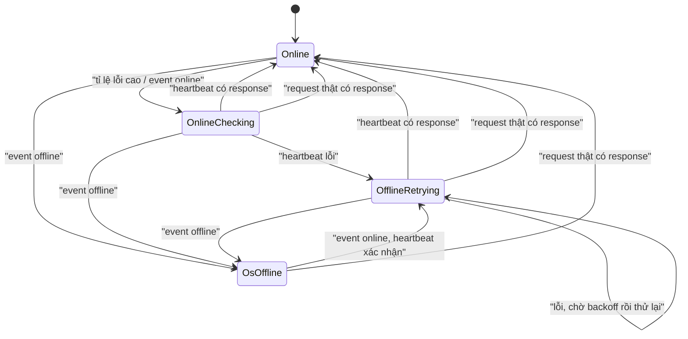
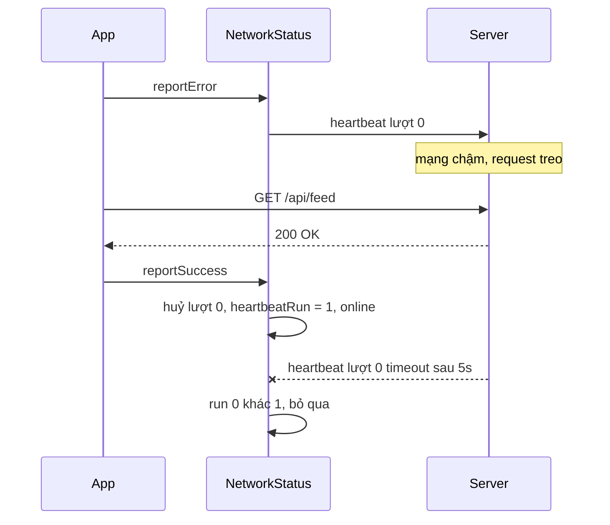

`navigator.onLine` và hai event `online` / `offline` có vẻ là tất cả những gì cần để hiện banner "Bạn đang offline". Thực tế:

- `navigator.onLine === true` chỉ nghĩa là máy **có kết nối tới một mạng nào đó** (Wi-Fi, LAN). Wi-Fi quán cà phê chưa đăng nhập captive portal, router mất Internet, VPN treo… đều báo `true`.
- Khi mất mạng thật, request của app lỗi **trước khi** trình duyệt kịp bắn `offline`. Có lúc event này không bao giờ tới.

> [!TIP]
> **Tóm tắt**
> - `navigator.onLine === false` đáng tin, `=== true` thì không: nó không biết bạn có tới được server hay không.
> - Facebook nghe chính traffic của app: khi số request thành công không còn gấp đôi số request lỗi trong 5 giây, họ gọi một endpoint heartbeat nhỏ.
> - Heartbeat có response (bất kể status) là online; lỗi thì thử lại với backoff lũy thừa có trần.
> - Một response thật luôn thắng heartbeat; mọi vòng ping bị huỷ phải được đánh "phiên bản" để kết quả về muộn không ghi đè trạng thái mới.

Facebook giải quyết bằng `NetworkStatusImpl` + `NetworkHeartbeat` (thư mục `NetworkStatus/` trong [facebook-codebase](https://github.com/hunghg255/facebook-codebase)).

## Bên trong trình duyệt: `navigator.onLine` thực sự đo cái gì?

Spec HTML để định nghĩa giá trị này cho trình duyệt tự quyết. Trên thực tế:

| Trình duyệt | `onLine === false` khi… |
| --- | --- |
| Chrome / Edge / Safari | máy không còn kết nối tới mạng cục bộ nào (rút cáp, tắt Wi-Fi, chế độ máy bay) |
| Firefox | ngày trước chỉ phản ánh chế độ "Work Offline" của trình duyệt; bản mới hơn theo trạng thái mạng của hệ điều hành |

Không trình duyệt nào kiểm tra "có ra được Internet không". Những trường hợp sau vẫn báo `true`:

- **Captive portal**: Wi-Fi khách sạn, sân bay bắt đăng nhập. Máy đã có IP, nhưng mọi request bị chặn lại hoặc chuyển hướng tới trang đăng nhập.
- **Router mất kết nối WAN**: máy nối tốt với router, router không nối được ra ngoài.
- **DNS hỏng, VPN treo, firewall công ty** chặn domain của bạn.
- **Mạng 2G chập chờn**: kết nối vẫn còn, nhưng mỗi gói tin mất hàng chục giây.

Điều ngược lại thì đáng tin hơn: `onLine === false` gần như chắc chắn là offline thật. Cho nên event `offline` là tín hiệu để **báo offline ngay**, còn event `online` chỉ là tín hiệu để **kiểm tra lại**.

## Facebook làm thế nào?

**1. Lắng nghe request của chính app.** Lớp request gọi `reportError()` khi lỗi mạng và `reportSuccess()` khi có response. Module giữ hai danh sách mốc thời gian (`performanceNow()`) trong cửa sổ **5 giây** (`k = 5e3`).

**2. Chỉ nghi ngờ khi tỉ lệ lỗi cao.** Một request lỗi lẻ tẻ là chuyện thường. Hàm điều kiện `v()` lọc bỏ mốc cũ hơn 5 giây rồi trả về `successes.length / errors.length < 2`. Heartbeat chỉ bắt đầu khi số lần thành công **không còn gấp đôi** số lần lỗi.

**3. Heartbeat.** Gọi `GET /nw/` (`XHeartbeatController`) bằng một `XMLHttpRequest` cùng origin (`getSameOriginTransport`). Hễ có `onload`, tức là **có response với bất kỳ status code nào**, thì coi như mạng đã thông. `onerror` hoặc `ontimeout` thì hẹn thử lại.

**4. Backoff của Facebook tăng nhanh hơn bạn nghĩ.** Code bắt đầu với `i = 100`, mỗi lần lỗi tăng `k` rồi tính `i = min(i * 2^k, 6400)`. Đi từng bước:

| Lần lỗi | `k` | Chờ trước lần thử kế | Delay mới |
| --- | --- | --- | --- |
| 1 | 1 | 100ms | 100 × 2¹ = 200 |
| 2 | 2 | 200ms | 200 × 2² = 800 |
| 3 | 3 | 800ms | 800 × 2³ = 6400 |
| 4+ | … | 6400ms | giữ ở trần 6400 |

Delay **nhân với 2^k** chứ không nhân 2, nên chỉ sau 3 lần đã chạm trần. Mạng chập chờn vài trăm ms có rất ít cơ hội được thử lại dày, rồi nhanh chóng chuyển sang ping thưa.

**5. Một vòng heartbeat tại một thời điểm.** `isHeartbeatPending()` (có một XHR đang bay hay không) chặn việc chạy song song nhiều vòng. Khi heartbeat đang chạy, hàm đổi trạng thái `u()` **bỏ qua mọi thay đổi**. Hệ quả là trong bản gốc, heartbeat lỗi không tự chuyển trạng thái sang offline. Offline chủ yếu đến từ event của trình duyệt; heartbeat dùng để xác nhận khi nào mạng thông trở lại.

**6. Hai công tắc tắt từ xa.** `killswitch("DISABLE_HEARTBEAT_POLLING")` tắt polling theo config server. Ngoài ra, nếu response của heartbeat có status **204**, cùng cờ đó được bật và các lần heartbeat sau bị tắt. Có lẽ server dùng 204 như tín hiệu "đừng ping nữa" (suy đoán từ code). Một thiết kế đáng học: khi endpoint heartbeat gặp sự cố hoặc quá tải, server tự ra lệnh cho hàng triệu client ngừng ping mà không cần deploy lại frontend.

**7. Log khi đổi trạng thái.** Mỗi lần chuyển, module ghi `FBLogger("NetworkStatus").warn("Network switched to offline")`, nên đội vận hành biết người dùng mất mạng thường xuyên tới đâu.

Họ còn có `CometNetworkStatusToast` để hiện toast khi mất mạng (dùng toaster ở [bài #4](/blogs/facebook-toast-manager)).

## Viết lại

API của bản viết lại chỉ có một giá trị boolean `online`. Bên trong, nó đi qua bốn tình huống: đang online yên ổn, đang online nhưng có một vòng heartbeat chạy để kiểm tra, đã offline và heartbeat đang thử lại theo backoff, và offline do hệ điều hành báo (lúc này không ping gì cả):



`OnlineChecking` vẫn trả về `online = true`, hai trạng thái còn lại trả về `false`. Nếu UI của bạn cần hiện "Đang kiểm tra kết nối…", hãy mở rộng API thành ba giá trị.

### Đi qua code

**Heartbeat và vòng thử lại:**

```ts title=src/lib/networkStatus.ts
  // navigator.onLine = false thì gần như chắc chắn mất mạng (không có card mạng nào kết nối):
  // ping lúc này chỉ tốn pin. Ngược lại `true` thì chưa chắc, nên mới cần heartbeat.
  const osSaysOffline = () => typeof navigator !== 'undefined' && navigator.onLine === false;

  async function heartbeatOnce() {
    try {
      // Có response (kể cả 404/500) nghĩa là đã tới được server -> online.
      // AbortSignal.timeout: huỷ request nếu treo quá `timeout` ms (mạng 2G có thể treo cả phút).
      await fetchImpl(heartbeatUrl, { cache: 'no-store', signal: AbortSignal.timeout(timeout) });
      return true;
    } catch {
      return false;
    }
  }

  async function runHeartbeat(run: number) {
    const ok = await heartbeatOnce();
    if (run !== heartbeatRun) return; // vòng này đã bị huỷ trong lúc chờ
    if (ok) {
      heartbeatPending = false;
      attempt = 0;
      onHeartbeat?.({ type: 'heartbeat-ok' });
      setOnline(true);
      return;
    }
    setOnline(false);
    if (osSaysOffline()) {
      // Ngừng vòng ping; sự kiện `online` của trình duyệt sẽ khởi động lại heartbeat.
      pauseHeartbeat();
      return;
    }
    // 100ms, 200ms, 400ms ... tối đa maxDelay: ping dày lúc đầu (mạng hay chập chờn
    // vài trăm ms) rồi thưa dần để không spam khi mất mạng lâu.
    // (Facebook tăng nhanh hơn: 100 → 200 → 800 → 6400, xem bài viết.)
    const retryIn = Math.min(initialDelay * 2 ** attempt, maxDelay);
    attempt++;
    onHeartbeat?.({ type: 'heartbeat-fail', attempt, retryIn });
    retryTimer = setTimeout(() => runHeartbeat(run), retryIn);
  }
```

- `fetch()` chỉ reject khi **lỗi mạng** (DNS, TCP, TLS, CORS…). Status 404 hay 500 vẫn resolve, nên "có response là online".
- `fetch()` **không có timeout mặc định**: trên mạng 2G request có thể treo vài phút. `AbortSignal.timeout(timeout)` biến "treo" thành "lỗi" để vòng backoff tiếp tục chạy.
- `cache: 'no-store'` buộc request đi qua mạng, không lấy bản cache HTTP.
- `runHeartbeat(run)` nhận số "lượt" của vòng heartbeat. Sau `await`, việc đầu tiên là so `run !== heartbeatRun`: vòng đã bị huỷ trong lúc chờ thì bỏ qua kết quả.
- Lỗi thì `setOnline(false)`. Nếu lúc này hệ điều hành đã báo offline (`navigator.onLine === false`) thì **ngừng ping** và chờ event `online`: ping khi chắc chắn mất mạng chỉ tốn pin.

**Huỷ, tạm dừng và khởi động một vòng:**

```ts title=src/lib/networkStatus.ts
  function cancelHeartbeat() {
    heartbeatRun++;
    heartbeatPending = false;
    attempt = 0;
    clearTimeout(retryTimer);
  }

  function pauseHeartbeat() {
    cancelHeartbeat();
    onHeartbeat?.({ type: 'heartbeat-paused' });
  }

  function startHeartbeat() {
    if (heartbeatPending) return; // đang ping rồi thì thôi
    if (osSaysOffline()) return; // chờ sự kiện `online`
    heartbeatPending = true;
    onHeartbeat?.({ type: 'heartbeat-start' });
    void runHeartbeat(heartbeatRun);
  }

  const onBrowserOnline = () => startHeartbeat(); // "online" có thể sai -> xác nhận lại
  const onBrowserOffline = () => {
    // Đây là tín hiệu tin được: báo offline ngay, dừng mọi vòng ping đang chạy.
    setOnline(false);
    if (heartbeatPending) pauseHeartbeat();
  };
```

`startHeartbeat` không làm gì nếu đã có vòng đang chạy, nên mọi tín hiệu nghi ngờ dồn về một vòng duy nhất. Event `offline` báo offline ngay và dừng vòng ping đang chạy.

**Tín hiệu từ request của app:**

```ts title=src/lib/networkStatus.ts
    /** Gọi khi một request của app lỗi mạng. */
    reportError() {
      errors.push(performance.now());
      prune();
      // Thỉnh thoảng lỗi một request là bình thường. Chỉ nghi ngờ mất mạng khi
      // số lần thành công không còn gấp đôi số lần lỗi trong `windowMs` gần nhất.
      if (successes.length < errors.length * 2) startHeartbeat();
    },
    /** Gọi khi một request của app có response. */
    reportSuccess() {
      successes.push(performance.now());
      prune();
      // Một response thật là bằng chứng mạnh hơn mọi heartbeat: huỷ vòng ping đang chạy
      // (có thể đang chờ tới 6.4s) và báo online ngay.
      if (heartbeatPending) cancelHeartbeat();
      setOnline(true);
    },
```

`reportError` áp dụng đúng điều kiện của Facebook. `reportSuccess` là nơi bản viết lại khác bản gốc nhiều nhất: một response thật từ server là bằng chứng **mạnh hơn mọi heartbeat**, nên nó huỷ vòng ping đang chạy (`cancelHeartbeat` tăng `heartbeatRun`, xoá timer, reset `attempt`) và `setOnline(true)` **ngay lập tức**. Không có bước này, người dùng có thể nhìn banner "offline" thêm tới 6,4 giây (chờ lần heartbeat kế tiếp) trong khi app đang tải dữ liệu bình thường.

**Khác bản gốc:**

- Heartbeat lỗi chuyển sang offline (Facebook thì không, xem mục 5 ở trên).
- Đường backoff là nhân đôi thông thường (100, 200, 400, …, 6400) cho dễ dự đoán; muốn giống Facebook thì nhân với `2 ** attempt` thay vì 2.
- Tạm dừng ping khi `navigator.onLine === false`, và một response thật huỷ vòng heartbeat.

::: spoiler Xem toàn bộ src/lib/networkStatus.ts

```ts title=src/lib/networkStatus.ts
import { useSyncExternalStore } from 'react';

/**
 * Trạng thái mạng "đáng tin" hơn navigator.onLine (ý tưởng từ NetworkStatusImpl + NetworkHeartbeat).
 *
 * - navigator.onLine chỉ biết máy có kết nối tới router hay không, không biết có ra được
 *   Internet / tới server của mình hay không.
 * - Khi nghi ngờ (sự kiện offline, request lỗi nhiều), ta gọi một endpoint heartbeat nhỏ.
 *   Lỗi thì thử lại với exponential backoff, tới khi thành công thì báo online.
 */

export type HeartbeatEvent =
  | { type: 'heartbeat-start' }
  | { type: 'heartbeat-ok' }
  | { type: 'heartbeat-fail'; attempt: number; retryIn: number }
  /** hệ điều hành báo offline (navigator.onLine = false): ngừng ping, chờ sự kiện `online` */
  | { type: 'heartbeat-paused' };

export interface NetworkStatusOptions {
  heartbeatUrl: string;
  fetchImpl?: typeof fetch;
  initialDelay?: number;
  maxDelay?: number;
  timeout?: number;
  /** cửa sổ thời gian để tính tỉ lệ lỗi */
  windowMs?: number;
  onHeartbeat?: (event: HeartbeatEvent) => void;
}

export function createNetworkStatus({
  heartbeatUrl,
  fetchImpl = (...args) => fetch(...args),
  initialDelay = 100,
  maxDelay = 6400,
  timeout = 5000,
  windowMs = 5000,
  onHeartbeat,
}: NetworkStatusOptions) {
  let online = typeof navigator === 'undefined' ? true : navigator.onLine;
  const listeners = new Set<() => void>();
  let heartbeatPending = false;
  // Tăng mỗi khi một vòng heartbeat bị huỷ. Heartbeat đang bay về sau khi đã bị huỷ
  // sẽ thấy `run !== heartbeatRun` và bỏ qua kết quả của nó.
  let heartbeatRun = 0;
  let attempt = 0;
  let retryTimer: ReturnType<typeof setTimeout> | undefined;
  let errors: number[] = [];
  let successes: number[] = [];

  const setOnline = (next: boolean) => {
    if (online === next) return;
    online = next;
    listeners.forEach((listener) => listener());
  };

  const prune = () => {
    const since = performance.now() - windowMs;
    errors = errors.filter((t) => t > since);
    successes = successes.filter((t) => t > since);
  };

  // navigator.onLine = false thì gần như chắc chắn mất mạng (không có card mạng nào kết nối):
  // ping lúc này chỉ tốn pin. Ngược lại `true` thì chưa chắc, nên mới cần heartbeat.
  const osSaysOffline = () => typeof navigator !== 'undefined' && navigator.onLine === false;

  async function heartbeatOnce() {
    try {
      // Có response (kể cả 404/500) nghĩa là đã tới được server -> online.
      // AbortSignal.timeout: huỷ request nếu treo quá `timeout` ms (mạng 2G có thể treo cả phút).
      await fetchImpl(heartbeatUrl, { cache: 'no-store', signal: AbortSignal.timeout(timeout) });
      return true;
    } catch {
      return false;
    }
  }

  async function runHeartbeat(run: number) {
    const ok = await heartbeatOnce();
    if (run !== heartbeatRun) return; // vòng này đã bị huỷ trong lúc chờ
    if (ok) {
      heartbeatPending = false;
      attempt = 0;
      onHeartbeat?.({ type: 'heartbeat-ok' });
      setOnline(true);
      return;
    }
    setOnline(false);
    if (osSaysOffline()) {
      // Ngừng vòng ping; sự kiện `online` của trình duyệt sẽ khởi động lại heartbeat.
      pauseHeartbeat();
      return;
    }
    // 100ms, 200ms, 400ms ... tối đa maxDelay: ping dày lúc đầu (mạng hay chập chờn
    // vài trăm ms) rồi thưa dần để không spam khi mất mạng lâu.
    // (Facebook tăng nhanh hơn: 100 → 200 → 800 → 6400, xem bài viết.)
    const retryIn = Math.min(initialDelay * 2 ** attempt, maxDelay);
    attempt++;
    onHeartbeat?.({ type: 'heartbeat-fail', attempt, retryIn });
    retryTimer = setTimeout(() => runHeartbeat(run), retryIn);
  }

  function cancelHeartbeat() {
    heartbeatRun++;
    heartbeatPending = false;
    attempt = 0;
    clearTimeout(retryTimer);
  }

  function pauseHeartbeat() {
    cancelHeartbeat();
    onHeartbeat?.({ type: 'heartbeat-paused' });
  }

  function startHeartbeat() {
    if (heartbeatPending) return; // đang ping rồi thì thôi
    if (osSaysOffline()) return; // chờ sự kiện `online`
    heartbeatPending = true;
    onHeartbeat?.({ type: 'heartbeat-start' });
    void runHeartbeat(heartbeatRun);
  }

  const onBrowserOnline = () => startHeartbeat(); // "online" có thể sai -> xác nhận lại
  const onBrowserOffline = () => {
    // Đây là tín hiệu tin được: báo offline ngay, dừng mọi vòng ping đang chạy.
    setOnline(false);
    if (heartbeatPending) pauseHeartbeat();
  };
  // An toàn khi import ở server (SSR): chỉ gắn listener khi có window.
  if (typeof window !== 'undefined') {
    window.addEventListener('online', onBrowserOnline);
    window.addEventListener('offline', onBrowserOffline);
  }

  return {
    isOnline: () => online,
    subscribe(listener: () => void) {
      listeners.add(listener);
      return () => listeners.delete(listener);
    },
    /** Gọi khi một request của app lỗi mạng. */
    reportError() {
      errors.push(performance.now());
      prune();
      // Thỉnh thoảng lỗi một request là bình thường. Chỉ nghi ngờ mất mạng khi
      // số lần thành công không còn gấp đôi số lần lỗi trong `windowMs` gần nhất.
      if (successes.length < errors.length * 2) startHeartbeat();
    },
    /** Gọi khi một request của app có response. */
    reportSuccess() {
      successes.push(performance.now());
      prune();
      // Một response thật là bằng chứng mạnh hơn mọi heartbeat: huỷ vòng ping đang chạy
      // (có thể đang chờ tới 6.4s) và báo online ngay.
      if (heartbeatPending) cancelHeartbeat();
      setOnline(true);
    },
    destroy() {
      cancelHeartbeat();
      if (typeof window === 'undefined') return;
      window.removeEventListener('online', onBrowserOnline);
      window.removeEventListener('offline', onBrowserOffline);
    },
  };
}

export type NetworkStatus = ReturnType<typeof createNetworkStatus>;

/** Bọc fetch để tự báo thành công/lỗi cho NetworkStatus. */
export function trackedFetch(status: NetworkStatus, fetchImpl: typeof fetch = fetch): typeof fetch {
  return async (...args) => {
    try {
      const response = await fetchImpl(...args);
      status.reportSuccess();
      return response;
    } catch (error) {
      // AbortError là do mình huỷ, không phải lỗi mạng
      if (!(error instanceof DOMException && error.name === 'AbortError')) status.reportError();
      throw error;
    }
  };
}

export function useOnline(status: NetworkStatus) {
  // server không biết trạng thái mạng của client -> mặc định online
  return useSyncExternalStore(status.subscribe, status.isOnline, () => true);
}
```

:::

### Race condition mà `heartbeatRun` chặn

Đây là kịch bản thật, xảy ra khi mạng vừa chập chờn xong:



Không có bộ đếm lượt, heartbeat lượt 0 về muộn sẽ gọi `setOnline(false)` và hẹn retry. Kết quả là app **nhảy về offline** dù vừa tải dữ liệu thành công, rồi vài giây sau lại nhảy về online. Banner nhấp nháy, và tệ hơn, có hai vòng heartbeat chạy song song.

Đây là pattern chung cho mọi tác vụ async có thể bị huỷ: **gắn "phiên bản" vào lúc bắt đầu, so sánh lúc kết thúc**. Bạn sẽ gặp lại nó ở search-as-you-type (bỏ kết quả của từ khoá cũ), ở `useEffect` fetch dữ liệu (cờ `ignore` trong docs React), ở optimistic update.

### Vì sao "có response là online"?

Một response HTTP, kể cả 500, chứng minh cả chuỗi đều thông: DNS phân giải được, TCP kết nối được, TLS bắt tay được. Đó là đúng câu hỏi "mạng có thông tới server của tôi không". Server trả 500 là chuyện **server lỗi**, cần xử lý riêng (retry, hiện thông báo lỗi), không nên trộn với "bạn đang offline".

Với HTTPS còn một lợi ích nữa: **captive portal tự động bị lộ**. Portal không có chứng chỉ TLS cho domain của bạn, nên request HTTPS bị chặn ở bước bắt tay và `fetch` reject. Heartbeat lỗi, đúng như mong muốn. Nếu heartbeat dùng HTTP thường, portal có thể trả về trang đăng nhập với status 200 và bạn tưởng là đang online.

## Backoff và jitter

Công thức của bản viết lại là backoff lũy thừa có trần:

```text
delay(n) = min(cap, base × 2^n)       base = 100ms, cap = 6400ms
         = 100, 200, 400, 800, 1600, 3200, 6400, 6400, …
```

Mất mạng 1 phút thì tốn khoảng 16 request heartbeat: 7 request đầu nằm trong 6,3 giây đầu tiên (lần đầu cộng 6 lần thử lại), sau đó mỗi 6,4 giây một lần. Không có backoff (ping mỗi 100ms) thì con số là 600.

Vấn đề xuất hiện khi **hàng triệu client cùng mất mạng một lúc**, chẳng hạn khi server hoặc CDN sập. Tất cả cùng bắt đầu backoff tại một thời điểm, nên tất cả cùng ping tại 100ms, 300ms, 700ms… Server vừa sống lại liền hứng một loạt "đợt sóng" request đồng bộ (thundering herd). **Jitter** (thêm ngẫu nhiên) làm các client lệch pha nhau. Ba biến thể phổ biến, được phân tích kỹ trong bài "Exponential Backoff And Jitter" trên AWS Architecture Blog:

| Kiểu | Công thức | Đặc điểm |
| --- | --- | --- |
| Full jitter | `random(0, delay)` | trải đều nhất, tổng số request ít nhất |
| Equal jitter | `delay/2 + random(0, delay/2)` | luôn chờ ít nhất một nửa, ít khi retry quá sớm |
| Decorrelated | `min(cap, random(base, prev × 3))` | phụ thuộc lần trước, không cần đếm `attempt` |

Thêm full jitter vào code chỉ cần một dòng:

```ts
const retryIn = Math.random() * Math.min(initialDelay * 2 ** attempt, maxDelay);
```

Demo không dùng jitter để log dễ đọc. Ở production, hãy dùng.

## Tại sao không làm cách khác?

**Sao không ping định kỳ, mỗi 30 giây một lần?** Tốn request khi mọi thứ bình thường (mà phần lớn thời gian là bình thường), và chậm phát hiện khi mất mạng (trung bình 15 giây). Lắng nghe chính traffic của app thì miễn phí và phát hiện ngay.

**Sao không coi một request lỗi là offline luôn?** Một request lỗi có thể vì nhiều lý do không liên quan tới mạng: CORS sai, server đóng kết nối, user chuyển trang làm request bị huỷ. Với bản viết lại, một lỗi lẻ khi chưa có request thành công nào trong 5 giây vẫn **khởi động heartbeat để xác nhận**, nhưng bản thân nó không đổi trạng thái. Chỉ khi heartbeat cũng lỗi thì mới chuyển sang offline.

**Sao heartbeat là endpoint riêng, không gọi lại API vừa lỗi?** API vừa lỗi có thể nặng (tìm kiếm, upload) hoặc có side effect (POST). Endpoint heartbeat nhẹ, idempotent, không cần auth, và luôn trả lời nhanh.

**Sao bản viết lại cho heartbeat lỗi chuyển sang offline, khác Facebook?** Bản gốc phụ thuộc nhiều vào event `offline` của trình duyệt. Như phân tích ở trên, event này không bắn trong các trường hợp captive portal, router mất WAN… Chủ động chuyển offline khi heartbeat lỗi giúp phát hiện được cả những trường hợp đó. Đổi lại, ta phải xử lý race condition kỹ hơn, tức là bộ đếm `heartbeatRun`.

## Edge case và cạm bẫy

- **CORS cũng làm `fetch` reject với `TypeError`.** Nếu `trackedFetch` bọc request tới domain khác mà cấu hình CORS sai, mỗi request sẽ bị tính là "lỗi mạng". Chỉ bọc request tới API của chính bạn.
- **`AbortSignal.timeout()` ném `TimeoutError`, không phải `AbortError`.** `trackedFetch` chỉ bỏ qua `AbortError` (mình chủ động huỷ). Timeout vẫn bị tính là lỗi mạng, và đó là hành vi hợp lý.
- **Tab ẩn.** Bản viết lại vẫn ping khi tab ẩn. Muốn tiết kiệm hơn, tạm dừng heartbeat khi `document.visibilityState === 'hidden'` và kiểm tra lại ở `visibilitychange`.
- **Service worker.** Nếu app có service worker cache "network-first, fallback cache", cả heartbeat **lẫn request đi qua `trackedFetch`** có thể nhận response **từ cache** dù đang offline, và bị tính là "online". Header `Cache-Control: no-store` và `cache: 'no-store'` giúp cho heartbeat, nhưng chắc nhất là để service worker bỏ qua hẳn URL heartbeat, và gắn một header riêng (ví dụ `x-from-sw: 1`) vào response lấy từ cache để `trackedFetch` không gọi `reportSuccess` cho chúng.
- **SSR.** `createNetworkStatus` chỉ gắn listener `online`/`offline` khi có `window`, nên import và tạo ở server không bị crash. `useOnline` truyền `getServerSnapshot = () => true` cho `useSyncExternalStore`, vì server không biết trạng thái mạng của người dùng và giả định online là an toàn nhất. Sau khi hydrate, React tự đọc lại `isOnline()` ở client.
- **Đừng chặn thao tác khi "offline".** Trạng thái offline là phỏng đoán. Hãy hiện banner và cho phép thử lại, đừng vô hiệu hoá nút "Gửi". Biết đâu request đó lại thành công.

## Demo

Không thể rút dây mạng của bạn được, nên demo dùng một `fetch` giả. Bật **Giả lập mất mạng**, bấm **Gọi API**, xem heartbeat giãn dần (100 → 200 → 400…). Sau đó:

- Tắt công tắc rồi **chờ**: heartbeat kế tiếp thành công và trạng thái về online.
- Hoặc tắt công tắc rồi **bấm Gọi API ngay**: request thật thành công huỷ vòng heartbeat và về online tức thì, không phải chờ backoff.
- Bật chế độ Offline trong DevTools (tab Network): log hiện "ngừng ping", không còn request heartbeat nào cho tới khi bạn tắt Offline.

<iframe class="demo-frame" src="/demos/facebook-patterns/index.html?theme=dark#/network-status" title="Demo network-status" loading="lazy" style="height: 520px"></iframe>

<p class="demo-links">▶ <a href="/demos/facebook-patterns/index.html#/network-status" target="_blank" rel="noopener">Mở demo toàn màn hình ↗</a> · <a href="https://stackblitz.com/github/hunghg255/blog-hunghg/tree/master/examples/facebook-patterns?file=src/lib/networkStatus.ts" target="_blank" rel="noopener">Sửa code trên StackBlitz ↗</a> · <a href="https://github.com/hunghg255/blog-hunghg/blob/master/examples/facebook-patterns/src/lib/networkStatus.ts" target="_blank" rel="noopener">Xem source trên GitHub ↗</a></p>

## Dùng trong dự án

```ts title=network.ts
export const network = createNetworkStatus({ heartbeatUrl: '/api/health' });
export const api = trackedFetch(network);
```

```tsx
function OfflineBanner() {
  const online = useOnline(network);
  return online ? null : <div role='status'>Mất kết nối. Đang thử kết nối lại…</div>;
}
```

Endpoint heartbeat nên:

- **Trả về nhanh**, body rỗng, không chạm database, không cần auth.
- Có header `Cache-Control: no-store`, nếu không thì service worker hoặc CDN có thể trả về bản cache khi đang offline.
- **Cùng origin** với app và chạy qua **HTTPS**, để kiểm tra đúng đường đi tới server của bạn và lộ được captive portal.
- Nếu muốn có "công tắc từ xa" giống Facebook, hãy quy ước một status hoặc header đặc biệt để client ngừng ping.

So với các thư viện có sẵn: hook `useNetworkState` trong các bộ hook như `react-use` hay `@uidotdev/usehooks` chỉ bọc `navigator.onLine` cùng hai event `online`/`offline`, tức là gặp đúng các hạn chế ở đầu bài. Còn TanStack Query có `onlineManager` để tạm dừng query khi offline, và bạn có thể gọi `onlineManager.setOnline(...)` mỗi khi `network.subscribe` báo thay đổi để nối hai thứ lại với nhau.

## Kiểm thử

`fetchImpl` có thể truyền vào nên test không cần mạng thật.

::: spoiler Ví dụ test (bản phác, không có trong repo)

```ts title=networkStatus.test.ts
// @vitest-environment jsdom
import { afterEach, describe, expect, it, vi } from 'vitest';
import { createNetworkStatus } from './networkStatus';

afterEach(() => {
  vi.useRealTimers();
  vi.restoreAllMocks();
});

describe('createNetworkStatus', () => {
  it('backoff gấp đôi rồi về online khi heartbeat thành công', async () => {
    vi.useFakeTimers();
    let down = true;
    const delays: number[] = [];
    const net = createNetworkStatus({
      heartbeatUrl: '/hb',
      fetchImpl: async () => {
        if (down) throw new TypeError('Failed to fetch');
        return {} as Response;
      },
      onHeartbeat: (e) => e.type === 'heartbeat-fail' && delays.push(e.retryIn),
    });

    net.reportError();
    await vi.advanceTimersByTimeAsync(100 + 200 + 400);
    expect(delays).toEqual([100, 200, 400, 800]);
    expect(net.isOnline()).toBe(false);

    down = false;
    await vi.advanceTimersByTimeAsync(800);
    expect(net.isOnline()).toBe(true);
  });

  it('heartbeat cũ về muộn không ghi đè trạng thái mới', async () => {
    vi.useFakeTimers();
    let failHeartbeat!: (error: unknown) => void;
    const fetchImpl = vi.fn(
      () => new Promise<Response>((_, reject) => (failHeartbeat = reject)),
    );
    const net = createNetworkStatus({ heartbeatUrl: '/hb', fetchImpl });

    net.reportError(); // heartbeat lượt 0 bắt đầu và treo
    net.reportSuccess(); // request thật thành công -> huỷ lượt 0
    failHeartbeat(new TypeError('timeout')); // lượt 0 giờ mới lỗi
    await vi.runAllTimersAsync();

    expect(net.isOnline()).toBe(true);
    expect(fetchImpl).toHaveBeenCalledTimes(1); // không có retry nào
  });

  it('không ping khi hệ điều hành báo offline', () => {
    vi.spyOn(navigator, 'onLine', 'get').mockReturnValue(false);
    const fetchImpl = vi.fn();
    const net = createNetworkStatus({ heartbeatUrl: '/hb', fetchImpl });

    window.dispatchEvent(new Event('offline'));
    net.reportError();

    expect(net.isOnline()).toBe(false);
    expect(fetchImpl).not.toHaveBeenCalled();
  });
});
```

:::

Test thứ hai chính là kịch bản race condition ở trên. Thử xoá dòng `if (run !== heartbeatRun) return;` trong code là test này đỏ ngay.

---

**Series "Học từ mã nguồn Facebook"**

← [#4 Toast manager với external store](/blogs/facebook-toast-manager) · [#6 ErrorGuard: bắt lỗi theo ngữ cảnh](/blogs/facebook-error-guard) →

::: spoiler Xem cả series (20 kỹ thuật + bài mở đầu)

*Phần 1*

- [Mở đầu: cách đọc code minify của Facebook](/blogs/learn-from-facebook-source-code)
- [#1 Dùng chung IntersectionObserver + infinite scroll](/blogs/facebook-shared-intersection-observer)
- [#2 useViewportDuration: đo thời gian thực sự được xem](/blogs/facebook-use-viewport-duration)
- [#3 Preload code + data khi hover](/blogs/facebook-preload-on-hover)
- [#4 Toast manager với external store](/blogs/facebook-toast-manager)
- **#5 Network status + heartbeat backoff** (bài này)
- [#6 ErrorGuard: bắt lỗi theo ngữ cảnh](/blogs/facebook-error-guard)
- [#7 Banzai: gom log theo lô + sendBeacon](/blogs/facebook-batch-logger)
- [#8 Focus trap + Esc theo layer](/blogs/facebook-focus-trap)

*Phần 2*

- [#9 Mẹo calc(… * 9999): container query, line-clamp, mũi tên carousel bằng CSS](/blogs/facebook-css-9999-trick)
- [#10 Thanh cuộn tuỳ biến bằng CSS 3D](/blogs/facebook-css-3d-scrollbar)
- [#11 Modal cuộn bằng window, giữ vị trí trang nền](/blogs/facebook-document-scroll-modal)
- [#12 Popover, tooltip group và hovercard](/blogs/facebook-popover-tooltip)
- [#13 Primitive Pressable + focus-visible](/blogs/facebook-pressable)
- [#14 Tab "Xem thêm" + sticky header bằng IntersectionObserver](/blogs/facebook-priority-tabs-sticky-header)
- [#15 Avatar khoét mask, gradient Messenger, skeleton steps()](/blogs/facebook-visual-tricks)
- [#16 Khung chat không giật](/blogs/facebook-chat-scroller)
- [#17 Thuật toán chọn bố cục collage ảnh](/blogs/facebook-photo-collage-layout)
- [#18 Keep-alive tab trong SPA](/blogs/facebook-keep-alive-tabs)
- [#19 Tự đo Visual Completion & interaction tracing](/blogs/facebook-visual-completion)
- [#20 Router SPA bền bỉ & tải chunk có retry](/blogs/facebook-spa-router-resilient-loading)

:::

Code + demo: [`examples/facebook-patterns`](https://github.com/hunghg255/blog-hunghg/tree/master/examples/facebook-patterns) · [Mở trên StackBlitz](https://stackblitz.com/github/hunghg255/blog-hunghg/tree/master/examples/facebook-patterns)
